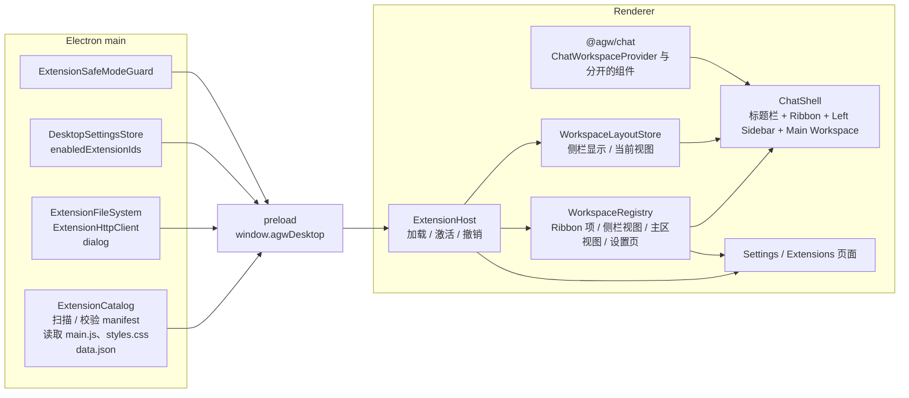
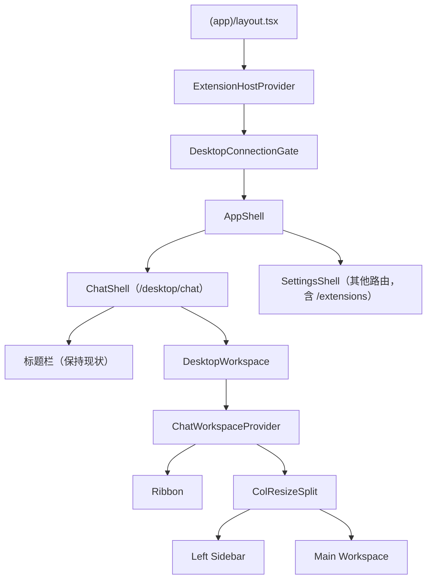
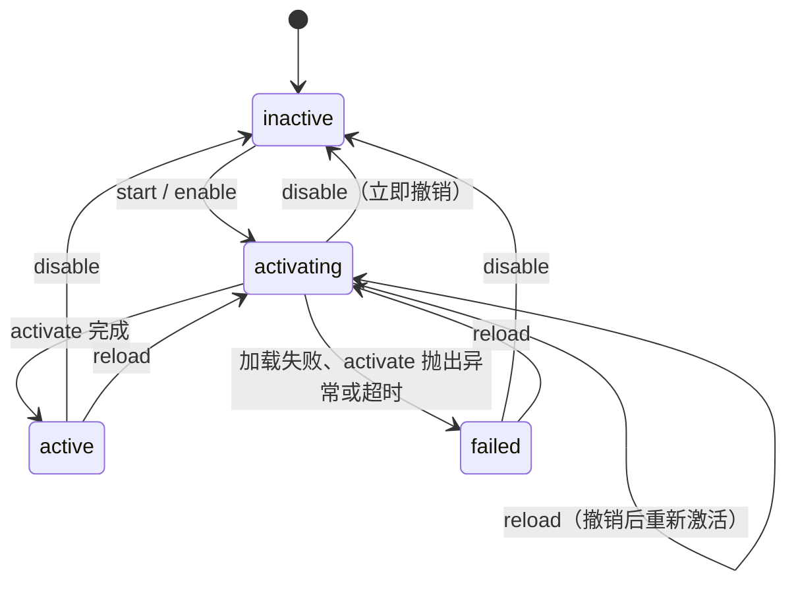
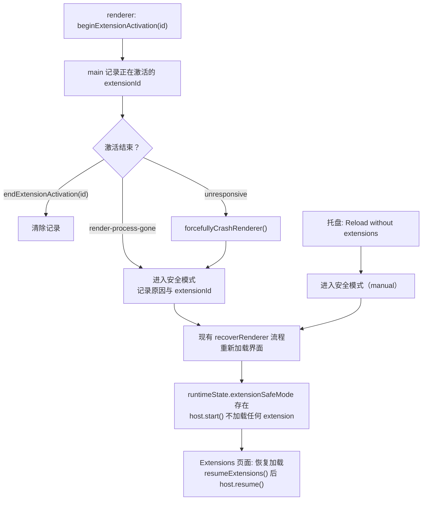

# Desktop Extension 与三区布局

## 名词解释

- **Extension**：Agw Desktop 的插件，概念与 Obsidian plugin 相同。仓库中 "Plugin" 已经是 Integrations 模块的概念（`Agw.Integrations` 的 `PluginDefinition` / `PluginInstallation`），因此 Desktop 插件统一称为 extension。
- **Ribbon**：窗口左侧的竖向图标栏，放置内置功能和 extension 的入口。
- **Left Sidebar**：Ribbon 右侧的侧栏，每次显示一个侧栏视图，例如对话列表、文件浏览器、extension 自定义视图。
- **Main Workspace**：侧栏右侧的主区，每次显示一个主区视图，例如对话、文件内容、extension 自定义视图。
- **视图（View）**：可以注册到 Left Sidebar 或 Main Workspace 的界面单元。Desktop 自带的视图称为内置视图，id 以 `agw.` 开头；extension 注册的视图 id 为 `<extensionId>:<localId>`。
- **安全模式**：某个 extension 在激活过程中让界面崩溃或失去响应后，Desktop 在本次恢复的界面中不加载任何 extension 的状态。

## 背景

- **产品需求**：Desktop 需要支持由用户安装的 extension，用来增加侧栏视图、主区视图、快捷入口和设置页，并能读写本机文件、访问外部 HTTP 服务。
- **现有界面结构无法承载 extension**：
  - `desktop/renderer/src/runtime/components/app-shell.tsx` 的 `AppShell` 按路径选择 `ChatShell`（`/desktop/chat`）或 `SettingsShell`。`ChatShell` 在 `<main className="agw-chat-workspace">` 中直接渲染 `@agw/chat` 的 `ChatWorkspace`，并通过 `ChatSidebarVisibilityContext` 控制左列显示。
  - `packages/chat/src/ui-web/pages/chat/chat-workspace.tsx` 的 `ChatWorkspace` 在一个函数中同时管理左列（`ConversationList` / `Explorer`）、右列（`Chat` / `FileContent`）、路由同步、对话恢复、文件预览、行评论和重连状态，左右两列不能分开渲染，也就无法放进新的布局。
  - 前端没有 registry、slot 或 contribution 机制。
- **主进程能力**：preload 通过 `contextBridge` 暴露 `window.agwDesktop`，IPC 全部是 `ipcRenderer.invoke` / `ipcMain.handle` 形式的请求与响应，通道名为 `agw:<kebab-case>`，每个 handler 先调用 `assertTrustedSender`。renderer 开启 `sandbox`、`contextIsolation`，关闭 `nodeIntegration`，没有 CSP。
- **范围**：本次只改 Desktop。Web 的界面和行为保持不变，以后可能把同样的布局扩展到 Web。

## 设计目标

### 功能目标

1. 三区布局：顶部区域保持现状，下面分为 Ribbon、Left Sidebar、Main Workspace。
2. 内置视图：对话列表、文件浏览器作为内置侧栏视图，对话、文件内容作为内置主区视图，Ribbon 提供 Conversations、Files 两个内置入口。
3. `ChatWorkspace` 分开：状态协调逻辑与各个界面部分可以分别渲染，Web 保持原有组合。
4. Extension 发现与校验：扫描安装目录，校验 manifest。
5. Extension 生命周期：加载、启用、停用、重新加载、重新扫描。
6. Extension API：注册 Ribbon 项、侧栏视图、主区视图、设置页，读写工作区状态，保存自己的数据，调用当前 Agw Server 的 API，发送界面通知。
7. 本机能力：读写本机文件、文件选择对话框、访问外部 HTTP 服务。
8. Extensions 设置页：列表、启用开关、重新加载、打开安装目录、extension 自己的设置页。
9. 故障隔离与安全模式。

### 技术目标

- **安全**：
  - renderer 的 `sandbox`、`contextIsolation`、`nodeIntegration: false` 保持不变，extension 不获得 Node.js 运行时。
  - 新增 IPC 全部经过 `assertTrustedSender`；涉及 extension 能力的通道要求 extensionId 处于启用状态。
  - 新发现的 extension 默认停用，每次启用前向用户说明权限。
  - HTTP 能力只允许 `http:` / `https:`，不携带 Desktop 会话的 cookie。
- **稳定**：
  - 单个 extension 激活失败、视图渲染失败不影响 Desktop 和其他 extension。
  - extension 在激活时让界面崩溃或失去响应，Desktop 进入安全模式，用户总能进入 Extensions 页面停用它。
  - `activate` 长时间不完成时 15 秒后判定失败；停用与重新加载不等待激活完成，被撤销的激活不能再注册任何内容。
  - extension 自己的 React root 中的错误通过 `view.reportError` 显示在宿主错误界面中。
  - 切换 Server、修改 URL、更换凭据后，extension 不会拿旧的 Project、对话上下文访问新的连接。
  - React StrictMode 下 effect 执行两次时，extension 只激活一次，视图不留下重复 DOM。
- **兼容**：
  - Web 的 Chat 页面代码与行为不变。
  - Desktop 对话路由仍为 `/desktop/chat`，`returnTo` 规则不变。
  - `settings.json` 的 `schemaVersion` 仍为 1，新增字段缺失时视为空数组。
- **可观测**：
  - Extensions 页面显示每个 extension 的状态与错误信息。
  - 激活失败在 renderer 控制台输出带 extensionId 的错误。
  - 进入安全模式时主进程通过 `writeRendererEvent` 写入 `renderer-events.jsonl`，记录原因与 extensionId。

## 总体设计



- **主进程**负责 extension 安装目录的扫描与读取、extension 数据文件、本机文件与对话框、外部 HTTP 请求、启用列表的持久化，以及安全模式判断。
- **Renderer** 中的 `ExtensionHost`、`WorkspaceRegistry`、`WorkspaceLayoutStore` 为模块级单例，由 `renderer/src/app/(app)/layout.tsx` 中位于 `DesktopConnectionGate` 外层的 `ExtensionHostProvider` 提供。Server 不可用、切换 Server 时连接门会卸载外壳，extension 本身不重新激活。
- **界面**由 `ChatShell` 的标题栏和新的 `DesktopWorkspace` 组成。`DesktopWorkspace` 用 `@agw/chat` 新导出的 Provider 与组件组合出内置视图，并从 registry 读取 extension 视图。

页面组成如下：



## 数据库设计

不涉及 Server 数据库。Desktop 本地存储变化如下：

- `<userData>/settings.json` 增加 `enabledExtensionIds: string[]`，记录处于启用状态的 extension id，缺失时为 `[]`。
- `<userData>/extensions/<id>/data.json` 保存 extension 通过 `storage.save` 写入的数据，文件权限 `0o600`。

## 详细设计

### 1. 三区布局

- **顶部区域**：`ChatShell` 的标题栏保持现状，包括侧栏开关、Project 标签、后台 Conversations、Server 切换、主题按钮、Settings 按钮。侧栏开关改为读写 `WorkspaceLayoutStore.sidebarVisible`。
- **Ribbon**（`runtime/components/workspace/ribbon.tsx`）：
  - 竖向图标列，内置项在前，extension 项在后，两组之间显示分隔线。
  - 图标使用 lucide-react 导出名（PascalCase，例如 `MessagesSquare`），或 `{ svg }` 形式的 SVG 标记。
  - 鼠标悬停时用 `Tooltip` 显示 title。
  - Ribbon 项声明了 `sidebarViewId` 时，该侧栏视图处于显示状态时图标高亮。
  - 点击时调用该项的 `onClick`，切换侧栏还是做其他事情由注册方决定。
- **Left Sidebar**（`left-sidebar.tsx`）：渲染 `activeSidebarViewId` 对应的视图。放在 `ColResizeSplit.Left` 中，可以拖拽宽度。`sidebarVisible` 为 false 时不渲染 Left，`ColResizeSplit` 保持挂载，拖拽后的宽度保留。
- **Main Workspace**（`main-workspace.tsx`）：渲染 `activeMainViewId` 对应的视图。内置对话视图常驻挂载，切走时隐藏，后台执行订阅、输入草稿、滚动位置都保留；其他视图只在激活时挂载，切走时卸载。
- **重连**：`ChatWorkspaceProvider` 暴露的 `isReconnecting` 为 true 时，整个三区区域设置 `inert`，重连对话框由 Provider 渲染。
- **样式**：在 `packages/components/src/ui-tokens/tokens.css` 的现有 `agw-*` 外壳类旁增加 `.agw-ribbon`、`.agw-ribbon-item`（含 `is-active`）、`.agw-left-sidebar`、`.agw-main-workspace`，沿用现有 token 与间距。

### 2. 内置视图与主区切换

内置视图与 extension 视图注册在同一个 `WorkspaceRegistry` 中，不能停用。内置 id 常量定义在 `renderer/src` 中：

- `agw.conversations`：侧栏视图，`ChatConversationSidebar`。
- `agw.files`：侧栏视图，`ChatFilesSidebar`。
- `agw.chat`：主区视图，`ChatConversationPane`（`compact`、`showUserInputNavigation`）。
- `agw.file`：主区视图，`ChatFilePane`。
- Ribbon 内置项 Conversations（`MessagesSquare`）与 Files（`FolderTree`），点击时调用 `toggleSidebarView` 切换到对应侧栏视图。

切换规则：

- `toggleSidebarView(id)`：该视图正在显示且侧栏可见时收起侧栏；否则显示侧栏并切换到该视图。
- 在对话列表中选中对话、新建对话、清空全部对话后，主区切到 `agw.chat`。
- 在文件浏览器中选中文件后，主区切到 `agw.file`；再次选中当前文件同样切换。
- 切换 Project 标签不改变当前主区视图。文件预览随 Project 变化清空，与现有行为一致。
- 默认状态：侧栏可见，侧栏视图 `agw.conversations`，主区视图 `agw.chat`。当前视图被注销时回到对应的默认内置视图。
- 布局状态保存在内存中，进出 Settings 不丢失，重启 Desktop 后恢复默认。

### 3. ChatWorkspace 分开

全部改动留在 `chat-workspace.tsx` 中，`chat-workspace-hydration.test.ts` 按模块说明符加载该文件的方式保持可用。

- **`ChatWorkspaceProvider`**：承接 `ChatWorkspace` 中与布局无关的状态和回调，包括项目与执行目标选择、路由同步与对话恢复、对话列表刷新信号、文件预览、行评论、envVars / resultOnly、重连状态。只有一个 Provider 组件，effect 保持现在的顺序。Provider 渲染 `ExecutionReconnectingDialog`，并通过 `useChatWorkspace()` 暴露状态、回调与 `isReconnecting`。
- **新导出的组件**（`packages/chat/src/index.ts`）：
  - `ChatConversationSidebar`：`ConversationList` 加 `ChatSettingsDialog`。prop `onConversationOpened?()`，在选中对话、新建对话、全部删除后调用。
  - `ChatFilesSidebar`：`Explorer`，未选择 Project 时显示 `ProjectRequiredState`。prop `onFileOpened?()`，选中非空文件时调用，不受"文件或 diff scope 是否变化"的判断影响。
  - `ChatConversationPane`：`Chat` 加 `AgentSelector`。props `compact`、`showUserInputNavigation`。
  - `ChatFilePane`：`FileContent`，未选择 Project 时显示 `ProjectRequiredState`。
  - `ColResizeSplit`：`./components/split-layout` 中现有的可拖拽分栏组件。
- **`ChatWorkspace`**：由 `ChatWorkspaceProvider` 加原有的 Tabs、`ColResizeSplit`、项目选择器、移动端 Drawer 组合而成，props 不变。移动端 Drawer 通过 `onConversationOpened` / `onFileOpened` 关闭。`inert` 仍只设置在 Tabs 上。
- 删除 `ChatSidebarVisibilityContext` 及其分支。

### 4. Extension 目录与 manifest

安装目录为 Desktop 用户数据目录下的 `extensions`，即 `join(app.getPath("userData"), "extensions")`。每个 extension 一个子目录：

```text
extensions/
  hello-world/
    manifest.json
    main.js
    styles.css   （可选）
    data.json    （由 storage.save 生成）
```

`manifest.json` 示例：

```json
{
  "id": "hello-world",
  "name": "Hello World",
  "version": "1.0.0",
  "minAppVersion": "0.5.0",
  "description": "Adds a greeting view.",
  "author": "Agw",
  "authorUrl": "https://example.com"
}
```

校验规则（`ExtensionCatalog.list()`）：

- `id`：匹配 `^[a-z0-9]+(-[a-z0-9]+)*$`，与目录名相同，不以 `agw` 开头。
- `name`：非空字符串。
- `version`：非空字符串，由作者自行管理。
- `minAppVersion`：满足 `isSupportedDesktopVersion`（`src/main/update/github-release-updater.ts`），并且 `compareDesktopVersions(appVersion, minAppVersion) >= 0`。`appVersion` 取 `packageMetadata.appVersion`，开发环境来自 git tag，打包后来自 `package-flavor.json`。预览版 `1.2.0-preview.1` 低于 `1.2.0`。
- `main.js` 必须存在。
- `description`、`author`、`authorUrl` 可选，存在时为字符串。
- 不符合规则的目录仍出现在列表中，带有 `error`，不能启用。

extension 自带的图片、字体等资源不通过 URL 提供，需要以 data URL 内联到 `main.js` 或 `styles.css`。

### 5. 加载与生命周期

```mermaid
sequenceDiagram
  participant Host as ExtensionHost
  participant Bridge as window.agwDesktop
  participant Main as Electron main
  participant Ext as main.js
  Host->>Host: 首次加载前 import("lucide-react") 取得 icons
  Host->>Bridge: beginExtensionActivation(id)
  Bridge->>Main: 记录正在激活的 extensionId
  Host->>Bridge: readExtension(id)
  Main-->>Host: scriptBase64, styles
  Host->>Host: 注入 style[data-agw-extension=id]
  Host->>Ext: import(data:text/javascript;base64,...)
  Ext-->>Host: { activate, deactivate }
  Host->>Ext: activate(context)，与 15 秒超时、停用、重新加载竞争
  Host->>Bridge: endExtensionActivation(id)（激活完成、失败、超时、被取消都会调用）
```

- **模块格式**：`main.js` 是 ESM 单文件，导出 `activate(context)` 和可选的 `deactivate()`。extension 需要自行打包所有依赖。
- **加载方式**：主进程用 `Buffer` 把源码转成 base64 返回，renderer 在源码末尾追加 `//# sourceURL=agw-extension:///<id>/main.js?load=<n>`（`n` 每次加载递增），拼成 `data:text/javascript;base64,` URL，用 `import(/* webpackIgnore: true */ url)` 加载。开发模式（`http://localhost:3000`）、打包后（`agw://app`）和 Node 测试使用同一段代码。每次加载的 URL 不同，`reload` 一定重新执行模块。renderer 的 dev 与 build 都使用 `--webpack`，`webpackIgnore` 生效。
- **启动**：`ExtensionHostProvider` 在客户端惰性创建 registry、layout、host 单例，生命周期不绑定 effect 的清理。effect 中调用 `host.start()`，`start()` 幂等，StrictMode 下重复调用不会重复激活。普通浏览器中（`isDesktop` 为 false）不加载 extension。静态导出预渲染阶段不访问 `window.agwDesktop`，store 提供 `getServerSnapshot`。
- **启用**：`await bridge.setExtensionEnabled(id, true)` 返回后再加载。
- **激活会话**：每次激活创建一个新的 `ExtensionContext`，它持有自己的 `AbortController`，通过 `context.signal` 暴露给 extension。下列情况撤销这次激活会话：
  - 停用或重新加载：立即撤销，不等待 `activate` 返回的 Promise。停用随即完成，状态变为 inactive；重新加载随即开始下一次激活。
  - 超时：`activate` 在 15 秒（`EXTENSION_ACTIVATION_TIMEOUT_MS`，`ExtensionHost` 构造参数，测试中可传入更短的值）内没有完成时撤销，状态变为 failed，错误为 `code` 为 `ACTIVATION_TIMEOUT` 的 `ExtensionError`。
  - `activate` 抛出异常或 Promise 被拒绝：撤销，状态变为 failed。
- **撤销的效果**：
  - `context.signal` 以 `code` 为 `EXTENSION_DEACTIVATED`（超时时为 `ACTIVATION_TIMEOUT`）的 `ExtensionError` 为原因中止。
  - 这次会话已经做出的注册全部撤销，注入的样式移除，`endExtensionActivation` 被调用。
  - 会话被标记为已撤销：此后调用 `register*`、`addItem`、`onDidChangeState` 同步抛出 `EXTENSION_DEACTIVATED`，不产生任何注册；`storage`、`fs`、`dialog`、`http`、`api` 的调用立即拒绝；撤销前已发出、撤销后才返回的异步结果也以 `EXTENSION_DEACTIVATED` 拒绝，不交给 extension。
  - 正在进行的 `http.request` 与 `api.request` 通过 `context.signal` 中止（见第 7 节）。
  - 撤销时 `activate` 的 Promise 之后再完成或拒绝，宿主都忽略。
- **停用已激活的 extension**：撤销会话之前先调用 `deactivate()`，最多等待 5 秒，超时或抛出异常只输出到控制台，撤销照常进行。激活未完成就被撤销时不调用 `deactivate()`，extension 通过 `context.signal` 清理自己启动的工作。
- **重新扫描**：重新调用 `listExtensions()`，新目录以停用状态出现。
- 长时间的工作（等待网络、读取大量文件）应在 `activate` 返回之后进行，并把 `context.signal` 传给可以取消的调用。

状态变化：



### 6. Extension API

类型定义在 `desktop/src/shared/extension-api.ts`，文件只包含类型，renderer 通过 `@desktop/*` 以 `import type` 引用。

```ts
export interface ExtensionModule {
  activate(context: ExtensionContext): void | Promise<void>;
  deactivate?(): void | Promise<void>;
}

export interface Disposable {
  dispose(): void;
}

/** Extension API 抛出的错误。Errors thrown by the Extension API. */
export interface ExtensionError extends Error {
  name: "ExtensionError";
  code: string | null;
  syscall: string | null;
  path: string | null;
}

/** lucide-react 导出名（PascalCase）或 SVG 标记。A lucide-react export name (PascalCase) or SVG markup. */
export type ExtensionIcon = string | { svg: string };

/** 宿主传给 mount 的视图句柄。The view handle the host passes to mount. */
export interface ExtensionViewHandle {
  /** 报告视图中宿主无法捕获的错误，宿主随后卸载视图并显示错误。Reports an error the host cannot catch; the host then unmounts the view and shows the error. */
  reportError(error: unknown): void;
  /** 视图卸载时中止。Aborted when the view unmounts. */
  readonly signal: AbortSignal;
}

export type ExtensionMount = (container: HTMLElement, view: ExtensionViewHandle) => void | (() => void);

export interface ExtensionViewOptions {
  id: string;
  title: string;
  icon: ExtensionIcon;
  /** 返回的函数在视图卸载时调用。The returned function runs when the view unmounts. */
  mount: ExtensionMount;
}

export interface RibbonItemOptions {
  id: string;
  title: string;
  icon: ExtensionIcon;
  /** 该侧栏视图显示时图标高亮。Highlights the icon while this sidebar view is shown. */
  sidebarViewId?: string;
  onClick(): void;
}

export interface WorkspaceState {
  serverId: string;
  projectId: string | null;
  conversationId: string | null;
  sidebarVisible: boolean;
  activeSidebarViewId: string;
  activeMainViewId: string;
}

export interface ExtensionContext {
  readonly manifest: ExtensionManifest;
  readonly extensionDirectory: string;
  /** 本次激活会话被撤销时中止。Aborted when this activation session is revoked. */
  readonly signal: AbortSignal;
  ribbon: { addItem(item: RibbonItemOptions): Disposable };
  workspace: {
    registerSidebarView(view: ExtensionViewOptions): Disposable;
    registerMainView(view: ExtensionViewOptions): Disposable;
    showSidebarView(id: string): void;
    toggleSidebarView(id: string): void;
    setSidebarVisible(visible: boolean): void;
    openMainView(id: string): void;
    getState(): WorkspaceState;
    onDidChangeState(listener: (state: WorkspaceState) => void): Disposable;
  };
  settings: {
    registerTab(tab: { mount: ExtensionMount }): Disposable;
  };
  storage: {
    load<T>(): Promise<T | null>;
    save(data: unknown): Promise<void>;
  };
  api: {
    request<T>(request: {
      method: "get" | "post" | "put" | "delete";
      path: string;
      query?: Record<string, unknown>;
      body?: unknown;
      signal?: AbortSignal;
    }): Promise<T>;
  };
  fs: ExtensionFileSystemApi;
  dialog: { showOpenDialog(options: OpenDialogOptions): Promise<string[]> };
  http: {
    request(request: {
      url: string;
      method?: string;
      headers?: Record<string, string>;
      body?: string | Uint8Array;
      signal?: AbortSignal;
    }): Promise<{
      status: number;
      headers: Record<string, string>;
      body: Uint8Array;
      text(): string;
      json<T>(): T;
    }>;
  };
  ui: {
    notify(notification: { type: "info" | "success" | "error"; message: string }): void;
    openExternal(url: string): Promise<void>;
  };
}
```

- **id**：`addItem`、`registerSidebarView`、`registerMainView` 传入的 id 由宿主加上 `<extensionId>:` 前缀，同一集合内 id 重复时抛出错误。`showSidebarView`、`toggleSidebarView`、`openMainView` 接受完整 id，也能打开内置视图。
- **图标**：名称不在 lucide-react 的 `icons` 中时，注册立即抛出错误。
- **视图**：
  - `ExtensionView` 每次挂载时新建一个子元素放进容器，再调用 `mount(child, view)`；卸载时中止 `view.signal`，调用 `mount` 返回的函数，再清空容器。
  - `mount` 同步抛出的错误发生在宿主 effect 中，由外层 `ErrorBoundary` 捕获。extension 在 `mount` 中用 `createRoot` 建立的 React root 是独立的组件树，其中的渲染错误不会进入宿主的 `ErrorBoundary`；DOM 事件回调和异步代码中的错误也不会。这些错误由 extension 调用 `view.reportError(error)` 交给宿主。使用 React 的 extension 在创建 root 时传入 `onUncaughtError`（React 在组件树中出现未被 Error Boundary 捕获的错误时调用它）：

    ```js
    mount(container, view) {
      const root = createRoot(container, {
        onUncaughtError: (error) => view.reportError(error),
      });
      root.render(<App />);
      return () => root.unmount();
    }
    ```

  - `reportError` 只记录错误并安排宿主更新，不在 extension 的 React root 处理错误的过程中同步卸载它。宿主在下一次提交时调用清理函数、清空容器，显示 extension 名称、视图标题、错误信息和"重试"按钮；"重试"重新挂载视图。错误同时输出到控制台。视图卸载后再调用 `reportError` 只输出到控制台。
  - 宿主 `ErrorBoundary` 的错误界面与 `reportError` 的错误界面使用同一个组件。
  - Server 重连期间外壳会卸载，视图随之重新挂载，extension 需要在 `mount` / 清理函数中处理好自己的状态。
- **工作区状态**：
  - **连接标识**：持续挂载的 `ExtensionHostProvider` 从 `useDesktopRuntime()` 读取当前连接，以 activeProfile 的 `id`、规范化后的 `baseUrl`（去掉首尾空白和末尾 `/`，与 `@agw/api` 的 `configureApiRuntime` 相同）和 `runtimeState.activeToken` 三者作为连接标识写入 host，不依赖对话路由是否挂载。`runtimeState.activeToken` 与 runtime-provider 传给 `configureClients` 的 token 相同（包括本机 token 补发、Bearer 校验失败后置为 `null` 的情况）。token 只在 host 内部用于比较，不出现在 `WorkspaceState` 中。`serverId` 与 `ExecutionPlatformContext` 使用同一个值（`activeProfile?.id ?? "browser"`）。
  - **标识变化**：以下情况都会改变连接标识：在 Settings 中删除当前 remote profile 后切换到 local；修改当前 profile 的 URL；在 Settings 中更换当前 profile 的 token；OIDC 退出（token 变为 `null`）后用其他账号登录。标识变化时 host 把 `serverId` 改为新值、`projectId` 与 `conversationId` 清空为 `null`，并只触发一次 `onDidChangeState`。同一账号重新登录得到新 token 时同样清空，extension 重新读取状态即可。
  - **Project 与对话**：`DesktopWorkspace` 把 `useChatWorkspace` 中的 `projectId`、`conversationId` 连同它所属的连接标识写入 host。标识与 host 当前值不同的写入被丢弃，切换连接时旧外壳卸载前的写入不会覆盖新状态。离开对话路由后保留同一连接下最后的值。
  - 任一字段变化时触发 `onDidChangeState`。`openMainView` 在非对话路由调用时先导航到对话路由。
- **设置页**：每个 extension 最多注册一个设置页，显示在 `/extensions/settings/?id=<extensionId>`。
- **数据**：`storage.save` 写入 `data.json`，`storage.load` 在文件不存在时返回 `null`。
- **Agw API**：`api.request` 调用 `@agw/api` 的 `apiRequest`，使用当前 Server profile 的地址与 token，返回已解包的数据，失败时抛出 `ApiError`。runtime-provider 在发布新的运行状态之前就会调用 `configureApiRuntime`，因此 `api.request` 发出请求前同步比较 `getApiRuntime()` 的 `baseUrl`、`token` 与 host 当前的连接标识：任一项不同时抛出 `code` 为 `CONNECTION_CHANGED` 的 `ExtensionError`，不发出请求。`apiRequest` 在调用开始时取得运行配置，通过检查后发出的请求一定使用与标识一致的地址和凭据。extension 收到新的 `onDidChangeState` 后再发起请求。请求的 `signal` 与 `context.signal` 合并（`AbortSignal.any`）后传给 `apiRequest`。
- **通知与外部链接**：`ui.notify` 使用 `sonner`；`ui.openExternal` 使用现有的 `openExternal`，只允许 HTTP(S)。

extension 示例：

```js
export function activate(context) {
  context.workspace.registerSidebarView({
    id: "greeting",
    title: "Greeting",
    icon: "Hand",
    mount(container) {
      container.textContent = `Hello from ${context.manifest.name}`;
    },
  });
  context.ribbon.addItem({
    id: "greeting",
    title: "Greeting",
    icon: "Hand",
    sidebarViewId: "hello-world:greeting",
    onClick: () => context.workspace.toggleSidebarView("hello-world:greeting"),
  });
}
```

### 7. 本机文件、对话框与 HTTP

extension 不获得 Node.js 运行时，本机能力全部由主进程实现，通过 IPC 提供。

- **文件系统**（`src/main/extensions/extension-file-system.ts`）：
  - `readFile(path, { encoding?: "utf8" })`：指定 `utf8` 时返回字符串，否则返回 `Uint8Array`。
  - `writeFile(path, data: string | Uint8Array)`。
  - `readDirectory(path)`：返回 `{ name, kind: "file" | "directory" | "symlink" }[]`。
  - `stat(path)`：返回 `{ kind, size, modifiedTime }`，`modifiedTime` 为 RFC 3339 字符串。
  - `createDirectory(path, { recursive? })`、`remove(path, { recursive? })`、`rename(from, to)`、`exists(path)`。
  - 路径必须是绝对路径，否则抛出 `code` 为 `ERR_RELATIVE_PATH` 的错误。
- **对话框**：`showOpenDialog({ title?, directory?, multiple?, filters? })` 使用 Electron `dialog.showOpenDialog`，以主窗口为父窗口，用户取消时返回空数组。
- **HTTP**（`src/main/extensions/extension-http.ts`）：`ExtensionHttpClient(fetchImpl)`，生产环境传入 Electron `net.fetch`。协议不是 `http:` / `https:` 时抛出 `code` 为 `ERR_UNSUPPORTED_PROTOCOL` 的错误；请求使用 `credentials: "omit"`；返回 `{ status, headers, body }`，非 2xx 状态不抛出，由调用方判断；`text()` 与 `json()` 在 renderer 中基于 `body` 解码。
  - **取消**：renderer 为每个请求生成 `requestId`（`crypto.randomUUID()`），随请求发送。主进程为每个请求创建 `AbortController` 并传给 `net.fetch`，按 `extensionId` 记录。请求的 `signal` 与 `context.signal` 合并，中止时 renderer 调用管理通道 `cancelExtensionHttpRequest(requestId)`，主进程中止对应请求，该请求以 `code` 为 `ABORT_ERR` 的失败结果返回。`setExtensionEnabled(id, false)` 在主进程中同时中止该 extension 的全部未完成请求，renderer 来不及发送取消时请求也会结束。请求完成或中止后从记录中删除。
- **错误传递**：`ipcMain.handle` 抛出的错误到达 renderer 时只保留 `message`，`contextBridge` 复制 Error 时也会丢失自定义属性，`code` 等字段无法直接传递。因此能力通道（见接口文档）的 handler 在 IPC 边界把操作结果包装为可序列化的 `ExtensionIpcResult`：

  ```ts
  export type ExtensionIpcError = {
    name: string;
    message: string;
    code: string | null;    // Node.js 错误的 code，例如 ENOENT
    syscall: string | null; // 例如 open
    path: string | null;
  };
  export type ExtensionIpcResult<T> = { ok: true; value: T } | { ok: false; error: ExtensionIpcError };
  ```

  preload 原样返回这个对象。renderer 的 `ExtensionContext` 收到 `ok: false` 时重建并抛出 `ExtensionError`（`extends Error`，带 `code`、`syscall`、`path`），extension 用 `error.code === "ENOENT"` 判断。包装只在 handler 的最外层进行，错误在 renderer 中重新抛出，不被吞掉。renderer 侧自身产生的错误（例如 `CONNECTION_CHANGED`、`EXTENSION_DEACTIVATED`、`ACTIVATION_TIMEOUT`）同样使用 `ExtensionError`。

### 8. Extensions 设置页

- **导航**：`SettingsShell` 的 Others 组增加 Extensions（`/extensions/`，图标 `Puzzle`）。`DesktopConnectionGate` 的放行条件增加 `/extensions`，Server 不可用时也能管理 extension。
- **列表页**（`renderer/src/app/(app)/extensions/page.tsx` → `runtime/desktop-extensions-page.tsx`）：
  - 每项显示名称、版本、作者、描述、状态与错误信息。
  - 启用开关：从停用切换为启用前弹出确认，说明 extension 与 Desktop 在同一个页面中运行，可以调用 Agw API、读写本机任意文件、访问外部网络。
  - 操作：Reload、Rescan、Open extensions folder。
  - extension 注册了设置页时显示 Settings 链接。
  - 安全模式时顶部显示原因、涉及的 extension 和"恢复加载"按钮。
- **设置页**（`renderer/src/app/(app)/extensions/settings/page.tsx?id=<extensionId>`）：用 `ExtensionView` 挂载该 extension 的设置页，导航中高亮 Extensions。

### 9. 故障隔离与安全模式

- **激活失败**：读取文件、`import`、`activate` 任一步抛出异常时，该 extension 状态变为 failed，已注册的内容全部撤销，样式移除，错误显示在 Extensions 页面并输出到控制台，其他 extension 继续加载。
- **激活一直未完成**：`activate` 返回的 Promise 长时间等待时页面仍能响应，不会触发 `unresponsive`。这种情况由第 5 节的 15 秒超时处理，用户也可以随时停用或重新加载，两者都立即撤销激活会话。
- **视图失败**：`mount` 同步抛出的错误由 `ExtensionView` 的 `ErrorBoundary` 处理；extension 自己的 React root、事件回调和异步代码中的错误通过 `view.reportError` 交给宿主（第 6 节）。两种情况都只影响该视图。
- **安全模式**（`src/main/extensions/extension-safe-mode.ts` 的 `ExtensionSafeModeGuard`，写法参照 `renderer-recovery.ts` 的 `RendererRecoveryGuard`）：



- 安全模式只保存在主进程内存中，重启 Desktop 后清除；再次在激活时崩溃会再次进入。
- 进入安全模式时通过 `writeRendererEvent` 写入 `renderer-events.jsonl`。

### 10. 安全说明

- extension 代码与 Desktop 界面运行在同一个页面中，可以访问页面中的一切，包括当前 Server 的 token 和 `window.agwDesktop` 的全部方法。这与 Obsidian 社区插件的信任模型相同，启用前的确认弹窗与 README 都写明这一点。
- 能力通道（见接口文档）检查 extensionId 处于启用状态；管理通道只做来源校验，停用状态的 extension 通过管理通道 `setExtensionEnabled` 启用。所有 extension 共用一个页面，主进程无法区分调用来自哪个 extension，启用检查用来防止误用。没有启用任何 extension 时，文件系统、对话框、HTTP、数据读写通道全部拒绝；只要启用了任意一个 extension，页面就具备读写本机文件和访问外部网络的能力。
- renderer 的 `sandbox`、`contextIsolation`、`nodeIntegration: false`、导航限制、`setWindowOpenHandler` 规则保持不变。

### 11. 兼容设计

- Web 的 `ChatWorkspace` props 与界面不变，`web/src` 不需要修改。
- `/desktop/chat` 路由与 Settings 的 `returnTo` 规则不变。
- 旧的 `settings.json` 没有 `enabledExtensionIds` 时按空数组读取，`schemaVersion` 不变。
- `DesktopSettingsUpdate` 不包含 `enabledExtensionIds`，启用列表只通过 `setExtensionEnabled` 在设置写入队列中修改，并发切换不会互相覆盖，其他设置保存时也不会丢失该字段。

## 接口文档

### 基础信息

- **形式**：Electron IPC，preload 通过 `contextBridge.exposeInMainWorld("agwDesktop", bridge)` 暴露方法，内部使用 `ipcRenderer.invoke`，主进程使用 `ipcMain.handle`。
- **通道命名**：`agw:<kebab-case>`。
- **来源校验**：每个 handler 先调用 `assertTrustedSender`，只接受 `agw://app/` 或开发模式 `AGW_RENDERER_URL` 下的页面。
- **通道分类与校验**：
  - **管理通道**：`listExtensions`、`setExtensionEnabled`、`openExtensionsDirectory`、`beginExtensionActivation`、`endExtensionActivation`、`resumeExtensions`、`cancelExtensionHttpRequest`。只做来源校验，不检查启用状态，失败时直接抛出错误（renderer 只需要 `message`）。`setExtensionEnabled(id, true)` 是停用状态的 extension 启用的唯一入口，要求 id 出现在当前扫描结果中且 `error` 为空；`setExtensionEnabled(id, false)` 不要求目录仍然存在。`beginExtensionActivation` / `endExtensionActivation` 只记录或清除激活标记，`cancelExtensionHttpRequest` 只中止已经发出的请求，都不提供任何能力；取消在 extension 停用后仍然可用。
  - **能力通道**：`readExtension`、`loadExtensionData`、`saveExtensionData`、`extensionFileSystem`、`showExtensionOpenDialog`、`extensionHttpRequest`。来源校验之后要求 extensionId 在 `enabledExtensionIds` 中。返回 `ExtensionIpcResult<T>`，操作失败和启用检查失败都以 `{ ok: false, error }` 返回，启用检查失败的 `code` 为 `ERR_EXTENSION_DISABLED`。
- **类型**：定义在 `desktop/src/shared/contracts/extension.ts`，由 `contracts/index.ts` 导出；`DesktopBridge` 增加下列方法。

### 接口列表

均为新增接口。

- **`listExtensions()`** → `agw:list-extensions`
  - 响应：`InstalledExtension[]`

    ```json
    [
      {
        "directoryName": "hello-world",
        "directory": "/Users/me/Library/Application Support/Agw Desktop/extensions/hello-world",
        "manifest": { "id": "hello-world", "name": "Hello World", "version": "1.0.0", "minAppVersion": "0.5.0" },
        "hasStyles": false,
        "enabled": true,
        "error": null
      }
    ]
    ```

  - 说明：管理通道。manifest 无法解析时 `manifest` 为 `null`，`error` 给出原因。
- **`setExtensionEnabled(extensionId, enabled)`** → `agw:set-extension-enabled`
  - 响应：完整的 `DesktopRuntimeState`，与 `saveSettings` 相同。
  - 说明：管理通道，规则见"通道分类与校验"。
- **`openExtensionsDirectory()`** → `agw:open-extensions-directory`
  - 说明：管理通道。目录不存在时先创建；`shell.openPath` 返回非空字符串时抛出错误。
- **`beginExtensionActivation(extensionId)`** / **`endExtensionActivation(extensionId)`** → `agw:begin-extension-activation` / `agw:end-extension-activation`
  - 说明：管理通道，供安全模式判断使用。
- **`resumeExtensions()`** → `agw:resume-extensions`
  - 响应：完整的 `DesktopRuntimeState`，其中 `extensionSafeMode` 为 `null`。
  - 说明：管理通道。
- **`cancelExtensionHttpRequest(requestId)`** → `agw:cancel-extension-http-request`
  - 说明：管理通道。`requestId` 不存在（请求已经结束）时不做任何事情。
- **`readExtension(extensionId)`** → `agw:read-extension`
  - 响应：`{ "ok": true, "value": { "scriptBase64": "ZXhwb3J0IGZ1bmN0aW9uIGFjdGl2YXRlKCkge30=", "styles": null } }`
  - 说明：能力通道。
- **`loadExtensionData(extensionId)`** → `agw:load-extension-data`
  - 响应：`{ "ok": true, "value": null }`，`value` 为 `data.json` 的内容，文件不存在时为 `null`。
  - 说明：能力通道。
- **`saveExtensionData(extensionId, data)`** → `agw:save-extension-data`
  - 请求：任意可 JSON 序列化的值。
  - 响应：`{ "ok": true, "value": null }`
  - 说明：能力通道。
- **`extensionFileSystem(extensionId, request)`** → `agw:extension-file-system`
  - 请求示例：`{ "operation": "readFile", "path": "/Users/me/notes/a.md", "encoding": "utf8" }`
  - 成功响应示例：`{ "ok": true, "value": "# Title" }`
  - 失败响应示例：

    ```json
    {
      "ok": false,
      "error": {
        "name": "Error",
        "message": "ENOENT: no such file or directory, open '/Users/me/notes/missing.md'",
        "code": "ENOENT",
        "syscall": "open",
        "path": "/Users/me/notes/missing.md"
      }
    }
    ```

  - 说明：能力通道。`operation` 为 `readFile`、`writeFile`、`readDirectory`、`stat`、`createDirectory`、`remove`、`rename`、`exists` 之一；二进制内容以 `Uint8Array` 传递。
- **`showExtensionOpenDialog(extensionId, options)`** → `agw:extension-open-dialog`
  - 请求示例：`{ "title": "Choose a folder", "directory": true, "multiple": false }`
  - 响应示例：`{ "ok": true, "value": ["/Users/me/notes"] }`
  - 说明：能力通道。
- **`extensionHttpRequest(extensionId, request)`** → `agw:extension-http-request`
  - 请求示例：`{ "requestId": "1b4e28ba-2fa1-41d2-883f-0016d3cca427", "url": "https://example.com/hook", "method": "POST", "headers": { "content-type": "application/json" }, "body": "{\"ok\":true}" }`
  - 响应示例：`{ "ok": true, "value": { "status": 200, "headers": { "content-type": "application/json" }, "body": "<Uint8Array>" } }`
  - 说明：能力通道。网络错误与取消以 `{ ok: false, error }` 返回，取消时 `code` 为 `ABORT_ERR`。
- **`DesktopRuntimeState` 修改**：增加 `extensionSafeMode: { reason: "crashed" | "unresponsive" | "manual"; extensionId: string | null } | null`；`settings` 增加 `enabledExtensionIds`。

## 测试计划

单元测试使用 `node:test` + `tsx`，测试文件放在源码旁边，临时目录建在 `desktop/.scratch/` 下（已被 `.gitignore` 的 `.scratch/` 覆盖）。

### 配置测试

- **`settings-store.test.ts`**：
  - 旧文件没有 `enabledExtensionIds` 时读取为空数组。
  - 非字符串数组被拒绝。
  - 保存其他设置（例如 `projectTabsByServer`）后 `enabledExtensionIds` 保留。
  - 连续两次 `setExtensionEnabled` 的结果都被保存。

### 单元测试

- **`extension-catalog.test.ts`**：
  - 合格 manifest 被列出。
  - `id` 格式错误、与目录名不一致、以 `agw` 开头时带 `error`。
  - 缺少 `main.js`、JSON 无法解析时带 `error`。
  - `minAppVersion` 高于当前版本（含预览版低于正式版）时带 `error`。
  - `read` 返回的 base64 解码后与源文件一致。
  - `data.json` 写入后读回一致，文件不存在时返回 `null`。
- **`extension-file-system.test.ts`**：相对路径被拒绝；各方法在 scratch 目录中的结果；`ENOENT` 等错误保留 `code`。
- **`extension-ipc-result.test.ts`**：读取 scratch 目录中不存在的文件得到 Node.js 错误，包装为 `ExtensionIpcResult` 后经 `structuredClone`（与 IPC 相同的结构化克隆）复制，再在 renderer 侧重建为 `ExtensionError`，`name`、`message`、`code`、`syscall`、`path` 与原错误一致；抛出的值不是 Error 时 `code` 为 `null`。
- **`extension-http.test.ts`**：用 Node 内置 `fetch` 请求测试中启动的本地 `http.createServer`，验证方法、请求头、请求体、二进制响应、非 2xx 状态；`file:` 等协议被拒绝；服务端不响应时按 `requestId` 取消，请求以 `ABORT_ERR` 结束且服务端观察到连接关闭；按 `extensionId` 取消该 extension 的全部请求，其他 extension 的请求不受影响；结束的请求从记录中删除。
- **`extension-safe-mode.test.ts`**：激活期间崩溃或失去响应时进入安全模式；激活结束后发生崩溃不进入；`manual` 进入；`resume` 清除。
- **`workspace-registry.test.ts`**：注册与撤销；重复 id 抛出错误；订阅收到变化。
- **`workspace-layout-store.test.ts`**：`toggleSidebarView` 规则；当前视图被注销后回到默认内置视图；`openMainView` 切换。
- **`extension-host.test.ts`**：bridge 由指向 scratch 目录的 `ExtensionCatalog` 提供，用 data URL 加载 fixture extension 的源码文件，验证：
  - `activate` 被调用且注册生效。
  - 停用后注册全部撤销、样式移除。
  - `activate` 抛出异常时状态为 failed，其他 extension 正常激活。
  - `reload` 重新执行模块顶层代码。
  - `start()` 重复调用只激活一次。
  - 未知图标名注册时抛出错误。
  - 处于停用状态的 extension 调用 `enable` 后被激活。
  - `activate` 等待一个不会完成的 Promise 时：`disable` 立即完成，状态为 inactive，`context.signal` 已中止，`endExtensionActivation` 被调用；之后 extension 调用 `registerSidebarView` 抛出 `EXTENSION_DEACTIVATED`，registry 没有新增内容。
  - 同样的 `activate` 在超时（构造参数传入较短的超时）后状态为 failed，错误 `code` 为 `ACTIVATION_TIMEOUT`，已做出的注册全部撤销。
  - 激活过程中 `reload`：旧会话被撤销，新会话正常激活，旧会话之后的注册被拒绝。
  - 撤销前发出的 `storage.load`，结果在撤销后返回时以 `EXTENSION_DEACTIVATED` 拒绝。
  - 停用已激活的 extension 时 `deactivate` 一直不返回，停用在 `deactivate` 超时（构造参数传入较短的值）后完成。
  - 连接标识的任一项（`id`、`baseUrl`、token）变化时 `projectId`、`conversationId` 清空，`onDidChangeState` 只触发一次；`id` 与 `baseUrl` 不变、只更换 token 时同样清空；携带旧连接标识的对话上下文写入被丢弃。
  - 用 `@agw/api` 的 `configureApiRuntime` 把 API 配置切到另一个地址，或只把 token 换成另一个值后，`api.request` 抛出 `code` 为 `CONNECTION_CHANGED` 的 `ExtensionError`，不发出请求。
- **`ribbon.test.ts`**、**`extension-view.test.ts`**：与各 package 和 desktop 现有测试一样使用 `.test.ts` 文件名，用 `React.createElement` 构建组件，由 desktop 现有的 `renderer/src/**/*.test.ts` 匹配规则纳入 `pnpm test`。desktop 包是 CommonJS，在 `test.before` 中用动态 `import()` 调用 `@agw/test-harness` 的 DOM 环境设置；desktop devDependencies 增加 `@agw/test-harness`、`jsdom`、`@types/jsdom`。验证：
  - 点击 Ribbon 项切换侧栏，`sidebarViewId` 对应项高亮。
  - `mount` 与清理函数被调用，卸载时 `view.signal` 中止，重复挂载不留下重复 DOM。
  - `mount` 同步抛出异常时显示宿主错误界面。
  - extension 在 `mount` 中用仓库当前的 `react-dom/client` `createRoot` 建立独立 root，传入 `onUncaughtError: (error) => view.reportError(error)`，其中的组件渲染时抛出异常：宿主显示错误界面与错误信息，清理函数被调用；点击"重试"后重新挂载。
  - 在异步回调中调用 `view.reportError` 同样显示错误界面；视图卸载后调用只输出到控制台，不改变界面。
- **`chat-workspace-hydration.test.ts`**：现有用例全部通过；新增用 Provider 加分开的组件组合（Desktop 用法）的用例，验证：
  - 对话恢复。
  - 选中对话后 `onConversationOpened` 被调用。
  - 再次选中当前文件仍调用 `onFileOpened`。
  - 文件行评论进入 `Chat` 的 `pendingFileComments`。

### 集成测试

`pnpm --filter @agw/desktop test:extensions`，由 `scripts/test-extensions.mjs` 与 `src/main/extensions.integration.ts` 组成，写法参照 `test-development-reload.mjs`：

1. `dotnet build` 后启动 SQLite Standalone Host：`--environment=Production --urls=http://127.0.0.1:<空闲端口> --AgwDataDir=.scratch/extension-tests/server --AgwLogDir=.scratch/extension-tests/logs --Database:Provider=sqlite --Execution:Provider=InProcess --DistributedLock:Provider=inmemory --Setup:AdminPassword=<测试密码>`。
2. 登录取得 Bearer token，再通过 `POST /api/auth/tokens` 创建第二个 token；创建一个工作目录位于 `.scratch/extension-tests/project` 的 Project，并放入已知文件。Server 没有创建用户的接口（其他账号来自 OIDC），更换凭据用第二个 token 模拟；连接标识按 token 判断，与更换账号走同一条路径。
3. 启动本地 HTTP 服务，记录收到的请求；其中一个路径永远不响应，用来模拟一直未完成的请求。
4. userData 指向 `.scratch/extension-tests/user-data`，写入指向该 Host 的 remote profile，`enabledExtensionIds` 为空；复制三个 fixture extension：正常的 `sample`、`activate` 抛出异常的 `broken`、`activate` 等待不响应路径的 `slow`。
5. 窗口加载后通过 `executeJavaScript` 调用 `agwDesktop.saveToken`，再刷新页面。
6. 通过 `executeJavaScript` 查询 DOM 并操作，验证：
   - 启用前：Ribbon 只有内置项；调用 `agwDesktop.extensionFileSystem("sample", ...)` 返回 `code` 为 `ERR_EXTENSION_DISABLED` 的失败结果。
   - 在 Extensions 页面打开 `sample` 的启用开关并确认弹窗：`settings.json` 的 `enabledExtensionIds` 变为 `["sample"]`，回到对话页面后 Ribbon 出现 `sample` 项；点击该项显示其侧栏视图。
   - `sample` 用 `fs` 在自己目录写入并读回文件，读取不存在的文件得到 `code` 为 `ENOENT` 的 `ExtensionError`，用 `storage` 保存数据，用 `http.request` 请求本地 HTTP 服务；测试检查磁盘上的文件、`data.json` 中记录的结果和服务收到的请求。
   - 启用 `broken` 后 Extensions 页面显示它为 failed 并带有错误信息，`sample` 不受影响。
   - 启用 `slow` 后它停留在 activating；在超时之前停用它，停用立即完成，状态为 inactive，本地 HTTP 服务观察到该请求的连接关闭。
   - Files 视图选中文件后主区显示文件内容；切回对话视图时输入框仍在。
   - `sample` 用 `onDidChangeState` 把收到的状态写入 `data.json`。在 Settings 的 Servers 页面把当前 profile 的 URL 从 `127.0.0.1` 形式改为 `localhost` 形式（指向同一个 Host）后，测试读取 `data.json`：最后一次状态的 `projectId`、`conversationId` 为 `null`，且只记录了一次清空。
   - 回到对话页面选中 Project 后，在 Settings 的 Servers 页面把当前 profile 的 token 换成第二个 token（`id` 与 URL 不变）：`data.json` 中再记录一次清空；`sample` 收到新状态后调用 `api.request` 成功。
   - 停用 `sample` 后其 Ribbon 项与样式消失。
   - 触发托盘 "Reload without extensions" 后不加载任何 extension；点击"恢复加载"后重新加载。

### 回归测试

- `pnpm --filter @agw/chat test`。
- `pnpm --filter @agw/web test:e2e`。
- 在 `src/clients` 运行 `pnpm test`（含 `test:boundaries`）、`pnpm lint`、`pnpm fmt:check`、`pnpm build`。
- 运行 `pnpm dev:desktop` 连接本机 Server，确认三区布局、Ribbon 切换、对话与文件流程、Settings 往返、extension 启用与停用正常，StrictMode 下没有重复激活。
