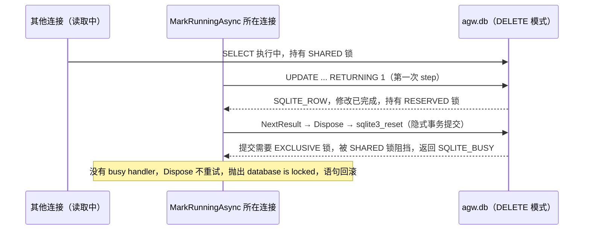
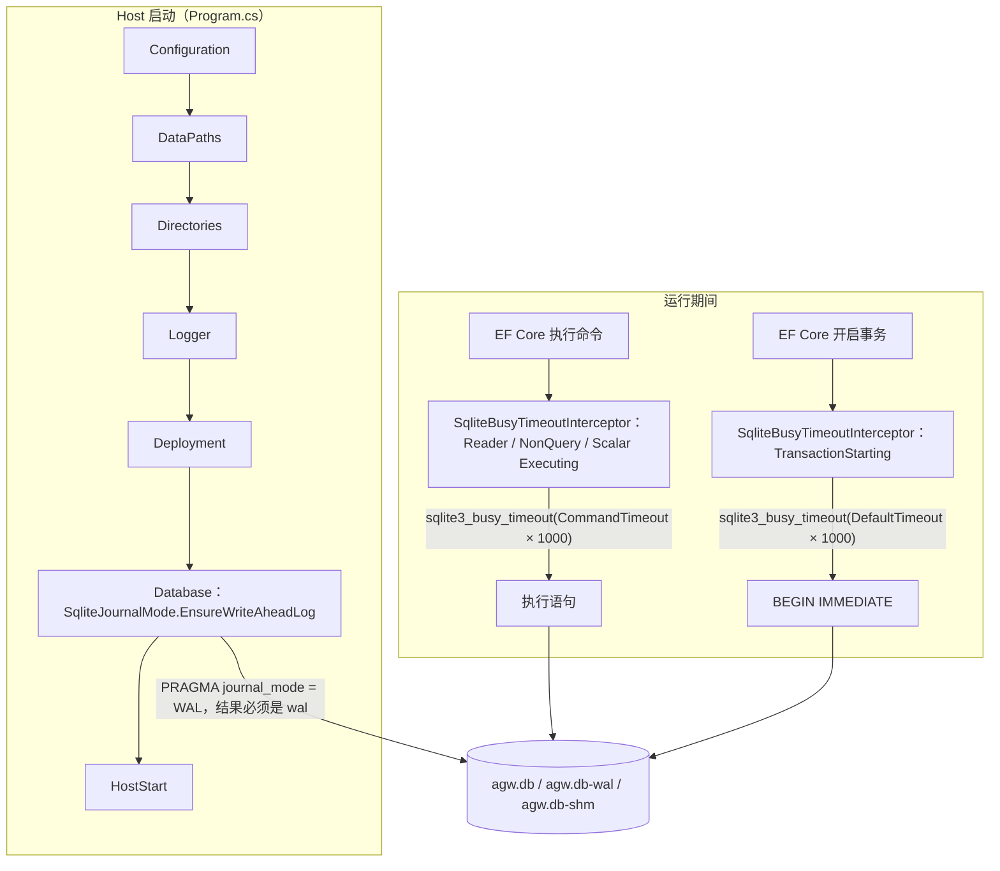
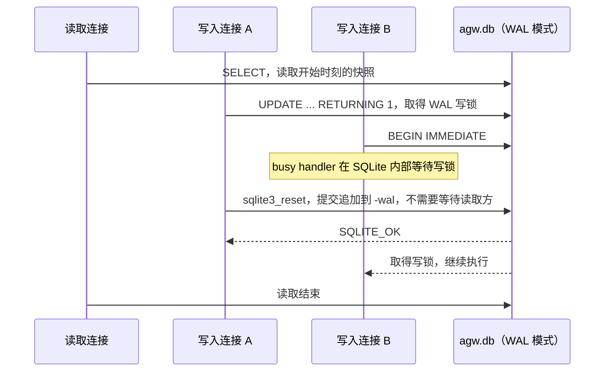

# SQLite 并发写入锁冲突修复方案

## 名词解释

- **Journal mode**：SQLite 实现原子提交和回滚的方式，作用于整个数据库文件。本方案涉及 rollback journal 的 `DELETE` 模式和 `WAL` 模式。
- **Rollback journal（`DELETE` 模式）**：SQLite 新建数据库的默认模式。写入之前把原始页面复制到 `-journal` 文件，然后直接修改数据库文件；删除 `-journal` 文件的那一刻就是提交。
- **WAL（Write-Ahead Logging）**：修改追加到 `-wal` 文件，数据库文件保持原有内容。读取方按自己开始读取那一刻的提交位置读取数据。`-shm` 文件保存 wal-index，供同一台主机上的连接共享。
- **SHARED / RESERVED / PENDING / EXCLUSIVE 锁**：rollback journal 模式下的文件锁状态。读取持有 SHARED；准备写入持有 RESERVED；提交需要 EXCLUSIVE，必须等待其他连接的 SHARED 全部释放；PENDING 阻止新的 SHARED。
- **Busy handler / `busy_timeout`**：SQLite 取不到锁的时候调用的等待回调。`sqlite3_busy_timeout(db, ms)` 安装一个按累计时间等待的 busy handler。没有 busy handler 时 SQLite 立即返回 `SQLITE_BUSY`。这个设置只作用于单个连接。
- **隐式事务（autocommit）**：没有 `BEGIN` 的语句由 SQLite 自动开启事务，在最后一个活动语句结束的时候提交。语句在 reset 或 finalize 的时候一定结束。
- **Checkpoint**：把 `-wal` 文件中已提交的内容写回数据库文件的操作。

## 背景

### 现象

[Issue #189](https://github.com/zxyao145/agw/issues/189) 报告：使用默认配置（SQLite，`ConversationHistory:Mode=Interval`）发送消息，Turn 开始执行的时候失败：

```text
Microsoft.Data.Sqlite.SqliteException (0x80004005): SQLite Error 5: 'database is locked'.
   at Microsoft.Data.Sqlite.SqliteDataRecord.Dispose()
   at Microsoft.Data.Sqlite.SqliteDataReader.NextResult()
   ...
   at Agw.Projects.Infrastructure.ConversationTurnStore.MarkRunningAsync(...) ConversationTurnStore.cs:line 116
   at Agw.Agents.Execution.Turns.TurnRecord.RunAsync(...) TurnRecord.cs:line 84
   at Agw.Agents.Execution.Runtimes.InProcess.InProcessExecutionCoordinator.StartTurnAsync(...) InProcessExecutionCoordinator.cs:line 194
```

堆栈中的文件和行号与 v0.4.1 的源码一致，路径 `/Users/runner/work/agw/agw` 来自 GitHub Actions 的 macOS 发布构建。

`ConversationTurnStore.MarkRunningAsync` 只把一行 Turn 更新为 Running。EF Core 10 为这次保存生成一条语句，没有开启显式事务：

```sql
UPDATE "project_conversation_turn" SET ... WHERE "id" = @p RETURNING 1;
```

这个异常使 Turn 无法开始执行。同一个类中的 `CompleteStepAsync`（`ConversationTurnStore.cs:167`）和 `FinishAsync`（`ConversationTurnStore.cs:192`）也是单行保存；`FinishAsync` 失败的时候，Turn 会一直停留在 Running 状态。

### 根因推导

#### SQLite 的锁与提交

1. 同一个数据库文件同一时刻只允许一个写入方（[SQLITE_BUSY](https://www.sqlite.org/rescode.html#busy)）。
2. Rollback journal 模式下，提交必须取得 EXCLUSIVE 锁；其他连接持有 SHARED 锁（正在读取）的时候，提交只能等待这些 SHARED 锁释放（[File Locking And Concurrency](https://www.sqlite.org/lockingv3.html)）。
3. WAL 模式下读取方不阻挡写入方，写入方也不阻挡读取方；写入方之间仍然依次进行（[Write-Ahead Logging](https://www.sqlite.org/wal.html)）。
4. SQLite 只通过 busy handler 等待锁；没有 busy handler 时立即返回 `SQLITE_BUSY`。`busy_timeout` 属于单个连接（[sqlite3_busy_timeout](https://www.sqlite.org/c3ref/busy_timeout.html)）。
5. 带 `RETURNING` 的修改语句在第一次 `sqlite3_step()` 中完成全部修改，并把输出缓存在内存中；提交要等语句结束才发生（[RETURNING](https://www.sqlite.org/lang_returning.html)）。隐式事务在最后一个活动语句结束的时候提交，语句在 reset 或 finalize 的时候一定结束（[Transaction](https://www.sqlite.org/lang_transaction.html)）。
6. 已经开始读取的事务升级为写事务的时候，如果其他连接已经提交了修改，WAL 模式返回 `SQLITE_BUSY_SNAPSHOT`。`BEGIN IMMEDIATE` 成功以后，到下一次 `COMMIT` 之前的操作不会再返回 `SQLITE_BUSY`（[SQLITE_BUSY_SNAPSHOT](https://www.sqlite.org/rescode.html#busy_snapshot)）。

#### Microsoft.Data.Sqlite 与 EF Core 的行为

7. Microsoft.Data.Sqlite 10.0 不调用 `sqlite3_busy_timeout`，新连接的 `PRAGMA busy_timeout` 为 `0`（实验中读取得到）。
8. Microsoft.Data.Sqlite 在托管代码中重试 busy：`SqliteCommand` 准备语句的时候重试；`SqliteDataReader.NextResult` 对第一次 `sqlite3_step` 每隔 150 ms 重试一次，直到这条命令的 `CommandTimeout`。`CommandTimeout` 可以对每条命令单独设置；没有设置时读取连接当前的 `DefaultTimeout`，它的初始值来自连接串的 `Default Timeout`，默认 30 秒，连接打开以后也可以修改（`SqliteCommand.cs`、[Database errors](https://learn.microsoft.com/en-us/dotnet/standard/data/sqlite/database-errors#locking-retries-and-timeouts)）。`SqliteDataRecord.Read()` 中后续的 step，以及 `SqliteDataRecord.Dispose()` 中的 `sqlite3_reset`，遇到错误直接抛出（dotnet/efcore `release/10.0` 分支的 `src/Microsoft.Data.Sqlite.Core/SqliteDataReader.cs` 与 `SqliteDataRecord.cs`）。
9. EF Core 读取完 `RETURNING 1` 的结果以后调用 `NextResult()`，`SqliteDataRecord.Dispose()` 执行 `sqlite3_reset`，隐式事务在这里提交。结合第 5、8 条：这次提交遇到 `SQLITE_BUSY` 时没有任何重试。
10. Microsoft.Data.Sqlite 的 `BeginTransaction()` 没有指定隔离级别的时候发出 `BEGIN IMMEDIATE`，只有 `IsolationLevel.ReadUncommitted` 使用 deferred（`SqliteConnection.cs`、`SqliteTransaction.cs`）。`BEGIN IMMEDIATE` 由 `SqliteTransaction` 内部创建的命令执行，这条命令没有单独设置超时，使用连接当前的 `DefaultTimeout`。EF Core 的 `Database.BeginTransactionAsync()` 和多条命令的 `SaveChanges` 都经过这里。
11. EF Core 的 `SqliteDatabaseCreator.Create()` 在创建数据库文件的时候执行 `PRAGMA journal_mode = 'wal'`。`Migrator.MigrateAsync` 只在 `Exists()` 返回假，也就是数据库文件不存在的时候调用 `Create()`。已经存在的数据库文件不会被切换。

#### Agw 的现状

12. SQLite 只用于 Standalone Host 加 InProcess 执行（`ServerDeploymentConfiguration.Validate`）。所有连接位于同一个进程，由连接池管理。
13. 数据库一直处于并发访问之中：SignalR 执行写入 Turn 行和对话历史；HTTP API 读取和写入；`DatabaseInitializationStateRefreshHostedService` 每秒读取一次 `setting` 表；`JobHostedService`、`DesktopGrantCleanupService`、`AgentflowNodeExecutionTraceCollector` 在后台读写。`ConversationHistory:Mode` 决定历史写入的时机，与这些读取的并发无关。
14. 仓库中没有任何地方设置 `journal_mode` 和 `busy_timeout`，`AgwDbContextOptionsConfigurator.Configure` 只调用 `UseSqlite`。
15. 数据库的 journal mode 由创建它的版本决定：
    - v0.3.0（c20fdaf6）到 v0.4.1：Host 启动时 `DatabaseInitializationStateStore.RefreshAsync()` 使用普通读写连接查询 `setting` 表。Microsoft.Data.Sqlite 默认使用 `Mode=ReadWriteCreate`，这次查询在 Setup 之前创建出空的 `agw.db`。Setup 执行 `MigrateAsync` 的时候文件已经存在，EF Core 不调用 `Create()`，数据库保持 `delete` 模式。
    - f3b240d7（#190）以后：启动时先以只读方式检查数据库是否存在，Setup 之前不再创建文件，新数据库由 `Create()` 切换为 `wal`。这个结果依赖“Setup 之前没有任何读写连接”这一条件，代码中没有任何地方保证或检查它。
    - 已有数据库升级到任何版本以后，journal mode 都保持原样。

#### 失败过程

v0.4.1 创建的数据库处于 `delete` 模式（第 15 条）。Turn 开始执行的时候，另一个连接恰好在读取（第 13 条），持有 SHARED 锁。`MarkRunningAsync` 的 `UPDATE ... RETURNING 1` 在第一次 step 中完成修改；EF Core 调用 `NextResult()`，`sqlite3_reset` 触发隐式事务提交，提交需要 EXCLUSIVE 锁（第 2、5、9 条）。连接上没有 busy handler，SQLite 立即返回 `SQLITE_BUSY`（第 4、7、14 条），`Dispose()` 直接抛出异常（第 8 条），SQLite 回滚这条语句。



### 验证

实验使用与 v0.4.1 相同的包版本：EF Core Sqlite 10.0.12、SQLitePCLRaw.bundle_e_sqlite3 3.0.5（SQLite 3.53.4）。

最小复现：一个连接保持一条进行中的 `SELECT`，另一个 `DbContext` 修改一行并调用 `SaveChangesAsync`。

- `delete` 模式，没有 busy_timeout：115 ms 后抛出 `SQLite Error 5: 'database is locked'`，堆栈为 `SqliteDataRecord.Dispose ← SqliteDataReader.NextResult`，与 issue 一致。耗时远小于 30 秒的命令超时，说明没有发生重试；数据库中的值没有改变。
- `wal` 模式，同样的读取：4 ms 成功。
- `delete` 模式，`busy_timeout=5000`，读取在 300 ms 后结束：387 ms 成功。
- `wal` 模式，另一个连接持有写入事务 300 ms：没有 busy_timeout 时 312 ms 成功（第一次 step 的托管重试生效），有 busy_timeout 时 396 ms 成功。

首次运行（使用 `--AgwDataDir` 指定的独立数据目录）：

- v0.4.1：无人值守 Setup，以及“先启动、以后再 Setup”两种方式创建的数据库都是 `delete` 模式；尚未初始化的 Host 启动以后，已经存在 0 字节的 `agw.db`。
- 当前 main：两种方式创建的数据库都是 `wal` 模式；尚未初始化的时候不存在 `agw.db`。
- 当前 main 在 v0.4.1 创建的数据库上启动以后，journal mode 仍然是 `delete`。

## 设计目标

### 功能目标

1. Server 启动的时候把 SQLite 文件数据库切换为 WAL 并检查结果，新数据库和已有数据库都适用。
2. EF Core 在 SQLite 上执行每条命令、开启每个事务之前，把连接的 `busy_timeout` 设置为这个操作的有效超时，锁等待在 SQLite 内部完成。
3. 测试保证打包的 SQLite 包含 WAL-reset 修复。
4. 部署文档说明 WAL 文件、备份方式和文件系统要求。

### 技术目标

- 正确性：读取不会导致提交失败；写入方之间的锁冲突在超时之内等待完成，覆盖 reset 时的提交在内的所有加锁位置。
- 延迟：没有锁冲突的时候，提交过程不增加 SQL 语句；`busy_timeout` 通过 C API 设置。每次锁等待的上限等于当前操作的有效超时：命令使用它的 `CommandTimeout`，事务开始使用连接当前的 `DefaultTimeout`，默认都是 30 秒。
- 持久性：`synchronous` 保持 SQLite 默认的 `FULL`，WAL 模式下每次提交都同步 `-wal` 文件。
- 可用性：journal mode 无法切换为 WAL 的时候启动失败，stderr 诊断记录的 stage 为 `Database`，退出码为 `1`。
- 可观测：启动日志记录数据库文件和 journal mode。
- 安全：`-wal` 和 `-shm` 位于 `database` 目录中，沿用目录权限（Unix 新建目录为 `0700`）。
- 兼容：没有表结构变化，不需要 EF migration；PostgreSQL 部署不受影响；已有的 `delete` 模式数据库在新版本第一次启动的时候自动切换。

## 总体设计

### 从事实推导出的要求

- **R1 读取不能使提交失败。** Rollback journal 模式的提交按照设计必须等待所有读取方（第 2 条）；WAL 让读取和写入互不阻挡（第 3 条）。数据库必须处于 WAL 模式。
- **R2 每个数据库都必须确立 WAL。** Journal mode 是数据库文件的属性，EF Core 只在创建文件的时候设置（第 11 条），已有安装的数据库处于 `delete` 模式（第 15 条）。Server 必须对它打开的每个文件数据库确立 WAL，并且在其他任何数据库访问之前完成并检查。
- **R3 写入方之间的等待必须在 SQLite 内部完成。** 单一写入方是 SQLite 的固有限制（第 1、3 条），写入之间的等待不可避免。托管代码的重试覆盖不到 reset 时的提交（第 8、9 条），只有 busy handler 能覆盖 SQLite 内部的每个加锁位置，所以每个可能等待锁的操作执行之前，连接上都必须已经设置 `busy_timeout`（第 4、7 条）。
- **R4 每次等待的上限等于当前操作的有效超时。** 命令的有效超时是它的 `CommandTimeout`，没有单独设置时等于连接当前的 `DefaultTimeout`；事务开始的有效超时是连接当前的 `DefaultTimeout`（第 8、10 条）。两个值都可以在连接打开以后修改，并且可以不同；`busy_timeout` 作用于整个连接。所以原生等待必须在每个操作开始之前，按这个操作自己的有效超时设置，调用方对每个操作只面对一个超时。
- **R5 多个连接并发写入时，WAL 的正确性依赖 SQLite 版本。** WAL-reset 问题在 WAL 模式、多个连接同时写入或 checkpoint 时出现，SQLite 3.51.3 修复了它（[The WAL-Reset Bug](https://www.sqlite.org/wal.html)）。打包的 SQLite 必须不低于 3.51.3。
- **R6 显式事务必须以写事务开始。** 先读取后写入的 deferred 事务在 WAL 下会遇到 `SQLITE_BUSY_SNAPSHOT`，busy handler 无法解决（第 6 条）。现有代码通过 Microsoft.Data.Sqlite 的默认行为使用 `BEGIN IMMEDIATE`（第 10 条），本方案保持这一点。

### 结构



修复以后的并发过程：



## 数据库设计

本方案没有表、列和索引的变化，不需要 migration。变化位于数据库文件层面：

- `journal_mode` 为 `wal`，保存在数据库文件中（文件头的格式版本字节由 1 变为 2），之后打开的每个连接都使用 WAL。
- Server 运行期间，`database` 目录包含 `agw.db`、`agw.db-wal`、`agw.db-shm`。`-wal` 是数据库状态的一部分，复制或移动数据库时必须与 `agw.db` 一起处理。最后一个连接正常关闭的时候，SQLite 执行 checkpoint 并删除 `-wal` 和 `-shm`。
- Checkpoint 使用默认设置：`-wal` 达到 1000 页（`page_size` 为 4096，约 4 MB）以后，由触发它的提交所在线程自动执行。Checkpoint 不能越过仍在进行的读取事务的提交位置。流式读取会让读取事务保持较长时间，例如 `ProjectMemoryStore` 搜索项目记忆时边读取边逐条执行正则匹配；WAL 模式下这只推迟 checkpoint 完成，提交照常进行。读取结束以后，后续提交触发的 checkpoint 从上次停止的位置继续。
- `synchronous` 保持默认值 `FULL`。实验中打包的 SQLite 在 WAL 模式下读取到的值为 `2`（FULL）。

## 详细设计

### 启动时确立 WAL 模式

新增 `src/server/Agw.Infrastructure/Data/SqliteJournalMode.cs`：

```csharp
public static class SqliteJournalMode
{
    /// <summary>
    /// 把文件数据库切换为 WAL 并返回数据库文件路径；内存数据库返回 null。
    /// Switches a file database to WAL and returns its file path; returns null for an in-memory database.
    /// </summary>
    public static string? EnsureWriteAheadLog(string connectionString)
    {
        var builder = new SqliteConnectionStringBuilder(connectionString);
        if (
            builder.Mode == SqliteOpenMode.Memory
            || builder.DataSource.Equals(":memory:", StringComparison.OrdinalIgnoreCase)
        )
            return null;

        using var connection = new SqliteConnection(connectionString);
        connection.Open();
        using var command = connection.CreateCommand();
        command.CommandText = "PRAGMA journal_mode = WAL;";
        var mode = (string)command.ExecuteScalar()!;
        if (!string.Equals(mode, "wal", StringComparison.OrdinalIgnoreCase))
            throw new AgwException(
                ErrorCodes.InvalidSetupConfiguration,
                $"SQLite database '{builder.DataSource}' cannot use WAL journal mode (journal mode: {mode}). Place the database on a local file system."
            );
        return builder.DataSource;
    }
}
```

- 这里使用同步 API。Microsoft.Data.Sqlite 的 async 方法实际上同步执行，官方文档建议避免使用（[Async limitations](https://learn.microsoft.com/en-us/dotnet/standard/data/sqlite/async)）；这一步在启动时只执行一次。
- `PRAGMA journal_mode = WAL` 在第一次 step 中执行，遇到 `SQLITE_BUSY` 时由 Microsoft.Data.Sqlite 的托管重试处理，上限为命令超时。
- 这个连接使用与 EF Core 相同的连接串，关闭以后回到同一个连接池。

各种数据库状态下的行为：

- 文件不存在：SQLite 创建文件并切换为 WAL，文件写入第一页（4096 字节），模式在重新打开后保持。之后的 Setup 执行 `MigrateAsync`，在已有的空数据库上创建表；`StorageExistsAsync` 检查 `setting` 表是否存在，未初始化状态的判断不受影响。
- `delete` 模式的已有数据库：切换为 WAL，数据保持不变。
- 已经是 WAL：语句返回 `wal`，没有其他效果。
- 内存数据库：直接返回 `null`。
- 数据库所在目录不可写入：SQLite 无法创建 `-wal`，抛出 `SqliteException`（实验结果为错误码 8，扩展码 1544 `SQLITE_READONLY_DIRECTORY`），进入启动失败处理。
- 文件系统不支持 WAL 需要的共享内存：语句返回原来的模式（例如 `delete`），抛出 `AgwException(ErrorCodes.InvalidSetupConfiguration, ...)`，进入启动失败处理。

`src/server/Agw.Host/Hosting/ServerStartupFailure.cs` 的 `ServerStartupStage` 在 `Deployment` 与 `HostStart` 之间增加 `Database`。`src/server/Agw.Host/Program.cs` 在部署配置检查之后、注册服务之前执行这一步：

```csharp
startupStage = ServerStartupStage.Database;
var databaseSettings =
    builder.Configuration.GetSection(DatabaseSettings.SectionName).Get<DatabaseSettings>() ?? new DatabaseSettings();
var databaseConnectionString = DatabaseConnectionStringResolver.Resolve(
    databaseSettings.Provider,
    databaseSettings.ConnectionString,
    dataPaths
);
if (databaseSettings.Provider == DatabaseProvider.Sqlite)
{
    startupPath = new SqliteConnectionStringBuilder(databaseConnectionString).DataSource;
    var databaseFile = SqliteJournalMode.EnsureWriteAheadLog(databaseConnectionString);
    Log.Information("SQLite database {DatabaseFile} uses WAL journal mode", databaseFile ?? ":memory:");
}

startupStage = ServerStartupStage.HostStart;
```

- 这一步位于 `stateStore.RefreshAsync()` 和 `ServerCommand.TryRunAsync` 之前，Server 的第一次数据库访问一定发生在 WAL 确立之后，命令行子命令也包括在内。
- `Program.cs` 中后面记录数据库提供者和连接串的日志改为使用这里得到的 `databaseSettings` 和 `databaseConnectionString`，不再重复解析。
- `database/` 目录在 `Directories` 阶段已经创建。显式配置的数据库路径所在目录不存在时，打开连接失败，stage 为 `Database`，path 为数据库文件路径。

### 按操作设置 busy_timeout

`busy_timeout` 作用于整个连接，等待上限属于单个操作（R4）。EF Core 管理的 SQLite 连接上，可能等待锁的操作有两类：

- 命令：自动提交的语句在第一次 step 中建立读取快照或取得写锁；在 rollback journal 模式下，reset 时的提交还需要 EXCLUSIVE 锁。
- 事务开始：`BEGIN IMMEDIATE` 取得写锁。

WAL 模式下 `BEGIN IMMEDIATE` 成功以后，到 `COMMIT` 为止的语句、savepoint 和 `COMMIT` 都不再返回 `SQLITE_BUSY`（第 6 条）；R2 保证文件数据库处于 WAL 模式。所以 interceptor 在这两类操作开始之前设置原生等待。

新增 `src/server/Agw.Infrastructure/Data/Interceptors/SqliteBusyTimeoutInterceptor.cs`。EF Core 的 interceptor 接口带有默认实现，一个类同时实现 `IDbCommandInterceptor` 和 `IDbTransactionInterceptor`，只实现下面这些方法，注册一次后两种拦截都生效：

```csharp
/// <summary>
/// 每条命令执行之前、每个事务开始之前，把连接的原生 busy_timeout 设置为这个操作的有效超时。
/// Sets the connection's native busy_timeout to the operation's effective timeout before each command and each transaction start.
/// </summary>
internal sealed class SqliteBusyTimeoutInterceptor : IDbCommandInterceptor, IDbTransactionInterceptor
{
    public static readonly SqliteBusyTimeoutInterceptor Instance = new();

    public InterceptionResult<DbDataReader> ReaderExecuting(
        DbCommand command,
        CommandEventData eventData,
        InterceptionResult<DbDataReader> result
    )
    {
        ApplyCommand(command);
        return result;
    }

    public ValueTask<InterceptionResult<DbDataReader>> ReaderExecutingAsync(
        DbCommand command,
        CommandEventData eventData,
        InterceptionResult<DbDataReader> result,
        CancellationToken cancellationToken = default
    )
    {
        ApplyCommand(command);
        return ValueTask.FromResult(result);
    }

    // NonQueryExecuting、NonQueryExecutingAsync、ScalarExecuting、ScalarExecutingAsync 写法相同，都调用 ApplyCommand。
    // NonQueryExecuting, NonQueryExecutingAsync, ScalarExecuting and ScalarExecutingAsync follow the same pattern and call ApplyCommand.

    public InterceptionResult<DbTransaction> TransactionStarting(
        DbConnection connection,
        TransactionStartingEventData eventData,
        InterceptionResult<DbTransaction> result
    )
    {
        ApplyTransactionStart(connection);
        return result;
    }

    public ValueTask<InterceptionResult<DbTransaction>> TransactionStartingAsync(
        DbConnection connection,
        TransactionStartingEventData eventData,
        InterceptionResult<DbTransaction> result,
        CancellationToken cancellationToken = default
    )
    {
        ApplyTransactionStart(connection);
        return ValueTask.FromResult(result);
    }

    // SqliteCommand 没有单独设置超时的时候返回连接当前的 DefaultTimeout。
    // SqliteCommand returns the connection's current DefaultTimeout when the command has no timeout of its own.
    private static void ApplyCommand(DbCommand command) => Apply(command.Connection!, command.CommandTimeout);

    // BEGIN IMMEDIATE 由 SqliteTransaction 内部创建的命令执行，使用连接当前的 DefaultTimeout。
    // BEGIN IMMEDIATE runs through a command created inside SqliteTransaction and uses the connection's current DefaultTimeout.
    private static void ApplyTransactionStart(DbConnection connection) =>
        Apply(connection, ((SqliteConnection)connection).DefaultTimeout);

    private static void Apply(DbConnection connection, int seconds)
    {
        var sqlite = (SqliteConnection)connection;
        var milliseconds = seconds == 0 ? int.MaxValue : (int)Math.Min(seconds * 1000L, int.MaxValue);
        SqliteException.ThrowExceptionForRC(raw.sqlite3_busy_timeout(sqlite.Handle!, milliseconds), sqlite.Handle);
    }
}
```

`AgwDbContextOptionsConfigurator.Configure` 的 SQLite 分支注册这个 interceptor：

```csharp
options
    .UseSqlite(connectionString, migrations => migrations.MigrationsAssembly(SqliteMigrationsAssembly))
    .UseSnakeCaseNamingConvention()
    .AddInterceptors(SqliteBusyTimeoutInterceptor.Instance);
```

- 覆盖范围：运行时的 `AddDbContext`、Setup 使用的 `DatabaseBootstrapper`（包括 migration）和设计时工厂都通过 `Configure` 注册 interceptor。Agw 在 SQLite 上的数据库访问都经过 EF Core 命令和 EF Core 事务，`SaveChanges` 自动开启的事务同样触发 `TransactionStarting`。`src/server` 中直接创建 ADO.NET 命令的只有 `DatabaseClock`，它在 SQLite 上使用应用时钟，不执行 SQL。interceptor 没有状态，使用静态实例。
- 设置成本：`sqlite3_busy_timeout` 只修改连接上的一个设置，不执行 SQL。
- 读取器的 reset：`ReaderExecuting` 设置的值保留到同一个连接上的下一个操作重新设置为止，读取器结束时的 reset 使用这个值。读取器打开期间，同一个连接上的其他命令来自同一个 `DbContext`，使用同一个 `CommandTimeout`，reset 时的等待上限不变。
- 等待过程：busy handler 在 `sqlite3_step` 或 `sqlite3_reset` 内部累计等待到当前操作的有效超时后返回 `SQLITE_BUSY`；第一次 step 的托管重试使用同一个超时，这时已经到达上限，直接抛出；reset 时的提交直接抛出。超时以后的异常照常抛出。
- 实验结果（WAL 模式下另一个连接持有写入事务 1.8 秒）：`Default Timeout=3`、`CommandTimeout=1` 的保存在约 1.05 秒时失败，`CommandTimeout=5` 的保存在锁释放后成功；打开连接以后把 `DefaultTimeout` 修改为 1，显式事务和 `SaveChanges` 自动开启的事务都在约 1.02 秒时失败。rollback journal 模式下读取连接 2 秒后结束：`Default Timeout=1`、`CommandTimeout=10` 的保存在约 2.05 秒时成功。
- 线程占用：Microsoft.Data.Sqlite 同步执行，busy handler 等待期间占用调用线程，与现有托管重试中的 `Thread.Sleep(150)` 相同。WAL 模式下只有写入方之间需要等待，等待时间等于前一个写入事务的持续时间。受理 Turn（`TurnAcceptanceWriter`）、历史批量提交（`AgwDbContext.SaveConversationChangesAsync`）、项目记忆写入（`ProjectMemoryPersistence.WriteAsync`）的事务中只有数据库操作。

#### 配置项

不新增配置项。`busy_timeout` 来自每个操作已有的有效超时：

- key：`Database:ConnectionString` 中的 `Default Timeout`（别名 `Command Timeout`），决定连接 `DefaultTimeout` 的初始值。代码可以通过 `DbContext.Database.SetCommandTimeout` 为命令单独设置超时；当前业务代码没有单独设置命令超时，也没有修改 `DefaultTimeout`。
- value：秒数。
- 默认值：30，对应 `busy_timeout` 30000 ms。
- 使用说明：`0` 表示不限时，对应 `int.MaxValue` 毫秒；超过 `int.MaxValue` 毫秒的值按 `int.MaxValue` 设置。同一个值同时决定这个操作的原生等待和 Microsoft.Data.Sqlite 托管重试的上限。

### 事务开始方式

R6 要求 SQLite 上的显式事务以写事务开始。现有代码满足这个要求：所有显式事务都通过不带参数的 `Database.BeginTransactionAsync()` 开启，Microsoft.Data.Sqlite 发出 `BEGIN IMMEDIATE`；`src/server` 中没有使用 `IsolationLevel` 和 `deferred` 参数的代码。之后在 SQLite 上开启事务时，继续使用这种方式，不使用 `BeginTransaction(deferred: true)` 和 `IsolationLevel.ReadUncommitted`。

### SQLite 版本保障

`tests/Agw.Host.Tests/SqliteRuntimeTests.cs` 增加 `OpenConnection_BundledNativeLibrary_ContainsWalResetFix`，读取 `sqlite_version()` 并断言不低于 3.51.3。当前打包版本为 3.53.4。升级或替换 `SQLitePCLRaw.bundle_e_sqlite3` 时，这个测试检查 R5。

### 部署文档

`docs/4.Deployment.md` 的 SQLite 默认配置说明之后增加：

- SQLite 数据库使用 WAL 模式。Server 运行期间，`database/` 目录包含 `agw.db`、`agw.db-wal`、`agw.db-shm`。
- 备份或迁移时先停止 Server，再复制整个 `database/` 目录。
- 数据库必须位于本地文件系统；WAL 需要同一台主机上的共享内存，网络文件系统不受支持。无法切换为 WAL 时 Server 启动失败，stderr 诊断记录的 stage 为 `Database`。
- 已有安装在新版本第一次启动时自动切换为 WAL。

### 可观测性

- 日志：启动时记录 `SQLite database {DatabaseFile} uses WAL journal mode`，级别为 Information。
- 启动失败：stderr 输出 `server-startup-failed` 记录，stage 为 `Database`，path 为数据库文件路径；logger 已经创建，同时写入 Fatal 日志。
- 运行期间：等待超时后的 `SQLITE_BUSY` 照常以 `SqliteException` 或 `DbUpdateException` 抛出，由现有错误日志和 `agw.history.write.failures` 指标记录。

### 兼容设计

- 已有安装：新版本第一次启动时把数据库切换为 WAL。WAL 模式保存在数据库文件中，SQLite 把它应用到同一个数据库文件的所有连接。
- 版本回退：v0.3.0 与 v0.4.1 打包的同样是 SQLitePCLRaw.bundle_e_sqlite3 3.0.5（SQLite 3.53.4），能够正常打开 WAL 数据库，数据库继续保持 WAL 模式。
- 旧数据目录迁移：`AgwDataPaths.MigrateLegacyData` 移动整个目录，`-wal` 和 `-shm` 一起移动。
- PostgreSQL：启动步骤只在 SQLite 时执行，interceptor 只在 SQLite 分支注册。
- 客户端：没有 HTTP API 变化，Desktop、Web 和 Mobile 不需要修改。

## 接口文档

### 基础信息

本方案没有新增或修改 HTTP API。

### 接口列表

Server 启动失败诊断（stderr）的 `stage` 增加取值 `Database`，其他字段保持不变。现有客户端不解析这个字段。示例：

```json
{
  "event": "server-startup-failed",
  "timestamp": "2026-10-15T08:00:00+00:00",
  "stage": "Database",
  "hostProfile": "Standalone",
  "processId": 12345,
  "path": "/srv/agw/database/agw.db",
  "exceptionType": "Microsoft.Data.Sqlite.SqliteException",
  "message": "SQLite Error 8: 'attempt to write a readonly database'.",
  "exitCode": 1
}
```

## 实施步骤

1. 编写 `SqliteBusyTimeoutInterceptorTests` 中的全部用例。没有 interceptor 的时候，`SqlQueryRaw_EffectiveCommandTimeout_SetsBusyTimeout`、`SaveChangesAsync_ActiveReaderOnRollbackJournal_CommitsAfterReaderCloses`、`SaveChangesAsync_CommandTimeoutLongerThanDefaultTimeout_WaitsAtResetCommit` 失败；三个“在超时停止”的用例依靠第一次 step 的托管重试通过，它们检查的是原生等待不超过当前操作的有效超时。新增 `SqliteBusyTimeoutInterceptor` 并在 `AgwDbContextOptionsConfigurator.Configure` 中注册，确认全部用例通过。
2. 新增 `SqliteJournalMode` 及其测试。
3. `ServerStartupStage` 增加 `Database`，`Program.cs` 增加启动步骤，补充启动测试。
4. 增加 SQLite 版本测试。
5. 更新 `docs/4.Deployment.md`。
6. 对修改的 C# 文件执行 CSharpier，运行回归测试和验收。

## 测试计划

测试使用真实的 SQLite 文件、真实的 `AgwDbContext` 和真实的 Host 进程。数据库文件放在各测试项目下已被忽略的 `.scratch` 目录中，与现有测试相同。

### 配置测试

- `SqlQueryRaw_EffectiveCommandTimeout_SetsBusyTimeout`（`tests/Agw.Projects.Tests/Infrastructure/SqliteBusyTimeoutInterceptorTests.cs`）
  - 目的：确认每条命令执行时的 `busy_timeout` 等于这条命令的有效超时。
  - 步骤：通过 `AgwDbContextOptionsConfigurator.Configure` 创建 `AgwDbContext`，依次使用不带 `Default Timeout` 的连接串、`Default Timeout=5`、`Default Timeout=0`、`Default Timeout=5` 加上 `Database.SetCommandTimeout(7)`；用 `Database.SqlQueryRaw<int>("SELECT timeout AS Value FROM pragma_busy_timeout()")` 在同一条命令中读取当前值。
  - 预期：依次为 `30000`、`5000`、`2147483647`、`7000`。

### 单元测试

`tests/Agw.Projects.Tests/Infrastructure/SqliteJournalModeTests.cs`：

- `EnsureWriteAheadLog_MissingFile_CreatesWalDatabase`：文件不存在；调用以后文件存在，新连接读取 `PRAGMA journal_mode` 得到 `wal`，返回值为数据库文件路径。
- `EnsureWriteAheadLog_RollbackJournalDatabase_ConvertsAndKeepsData`：预先创建 `delete` 模式数据库并写入一张带数据的表；调用以后新连接读取到 `wal`，表中数据不变。
- `EnsureWriteAheadLog_WalDatabase_KeepsWalMode`：对已经是 WAL 的数据库再次调用，结果仍然是 `wal`。
- `EnsureWriteAheadLog_MemoryDatabase_ReturnsNull`：使用 `Data Source=:memory:` 和 `Mode=Memory` 两种连接串，返回 `null`，不创建任何文件。
- `EnsureWriteAheadLog_ReadOnlyDirectory_ThrowsSqliteException`（仅 Unix）：预先创建 `delete` 模式数据库，把所在目录权限设置为 `0500`；调用抛出 `SqliteException`，`SqliteExtendedErrorCode` 为 1544；测试结束时恢复目录权限。

`tests/Agw.Host.Tests/SqliteRuntimeTests.cs`：

- `OpenConnection_BundledNativeLibrary_ContainsWalResetFix`：`sqlite_version()` 不低于 3.51.3。

### 集成测试

`tests/Agw.Projects.Tests/Infrastructure/SqliteBusyTimeoutInterceptorTests.cs`：

- `SaveChangesAsync_ActiveReaderOnRollbackJournal_CommitsAfterReaderCloses`
  - 目的：覆盖 issue 中 reset 时提交的加锁位置。
  - 前置条件：`delete` 模式的文件数据库，通过 `AgwDbContextOptionsConfigurator.Configure` 创建并完成 migration，写入至少两行可修改的数据。
  - 步骤：另一个连接对这张表执行 `SELECT` 并只读取第一行，语句保持进行中，300 ms 后结束读取；同时修改其中一行对应的实体并调用 `SaveChangesAsync`。
  - 预期：保存成功，耗时不少于 300 ms，新连接读取到修改后的值。没有注册 interceptor 时，这个测试以 `database is locked` 失败。
- `SaveChangesAsync_CommandTimeoutShorterThanDefaultTimeout_StopsWaitingAtCommandTimeout`
  - 目的：命令超时短于 `DefaultTimeout` 的时候，原生等待在命令超时停止。
  - 前置条件：WAL 模式的文件数据库，连接串为 `Default Timeout=10`；另一个连接开启写入事务并修改一行，5 秒后提交。
  - 步骤：调用 `Database.SetCommandTimeout(1)`，修改另一行并调用 `SaveChangesAsync`。
  - 预期：抛出 `DbUpdateException`，内部 `SqliteException.SqliteErrorCode` 为 5，耗时不少于 1 秒并且少于 5 秒。只在打开连接时按 `DefaultTimeout` 设置的实现会等到另一个事务提交，保存成功。
- `SaveChangesAsync_CommandTimeoutLongerThanDefaultTimeout_WaitsAtResetCommit`
  - 目的：命令超时长于 `DefaultTimeout` 的时候，reset 时的提交按命令超时等待。
  - 前置条件：rollback journal 模式的文件数据库，连接串为 `Default Timeout=1`，至少两行数据；另一个连接对这张表执行 `SELECT` 并只读取第一行，2 秒后结束读取。
  - 步骤：调用 `Database.SetCommandTimeout(10)`，修改一行并调用 `SaveChangesAsync`。
  - 预期：保存成功，耗时不少于 2 秒，新连接读取到修改后的值。只在打开连接时按 `DefaultTimeout` 设置的实现约 1 秒时以 `database is locked` 失败。
- `BeginTransactionAsync_DefaultTimeoutChangedAfterOpen_StopsWaitingAtDefaultTimeout`
  - 目的：事务开始使用连接当前的 `DefaultTimeout`。
  - 前置条件：WAL 模式的文件数据库，连接串为 `Default Timeout=10`；另一个连接持有写入事务，5 秒后提交。
  - 步骤：调用 `Database.OpenConnectionAsync`，把 `SqliteConnection.DefaultTimeout` 设置为 1，再调用 `Database.BeginTransactionAsync`。
  - 预期：抛出 `SqliteException`，`SqliteErrorCode` 为 5，耗时不少于 1 秒并且少于 5 秒。
- `SaveChangesAsync_AutoTransactionWithDefaultTimeoutChangedAfterOpen_StopsWaitingAtDefaultTimeout`
  - 目的：`SaveChanges` 自动开启的事务同样使用连接当前的 `DefaultTimeout`。
  - 前置条件：与上一个用例相同。
  - 步骤：读取两行并全部修改，使 `SaveChanges` 自动开启事务；调用 `Database.OpenConnectionAsync`，把 `SqliteConnection.DefaultTimeout` 设置为 1，再调用 `SaveChangesAsync`。
  - 预期：抛出 `SqliteException`（实验中没有被 `DbUpdateException` 包装），`SqliteErrorCode` 为 5，耗时不少于 1 秒并且少于 5 秒。

`tests/Agw.Projects.Tests/Infrastructure/ConversationTurnStoreSqliteTests.cs`：

- `MarkRunningAsync_ActiveReaderOnWalDatabase_PersistsRunningStatus`
  - 目的：在 issue 的实际调用路径上确认 WAL 下读取不影响提交。
  - 前置条件：调用 `SqliteJournalMode.EnsureWriteAheadLog` 并完成 migration；在用户上下文中准备 Project、Conversation 和两个 Accepted 状态的 Turn。
  - 步骤：另一个连接对 `project_conversation_turn` 表执行 `SELECT` 并只读取第一行，语句保持进行中，不结束读取；调用真实的 `ConversationTurnStore.MarkRunningAsync` 更新其中一个 Turn。
  - 预期：调用立即完成，新连接读取到 Turn 状态为 Running。

`tests/Agw.Host.Tests/ServerStartupTests.cs`（启动真实 Host 子进程）：

- `Start_DefaultSqlite_UsesWalJournalMode`：不执行 Setup 启动 Host；就绪以后 `database/agw.db` 存在，新连接读取到 `wal`；日志包含 `uses WAL journal mode`；Setup 仍然处于未初始化状态。
- `Start_RollbackJournalDatabase_ConvertsToWal`：预先在 `data/database/agw.db` 创建 `delete` 模式数据库和一张标记表；启动以后读取到 `wal`，标记表数据不变。
- `Start_SqliteDirectoryReadOnly_ReportsDatabaseFailure`（仅 Unix）：预先创建 `delete` 模式数据库，把 `data/database` 目录权限设置为 `0500`；退出码为 `1`，stderr 记录的 stage 为 `Database`，path 为数据库文件路径，exceptionType 为 `Microsoft.Data.Sqlite.SqliteException`，HTTP 没有就绪；测试结束时恢复目录权限。

### 回归测试

- 使用 `env -u ASPNETCORE_ENVIRONMENT -u ASPNETCORE_URLS` 运行 `dotnet test tests/Agw.Projects.Tests`、`tests/Agw.Host.Tests`、`tests/Agw.Setup.Tests`、`tests/Agw.Architecture.Tests`，最后运行 `dotnet test Agw.slnx`。
- 对修改的 C# 文件执行 `dotnet csharpier format`。

相关单元测试和集成测试全部通过以后执行验收：

1. 使用 v0.4.1 构建的 Standalone Host 在独立数据目录中完成首次运行和 Setup，确认 journal mode 为 `delete`。
2. 使用新版本 Host 启动同一个数据目录，确认 journal mode 变为 `wal`，原有数据可以正常读取。
3. 在这个数据目录上运行本地 e2e 环境（SQLite Standalone Host、本地回显模型服务、SignalR 脚本），连续执行多轮 Agent 和 Agentflow Turn，同时并发请求对话列表和对话历史接口；日志中没有 `database is locked`，每个 Turn 都正常进入 Running 并结束。
4. 正常停止 Host，确认 `agw.db-wal` 和 `agw.db-shm` 已被删除。
