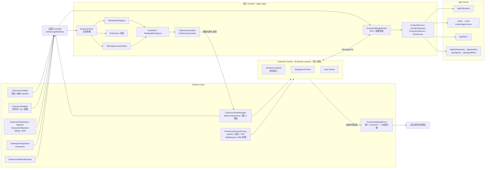
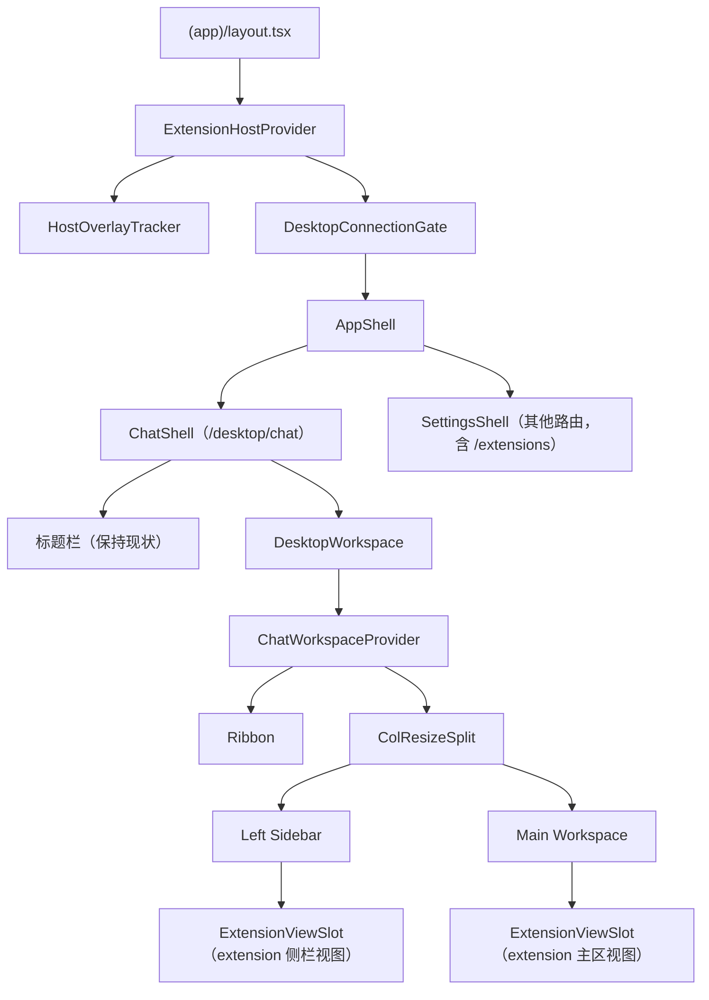
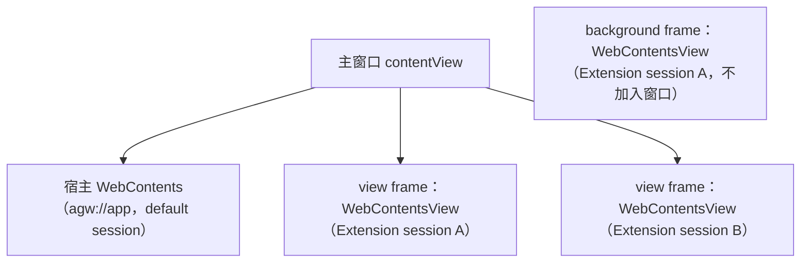
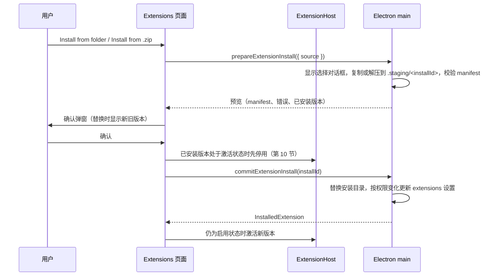
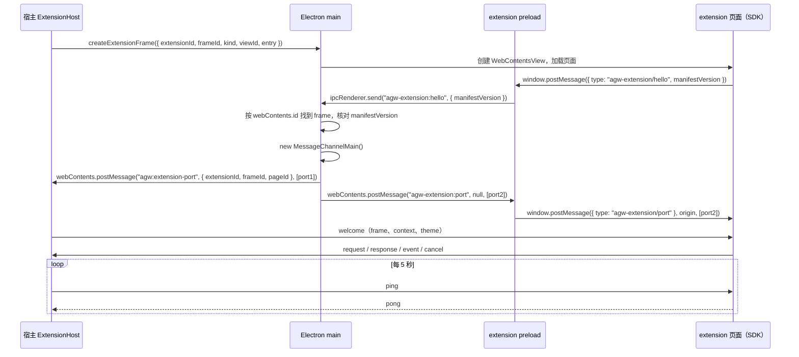
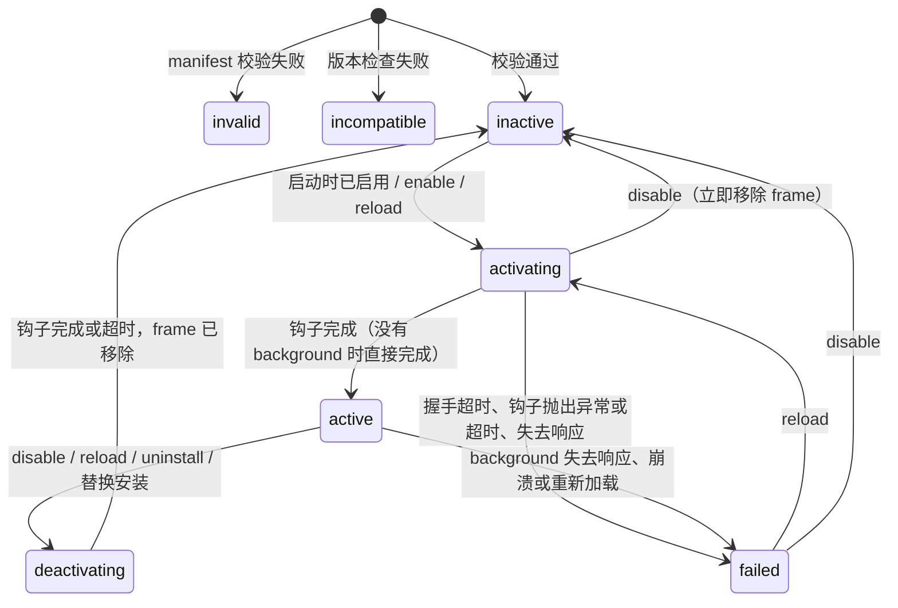
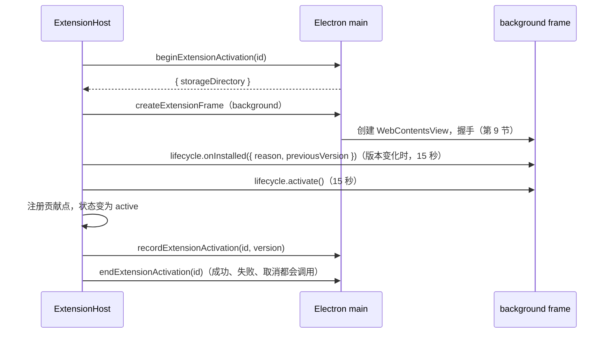
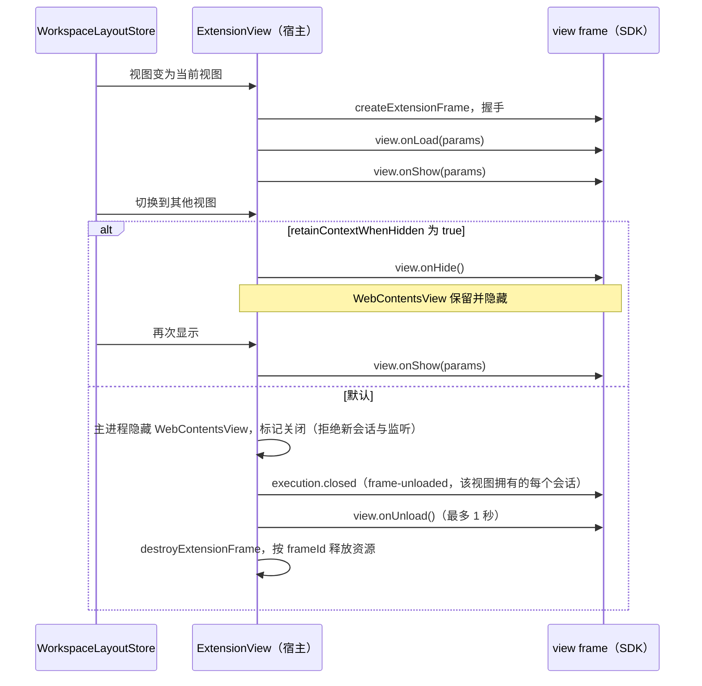
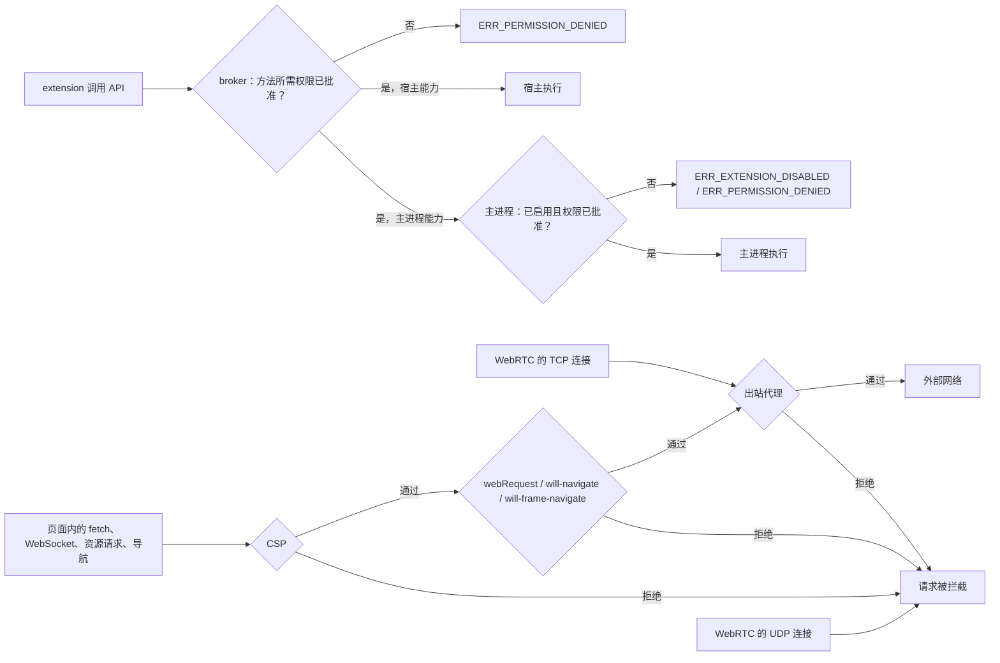
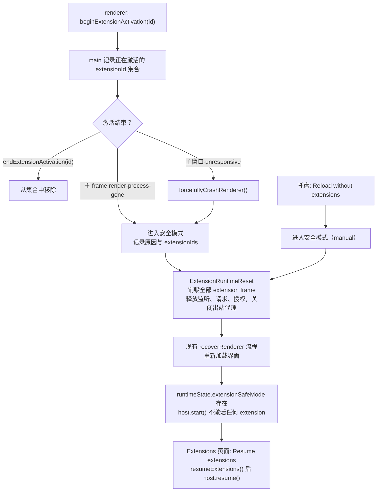

# Desktop Extension 与三区布局

## 名词解释

- **Extension**：Agw Desktop 的插件，概念与 Obsidian plugin 相同，定位接近小程序：用户编写的 extension 可以在 Main Workspace 中运行完整的 Web 界面并与用户交互。仓库中 "Plugin" 已经是 Integrations 模块的概念（`Agw.Integrations` 的 `PluginDefinition` / `PluginInstallation`），因此 Desktop 插件统一称为 extension。
- **Ribbon**：窗口左侧的竖向图标栏，放置内置功能和 extension 的入口。
- **Left Sidebar**：Ribbon 右侧的侧栏，每次显示一个侧栏视图，例如对话列表、文件浏览器、extension 自定义视图。
- **Main Workspace**：侧栏右侧的主区，每次显示一个主区视图，例如对话、文件内容、extension 自定义视图。
- **视图（View）**：可以注册到 Left Sidebar 或 Main Workspace 的界面单元。Desktop 自带的视图称为内置视图，id 以 `agw.` 开头；extension 的视图 id 为 `<extensionId>:<localId>`。
- **宿主（Host）**：Desktop 主窗口 renderer 中 `agw://app`（开发模式为 `AGW_RENDERER_URL`，默认 `http://localhost:3000`）页面里运行的 Desktop 自身代码。宿主管理 extension 的生命周期，替 extension 执行经过权限检查的操作。
- **Extension frame**：运行 extension 页面的 Electron `WebContentsView`，由主进程创建，使用该 extension 自己的 session，页面 origin 为 `agw-extension://<extensionId>`。分为 background frame（不加入窗口，运行 extension 的后台逻辑）和 view frame（加入主窗口，显示一个视图或设置页）。
- **Extension session**：每个 extension 独享的 Electron session（partition 为 `persist:agw-extension-<extensionId>`），该 extension 的全部 frame 都使用它。
- **出站代理**：主进程为每个处于激活状态的 extension 启动的本地 HTTP 代理，Extension session 的全部网络连接都经过它，它只放行已批准的域名。
- **Manifest**：extension 根目录下的 `manifest.json`，声明身份、版本、界面入口、权限和可以访问的外部域名。
- **Extension API 版本**：manifest 的 `manifestVersion`，表示 extension 基于哪一版 Extension API 编写。
- **权限（Permission）**：manifest 的 `permissions` 中声明的能力，例如读取本地文件、运行 Agent。
- **域名权限（Host permission）**：manifest 的 `hostPermissions` 中声明的外部 origin。extension 只能访问这些 origin。
- **贡献点（Contribution）**：manifest 的 `contributes` 中声明的界面入口，例如 Ribbon 项、视图、对话输入框工具栏中的菜单项。
- **命令（Command）**：extension 在 background 中定义的处理函数，由贡献点触发。
- **本地文件系统**：Desktop 所在机器的文件系统，由 Electron 主进程访问。
- **云端文件系统**：Agw Server 提供的 Project 目录，由宿主通过 `/api/files` 访问。
- **文件 URI**：extension 访问文件时使用的地址，`file:` 表示本地文件，`agw-cloud:` 表示云端文件。
- **用户选择授权**：用户在文件对话框中选择的路径、在文件浏览器右键菜单中点击的文件，在本次激活期间允许触发它的 extension 访问；云端文件的授权还绑定授予时的连接标识，连接标识变化后失效。
- **安全模式**：extension 激活期间 Desktop 主界面崩溃或失去响应后，Desktop 在本次恢复的界面中不加载任何 extension 的状态。

## 背景

- **产品需求**：
  - Desktop 支持用户安装、编写的 extension，能力接近 Obsidian plugin，定位接近小程序：extension 可以在 Main Workspace 中运行完整的 Web 应用。
  - 设计参考 Obsidian plugin、Chrome Extension、FinClip、微信小程序：manifest 声明权限与外部域名，Desktop 按声明限制 extension；extension 有版本和完整的生命周期，可以通过按钮随时加载、卸载。
  - extension 需要感知宿主环境（用户、Project、Agent），读写本地文件与 Agw Server 提供的文件，运行 Agent，保存自己的配置文件。
  - extension 可以使用 JS、TS、React、WASM 编写，Vue、Blazor 尽力支持。
- **现有界面结构无法承载 extension**：
  - `desktop/renderer/src/runtime/components/app-shell.tsx` 的 `AppShell` 按路径选择 `ChatShell`（`/desktop/chat`）或 `SettingsShell`。`ChatShell` 在 `<main className="agw-chat-workspace">` 中直接渲染 `@agw/chat` 的 `ChatWorkspace`，并通过 `ChatSidebarVisibilityContext` 控制左列显示。
  - `packages/chat/src/ui-web/pages/chat/chat-workspace.tsx` 的 `ChatWorkspace` 在一个函数中同时管理左列（`ConversationList` / `Explorer`）、右列（`Chat` / `FileContent`）、路由同步、对话恢复、文件预览、行评论和重连状态，左右两列不能分别渲染，也就无法放进新的布局。
  - 前端没有 registry、slot 或 contribution 机制。消息操作（`MessageActions`）只有 Copy；对话列表项只有 Rename、Delete 两个按钮；文件浏览器右键菜单只有 Delete、Reset to HEAD。
- **Desktop 主进程现状**：
  - Electron 44.4.3。`agw://app` 由 `src/main/index.ts` 的 `registerStaticProtocol` 在 default session 上用 `protocol.handle` 提供，`protocol.registerSchemesAsPrivileged` 只登记了 `agw`，响应不带 CSP。
  - 主窗口开启 `sandbox`、`contextIsolation`，关闭 `nodeIntegration`；preload 只注入主 frame，通过 `contextBridge` 暴露 `window.agwDesktop`。
  - IPC 全部是 `ipcRenderer.invoke` / `ipcMain.handle`，通道名为 `agw:<kebab-case>`，每个 handler 先调用 `assertTrustedSender`（`event.senderFrame.url` 以 `agw://app/` 或开发地址开头）。没有主进程向 renderer 推送消息的通道。
  - 没有使用 `session.webRequest`、`will-frame-navigate`、`setPermissionRequestHandler`、`WebContentsView`。`setWindowOpenHandler` 把 HTTP(S) 地址交给 `shell.openExternal`。全部页面使用 default session。
- **Server 文件接口现状**：`Agw.Files` 的 `FilesController`（`/api/files`）只提供 `list`、`read`（整个文件按文本返回）、`diff`、`delete`、`reset`、`stage`、`unstage`、`search`，没有写入、二进制读取、stat、创建目录、移动。`IAgwFileSystem` 没有流式读写与移动方法。
- **范围**：
  - Desktop：三区布局、extension 运行时、Extensions 页面、内置 SDK。
  - `@agw/chat`、`@agw/projects`：分别导出的组件与对话扩展位置。新增 props 都是可选的，Web 不传入，界面与行为不变。
  - `@agw/projects-core`、`@agw/api`：云端文件系统需要的函数。
  - Server：`Agw.Files` 增加文件接口，删除接口增加可选的 `recursive` 参数。
  - Web、Mobile 不加载 extension。

## 设计目标

### 功能目标

1. 三区布局：顶部区域保持现状，下面分为 Ribbon、Left Sidebar、Main Workspace。
2. 内置视图：对话列表、文件浏览器、对话、文件内容作为内置视图注册。
3. `ChatWorkspace` 分开：状态协调逻辑与各个界面部分可以分别渲染。
4. 对话扩展位置：对话输入框工具栏、消息操作菜单、对话列表项菜单、文件浏览器右键菜单。
5. Extension 包结构与 manifest：目录约束、字段与校验、多种技术栈。
6. 版本：Extension API 版本下限、Desktop 版本要求、extension 自身版本。
7. 安装与卸载：从文件夹安装、从 .zip 安装、手动复制后 Rescan、Uninstall；启用即加载，停用即卸载，不需要重启。
8. 隔离运行：独立的 WebContents、session 与进程，CSP，出站代理与主进程的网络、导航检查。
9. 通信与 SDK：bridge 协议，Desktop 内置 SDK。
10. 生命周期：extension 状态、background 钩子、视图钩子、超时。
11. 权限：manifest 声明、启用前批准、多处检查。
12. Extension API：context、工作区、文件系统、文件对话框、执行、A2A、外部 HTTP、剪贴板、通知、主题。
13. Server 文件接口：stat、下载、写入、创建目录、移动，删除支持非递归语义。
14. Extensions 设置页。
15. 故障隔离与安全模式。

### 不在本次范围

- 扩展市场、在线更新、安装包签名。
- 运行期间申请的可选权限；按事件延迟激活。
- extension 中使用 Service Worker（Extension session 禁止注册，第 8 节）；Node.js 运行时。
- Web、Mobile 加载 extension；把 SDK 发布到 npm。

### 技术目标

- **安全**：
  - extension 代码运行在主进程创建的 `WebContentsView` 中，使用它自己的 Extension session。Chromium 不在不同 session 之间共用 renderer 进程，extension 与宿主、与其他 extension 都在不同的进程中，访问不到宿主页面、Server token、`window.agwDesktop` 和其他 extension 的数据。
  - 主窗口 renderer 的 `sandbox`、`contextIsolation`、`nodeIntegration: false` 与导航限制保持不变；extension frame 同样开启 `sandbox`、`contextIsolation`，关闭 `nodeIntegration`。
  - extension 的网络访问只限于自身 origin 和已批准的域名。Extension session 的全部网络连接（包括 WebRTC 的 TCP 连接）经过出站代理，UDP 连接被禁止；CSP 与 session 的 `webRequest` 在此之前再检查一次。
  - 每个能力调用由宿主按权限检查；涉及主进程的调用，主进程再检查一次。
  - 新安装的 extension 默认停用。启用前向用户列出全部权限与域名，批准后才启用；更新后权限增加时重新批准。
  - extension 能访问的 Agw Server 范围：数据面接口（`/api/hubs/exec` 执行、A2A）与云端文件系统；用户、Project、Agent 元数据由宿主读取后只读提供。
- **稳定**：
  - 单个 extension 加载失败、超时、崩溃、失去响应只影响它自己。每个 frame 是独立的 WebContents，崩溃与失去响应按实际所在的 renderer 进程处理：background 受影响时整个 extension 失败，只有视图受影响时只影响这些视图。
  - 握手 15 秒、`onInstalled` 15 秒、`activate` 15 秒、`deactivate` 5 秒、视图 `onUnload` 1 秒超时；心跳 15 秒无响应判定失去响应。
  - 停用随时完成：主进程销毁该 extension 的全部 frame，它的 JavaScript 运行环境随之销毁；Extension session 禁止注册 Service Worker，页面关闭后不会有 worker 继续运行（第 8 节）。
  - 每个 frame 通常占用一个 renderer 进程，`retainContextWhenHidden` 只在需要保留页面状态时开启。
  - extension 激活期间主界面崩溃或失去响应时进入安全模式，用户总能进入 Extensions 页面停用它。
  - React StrictMode 下 effect 执行两次时，extension 只激活一次，每个视图只有一个 frame。
  - 宿主的菜单、对话框、Tooltip、通知出现在 extension 视图所在区域时，被遮挡的视图临时换成截图，弹出层关闭后恢复（第 1 节）。
- **兼容**：
  - Web 的 Chat 页面代码与行为不变。
  - Desktop 对话路由仍为 `/desktop/chat`，`returnTo` 规则不变。
  - `settings.json` 的 `schemaVersion` 仍为 1，新增字段缺失时视为空。
  - Server 新增接口；现有删除接口只增加默认值为 true 的可选参数，其他现有接口不变。
- **可观测**：
  - Extensions 页面显示每个 extension 的状态、错误信息和最近被拦截的请求。
  - 宿主在 renderer 控制台输出带 extensionId 的错误；SDK 把 frame 中未捕获的错误转发到宿主控制台。
  - 进入安全模式时主进程通过 `writeRendererEvent` 写入 `renderer-events.jsonl`。

## 总体设计



- **主进程**负责 extension 目录的扫描与 manifest 校验、安装与卸载、Extension session 与其中的 `agw-extension` 协议、出站代理、extension frame 的创建与销毁、网络与导航检查、本地文件与文件监听、文件对话框、Reveal in Finder、外部 HTTP 请求、设置持久化与安全模式判断。
- **宿主**中的 `ExtensionHost`、`ExtensionBridgeBroker`、`WorkspaceRegistry`、`WorkspaceLayoutStore` 与各个服务为模块级单例，由 `renderer/src/app/(app)/layout.tsx` 中位于 `DesktopConnectionGate` 外层的 `ExtensionHostProvider` 提供。frame 由主进程持有，Server 不可用、切换 Server 时连接门卸载外壳不会销毁 frame，何时关闭只由 `ExtensionHost` 决定。
- **Extension frame** 只通过主进程转交的 `MessagePort` 与 broker 通信。broker 检查权限后，在宿主中完成操作（context、云端文件、执行、A2A、界面），或经 `window.agwDesktop` 交给主进程（本地文件、对话框、HTTP）。
- **界面**由 `ChatShell` 的标题栏和新的 `DesktopWorkspace` 组成。`DesktopWorkspace` 用 `@agw/chat` 新导出的 Provider 与组件组合出内置视图，并从 registry 读取 extension 的贡献点；extension 视图的位置由 `ExtensionViewSlot` 报告给主进程（第 1 节）。

页面组成如下：



主窗口中的视图层次如下，extension 的 view frame 位于宿主页面之上：



## 数据库设计

不涉及 Server 数据库。Desktop 本地存储如下。

- `<userData>/settings.json` 增加 `extensions`：

  ```json
  {
    "extensions": {
      "hello-world": {
        "enabled": true,
        "grantedPermissions": ["context.project", "fs.cloud.read"],
        "grantedHostPermissions": ["https://api.example.com"],
        "lastActivatedVersion": "1.2.0"
      }
    }
  }
  ```

  - 缺失时为 `{}`，`schemaVersion` 仍为 1。
  - `enabled` 为 true 时，`grantedPermissions`、`grantedHostPermissions` 与当前 manifest 的声明相同。
  - `lastActivatedVersion` 是最近一次激活成功的 extension 版本，用来判断 `onInstalled` 的 `install` / `update`；从未激活时为 `null`。
  - `DesktopSettingsUpdate` 不包含 `extensions`。该字段只通过 extension 管理通道在设置写入队列中修改，并发修改不会互相覆盖，其他设置保存时也不会丢失该字段。
- `<userData>/extensions/<id>/`：安装目录。
- `<userData>/extensions/.staging/<installId>/`：安装与卸载的暂存目录，包含：
  - `package/`：待安装的新版本。
  - `previous/`：替换或卸载时移出的旧版本。
  - `journal.json`：操作记录（第 7 节）。
  - Desktop 启动时先按 `journal.json` 恢复未完成的替换与卸载，再删除暂存目录。
- `<userData>/extension-data/<id>/`：extension 自己的存储目录，首次激活前创建，目录权限 `0o700`。extension 在这里保存配置等文件。
- `<userData>/Partitions/agw-extension-<id>/`：Extension session 的数据目录，由 Chromium 管理，保存该 extension 页面的 localStorage、IndexedDB、Cache、cookie 等。卸载时可以与存储目录一起清除。

## 详细设计

### 1. 三区布局

- **顶部区域**：`ChatShell` 的标题栏保持现状，包括侧栏开关、Project 标签、后台 Conversations、Server 切换、主题按钮、Settings 按钮。侧栏开关改为读写 `WorkspaceLayoutStore.sidebarVisible`。
- **Ribbon**（`runtime/components/workspace/ribbon.tsx`）：
  - 竖向图标列，内置项在前，extension 项在后，两组之间显示分隔线。
  - 图标为 lucide-react 导出名（PascalCase，例如 `MessagesSquare`），或 extension 包内的 `.svg` / `.png` 文件。包内图标由主进程在扫描时读取并转换为 data URL（`listExtensions` 返回的 `icons`），宿主用 `` 显示，宿主页面不加载 `agw-extension://` 地址。
  - 鼠标悬停时用 `Tooltip` 显示 title。
  - 动作为 `toggleSidebarView` 的 Ribbon 项，在该侧栏视图显示时图标高亮。
  - 点击时执行该项的动作（第 5 节）。
- **Left Sidebar**（`left-sidebar.tsx`）：渲染 `activeSidebarViewId` 对应的视图。放在 `ColResizeSplit.Left` 中，可以拖拽宽度。`sidebarVisible` 为 false 时不渲染 Left，`ColResizeSplit` 保持挂载，拖拽后的宽度保留。
- **Main Workspace**（`main-workspace.tsx`）：渲染 `activeMainViewId` 对应的视图。内置对话视图常驻挂载，切走时隐藏，后台执行订阅、输入草稿、滚动位置都保留；内置文件视图只在激活时挂载；extension 主区视图按 `retainContextWhenHidden` 决定切走时隐藏或卸载（第 10 节）。
- **Extension 视图的显示**：extension 的 view frame 是主进程创建、加入主窗口 `contentView` 的 `WebContentsView`（第 8 节），位于宿主页面之上。宿主不持有它，组件卸载、布局切换、路由变化都只让它隐藏，frame 何时关闭只由 `ExtensionHost` 按第 10 节的流程决定。
  - 视图位置渲染占位组件 `ExtensionViewSlot`。它用 `ResizeObserver`、窗口尺寸变化与侧栏拖拽事件取得占位区域的 `getBoundingClientRect()`，在下一个动画帧通过 `updateExtensionFrameLayout` 批量报告给主进程。主进程把 CSS 像素乘以宿主 WebContents 的 `getZoomFactor()` 换算为窗口坐标，调用 `view.setBounds()`。
  - 占位组件卸载或不可见（例如侧栏收起、离开对话路由）时，主进程调用 `view.setVisible(false)`，页面继续存在。
  - 视图背景色随宿主主题设置（`view.setBackgroundColor()`），加载与调整大小时不出现白色闪烁。
- **宿主弹出层与 extension 视图**：`WebContentsView` 总在宿主页面之上，宿主的弹出层无法盖住它。`ExtensionHostProvider` 渲染的 `HostOverlayTracker` 处理这种情况：
  - 它用 `MutationObserver` 观察 `document.body` 的整个子树（`childList`、`subtree`、`attributes`），在整个文档中按下面的名单查找打开的弹出层，弹出内容可以位于任意层级。Radix 的 Popover、DropdownMenu、ContextMenu、Select、Tooltip 把内容放在 `[data-radix-popper-content-wrapper]` 内，Base UI 的 Combobox 使用 `Portal → Positioner → Popup` 结构，带 `data-slot` 的元素都在内层。
  - 识别规则是 `@agw/components/src/ui-web/shadcn` 中经 Portal 渲染的内容与遮罩的 `data-slot` 名单 `OVERLAY_SLOTS`：`dialog-content`、`dialog-overlay`、`alert-dialog-content`、`alert-dialog-overlay`、`sheet-content`、`sheet-overlay`、`drawer-content`、`drawer-overlay`、`popover-content`、`dropdown-menu-content`、`dropdown-menu-sub-content`、`context-menu-content`、`context-menu-sub-content`、`select-content`、`combobox-content`、`tooltip-content`，再加 sonner 的 `[data-sonner-toast]`。名单之外同样以 `-content` 结尾的普通元素（`card-content`、`accordion-content`、`sidebar-content` 等）不参与判断。`SearchableSelect` 通过 `ComboboxContent` 渲染选项，由 `combobox-content` 识别。
  - 只计算可见的元素：`getBoundingClientRect()` 宽高大于 0，计算样式的 `visibility` 不是 `hidden`。关闭动画期间元素仍然可见，继续计入。
  - `@agw/components` 新增经 Portal 渲染的组件时，同时把它的 `data-slot` 加入 `OVERLAY_SLOTS` 和 `host-overlay-tracker.test.ts`。
  - 每个动画帧计算这些元素的区域，与各个可见的 extension 视图区域对比。有重叠的视图通过 `obscureExtensionFrames` 交给主进程：主进程先用 `webContents.capturePage()` 截图（JPEG，质量 85），再 `setVisible(false)`，把截图返回宿主；宿主在该视图的占位组件中显示截图，弹出层显示在截图之上。
  - 重叠消失后调用 `revealExtensionFrames`，主进程恢复显示，宿主移除截图。显示截图期间该视图不能交互。
  - `capturePage()` 是异步操作，截图期间宿主可能已经调用 `revealExtensionFrames`（例如快速打开又关闭菜单）。主进程为每个 view frame 保存遮挡状态：
    - `layoutVisible`：`updateExtensionFrameLayout` 最后设置的可见性；`obscured`：是否处于遮挡；`obscureToken`：每次 `obscureExtensionFrames` 与 `revealExtensionFrames` 都加 1。
    - 视图的实际可见性始终为 `layoutVisible && !obscured`，任何状态变化后都按这个式子调用 `setVisible`。
    - `obscureExtensionFrames` 记下本次的 `obscureToken`，设置 `obscured = true` 但暂不隐藏，开始截图。截图完成时，`obscureToken` 已经变化、frame 已销毁或 `obscured` 已为 false，则丢弃截图、不改变可见性，返回 `{ frameId, snapshot: null }`；否则按上式隐藏视图并返回截图。
    - `revealExtensionFrames` 设置 `obscured = false`、`obscureToken` 加 1，按上式恢复可见性。之后才完成的截图因 `obscureToken` 不同被丢弃。
  - 宿主为每个 frame 保存期望的遮挡状态与请求序号。`obscureExtensionFrames` 的结果到达时，该 frame 已不再期望遮挡、或结果对应的请求序号不是最新的，就不显示截图。
  - 模态对话框（`-overlay` 覆盖整个窗口）使全部可见的 extension 视图换成截图；重连时宿主渲染的重连对话框同样如此。
  - Electron 原生菜单（例如图片右键菜单）由系统绘制，总在最上层，不需要处理。
- **Extension 视图标题条**：extension 的主区视图和侧栏视图上方显示宿主绘制的标题条，内容为 extension 图标、视图标题、extension 名称和 "Reload view" 按钮，让用户知道这块内容由哪个 extension 提供。
- **重连**：`ChatWorkspaceProvider` 暴露的 `isReconnecting` 为 true 时，整个三区区域设置 `inert`，重连对话框由 Provider 渲染。
- **样式**：在 `packages/components/src/ui-tokens/tokens.css` 的现有 `agw-*` 外壳类旁增加 `.agw-ribbon`、`.agw-ribbon-item`（含 `is-active`）、`.agw-left-sidebar`、`.agw-main-workspace`、`.agw-extension-view-header`、`.agw-extension-view-slot`（含显示截图时的样式），沿用现有 token 与间距。

### 2. 内置视图与主区切换

内置视图与 extension 视图注册在同一个 `WorkspaceRegistry` 中，内置视图不能停用。内置 id 常量定义在 `renderer/src` 中：

- `agw.conversations`：侧栏视图，`ChatConversationSidebar`。
- `agw.files`：侧栏视图，`ChatFilesSidebar`。
- `agw.chat`：主区视图，`ChatConversationPane`（`compact`、`showUserInputNavigation`）。
- `agw.file`：主区视图，`ChatFilePane`。
- Ribbon 内置项 Conversations（`MessagesSquare`）与 Files（`FolderTree`），点击时调用 `toggleSidebarView` 切换到对应侧栏视图。

切换规则：

- `toggleSidebarView(id)`：该视图正在显示且侧栏可见时收起侧栏；否则显示侧栏并切换到该视图。
- `openMainView(id, params)`：切换主区视图；在非对话路由调用时先导航到 `/desktop/chat/`。
- 在对话列表中选中对话、新建对话、清空全部对话后，主区切到 `agw.chat`。
- 在文件浏览器中选中文件后，主区切到 `agw.file`；再次选中当前文件同样切换。
- 切换 Project 标签不改变当前主区视图。文件预览随 Project 变化清空，与现有行为一致。
- 默认状态：侧栏可见，侧栏视图 `agw.conversations`，主区视图 `agw.chat`。当前视图被注销时回到对应的默认内置视图。
- extension 进入 `active` 时注册它的视图和入口（Ribbon 项、对话扩展菜单项）。开始停用时立即注销全部视图和入口，正在显示的视图位置按上一条回到默认内置视图；此时视图 frame 只是被主进程隐藏，之后按停用流程依次关闭（第 10 节）。
- extension 进入 `failed` 时注销入口，视图注册保留并标记为失败。显示该视图的位置渲染 `ExtensionErrorView`（extension 名称、视图标题、错误信息、"Reload extension" 按钮），直到该 extension 被 Reload、停用或卸载时注销。
- 布局状态保存在内存中，进出 Settings 不丢失，重启 Desktop 后恢复默认。

### 3. ChatWorkspace 分开

全部改动留在 `chat-workspace.tsx` 中，`chat-workspace-hydration.test.ts` 按模块说明符加载该文件的方式保持可用。

- **`ChatWorkspaceProvider`**：承接 `ChatWorkspace` 中与布局无关的状态和回调，包括项目与执行目标选择、路由同步与对话恢复、对话列表刷新信号、文件预览、行评论、envVars / resultOnly、重连状态。只有一个 Provider 组件，effect 保持现在的顺序。Provider 渲染 `ExecutionReconnectingDialog`，并通过 `useChatWorkspace()` 暴露状态与回调，其中包括：
  - `isReconnecting`。
  - `selectedProject`、`conversationId`、`selectedTarget` 与 `targetOptions`，供 context 使用（第 15 节）。
  - `refreshConversations()`：触发对话列表刷新，供执行服务使用（第 16 节）。
  - `composerRef`：Provider 创建，传给 `ChatConversationPane`，供 `chat.composer.insertText` 使用。
- **新导出的组件**（`packages/chat/src/index.ts`）：
  - `ChatConversationSidebar`：`ConversationList` 加 `ChatSettingsDialog`。prop `onConversationOpened?()`，在选中对话、新建对话、全部删除后调用；prop `itemActions?`（第 4 节）。
  - `ChatFilesSidebar`：`Explorer`，未选择 Project 时显示 `ProjectRequiredState`。prop `onFileOpened?()`，选中非空文件时调用，不受"文件或 diff scope 是否变化"的判断影响；prop `contextMenuItems?`（第 4 节）。
  - `ChatConversationPane`：`Chat` 加 `AgentSelector`。props `compact`、`showUserInputNavigation`、`composerActions?`、`messageActions?`（第 4 节）。
  - `ChatFilePane`：`FileContent`，未选择 Project 时显示 `ProjectRequiredState`。
  - `ColResizeSplit`：`./components/split-layout` 中现有的可拖拽分栏组件。
- **`ChatWorkspace`**：由 `ChatWorkspaceProvider` 加原有的 Tabs、`ColResizeSplit`、项目选择器、移动端 Drawer 组合而成，props 不变。移动端 Drawer 通过 `onConversationOpened` / `onFileOpened` 关闭。`inert` 仍只设置在 Tabs 上。
- 删除 `ChatSidebarVisibilityContext` 及其分支。

### 4. 对话扩展位置

`@agw/chat` 导出菜单项类型，`@agw/projects` 使用同样的结构：

```ts
/** 宿主传入的扩展菜单项。A menu item supplied by the host. */
export interface ExtensionMenuItem<TArgs> {
  id: string;
  title: string;
  icon: ReactNode;
  onSelect(args: TArgs): void;
}

/** 对话输入框句柄。Composer handle. */
export interface ChatComposerHandle {
  insertText(text: string): void;
}
```

- **对话输入框工具栏**：
  - `Chat` 增加 props `composerActions?: ExtensionMenuItem<Record<string, never>>[]` 与 `composerRef?: Ref<ChatComposerHandle>`，经 `ChatInput` 传给 `ChatInputToolbar`。
  - `composerActions` 非空时，`ChatInputToolbar` 的 "+" 菜单在 Skills、Tools 之后增加 Extensions 分组。
  - `composerRef.insertText` 调用 `UserInputRef.insertText`：在光标处插入文本、调用 `onValueChange` 并重新聚焦。
- **消息操作菜单**：
  - `Chat` 增加 prop `messageActions?: ExtensionMenuItem<ChatMessageActionArgs>[]`，经 `Conversation`、`ConversationItem` 传给 `MessageActions`。
  - `messageActions` 非空时，`MessageActions` 在 Copy 按钮旁显示 `MoreHorizontal` 下拉菜单，显示位置与 Copy 相同（结果消息与用户消息）。
  - `ChatMessageActionArgs` 为 `{ messageId, role, text, turnId }`：`messageId`、`role` 取自 `message.source`，`text` 为 `getMessageCopyText(message.contents)`，`turnId` 为 `message.source.additionalProperties?.turnId ?? null`。
- **对话列表项菜单**：`ConversationList` 增加 prop `itemActions?: ExtensionMenuItem<{ conversationId: string; title: string }>[]`。非空时在 Rename、Delete 按钮旁显示 `MoreHorizontal` 下拉菜单。
- **文件浏览器右键菜单**：`Explorer` 与 `ExplorerFileTree` 增加 prop `contextMenuItems?: ExtensionMenuItem<{ path: string; name: string; type: "file" | "directory"; directoryId: string | null }>[]`。非空时在 Delete、Reset to HEAD 之后加分隔线，再列出这些菜单项。
- **组合方式**：`DesktopWorkspace` 从 registry 读取处于 `active` 状态的 extension 声明的 `chat.composerActions`、`chat.messageActions`、`chat.conversationActions`、`explorerActions`，生成菜单项。`onSelect` 调用 `ExtensionHost.runAction(extensionId, action, args)`，并补充当前 `projectId`、`conversationId`。Web 的 `ChatWorkspace` 不传入这些 props，界面不变。
- **extension 收到的参数**：
  - 输入框工具栏：`{ projectId, conversationId }`。
  - 消息操作：`{ projectId, conversationId, message: { id, role, text, turnId } }`。
  - 对话列表项：`{ projectId, conversationId, title }`。
  - 文件浏览器：`{ projectId, uri, name, type }`，`uri` 为云端文件 URI（第 14 节）。宿主同时给该 extension 授予这个 URI 的读取权限（目录包含其下全部内容），授权记录当前连接标识，在本次激活内且连接标识不变时有效（第 13、14 节）。
- **图标**：与 Ribbon 相同的规则。菜单项标题旁显示 extension 名称，用户能分清菜单项来源。

### 5. Extension 包结构与 manifest

#### 目录约束

以 `hello-world` 为例，extension 根目录包含：

- `manifest.json`：必需，必须位于根目录。
- `background.js`：可选，由 manifest 的 `background` 指定。
- `index.html`、`sidebar.html`、`settings.html`：视图与设置页入口，由 manifest 指定。
- `assets/`：脚本、样式、图片、字体、`.wasm` 等资源，目录名由作者决定。
- `icon.svg`：由 manifest 的 `icon` 指定。

规则：

- manifest 中出现的路径（包路径）必须是根目录内的相对 POSIX 路径：不以 `/` 开头，不含 `\`，不含 `.`、`..` 段，不以 `__agw/` 开头，文件必须存在，且 realpath 位于根目录的 realpath 之内。
- `__agw/` 路径由 Desktop 保留（第 8 节），包内同名文件不会被提供。
- 入口文件扩展名为 `.html`；`background` 为 `.js` 或 `.mjs`；图标文件为 `.svg` 或 `.png`。
- 符号链接：从文件夹或 zip 安装时拒绝；手动复制的目录中，指向根目录之外的符号链接在提供文件时被拒绝。
- 安装目录名必须等于 manifest 的 `id`。

#### manifest 示例

```json
{
  "$schema": "./agw/manifest.schema.json",
  "manifestVersion": 1,
  "id": "hello-world",
  "name": "Hello World",
  "version": "1.2.0",
  "minAppVersion": "0.5.0",
  "description": "Adds a greeting app.",
  "author": "Agw",
  "authorUrl": "https://example.com",
  "icon": "icon.svg",
  "background": "background.js",
  "contributes": {
    "commands": [{ "id": "insert-greeting", "title": "Insert greeting" }],
    "ribbon": [
      { "id": "open", "title": "Hello", "icon": "icon.svg", "action": { "type": "openMainView", "view": "app" } },
      { "id": "list", "title": "Greetings", "icon": "Hand", "action": { "type": "toggleSidebarView", "view": "list" } }
    ],
    "sidebarViews": [{ "id": "list", "title": "Greetings", "icon": "Hand", "entry": "sidebar.html" }],
    "mainViews": [
      { "id": "app", "title": "Hello", "icon": "icon.svg", "entry": "index.html", "retainContextWhenHidden": true }
    ],
    "settings": { "entry": "settings.html" },
    "chat": {
      "composerActions": [
        { "id": "greet", "title": "Insert greeting", "icon": "Hand", "action": { "type": "command", "command": "insert-greeting" } }
      ],
      "messageActions": [
        { "id": "open-in-app", "title": "Open in Hello", "icon": "icon.svg", "action": { "type": "openMainView", "view": "app" } }
      ],
      "conversationActions": []
    },
    "explorerActions": []
  },
  "permissions": ["context.project", "fs.cloud.read", "chat.composer"],
  "hostPermissions": ["https://api.example.com"]
}
```

#### 字段与校验

校验由 `desktop/src/shared/extension-manifest.ts` 中的 zod schema `extensionManifestSchema` 完成，`ExtensionManifest` 类型由该 schema 推导。构建时用 `z.toJSONSchema` 生成 `manifest.schema.json`，作者可以在 manifest 中用 `$schema` 引用，编辑器据此提示与检查。

- `$schema`：可选字符串，不参与校验。
- `manifestVersion`：整数，规则见第 6 节。
- `id`：匹配 `^[a-z0-9]+(-[a-z0-9]+)*$`，长度 3 到 64，不以 `agw` 开头。
- `name`：1 到 64 个字符。
- `version`：`semver.valid` 通过的版本号。
- `minAppVersion`：可选，满足 `isSupportedDesktopVersion`（`src/main/update/github-release-updater.ts`）。
- `description`（最多 500 个字符）、`author`、`authorUrl`（`http:` / `https:` URL）：可选。
- `icon`：可选，包路径。
- `background`：可选，包路径，作为 ES module 加载。
- `contributes`：可选，各项都是可选的。
  - `commands[]`：`{ id, title }`。
  - `ribbon[]`：`{ id, title, icon, action }`。
  - `sidebarViews[]`：`{ id, title, icon, entry }`。
  - `mainViews[]`：`{ id, title, icon, entry, retainContextWhenHidden? }`，`retainContextWhenHidden` 默认 false。
  - `settings`：`{ entry }`。
  - `chat.composerActions[]`、`chat.messageActions[]`、`chat.conversationActions[]`、`explorerActions[]`：`{ id, title, icon }` 加 `action`。
  - 各集合内的 `id` 匹配与 extension `id` 相同的格式且不重复；`title` 为 1 到 64 个字符；`icon` 为 lucide-react 导出名或包路径；`entry` 为包路径。
- `action`：
  - `{ "type": "openMainView", "view": "<mainViews 中的 id>" }`
  - `{ "type": "toggleSidebarView", "view": "<sidebarViews 中的 id>" }`
  - `{ "type": "command", "command": "<commands 中的 id>" }`，要求声明了 `background`。
- `permissions`：第 11 节列出的字符串，不重复。
- `hostPermissions`：第 11 节规定的 origin 格式，不重复。
- 出现未定义的顶层字段或 `contributes` 字段时校验失败，拼写错误可以尽早发现。
- 校验失败的 extension 仍出现在列表中，带有错误列表（每项含 `code`、`message`、字段路径），不能启用。

extension 的资源通过相对 URL 引用，由 `agw-extension` 协议提供（第 8 节）。

### 6. 版本

- **Extension API 版本**：`desktop/src/shared/extension-manifest.ts` 定义 `EXTENSION_MANIFEST_VERSION_MIN` 与 `EXTENSION_MANIFEST_VERSION_CURRENT`，当前都为 1。
  - `manifestVersion` 低于下限：状态为 `incompatible`，错误 `code` 为 `MANIFEST_VERSION_UNSUPPORTED`，信息为 "This extension targets Extension API version {v}. This Desktop supports version {min} and later."。Desktop 不再支持某个 API 版本时提高下限，使用该版本的 extension 都会被拒绝加载。
  - `manifestVersion` 高于当前版本：状态为 `incompatible`，`code` 为 `MANIFEST_VERSION_TOO_NEW`，提示更新 Desktop。
  - 下限与当前版本之间的每个版本都有对应的 SDK 文件与 broker 适配，extension 拿到的是它声明版本的 API。
  - SDK 握手时上报自身的 `manifestVersion`，与 manifest 的值不同时宿主拒绝连接（第 9 节）。
- **Desktop 版本**：`minAppVersion` 存在时要求 `compareDesktopVersions(appVersion, minAppVersion) >= 0`，否则为 `incompatible`，`code` 为 `APP_VERSION_TOO_OLD`。`appVersion` 取 `packageMetadata.appVersion`，开发环境来自 git tag，打包后来自 `package-flavor.json`；预览版 `1.2.0-preview.1` 低于 `1.2.0`。
- **extension 自身版本**：`version` 用 `semver.compare` 对比。用于安装替换时的确认提示（第 7 节）和 `onInstalled` 的原因判断（第 10 节）。
- `incompatible` 的 extension 无论 `enabled` 为何值都不加载，Extensions 页面显示原因；换成兼容版本后按第 7 节的规则处理。

### 7. 安装、卸载、加载与卸载



- **从文件夹安装**：`dialog.showOpenDialog`（`openDirectory`）选择 extension 根目录，`manifest.json` 必须直接位于该目录下。用 `fs.cp` 递归复制到暂存目录，遇到符号链接时失败，错误 `code` 为 `SYMLINK_NOT_ALLOWED`。
- **从 .zip 安装**：`dialog.showOpenDialog` 选择 `.zip` 文件，用 `yauzl` 逐项解压到暂存目录：
  - 拒绝绝对路径、含 `..` 的路径、符号链接条目（外部属性为 `S_IFLNK`）和加密条目。
  - 条目数不超过 10,000，解压后的总字节数不超过 500 MB，解压时按实际写入的字节计数，超出时停止并删除暂存目录。
  - extension 根目录为压缩包根目录（其中有 `manifest.json` 时），或压缩包根目录下唯一的目录（忽略 `__MACOSX/`，且该目录中有 `manifest.json`）。两种都不满足时错误 `code` 为 `MANIFEST_NOT_AT_ROOT`。
- **预览与确认**：
  - 预览包含 manifest 校验与版本检查的结果，有错误时只能取消。
  - 同 id 已安装时，确认弹窗显示 `1.0.0 → 1.2.0`；新版本更低时额外提示正在安装旧版本；版本相同时显示为重新安装。
  - 取消时删除暂存目录。
- **提交**：暂存目录与安装目录在同一卷上，每次改名是原子操作；整组操作由 `journal.json` 记录进度，Desktop 在任一步终止后都能恢复到旧版本或完成新版本：
  1. 写入 `journal.json`：`{ "operation": "install", "extensionId": "<id>", "phase": "swapping", "hasPrevious": true }`（`hasPrevious` 表示是否已安装旧版本）。用与 `settings-store.ts` 的 `writeJson` 相同的方式写入：先写临时文件再改名。
  2. 有旧版本时把 `<id>` 改名为 `.staging/<installId>/previous`。
  3. 把 `.staging/<installId>/package` 改名为 `<id>`。
  4. 按下文"权限变化"更新 `extensions` 设置。
  5. 把 `journal.json` 的 `phase` 改为 `committed`。
  6. 删除 `.staging/<installId>`（包括 `previous`）。
- **启动恢复**：Desktop 启动时、扫描 extension 之前，读取每个暂存目录的 `journal.json`：
  - 没有 `journal.json`：安装没有进入第 1 步，安装目录未被改动，直接删除该暂存目录。
  - `phase` 为 `swapping` 且 `package` 仍存在（第 3 步未完成）：`previous` 存在时把它改名回 `<id>`，恢复旧版本；然后删除暂存目录。设置在第 4 步才修改，此时没有变化。
  - `phase` 为 `swapping` 且 `package` 已不存在（第 3 步已完成）：新版本已在安装位置，重新执行第 4 至 6 步。第 4 步按当前设置与新 manifest 计算，重复执行结果相同。
  - `phase` 为 `committed`：执行第 6 步。
  - 恢复操作写入主进程控制台日志，Extensions 页面在本次运行中提示哪个 extension 恢复到了旧版本。
- **权限变化**：
  - 新安装：没有设置项，即停用状态。
  - 替换：新声明的 `permissions` 与 `hostPermissions` 都包含在已批准的集合中时，保持原启用状态，已批准集合更新为新声明；有新增项时 `enabled` 改为 false，Extensions 页面标记 "Permission approval required"，用户重新启用时批准。
- **手动复制后 Rescan**：用户把目录放进 `<userData>/extensions/`，点击 Rescan 重新扫描。新目录以停用状态出现。处于激活状态的 extension 目录被移走时，宿主停用它并从列表移除，设置项保留。
- **加载与卸载**：Extensions 页面的启用开关就是加载与卸载按钮。打开开关时先弹出权限批准（第 11 节），批准后调用 `setExtensionEnabled`，宿主立即激活；关闭开关时宿主立即停用（第 10 节），再调用 `setExtensionEnabled(id, false)`。都不需要重启。
- **Reload**：停用 → 主进程重新校验该 extension 的 manifest → 权限有新增项时保持停用等待批准，否则重新激活。用于开发时加载修改后的文件。
- **Uninstall**：确认弹窗中有 "Also delete extension data" 选项。宿主先停用，主进程依次执行：
  1. 写入 `.staging/<uninstallId>/journal.json`：`{ "operation": "uninstall", "extensionId": "<id>", "deleteData": true, "phase": "removing" }`。
  2. 把 `<id>` 改名为 `.staging/<uninstallId>/previous`，安装位置从此没有该 extension。
  3. 删除设置项；`deleteData` 为 true 时删除 `<userData>/extension-data/<id>/`，并对 `session.fromPartition("persist:agw-extension-<id>")` 调用 `clearStorageData()` 与 `clearCache()`。
  4. 删除 `.staging/<uninstallId>`。
  - 启动恢复时，`phase` 为 `removing` 且 `<id>` 仍存在（第 2 步未完成）时删除暂存目录、保留安装；`<id>` 已不存在时重新执行第 3、4 步。

### 8. 隔离运行

#### 运行方式选择

- 域名限制需要覆盖 extension 能建立的全部网络连接。WebRTC 的 TCP、UDP 连接由 Chromium network service 中的 P2P socket 直接建立，不经过 URLLoader，`webRequest` 看不到这些连接。Electron 44 的 `setWebRTCIPHandlingPolicy` 只接受 `default`、`default_public_interface_only`、`default_public_and_private_interfaces`、`disable_non_proxied_udp`，最严格的 `disable_non_proxied_udp` 只禁止未经代理的 UDP，没有配置代理时 TCP 仍然直连。Chromium 没有实现 CSP 的 `webrtc` 指令。
- P2P 的 TCP 连接通过 `ProxyResolvingClientSocket` 使用所在 session 的代理设置。因此每个 extension 使用自己的 session，session 的代理指向只放行已批准域名的出站代理，再配合 `disable_non_proxied_udp`（HTTP 代理不支持 UDP，UDP 因此被禁止），WebRTC 连接也受域名限制。
- iframe 只能使用嵌入它的页面的 session。extension 页面因此运行在主进程创建的 `WebContentsView` 中，每个 frame 是一个独立的 WebContents。

#### Extension session

`src/main/extensions/extension-session.ts` 的 `ExtensionSessionFactory` 在 extension 本次运行第一次激活时创建 session 并完成配置，之后复用：

- `session.fromPartition("persist:agw-extension-<id>")`。
- `ses.protocol.handle("agw-extension", handler)`（见下文"协议"）。
- `ses.webRequest.onBeforeRequest`、Web 权限处理函数（见下文）。
- 每次激活、创建任何 frame 之前，调用 `ses.setProxy({ proxyRules: "http://127.0.0.1:<port>", proxyBypassRules: "<-loopback>" })`，`port` 为该 extension 本次激活的出站代理端口。`<-loopback>` 去掉 Chromium 对 `localhost` 与回环地址默认不走代理的规则，本机服务（包括本机的 Agw Server）同样需要声明才能访问。
- 下载使用 Electron 默认的保存对话框。
- default session 与主窗口不做任何修改。

#### 协议

- `src/main/index.ts` 现有的 `protocol.registerSchemesAsPrivileged` 调用中增加：

  ```ts
  { scheme: "agw-extension", privileges: { standard: true, secure: true, supportFetchAPI: true, stream: true, codeCache: true } }
  ```

  不设置 `bypassCSP`、`allowServiceWorkers`、`corsEnabled`。
- `src/main/extensions/extension-protocol.ts` 的处理函数只注册在 Extension session 上，每个 session 的处理函数绑定一个 extensionId：
  - `url.host` 不等于该 extensionId 时返回 404，一个 extension 读不到另一个 extension 的文件。
  - `/__agw/` 下的路径由 Desktop 提供：
    - `sdk.js`：与该 extension 的 `manifestVersion` 对应的 SDK。
    - `sdk.d.ts`：SDK 类型定义。
    - `manifest.schema.json`：manifest 的 JSON Schema。
    - `background.html`：内容为 `<!doctype html><meta charset="utf-8"><script type="module" src="/<background 路径>"></script>`，`background` 路径来自已校验的 manifest。
  - 其他路径：extension 必须处于启用状态且校验通过。路径按第 5 节的包路径规则解析，目录或不存在的文件返回 404。
  - 用 `net.fetch(pathToFileURL(file))` 读取文件，返回新的 `Response`，响应头：
    - `Content-Type`：由 `mime-types` 的 `lookup` 按扩展名得到，查不到时为 `application/octet-stream`；`.wasm` 为 `application/wasm`，`.js` / `.mjs` 为 `text/javascript`。
    - `Content-Security-Policy`：见下文。
    - `X-Content-Type-Options: nosniff`。
    - `Cache-Control: no-cache`，Reload 后读取到新文件。
- SDK 文件位于 `resources/extension-sdk/`，开发模式与打包后使用同一套路径规则（与 `rendererRoot()` 相同的写法）。

#### CSP

每个 extension 的 CSP 由 `buildExtensionCsp(grantedHostPermissions)` 生成，`H` 表示已批准的域名：

```text
default-src 'none';
script-src 'self' 'wasm-unsafe-eval';
style-src 'self' 'unsafe-inline';
img-src 'self' data: blob: H;
media-src 'self' data: blob: H;
font-src 'self' data:;
connect-src 'self' H;
worker-src 'self' blob:;
frame-src H;
form-action 'self';
base-uri 'self';
object-src 'none';
frame-ancestors 'none'
```

- `H` 为空时 `frame-src` 为 `'none'`，其他指令只保留前面的来源。
- extension 页面是所在 WebContents 的顶层页面，`frame-ancestors 'none'` 禁止它被其他页面嵌入。
- 脚本只能来自 extension 自身：不允许内联脚本、`eval`、`new Function`、远程脚本。允许内联样式。
- CSP 由 renderer 执行，WebTransport 等不经过 HTTP 代理的连接也受 `connect-src` 限制。

#### Frame

`src/main/extensions/extension-view-manager.ts` 的 `ExtensionViewManager` 按宿主的 `createExtensionFrame` 请求创建 frame，按 `frameId` 记录 `{ extensionId, kind, viewId, view }`，并按 `webContents.id` 反查：

- 创建：

  ```ts
  const view = new WebContentsView({
    webPreferences: {
      session: extensionSession,
      preload: extensionPreloadPath,
      sandbox: true,
      contextIsolation: true,
      nodeIntegration: false,
      nodeIntegrationInSubFrames: false,
      webviewTag: false,
      navigateOnDragDrop: false,
      // background 不在窗口中，关闭节流以保证定时器正常运行。Background is not in the window, so throttling is off.
      backgroundThrottling: kind !== "background",
    },
  });
  view.webContents.setWebRTCIPHandlingPolicy("disable_non_proxied_udp");
  view.webContents.setWindowOpenHandler(() => ({ action: "deny" }));
  ```

- **view frame**：加载 `agw-extension://<id>/<entry>`，加入 `mainWindow.contentView`，收到第一次位置报告前 `setVisible(false)`。位置、可见性与遮挡由第 1 节的 `ExtensionViewSlot`、`HostOverlayTracker` 控制。
- **background frame**：加载 `agw-extension://<id>/__agw/background.html`，不加入窗口。
- **销毁**：从 `contentView` 移除（view frame），再调用 `webContents.close()`。主窗口关闭时销毁全部 frame。
- `window.open` 与 `target="_blank"` 链接不可用，打开外部链接使用 `ui.openExternal`。
- extension 页面获得焦点时，键盘事件交给该页面，宿主的快捷键不生效。
- **进程**：
  - Chromium 不在不同 session 之间共用 renderer 进程，extension 与宿主、与其他 extension 一定在不同的进程中。
  - 同一 extension 的各个 frame 是不同的 WebContents，Chromium 通常为每个 frame 分配单独的进程；进程数量达到上限时，可能把同一站点的 WebContents 放进同一个进程。崩溃与失去响应因此按实际进程处理（第 18 节），主进程用 `webContents.getOSProcessId()` 判断 frame 所在的进程。
  - 同一 extension 的 frame 同源且使用同一个 session，可以通过 `BroadcastChannel`、IndexedDB、localStorage 共享数据；它们之间不能直接访问对方的 `window`。

#### 网络限制

- **出站代理**（`src/main/extensions/extension-egress-proxy.ts` 的 `ExtensionEgressProxy`）：
  - 每个处于激活状态的 extension 对应一个出站代理，基于 `node:http` 在 `127.0.0.1` 的随机端口监听。`beginExtensionActivation` 启动它并设置 session 代理，`releaseExtensionResources` 在全部 frame 销毁后关闭它及其全部连接。
  - `CONNECT host:port`（HTTPS、WSS、WebRTC 的 TCP 连接都使用这种方式）：host 与某个已批准的 origin 相同，且端口相同、该 origin 的端口为 `*`、或该 origin 没有写端口且请求端口为其 scheme 的默认端口（`http` / `ws` 为 80，`https` / `wss` 为 443）时，建立到目标的 TCP 连接并双向转发；否则返回 403。WebRTC 使用的 TURN 服务按 host 与端口声明，例如 `https://turn.example.com:3478`。
  - 绝对地址的 HTTP 请求（`GET http://host/path`）：origin 匹配已批准的 `http` 项时转发，否则返回 403。
  - 其他请求返回 400。
  - 被拒绝的请求通过 `agw:extension-event` 发送 `request-blocked` 事件（`resourceType` 为 `connect` 或 `http`）。
  - 上游连接与宿主使用相同的系统代理设置：转发前调用 `session.defaultSession.resolveProxy(url)`。结果为 `DIRECT` 时直连；为 `PROXY host:port` 或 `HTTPS host:port` 时经该 HTTP 代理用 `CONNECT` 转发；其他结果（例如 `SOCKS5`）时拒绝请求，`request-blocked` 的 `reason` 为 `upstream-proxy-unsupported`。
- **UDP**：每个 extension WebContents 设置 `disable_non_proxied_udp`，代理不支持 UDP，WebRTC 不能使用 UDP；WebRTC 的 TCP 连接经过出站代理。Chromium 经 HTTP 代理访问时不使用 QUIC。
- **webRequest**：Extension session 的 `webRequest.onBeforeRequest({ urls: ["<all_urls>"] })`。session 只属于一个 extension，目标为自身 origin 或匹配已批准的域名时放行，否则取消并发送 `request-blocked` 事件。它在请求发出前拒绝并提供资源类型，出站代理是最终的限制。
- **Service Worker**：Service Worker 在页面关闭后仍可继续处理事件（例如延迟写入 IndexedDB），Electron 44 没有停止某个 Service Worker 的接口，因此 Extension session 中禁止注册任何 Service Worker：
  - `agw-extension` scheme 没有 `allowServiceWorkers` 特权，extension 自己的页面无法注册。
  - 已批准的 HTTPS 域名（以及 `http://localhost`、`http://127.0.0.1` 等可信来源）的页面嵌入在 extension 页面中时可以注册。Extension session 的 `webRequest.onBeforeSendHeaders` 取消所有带 `Service-Worker: script` 请求头的请求（浏览器获取 Service Worker 主脚本时都会带这个请求头，包括注册与更新），`navigator.serviceWorker.register()` 因此失败，并发送 `request-blocked` 事件（`reason` 为 `service-worker-blocked`）。
  - 检查：监听 `ses.serviceWorkers` 的 `registration-completed` 事件。出现注册说明上面的拦截没有生效，该 extension 立即进入 `failed`，错误 `code` 为 `SERVICE_WORKER_NOT_ALLOWED`，并对该 session 调用 `clearStorageData({ storages: ["serviceworkers"] })`。
  - Dedicated Worker 随创建它的页面结束；Shared Worker 在最后一个连接它的页面结束后结束。frame 全部销毁后，该 extension 不再有运行的 JavaScript。
- **导航**：每个 extension WebContents 监听 `will-navigate` 与 `will-frame-navigate`。顶层页面只能导航到自身 origin；页面中嵌套的 frame 可以导航到自身 origin 或已批准的 `http` / `https` 域名；其他情况 `event.preventDefault()` 并发送 `request-blocked` 事件。

#### Web 权限

Extension session 的 `setPermissionRequestHandler` 与 `setPermissionCheckHandler`：`fullscreen` 允许；`clipboard-read` 在批准了 `clipboard.read` 时允许；`clipboard-sanitized-write` 在批准了 `clipboard.write` 时允许；其余全部拒绝（摄像头、麦克风、定位、系统通知等）。`setDevicePermissionHandler` 拒绝全部 HID、串口、USB 设备；`setDisplayMediaRequestHandler` 拒绝屏幕共享。default session 的处理方式不变。

#### extension preload 与 IPC

- extension frame 的 preload 为 `src/preload/extension.ts`，由 `scripts/build-main.mjs` 与主窗口 preload 一起打包为 `dist/preload/extension.js`。它不通过 `contextBridge` 暴露任何方法，只转交握手消息与端口（第 9 节）：
  - 监听 `window` 的 `message` 事件，`event.source === window` 且 `data.type` 为 `agw-extension/hello` 时调用 `ipcRenderer.send("agw-extension:hello", { manifestVersion })`。
  - `ipcRenderer.on("agw-extension:port")` 收到端口后，调用 `window.postMessage({ type: "agw-extension/port" }, location.origin, event.ports)` 交给页面。
- 主进程只接受 `ExtensionViewManager` 中登记过的 WebContents 的主 frame（`event.senderFrame === event.sender.mainFrame`）发来的 `agw-extension:hello`，extension 身份由登记表决定。
- 现有 `agw:*` 通道的 `assertTrustedSender` 只接受 `agw://app/` 与开发地址，extension frame 调用这些通道会被拒绝。
- extension 页面中嵌套的 frame 不注入 preload，拿不到端口。

### 9. 通信与 SDK

#### 内置 SDK

- 源码位于 `desktop/extension-sdk/src/`，Extension API 类型位于 `desktop/src/shared/extension-api.ts`，SDK 与宿主 broker 共用这些类型。SDK 通过 extension preload 转交的 `MessagePort` 与宿主通信，页面中不暴露其他宿主接口。
- `scripts/build-extension-sdk.mjs` 用 esbuild 把 SDK 打包为单个 ES module，输出到 `resources/extension-sdk/v<manifestVersion>/sdk.js`；用 `dts-bundle-generator` 生成单文件 `sdk.d.ts`；用 `z.toJSONSchema` 生成 `manifest.schema.json`。`scripts/prepare-resources.mjs` 与 `scripts/dev.mjs` 在打包与开发启动前执行它。
- extension 用 `import { defineView } from "/__agw/sdk.js"` 引用 SDK。Extensions 页面的 "Save SDK types…" 把 `sdk.d.ts` 与 `manifest.schema.json` 保存到用户选择的目录，供 TS 项目与编辑器使用。
- SDK 导出：

  ```ts
  /** 建立连接并返回 API。Connects and returns the API. */
  export function connect(): Promise<ExtensionApi>;
  /** 定义 background 钩子与命令。Defines background hooks and commands. */
  export function defineBackground(definition: BackgroundDefinition): void;
  /** 定义视图钩子。Defines view hooks. */
  export function defineView(definition: ViewDefinition): void;
  ```

  `defineBackground`、`defineView` 内部调用 `connect()`。frame 中多次调用 `connect()` 返回同一个连接。

#### 握手与消息



- 宿主调用 `createExtensionFrame` 后 15 秒内没有收到该 frame 的端口时，该 frame 失败，错误 `code` 为 `HANDSHAKE_TIMEOUT`。
- `manifestVersion` 与 manifest 不同时，主进程销毁该 frame，并发送 `frame-failed` 事件，错误 `code` 为 `MANIFEST_VERSION_MISMATCH`。
- 主窗口 preload 收到 `agw:extension-port` 后，调用 `window.postMessage({ type: "agw:extension-port", extensionId, frameId, pageId }, location.origin, event.ports)` 交给宿主页面，`ExtensionHost` 只接受 `event.source === window` 的这类消息。端口对应哪个 extension 与 frame 由主进程按自己创建的 WebContents 决定，extension 无法冒充。
- 宿主收到端口后，第一条消息是 `{ kind: "event", name: "welcome", data: { frame: { frameId, kind: "background" | "sidebarView" | "mainView" | "settings", viewId: string | null, params: unknown }, context: HostContext, theme: ThemeInfo } }`。SDK 收到 `welcome` 后 `connect()` 才完成。
- **页面被替换**：已经完成握手的 frame，其顶层文档被新文档替换时（例如 `location.reload()` 或导航到同一 origin 的其他页面），旧页面的资源按以下步骤释放：
  - 判定依据是文档实际被替换，以下两个信号中先到的一个生效，同一个 `pageId` 只处理一次：
    - 该 WebContents 的 `did-navigate`（顶层文档的跨文档导航已经提交）。
    - 该 frame 发来 `agw-extension:hello`，而它当前的 `pageId` 仍然有效（新文档的脚本已经运行）。
  - 导航开始后 Electron 才触发可取消的 `will-frame-navigate`、`will-navigate`，开始导航时还无法确定文档会被替换。导航被第 8 节的导航规则拒绝、被页面的 `beforeunload` 取消、或最终成为下载时，原页面继续运行，端口、会话、监听都保持不变。
  1. 主进程把该 frame 的当前 `pageId` 作废，关闭旧 `pageId` 下的文件监听、中止 HTTP 请求，并发送 `frame-page-replaced` 事件（含旧 `pageId`）。
  2. 宿主收到事件后：view frame 中止旧 `pageId` 下尚未完成的 `createSession`，关闭旧 `pageId` 下的执行会话、取消云端文件与 A2A 请求（旧页面已经不存在，不发送 `execution.closed`），关闭旧端口；background frame 使该 extension 进入 `failed`，错误 `code` 为 `BACKGROUND_RELOADED`，按 `failed` 处理。
  3. 新页面的 `hello` 到达后（如果它是触发信号，在第 1 步完成之后），主进程生成新的 `pageId` 并建立新的端口，宿主发送 `welcome`，重新调用 `onLoad`、`onShow`。
  - 主进程在同一个处理过程中先发送 `frame-page-replaced`，再交付新页面的端口，宿主按此顺序收到；旧页面的会话不再计入每个 extension 4 个会话的上限，连续刷新不会耗尽额度。
- 端口上的消息：
  - `{ kind: "request", id: number, method: string, params: unknown }`
  - `{ kind: "response", id, ok: true, value: unknown }` 或 `{ kind: "response", id, ok: false, error: ExtensionErrorData }`
  - `{ kind: "event", name: string, data: unknown }`
  - `{ kind: "cancel", id }`：取消对方尚未完成的请求，SDK 在调用方传入的 `AbortSignal` 中止时发送。
  - `{ kind: "ping", seq }` / `{ kind: "pong", seq }`
- 两个方向都可以发起请求：extension 调用 API 方法，宿主调用生命周期钩子与命令。方法名与所需权限见"接口文档"。
- 消息使用结构化克隆。文件内容、HTTP 请求与响应体使用 `Uint8Array`，其 `ArrayBuffer` 放进转移列表。
- **心跳**：宿主每 5 秒向每个 frame 发送 `ping`，SDK 在消息处理函数中回复 `pong`。某个 frame 15 秒没有回复 `pong` 时，判定该 frame 失去响应（第 18 节）。frame 主线程上长时间的同步计算会延迟回复，与它同在一个进程中的 frame 也会受影响，extension 应把这类计算放进 Web Worker（Worker 有自己的线程）。
- **错误**：`ExtensionErrorData` 为 `{ name, message, code: string | null, syscall: string | null, path: string | null }`。SDK 收到失败响应时重建并抛出 `ExtensionError`。
- **未捕获错误**：SDK 监听 frame 的 `error` 与 `unhandledrejection` 事件，以 `log.error` 事件发给宿主，宿主输出到控制台（带 extensionId 与视图 id），extension 状态不变。

### 10. 生命周期

#### 状态



`invalid`、`incompatible` 由主进程的校验结果决定，Rescan、Reload、替换安装后重新判断。其余状态由宿主维护。

#### 激活



- `beginExtensionActivation` 记录安全模式标记；在存储目录不存在时创建它；创建或取得 Extension session，启动该 extension 的出站代理并设置 session 代理（第 8 节）。之后才创建 frame。
- 没有 `background` 的 extension 跳过 frame 与钩子，直接注册贡献点。
- `onInstalled` 的 `reason`：`lastActivatedVersion` 为 `null` 时为 `install`；与当前 `version` 不同时为 `update`，`previousVersion` 为 `lastActivatedVersion`；相同时不调用。`onInstalled` 在 `activate` 之前调用，适合迁移存储目录中的配置文件。
- 钩子抛出异常、Promise 被拒绝或超时时，状态变为 `failed`，错误 `code` 为 `ACTIVATION_FAILED` 或 `ACTIVATION_TIMEOUT`，宿主执行下文的清理（不调用 `deactivate`）。
- 多个 extension 并行激活，各自运行在自己的进程中。
- **启动**：`ExtensionHostProvider` 在客户端惰性创建各个单例，生命周期不绑定 effect 的清理。effect 中调用 `host.start()`，`start()` 幂等，StrictMode 下重复调用不会重复激活。普通浏览器中（`isDesktop` 为 false）不加载 extension。静态导出预渲染阶段不访问 `window.agwDesktop`，各个 store 提供 `getServerSnapshot`。安全模式下 `start()` 不激活任何 extension。

#### frame 资源

每次创建的 frame 都有宿主生成的 `frameId`（`crypto.randomUUID()`）。frame 发起的长期资源与请求都记录在该 `frameId` 下：

- 宿主：执行会话（含正在建立的连接）、进行中的云端文件、A2A 请求。
- 主进程：文件监听、进行中的 HTTP 请求。宿主调用能力通道时带上 `frameId`，主进程按 `(extensionId, frameId)` 记录。
- 同一个 frame 的页面重新加载后是新的页面。主进程在每次握手时生成 `pageId`，随端口交给宿主；broker 按收到请求的端口给请求标上 `pageId`，主进程与宿主都按 `(frameId, pageId)` 记录资源。主进程只接受当前页面 `pageId` 的能力请求，旧页面在重新加载前发出、之后才到达的请求被拒绝，不会在新页面下创建监听或请求。

这些资源在三种情况下释放：frame 关闭（下文"frame 关闭流程"）、frame 的页面重新加载（第 9 节）、宿主页面重新加载或崩溃（下文）。

#### frame 关闭流程

视图卸载（切换视图、外壳卸载）与停用都按以下顺序关闭一个 frame：

1. **标记关闭**：该 frame 进入关闭状态。broker 拒绝它新的 `execution.createSession` 与 `fs.watch`，错误 `code` 为 `ERR_FRAME_CLOSING`。尚未完成的 `createSession` 立即中止：宿主停止正在建立的 SignalR 连接，该请求以 `ERR_FRAME_CLOSING` 结束。文件读写、HTTP 等一次性请求仍然可用，供钩子保存数据。
2. **关闭会话**：关闭该 frame 拥有的执行会话，向它发送 `execution.closed`（`reason` 见第 16 节）。
3. **调用钩子**：view frame 调用 `view.onUnload`（最多 1 秒），background frame 调用 `lifecycle.deactivate`（最多 5 秒），超时或抛出异常只输出到控制台。
4. **销毁 frame**：调用 `destroyExtensionFrame(frameId)`，主进程从窗口移除该 `WebContentsView`（view frame）并关闭其 WebContents。
5. **释放资源**：宿主释放该 `frameId` 下的全部资源（执行会话、进行中的云端文件与 A2A 请求）；调用 `releaseExtensionFrameResources(extensionId, frameId)`，主进程关闭该 frame 的文件监听、中止它进行中的 HTTP 请求。

第 1 步之后该 frame 无法再创建会话或监听，第 5 步按 `frameId` 释放全部记录，frame 移除后不会留下没有接收方的连接。同一端口上的消息按发送顺序处理，`execution.closed` 先于钩子到达 frame，`onClose` 监听函数在钩子之前运行。extension 需要在 frame 移除前完成的异步工作（例如把会话结果写入存储目录）放在钩子中完成，宿主等待钩子返回（在超时范围内）后才移除 frame。

#### 停用

用于 disable、reload、uninstall、替换安装：

1. 状态变为 `deactivating`。注销该 extension 的全部视图与入口（第 2 节），正在显示的视图位置回到默认内置视图，视图 frame 由主进程隐藏。
2. 每个视图 frame 依次执行 frame 关闭流程，`reason` 为 `deactivated`。
3. background frame 执行 frame 关闭流程，`reason` 为 `deactivated`。
4. 清理：清除云端的用户选择授权；调用 `releaseExtensionResources(id)`，主进程清除本地的用户选择授权，并释放该 extension 仍有的监听与请求。
5. 状态变为 `inactive`。

处于 `activating` 时停用，以及进入 `failed`（激活失败、失去响应）时：frame 已无法正常处理消息，宿主不调用钩子、不发送 `execution.closed`。宿主注销入口（`failed` 时视图注册按第 2 节标记为失败），对每个 frame 执行第 1、4、5 步，再执行上面的第 4 步清理；处于 `activating` 时还调用 `endExtensionActivation`。

#### 宿主页面重新加载或崩溃

extension frame、出站代理、文件监听与 HTTP 请求由主进程持有，宿主页面被替换后它们不会自动消失，而新的宿主页面不认识旧的 frame 与端口。主进程的 `ExtensionRuntimeReset` 负责在旧宿主页面结束时清理：

- **触发**：只在旧宿主文档已经结束时清理，以下信号中先到的一个生效，同一次登记只清理一次：
  - 宿主 WebContents 的 `render-process-gone`（崩溃或被结束）。
  - 宿主 WebContents 的 `did-navigate`：主 frame 的跨文档导航已经提交，包括 `recoverRenderer` 的 `reloadRendererWindow`、托盘菜单通过 `loadTrustedRendererUrl` 打开页面、开发模式下的整页刷新。
  - `attachExtensionHost` 收到与当前登记不同的 `hostInstanceId`：新宿主页面已经运行，旧页面一定已经结束。
  - 托盘 "Reload without extensions" 在重新加载之前主动执行清理（第 18 节）。
  - 宿主的导航被现有的 `will-navigate` 规则拒绝、被 `beforeunload` 取消、或最终成为下载时，不会到达 `did-navigate`，extension 继续运行。安全模式的判断（第 18 节）先于清理执行。
- **清理**：对全部 extension 执行，不调用钩子、不发送 `execution.closed`（旧宿主页面已经无法处理消息）：
  1. 销毁全部 extension frame（view frame 先从窗口移除），关闭它们的 WebContents。
  2. 释放全部 frame 资源与 extension 资源：关闭文件监听、中止 HTTP 请求、清除本地用户选择授权。
  3. 关闭全部出站代理及其连接。
  4. 清空正在激活的 extensionId 集合与端口登记。
- 宿主侧的执行会话、云端文件与 A2A 请求、云端用户选择授权都在旧宿主页面中，随页面结束而关闭。
- 新的宿主页面加载后按正常流程调用 `host.start()`：不在安全模式时，按设置重新激活已启用的 extension，`lastActivatedVersion` 不变，因此不再调用 `onInstalled`；在安全模式时不激活任何 extension。
- 主进程只接受当前宿主页面的 extension 请求：`host.start()` 生成 `hostInstanceId`（`crypto.randomUUID()`），先调用 `attachExtensionHost(hostInstanceId)` 登记；`ExtensionRuntimeReset` 把登记清空。`beginExtensionActivation`、`createExtensionFrame` 等 extension 管理通道都带上 `hostInstanceId`，与当前登记不同时被拒绝，旧页面在卸载过程中发出的请求不会创建新的 frame 或代理。

#### background 钩子与命令

```ts
defineBackground({
  /** 安装或更新后第一次激活时调用。Called on the first activation after install or update. */
  async onInstalled({ reason, previousVersion }, api) {},
  async activate(api) {},
  async deactivate() {},
  commands: {
    "insert-greeting": async (args, api) => {
      await api.chat.composer.insertText("Hello!");
    },
  },
});
```

- 动作为 `command` 的贡献点被点击时，宿主向 background 发送 `commands.execute`，参数为 `{ command, args }`。命令未定义或抛出异常时，宿主输出错误到控制台，并用 `ui.notify` 显示 "Command failed"。
- 命令中可以调用任何已批准的 API，例如打开视图、运行 Agent。

#### 视图钩子



```ts
defineView({
  async onLoad(api, params) {},
  onShow(params) {},
  onHide() {},
  async onUnload() {},
});
```

- `params` 来自贡献点动作的参数（第 4 节）或 `workspace.openMainView(id, params)`；Ribbon 项的参数为 `{}`。视图已经显示时再次打开，调用 `onShow(params)`。
- `retainContextWhenHidden` 只用于主区视图；侧栏视图与设置页切走时卸载。
- 视图卸载时执行 frame 关闭流程，`reason` 为 `frame-unloaded`。占位组件卸载只让 frame 隐藏，切换视图在界面上立即完成，关闭流程在隐藏的 frame 上进行。`retainContextWhenHidden` 的视图切走时只隐藏，会话保持打开。
- 离开对话路由（进入 Settings）或 Server 重连时外壳卸载，全部视图（包括 `retainContextWhenHidden` 的视图）执行 frame 关闭流程；background 不受影响。extension 需要保留的状态放在 background 或存储目录中。
- 窗口隐藏、最小化时 frame 收到标准的 `visibilitychange` 事件。
- Desktop 退出时不保证调用任何钩子。

### 11. 权限

#### 权限列表

- `context.user`：读取当前用户信息。
- `context.project`：读取当前 Project、当前对话 id，列出用户的 Project。
- `context.agent`：读取当前 Agent / Agentflow，列出可用的 Agent 与 Agentflow。
- `fs.local.read`（高风险）：读取任意本地文件与目录。
- `fs.local.write`（高风险）：创建、修改、删除、移动任意本地文件与目录。
- `fs.cloud.read`：读取当前 Server 上用户拥有的 Project 目录中的文件。
- `fs.cloud.write`（高风险）：写入、删除、移动这些文件。
- `execution`（高风险）：通过 `/api/hubs/exec` 运行 Agent 与 Agentflow，回答工具审批与用户输入请求；产生的对话出现在对话列表中。
- `a2a`（高风险）：调用当前 Server 的 A2A 接口。
- `chat.composer`：向对话输入框插入文本。
- `clipboard.read`（高风险）：读取剪贴板。
- `clipboard.write`：写入剪贴板。

`hostPermissions` 中每一项是一个 origin：

- 格式 `<scheme>://<host>[:<port>]`，`scheme` 为 `https`、`http`、`wss`、`ws`。
- `host` 为域名、IPv4 地址或 `localhost`；域名可以用 `*.` 开头，其后至少两段，例如 `https://*.example.com`。
- `port` 为数字或 `*`。
- 不能带路径，不能只写 `*`，IP 地址不能用通配符。
- 使用 `http`、`ws` 的项在批准弹窗中标注为未加密连接。

不需要权限的能力：界面贡献点与工作区布局控制、自己的存储目录、文件对话框与用户选择授权、`ui.notify`、主题、应用与 extension 信息、Server 的 id 与类型、打开已批准域名下的外部链接。

#### 批准

- 打开启用开关时弹出批准对话框，列出全部权限的说明（高风险项用警告色）与全部域名。点击 "Enable" 一次批准全部声明；取消则保持停用。
- 批准结果写入 `grantedPermissions`、`grantedHostPermissions`。主进程要求传入的集合与 manifest 声明完全相同。
- Reload 或替换安装后声明有新增项时停用并等待重新批准；声明减少时保持启用，已批准集合同步减少。

#### 检查点



- broker 按"接口文档"中方法与权限的对应关系检查。
- 主进程能力通道检查 extension 处于启用状态，并按操作检查已批准的权限或用户选择授权。
- Extension session 的 Web 权限处理函数检查剪贴板权限。

### 12. Extension API

类型定义在 `desktop/src/shared/extension-api.ts`，文件只包含类型，SDK 与宿主（通过 `@desktop/*`）以 `import type` 引用，`sdk.d.ts` 由它生成。

```ts
export interface Disposable {
  dispose(): void;
}

/** Extension API 抛出的错误。Errors thrown by the Extension API. */
export interface ExtensionError extends Error {
  name: "ExtensionError";
  code: string | null;
  syscall: string | null;
  path: string | null;
}

export interface ThemeInfo {
  kind: "light" | "dark";
  /** tokens.css 中的颜色与圆角变量。Color and radius variables from tokens.css. */
  tokens: Record<string, string>;
}

export interface ExtensionApi {
  readonly manifest: ExtensionManifest;
  readonly context: ContextApi;
  readonly workspace: WorkspaceApi;
  readonly fs: FileSystemApi;
  readonly dialog: DialogApi;
  readonly shell: {
    /** 只支持本地文件。Local files only. */
    revealInFileManager(uri: string): Promise<void>;
  };
  readonly execution: ExecutionApi;
  readonly a2a: A2AApi;
  readonly http: HttpApi;
  readonly chat: {
    composer: { insertText(text: string): Promise<void> };
  };
  readonly ui: {
    notify(notification: { type: "info" | "success" | "error"; message: string }): void;
    /** URL 必须匹配已批准的域名。The URL must match an approved host permission. */
    openExternal(url: string): Promise<void>;
  };
  readonly theme: {
    get(): ThemeInfo;
    onDidChange(listener: (theme: ThemeInfo) => void): Disposable;
    /** 把主题变量与 dark class 写到 document 上并保持同步。Applies theme variables and the dark class to the document and keeps them in sync. */
    apply(): Disposable;
  };
}

export interface BackgroundDefinition {
  onInstalled?(
    details: { reason: "install" | "update"; previousVersion: string | null },
    api: ExtensionApi,
  ): void | Promise<void>;
  activate?(api: ExtensionApi): void | Promise<void>;
  deactivate?(): void | Promise<void>;
  commands?: Record<string, (args: unknown, api: ExtensionApi) => void | Promise<void>>;
}

export interface ViewDefinition {
  onLoad?(api: ExtensionApi, params: unknown): void | Promise<void>;
  onShow?(params: unknown): void;
  onHide?(): void;
  onUnload?(): void | Promise<void>;
}
```

`ContextApi`、`WorkspaceApi`、`FileSystemApi`、`DialogApi`、`ExecutionApi`、`A2AApi`、`HttpApi` 在第 13 到第 17 节定义。`ExtensionManifest` 由 zod schema 推导。

- **id**：`workspace` 的方法接受完整 id（含 `:` 或以 `agw.` 开头），也接受本 extension 的本地 id（自动加上 `<extensionId>:` 前缀），可以打开内置视图。
- **通知**：`ui.notify` 使用 `sonner`，消息前显示 extension 名称。
- **外部链接**：`ui.openExternal` 只接受 `http:` / `https:`，origin 必须匹配已批准的域名，使用现有的 `openExternal` 通道。
- **主题**：`theme.get()` 返回宿主当前的 `resolvedTheme` 与 `tokens.css` 中 `:root` / `.dark` 定义的颜色与圆角变量的计算值；主题切换时触发 `theme.onDidChange`。
- **对话输入框**：`chat.composer.insertText` 调用 `composerRef.insertText`；对话路由未挂载时抛出 `code` 为 `ERR_UNAVAILABLE` 的错误。
- **剪贴板**：使用标准的 `navigator.clipboard`，由 Extension session 的 Web 权限处理函数按 `clipboard.read`、`clipboard.write` 控制（第 8 节）。

extension 示例：

```js
// sidebar.js：纯 JS 侧栏视图。Plain JS sidebar view.
import { defineView } from "/__agw/sdk.js";

defineView({
  async onLoad(api) {
    api.theme.apply();
    const { project } = api.context.get();
    document.body.textContent = project ? `Project: ${project.name}` : "No project selected";
  },
});
```

```tsx
// main.tsx：React 主区视图。React main view.
import { createRoot } from "react-dom/client";
import { defineView } from "/__agw/sdk.js";
import { App } from "./app";

const root = createRoot(document.getElementById("root")!);
defineView({
  onLoad(api, params) {
    api.theme.apply();
    root.render(<App api={api} params={params} />);
  },
  onUnload() {
    root.unmount();
  },
});
```

### 13. Context 与工作区

```ts
export interface HostContext {
  app: { version: string; platform: "darwin" | "win32" | "linux"; architecture: string };
  extension: { id: string; version: string; manifestVersion: number; storageUri: string };
  server: { id: string; name: string; kind: "local" | "remote" };
  /** 需要 context.user。Requires context.user. */
  user?: ContextUser | null;
  /** 需要 context.project。Requires context.project. */
  project?: ContextProject | null;
  /** 需要 context.project。Requires context.project. */
  conversation?: { id: string } | null;
  /** 需要 context.agent。Requires context.agent. */
  target?: ContextTarget | null;
  workspace: WorkspaceState;
}

export interface ContextUser {
  id: string;
  displayName: string | null;
  loginProvider: string | null;
  isAdmin: boolean;
}

export interface ContextProject {
  id: string;
  name: string;
  description: string | null;
  /** 主目录与附加目录。The primary and additional directories. */
  directories: { directoryId: string | null; label: string; uri: string }[];
}

export interface ContextTarget {
  type: "agent" | "agentflow";
  id: string;
  name: string;
  displayName: string | null;
  description: string | null;
  externalAgentKind: "maf" | "claudeCode" | "codex" | "pi" | null;
}

export interface ContextApi {
  /** 同步返回最近一次快照。Returns the latest snapshot synchronously. */
  get(): HostContext;
  onDidChange(listener: (context: HostContext) => void): Disposable;
  /** 需要 context.project。Requires context.project. */
  listProjects(): Promise<ContextProject[]>;
  /** 需要 context.agent。Requires context.agent. */
  listTargets(): Promise<ContextTarget[]>;
}

export interface WorkspaceState {
  sidebarVisible: boolean;
  activeSidebarViewId: string;
  activeMainViewId: string;
}

export interface WorkspaceApi {
  showSidebarView(id: string): Promise<void>;
  toggleSidebarView(id: string): Promise<void>;
  setSidebarVisible(visible: boolean): Promise<void>;
  openMainView(id: string, params?: unknown): Promise<void>;
}
```

- 没有批准对应权限时，该字段不出现（`undefined`）；`null` 表示当前没有选中。broker 发送快照与 `context.changed` 事件前按权限去掉字段。
- **数据来源**：
  - `app`：`runtimeState` 的 `appVersion`、`platform`、`architecture`。
  - `extension`：manifest，`storageUri` 为 `beginExtensionActivation` 返回目录的 `file:` URI。
  - `server`：`activeProfile` 的 `id`、`name`、`kind`。
  - `user`：runtime-provider 在 `connect()` 中已经请求 `/api/auth/session`，保存响应中的 `userId`、`displayName`、`loginProvider`、`isAdmin`，供 context 使用。
  - `project`、`conversation`、`target`：`DesktopWorkspace` 把 `useChatWorkspace()` 的 `selectedProject`、`conversationId`、`selectedTarget` 连同所属连接标识写入 `ContextService`。目录列表来自 `getProjectDirectories`，每个目录转换为云端 URI。`target` 的名称与描述来自 `targetOptions` 对应的 Agent / Agentflow。
  - `listProjects()`：`GET /api/projects`，只返回上面的字段。
  - `listTargets()`：`GET /api/agents` 与 `GET /api/agentflows`，只返回上面的字段，不返回 systemPrompt、环境变量、Provider、工具等配置；`externalAgentKind` 只对 External 类型的 Agent 有值。
  - `workspace`：`WorkspaceLayoutStore`。
- 任一字段变化时触发 `onDidChange`。
- **连接标识**：
  - 持续挂载的 `ExtensionHostProvider` 从 `useDesktopRuntime()` 读取当前连接，以 activeProfile 的 `id`、规范化后的 `baseUrl`（去掉首尾空白和末尾 `/`，与 `@agw/api` 的 `configureApiRuntime` 相同）和 `runtimeState.activeToken` 三者作为连接标识，不依赖对话路由是否挂载。`runtimeState.activeToken` 与 runtime-provider 传给 `configureClients` 的 token 相同（包括本机 token 补发、Bearer 校验失败后置为 `null` 的情况）。token 只在宿主内部用于对比，不进入 context。
  - 以下情况都会改变连接标识：在 Settings 中删除当前 remote profile 后切换到 local；修改当前 profile 的 URL；在 Settings 中更换当前 profile 的 token；OIDC 退出（token 变为 `null`）后用其他账号登录；同一账号重新登录得到新 token。
  - 标识变化时，宿主更新 `server`，把 `user`、`project`、`conversation`、`target` 清空为 `null`，只触发一次 `onDidChange`；新连接的 session 读取完成后再次更新 `user`。携带旧连接标识的 `project`、`conversation`、`target` 写入被丢弃，切换连接时旧外壳卸载前的写入不会覆盖新状态。离开对话路由后保留同一连接下最后的值。
  - 在旧连接下开始、尚未完成的云端文件、执行、A2A、`listProjects`、`listTargets` 请求以 `code` 为 `ERR_CONNECTION_CHANGED` 的错误结束；执行会话关闭（第 16 节）。
  - 宿主清除全部 extension 在旧连接下获得的云端用户选择授权。每条授权记录授予时的连接标识，检查授权时还要求它与当前连接标识相同，标识变化与清除之间发出的请求同样被拒绝。同一 profile 修改 URL 或更换 token 后，即使新连接中存在相同的 `projectId` 与路径，没有 `fs.cloud.read` 的 extension 也不能沿用旧授权读取。
  - runtime-provider 在发布新的运行状态之前就会调用 `configureApiRuntime`，因此宿主发出每个 Server 请求前同步对比 `getApiRuntime()` 的 `baseUrl`、`token` 与当前连接标识，任一项不同时以 `ERR_CONNECTION_CHANGED` 结束，不发出请求。

### 14. 文件系统

```ts
export type FileKind = "local" | "cloud";
export type FileType = "file" | "directory" | "symlink";

export interface FileStat {
  type: FileType;
  size: number | null;
  /** RFC 3339。 */
  modifiedTime: string | null;
}

export interface DirectoryEntry {
  name: string;
  uri: string;
  type: FileType;
}

export interface FileChangeEvent {
  type: "created" | "changed" | "deleted";
  uri: string;
}

export interface FileSystemApi {
  kind(uri: string): FileKind;
  readFile(uri: string, options?: { signal?: AbortSignal }): Promise<Uint8Array>;
  readTextFile(uri: string, options?: { signal?: AbortSignal }): Promise<string>;
  writeFile(
    uri: string,
    data: Uint8Array | string,
    options?: { overwrite?: boolean; createParents?: boolean; signal?: AbortSignal },
  ): Promise<void>;
  readDirectory(uri: string): Promise<DirectoryEntry[]>;
  stat(uri: string): Promise<FileStat>;
  exists(uri: string): Promise<boolean>;
  createDirectory(uri: string, options?: { recursive?: boolean }): Promise<void>;
  delete(uri: string, options?: { recursive?: boolean }): Promise<void>;
  rename(from: string, to: string, options?: { overwrite?: boolean }): Promise<void>;
  /** 只支持本地文件。Local files only. */
  watch(
    uri: string,
    options: { recursive?: boolean },
    listener: (event: FileChangeEvent) => void,
  ): Promise<Disposable>;
}

export interface DialogFilter {
  name: string;
  extensions: string[];
}

export interface DialogApi {
  /** 返回本地文件 URI；取消时为空数组。Returns local file URIs, or an empty array when canceled. */
  showOpenDialog(options: {
    title?: string;
    directory?: boolean;
    multiple?: boolean;
    filters?: DialogFilter[];
  }): Promise<string[]>;
  /** 取消时为 null。Null when canceled. */
  showSaveDialog(options: { title?: string; defaultName?: string; filters?: DialogFilter[] }): Promise<string | null>;
}
```

#### URI

- **本地**：绝对路径的 `file:` URI，例如 `file:///Users/me/notes/a.md`、`file:///C:/Users/me/a.md`。主进程用 `fileURLToPath` / `pathToFileURL` 转换；带主机名或无法转换为绝对路径时错误 `code` 为 `ERR_INVALID_URI`。
- **云端**：`agw-cloud://<serverId>/<projectId>/<directoryKey>/<path>`。
  - `directoryKey` 为 `workspace`（Project 主目录）或附加目录的 `directoryId`。
  - `path` 是相对于该目录的路径，各段按 URL 规则编码；目录根为 `agw-cloud://<serverId>/<projectId>/<directoryKey>/`。
  - 宿主用 `URL` 解析。`serverId` 与当前连接不同时错误 `code` 为 `ERR_CONNECTION_CHANGED`。
- `fs.kind(uri)` 按 scheme 同步返回，其他 scheme 抛出 `ERR_INVALID_URI`。

#### 操作

- 两类文件系统都支持：`readFile`、`readTextFile`（UTF-8 解码，去掉 BOM）、`writeFile`（`overwrite` 默认 true，`createParents` 默认 true）、`readDirectory`、`stat`、`exists`、`createDirectory`（`recursive` 默认 false）、`delete`（`recursive` 默认 false）、`rename`（`overwrite` 默认 false）。
- `rename` 只能在同一类文件系统内进行，云端还要求同一个 Project 目录，否则错误 `code` 为 `ERR_CROSS_DEVICE`。跨文件系统复制由 extension 读取后写入。
- 只有本地文件支持 `watch`、`shell.revealInFileManager`；对云端 URI 调用时错误 `code` 为 `ERR_UNSUPPORTED_OPERATION`。
- 文件对话框只返回本地文件 URI。
- 云端文件没有 `symlink` 类型。
- 单次读取或写入的内容不超过 100 MB，超出时错误 `code` 为 `ERR_FILE_TOO_LARGE`。

#### 访问范围

- **自己的存储目录**（`context.get().extension.storageUri`）：始终可以读写，不需要权限。
- **本地文件**：
  - `fs.local.read`：读取任意路径（`readFile`、`readTextFile`、`readDirectory`、`stat`、`exists`、`watch`、`revealInFileManager`）。
  - `fs.local.write`：写入任意路径（`writeFile`、`createDirectory`、`delete`、`rename`）。
  - 没有这些权限时，只能访问存储目录与用户选择授权的路径：`showOpenDialog` 返回的路径可读（目录包含其下全部内容），`showSaveDialog` 返回的路径可读写。授权在本次激活内有效，停用时清除。
  - **登记允许范围**：存储目录与授权路径登记时，按下文"目标已存在"与"目标尚不存在"两条规则得到判断用的路径并保存。`showSaveDialog` 选择的新文件（例如尚不存在的 `export.json`）按"目标尚不存在"的规则登记，取父目录（或最近的已存在祖先）的 realpath 拼接剩余路径段；首次写入该文件时得到相同的判断路径，写入后该文件的 realpath 也与登记值相同。`showSaveDialog` 的授权只覆盖这一个文件，`showOpenDialog` 选择的目录覆盖其下全部内容。
  - **路径判断**：每个操作先用 `path.resolve` 规范化目标路径（结果不含 `.`、`..` 段），再按下面的规则得到用于判断的路径，判断它是否位于某个允许范围之内：
    - 目标已存在，且操作读取或写入目标内容（`readFile`、`readTextFile`、`readDirectory`、`stat`、`exists`、`watch`、`revealInFileManager`、覆盖已有文件的 `writeFile`）：取目标的 realpath，跟随符号链接。存储目录中指向范围之外的符号链接因此无法用来读写范围之外的文件。
    - 目标尚不存在（写入新文件、`createDirectory`、`rename` 的目标、对不存在路径的 `stat` 与 `exists`）：从目标向上逐级 `lstat`，找到最近的已存在祖先，取它的 realpath，再拼接剩余的路径段。例如首次写入 `<存储目录>/cache/items/data.json` 时，`cache` 不存在，判断路径为存储目录的 realpath 加 `cache/items/data.json`。
    - `delete` 的目标与 `rename` 的源：取父目录的 realpath 再拼接最后一段，操作作用于符号链接本身，不影响它指向的目标。
    - 判断在操作之前进行，结果不在允许范围内时以 `ERR_PERMISSION_DENIED` 结束，不论目标是否存在，extension 无法借此探测范围之外的路径。
  - **创建父目录**：判断通过后，`writeFile` 的 `createParents` 与 `createDirectory` 的 `recursive` 为 true 时，用 `fs.mkdir(parent, { recursive: true })` 创建缺失的目录，再执行写入。`createParents` 为 false 且父目录不存在时以 `ENOENT` 结束。
  - **判断与操作不被穿插**：`rename` 可以移动已有的符号链接或包含符号链接的目录。如果另一个操作在某次判断之后、实际读写之前改变了路径中的目录（例如把 `cache` 改名，再把一个指向范围之外的链接改名为 `cache`），实际读写会进入范围之外。因此主进程的 `ExtensionFileSystem` 为每个 extension 持有一把读写锁：
    - 修改类操作（`writeFile`、`createDirectory`、`delete`、`rename`）独占执行；读取类操作（`readFile`、`readTextFile`、`readDirectory`、`stat`、`exists`、`revealInFileManager`、`watch` 的登记）可以互相并行，但不与修改类操作并行。
    - 一个操作的路径判断、创建父目录与实际读写在同一次持有锁期间完成，同一 extension 的其他操作无法插在中间。
    - 锁按 extension 划分：没有 `fs.local.write` 的 extension 只能写自己的存储目录与 `showSaveDialog` 授权的单个文件，无法改变另一个 extension 存储目录中的目录结构；持有 `fs.local.write` 的 extension 本身就能访问任意路径，借这种穿插得不到额外的能力。
    - 本机其他程序同时修改这些目录不在防护范围内。
- **云端文件**：
  - `fs.cloud.read` / `fs.cloud.write`：当前 Server 上用户拥有的全部 Project 目录，Server 按所有者校验。
  - 没有这些权限时，只能读取文件浏览器右键菜单授权的 URI。授权由宿主的 `CloudAccessGrants` 保存，每条记录包含 extensionId、URI 与授予时的连接标识；extension 停用或连接标识变化时清除（第 13 节）。

#### 实现

- **本地**：主进程 `src/main/extensions/extension-file-system.ts` 用 `fs/promises` 实现各项操作，经能力通道 `agw:extension-file-system` 调用。
  - `watch` 由 `extension-file-watcher.ts` 用 `fs.watch(path, { recursive })` 实现，每个 extension 最多 32 个监听。`rename` 事件按文件是否存在转换为 `created` 或 `deleted`，`change` 事件转换为 `changed`。事件通过推送通道 `agw:extension-event` 发给宿主，宿主转发给对应 frame。
  - `revealInFileManager` 调用 `shell.showItemInFolder`。
  - 对话框调用 `dialog.showOpenDialog` / `dialog.showSaveDialog`，以主窗口为父窗口。
- **云端**：宿主 `renderer/src/runtime/extensions/cloud-file-system.ts` 调用 `@agw/projects-core` 的函数：
  - `readDirectory` → `listFiles`。
  - `readFile`、`readTextFile` → `downloadFile`（`GET /api/files/download`）。
  - `writeFile` → `writeFile`（`PUT /api/files/write`）。
  - `stat`、`exists` → `statFile`（`GET /api/files/stat`），`exists` 在 `ENOENT` 时返回 false。
  - `createDirectory` → `createDirectory`（`POST /api/files/create-directory`）。
  - `delete` → `deleteFile`（`DELETE /api/files/delete`），`recursive` 作为 query 参数传给 Server，由 Server 的文件系统删除操作保证非递归语义（第 15 节）。目标为非空目录且 `recursive` 为 false 时，Server 返回 `DirectoryNotEmpty`。
  - `rename` → `moveFile`（`POST /api/files/move`）。
- **错误**：
  - 本地：保留 Node.js 错误的 `code`、`syscall`、`path`，例如 `ENOENT`、`EEXIST`、`EACCES`、`ENOTDIR`、`EISDIR`、`ENOTEMPTY`。
  - 云端：Server 错误码转换为 `ENOENT`（`FileNotFound` 404_0001、`ResourceNotFound` 404_0007）、`EEXIST`（`FileAlreadyExists` 400_0040）、`EACCES`（`FilePathOutsideRoot` 403_0005）、`ENOTEMPTY`（`DirectoryNotEmpty` 409_0022）、`ERR_FILE_TOO_LARGE`（`FileTooLarge` 413_0001），其他为 `ERR_SERVER`，`message` 为 Server 返回的信息。
  - 宿主：`ERR_PERMISSION_DENIED`、`ERR_UNSUPPORTED_OPERATION`、`ERR_INVALID_URI`、`ERR_CROSS_DEVICE`、`ERR_CONNECTION_CHANGED`。

### 15. Server 文件接口

- **`IAgwFileSystem`** 增加：
  - `Task<Stream> OpenReadAsync(string path, CancellationToken cancellationToken)`
  - `Task WriteAsync(string path, Stream content, bool overwrite, bool createParents, CancellationToken cancellationToken)`
  - `Task MoveAsync(string sourcePath, string destinationPath, bool overwrite, CancellationToken cancellationToken)`

  `LocalFileSystem`、`UnixConfinedFileSystem`、`WindowsConfinedFileSystem` 都实现这三个方法，沿用各自现有的路径校验（confined 实现保持对符号链接的限制）。
- **`IAgwFileSystem.DeleteAsync`** 改为 `Task DeleteAsync(string path, bool recursive, CancellationToken ct)`，由文件系统的删除操作本身保证非递归语义，检查与删除之间新建的文件不会被删除：
  - `LocalFileSystem`：目录调用 `Directory.Delete(fullPath, recursive)`。
  - `UnixConfinedFileSystem`：`recursive` 为 false 时只调用一次 `unlinkat(directory, name, AT_REMOVEDIR)`，不清空目录。
  - `WindowsConfinedFileSystem`：`recursive` 为 false 时不清空目录，只删除目录本身。
  - 目录非空时，系统返回的错误（Unix 为 `ENOTEMPTY`，.NET 为对应的 `IOException`，Windows 为 `ERROR_DIR_NOT_EMPTY`）转换为 `AgwException(ErrorCodes.DirectoryNotEmpty)`。
  - 现有调用方 `FileAppService.DeleteAsync`、`ProjectAgentFileStore` 传入 `recursive: true`，行为不变。
- **`FileAppService`** 增加 `StatAsync`、`OpenReadAsync`、`WriteAsync`、`CreateDirectoryAsync`、`MoveAsync`，与现有方法一样通过 `IAgwFileSystemResolver` 按 `projectId`、`directoryId` 解析根目录；`DeleteAsync` 增加 `recursive` 参数。单次传输上限常量 `MaxTransferBytes` 为 100 MiB。
- **`FilesController`** 的 `DELETE /api/files/delete` 增加 query 参数 `recursive`（默认 true，Web 文件浏览器的现有行为不变）。另外增加五个接口，参数都在 query 或 body 中（见"接口文档"）：
  - `GET /api/files/stat`：返回 `FileItem`。
  - `GET /api/files/download`：成功时响应体为文件内容（`application/octet-stream`，带 `Content-Length`），属于文件响应；失败时与其他接口一样返回 ApiResult。
  - `PUT /api/files/write`：multipart 表单字段 `content`。`[RequestSizeLimit]` 与 `[RequestFormLimits(MultipartBodyLengthLimit)]` 设为 `MaxTransferBytes` 加 1 MiB；`FileAppService` 在 `content.Length` 超过 `MaxTransferBytes` 时抛出 `FileTooLarge`；`overwrite` 为 false 且文件已存在时抛出 `FileAlreadyExists`。
  - `POST /api/files/create-directory`：`recursive` 为 false 且父目录不存在时抛出 `ResourceNotFound`。
  - `POST /api/files/move`：源与目标在同一个 Project 目录内；目标存在且 `overwrite` 为 false 时抛出 `FileAlreadyExists`；移动根目录与源目标相同时抛出现有的 InvalidRequest 错误。
- **错误码**：复用 `FileNotFound`、`ResourceNotFound`、`FileAlreadyExists`、`FilePathOutsideRoot`、`FileOperationFailed`；新增 `DirectoryNotEmpty = new(409_0022, "Directory is not empty.", HttpStatusCode.Conflict)` 与 `FileTooLarge = new(413_0001, "File exceeds the 100 MiB transfer limit.", HttpStatusCode.RequestEntityTooLarge)`。
- **部署**：这些接口是 MVC 管理控制器，与 `/api/files` 现有接口一样由 Control Plane 与 Standalone 提供，Control Plane 与 Data Plane 分开部署时的路由规则不变。
- **客户端**：
  - `@agw/api` 增加 `apiDownload(path, options)`，与 `apiRequest` 使用相同的认证头与 CSRF 处理，成功时返回 `Uint8Array`，失败时抛出 `ApiError`（`body` 为解析后的 ApiResult）。
  - `@agw/projects-core` 的 `files.ts` 增加 `statFile`、`downloadFile`、`writeFile`（`FormData`）、`createDirectory`、`moveFile`，`deleteFile` 增加可选参数 `recursive`（省略时不发送，Server 按 true 处理），错误与现有函数一样转换为 `FileApiError`。
  - 执行 `pnpm gen:api` 更新 `packages/api/src/openapi.d.ts`。

### 16. 执行（数据面）

```ts
import type { ExecutionMessage, InteractionResponse, PermissionMode } from "@agw/execution-core";

export interface ExecutionApi {
  /** 需要 execution。Requires execution. */
  createSession(options: {
    projectId: string;
    /** 省略时新建对话。Omit to start a new conversation. */
    conversationId?: string;
    environmentVariables?: Record<string, string>;
    permissionMode?: PermissionMode;
  }): Promise<ExecutionSessionApi>;
}

export interface ExecutionSessionApi {
  readonly conversationId: string;
  send(input: { target: { type: "agent" | "agentflow"; id: string }; text: string }): Promise<{ turnId: string }>;
  interrupt(): Promise<void>;
  respond(response: InteractionResponse): Promise<void>;
  setPermissionMode(mode: PermissionMode): Promise<void>;
  onMessage(listener: (message: ExecutionMessage) => void): Disposable;
  onClose(
    listener: (reason: "disposed" | "frame-unloaded" | "deactivated" | "connection-changed" | "connection-lost") => void,
  ): Disposable;
  dispose(): Promise<void>;
}
```

`ExecutionMessage`、`InteractionResponse`、`PermissionMode` 来自 `@agw/execution-core`（`types.ts`、`protocol.ts`），生成 `sdk.d.ts` 时一同打包。

- 宿主 `renderer/src/runtime/extensions/execution-service.ts` 为每个会话创建 `@agw/chat-runtime` 的 `new ExecutionSession(handlers, { baseUrl, token, attachmentStore: null })`，它建立独立的 SignalR 连接到 `/api/hubs/exec`，不加入 `executionSessionManager`。
- `createSession`：`conversationId` 省略时用 `@agw/api` 的 `createUuidV7()` 生成；调用 `configure` 发送 `SettingCommand`（Project、环境变量、权限模式，默认 `alwaysAsk`）。
- `send`：用 `createUuidV7()` 生成 `turnId`，调用 `execute` 发送 `ExecCommand`（`agentType` 为 0 表示 Agent、1 表示 Agentflow）。上一轮仍在运行时 Server 返回 `ExecutionBusy`（4090021），以 `code` 为 `ERR_EXECUTION_BUSY` 的错误结束。
- `onMessage`：原样传递 `ReceiveMessage` 收到的每条消息，包括 `turn-start`、运行输出、`interaction-request`、`turn-finished`。
- `respond` → `submitHumanResponse`；`interrupt` → `interrupt`；`setPermissionMode` → `setPermissionMode`。
- 每个 extension 最多同时打开 4 个会话，超出时错误 `code` 为 `ERR_TOO_MANY_SESSIONS`。
- **会话归属**：会话属于创建它的 frame（background 或某个视图），`onMessage`、`onClose` 只发给该 frame。
- **关闭**：宿主先关闭 SignalR 连接，再向所属 frame 发送 `execution.closed`，SDK 据此触发 `onClose`。`reason`：
  - `disposed`：extension 调用 `dispose`。
  - `frame-unloaded`：所属视图卸载（第 10 节），在 `view.onUnload` 之前发送。
  - `deactivated`：extension 停用，在所属 frame 的 `view.onUnload` 或 `lifecycle.deactivate` 之前发送（第 10 节）。
  - 所属 frame 进入关闭状态后，`createSession` 以 `ERR_FRAME_CLOSING` 失败，尚未完成的创建被中止（第 10 节"frame 关闭流程"）。
  - `connection-changed`：连接标识变化（第 13 节）。
  - `connection-lost`：SignalR 重连失败。
  - extension 进入 `failed` 时 frame 已被移除，会话直接关闭，不发送通知。
- **对话**：Server 与普通对话一样保存这些对话，它们出现在 Project 的对话列表中。会话的 `projectId` 等于当前 Project 时，宿主在 `turn-start` 与 `turn-finished` 后调用 `refreshConversations()`。用户可以在对话视图中打开这些对话，查看历史与运行状态的方式与现有对话相同。
- 批准弹窗说明：extension 可以运行用户的 Agent，并代替用户回答工具审批。

### 17. A2A 与外部 HTTP

#### A2A

```ts
export interface A2AApi {
  listAgents(options?: { signal?: AbortSignal }): Promise<unknown[]>;
  getAgentCard(agentName: string, options?: { signal?: AbortSignal }): Promise<unknown>;
  request(
    agentName: string,
    request: { method: string; params?: unknown },
    options?: { signal?: AbortSignal },
  ): Promise<unknown>;
  stream(
    agentName: string,
    request: { method: "SendStreamingMessage" | "SubscribeToTask"; params?: unknown },
    listener: (event: unknown) => void,
    options?: { signal?: AbortSignal },
  ): Promise<void>;
}
```

- 宿主 `renderer/src/runtime/extensions/a2a-service.ts` 用当前连接的 `baseUrl` 与 Bearer token 发出请求，token 不交给 extension。
- `listAgents` → `GET /.well-known/agents.json`；`getAgentCard` → `GET /a2a/{agentName}/.well-known/agent-card.json`。
- `request` → `POST /a2a/{agentName}`，请求体为 JSON-RPC 2.0（`{ jsonrpc: "2.0", id, method, params }`），请求头 `A2A-Version: 1.0`，返回 `result`；JSON-RPC 错误转换为 `code` 为 `ERR_A2A_RPC` 的错误，`message` 为 `<错误码>: <信息>`。
- `stream` → 同一地址，请求头 `Accept: text/event-stream`，用 `eventsource-parser` 解析 SSE，每个事件的 JSON 交给 `listener`，流结束时 Promise 完成。
- 允许的方法：`SendMessage`、`GetTask`、`ListTasks`、`CancelTask`、`GetExtendedAgentCard`、`SendStreamingMessage`、`SubscribeToTask`。推送通知配置相关的方法由宿主拒绝，错误 `code` 为 `ERR_UNSUPPORTED_OPERATION`。

#### 外部 HTTP

```ts
export interface HttpApi {
  request(request: {
    url: string;
    method?: string;
    headers?: Record<string, string>;
    body?: string | Uint8Array;
    signal?: AbortSignal;
  }): Promise<HttpResponse>;
}

export interface HttpResponse {
  status: number;
  headers: Record<string, string>;
  body: Uint8Array;
  text(): string;
  json<T>(): T;
}
```

- **页面内直接访问**：`fetch`、`XMLHttpRequest`、`WebSocket`、`EventSource`、WebRTC 可以访问已批准的域名，依次受 CSP、Extension session 的 `webRequest` 与出站代理检查（第 8 节），目标服务需要允许 `agw-extension://<id>` 的跨域请求。
- **`http.request`**：由主进程 `src/main/extensions/extension-http.ts` 的 `ExtensionHttpClient(fetchImpl)` 发出，生产环境传入该 extension 的 Extension session 的 `ses.fetch`，请求同样经过 `webRequest` 与出站代理，不受跨域限制。
  - URL 的 origin 必须匹配已批准的 `http` / `https` 域名，否则在发出前以 `code` 为 `ERR_HOST_NOT_PERMITTED` 的错误结束。
  - `credentials: "omit"`，不携带 cookie。
  - `redirect: "manual"`：主进程最多跟随 5 次重定向，每次先检查 `Location` 的 origin，不匹配时以 `ERR_HOST_NOT_PERMITTED` 结束；303 改为 GET；超过次数时错误 `code` 为 `ERR_TOO_MANY_REDIRECTS`。
  - 响应体不超过 100 MB，超出时错误 `code` 为 `ERR_RESPONSE_TOO_LARGE`。
  - 非 2xx 状态不抛出，由调用方判断；`text()`、`json()` 在 SDK 中基于 `body` 解码。
  - **取消**：宿主为每个请求生成 `requestId`（`crypto.randomUUID()`）。主进程为每个请求创建 `AbortController` 传给 `ses.fetch`，按 `(extensionId, frameId)` 记录。extension 的 `signal` 中止时 SDK 发送 `cancel`，宿主调用 `cancelExtensionHttpRequest(requestId)`，该请求以 `code` 为 `ABORT_ERR` 的失败结果返回。`releaseExtensionFrameResources(id, frameId)` 中止该 frame 的未完成请求，`releaseExtensionResources(id)` 与 `setExtensionEnabled(id, false)` 中止该 extension 的全部未完成请求。请求完成或中止后从记录中删除。

#### 错误传递

`ipcMain.handle` 抛出的错误到达 renderer 时只保留 `message`，`code` 等字段无法直接传递。能力通道的 handler 在 IPC 边界把结果包装为可序列化的 `ExtensionIpcResult`：

```ts
export type ExtensionIpcError = {
  name: string;
  message: string;
  code: string | null; // Node.js 错误的 code，例如 ENOENT。Node.js error code, e.g. ENOENT.
  syscall: string | null; // 例如 open。e.g. open.
  path: string | null;
};
export type ExtensionIpcResult<T> = { ok: true; value: T } | { ok: false; error: ExtensionIpcError };
```

preload 原样返回这个对象，broker 把 `error` 原样放进 bridge 的失败响应，SDK 重建并抛出 `ExtensionError`。包装只在 handler 的最外层进行，错误在 extension 中重新抛出。

### 18. 故障隔离与安全模式

- **激活失败**：握手超时、`onInstalled` 或 `activate` 抛出异常或超时时，该 extension 状态变为 `failed`，frame 全部移除（贡献点在 `active` 之后才注册，此时还没有入口与视图），错误显示在 Extensions 页面并输出到控制台，其他 extension 继续加载。
- **视图握手失败**：view frame 握手超时（例如入口页面没有加载 SDK）时，宿主销毁该 frame，在视图位置显示错误面板（extension 名称、视图标题、错误信息、"Reload view" 按钮），只影响该视图，extension 状态不变。
- **失去响应与崩溃**：每个 frame 是独立的 WebContents，按它实际所在的 renderer 进程处理（第 8 节）：
  - 发现：某个 frame 15 秒没有回复 `pong` 时，宿主调用 `terminateExtensionFrameProcess(frameId)`；其 WebContents 触发 `unresponsive` 时，主进程直接处理。两种情况都由主进程调用该 WebContents 的 `forcefullyCrashRenderer()` 结束其进程，无限循环随之停止。进程崩溃（包括被结束）时，该进程中的每个 extension WebContents 都触发 `render-process-gone`，主进程为每个受影响的 frame 发送 `frame-gone` 事件（`frameId`、`reason`、`osProcessId`）。
  - background 受影响：该 extension 状态变为 `failed`，错误 `code` 为 `UNRESPONSIVE` 或 `CRASHED`。宿主按第 10 节进入 `failed` 的处理销毁其余 frame（不调用钩子）、注销入口；视图注册保留并标记为失败，正在显示该 extension 视图的位置渲染 `ExtensionErrorView`，按钮为 "Reload extension"（第 2 节）；用户也可以在 Extensions 页面点击 Reload。
  - 只有视图受影响：这些视图的 frame 按 frame 关闭流程的第 4、5 步销毁并释放资源，视图位置显示错误面板（错误信息、"Reload view" 按钮），extension 保持 `active`，background 与其他视图继续运行。
  - 宿主主界面与其他 extension 使用不同的 session，运行在不同的进程中，不受影响。
- **安全模式**（`src/main/extensions/extension-safe-mode.ts` 的 `ExtensionSafeModeGuard`，写法参照 `renderer-recovery.ts` 的 `RendererRecoveryGuard`）：



- 安全模式的判断在 `ExtensionRuntimeReset` 之前完成，判断时使用的正在激活的 extensionId 集合不会被清理影响。
- 重新加载宿主页面之前，主进程已经销毁全部 extension frame 并释放其资源（第 10 节"宿主页面重新加载或崩溃"），恢复后的界面上没有遗留的 `WebContentsView`。
- 安全模式只保存在主进程内存中，重启 Desktop 后清除；再次在激活时崩溃会再次进入。
- 进入安全模式时通过 `writeRendererEvent` 写入 `renderer-events.jsonl`。

### 19. Extensions 设置页

- **导航**：`SettingsShell` 的 Others 组增加 Extensions（`/extensions/`，图标 `Puzzle`）。`DesktopConnectionGate` 的放行条件增加 `/extensions`，Server 不可用时也能管理 extension。
- **列表页**（`renderer/src/app/(app)/extensions/page.tsx` → `runtime/desktop-extensions-page.tsx`）：
  - 顶部按钮：Install from folder…、Install from .zip…、Rescan、Open extensions folder、Save SDK types…。
  - 每项显示：图标、名称、版本、作者、描述、Extension API 版本、状态与错误信息、"Permission approval required" 标记；可以展开查看权限与域名、最近被拦截的请求（每个 extension 保留最近 20 条，来自 `request-blocked` 事件）。
  - 每项操作：启用开关（加载 / 卸载）、Reload、Settings（注册了设置页时显示）、Open data folder、Uninstall。
  - 处于 `active` 状态的 extension 列出它当前的 frame（background 与打开的视图），每个 frame 有 "Inspect" 按钮。
  - 安全模式时顶部显示原因、涉及的 extension 和 "Resume extensions" 按钮。
- **对话框**：权限批准（第 11 节）、安装确认（第 7 节）、卸载确认（含 "Also delete extension data"）。
- **设置页**（`renderer/src/app/(app)/extensions/settings/page.tsx?id=<extensionId>`）：用 view frame 显示该 extension 的设置页，导航中高亮 Extensions。extension 不在 `active` 状态时显示说明。
- **Inspect**：调用 `openExtensionFrameDevTools(frameId)`，主进程对该 frame 的 WebContents 调用 `openDevTools({ mode: "detach" })`，开发者可以调试自己的代码。
- 界面文字为英文，与现有界面一致。

### 20. 技术栈支持

- **通用规则**：
  - 包根目录就是 origin 根目录，入口为 HTML 文件，脚本使用 ES module，通过 `/__agw/sdk.js` 引用 SDK。
  - 不允许内联 `<script>` 内容、`eval`、`new Function`、远程脚本；不支持 Service Worker；`window.open` 不可用，使用 `ui.openExternal`。
  - 开发流程：修改源码 → 构建，把输出放到 `<userData>/extensions/<id>/`（或重新安装）→ Extensions 页面点击 Reload。
- **JS**：不需要构建。
- **TS**：用任意工具编译为 JS。类型来自 "Save SDK types…" 保存的 `sdk.d.ts`，在 `tsconfig.json` 中配置 `"paths": { "/__agw/sdk.js": ["./agw/sdk.d.ts"] }`。
- **React**：Vite 构建，`base: "./"`，`build.rollupOptions.external: ["/__agw/sdk.js"]`。
- **WASM**：`.wasm` 以 `application/wasm` 提供，CSP 允许 `wasm-unsafe-eval`，可以使用 `WebAssembly.instantiateStreaming(fetch(new URL("./app.wasm", import.meta.url)))`；Web Worker 可以从自身 origin 或 `blob:` 加载。
- **Vue**：Vite 加 `@vitejs/plugin-vue`，模板在构建时编译。运行时编译模板需要 `eval`，不支持。
- **Blazor WebAssembly**（尽力支持）：
  - `dotnet publish` 输出的 `wwwroot` 加上 `manifest.json` 作为 extension 根目录，`index.html` 中 `<base href="/" />`。
  - `blazor.webassembly.js` 以外部脚本加载，`_framework/` 下的资源从自身 origin 读取；.NET 8 及以后的版本只需要 `wasm-unsafe-eval`。
  - 通过 JS interop 模块调用 SDK（`IJSRuntime` 导入一个调用 `/__agw/sdk.js` 的 JS 模块）。

### 21. 安全说明

- extension 运行在自己的 WebContents、session 与进程中，读不到宿主页面、Server token、`window.agwDesktop`、其他 extension 的文件与存储。extension 页面中只有 preload 转交的一个 `MessagePort`，没有其他宿主接口。
- extension 的全部能力经过 broker 的权限检查，本地能力由主进程再检查一次。端口对应的 extension 身份由主进程决定。
- 网络访问只限于自身 origin 和已批准的域名：Extension session 的全部 TCP 连接（HTTP、WebSocket、WebRTC）经过只放行已批准域名的出站代理，UDP 被禁止，本机回环地址同样需要声明；CSP 与 `webRequest` 在此之前检查。extension 不能打开弹窗、导航到其他 origin。
- Agw Server 方面，extension 只能使用执行会话（`/api/hubs/exec`）、A2A、云端文件系统，以及宿主提供的只读 context。
- 剩余风险：
  - 用户批准的高风险权限按声明生效，例如 `fs.local.read` 加上任意域名权限后，extension 可以把本地文件发送到该域名。批准弹窗明确列出这些组合。
  - 安装包没有签名，安装即信任来源。
  - extension 可以在自己的视图中绘制仿冒界面；宿主绘制的标题条与菜单项旁的 extension 名称标明来源。
  - 出站代理在本机回环地址上监听，本机其他程序也能连接它，但只能访问该 extension 已批准的域名，不会因此获得额外的访问能力。
- 主窗口 renderer 的 `sandbox`、`contextIsolation`、`nodeIntegration: false`、导航限制、`setWindowOpenHandler` 规则与 default session 的设置保持不变。

### 22. 兼容设计

- Web 的 `ChatWorkspace` props 与界面不变，`web/src` 不需要修改；`@agw/chat`、`@agw/projects` 新增的 props 都是可选的。
- `/desktop/chat` 路由与 Settings 的 `returnTo` 规则不变。
- 旧的 `settings.json` 没有 `extensions` 时按 `{}` 读取，`schemaVersion` 不变。
- `registerSchemesAsPrivileged` 中 `agw` 的登记不变。
- default session 不注册新的协议、`webRequest`、代理与权限处理函数，宿主页面的网络与权限行为不变。
- Server 新增接口；`DELETE /api/files/delete` 增加的 `recursive` 默认为 true，省略时与现有行为相同；其他现有接口与 OpenAPI 中的已有定义不变。`IAgwFileSystem.DeleteAsync` 的现有调用方传入 `recursive: true`。

## 接口文档

### Electron IPC

#### 基础信息

- **形式**：preload 通过 `contextBridge.exposeInMainWorld("agwDesktop", bridge)` 暴露方法，内部使用 `ipcRenderer.invoke`，主进程使用 `ipcMain.handle`。推送通道使用 `webContents.send` 与 `ipcRenderer.on`。
- **通道命名**：`agw:<kebab-case>`。
- **来源校验**：每个 handler 先调用 `assertTrustedSender`。
- **通道分类**：
  - **管理通道**：只做来源校验，失败时直接抛出错误（宿主只需要 `message`）。操作 extension 运行时的管理通道（`beginExtensionActivation`、`endExtensionActivation`、`recordExtensionActivation`、`releaseExtensionFrameResources`、`releaseExtensionResources` 以及全部 frame 通道）第一个参数为 `hostInstanceId`，与 `attachExtensionHost` 登记的值不同时抛出错误（第 10 节"宿主页面重新加载或崩溃"）。
  - **能力通道**：第一个参数为 `{ hostInstanceId, extensionId, frameId, pageId }`。主进程要求 `hostInstanceId` 与当前登记相同、`frameId` 是该 extension 当前存活的 frame、`pageId` 是该 frame 当前页面的值，并按 `(frameId, pageId)` 记录文件监听与 HTTP 请求的归属（第 10 节"frame 资源"）；不满足时以 `code` 为 `ERR_FRAME_GONE` 的失败结果返回。来源校验之后要求 extension 处于启用状态，并按操作检查已批准的权限或用户选择授权。返回 `ExtensionIpcResult<T>`，操作失败与检查失败都以 `{ ok: false, error }` 返回，未启用的 `code` 为 `ERR_EXTENSION_DISABLED`，缺少权限的 `code` 为 `ERR_PERMISSION_DENIED`。
- **类型**：定义在 `desktop/src/shared/contracts/extension.ts`，由 `contracts/index.ts` 导出；`AgwDesktopBridge` 增加下列方法。

#### 管理通道

- **`attachExtensionHost(hostInstanceId)`** → `agw:attach-extension-host`
  - 说明：`host.start()` 第一步调用，登记当前宿主页面。同一个 `hostInstanceId` 重复调用不做任何事情；已有其他登记时，先执行 `ExtensionRuntimeReset` 再登记（第 10 节"宿主页面重新加载或崩溃"）；`ExtensionRuntimeReset` 清空登记。
- **`listExtensions()`** → `agw:list-extensions`
  - 响应：`InstalledExtension[]`

    ```json
    [
      {
        "id": "hello-world",
        "directory": "/Users/me/Library/Application Support/Agw Desktop/extensions/hello-world",
        "manifest": { "manifestVersion": 1, "id": "hello-world", "name": "Hello World", "version": "1.2.0" },
        "validation": "valid",
        "errors": [],
        "enabled": true,
        "permissionApprovalRequired": false,
        "grantedPermissions": ["context.project", "fs.cloud.read", "chat.composer"],
        "grantedHostPermissions": ["https://api.example.com"],
        "lastActivatedVersion": "1.2.0",
        "icons": { "icon.svg": "data:image/svg+xml;base64,PHN2ZyB4bWxucz0iaHR0cDovL3d3dy53My5vcmcvMjAwMC9zdmciLz4=" }
      }
    ]
    ```

  - 说明：`validation` 为 `valid`、`invalid`、`incompatible` 之一；manifest 无法解析时 `manifest` 为 `null`。`errors` 的每项为 `{ code, message, path }`。`icons` 包含 manifest 中作为图标声明的包路径与对应的 data URL，单个图标文件不超过 256 KB，超过时该项校验失败。
- **`prepareExtensionInstall(request)`** → `agw:prepare-extension-install`
  - 请求：`{ "source": "directory" }` 或 `{ "source": "archive" }`。
  - 响应：用户取消选择时为 `{ "canceled": true }`，否则：

    ```json
    {
      "canceled": false,
      "installId": "5f1c2f0e-6c1e-4d8a-9a0e-2f4b7c9d1e3a",
      "manifest": { "manifestVersion": 1, "id": "hello-world", "name": "Hello World", "version": "1.2.0" },
      "errors": [],
      "installedVersion": "1.0.0"
    }
    ```

  - 说明：主进程显示选择对话框，把内容放入暂存目录并校验。
- **`commitExtensionInstall(installId)`** → `agw:commit-extension-install`
  - 响应：`InstalledExtension`。
  - 说明：`errors` 非空的安装不能提交。
- **`cancelExtensionInstall(installId)`** → `agw:cancel-extension-install`
  - 说明：删除暂存目录。
- **`uninstallExtension(extensionId, options)`** → `agw:uninstall-extension`
  - 请求：`{ "deleteData": true }`。
  - 响应：完整的 `DesktopRuntimeState`。
- **`setExtensionEnabled(extensionId, enabled, grants)`** → `agw:set-extension-enabled`
  - 请求：`enabled` 为 true 时 `grants` 为 `{ "permissions": [...], "hostPermissions": [...] }`，必须与 manifest 声明完全相同，且 `validation` 为 `valid`；为 false 时省略，并中止该 extension 的全部 HTTP 请求与文件监听。
  - 响应：完整的 `DesktopRuntimeState`，与 `saveSettings` 相同。
- **`beginExtensionActivation(extensionId)`** → `agw:begin-extension-activation`
  - 响应：`{ "storageDirectory": "/Users/me/Library/Application Support/Agw Desktop/extension-data/hello-world" }`。
  - 说明：记录安全模式标记，存储目录不存在时创建。
- **`endExtensionActivation(extensionId)`** → `agw:end-extension-activation`
- **`recordExtensionActivation(extensionId, version)`** → `agw:record-extension-activation`
  - 响应：完整的 `DesktopRuntimeState`。
  - 说明：写入 `lastActivatedVersion`。
- **`releaseExtensionFrameResources(extensionId, frameId)`** → `agw:release-extension-frame-resources`
  - 说明：关闭该 frame 的文件监听、中止它进行中的 HTTP 请求，由 frame 关闭流程的第 5 步调用。
- **`releaseExtensionResources(extensionId)`** → `agw:release-extension-resources`
  - 说明：中止该 extension 全部 frame 的 HTTP 请求、关闭全部文件监听、清除本地用户选择授权。
- **`resumeExtensions()`** → `agw:resume-extensions`
  - 响应：完整的 `DesktopRuntimeState`，其中 `extensionSafeMode` 为 `null`。
- **`openExtensionsDirectory()`** / **`openExtensionDataDirectory(extensionId)`** → `agw:open-extensions-directory` / `agw:open-extension-data-directory`
  - 说明：目录不存在时先创建；`shell.openPath` 返回非空字符串时抛出错误。
- **`cancelExtensionHttpRequest(requestId)`** → `agw:cancel-extension-http-request`
  - 说明：`requestId` 不存在（请求已经结束）时不做任何事情。
- **`saveExtensionSdkTypes()`** → `agw:save-extension-sdk-types`
  - 响应：`{ "canceled": false, "directory": "/Users/me/dev/hello-world/agw" }`。
  - 说明：选择目录后写入 `sdk.d.ts` 与 `manifest.schema.json`。
- **`createExtensionFrame(request)`** → `agw:create-extension-frame`
  - 请求示例：`{ "extensionId": "hello-world", "frameId": "6f2d0c7a-91b4-4f0e-8a51-0d3c2b1a9e77", "kind": "mainView", "viewId": "app", "entry": "index.html", "backgroundColor": "#0b0c0f" }`。`kind` 为 `background`、`sidebarView`、`mainView`、`settings` 之一；`background` 的 `entry` 与 `viewId` 为 `null`。
  - 说明：extension 必须处于启用状态且已调用 `beginExtensionActivation`。主进程按第 8 节创建 `WebContentsView` 并加载页面，view frame 初始不可见。握手完成后通过 `agw:extension-port` 交付端口。
- **`updateExtensionFrameLayout(updates)`** → `agw:update-extension-frame-layout`
  - 请求示例：`[{ "frameId": "6f2d0c7a-91b4-4f0e-8a51-0d3c2b1a9e77", "bounds": { "x": 312, "y": 48, "width": 968, "height": 812 }, "visible": true }]`。`bounds` 为宿主页面中的 CSS 像素，主进程乘以宿主 WebContents 的缩放比例后调用 `setBounds`。
  - 说明：宿主每个动画帧最多调用一次。
- **`obscureExtensionFrames(frameIds)`** → `agw:obscure-extension-frames`
  - 响应示例：`[{ "frameId": "6f2d0c7a-91b4-4f0e-8a51-0d3c2b1a9e77", "snapshot": "data:image/jpeg;base64,/9j/4AAQ..." }]`。
  - 说明：对每个 frame 设置 `obscured = true`、`obscureToken` 加 1，对可见的 frame 先 `capturePage()` 截图；截图完成时遮挡状态仍是本次请求的结果才 `setVisible(false)` 并返回截图，否则 `snapshot` 为 `null`、可见性不变（第 1 节）。
- **`revealExtensionFrames(frameIds)`** → `agw:reveal-extension-frames`
  - 说明：设置 `obscured = false`、`obscureToken` 加 1，按 `layoutVisible && !obscured` 恢复可见性；仍在进行的截图完成后被丢弃。
- **`setExtensionFrameBackground(color)`** → `agw:set-extension-frame-background`
  - 说明：宿主主题变化时调用，主进程对全部 view frame 调用 `setBackgroundColor`。
- **`destroyExtensionFrame(frameId)`** → `agw:destroy-extension-frame`
  - 说明：从窗口移除并关闭该 frame 的 WebContents。`frameId` 不存在（已经销毁）时不做任何事情。
- **`terminateExtensionFrameProcess(frameId)`** → `agw:terminate-extension-frame-process`
  - 说明：宿主发现该 frame 心跳超时后调用，主进程对它的 WebContents 调用 `forcefullyCrashRenderer()`，之后按 `render-process-gone` 为该进程中的每个 extension frame 发送 `frame-gone` 事件（`reason` 为 `unresponsive`）。
- **`openExtensionFrameDevTools(frameId)`** → `agw:open-extension-frame-dev-tools`

#### 能力通道

下列方法的 `caller` 为 `{ "hostInstanceId": "0e8f5b2c-3d4a-4f61-9b7e-2a1c5d6e7f80", "extensionId": "hello-world", "frameId": "6f2d0c7a-91b4-4f0e-8a51-0d3c2b1a9e77", "pageId": "c41d7e90-5a2b-4c3d-8e1f-6a7b8c9d0e12" }`。

- **`extensionFileSystem(caller, request)`** → `agw:extension-file-system`
  - 请求示例：`{ "operation": "readFile", "uri": "file:///Users/me/notes/a.md" }`、`{ "operation": "writeFile", "uri": "file:///Users/me/notes/b.md", "data": "<Uint8Array>", "overwrite": true, "createParents": true }`、`{ "operation": "rename", "from": "file:///Users/me/a.md", "to": "file:///Users/me/b.md", "overwrite": false }`。
  - 成功响应示例：`{ "ok": true, "value": "<Uint8Array>" }`。
  - 失败响应示例：

    ```json
    {
      "ok": false,
      "error": {
        "name": "Error",
        "message": "ENOENT: no such file or directory, open '/Users/me/notes/missing.md'",
        "code": "ENOENT",
        "syscall": "open",
        "path": "/Users/me/notes/missing.md"
      }
    }
    ```

  - 说明：`operation` 为 `readFile`、`writeFile`、`readDirectory`、`stat`、`exists`、`createDirectory`、`delete`、`rename` 之一。
- **`extensionWatch(caller, request)`** → `agw:extension-watch`
  - 请求示例：`{ "watchId": "w1", "uri": "file:///Users/me/notes", "recursive": true }`。
  - 响应：`{ "ok": true, "value": null }`。
  - 说明：监听记录在 `caller.frameId` 下。
- **`extensionUnwatch(caller, watchId)`** → `agw:extension-unwatch`
- **`showExtensionOpenDialog(caller, options)`** → `agw:extension-open-dialog`
  - 请求示例：`{ "title": "Choose a folder", "directory": true, "multiple": false }`。
  - 响应示例：`{ "ok": true, "value": ["file:///Users/me/notes"] }`。
  - 说明：返回的路径加入该 extension 的读取授权。
- **`showExtensionSaveDialog(caller, options)`** → `agw:extension-save-dialog`
  - 响应示例：`{ "ok": true, "value": "file:///Users/me/export.json" }`，取消时 `value` 为 `null`。
  - 说明：返回的路径加入该 extension 的读写授权。
- **`revealExtensionPath(caller, uri)`** → `agw:reveal-extension-path`
- **`extensionHttpRequest(caller, request)`** → `agw:extension-http-request`
  - 请求示例：`{ "requestId": "1b4e28ba-2fa1-41d2-883f-0016d3cca427", "url": "https://api.example.com/hook", "method": "POST", "headers": { "content-type": "application/json" }, "body": "{\"ok\":true}" }`。
  - 响应示例：`{ "ok": true, "value": { "status": 200, "headers": { "content-type": "application/json" }, "body": "<Uint8Array>" } }`。
  - 说明：网络错误与取消以 `{ ok: false, error }` 返回，取消时 `code` 为 `ABORT_ERR`。

#### 推送通道

- **`onExtensionEvent(listener)`** → `agw:extension-event`
  - preload 用 `ipcRenderer.on` 订阅，返回取消订阅的函数。
  - 事件：
    - `{ "type": "file-change", "extensionId": "hello-world", "frameId": "6f2d0c7a-91b4-4f0e-8a51-0d3c2b1a9e77", "pageId": "c41d7e90-5a2b-4c3d-8e1f-6a7b8c9d0e12", "watchId": "w1", "event": { "type": "changed", "uri": "file:///Users/me/notes/a.md" } }`
    - `{ "type": "request-blocked", "extensionId": "hello-world", "url": "https://other.example.net/track", "resourceType": "xhr", "reason": "host-not-permitted" }`。`reason` 为 `host-not-permitted`、`navigation-blocked`、`upstream-proxy-unsupported`、`service-worker-blocked` 之一；出站代理拒绝的连接 `resourceType` 为 `connect`（`url` 为 `host:port`）或 `http`。
    - `{ "type": "frame-failed", "extensionId": "hello-world", "frameId": "6f2d0c7a-91b4-4f0e-8a51-0d3c2b1a9e77", "code": "MANIFEST_VERSION_MISMATCH", "message": "..." }`：握手阶段主进程销毁了该 frame，或页面加载失败（`code` 为 `LOAD_FAILED`）。
    - `{ "type": "frame-page-replaced", "extensionId": "hello-world", "frameId": "6f2d0c7a-91b4-4f0e-8a51-0d3c2b1a9e77", "pageId": "c41d7e90-5a2b-4c3d-8e1f-6a7b8c9d0e12" }`：该 frame 的顶层文档已被替换，`pageId` 为作废的旧页面（第 9 节）。
    - `{ "type": "frame-gone", "extensionId": "hello-world", "frameId": "6f2d0c7a-91b4-4f0e-8a51-0d3c2b1a9e77", "reason": "unresponsive", "osProcessId": 48211 }`：该 frame 的进程已结束，主进程因心跳超时或 `unresponsive` 事件结束该进程时 `reason` 为 `unresponsive`，其他情况为 Electron `render-process-gone` 事件的 `details.reason`（例如 `crashed`、`killed`、`oom`）。

- **`agw:extension-port`**：主进程用 `webContents.postMessage("agw:extension-port", { extensionId, frameId, pageId }, [port])` 发给主窗口，主窗口 preload 用 `window.postMessage` 交给宿主页面（第 9 节）。

#### extension preload 通道

- **`agw-extension:hello`**：extension preload 用 `ipcRenderer.send` 发送 `{ manifestVersion }`，主进程按发送方 WebContents 找到 frame（第 8 节）。
- **`agw-extension:port`**：主进程用 `webContents.postMessage` 把端口发给 extension preload。

#### `DesktopRuntimeState` 修改

- 增加 `extensionSafeMode: { reason: "crashed" | "unresponsive" | "manual"; extensionIds: string[] } | null`。
- `settings` 增加 `extensions`。

### Bridge 方法

extension 调用的方法与所需权限：

- `context.listProjects` → `context.project`；`context.listTargets` → `context.agent`。快照与 `context.changed` 事件按权限去掉字段。
- `workspace.showSidebarView`、`workspace.toggleSidebarView`、`workspace.setSidebarVisible`、`workspace.openMainView` → 不需要权限。
- `fs.readFile`、`fs.readDirectory`、`fs.stat`、`fs.exists`、`fs.watch`、`fs.unwatch`：本地 URI → `fs.local.read`、存储目录或读取授权；云端 URI → `fs.cloud.read` 或读取授权。
- `fs.writeFile`、`fs.createDirectory`、`fs.delete`、`fs.rename`：本地 URI → `fs.local.write`、存储目录或读写授权；云端 URI → `fs.cloud.write`。
- `dialog.showOpenDialog`、`dialog.showSaveDialog` → 不需要权限。
- `shell.revealInFileManager` → 该本地 URI 的读取权限。
- `execution.createSession`、`execution.send`、`execution.interrupt`、`execution.respond`、`execution.setPermissionMode`、`execution.dispose` → `execution`。
- 发起请求的 frame 处于关闭状态时，`execution.createSession` 与 `fs.watch` 以 `ERR_FRAME_CLOSING` 失败（第 10 节"frame 关闭流程"）。
- `a2a.listAgents`、`a2a.getAgentCard`、`a2a.request`、`a2a.stream` → `a2a`。
- `http.request` → URL 的 origin 匹配已批准的域名。
- `chat.composer.insertText` → `chat.composer`。
- `ui.notify` → 不需要权限；`ui.openExternal` → URL 的 origin 匹配已批准的域名。
- `log.error` → 不需要权限。

宿主调用 extension 的方法：`lifecycle.onInstalled`、`lifecycle.activate`、`lifecycle.deactivate`、`commands.execute`（background）；`view.onLoad`、`view.onShow`、`view.onHide`、`view.onUnload`（view frame）。

宿主发给 extension 的事件：`context.changed`、`theme.changed`、`fs.changed`、`execution.message`、`execution.closed`、`a2a.event`。

### Server HTTP

参数为 query 或 body，成功时（`download` 除外）返回 ApiResult，下面给出 `data` 的内容。`directoryId` 省略时表示 Project 主目录。

- **`DELETE /api/files/delete`**（修改）
  - 请求：`?projectId=0192f0c5-3c2a-7cc1-9d4e-6f1a2b3c4d5e&path=docs/archive&recursive=false`
  - 说明：新增可选参数 `recursive`，默认 true；其他参数与响应 `{ success, message }` 不变。
  - 错误：在现有错误之外，`recursive` 为 false 且目标为非空目录时返回 `DirectoryNotEmpty`（409_0022），目录与其中的文件保持不变。
- **`GET /api/files/stat`**（新增，以下均为新增接口）
  - 请求：`?projectId=0192f0c5-3c2a-7cc1-9d4e-6f1a2b3c4d5e&path=docs/a.md`
  - 响应 `data`：`{ "directoryId": null, "name": "a.md", "path": "docs/a.md", "type": "file", "size": 120, "modifiedTime": "2026-10-17T08:00:00Z" }`
  - 错误：`ResourceNotFound`（404_0007）、`FilePathOutsideRoot`（403_0005）。
- **`GET /api/files/download`**
  - 请求：`?projectId=0192f0c5-3c2a-7cc1-9d4e-6f1a2b3c4d5e&path=assets/logo.png`
  - 响应：200，`Content-Type: application/octet-stream`，`Content-Length` 为文件大小，响应体为文件内容。
  - 错误：与 `stat` 相同，以 ApiResult 返回；文件超过 100 MiB 时 `FileTooLarge`（413_0001）。
- **`PUT /api/files/write`**
  - 请求：`?projectId=0192f0c5-3c2a-7cc1-9d4e-6f1a2b3c4d5e&path=docs/b.md&overwrite=true&createParents=true`，`multipart/form-data`，字段 `content` 为文件内容。
  - 响应 `data`：写入后的 `FileItem`。
  - 错误：`FileAlreadyExists`（400_0040）、`FileTooLarge`（413_0001）、`FilePathOutsideRoot`（403_0005）、`ResourceNotFound`（`createParents` 为 false 且父目录不存在）。
- **`POST /api/files/create-directory`**
  - 请求：`?projectId=0192f0c5-3c2a-7cc1-9d4e-6f1a2b3c4d5e&path=docs/archive&recursive=true`
  - 响应 `data`：新目录的 `FileItem`（`type` 为 `directory`）。
  - 错误：`FileAlreadyExists`（同名文件已存在）、`ResourceNotFound`、`FilePathOutsideRoot`。
- **`POST /api/files/move`**
  - 请求：`?projectId=0192f0c5-3c2a-7cc1-9d4e-6f1a2b3c4d5e&sourcePath=docs/a.md&destinationPath=docs/archive/a.md&overwrite=false`
  - 响应 `data`：目标的 `FileItem`。
  - 错误：`ResourceNotFound`、`FileAlreadyExists`、`FilePathOutsideRoot`、InvalidRequest（移动根目录、源与目标相同）。

## 测试计划

客户端单元测试使用 `node:test` + `tsx`，测试文件放在源码旁边，临时目录建在 `desktop/.scratch/` 下（已被 `.gitignore` 的 `.scratch/` 覆盖）。需要 DOM 的 desktop 测试在 `test.before` 中用动态 `import()` 调用 `@agw/test-harness` 的 `setupDomEnvironment`，desktop devDependencies 增加 `@agw/test-harness`、`jsdom`、`@types/jsdom`。

### 配置测试

- **`settings-store.test.ts`**：
  - 旧文件没有 `extensions` 时读取为 `{}`。
  - 字段类型错误的值被拒绝。
  - 保存其他设置（例如 `projectTabsByServer`）后 `extensions` 保留。
  - 连续两次 `setExtensionEnabled` 与 `recordExtensionActivation` 的结果都被保存。

### 单元测试

- **`extension-manifest.test.ts`**：合格 manifest 通过；`id` 格式错误、以 `agw` 开头、未知字段、包路径越界（`..`、绝对路径、`__agw/`）、引用不存在的视图或命令、`command` 动作缺少 `background`、`hostPermissions` 格式错误（带路径、只有 `*`、IP 通配符）时得到对应错误；`manifestVersion` 低于下限、高于当前版本、`minAppVersion` 高于当前版本（含预览版低于正式版）时为 `incompatible`；生成的 JSON Schema 能校验同一组样例。
- **`extension-catalog.test.ts`**：扫描 scratch 目录；目录名与 `id` 不一致时带错误；JSON 无法解析时 `manifest` 为 `null`；符号链接指向根目录之外时带错误；`icons` 中的 data URL 解码后与图标文件一致，图标超过 256 KB 时带错误。
- **`extension-installer.test.ts`**：从文件夹安装与提交；文件夹中有符号链接时失败；zip 根目录与单一顶层目录两种结构；含 `..`、绝对路径、符号链接条目的 zip 被拒绝；超过条目数与解压大小限制时停止并删除暂存目录；替换时权限没有扩大保持启用、扩大后停用；取消时删除暂存目录；卸载时删除数据与否。zip 样例在测试中用 `yazl` 生成。启动恢复：按提交与卸载的每一步，在 scratch 目录中构造中断后的目录与 `journal.json` 状态（没有 journal、第 2 步后、第 3 步后、第 4 步后、`committed`，卸载第 1 步后、第 2 步后），调用启动恢复函数，验证旧版本被恢复或新版本完成提交、`extensions` 设置与预期一致、暂存目录被删除，任何情况下安装位置都有且只有一个完整版本或按卸载语义没有该 extension。
- **`extension-protocol.test.ts`**：直接调用处理函数（传入 `Request`）：`url.host` 与绑定的 extensionId 不同时返回 404；extension 停用时返回 404；路径越界与符号链接越界返回 404；`__agw/sdk.js` 按 `manifestVersion` 返回；`background.html` 内容；`.wasm`、`.js`、`.html` 的 `Content-Type`；CSP、`nosniff`、`Cache-Control` 响应头。
- **`extension-csp.test.ts`**：有无域名权限、`ws`/`wss`、通配符子域名；`frame-ancestors 'none'`。
- **`extension-network-rules.test.ts`**：出站代理与 `webRequest` 共用的判断函数：`CONNECT` 目标按 host 与端口匹配（端口相同、`*`、按 scheme 的默认端口）；绝对地址 HTTP 请求只匹配 `http` 项；通配符子域名；IP 地址；本机回环地址未声明时拒绝；`resolveProxy` 结果的解析（`DIRECT`、`PROXY host:port`、`HTTPS host:port`、多个结果按顺序取第一个、`SOCKS5` 判为不支持）；导航规则；Web 权限规则（剪贴板按权限，其他拒绝）；请求头判断：带 `Service-Worker: script`（大小写不同的写法也算）的请求被取消，其他请求不受影响；`registration-completed` 的处理函数对任何 scope 都得出"该 extension 进入 `failed`、清除 Service Worker 存储"。
- **`extension-file-system.test.ts`**：各操作在 scratch 目录中的结果；没有权限时只能访问存储目录与授权路径；对话框返回路径后调用的 `ExtensionAccessGrants.grantRead` / `grantWrite` 使对应路径可读、可写，`releaseExtensionResources` 后失效；`realpath` 判断符号链接；路径判断：没有任何权限时首次写入存储目录中的 `cache/items/data.json`（`cache` 不存在）成功并创建两级目录，`createParents` 为 false 时得到 `ENOENT`；`showOpenDialog` 授权的目录下写入得到 `ERR_PERMISSION_DENIED`（只读）；首次保存：用尚不存在的 `export.json` 调用 `grantWrite`（与 `showSaveDialog` 返回后的登记相同）成功，随后写入并读回该文件成功，写入同目录的其他文件得到 `ERR_PERMISSION_DENIED`；`showSaveDialog` 选择的路径本身是指向别处的符号链接时，按链接目标登记；并发穿插：存储目录中预先放一个指向范围之外目录的符号链接 `link`，不等待地同时发起 `writeFile("cache/file")`、`rename("cache", "old")`、`rename("link", "cache")`，重复 200 次，每次结束后范围之外的目录中都没有新文件，`writeFile` 要么写入原来的 `cache` 目录，要么以 `ERR_PERMISSION_DENIED` 结束；存储目录中指向范围之外的符号链接，经它读取、写入、在它下面创建目录都得到 `ERR_PERMISSION_DENIED`，删除它只删除链接本身；对范围之外不存在的路径调用 `stat`、`exists` 得到 `ERR_PERMISSION_DENIED`；`ENOENT` 等错误保留 `code`；超过 100 MB 时 `ERR_FILE_TOO_LARGE`；`watch` 收到 `created`、`changed`、`deleted`，超过 32 个监听时失败。
- **`extension-ipc-result.test.ts`**：读取 scratch 目录中不存在的文件得到 Node.js 错误，包装为 `ExtensionIpcResult` 后经 `structuredClone`（与 IPC 相同的结构化克隆）复制，再重建为 `ExtensionError`，`name`、`message`、`code`、`syscall`、`path` 与原错误一致；抛出的值不是 Error 时 `code` 为 `null`。
- **`extension-http.test.ts`**：用 Node 内置 `fetch` 请求测试中启动的本地 `http.createServer`，验证方法、请求头、请求体、二进制响应、非 2xx 状态；未批准的 origin 被拒绝；重定向到未批准的 origin 被拒绝、超过 5 次时失败；服务端不响应时按 `requestId` 取消，请求以 `ABORT_ERR` 结束且服务端观察到连接关闭；按 extensionId 取消该 extension 的全部请求，其他 extension 不受影响；结束的请求从记录中删除。
- **`extension-safe-mode.test.ts`**：激活期间崩溃或失去响应时进入安全模式并记录全部正在激活的 id；激活结束后崩溃不进入；`manual` 进入；`resume` 清除；安全模式判断读取的 id 集合在之后的清理中被清空，不影响已记录的结果。
- **`extension-frame-registry.test.ts`**：主进程的 frame 登记与能力通道检查：
  - `attachExtensionHost` 用同一值重复调用不做任何事情；用新值调用时先执行清理再登记，旧值此后被拒绝；清理后未重新登记时全部运行时请求被拒绝。
  - 能力请求的 `frameId` 不存在、`pageId` 已作废时得到 `ERR_FRAME_GONE`。
  - 页面被替换的两个信号（`did-navigate` 与有效 `pageId` 下的新 `hello`）以任意顺序到达，同一个 `pageId` 只清理一次、只发送一次 `frame-page-replaced`，且该事件先于新端口；只有导航开始、没有后续信号时不做任何清理。
  - 页面被替换后旧 `pageId` 下的监听与请求记录被清除，新 `pageId` 的记录从零开始。
- **`extension-frame-visibility.test.ts`**：遮挡状态的转换函数：遮挡后截图完成时隐藏；遮挡后在截图完成前恢复，截图结果被丢弃、视图保持可见；连续多次遮挡与恢复只有最后一次生效；遮挡期间 `layoutVisible` 变为 false，恢复后仍不可见；frame 销毁后到达的截图结果被丢弃。
- **`extension-bridge.test.ts`**：SDK 的 RPC 模块与 broker 的 RPC 模块通过 Node.js 的 `MessageChannel` 连接，验证请求、响应、事件、`cancel`；`Uint8Array` 转移；错误重建为 `ExtensionError`；缺少权限时 `ERR_PERMISSION_DENIED`；context 快照与事件按权限去掉字段。
- **`context-service.test.ts`**：连接标识的任一项（`id`、`baseUrl`、token）变化时 `project`、`conversation`、`target` 清空，`onDidChange` 只触发一次；只更换 token 时同样清空；携带旧连接标识的写入被丢弃；用 `@agw/api` 的 `configureApiRuntime` 切换地址或 token 后，宿主发出的 Server 请求以 `ERR_CONNECTION_CHANGED` 结束且不发出请求。
- **`cloud-file-system.test.ts`**：用 `@agw/test-harness` 的 `startApiServer` 提供 `/api/files/*`，验证 URI 解析、各操作发出的请求（`delete` 带上 `recursive` 参数）、错误码转换（`DirectoryNotEmpty` 转换为 `ENOTEMPTY`）、`serverId` 不符时 `ERR_CONNECTION_CHANGED`；没有 `fs.cloud.read` 的 extension 通过右键菜单授权读取文件成功，之后连接标识的任一项（`baseUrl`、token）变化，`serverId`、`projectId` 与路径都不变，同一 URI 的读取得到 `ERR_PERMISSION_DENIED` 且不发出请求；extension 停用后授权同样失效。
- **`a2a-service.test.ts`**：用 `startApiServer` 提供 A2A 路由，验证请求头、JSON-RPC 请求体、错误转换、SSE 流解析、推送通知方法被拒绝。
- **`workspace-registry.test.ts`**、**`workspace-layout-store.test.ts`**：注册与注销；重复 id 抛出错误；订阅收到变化；`toggleSidebarView` 规则；当前视图被注销后回到默认内置视图；`openMainView` 切换并传递参数。
- **`ribbon.test.ts`**、**`extension-view.test.ts`**：用 `React.createElement` 构建组件，由 desktop 现有的 `renderer/src/**/*.test.ts` 匹配规则纳入 `pnpm test`。验证点击 Ribbon 项执行动作、`toggleSidebarView` 对应项高亮、包内图标使用 `icons` 中的 data URL；视图标题条内容；显示截图时占位组件中的 ``；视图握手失败时的错误面板与 "Reload view"；`ExtensionErrorView` 的内容与 "Reload extension" 按钮。
- **`host-overlay-tracker.test.ts`**：在 jsdom 中渲染 `@agw/components` 的 Dialog、AlertDialog、Sheet、Drawer、Popover、DropdownMenu（含子菜单）、ContextMenu（含子菜单）、Select、Combobox、Tooltip、`SearchableSelect` 与 sonner 通知，逐个打开，验证：
  - 识别函数找到每个打开的弹出层，包括内容嵌套在 `[data-radix-popper-content-wrapper]` 与 Base UI `Positioner` 内的情况；`SearchableSelect` 展开后其选项列表被识别。
  - 关闭并移除后不再找到。
  - 页面中带 `card-content`、`accordion-content`、`sidebar-content`、`item-content` 等 `data-slot` 的普通元素不被识别。
  - `OVERLAY_SLOTS` 中的每一项都至少被一个用例覆盖。
  - `computeObscuredFrames` 按区域重叠得出需要截图的 frame，模态遮罩使全部可见 frame 都需要截图。
- **`workspace-registry.test.ts`** 增加：开始停用时 Ribbon 项、对话扩展菜单项与视图注册立即消失，正在显示的位置回到默认内置视图；进入 `failed` 时入口消失、视图注册保留并标记为失败，停用或 Reload 后注销。
- **`@agw/chat` 组件测试**：`composerActions` 出现在 "+" 菜单的 Extensions 分组；`composerRef.insertText` 插入文本；`messageActions` 的 "More" 菜单传出 `messageId`、`role`、`text`、`turnId`；不传入这些 props 时界面与现有快照一致。
- **`@agw/projects` 组件测试**：`ConversationList` 的 `itemActions`、`ExplorerFileTree` 的 `contextMenuItems` 显示与参数；不传入时界面不变。
- **`chat-workspace-hydration.test.ts`**：现有用例全部通过；新增用 Provider 加分别导出的组件组合（Desktop 用法）的用例，验证对话恢复、选中对话后 `onConversationOpened` 被调用、再次选中当前文件仍调用 `onFileOpened`、文件行评论进入 `Chat` 的 `pendingFileComments`、`refreshConversations` 刷新列表。
- **Server `tests/Agw.Files.Tests`**：`LocalFileSystem`、`UnixConfinedFileSystem`、`WindowsConfinedFileSystem`（按当前平台）的 `OpenReadAsync`、`WriteAsync`、`MoveAsync`，包括覆盖与不覆盖、创建父目录、路径越界、符号链接限制；三个实现的 `DeleteAsync`：`recursive` 为 false 时删除空目录成功，删除非空目录抛出 `DirectoryNotEmpty` 且目录与其中的文件都保留，`recursive` 为 true 时行为与现有测试一致；`FileAppService` 新方法；`FilesController` 五个新接口与删除接口 `recursive` 参数（省略时递归删除）的参数、响应、错误码与大小限制。
- **Server `tests/Agw.Shared.Tests`**：新增错误码 `FileTooLarge` 通过错误码规则检查。

### 集成测试

#### 网络限制

`pnpm --filter @agw/desktop test:extension-network`，由 `scripts/test-extension-network.mjs` 与 `src/main/extension-network.integration.ts` 组成。它在 Electron 中用生产代码中的 `ExtensionSessionFactory`、`ExtensionEgressProxy`、`ExtensionViewManager` 创建一个 extension 的 session 与 frame，测试页面来自 scratch 目录中的 fixture，`hostPermissions` 只包含下面"允许的"服务所在的本地端口。测试启动的本地服务：

- 允许的与未声明的 HTTP 服务、WebSocket 服务（不同端口）。
- 两个 TCP 服务，作为 WebRTC TURN/TCP 的目标：一个端口已声明（`https://127.0.0.1:<端口>`），一个未声明；记录收到的连接。
- 一个 UDP 服务（`node:dgram`），作为 STUN/TURN UDP 的目标，记录收到的数据包。
- 一个上游 HTTP 代理（`node:http` 处理 `CONNECT`），记录经过它的连接。

验证：

- 页面中 `fetch`、`WebSocket` 访问允许的服务成功，访问未声明的服务失败，未声明的服务没有收到连接，主进程发出 `request-blocked` 事件。
- 访问未声明的本机端口（包括本机 Agw Server 的端口）失败。
- 页面创建 `RTCPeerConnection`，`iceServers` 为未声明端口上的 `turn:127.0.0.1:<端口>?transport=tcp`，并创建 DataChannel 触发 ICE 收集：未声明的 TCP 服务没有收到任何连接，出站代理拒绝了对该 `host:port` 的 `CONNECT`。
- 同样的做法指向已声明端口：已声明的 TCP 服务收到经出站代理转发的连接。
- `iceServers` 指向 UDP 服务的 `stun:` 与 `turn:...?transport=udp`：UDP 服务没有收到任何数据包。
- `http.request` 访问允许的服务成功，经过出站代理；重定向到未声明域名失败。
- 把 default session 的代理设置为上游 HTTP 代理后，出站代理放行的连接经过上游代理；设置为 `socks5://127.0.0.1:<端口>` 后，连接被拒绝，`reason` 为 `upstream-proxy-unsupported`。
- `releaseExtensionResources` 后出站代理端口不再接受连接，原有隧道全部关闭。
- Service Worker：fixture 页面嵌入已批准的 `http://127.0.0.1:<端口>`（可信来源，可以注册 Service Worker）页面，该页面调用 `navigator.serviceWorker.register("/sw.js")`：注册失败，本地服务没有收到带 `Service-Worker: script` 请求头的请求，主进程发出 `reason` 为 `service-worker-blocked` 的事件，`ses.serviceWorkers.getAllRunning()` 为空，没有触发 `registration-completed`。同一页面创建 Dedicated Worker 与 Shared Worker 正常；销毁 frame 后本地服务不再收到该页面或其 worker 的任何请求。
#### 完整流程

`pnpm --filter @agw/desktop test:extensions`，由 `scripts/test-extensions.mjs` 与 `src/main/extensions.integration.ts` 组成，写法参照 `test-development-reload.mjs`。

1. `scripts/build-extension-fixtures.mjs` 构建 fixture 到 `.scratch/extension-tests/fixtures/`：
   - `sample`：纯 JS，有 background、侧栏视图、主区视图、设置页、四类对话扩展位置、命令，声明除 `fs.local.*` 外的全部权限和本地 HTTP 服务的域名。
   - `broken`：`activate` 抛出异常。
   - `slow`：`activate` 等待本地 HTTP 服务中永远不响应的路径。
   - `stuck-deactivate`：`deactivate` 返回一个不会完成的 Promise。
   - `busy`：background 收到某个命令后进入无限循环；主区视图中有一个按钮，点击后该视图进入无限循环。
   - `bad-view`：主区视图入口页面不加载 SDK，握手超时。
   - `no-background`：只有主区视图，没有 background。
   - `undeclared`：尝试访问未声明的域名、导航到其他 origin、读取本地文件。
   - `react-ts`：Vite + React + TypeScript，`tsconfig` 使用保存的 `sdk.d.ts`。
   - `wasm`：用 `wabt` 把 `.wat` 编译为 `.wasm`，页面中调用并显示结果。
   - `vue`：Vite + `@vitejs/plugin-vue`。
   - `blazor`：`desktop/test-fixtures/extensions-src/blazor/` 中的 Blazor WebAssembly 项目（不加入 `Agw.slnx`），`dotnet publish` 后加上 `manifest.json`。
   - `sample-v2.zip`：`sample` 的新版本，多声明一个权限。
   - desktop devDependencies 增加 `vite`、`@vitejs/plugin-react`、`@vitejs/plugin-vue`、`vue`、`wabt`、`yazl`。
2. `dotnet build` 后启动 SQLite Standalone Host：`--environment=Production --urls=http://127.0.0.1:<空闲端口> --AgwDataDir=.scratch/extension-tests/server --AgwLogDir=.scratch/extension-tests/logs --Database:Provider=sqlite --Execution:Provider=InProcess --DistributedLock:Provider=inmemory --Setup:AdminPassword=<测试密码>`。
3. 启动 OpenAI 兼容的本地回显服务；登录取得 Bearer token，再通过 `POST /api/auth/tokens` 创建第二个 token；创建指向回显服务的 Provider 与一个可通过 A2A 发现的 System Agent；创建工作目录位于 `.scratch/extension-tests/project` 的 Project，并放入已知文件。Server 没有创建用户的接口（其他账号来自 OIDC），更换凭据用第二个 token 模拟；连接标识按 token 判断，与更换账号走同一条路径。
4. 启动本地 HTTP 服务，记录收到的请求，提供正常路径、永远不响应的路径、重定向到未声明域名的路径。
5. userData 指向 `.scratch/extension-tests/user-data`，写入指向该 Host 的 remote profile，`extensions` 为空；把 fixture 复制到 `extensions/`。
6. 窗口加载后通过 `executeJavaScript` 调用 `agwDesktop.saveToken`，再刷新页面。
7. 通过 `executeJavaScript` 查询宿主 DOM 并操作；`extensions.integration.ts` 在主进程中读取 `ExtensionViewManager` 的登记表、各 frame 的 `WebContentsView`（`getVisible()`、`getBounds()`）与 `webContents.getOSProcessId()`，并可对 extension 页面调用 `executeJavaScript`。验证：
   - 启用前：Ribbon 只有内置项；用当前宿主的 `hostInstanceId` 调用 `agwDesktop.extensionFileSystem({ hostInstanceId, extensionId: "sample", frameId: "test" }, ...)` 返回 `code` 为 `ERR_EXTENSION_DISABLED` 的失败结果。
   - 在 Extensions 页面打开 `sample` 的启用开关，批准弹窗列出全部权限与域名；确认后 `settings.json` 的 `extensions.sample` 记录批准结果，回到对话页面后 Ribbon 出现 `sample` 的项。
   - `sample` 的 background frame 与视图 frame 的进程与主窗口不同，`react-ts` 的 frame 与 `sample` 的也不同；各 frame 的 session 为各自 extension 的 partition。
   - 点击 Ribbon 项显示侧栏视图与主区视图，主区视图有宿主标题条；视图的 `getBounds()` 与占位组件的区域一致（拖动侧栏宽度、调整窗口大小、修改宿主缩放比例后仍一致）；`retainContextWhenHidden` 的视图切走后 `getVisible()` 为 false、再切回时页面状态保留。
   - 宿主弹出层：主区显示 `sample` 的视图时打开标题栏中与主区重叠的下拉菜单，该视图 `getVisible()` 为 false，占位组件显示截图，菜单可以点击；关闭菜单后视图恢复显示。打开 Settings 对话框等模态对话框时全部可见的 extension 视图都换成截图。`ui.notify` 显示的通知与视图重叠时同样处理，通知消失后视图恢复。
   - 快速打开并关闭菜单：通过 `executeJavaScript` 在宿主中连续 20 次打开与主区重叠的下拉菜单并在下一帧关闭（不等待截图完成），全部结束后该视图 `getVisible()` 为 true、占位组件中没有截图，`extensions.integration.ts` 对视图页面执行一次点击能收到事件；另外直接调用 `obscureExtensionFrames` 后立即调用 `revealExtensionFrames`（不等待前者返回），前者返回的 `snapshot` 为 `null`，视图保持可见。
   - 离开对话路由进入 Settings 时，extension 视图不可见，Settings 页面完全可以操作。
   - `sample` 读取 context：`project`、`target`、`user` 与 Host 中的数据一致，`listTargets` 不含 systemPrompt。
   - `sample` 在存储目录写入并读回配置文件，对存储目录中的文件 `watch` 后修改该文件，收到 `changed` 事件；用 `fs.cloud` 读写 Project 中的文件并在 Project 目录中检查；读取不存在的云端文件得到 `ENOENT`；通过文件浏览器右键菜单授权的文件可以读取。
   - `sample` 用 `execution` 创建会话运行 Agent，收到 `turn-finished`；该对话出现在对话列表中（`turn-finished` 后列表已刷新），在对话视图中打开后能看到回显内容；第 5 个会话得到 `ERR_TOO_MANY_SESSIONS`。
   - `sample` 用 `a2a.listAgents` 找到 Agent，用 `SendMessage` 得到回显结果。
   - `sample` 用 `http.request` 请求本地 HTTP 服务成功；重定向到未声明域名的请求失败。
   - 对话输入框 "+" 菜单中的 `sample` 项执行命令后输入框出现插入的文本；消息 "More" 菜单项打开主区视图并带有消息文本参数。
   - 启用 `undeclared`：访问未声明域名的请求被拦截，Extensions 页面显示被拦截的请求；导航到其他 origin 失败；`window.open` 没有打开任何窗口；读取本地文件得到 `ERR_PERMISSION_DENIED`；读取 `agw-extension://sample/` 下的文件失败。
   - `sample` 的 background 记录钩子调用顺序到存储目录：首次启用为 `onInstalled(install)` → `activate`；Reload 后不再调用 `onInstalled`；Desktop 重新启动后 `sample` 自动激活，只有一个 background frame。
   - 启用 `no-background` 后直接进入 `active`，主区视图可以打开。
   - 启用 `broken` 后它显示为 `failed` 并带有错误信息，`sample` 不受影响。
   - 启用 `slow` 后它停留在 `activating`；在超时之前停用，停用立即完成，状态为 `inactive`，frame 已移除，本地 HTTP 服务观察到该请求的连接关闭。再次启用 `slow` 并等待，15 秒后状态为 `failed`，错误 `code` 为 `ACTIVATION_TIMEOUT`。
   - 启用 `stuck-deactivate` 后停用：视图先收到 `onUnload`，5 秒后停用完成，frame 已移除。
   - 启用 `busy` 并触发让 background 进入无限循环的命令：15 秒后状态为 `failed`，错误 `code` 为 `UNRESPONSIVE`，该 extension 的全部 frame 已销毁，原来的进程已结束（该 `osProcessId` 不再出现在 `app.getAppMetrics()` 中），主界面在此期间保持响应（`executeJavaScript` 能立即返回），`sample` 不受影响。
   - Reload `busy`，打开它的主区视图并点击让视图进入无限循环的按钮。测试先记录 background 与该视图的 `osProcessId`：
     - 两者不同时：15 秒后只有该视图的进程被结束，视图位置显示带 "Reload view" 的错误面板，`busy` 仍为 `active`，background 正常回复心跳；点击 "Reload view" 后视图重新加载。
     - 两者相同时：该进程被结束，background 受影响，`busy` 变为 `failed`，视图位置显示带 "Reload extension" 的 `ExtensionErrorView`；点击后 `busy` 重新激活。
     - 两种情况下主界面与 `sample` 都不受影响。
   - 用 `extensions.integration.ts` 对 `busy` 的视图 WebContents 调用 `forcefullyCrashRenderer()` 模拟崩溃，宿主收到 `frame-gone` 事件，处理结果与上一条相同。
   - 启用 `bad-view` 并打开它的主区视图：15 秒后视图位置显示错误面板，该 WebContents 已关闭，`bad-view` 的状态仍为 `active`，background 正常回复心跳。
   - `sample` 的 background 与主区视图各打开一个执行会话，各自在内存中记录 `onClose` 收到的原因，并在 `lifecycle.deactivate` / `view.onUnload` 中把记录写入存储目录。停用 `sample` 后读取这些文件：两个会话都记录了 `deactivated`，且记录早于钩子运行；两个会话对应的 SignalR 连接都已关闭。
   - `sample` 的侧栏视图（未设置 `retainContextWhenHidden`）打开一个执行会话后切换到其他侧栏视图：该视图在 `view.onUnload` 中写入的记录为 `frame-unloaded`，对应的 SignalR 连接已关闭。
   - 关闭期间不能新建会话与监听：`sample` 的侧栏视图在 `onClose` 监听函数和 `view.onUnload` 中各调用一次 `createSession` 与 `fs.watch`，background 在 `lifecycle.deactivate` 中同样调用，结果都为 `ERR_FRAME_CLOSING`，并写入存储目录供测试检查。
   - 尚未完成的创建被中止：`sample` 的侧栏视图发起 `createSession` 后立即切换视图（测试在 Host 前放一个转发 `/api/hubs/exec` 的本地 TCP 代理，延迟转发该连接的握手，使创建在关闭开始时仍未完成）：该请求以 `ERR_FRAME_CLOSING` 结束，代理观察到该连接被关闭，代理上没有仍然打开的上游连接。
   - 视图卸载后它的资源被释放：侧栏视图创建的文件监听在切换视图后不再产生 `file-change` 事件，主进程中该 `frameId` 下没有监听记录。
   - 启用 `react-ts`、`wasm`、`vue`、`blazor`，每个都能显示主区视图并完成一次 `context.get` 调用与一次存储目录读写，`wasm` 显示 WASM 计算结果。
   - 从 .zip 安装 `sample-v2`：确认弹窗显示新旧版本；提交后 `sample` 因新增权限变为停用并标记需要批准；重新批准后 `onInstalled` 收到 `update` 与旧版本号。
   - `sample` 用 `onDidChange` 把收到的 context 写入存储目录。在 Settings 的 Servers 页面把当前 profile 的 URL 从 `127.0.0.1` 形式改为 `localhost` 形式（指向同一个 Host）后，最后一次记录的 `project`、`conversation` 为 `null`，且只记录了一次清空；再把 token 换成第二个 token（`id` 与 URL 不变），再记录一次清空，之后 `listProjects` 成功。
   - Files 视图选中文件后主区显示文件内容；切回对话视图时输入框仍在。
   - 停用 `sample` 后其 Ribbon 项、对话扩展菜单项消失，frame 被移除；卸载并选择删除数据后安装目录与存储目录都不存在。
   - 视图页面重新加载：`sample` 的主区视图在 `onLoad` 中创建一个执行会话和一个文件监听。测试对该视图连续执行 5 次 `location.reload()`：每次重新加载后，上一页面的 SignalR 连接已关闭、主进程中旧 `pageId` 下没有监听记录、修改被监听的文件只在当前页面收到一次事件；第 5 次之后 `createSession` 仍然成功，没有出现 `ERR_TOO_MANY_SESSIONS`。
   - 宿主页面重新加载：在 `sample`、`react-ts` 处于激活状态且有打开的视图、文件监听、进行中的 HTTP 请求时，分别执行托盘 "Open Agw Chat"（`loadTrustedRendererUrl`）与对宿主 WebContents 调用 `forcefullyCrashRenderer()` 触发自动恢复。每种情况下：原来的 extension WebContents 都已销毁（`isDestroyed()` 为 true），主窗口 `contentView` 中没有遗留的 extension 视图，原来的出站代理端口拒绝连接，修改被监听的文件不再产生事件，本地 HTTP 服务观察到进行中的请求连接关闭；恢复后的宿主重新激活这两个 extension，每个只有一个 background frame，`onInstalled` 没有再次调用。
   - 被拒绝的导航不影响运行：宿主页面中执行导航到不受信任地址（被现有 `will-navigate` 规则拒绝）后，全部 extension frame、出站代理、文件监听仍然存在，`sample` 的视图能继续调用 API、执行会话继续收到消息；`undeclared` 的视图页面尝试导航到其他 origin（被第 8 节的导航规则拒绝）后，该页面的端口仍然可用，`createSession` 与 `fs.watch` 正常工作，宿主没有收到 `frame-page-replaced` 事件。
   - 触发托盘 "Reload without extensions"：恢复后的界面上没有任何 extension 视图，`ExtensionViewManager` 的登记为空，全部出站代理已关闭，Extensions 页面显示安全模式；点击 "Resume extensions" 后重新激活。

### 回归测试

- `pnpm --filter @agw/chat test`、`pnpm --filter @agw/projects test`、`pnpm --filter @agw/projects-core test`、`pnpm --filter @agw/api test`。
- `pnpm --filter @agw/web test:e2e`。
- 在 `src/clients` 运行 `pnpm test`（含 `test:boundaries`）、`pnpm lint`、`pnpm fmt:check`、`pnpm build`。
- `dotnet test tests/Agw.Files.Tests`、`dotnet test tests/Agw.Shared.Tests`、`dotnet test tests/Agw.Architecture.Tests`。
- 运行 `pnpm dev:desktop` 连接本机 Server，确认三区布局、Ribbon 切换、对话与文件流程、Settings 往返、extension 安装、启用、停用、卸载正常，StrictMode 下没有重复激活；用 `sample` 打开系统文件对话框选择目录后可以读取其中的文件，对本地文件执行 Reveal in Finder 能在 Finder 中选中该文件。
