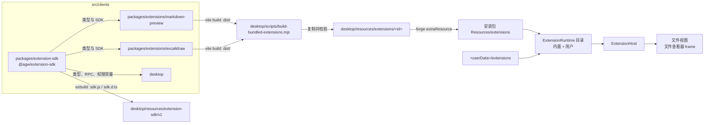
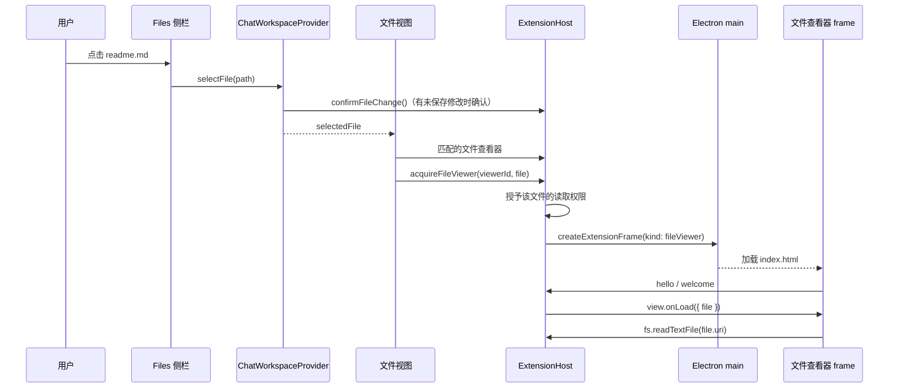
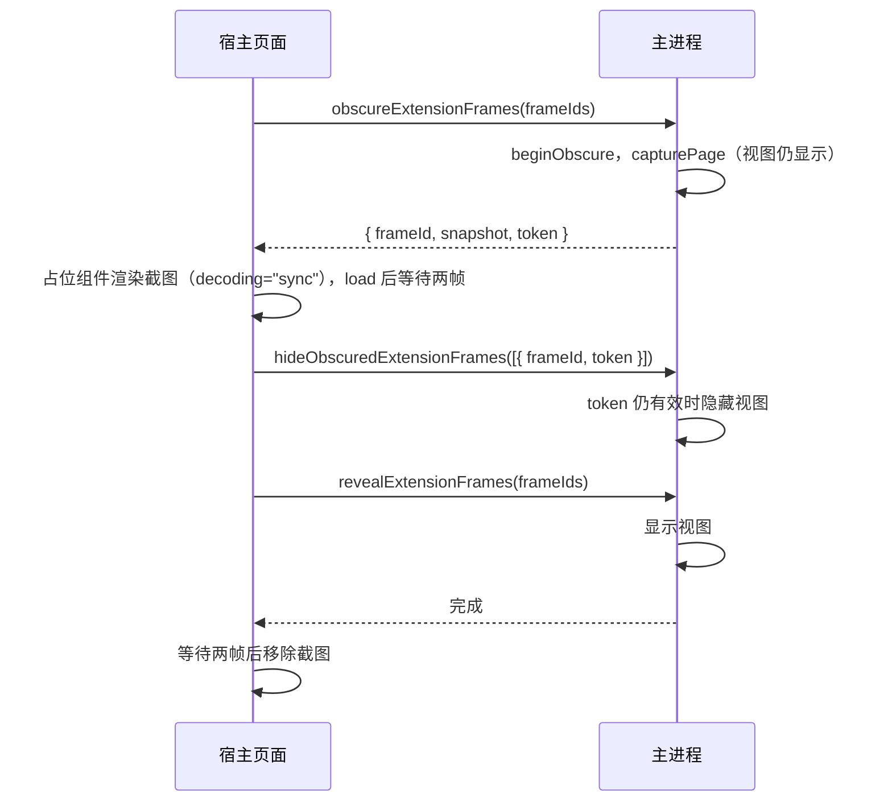

# Desktop 内置 Extension 与文件查看器

## 名词解释

- **内置 extension**：随 Desktop 安装包提供、从应用资源目录加载的 extension。源码在 `src/clients/packages/extensions/` 下，每个 extension 是一个工作区包。
- **用户 extension**：用户通过 Extensions 页面安装到 `<userData>/extensions/` 的 extension。
- **文件查看器（file viewer）**：extension 通过 `contributes.fileViewers` 注册的视图，在 Files 的文件视图中显示文件名匹配的文件。
- **未保存修改**：文件查看器报告的、还没有写回文件的修改。
- 其余名词（Ribbon、视图、frame、贡献点、session 等）沿用 `2026-10-16-Desktop-Extension.md`。

## 背景

`2026-10-16-Desktop-Extension.md` 让 Desktop 可以安装和运行 extension，但 Desktop 自身不提供任何 extension。Files 的文件视图只按源码显示文件：Markdown 文件看不到排版后的效果，`.excalidraw` 文件只显示 JSON。

本方案增加：

- `src/clients/packages/extensions/` 目录，放置随 Desktop 打包的 extension。
- Markdown Preview：在文件视图中渲染全部 Markdown 文件。
- Excalidraw：在文件视图中打开、编辑并手动保存 `.excalidraw` 文件。

点击文件时由 extension 显示内容，需要新的贡献点 `fileViewers`。extension 包位于 `src/clients/packages/` 下后，按工作区边界规则（`packages-no-application-imports`）不能引用 `desktop/` 中的 SDK 与类型，因此 SDK、公开 API 类型与 RPC 协议移入工作区包 `@agw/extension-sdk`。

## 设计目标

### 功能目标

1. `@agw/extension-sdk`：SDK、公开 API 类型、RPC 协议与权限常量组成的工作区包，Desktop 与 extension 包都引用它。
2. `src/clients/packages/extensions/` 目录与构建：每个内置 extension 一个工作区包，构建产物复制到 Desktop 资源目录并随安装包发布。
3. 内置 extension 的加载、默认启用、升级、停用与卸载。
4. `fileViewers` 贡献点与文件视图集成。
5. Extension API 补充：`workspace.openFile`、`workspace.setUnsavedChanges`，`ui.openExternal` 打开未批准地址前由用户确认。
6. 未保存修改的标记与离开前确认。
7. Markdown Preview extension。
8. Excalidraw extension。
9. 宿主弹出层遮挡 extension 视图时，视图与截图之间的切换不出现空白。

### 技术目标

- **安全**：内置 extension 与用户 extension 使用同一套隔离（独立 session、`WebContentsView`、CSP、出站代理、权限检查），没有额外权限。文件查看器只获得被打开文件的读取授权，写入需要 `fs.cloud.write`。Markdown Preview 不渲染 Markdown 中的原始 HTML。两个内置 extension 不声明 `hostPermissions`，不访问网络；Excalidraw 的字体等资源从 extension 自身 origin 提供。
- **兼容**：`manifestVersion` 仍为 1。新增的 manifest 字段、frame 类型与 API 都是增量，已有 extension 不受影响。
- **构建**：开发（`pnpm dev:desktop`）、打包（`prepare-resources.mjs`）与集成测试（`test:extensions`）使用同一个构建脚本生成内置 extension。

## 总体设计



运行时，主进程把应用资源目录与 `<userData>/extensions` 合并为一个 extension 目录；同 id 时用户 extension 优先。宿主注册 extension 的文件查看器；文件视图显示文件时按文件名找出匹配的查看器，默认显示第一个，标题栏可以切换到源码。

## 数据库设计

不涉及 Server 数据库。Desktop 的 `settings.json` 增加 `removedBundledExtensions`（见详细设计第 3 节）。

## 详细设计

### 1. `@agw/extension-sdk`

新建工作区包 `src/clients/packages/extension-sdk`（`@agw/extension-sdk`），从 Desktop 移入：

- `desktop/src/shared/extension-api.ts` → `packages/extension-sdk/src/api.ts`
- `desktop/src/shared/extension-rpc.ts` → `packages/extension-sdk/src/rpc.ts`
- `desktop/src/shared/extension-permissions.ts` → `packages/extension-sdk/src/permissions.ts`
- `desktop/extension-sdk/src/{index,connection,api}.ts` → `packages/extension-sdk/src/sdk/{index,connection,api}.ts`

- 包入口 `src/index.ts` 导出全部公开类型、`connect`、`defineBackground`、`defineView`、RPC 协议与权限常量。工作区边界规则要求跨包引用只经过入口文件，Desktop 主进程、preload、renderer 都从 `@agw/extension-sdk` 引用。
- 浏览器端 SDK 文件仍由 Desktop 的 `scripts/build-extension-sdk.mjs` 生成，入口改为 `packages/extension-sdk/src/sdk/index.ts`。产物 `resources/extension-sdk/v1/{sdk.js,sdk.d.ts,manifest.schema.json}` 与提供方式（`agw-extension://<id>/__agw/sdk.js`）不变。`sdk.js` 只导出 `connect`、`defineBackground`、`defineView`。
- extension 包在源码中写 `import { defineView } from "@agw/extension-sdk"`。Vite 构建时把 `@agw/extension-sdk` 设为 external，并通过 `output.paths` 改写为 `/__agw/sdk.js`，运行时使用宿主提供、与 `manifestVersion` 匹配的 SDK。extension 包只能从 `@agw/extension-sdk` 引用这三个函数与类型；构建脚本检查产物中对 `/__agw/sdk.js` 的引用只包含这三个名称。
- manifest 的 zod schema（`extension-manifest.ts`）与域名权限解析（`extension-host-permissions.ts`）是宿主的校验逻辑，留在 Desktop。
- `@agw/extension-sdk` 依赖 `@agw/execution-core`（执行消息类型），不依赖 React 或 DOM 组件库。

### 2. `packages/extensions` 目录与构建

- `src/clients/packages/extensions/markdown-preview/`：`@agw/extension-markdown-preview`
- `src/clients/packages/extensions/excalidraw/`：`@agw/extension-excalidraw`
- `pnpm-workspace.yaml` 的 `packages` 增加 `packages/extensions/*`。`tools/scripts/check-client-boundaries.mjs` 把 `packages/extensions/*` 纳入扫描。extension 包是独立的页面应用，React 等依赖作为 devDependencies 打包进产物，不按组件包的 peer 依赖规则检查；任何工作区包与应用都不能依赖 extension 包，只有 Desktop 的构建脚本读取它们的 `dist/`。
- 每个 extension 包包含：
  - `manifest.json`：extension manifest，`id` 与目录名相同。
  - `index.html`、`src/`：页面源码。
  - `vite.config.ts`：`base: "./"`，输出到 `dist/`，`@agw/extension-sdk` 映射为 `/__agw/sdk.js`；构建时把 `manifest.json` 复制到 `dist/`。
  - `package.json`：`build`、`typecheck`、`lint`、`format`、`format:check`、`test` 脚本。
- `desktop/scripts/build-bundled-extensions.mjs` 导出 `buildBundledExtensions()`：
  1. 在 `src/clients` 运行 `pnpm --filter "./packages/extensions/*" build`。
  2. 对每个包的 `dist/`：用 `evaluateExtensionManifest` 校验 manifest，要求 `validation` 为 `valid`、`id` 与包目录名相同、manifest 中的包路径都存在；检查 `/__agw/sdk.js` 的导入名称（第 1 节）。任何一项失败时构建失败。
  3. 删除并重建 `desktop/resources/extensions/`，把每个 `dist/` 复制为 `resources/extensions/<id>/`。
- `prepare-resources.mjs`、`dev.mjs`（启动时）与 `test-extensions.mjs` 调用 `buildBundledExtensions()`；`forge.config.cjs` 的 `extraResource` 增加 `resources/extensions`。`resources/` 已被 `.gitignore` 忽略。

### 3. 内置 extension 的加载、启用与卸载

- **位置**：打包后为 `<process.resourcesPath>/extensions`，开发时为 `desktop/resources/extensions`。目录只读，随 Desktop 升级整体替换。
- **目录合并**：`ExtensionRuntime` 扫描内置目录与 `<userData>/extensions`，`CatalogEntry` 增加 `source: "bundled" | "user"`。两边存在同一 `id` 时用户 extension 优先，内置的那一份不出现在列表中。`InstalledExtension` 增加 `source` 字段，供卸载与权限逻辑使用；Extensions 页面不显示来源，内置 extension 与用户 extension 的显示方式相同。
- **默认启用**：扫描后，对每个有效的内置 extension，`settings.json` 中没有对应项且不在 `removedBundledExtensions` 中时，写入 `{ enabled: true, grantedPermissions: 声明的权限, grantedHostPermissions: 声明的域名, lastActivatedVersion: null }`，即默认启用、声明的权限视为已批准。
- **升级**：Desktop 升级后内置 extension 的声明可能变化。来源为 `bundled` 的项在每次扫描时把已批准集合更新为当前声明（新增项同样视为已批准），保持启用状态不变。用户 extension 仍按原规则：有新增项时停用并等待批准。版本变化时 `onInstalled` 收到 `update`，规则不变。
- **停用与启用**：与用户 extension 相同。停用后再次启用时显示权限批准对话框。
- **卸载**：Extensions 页面的 Uninstall 与 "Also delete extension data" 对内置 extension 同样可用：
  - 来源为 `user`：按原流程删除安装目录。如果存在同 id 的内置 extension，且它不在 `removedBundledExtensions` 中，它在下次扫描时重新出现，并按默认启用规则写入设置。
  - 来源为 `bundled`：资源目录只读，不删除文件。主进程把 id 加入 `settings.json` 的 `removedBundledExtensions`（字符串数组，默认空），删除该 id 的设置项；选择删除数据时，与用户 extension 一样删除 `<userData>/extension-data/<id>/` 并清除其 session 数据。
  - 在 `removedBundledExtensions` 中的内置 extension 不出现在列表中，Desktop 升级也不会恢复。用户可以用 Install from folder 选择应用资源目录中的该 extension 目录，作为用户 extension 重新安装。
- **协议与隔离**：`agw-extension` 协议的根目录取目录项的实际目录，内置 extension 从资源目录提供文件；session、`WebContentsView`、CSP、出站代理与用户 extension 相同。

### 4. `fileViewers` 贡献点

```json
"contributes": {
  "fileViewers": [
    {
      "id": "preview",
      "title": "Preview",
      "icon": "BookOpen",
      "patterns": ["*.md", "*.markdown"],
      "entry": "index.html"
    }
  ]
}
```

- **字段**：`id`、`title`、`icon`、`entry` 的规则与 `mainViews` 相同（`id` 在 `fileViewers` 内不重复，`entry` 为 `.html` 包路径）。`patterns` 为 1 到 20 个不重复的文件名模式。
- **模式**：与文件的基本名（不含目录）对比，不区分大小写；`*` 匹配任意个字符，`?` 匹配一个字符，其余字符按字面匹配；模式长度 1 到 64，不能包含 `/` 或 `\`。示例：`*.md`、`README`、`*.excalidraw`。
- **注册**：extension 进入 `active` 时宿主注册它的文件查看器，id 为 `<extensionId>:<viewerId>`，与视图一起在停用与失败时注销或标记失败。
- **匹配与顺序**：文件视图显示文件时，找出模式匹配该文件名的全部文件查看器，按 extension id 排序，同一 extension 内按声明顺序排列。
- **适用范围**：Files 中的项目文件（云端文件）。`Only diff` 模式显示 git diff 时不提供文件查看器。

### 5. 文件视图集成



- **界面**：`@agw/projects` 的 `FileContent` 与 `@agw/chat` 的 `ChatFilePane` 增加可选属性：
  - `fileViewers?: readonly { id: string; title: string; unsaved: boolean }[]`：匹配当前文件的查看器。
  - `renderFileViewer?: (viewerId: string) => ReactNode`：渲染查看器的占位组件。
  - `onReloadFileViewer?: (viewerId: string) => void`：重新加载查看器。
  - `renderFileViewerInfo?: (viewerId: string) => ReactNode`：查看器的说明，显示在 "Reload view" 右侧。
  - 有匹配的查看器时，`FileHeader` 的文件名右侧依次显示：切换按钮（各查看器的 `title`，最后是 "Source"）；选中查看器时的 "Reload view" 按钮（传入了 `onReloadFileViewer` 时）与 `renderFileViewerInfo` 的内容。默认选中第一个查看器，切换文件时回到默认。`unsaved` 为 true 时标题前显示 "●"。`FileHeader` 为此增加可选属性 `actions?: ReactNode`，显示在文件名的右侧。
  - 选中 "Source" 时显示现有的 `FileViewer`（源码与行评论）。Web 不传这些属性，行为不变。
- **Desktop 组合**：`MainWorkspace` 渲染 `ChatFilePane` 时传入匹配结果，并用 `ExtensionView` 渲染查看器占位组件，错误面板、截图与遮挡处理与其他视图相同。文件查看器不显示宿主标题条（`ExtensionView` 的 `showHeader` 为 false），标题条的内容移到文件名右侧：
  - "Reload view" 与标题条按钮的处理相同：extension 已失败时重新加载 extension，否则重新加载视图。
  - "Reload view" 右侧是 Info 按钮（`ExtensionViewInfo`，`aria-label` 为 "View info"），点击后弹出层显示 extension 图标、视图标题与 extension 名称，标明查看器由哪个 extension 提供。弹出层是 `popover-content`，覆盖查看器时按遮挡处理换成截图。
- **frame**：
  - 新的 frame 类型 `fileViewer`。每个文件查看器在同一时间最多一个 frame，按查看器 id 记录。
  - 查看器第一次显示时创建 frame，`view.onLoad(api, params)` 的 `params` 为 `{ file: { uri, name, projectId } }`；`uri` 为 `agw-cloud://` 地址。
  - 文件变化且该查看器仍匹配新文件时复用 frame，宿主发送 `view.onShow({ file })`，extension 读取新文件。
  - 切换到 "Source"、切换到其他主区视图或文件视图卸载时，frame 隐藏并收到 `view.onHide`，页面保留；再次显示同一查看器时恢复。
  - 以下情况执行 frame 关闭流程（`reason` 为 `frame-unloaded`）：新选中的文件不再匹配该查看器、取消选择文件、切换 Project；外壳卸载、停用与连接标识变化按原设计处理。
- **授权**：宿主把文件交给查看器时（`onLoad` 或 `onShow` 之前），为该 extension 授予这个云端文件的读取权限（用户选择授权，绑定连接标识，第 14 节规则不变）。写入需要 `fs.cloud.write`。
- **读取与刷新**：文件内容由 extension 通过 `fs.readFile` / `fs.readTextFile` 读取。云端文件不能监听，文件名右侧的 "Reload view" 重新加载查看器。

### 6. Extension API 补充

- **`ExtensionFrameKind`** 增加 `"fileViewer"`；`ExtensionWelcome.frame.kind` 可能为 `fileViewer`。
- **`FileViewerParams`**：`{ file: { uri: string; name: string; projectId: string } }`，`onLoad` 与 `onShow` 的参数。
- **`workspace.openFile(uri: string): Promise<void>`**：在 Files 中选中并在文件视图中打开一个文件。
  - `uri` 必须是当前连接、当前 Project 的 `agw-cloud://` 文件地址，否则错误 `code` 为 `ERR_INVALID_URI`。
  - 打开前执行未保存修改确认（第 7 节）；用户取消时错误 `code` 为 `ERR_CANCELED`。
  - 文件不存在时文件视图显示错误，API 正常返回。
  - 不需要额外权限。
- **`workspace.setUnsavedChanges(unsaved: boolean): Promise<void>`**：文件查看器报告未保存修改；其他类型的 frame 调用时错误 `code` 为 `ERR_UNSUPPORTED_OPERATION`。frame 关闭或页面重新加载后该状态清除。
- **`ui.openExternal(url)`**：
  - 只接受 `http:`、`https:` 地址（与宿主的 `agw:open-external` 一致），其他地址的错误 `code` 为 `ERR_INVALID_URL`。
  - 匹配已批准的域名时直接用系统浏览器打开。
  - 其他地址由宿主显示确认对话框，标题为 "Open link?"，内容为 extension 名称与完整地址，按钮为 "Cancel" 与 "Open"。确认后打开；取消时错误 `code` 为 `ERR_CANCELED`。
- 这些都是增量变化，`manifestVersion` 仍为 1。

### 7. 未保存修改

- **记录**：宿主按 frame 记录 `setUnsavedChanges` 的结果；文件视图的查看器切换按钮显示 "●"。
- **确认对话框**：标题 "Discard unsaved changes?"，内容为文件名、查看器标题与 extension 名称，按钮为 "Cancel" 与 "Discard"。选择 "Discard" 后继续操作，查看器收到新文件或执行关闭流程。
- **触发确认的操作**（存在未保存修改的查看器时）：
  - 在 Files 中选择其他文件、切换浏览目录，以及 `workspace.openFile`：`ChatWorkspaceProvider` 增加可选属性 `confirmFileChange?: () => Promise<boolean>`，在 `selectFile`、`selectDirectory`、`selectProject` 改变当前文件前调用。Desktop 传入宿主的确认函数；Web 不传。
  - 离开对话页面或切换 Project：Desktop 外壳中的 Settings 链接、Project 选择、任务菜单中的对话链接在导航前调用同一个确认函数。
  - 关闭窗口（`closeBehavior` 为退出时）、退出 Desktop、用户刷新页面：宿主在存在未保存修改时注册 `beforeunload`。主进程在主窗口的 `will-prevent-unload` 事件中显示系统对话框（"Discard unsaved changes?"，按钮 "Discard" / "Cancel"），选择 "Discard" 时调用 `event.preventDefault()` 继续关闭。主进程主动加载渲染页面（托盘 "Open Agw Chat"、"Reload without extensions"、崩溃恢复，都经过 `loadTrustedRendererUrl`）时不显示该对话框。
- **不确认的情况**：切换到 "Source" 或其他主区视图时查看器只隐藏，修改保留。连接标识变化发生在 Settings 页面，离开对话页面时已经确认过。

### 8. Markdown Preview

- **包**：`packages/extensions/markdown-preview`（`@agw/extension-markdown-preview`）。manifest：`id` `markdown-preview`，`name` "Markdown Preview"，`fileViewers` 为 `[{ "id": "preview", "title": "Preview", "icon": "BookOpen", "patterns": ["*.md", "*.markdown"], "entry": "index.html" }]`，`permissions` 为 `["fs.cloud.read"]`，没有 background。
- **渲染**：React、`react-markdown`、`remark-gfm`（表格、任务列表、删除线、自动链接）、`rehype-highlight`（代码高亮）。不渲染原始 HTML（不使用 `rehype-raw`）。
- **样式与主题**：`api.theme.apply()` 同步宿主颜色变量与 dark class；代码高亮使用 highlight.js 的 GitHub 浅色与深色主题，按 dark class 切换。
- **标题锚点**：标题按 GitHub 规则生成 `id`，`#anchor` 链接在页面内滚动。
- **图片**：
  - 相对路径按当前文件所在目录解析，不能超出 Project 目录，通过 `fs.readFile` 读取后用 Blob URL 显示，切换文件或卸载时释放。
  - `data:` 地址直接显示。
  - 其他地址受 CSP 限制不加载，显示 alt 文本与 "External image" 标记。
- **链接**：
  - 相对路径：解析为同一 Project 的云端地址，调用 `workspace.openFile`。
  - `http:`、`https:`：调用 `ui.openExternal`，由宿主确认。其他 scheme 的链接不响应点击。
- **读取失败**：显示错误信息，"Source" 仍可使用。

### 9. Excalidraw

- **包**：`packages/extensions/excalidraw`（`@agw/extension-excalidraw`）。manifest：`id` `excalidraw`，`name` "Excalidraw"，`fileViewers` 为 `[{ "id": "editor", "title": "Excalidraw", "icon": "PenTool", "patterns": ["*.excalidraw"], "entry": "index.html" }]`，`permissions` 为 `["fs.cloud.read", "fs.cloud.write"]`，没有 background。
- **依赖**：`@excalidraw/excalidraw`（0.18.x，支持 React 19）。
- **资源**：页面加载前设置 `window.EXCALIDRAW_ASSET_PATH` 为 extension 自身 origin 下的资源目录；构建时把 Excalidraw 的字体复制到产物中。CSP（`font-src 'self'`、`style-src 'self' 'unsafe-inline'`、`script-src 'self' 'wasm-unsafe-eval'`、`worker-src 'self' blob:`）不变。
- **字体回退地址**：Excalidraw 0.18 为每个字体额外加入 `https://esm.sh/...` 回退地址，CSP 会拦截它们并让宿主记录大量被拦截请求。`pnpm-workspace.yaml` 的 `patchedDependencies` 给 `@excalidraw/excalidraw@0.18.1` 加补丁：设置了 `EXCALIDRAW_ASSET_PATH` 时只使用该地址。
- **打开**：`fs.readTextFile` 读取后用 `restore` 恢复场景。空文件作为空白画布打开；JSON 无效时显示错误信息，"Source" 仍可使用。主题跟随 `api.theme` 的 `kind`。
- **链接**：元素上的链接通过 `onLinkOpen` 处理：元素链接在画布内跳转；`http:`、`https:` 调用 `ui.openExternal`；其他链接不响应。
- **编辑与保存**：
  - 编辑后，元素版本、嵌入文件或写入文件的 appState 字段（背景颜色、网格设置，按 `serializeAsJSON` 的结果比较）与上次保存的状态不同时调用 `setUnsavedChanges(true)`；只改变缩放、滚动、选择等视图状态不算修改。
  - `Cmd/Ctrl+S` 或右上角的 "Save" 按钮用 `serializeAsJSON(elements, appState, files, "local")` 生成内容，通过 `fs.writeFile(uri, content, { overwrite: true })` 写回原文件。
  - 写入成功后调用 `setUnsavedChanges(false)`；失败时用 `ui.notify` 显示错误，保留未保存状态。
- **不提供**：在线库浏览、分享链接、协作、打开或另存为其他文件、导出图片。对应的界面入口通过 `UIOptions` 关闭。

### 10. 遮挡截图的切换顺序

`docs/designs/2026-10-16-Desktop-Extension.md` 第 1 节的遮挡处理中，主进程截图后立即隐藏视图，再把截图交给宿主；宿主收到、解码并画出截图之前，占位组件是空白的。恢复时宿主先移除截图，主进程随后才显示视图，中间同样是空白。文件查看器的 Info 弹出层盖住视图时，这两段空白看起来像查看器重新加载。切换顺序调整为：



- **主进程**：每个 view frame 的状态为 `layoutVisible`、`obscuring`、`hidden` 与 `obscureToken`，实际可见性为 `layoutVisible && !hidden`。
  - `obscureExtensionFrames` 设置 `obscuring = true`、`obscureToken` 加 1，截图期间视图保持显示，返回 `{ frameId, snapshot, token }`。截图完成时请求已过期（`obscureToken` 变化、frame 已销毁或已恢复），返回的 `snapshot` 为 `null`。
  - 视图在请求时已经不可见，或截图失败时，立即隐藏视图，返回的 `snapshot` 为 `null`。
  - `hideObscuredExtensionFrames` 只对 `token` 仍有效的请求设置 `hidden = true` 并隐藏视图，过期请求不生效。
  - `revealExtensionFrames` 设置 `obscuring = false`、`hidden = false`、`obscureToken` 加 1，按上式恢复可见性。
- **宿主**：
  - 收到截图后保存截图与 `token`；占位组件的截图使用 `decoding="sync"`，`load` 后调用 `ExtensionHost.snapshotShown`。宿主等待两帧（截图已经画出），确认该 frame 仍期望遮挡、请求序号与截图都未变化后，调用 `hideObscuredExtensionFrames`。
  - 遮挡结束时调用 `revealExtensionFrames`，完成后再等待两帧，请求序号未变化时移除截图。
- 其他规则（`OVERLAY_SLOTS`、模态遮罩、截图期间不能交互、宿主的请求序号）不变。

## 接口文档

### Manifest

`ExtensionContributes` 增加：

```ts
fileViewers?: Array<{
  id: string;
  title: string;
  icon: string;
  patterns: string[];
  entry: string;
}>;
```

### Extension API（`@agw/extension-sdk`）

```ts
type ExtensionFrameKind = "background" | "sidebarView" | "mainView" | "fileViewer" | "settings";

interface FileViewerParams {
  file: { uri: string; name: string; projectId: string };
}

interface WorkspaceApi {
  // 原有方法不变
  openFile(uri: string): Promise<void>;
  setUnsavedChanges(unsaved: boolean): Promise<void>;
}
```

`ui.openExternal` 的行为见详细设计第 6 节。新增错误 `code`：`ERR_INVALID_URI`、`ERR_INVALID_URL`、`ERR_CANCELED`。

### Desktop 内部

- `InstalledExtension.source: "bundled" | "user"`。
- `DesktopSettings.removedBundledExtensions: string[]`。
- `CreateExtensionFrameRequest.kind` 可以为 `fileViewer`。
- `ExtensionRuntimeOptions.bundledExtensionsDirectory: string`。
- `ExtensionFrameSnapshot` 增加 `token: number`；新增 `ExtensionFrameObscureRequest = { frameId: string; token: number }`。
- `AgwDesktopBridge.hideObscuredExtensionFrames(hostInstanceId, requests: ExtensionFrameObscureRequest[]): Promise<void>` → `agw:hide-obscured-extension-frames`；`obscureExtensionFrames` 截图后不再隐藏视图（第 10 节）。

## 测试计划

### 单元测试

- `extension-manifest.test.ts`：`fileViewers` 字段校验（模式格式、数量、重复 id、`entry` 路径）；JSON Schema 与 zod 结果一致。
- `file-viewer-patterns.test.ts`：模式匹配（大小写、`*`、`?`、字面字符、无目录）。
- `extension-catalog.test.ts`：内置与用户目录合并、同 id 时用户优先、`removedBundledExtensions` 中的内置 extension 不出现。
- `extension-runtime` 设置逻辑（`settings-store.test.ts`）：内置 extension 默认启用且批准声明的权限；升级后的新增权限自动批准且保持启用状态；卸载内置 extension 写入 `removedBundledExtensions`；卸载用户副本后内置副本重新出现。
- `workspace-registry.test.ts`：文件查看器的注册、注销、失败标记与匹配顺序。
- `extension-bridge.test.ts`：`setUnsavedChanges` 只允许文件查看器；`openFile` 校验地址并在取消时返回 `ERR_CANCELED`；`openExternal` 对已批准与未批准地址的处理。
- `@agw/projects`：`FileContent` 的文件名右侧依次为切换按钮、"Reload view" 与查看器说明；默认选中、"●" 标记、切换文件回到默认；"Reload view" 与查看器说明只在选中查看器时显示，"Reload view" 报告选中的查看器。
- Desktop `extension-view.test.ts`：`ExtensionViewInfo` 点击后弹出层显示图标、视图标题与 extension 名称。
- `extension-frame-visibility.test.ts`：截图期间视图保持显示，`hide` 只对仍有效的请求生效，恢复、销毁或更新的请求使旧请求失效。
- `@agw/chat`：`chat-workspace-hydration.test.ts` 中 `confirmFileChange` 返回 false 时不切换文件、目录与 Project。
- Markdown Preview：相对路径解析（不能超出 Project 目录）、链接分类、标题 id 生成。
- Excalidraw：修改判断（元素版本、嵌入文件、写入文件的 appState 字段；视图状态变化不算修改）、场景文件检查、保存快捷键识别。

### 集成测试

`pnpm --filter @agw/desktop test:extensions` 增加以下检查（Project 中放入 `readme.md`、`guide.md`（标题、表格、代码块、相对路径图片、相对链接与外部链接）、`docs/notes.md`、`images/logo.png`、`diagram.excalidraw`、空文件 `blank.excalidraw`）：

- 首次启动后 Markdown Preview 与 Excalidraw 出现在 Extensions 页面并处于 `active`，没有出现批准对话框，`settings.json` 记录了声明的权限。
- 在 Files 中点 `guide.md`：文件视图默认显示 "Preview"，页面中有渲染后的标题、表格与高亮代码，相对路径图片通过 Blob URL 加载成功；文件视图中没有宿主标题条，只有文件名右侧一个 "Reload view"，点击后查看器在新的 frame 中重新渲染；它右侧的 Info 按钮弹出视图标题与 extension 名称，弹出层盖住查看器时视图隐藏前截图已经加载，关闭后视图恢复且页面没有重新加载；切换到 "Source" 显示原文，查看器隐藏并保留页面；点击相对链接后文件视图打开 `docs/notes.md`，复用同一个 frame；点击外部链接时宿主显示 "Open link?" 与完整地址，选择 "Cancel" 后对话框关闭，文件视图不变。确认后由系统浏览器打开的处理由 `extension-bridge.test.ts` 验证。
- 点 `diagram.excalidraw`：显示 Excalidraw 并恢复场景中的元素，加载期间没有被拦截的请求；在画布上用键盘与鼠标画一个矩形后切换按钮出现 "●"；此时点击其他文件显示 "Discard unsaved changes?"，选择 "Cancel" 后仍停留在该文件；`Cmd/Ctrl+S` 后磁盘上的文件包含新元素，"●" 消失，再切换文件不再确认。
- 点 `blank.excalidraw`：显示空白画布，没有 "●"。
- 存在未保存修改时点击 Settings 链接显示确认对话框。
- 停用 Markdown Preview 后 `.md` 文件只显示源码；重新启用后恢复。
- 卸载 Excalidraw 并删除数据：列表中不再出现，数据目录被删除；重新启动 Desktop 后仍不出现。
- 重新启动后 Markdown Preview 自动激活。
- 原有的宿主弹出层检查（`hostOverlays`）：菜单盖住主区视图时，视图隐藏前占位组件中的截图已经加载。

### 回归测试

- `pnpm --filter @agw/desktop test`、`test:extension-network`、`test:extensions`。
- 在 `src/clients` 运行 `pnpm test`（含 `test:boundaries`）、`pnpm lint`、`pnpm fmt:check`、`pnpm build`、`pnpm --filter @agw/web test:e2e`。
- `pnpm dev:desktop` 连接本机 Server：打开 Markdown 与 Excalidraw 文件、编辑并保存、离开前确认、停用与卸载内置 extension。
