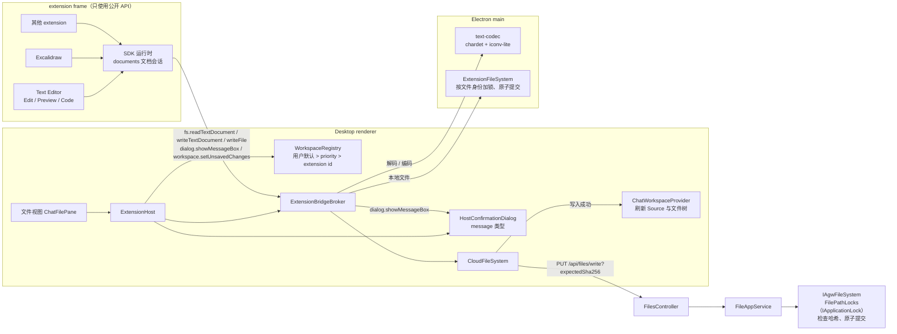
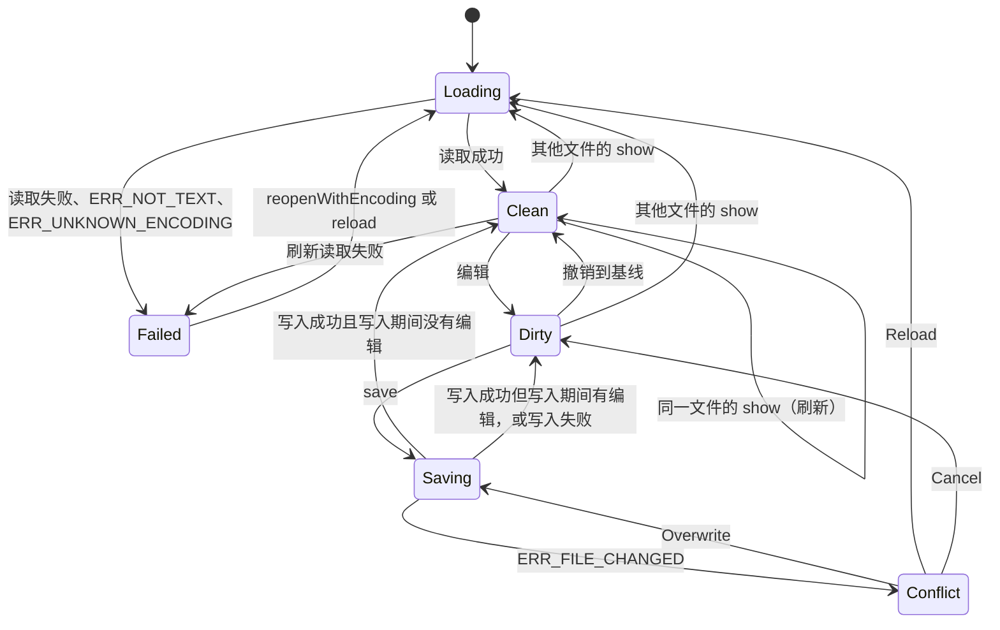
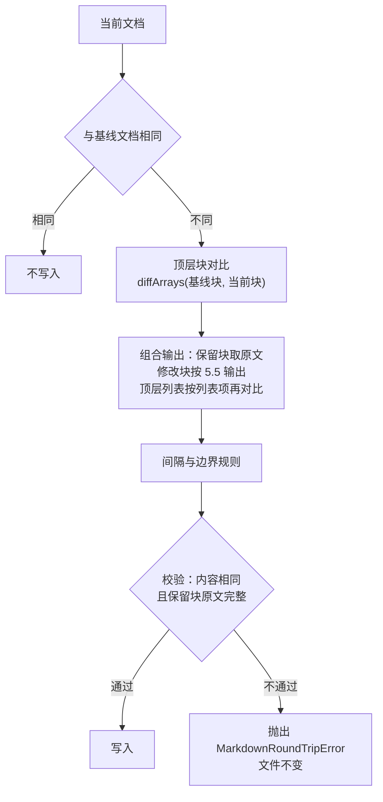

# Desktop 文本文件编辑

## 名词解释

- **Text Editor**：内置 extension，id `text-editor`，包名 `@agw/extension-text-editor`。由 Markdown Preview（`packages/extensions/markdown-preview`）改名而来，提供 Edit、Preview、Code 三个文件查看器。
- **Edit**：Text Editor 的 Markdown 编辑器，查看器 id `markdown`，基于 Tiptap，界面风格类似 Notion。
- **Preview**：Text Editor 的 Markdown 只读渲染，查看器 id `preview`，即原来的 Markdown Preview。
- **Code**：Text Editor 的代码编辑器，查看器 id `code`，基于 Monaco，匹配全部文件。
- **文本文件**：能按某种受支持的编码无损解码的文件：解码后再编码得到完全相同的字节，并且解码结果中没有替换字符（U+FFFD）与制表符、换行、回车、换页、垂直制表、ESC 以外的控制字符。
- **编码**：文本文件的字符编码（例如 `utf-8`、`utf-16le`、`gb18030`）与是否带 BOM。
- **内容哈希**：文件全部字节的 SHA-256，64 位小写十六进制。
- **写入前提**：写入时附带的 `expectedSha256`。服务端在写入前计算磁盘上文件的内容哈希，与它不同时拒绝写入。
- **文件身份**：判断两次写入是否针对同一个文件的依据，按操作的对象决定。内容操作（写入、替换文字）使用实际被替换的那个文件的完整物理路径（所有符号链接都跟随到最终目标）；目录项操作（删除、移动的源与目标、创建目录）使用这个目录项自己的物理路径（父目录的物理路径加目录项名称，最后一段不跟随符号链接）。Windows 与 macOS 上不区分大小写。
- **原子提交**：先把新内容完整写入同一目录中的临时文件并刷新到磁盘，再用一次重命名替换目标文件。替换之前的任何失败都不改变目标文件。
- **文档会话**：Extension API `documents` 创建的对象，负责一个文件的读取、编码、未保存状态、保存、冲突处理与刷新。
- **基线**：文档会话最近一次从磁盘读取或成功写入时的状态：内容哈希、编码、换行符，以及当时的编辑器内容。
- **块**：Markdown 文档的顶层子节点（paragraph、标题、列表、代码块、表格等）。顶层列表中的每个列表项也按块处理。
- **保留块**：保存时与基线中某个块相同的块。保留块写出时使用原文。
- **修改块**：保存时新增或内容、写法有变化的块。修改块按 5.5 节的规则输出。
- **内容属性 / 写法属性**：节点属性分为两类。内容属性决定文档的含义（例如列表项的 `checked`、代码块的 `info`）；写法属性只记录原文的写法（例如列表符号、围栏字符）。见 5.3 节。
- **查看器优先级**：manifest 中 `fileViewers[].priority` 的值，`default` 或 `option`。
- 其余名词（文件查看器、frame、未保存修改、`MarkdownManager` 等）沿用 `2026-10-18-Desktop-内置Extension与文件查看器.md` 与 `2026-10-18-Markdown渲染接口与Desktop-Tiptap渲染.md`。

## 背景

- Files 的文件视图中，Source 是只读的 `<pre>`（`packages/projects/src/ui-web/components/file-explorer/file-viewer.tsx`），没有语法高亮。能写回文件的只有 Excalidraw extension，它的读取、保存与未保存判断都写在自己的包中，其他 extension 无法复用。
- Markdown Preview 已经用 `MarkdownManager` 把 Markdown 解析为 Tiptap 文档，但它的扩展只用于解析。Tiptap 文档不记录原文的写法，marked 还会丢掉重复的链接定义、只保留代码围栏信息中的第一个词，直接从文档生成 Markdown 会改写或丢失原文。
- `PUT /api/files/write` 没有写入前提，`LocalFileSystem.WriteAsync` 用 `FileMode.Create` 清空目标文件后复制内容。复制期间取消、磁盘出错或进程退出都会留下不完整的文件。Agent 也会修改同一个 Project 中的文件，后写入的一方会在没有提示的情况下覆盖前一方。
- `LocalFilePathLocks` 只在同一个 Server 进程内有效。分开部署的 ControlPlane 与 DataPlane 都会写 Project 文件。Desktop 主进程的 `ExtensionFileSystem` 按 extension id 分配锁，两个 extension 写同一个本地文件时不会串行执行。
- 文本读取只按 UTF-8 解码（`readTextFile`），UTF-16、GB18030 等编码的文本文件显示为乱码，写回时被改成 UTF-8。
- 宿主只按文件名匹配文件查看器，并按 extension id 排序。多个 extension 匹配同一类文件时，默认显示哪一个由 id 的字母顺序决定，用户无法选择。
- 文件查看器隐藏后再显示时收不到通知；"Reload view" 直接重建 frame，未保存修改会在没有确认的情况下丢失；文件树只在 git 状态变化时重新加载根目录。

## 设计目标

### 功能目标

1. Text Editor extension：Markdown Preview 改名为 Text Editor，提供 Edit、Preview、Code 三个文件查看器。
2. Edit：Notion 风格的 Markdown 编辑器，包括块编辑、`/` 命令菜单、选中文字时的格式工具条、块拖动手柄、表格、任务列表、带高亮与语言选择的代码块、链接、图片、脚注引用、front matter，以及 HTML 等原文块。
3. Markdown 写回：保留块原样写出，修改块按原来的写法输出；写回前校验内容与保留块；没有改写整个文件的路径。
4. Code：Monaco 编辑器，覆盖全部文本文件，提供语法高亮、查找替换、格式化与状态栏。
5. 编码：自动识别编码，按原编码、BOM 与换行符写回；可以按指定编码重新读取、按指定编码保存；区分“无法识别编码”与“二进制文件”。
6. 保存与冲突：`Cmd/Ctrl+S` 与 Save 按钮、未保存标记、写入前提、原子提交、冲突对话框（Overwrite / Reload / Cancel）；自动刷新不覆盖读取期间的输入。
7. 通用的文件查看与编辑扩展能力：任何 extension 只使用公开的 manifest 与 Extension API，就能为任意文件名模式提供查看器或编辑器，并获得与 Text Editor 相同的读写、编码、冲突与未保存处理；用户可以为每类文件选择默认的查看器。Text Editor 与 Excalidraw 都只使用这些公开能力。
8. 宿主：查看器优先级与用户默认查看器、重新显示时的 `onShow`、"Reload view" 的确认、`dialog.showMessageBox`、写入后刷新 Source 与文件树。
9. 服务端：`PUT /api/files/write` 支持 `expectedSha256`，全部写入路径按文件身份串行，写入改为原子提交。

### 技术目标

- **数据安全**
  - 保存时发现读取之后被其他写入方修改过的内容，保存失败并显示冲突，不覆盖它们。Agw Server 的全部写入路径（HTTP 写入与 Agent 文件工具，包括分开部署的多个 Host）在持有租约期间按文件身份串行执行检查与提交；Desktop 主进程中全部 extension 的本地文件写入同样按文件身份串行。提交前的复核拒绝租约已失效的持有者与外部程序造成的变化，只剩复核与重命名之间的时间窗，保证范围见 11.2 节。
  - 不覆盖已有文件的写入（`overwrite` 为 false）使用系统提供的原子“不替换”操作，检查之后才出现的同名文件也不会被覆盖。
  - 受限文件系统的写入全程使用经过校验的句柄，不按路径重新解析。
  - 写入失败、取消或进程在提交前退出时，目标文件保持原来的完整内容。
  - Markdown 写回前校验两项：写出的文本重新解析后，内容与编辑器中的文档相同；每个保留块的原文完整出现在写出的文本中。任一项不满足时保存失败，磁盘上的文件不变，未保存修改保留。
  - 自动刷新只在读取前后编辑器都没有新的输入时替换内容。
  - 不能无损解码的文件不能编辑，不会按错误的编码写回；写回时不能用目标编码表示的字符直接报错。
- **最小改动**
  - 打开文件后不做修改直接保存，不发生写入。
  - 撤销到与基线相同的内容后，未保存标记消失。
  - Markdown 中修改一个块（或顶层列表中的一个列表项）时，写出的文件只有这个块的文字发生变化，其余字节与原文相同（边界规则见 5.6）。
- **可扩展**
  - 宿主中没有针对 `text-editor` 的代码。Text Editor 用到的每一项能力都是公开的 manifest 字段或 Extension API。
  - 单独安装的 extension 不修改宿主与 Text Editor 的代码，就能为新的扩展名提供查看器与编辑器（集成测试中的 fixture 验证）。
- **安全与隔离**
  - Text Editor 与其他 extension 使用同一套隔离：独立 session、`WebContentsView`、CSP、出站代理与权限检查。
  - 权限为 `fs.cloud.read`、`fs.cloud.write`，不声明 `hostPermissions`，不访问网络。
  - Monaco 的 worker 与语言定义、Prettier 都打包在 extension 中，从 extension 自身的 origin 加载，CSP 不变。
  - 编码识别与转换在 Desktop 主进程中执行，extension 页面只收到文字。
  - `dialog.showMessageBox` 由宿主页面绘制，标题为 extension 名称。
- **兼容**
  - `manifestVersion` 仍为 1。`priority`、`documents`、`expectedSha256`、新增的 API 与错误码都是增量。
  - 重新显示时发送 `onShow`，对现有的两个内置查看器兼容（见 9.3）。
  - Web 与 Mobile 不变，Web 的打包结果中没有 Monaco 与 Tiptap 编辑器。
- **性能**（在 Electron 中测量，见“性能测试”）
  - Edit 打开 158 KB 的文档到可以输入不超过 1500 ms，631 KB 不超过 4000 ms。
  - Edit 在 631 KB 的文档中输入一个字符，从按键到 DOM 更新不超过 50 ms。
  - Edit 保存 631 KB 的文档时，生成文本（块对比、输出、两项校验）不超过 1000 ms。
  - Code 打开 10 MB 的文本文件到可以输入不超过 3000 ms。
- **失败直接抛出**：读取、解码、解析、序列化、校验与写入的错误不做捕获后的降级，界面显示错误，未保存修改保留。

## 总体设计



文件视图中的查看器顺序（没有用户默认时）：

- `.md`、`.markdown`：Edit、Preview、Code、Source，默认 Edit。
- `.excalidraw`：Excalidraw、Code、Source，默认 Excalidraw。
- 其他文件：Code、Source，默认 Code。

### 技术选型

**通用能力放在公开的 Extension API 中**

- extension 包只能依赖 `@agw/extension-sdk`（`tools/scripts/check-client-boundaries.mjs:36-53`），包之间不能共用代码。读写、编码、冲突、未保存与刷新的处理如果写在 Text Editor 中，Excalidraw 与其他 extension 只能各自重写一遍，也无法保证行为一致。
- 这些处理分为两层：宿主提供带写入前提的读写与编码转换（RPC）；SDK 运行时提供文档会话（`documents`），把状态转换、冲突对话框、未保存报告、保存快捷键与刷新保护组合起来。SDK 运行时随 Desktop 发布，所有 extension 使用同一份实现。

**Text Editor 合并 Markdown Preview**

- Edit 与 Preview 共用 Markdown 解析（`markdown-extensions.ts`、`parse-markdown.ts`、`normalize-document.ts`）以及链接与图片地址的处理，放在同一个包中，这些代码只有一份。
- 每个查看器是一个独立的 HTML 入口，Vite 按入口分出代码，每个查看器只加载自己用到的模块。

**写入前提使用内容哈希**

- 修改时间的精度受文件系统影响，并且读取内容与读取修改时间是两次请求，两次请求之间发生的写入无法发现。
- 内容哈希由读取方对读到的字节计算，与读到的内容完全对应。服务端在文件锁内计算磁盘上文件的哈希。

**跨进程的文件锁使用 `IApplicationLock`**

- `IApplicationLock`（`Agw.Shared/Contracts/Coordination`）已经按部署方式选择实现：Standalone 使用进程内的 `InMemoryApplicationLock`，Distributed 使用 PostgreSQL 或 Redis 的分布式锁（`ApplicationLockRouter`）。按文件身份取得这个锁，同一部署中的所有 Host 都会串行执行同一个文件的写入，不需要在用户的 Project 目录中创建锁文件。

**Markdown 写回按块对比**

- 解析时记录每个块（以及顶层列表中每个列表项）在原文中的位置。保存时用最长公共子序列对比基线与当前文档的块：保留块原样复制原文，修改块按 5.5 节输出。
- 修改块需要的写法信息（围栏信息、列表符号、标题样式、引用式链接）作为写法属性保存在文档中，修改块的输出尽量使用原来的写法。
- 没有改写整个文件的路径，原文中不在文档模型里的信息（重复的链接定义、未修改代码块的围栏信息）只要所在的块没有修改，就原样保留。

**编码识别与转换**

- `chardet` 2.2.0（MIT）根据字节统计识别编码，`iconv-lite` 0.7.3（MIT）负责 UTF-8 以外编码的解码与编码。两者都依赖 Node 的 `Buffer`，在 Desktop 主进程中运行。
- 浏览器的 `TextEncoder` 只能输出 UTF-8，不能按原编码写回，所以编码转换不放在 extension 页面中。

**Monaco**

- `monaco-editor` 0.57.0（MIT），使用 ESM 版本，由 Vite 打包。
- 加载 `editor.api` 与编辑器功能模块、基础语言（Monarch 语法高亮）与 JSON 语言服务。不加载 TypeScript、CSS、HTML 语言服务，没有跨文件的代码导航与诊断。
- 格式化使用 Prettier 3.9.10（MIT）的 `prettier/standalone` 与插件 babel、estree、typescript、postcss、html、markdown、yaml、graphql。JSON 使用 Monaco JSON 语言服务的格式化。

**Tiptap 编辑器**（3.32.0，全部为 MIT）

- `@tiptap/react`：`useEditor`、`EditorContent`，以及 `@tiptap/react/menus` 的 `BubbleMenu`。
- `@tiptap/suggestion`：`/` 命令菜单。
- `@tiptap/extensions`：Placeholder、UndoRedo、Dropcursor、Gapcursor、TrailingNode。
- `@tiptap/extension-drag-handle-react`：块拖动手柄。
- `@tiptap/extension-code-block-lowlight`：代码块高亮。
- `@tiptap/extension-list`：ListKeymap（列表缩进）。

**其他**

- 块对比：`diff` 9.0.0（BSD-3-Clause）的 `diffArrays`，可以传入自定义的相等判断。
- front matter：`vfile-matter` 5.0.1（MIT），由它识别并去掉文件开头的 YAML front matter，YAML 由它依赖的 `yaml` 解析。
- 随机编辑测试：`fast-check` 4.10.2（MIT）。

## 数据库设计

不涉及。Desktop 的 `settings.json` 增加 `fileViewerDefaults`（见 9.2 节）。

## 详细设计

### 1. 通用的文件查看与编辑扩展能力

#### 1.1 extension 需要的能力

一个 extension 为某类文件提供查看器或编辑器时，只需要以下公开能力。它们都在 `@agw/extension-sdk` 的类型中定义，宿主对所有 extension 一视同仁：

- **声明**：manifest 的 `contributes.fileViewers`（`patterns`、`priority`、`entry`），见 9.1 节。
- **生命周期**：`defineView` 的 `onLoad(api, { file })`、`onShow({ file })`、`onHide()`。文件查看器每次从隐藏变为显示都会收到 `onShow`（9.3 节）。
- **读取**：`fs.readTextDocument`（自动识别编码）、`fs.readFile`（二进制）、`fs.listTextEncodings`。
- **写入**：`fs.writeTextDocument`（按指定编码写回）、`fs.writeFile`；两者都支持写入前提 `expectedSha256`，宿主与服务端按文件身份串行并原子提交。
- **文档会话**：`documents.openText`、`documents.openBinary`（第 4 节），组合读写、编码、未保存报告、保存快捷键、冲突对话框与刷新保护。
- **交互**：`dialog.showMessageBox`、`ui.notify`、`workspace.setUnsavedChanges`、`workspace.openFile`、`ui.openExternal`、`theme.apply`。
- **权限**：`fs.cloud.read`、`fs.cloud.write`（本地文件为 `fs.local.read`、`fs.local.write`）。

只读查看器（例如为某种日志格式显示统计信息）使用 `fs.readTextDocument` 或 `fs.readFile`；编辑器使用文档会话。二进制格式（例如图片）的编辑器使用 `documents.openBinary`。

#### 1.2 多个查看器匹配同一类文件

- extension 用 `priority` 声明自己是这类文件的默认查看器（`default`）还是可选查看器（`option`）。匹配全部文件的通用查看器应声明为 `option`。
- 用户可以在文件视图中为每类文件选择默认查看器（9.2 节），这个选择优先于 `priority` 与 extension id 的顺序。安装新的 Markdown 编辑器 extension 后，用户可以把它设为 `*.md` 的默认查看器，也可以继续使用 Edit。

#### 1.3 验证方式

- 宿主代码（`desktop/src`、`desktop/renderer/src`）中不出现 `text-editor`、`excalidraw`、`markdown-preview` 这些 extension id（集成测试与文档除外），测试计划中用搜索确认。
- 集成测试安装一个独立的 fixture extension（`test-fixtures/extensions-src/todo-editor`），它为新的扩展名 `*.todo` 提供编辑器，并为 `*.md` 提供只读的 Outline 查看器，只使用公开 API 完成读取、查看、编辑、保存与冲突处理（见“集成测试”）。

### 2. Text Editor extension 包

- 目录 `packages/extensions/markdown-preview` 改名为 `packages/extensions/text-editor`，包名 `@agw/extension-text-editor`。
- manifest（`version`、`description` 等其余字段沿用原文件）：

  ```json
  {
    "id": "text-editor",
    "name": "Text Editor",
    "permissions": ["fs.cloud.read", "fs.cloud.write"],
    "contributes": {
      "fileViewers": [
        { "id": "markdown", "title": "Edit", "icon": "SquarePen", "patterns": ["*.md", "*.markdown"], "entry": "markdown.html" },
        { "id": "preview", "title": "Preview", "icon": "BookOpen", "patterns": ["*.md", "*.markdown"], "entry": "preview.html" },
        { "id": "code", "title": "Code", "icon": "Code", "patterns": ["*"], "priority": "option", "entry": "code.html" }
      ]
    }
  }
  ```

- 源码目录：
  - `src/shared/`：`editor-chrome.tsx`（顶部条：保存状态、编码与换行符菜单、Save 按钮，Edit 与 Code 共用）、`errors.ts`、`document-error.tsx`（Preview、Code、Edit 共用的读取失败面板）、`theme.ts`（共用的代码高亮主题）。
  - `src/markdown/`：`markdown-extensions.ts`、`parse-markdown.ts`、`normalize-document.ts`、`markdown-links.ts`（从 Preview 移入），`image-source.ts`（Preview 中读取相对路径图片并生成 Blob URL 的逻辑移到这里，Edit 与 Preview 共用）。
  - `src/preview/`：原 Preview 的 `main.tsx`、`markdown-document.tsx`、`markdown-pipeline.ts`、`markdown-components.tsx`、`markdown.css`。
  - `src/editor/`：Edit（第 5 节），其中 `source-map.ts`（块与原文位置）、`markdown-writer.ts`（写回）、`document-equivalence.ts`（内容对比）。
  - `src/code/`：Code（第 6 节）。
- 根目录的 `markdown.html`、`preview.html`、`code.html` 分别加载 `src/editor/main.tsx`、`src/preview/main.tsx`、`src/code/main.tsx`。
- 三个查看器的文字最小为 14 px：页面的默认字号为 14 px，按比例缩小的字号写为 `max(14px, …)`，Code 编辑器的字号为 14。
- `vite.config.ts`：`build.rolldownOptions.input` 为三个 HTML 入口；`worker.format` 为 `"es"`；`@agw/extension-sdk` 的 `external` 与 `output.paths` 不变；继续复制 `manifest.json` 到 `dist/`。
- Desktop extension 只在 `feature/extension` 分支上，没有发布过，`markdown-preview` 改名不需要迁移 `settings.json`。
- `desktop/src/main/extensions.integration.ts` 与 `desktop/README.md` 中的 `markdown-preview`、"Markdown Preview" 改为 `text-editor`、"Text Editor"。

### 3. 文本文档与编码（Extension API 与主进程）

#### 3.1 API

```ts
type Eol = "\n" | "\r\n";

interface TextDocument {
  text: string;
  encoding: string; // 编码 id，例如 "utf-8"、"utf-16le"、"gb18030"
  bom: boolean;
  eol: Eol;
  sha256: string;
}

fs.readTextDocument(uri: string, options?: { encoding?: string; signal?: AbortSignal }): Promise<TextDocument>;
fs.writeTextDocument(
  uri: string,
  text: string,
  options: {
    encoding: string;
    bom: boolean;
    eol: Eol;
    expectedSha256: string | null;
    createParents?: boolean;
    signal?: AbortSignal;
  },
): Promise<{ sha256: string }>;
fs.listTextEncodings(): Promise<Array<{ id: string; label: string }>>;
```

三个方法都是宿主 RPC。broker 读取或写入字节（云端文件经过 `CloudFileSystem`，本地文件经过主进程），编码识别与转换由主进程的 `text-codec.ts` 执行，renderer 通过 Desktop bridge（`decodeText`、`encodeText`）调用它。extension frame 不能直接调用 bridge。

#### 3.2 受支持的编码

`text-codec.ts` 中的固定列表，`listTextEncodings` 返回这个列表：`utf-8`、`utf-16le`、`utf-16be`、`gb18030`、`gbk`、`big5`、`big5-hkscs`、`shift_jis`、`euc-jp`、`euc-kr`、`windows-1250` 至 `windows-1258`、`iso-8859-1` 至 `iso-8859-16`（`iso-8859-12` 除外）、`koi8-r`、`koi8-u`、`macintosh`、`ibm866`。每项的 `label` 为英文名称，例如 "Chinese Simplified (GB18030)"。

#### 3.3 读取与识别

`decodeText(bytes, encoding?)`：

1. 计算内容哈希（`node:crypto`）。
2. 指定了 `encoding` 时：不在列表中为 `ERR_UNSUPPORTED_ENCODING`；字节以该编码的 BOM 开头时从文字中去掉 BOM，`bom` 为 true；按它解码，第 6 步的检查不通过时为 `ERR_UNKNOWN_ENCODING`（信息说明不能按该编码无损读取）。
3. 识别 BOM：`EF BB BF` 为 `utf-8`，`FF FE` 为 `utf-16le`，`FE FF` 为 `utf-16be`，`bom` 为 true。有 BOM 时，BOM 对应的编码是唯一的候选，它不通过第 6 步的检查时直接进入第 7 步。
4. 没有 BOM、不含 NUL 字节、并且 `new TextDecoder("utf-8", { fatal: true })` 能解码时为 `utf-8`。UTF-16 的英文文字含有 NUL 字节，不会在这一步被当作 UTF-8。
5. 否则对前 64 KiB 调用 `chardet.analyse`，按置信度从高到低依次尝试在列表中的候选编码，第一个通过第 6 步检查的为结果。chardet 的候选都没有通过、并且字节中含有 NUL 且长度为偶数时，再依次尝试 `utf-16le` 与 `utf-16be`，每个都要通过第 6 步的检查。顺序按 NUL 字节的奇偶位置决定：NUL 更多出现在奇数位置时先试 `utf-16le`，更多出现在偶数位置时先试 `utf-16be`，数量相同时先试 `utf-16le`。
6. 检查：`iconv-lite` 解码后再编码得到与原字节完全相同的结果；解码结果中没有 U+FFFD，没有制表符、换行、回车、换页、垂直制表、ESC 以外的控制字符。
7. 没有编码通过检查时：字节中有 NUL 时为 `ERR_NOT_TEXT`（二进制文件）；否则为 `ERR_UNKNOWN_ENCODING`，用户可以选择编码重新读取。
8. 换行符：统计 `\r\n` 与单独 `\n` 的数量，`\r\n` 更多时为 `"\r\n"`，否则为 `"\n"`。`text` 保留原样（不改换行符、不含 BOM）。

#### 3.4 写入

`writeTextDocument` 依次执行：

1. 把文字中的所有换行（`\r\n`、单独的 `\r`、`\n`）替换为 `eol`。混合换行符的文件写回后统一为 `eol`。
2. 主进程 `encodeText`：编码不在列表中为 `ERR_UNSUPPORTED_ENCODING`；`iconv-lite` 编码后再解码与文字不同时为 `ERR_UNENCODABLE`，信息给出第一个不能表示的字符及其行号与列号；`bom` 为 true 时加对应编码的 BOM（只有 `utf-8`、`utf-16le`、`utf-16be` 可以带 BOM，其他编码带 BOM 为 `ERR_INVALID_ARGUMENT`）。返回字节与内容哈希。
3. `expectedSha256` 为字符串时调用 `fs.writeFile(uri, bytes, { overwrite: true, expectedSha256, createParents })`；为 `null` 时调用 `fs.writeFile(uri, bytes, { overwrite: false, createParents })`，文件已存在时为 `EEXIST`。
4. 返回第 2 步的内容哈希。

#### 3.5 `fs.writeFile` 的写入前提

- `expectedSha256`：64 位小写十六进制，只能与 `overwrite: true` 一起使用，否则错误 `code` 为 `ERR_INVALID_ARGUMENT`。
- 云端文件：`CloudFileSystem.writeFile` 把它传给 `@agw/projects-core` 的 `writeFile`，作为查询参数发给服务端（第 11 节）。服务端错误码 `4090024` 在 `toCloudError` 中转换为 `ERR_FILE_CHANGED`，`4030007`（只读的目标）转换为 `EACCES`。
- 本地文件：主进程按 9.7 节处理。

### 4. 文档会话（`documents`）

文档会话在 SDK 运行时（`packages/extension-sdk/src/sdk/documents.ts`）中实现，只调用公开的 RPC。状态转换是纯函数（`src/sdk/document-state.ts`），输入当前状态与事件，输出新状态与要执行的动作。

#### 4.1 API

```ts
interface TextDocumentAdapter<Snapshot> {
  /** 用读到的内容替换编辑器内容，并清空撤销历史。Replaces the editor content and clears undo history. */
  load(content: { text: string; eol: Eol }): void;
  snapshot(): Snapshot;
  /** baseline 为会话当前的基线快照。baseline is the session's current baseline snapshot. */
  serialize(snapshot: Snapshot, baseline: Snapshot): string;
  /** 当前内容是否与快照相同。Whether the current content equals the snapshot. */
  matches(snapshot: Snapshot): boolean;
  /** 每次用户输入后增加的编辑版本。An edit version that increases with every user edit. */
  version(): number;
  /** 编辑器当前的换行符；不提供时使用基线的换行符。The editor's current EOL; the baseline EOL when omitted. */
  eol?(): Eol;
}

interface BinaryDocumentAdapter<Snapshot> {
  load(bytes: Uint8Array): void;
  snapshot(): Snapshot;
  serialize(snapshot: Snapshot, baseline: Snapshot): Uint8Array;
  matches(snapshot: Snapshot): boolean;
  version(): number;
}

type DocumentState = "loading" | "clean" | "dirty" | "saving" | "conflict" | "failed";

interface DocumentSession {
  readonly file: { uri: string; name: string };
  readonly state: DocumentState;
  /** 文本文档的编码；二进制文档为 null。The text encoding; null for binary documents. */
  readonly format: { encoding: string; bom: boolean; eol: Eol } | null;
  /** 刷新时发现磁盘内容已变化、但因为有输入没有替换。The disk changed during a refresh that was not applied. */
  readonly changedOnDisk: boolean;
  readonly error: ExtensionError | null;
  onDidChange(listener: () => void): Disposable;
  /** 编辑器每次内容变化后调用。Called after every content change. */
  edited(): void;
  save(): Promise<void>;
  /** 在 view.onShow 中调用。Called from view.onShow. */
  show(file: { uri: string; name: string }): Promise<void>;
  /** 有未保存修改时先确认放弃。Confirms discarding unsaved changes first. */
  reload(): Promise<void>;
  reopenWithEncoding(encoding: string): Promise<void>;
  saveWithEncoding(encoding: string, bom: boolean): Promise<void>;
  dispose(): void;
}

documents.openText<Snapshot>(options: {
  file: { uri: string; name: string };
  adapter: TextDocumentAdapter<Snapshot>;
  saveShortcut?: boolean; // 缺省 true
}): DocumentSession;
documents.openBinary<Snapshot>(options: {
  file: { uri: string; name: string };
  adapter: BinaryDocumentAdapter<Snapshot>;
  saveShortcut?: boolean;
}): DocumentSession;
```

#### 4.2 状态



- `save`、`show`、`reload`、`reopenWithEncoding`、`saveWithEncoding` 进入同一个队列，按调用顺序执行。
- 其他文件的 `show`：宿主切换文件前已经确认放弃修改并清除了未保存状态，直接读取新文件。

#### 4.3 刷新保护

同一文件的 `show` 在 Clean 状态下刷新：

1. 记录读取开始时的会话代数（每次切换文件加 1）与 `adapter.version()`。
2. `fs.readTextDocument`（文本文档按基线的编码读取）。
3. 结果返回后重新核对：会话代数与 `adapter.version()` 都没有变化、状态仍为 Clean 时，内容哈希与基线不同才调用 `adapter.load` 并更新基线。
4. 核对不通过时丢弃读取结果；内容哈希与基线不同时 `changedOnDisk` 设为 true，编辑器显示 "Changed on disk" 与 Reload 按钮。之后保存时由写入前提发现冲突。

Dirty 状态下的同一文件 `show` 不读取。

#### 4.4 保存

1. `adapter.matches(基线快照)` 为 true 时不写入。
2. `snapshot = adapter.snapshot()`，以 `adapter.serialize(snapshot, 基线快照)` 序列化。
3. 文本文档调用 `fs.writeTextDocument(uri, text, { encoding, bom, eol, expectedSha256: 基线的内容哈希 })`，`eol` 取 `adapter.eol?.()` 或基线；二进制文档调用 `fs.writeFile(uri, bytes, { overwrite: true, expectedSha256 })`，内容哈希由会话计算（`crypto.subtle`，在调用 RPC 之前计算，RPC 会转移字节的 buffer）。
4. 成功：基线更新为新的内容哈希与 `snapshot`，`changedOnDisk` 清除；未保存修改按下面“未保存标记”的规则以 `snapshot` 重新计算，写入期间继续编辑或撤销的内容都算未保存。
5. `ERR_FILE_CHANGED`：进入 Conflict，显示冲突对话框。
6. `ERR_UNENCODABLE`：`ui.notify` 显示错误信息，提示用 "Save with Encoding" 选择其他编码，未保存修改保留。
7. 其他错误：`ui.notify({ type: "error", message: "Could not save {name}: {message}" })`，未保存修改保留。

**冲突对话框**（`dialog.showMessageBox`）

- `type: "warning"`，`message`："{name} was changed on disk after it was opened."，`detail`："Overwrite it with your version, or reload it and discard your changes."，按钮为 "Overwrite"、"Reload"、"Cancel"，`defaultId` 与 `cancelId` 都是 "Cancel" 的下标。
- **Overwrite**：重新读取文件得到当前的内容哈希，以它为写入前提写入同一份内容。文件已不存在（`ENOENT`）时以 `expectedSha256: null` 创建。写入期间文件再次变化时重新显示对话框。
- **Reload**：读取文件，`adapter.load`，基线更新，未保存标记清除。文件已不存在时进入 Failed。
- **Cancel**：未保存修改保留。

**编码操作**

- `reopenWithEncoding(encoding)`：有未保存修改时先用 `dialog.showMessageBox` 确认放弃；按指定编码读取，成功后替换内容与基线。
- `saveWithEncoding(encoding, bom)`：用指定的编码与 BOM 写入（写入前提为基线的内容哈希），成功后基线的编码随之改变。

**未保存标记**：只在结果变化时调用 `workspace.setUnsavedChanges`，结果按状态计算：

- Clean、Dirty：`!adapter.matches(基线快照)`。
- Saving、Conflict：始终为 true。写入的结果还没有确定，磁盘上的内容可能变成正在写入的快照，也可能保持基线；这期间即使编辑器内容被撤销到与基线相同，宿主仍在切换文件、离开页面前要求确认。
- 写入结束后按实际提交的快照重新计算：成功时为 `!adapter.matches(写入的快照)`，失败或取消时为 `!adapter.matches(基线快照)`。

例如基线为 A，修改为 B 后保存，写入期间撤销为 A：写入期间仍报告未保存；B 写入成功后，编辑器内容 A 与磁盘内容 B 不同，继续报告未保存。

**快捷键**：`saveShortcut` 为 true 时，会话在 `window` 的捕获阶段处理 `keydown`：`Cmd+S`（macOS）或 `Ctrl+S`（其他平台）调用 `save()`，按住 `Shift` 或 `Alt` 时不处理（`Mod+Shift+S` 留给编辑器自己的快捷键）。平台取自 `api.context.get().app.platform`。

### 5. Edit（Markdown 编辑器）

#### 5.1 载入


- **front matter**：`vfile-matter` 以 `{ strip: true }` 处理原文，原文与去掉 front matter 之后文字的长度差就是 front matter 所在的前缀。前缀成为 `frontMatter` 节点，在原文中的位置为整个前缀。YAML 无效时 `vfile-matter` 抛出错误，Edit 显示 "Front matter isn't valid YAML: {message}"，Preview、Code、Source 仍可使用。
- **解析器实例**：每次解析都新建 `Marked`、`MarkdownManager` 与 `markedFootnote()`，原因见 Tiptap 渲染方案的“技术选型”。位置计算与文档解析各用一组新建的实例。
- **块的位置**（`source-map.ts`）：
  1. 用一组新的实例 `new marked.Lexer(marked.defaults).lex(正文)` 得到顶层 token，先去掉 marked-footnote 的脚注容器（`type` 为 `footnotes` 的 token）。marked-footnote 的块级 tokenizer 第一次执行时就把容器放入顶层 token，不论文档中有没有脚注；容器的 `raw` 是说明文字（缺省为 `"Footnotes"`），不是原文的一部分。
  2. 检查其余顶层 token 的 `raw` 依次拼接后等于正文，不等时抛出 `MarkdownSourceMapError`（Edit 显示错误，Preview、Code、Source 仍可使用）。
  3. 每个 token 的位置为它前面（不含脚注容器）所有 `raw` 的长度和。块的位置为去掉末尾换行的 `raw` 所占的区间，块之间的换行为“间隔”。
  4. 顶层列表 token 的 `items` 的 `raw` 依次拼接，等于列表的块区间（列表 `raw` 去掉末尾换行）：marked 去掉最后一项末尾的空白，之后的单个换行再并入列表的 `raw`（已用 marked 17.0.6 验证）。由此得到每个列表项的位置；拼接结果不等时抛出 `MarkdownSourceMapError`。
- **块与节点的对应**：Edit 的块级扩展在 `parseMarkdown` 中记录自己返回的节点对象。`MarkdownManager.parse` 返回后，文档中被记录过的顶层节点按顺序与第 1 步去掉脚注容器之后、除 `space` 以外的顶层 token 一一对应；列表节点的列表项与 token 的 `items` 一一对应。数量不同时抛出 `MarkdownSourceMapError`。`space` 产生的空 paragraph 没有记录，由规范化删除。
- **内容检查**：编辑器启用 `enableContentCheck: true`，`onContentError` 中抛出错误。
- **基线**：`S0` 为解码后换行统一为 LF 的原文；块位置表把基线文档中每个块（与顶层列表的列表项）对应到 `S0` 中的区间；基线文档为 `editor.state.doc`。

#### 5.2 文档结构与解析

沿用 `src/markdown/markdown-extensions.ts` 的解析配置：MarkdownParagraph、带 `tight` 的列表、带 `checked` 的 ListItem、FencedCodeBlock、替换了 `start` 与 `tokenize` 的 Table、行内 Image、Link。以下几处与 Preview 不同：

- **HTML 块**：解析为 `rawBlock`（`kind: "html"`），内容为去掉末尾换行的 `token.raw`。
- **行内 HTML 标签**：Edit 的 `tag` tokenizer 先用原实现取得 token：`<br>`、`<br/>`、`<br />`（不区分大小写）返回 `br` token，解析为 `hardBreak`；其他标签返回 `rawInline` token，解析为 `rawInline` 节点。Preview 仍把标签转换为 `escape` token。
- **链接定义**：marked 只为每个标签的第一个定义产生 `def` token，之后的同名定义被读取但不产生 token。Edit 注册块级扩展 `definition`：它在前一个 token 不是 paragraph 或 text 时，调用 marked 原有的 `def` tokenizer 识别定义，总是返回 token，并在 `lexer.tokens.links` 中没有该标签时登记链接；前一个 token 是 paragraph 时不处理，由 marked 按原规则并入 paragraph。每个定义（包括重复的定义）都解析为 `rawBlock`（`kind: "definition"`），内容为去掉末尾换行的 `token.raw`。
- **引用式链接与图片**：Edit 的 `reflink` tokenizer 先用原实现取得 token；是链接或图片（`[text][label]`、`![alt][label]`，以及 collapsed 与 shortcut 写法）时用 marked 自己的 `Lexer.rules.inline.gfm.reflink` 与 `Lexer.rules.inline.gfm.nolink` 规则取得标签与写法（`full`、`collapsed`、`shortcut`），记录在 token 上。Link 的 `parseMarkdown` 把它们写入 link 标记的 `reference` 与 `referenceKind`，此时 `href` 为 `null`；Image 的 `parseMarkdown` 把它们写入 image 节点的 `reference` 与 `referenceKind`，`src` 与 `title` 由定义填入。链接与图片的地址在显示与对比时由当前文档中的定义解析（5.4 节）。
- **脚注**：引用 `footnoteRef` 解析为 `footnoteReference`（属性 `label`）；定义 `footnote` 解析为 `rawBlock`（`kind: "footnote"`），内容为去掉末尾换行的 `token.raw`，留在原来的位置；脚注容器 `footnotes` 不产生节点。
- **代码块**：`CodeBlockLowlight.extend`。属性 `info` 为完整的围栏信息（例如 `ts title=x`），`language` 由 `info` 的第一个词得到；`fenced` 与 `fence`（围栏字符与长度）记录原来的写法。`lowlight` 为 `createLowlight(common)`。
- **标题**：属性 `style` 为 `atx` 或 `setext`。
- **列表**：无序列表的属性 `marker` 为 `-`、`*` 或 `+`；有序列表的属性 `delimiter` 为 `.` 或 `)`。取自 marked 列表 token 第一项的 `raw`（`raw` 的第一个非空白字符或数字之后的字符）。
- **表格单元格**：`TableCell`、`TableHeader` 的内容为 `paragraph`。
- **数学公式**：与 Preview 相同，不解析。
- **实体与文字**：与 Preview 相同（`inlineText` tokenizer 用 `decodeString` 解码普通文字中的实体）。

编辑器专用的节点：

- `frontMatter`：`content: "text*"`、`code: true`、`marks: ""`。doc 的内容表达式为 `frontMatter? block+`。
- `rawBlock`：`content: "text*"`、`code: true`、`marks: ""`，属性 `kind`（`html`、`definition`、`footnote`）。
- `rawInline`：行内 atom，属性 `raw`。
- `footnoteReference`：行内 atom，属性 `label`。

#### 5.3 内容属性与写法属性

- **写法属性**：codeBlock 的 `fenced`、`fence`；heading 的 `style`；bulletList 的 `marker`；orderedList 的 `delimiter`；link 标记与 image 节点的 `reference`、`referenceKind`。
- **内容属性**：其余全部属性，包括 codeBlock 的 `info`、`language`，orderedList 的 `start`，列表的 `tight`，listItem 的 `checked`，表格单元格的 `align`，图片的 `src`、`alt`、`title`，link 标记解析后的地址。
- 块对比（5.6 节）同时对比两类属性：写法变化也算修改。
- 内容对比（5.6 节的校验）只对比内容属性：去掉写法属性后再对比。一个块按写法属性输出不成立时（例如缩进代码块的内容以空行开头，只能用围栏输出），输出使用其他写法，重新解析后只有写法属性不同，内容对比仍然相同。

#### 5.4 文档规范化（`normalizeEditorDocument`）

载入时与内容对比时使用同一个函数，依次处理：

1. 沿用 `normalizeMarkdownDocument` 的处理：删除空文字节点；删除 paragraph 与 heading 中每一行开头与结尾的空格与制表符（Markdown 不保留 paragraph 行首的空白）；删除 doc、blockquote、listItem 中空的 paragraph。
2. 满足 schema：第一个子节点不是 paragraph 的 listItem（`- ` 后面没有文字，或以代码块、标题、嵌套列表开头）在开头插入一个空 paragraph；没有子节点的 blockquote 与 doc 保留一个空 paragraph。
3. 任务项：第一个 paragraph 为空、`checked` 不为 `null` 的 listItem 改为 `checked: null`，第一个 paragraph 的文字为 `[ ]` 或 `[x]`。marked 只在复选框后面有文字时才把列表项识别为任务项。
4. 脚注引用：标签不在任何 `rawBlock`（`kind: "footnote"`）的标签中的 `footnoteReference` 改为文字 `[^label]`。`rawBlock` 的标签由 marked-footnote 解析该块文字得到的 `footnote` token 的 `label` 决定，标签按原样对比。
5. 引用式链接与图片：由文档中全部 `rawBlock`（`kind: "definition"`）的文字解析出“标签到地址与标题”的表（marked 原有的 `def` tokenizer，标签按 marked 的规则转为小写并合并空白，同名时第一个有效）。`reference` 在表中的 link 标记与 image 节点得到对应的地址与标题（图片填入 `src` 与 `title`）；不在表中的 link 标记按 marked 的结果改为文字：`[`、链接内的行内内容、`]`，再按 `referenceKind` 加 `[label]`、`[]` 或不加；不在表中的 image 节点改为文字：`![`、把 `alt` 当作行内 Markdown 读取得到的内容、`]`，再按 `referenceKind` 加 `[label]`、`[]` 或不加。
6. 列表的 `tight`：列表中任一列表项含有第二个及以后的 paragraph 或表格时，`tight` 为 false。

载入后编辑器中的文档已经过第 1 至 6 步。编辑过程中第 4、5 步的结果由一个 `appendTransaction` 插件保持：定义块变化后，引用式链接的显示地址随之更新（`href` 不写入标记，不会让引用它的 paragraph 变成修改块）；删除定义后，引用它的链接显示为 "Missing link definition" 样式，保存时按第 5 步改为文字。序列化之前在文档副本上执行第 3、4、6 步。

#### 5.5 块的输出

在 `src/markdown/markdown-extensions.ts` 中为以下节点增加或覆盖 `renderMarkdown`（`frontMatter`、`rawBlock`、`rawInline`、`footnoteReference` 的输出在 `src/editor/editor-nodes.ts` 中），Preview 不使用这些输出：

- `paragraph`：
  - 没有内容时输出空字符串。
  - 每一行开头的文字会被 marked 当作块的开头时，转义该行的第一个字符：ATX 标题 `#`（1 到 6 个，后接空白或行尾）、引用 `>`、无序列表 `-`、`+`、`*`（后接空白或行尾）、有序列表 `1.`、`1)`（1 到 9 位数字，后接空白或行尾，转义为 `\.`、`\)`）、由 `-`、`_`、`*`、`=` 组成的分隔线与 setext 下划线、围栏 ```` ``` ```` 与 `~~~`。
- `heading`：`style` 为 `setext` 且级别为 1 或 2、文字只有一行时输出 setext 写法；1、2 级标题的文字含有换行时，库同样输出 setext 写法，读回的内容相同；其余情况输出 ATX 写法。文字的行首转义同 paragraph。
- `bulletList`：使用 `marker`；`orderedList`：使用 `delimiter`，从 `start` 开始编号。`tight` 为 true 时列表项之间用一个换行连接，否则用一个空行。
- `listItem`：`checked` 不为 `null` 时在内容前输出 `[ ] ` 或 `[x] `；第一个 paragraph 为空时只输出列表符号，其余子块从下一行开始，按列表符号的宽度缩进。
- `codeBlock`：
  - 缩进写法：`fenced` 为 false、`info` 为空，并且内容的第一行与最后一行都不是空行时，每行缩进 4 个空格。缩进代码块不能带 `info`，用户为缩进代码块选择语言后改用围栏输出。
  - 围栏写法（其余情况）：字符为 `fence` 记录的字符，没有记录时为反引号；长度为 3、“记录的长度”与“内容中该字符最长连续串的长度加 1”三者中的最大值；围栏后接 `info`。
- `table`：每个单元格输出为 `| ` 加内容加 ` `，不补齐列宽、不合并空格；单元格中的 `|` 输出为 `\|`，`hardBreak` 输出为 `<br>`；分隔行按 `align` 输出 `:---`、`:---:`、`---:` 或 `---`。
- `image`：`reference` 为 `null` 时输出 ``，`src` 含空白或括号时用 `<` 与 `>` 包住，`alt` 只转义方括号；`reference` 不为 `null` 时按下面 link 标记的规则输出引用写法。
- `link` 标记：
  - `reference` 为 `null`：输出 `[text](href "title")`。
  - `reference` 不为 `null`：collapsed（`[text][]`）与 shortcut（`[text]`）写法用链接文字本身作为标签，只有链接文字输出后的 Markdown 按 marked 的标签规则（转为小写、合并连续空白）等于 `reference` 时才能使用，这时按 `referenceKind` 输出；否则输出完整写法 `[text][reference]`。例如 `[foo][]` 的文字改为 `bar` 后输出 `[bar][foo]`，重新解析仍指向 `foo` 的定义。图片的引用写法使用同一规则。
- `frontMatter`：`---\n{文字}\n---`。
- `rawBlock`：文字原样输出。
- `rawInline`：`raw` 原样输出。
- `footnoteReference`：`[^label]`。

paragraph、heading 与表格单元格中的行内内容（文字、强调、删除线、行内代码、链接、图片、换行）由 `src/markdown/markdown-inline.ts` 用 `mdast-util-to-markdown` 与 `mdast-util-gfm` 输出：先把 Tiptap 的标记转换为嵌套的 mdast 节点，再序列化，文字的转义由库完成。marked 与库的写法差异由 handler 与 unsafe 规则补齐：引用式链接与图片的写法、标题与表格单元格中的 `<br>`、原样输出的 `rawInline` 与脚注引用、删除线两侧的 flanking 规则。强调、strong、删除线的分隔符与行内代码的围栏长度有多种等价写法，输出后用 Edit 的解析器读回，读回结果与预期的行内内容不同时，围绕读回结果与预期第一处不同的位置做局部、递增的搜索：依次尝试离该位置最近的若干个可选节点的写法组合（改动节点最少的组合优先），采用第一个使第一处不同的位置后移的组合，再从新位置继续；节点数不多时最后一组为全部节点，即穷尽搜索；某个组合读回相同时搜索结束。每个块有一个停滞上限（第一处不同的位置没有后移时累计的读回检查成本），位置后移时重新计算。某个块的搜索没有找到写法时，保存中其余的块不再搜索，一律使用默认写法，由 5.6 节的校验使保存安全失败。`code: true` 的扩展（代码块、`rawBlock`、`frontMatter`）中的文字不转义。

#### 5.6 写回（`markdown-writer.ts`）



**块对比**

- 用 `diffArrays(基线文档的块, 当前文档的块, { comparator })` 对比，`comparator` 先判断是否为同一个节点对象（ProseMirror 编辑时共用未修改的子树），再用 `Node.eq`（包括写法属性）。
- 相等的块为保留块。删除的块不输出。同一位置一个块被删除、一个块被插入，并且两者都是同类列表（同为无序或同为有序）时，这个列表按列表项再对比一次：列表项相等时取原文，否则按 5.5 输出。

**组合输出**

- 保留块与保留的列表项：输出它在 `S0` 中的区间的原文。
- 修改块与修改的列表项：按 5.5 节输出。修改的有序列表项编号为 `start` 加它在列表中的序号；保留的列表项保持原来的编号。
- 块之间的间隔：
  - 两个块都是保留块，并且在基线中相邻：使用原来的间隔。
  - 至少一个是修改块，并且在基线中相邻：原来的间隔含有空行时使用原来的间隔，否则使用一个空行（`\n\n`），修改块的下一行不会被并入它。
  - 在基线中不相邻：使用一个空行。
- 列表项之间的间隔：两项都保留并且在基线中相邻时使用原来的间隔，否则 `tight` 为 true 时用一个换行、为 false 时用一个空行。
- 文件开头与结尾：第一个块之前的原文（front matter 之后的空行等）在第一个块保留时保留；`S0` 以换行结尾时，写出的文本也以一个换行结尾，否则末尾没有换行。

**边界规则**

输出中相邻的两个块 X、Y，在基线中不相邻或至少一个是修改块时，依次检查：

1. X、Y 是同类列表并且符号相同（无序列表的 `marker` 相同，或有序列表的 `delimiter` 相同）：Y 改为修改块，使用另一个符号（`-` 与 `*` 交替，`.` 与 `)` 交替）。否则 marked 会把两个列表并成一个。
2. Y 是 `fenced` 为 false 的代码块，并且 X 是列表、脚注定义或同样 `fenced` 为 false 的代码块：Y 用围栏输出。缩进的代码会被并入前面的列表项、脚注或代码块。
3. Y 是保留块，原文以空白开头，并且 X 是列表或脚注定义：Y 改为修改块。缩进的文字会被并入前面的列表项或脚注。

**校验**

1. 内容：用 5.1 节的流程解析写出的文本，与当前文档都经过 `normalizeEditorDocument` 并去掉写法属性后，用 `schema.nodeFromJSON` 生成节点，再用 `Node.eq` 对比。`Fragment.fromArray` 会合并相邻的、标记相同的文字节点。
2. 保留块原文：组合输出时记录每个保留块与保留列表项在输出中的位置，检查输出在该位置的文字与 `S0` 中对应区间的原文完全相同，并且保留块在输出中的顺序与基线中的顺序一致。

两项都通过时写入；任一项不通过时抛出 `MarkdownRoundTripError`，显示 "Could not save {name}: the document can't be written as Markdown without changing it."，控制台记录不一致的块路径与类型。

**写入成功后**：`S0` 为写入的文本（LF），块位置表按组合输出时记录的位置更新，基线文档为写入时的快照。

#### 5.7 界面

- **页面**：内容列居中，最大宽度 760 px，左侧留出拖动手柄的位置。正文 16 px、行高 1.6；H1、H2、H3 为 30、24、20 px。颜色来自宿主的颜色变量（`api.theme.apply()`），跟随深色模式。
- **顶部条**（`editor-chrome.tsx`）：固定在页面顶部，高 32 px。右侧依次为保存状态（"Saved"、"Unsaved changes"、"Saving…"、"Changed on disk" 与 Reload 按钮）、编码菜单（显示编码名称，菜单项 "Reopen with Encoding…"、"Save with Encoding…"）与 Save 按钮。
- **`/` 命令菜单**：在空 paragraph 中或空格之后输入 `/` 时弹出，继续输入的文字用于过滤；`↑`、`↓` 选择，`Enter` 确认，`Esc` 关闭。菜单项：Text、Heading 1、Heading 2、Heading 3、Bulleted list、Numbered list、To-do list、Quote、Code block、Table（3×3，带标题行）、Divider、Image、HTML block。
- **格式工具条**：选中文字时由 `BubbleMenu` 显示：Bold、Italic、Strikethrough、Inline code、Link、Turn into（Text、Heading 1–3、Bulleted list、Numbered list、To-do list、Quote、Code block）。选区在代码块、`rawBlock`、`frontMatter` 中时不显示。
- **链接**：
  - `Mod+K` 或工具条的 Link 打开地址输入框，按钮为 Apply 与 Remove。修改引用式链接的地址时，它改为普通链接（`reference` 为 `null`）。
  - 光标在链接中时，浮层显示地址与 Open、Edit、Remove；引用式链接同时显示标签。
  - Open 与 `Mod+点击`：相对路径调用 `workspace.openFile`，`http`、`https` 调用 `ui.openExternal`，其他地址不响应。规则与 `markdown-links.ts` 相同。
- **块拖动手柄**：鼠标悬停时，内容列的左侧显示 `⋮⋮` 手柄，与块的第一行对齐，拖动可以移动块；点击打开块菜单：Turn into、Duplicate、Delete。顶层列表中的列表项也有手柄，手柄始终在内容列左侧的同一位置，不随列表的缩进移动。
- **表格工具条**：光标在表格中时显示在表格上方：Insert row above、Insert row below、Insert column left、Insert column right、Delete row、Delete column、Align left、Align center、Align right（作用于当前列）、Delete table。
- **任务项**：`checked` 不为 `null` 的列表项左侧显示复选框，点击切换 `checked`。在列表项开头输入 `[ ] ` 或 `[x] ` 时转换为任务项。
- **代码块**：标题栏有语言选择（`lowlight` 已注册的语言与 "Plain text"，选择后替换 `info` 的第一个词，其余部分不变）与 Copy 按钮，内容由 `CodeBlockLowlight` 高亮。
- **图片**：显示规则与 Preview 相同：相对路径经 `fs.readFile` 生成 Blob URL，`data:` 地址直接显示，其他地址显示 alt 与 "External image"。`/` 菜单的 Image 打开地址输入框；选中图片时浮层可以修改地址与 alt。
- **脚注引用**：显示为上标样式的 `[^label]`。输入 `[^label]` 并且文档中已有同名的脚注定义块时，转换为脚注引用。
- **原文块**：`rawBlock` 与 `frontMatter` 显示为等宽字体的块，左上角的标签为 "HTML"、"Link definition"、"Footnote" 或 "Front matter"，文字可以直接编辑。`rawInline` 显示为等宽字体的行内标签，可以删除。
- **占位文字**：光标所在的空 paragraph 显示 "Type '/' for commands"，空标题显示 "Heading 1" 等。
- **粘贴**：剪贴板只有 `text/plain`，并且光标不在代码块、`rawBlock`、`frontMatter` 中时，按 Markdown 解析后插入。
- **快捷键**：`Mod+B`、`Mod+I`、`Mod+Shift+S`（删除线）、`Mod+E`（行内代码）、`Mod+K`（链接）、`Mod+Alt+1/2/3`（标题）、`Mod+Shift+7/8/9`（有序列表、无序列表、任务列表）、`Tab` 与 `Shift+Tab`（列表缩进）、`Mod+Z` 与 `Mod+Shift+Z`；`Mod+S` 由文档会话处理。
- **Node view**：代码块、任务项、图片与原文块的 node view 不使用 React（`addNodeView` 返回 `dom` 与 `contentDOM`），文档中有大量块时不创建大量 React 根节点。菜单与浮层使用 React。
- **文档会话的接入**：`adapter.snapshot()` 返回 `editor.state.doc`；`matches(s)` 为 `editor.state.doc.eq(s)`（共用的子树直接返回）；`version()` 为每个 `docChanged` 事务加 1 的计数；`serialize` 为 5.6 节的写回；`load` 执行 5.1 节的载入并清空撤销历史。

### 6. Code（Monaco 编辑器）

#### 6.1 加载 Monaco

- `src/code/monaco.ts`：
  - `import * as monaco from "monaco-editor/editor/editor.api"`。
  - 导入编辑器功能模块：列表取自 0.57.0 的 `esm/vs/editor/editor.main.js` 导入的功能模块（查找替换、折叠、括号匹配、多光标、格式化、悬停、快捷键等），去掉 `language/typescript`、`language/css`、`language/html` 的语言服务。
  - `import "monaco-editor/basic-languages/monaco.contribution"` 与 `import "monaco-editor/language/json/monaco.contribution"`。
  - `self.MonacoEnvironment = { getWorker: (_workerId, label) => (label === "json" ? new JsonWorker() : new EditorWorker()) }`，两个 worker 分别来自 `monaco-editor/editor/editor.worker?worker` 与 `monaco-editor/language/json/json.worker?worker`。
- 路径按 0.57.0 `package.json` 的 `exports`（`"./*": "./esm/vs/*.js"`）解析。
- worker 由 Vite 输出为同源的 ES module 文件，符合 `worker-src 'self' blob:`；codicon 字体由 CSS 引用，作为资源文件输出，符合 `font-src 'self' data:`；Monaco 动态插入的样式符合 `style-src 'self' 'unsafe-inline'`。
- JSON 语言服务：`jsonDefaults.setDiagnosticsOptions({ validate: true, allowComments: true, trailingCommas: "ignore", schemaValidation: "ignore", enableSchemaRequest: false })`。
- Monaco 的 ESM 文件会导入 CSS，Node 测试不能加载它。语言识别（6.2）与格式化支持判断（6.5）写成不导入 Monaco 的模块，由测试直接调用。

#### 6.2 语言识别（`src/code/languages.ts`）

纯函数 `detectLanguage(fileName, languages: ILanguageExtensionPoint[])`，运行时传入 `monaco.languages.getLanguages()`，依次判断：

1. `filenames` 中有与文件名相同的一项（不区分大小写），例如 `Dockerfile`；
2. `extensions` 中与文件名结尾匹配的最长一项，例如 `.d.ts` 优先于 `.ts`；
3. 都不匹配时为 `plaintext`。

状态栏的语言选择可以临时切换语言，只影响当前打开的文件。

#### 6.3 编辑器设置

- `automaticLayout: true`、`minimap.enabled: false`、`scrollBeyondLastLine: false`、`fontSize: 14`，`fontFamily` 取宿主主题变量 `--font-mono`。宿主发给 extension 的主题变量包括颜色、圆角与字体变量，`--font-mono` 是其中之一。
- `detectIndentation` 保持默认值 true。
- `wordWrap` 默认为 `off`，工具栏有换行开关。
- 查找替换、多光标、括号匹配与折叠使用 Monaco 自带的功能。

#### 6.4 主题

用 `defineTheme` 定义 `agw-light`（`base: "vs"`）与 `agw-dark`（`base: "vs-dark"`），`editor.background`、`editor.foreground`、`editorLineNumber.foreground`、`editor.selectionBackground` 取自宿主颜色变量的计算值。`api.theme.onDidChange` 时重新定义并切换主题。

#### 6.5 格式化（`src/code/formatting.ts`）

- 启动时用 `prettier.getSupportInfo({ plugins })` 取得 Prettier 支持的文件名与扩展名。当前文件名匹配时，为模型的语言注册 `DocumentFormattingEditProvider`：调用 `prettier.format(text, { filepath: 文件名, plugins, tabWidth, useTabs })`，缩进取自模型的 `getOptions()`，返回覆盖全文的一项编辑。
- JSON 使用 JSON 语言服务的格式化。
- 其他语言没有格式化，Format 按钮不可用，提示 "No formatter for {language}"。
- 触发方式：工具栏的 Format 按钮与 `Shift+Alt+F`（Monaco 的 `editor.action.formatDocument`）。格式化失败（例如语法错误）时用 `ui.notify` 显示错误，内容不变。

#### 6.6 状态栏

- `Ln {行}, Col {列}`，有选区时显示选中的字符数。
- 缩进："Spaces: 2" 或 "Tab Size: 4"。
- 编码：编码 id 的大写形式（例如 `UTF-8`），带 BOM 时加 " with BOM"；点击打开菜单 "Reopen with Encoding…"、"Save with Encoding…"（`editor-chrome.tsx` 的同一个组件）。
- 换行符："LF" 或 "CRLF"，点击切换（`model.setEOL`），切换后算作修改。
- 语言。

#### 6.7 文档会话的接入

- `load`：`monaco.editor.createModel(text, language)`（同一文件重新载入时用 `model.setValue`，撤销历史清空），`model.setEOL` 设为读取结果的换行符。
- `snapshot()` 返回 `model.getAlternativeVersionId()`；`matches(id)` 为当前的 `getAlternativeVersionId()` 等于 `id`，撤销到基线时恢复为已保存。Monaco 创建模型时统一了全部换行符，混合换行符的文件在没有编辑时也不写入。
- `version()` 为 `model.getVersionId()`；`serialize` 返回 `model.getValue()`；`eol()` 返回模型当前的换行符。
- 切换文件：释放旧模型，为新文件创建模型；滚动位置与光标不保留。
- 文档会话为 Failed 时显示说明面板：
  - `ERR_NOT_TEXT`："This file is binary, so it can't be edited as text."
  - `ERR_UNKNOWN_ENCODING`："The encoding of this file couldn't be detected."，并显示 "Reopen with Encoding…" 按钮。
  - 其他错误显示错误信息。三种情况下 "Source" 仍可使用。

### 7. Preview

- 代码移到 `src/preview/`，渲染结果不变；代码的等宽字体使用宿主主题变量 `--font-mono`。
- 改用 `fs.readTextDocument` 读取（自动识别编码）；`ERR_NOT_TEXT`、`ERR_UNKNOWN_ENCODING` 的显示同 Code。
- 每次收到 `onShow` 都重新读取文件（同一个文件也读取），显示其他查看器保存后的内容。

### 8. Excalidraw

- 改用 `documents.openText`，删除包中自己的保存队列与写入代码；`save-shortcut.ts` 删除，`unsaved-changes.ts` 的快照对比作为适配器的 `snapshot`、`matches` 保留。
- 适配器：
  - `load`：JSON 无效时抛出错误（与现在的提示相同）；否则 `restore` 后 `updateScene` 与 `addFiles`，并清空历史。
  - `snapshot`、`matches`：`takeSnapshot`、`matchesSnapshot`（元素版本、嵌入文件、写入文件的 appState 字段）。
  - `serialize`：`serializeAsJSON(elements, appState, files, "local")`。
  - `version`：`onChange` 中场景变化时加 1。
- 右上角的 Save 按钮调用 `session.save()`，状态取自 `session.state`。
- `main.tsx` 的 `onShow` 调用 `session.show(file)`。

### 9. 宿主

#### 9.1 查看器优先级

- `fileViewers[].priority`：`"default"`（缺省）或 `"option"`。修改 zod schema（`desktop/src/shared/extension-manifest.ts`），`manifest.schema.json` 由构建脚本从 zod 生成。`@agw/extension-sdk` 的 `ExtensionManifest` 类型同时增加。
- `WorkspaceView` 增加 `priority`。

#### 9.2 用户默认查看器

- `settings.json` 增加 `fileViewerDefaults: Record<string, string>`：键为文件类型，值为查看器 id（`<extensionId>:<viewerId>`）或 `"source"`。
- 文件类型：文件名含 `.` 时为 `*.` 加最后一个 `.` 之后的部分，否则为文件名本身；全部转为小写。例如 `README.MD` 为 `*.md`，`Dockerfile` 为 `dockerfile`。
- `WorkspaceRegistry.fileViewersFor(fileName, defaults)` 的顺序：
  1. `fileViewerDefaults` 中该文件类型对应的查看器（匹配该文件时）；
  2. 其余 `priority` 为 `default` 的查看器，按 extension id 排序，同一 extension 内按声明顺序；
  3. `priority` 为 `option` 的查看器，规则同上。
- 设置的值为 `"source"` 时，`FileContent` 默认选中 Source。
- 界面：`FileContent` 增加可选属性 `defaultFileViewerId?: string | null` 与 `onSetDefaultFileViewer?: (viewerId: string | null) => void`。传入后，切换按钮右侧显示 "More" 菜单（`MoreHorizontal` 图标）：
  - "Open with {title} by default for {文件类型}"：把当前选中的查看器（含 Source）设为默认；
  - "Reset default for {文件类型}"：有设置时显示，删除该项。
  - 这两项都不切换正在显示的查看器，之后打开的文件按新的设置选中查看器。
- Desktop 通过 bridge 读写这个设置（`getFileViewerDefaults`、`setFileViewerDefault(fileType, viewerId | null)`）；Web 不传这两个属性，行为不变。
- 查看器所属的 extension 被卸载或停用后，对应的设置不再匹配，按第 2、3 条排序；设置项保留，重新启用后恢复。

#### 9.3 重新显示时的 `onShow`

- `ExtensionHost.showView` 中，先记录 frame 原来的 `shown`，再设为 true；已加载的文件查看器原来为隐藏时发送 `view.onShow({ file })`。`acquireView` 在释放计时器被取消时会再次调用 `showView`，这时 frame 原来已经显示，不重复发送。
- `setFileViewerFile` 对隐藏的 frame 也会发送 `onShow`，文件变化后再显示时查看器会收到两次 `onShow`，由文档会话的队列按顺序处理。
- 兼容性：Preview 收到 `onShow` 时重新读取文件；Excalidraw 改用文档会话后按 4.3 节处理。

#### 9.4 "Reload view" 的确认

- `ExtensionHost.confirmDiscardUnsaved(viewIds?: readonly string[])`：传入 `viewIds` 时只列出 `frame.viewId` 在其中的未保存修改。
- `reloadExtensionView`（`extension-view.tsx`）改为 async：查看器有未保存修改时先调用 `confirmDiscardUnsaved([view.id])`，用户选择 "Discard" 后再执行原来的两个分支（extension 已失败时 `host.reload`，否则 `host.reloadView`）。调用方 `main-workspace.tsx` 与 `extension-view.tsx` 的标题条按钮相应修改。

#### 9.5 `dialog.showMessageBox`

```ts
showMessageBox(options: {
  type?: "info" | "warning" | "error";
  message: string;
  detail?: string;
  buttons: string[];
  defaultId?: number;
  cancelId?: number;
}): Promise<number>;
```

- 返回用户点击的按钮下标；按 `Esc` 或关闭对话框时返回 `cancelId`（缺省为最后一个按钮）。
- 宿主页面绘制：broker 调用 `ExtensionHost` 的确认队列，`HostConfirmationDialog` 增加 `message` 类型。标题为 extension 名称（与 "Open link?" 对话框标明 extension 的方式相同），下方依次为 `message`、`detail` 与按钮，`defaultId` 对应的按钮获得焦点。对话框盖住 extension 视图时按现有的遮挡规则换成截图。
- 参数检查：`message` 1 到 500 个字符，`detail` 不超过 2000 个字符，`buttons` 1 到 4 个、每个 1 到 40 个字符，`defaultId`、`cancelId` 在下标范围内，否则错误 `code` 为 `ERR_INVALID_ARGUMENT`。
- 只有视图类 frame（`sidebarView`、`mainView`、`fileViewer`、`settings`）可以调用，background frame 调用时错误 `code` 为 `ERR_UNSUPPORTED_OPERATION`。确认队列按顺序显示对话框。frame 关闭时，它排队中与显示中的对话框移除，调用返回 `ERR_FRAME_GONE`。
- 不需要额外权限。

#### 9.6 写入后的通知

- `CloudFileSystem.writeFile` 成功后调用 `ExtensionHost` 的文件写入监听函数，参数为 `{ projectId, directoryId, path }`，`directoryId` 为 `string | null`（主目录为 `null`）。
- `ExtensionHost.setFileWriteListener(listener | null)`，写法与 `setConversationRefresher` 相同。`DesktopWorkspaceLayout` 设置监听函数：`projectId` 是当前 Project 时调用 `ChatWorkspaceProvider` 的 `handleFileWritten(directoryId, path)`（第 10 节）。

#### 9.7 本地文件的写入（主进程 `extension-file-system.ts`）

- 写入相关的操作（`writeFile`、`delete`、`rename`、`createDirectory`）按文件身份加锁，所有 extension 共用同一张锁表，同一个文件的写入依次执行。键为物理路径，Windows 与 macOS 上转为小写：
  - `writeFile`：最终目标，路径上的符号链接都跟随到最终目标。
  - `delete`、`rename` 的源与目标、`createDirectory`：目录项路径，父目录解析为物理路径，最后一段不跟随符号链接。
  - 顺序：先取得 extension 自己的写锁并完成路径与权限检查，检查通过后再取得文件身份锁。`writeFile`、`delete`、`rename` 的键就是权限检查解析得到的路径；只有 `createDirectory` 的权限检查使用跟随符号链接的路径，它的键在检查之后按目录项路径计算。
- 读取仍按 extension 使用现有的读写锁。
- 监视单个本地文件时，主进程监视 `realpath` 得到的真实路径（跟随符号链接，名称使用磁盘上的大小写与 Unicode 形式）所在的目录，只保留文件名与真实路径文件名相同的事件。
- Agw 的临时文件 `.{文件名}.agw-{32 位十六进制}.tmp` 是内部文件，文件监视与目录监视的全部事件都过滤掉它们。
- Agw 覆盖已存在的文件时（提交是一次重命名），监视报告 `changed`，不报告 `created`。
- `writeFile` 的提交过程与服务端相同（11.3 节）：
  1. 有 `expectedSha256` 时打开目标文件，计算哈希，并用同一个句柄的 `stat({ bigint: true })` 记录文件标识（`dev` 与 `ino`）、大小与修改时间（纳秒）；文件不存在或哈希不同时为 `ERR_FILE_CHANGED`。
  2. 目标文件存在时用 `access(目标, W_OK)` 检查写权限：只读的目标在 Unix 上为 `EACCES`、在 Windows 上为 `EPERM`（错误中的路径为目标文件），不替换它。
  3. 删除同一目录中这个文件以前留下的临时文件（`.{文件名}.agw-{32 位十六进制}.tmp`，文件名的大小写规则与键相同；此时持有该文件的身份锁，Desktop 的其他写入不会正在使用这些临时文件，服务端同时写同一个文件的情况见 11.3 节末尾）。在同一目录创建临时文件 `.{文件名}.agw-{随机 id}.tmp`（`wx`），写入全部内容后 `FileHandle.sync()`。临时文件是内部文件：删除或创建失败时错误码不变，错误中的路径为目标文件。
  4. 目标文件存在时把它的权限位复制给临时文件。
  5. 有 `expectedSha256` 时用 `lstat({ bigint: true })` 重新读取目标文件的标识、大小与修改时间，任一项与第 1 步不同时为 `ERR_FILE_CHANGED`。第 5、6 步之间没有其他异步操作。
  6. 提交：
     - `overwrite` 为 true：`rename(临时文件, 目标)`。
     - `overwrite` 为 false：`link(临时文件, 目标)` 后 `unlink(临时文件)`。`link` 在目标已存在时原子地失败（`EEXIST`），检查之后才出现的目标文件也不会被覆盖。文件系统不支持 hard link（例如 FAT、exFAT）时返回错误 `ERR_UNSUPPORTED_OPERATION`，信息说明该文件系统不能原子地创建文件。
  7. 第 3 至 6 步中任何一步失败都删除临时文件，返回原来的错误。
- 临时文件名的长度限制，以及同一个文件同时经本地文件系统与 HTTP 写入时临时文件的清理，见 11.3 节末尾。

#### 9.8 错误码

新增 `ERR_FILE_CHANGED`、`ERR_NOT_TEXT`、`ERR_UNKNOWN_ENCODING`、`ERR_UNSUPPORTED_ENCODING`、`ERR_UNENCODABLE`、`ERR_INVALID_ARGUMENT`，写入 `@agw/extension-sdk` 的类型说明与 `sdk.d.ts`。

### 10. 文件视图刷新（`@agw/chat`、`@agw/projects`）

- `ChatWorkspaceProvider` 增加 `handleFileWritten(directoryId: string | null, path: string)` 与状态 `fileTreeRefreshSignal`：
  - 目录与当前目录相同、`path` 是当前文件、并且不在 Only diff 模式时，重新读取 Source 的内容（`loadFileContent`），行评论保留。
  - `fileTreeRefreshSignal` 加 1。context 增加这两个字段。
- `ChatFilesSidebar` 渲染 `Explorer` 时传入 `refreshSignal={workspace.fileTreeRefreshSignal}`。
- `Explorer` 增加可选属性 `refreshSignal?: number`：
  - 变化时调用 `scheduleRootDirectoryReload()` 重新加载根目录。
  - 传给文件树的节点（`explorer-file-tree.tsx`），已展开的目录在它变化时重新读取子项；未展开的目录下次展开时读取。
  - 跳过第一次的值，写法与对话列表的 `refreshSignal`（`conversation-list.tsx`）相同。
- Web 不调用 `handleFileWritten`，行为不变。

### 11. 服务端

#### 11.1 接口

- `FilesController.WriteAsync` 增加 `[FromQuery] string? expectedSha256 = null`，传给 `FileAppService.WriteAsync`；增加 `[ProducesResponseType(typeof(ApiResult), StatusCodes.Status409Conflict)]`。
- `FileAppService.WriteAsync` 在 `createParents` 之后增加参数 `string? expectedSha256`，检查：
  - 不是 64 位十六进制时抛出 `AgwException(ErrorCodes.InvalidParam)`；大写字母转为小写。
  - 有值而 `overwrite` 为 false 时抛出 `AgwException(ErrorCodes.InvalidParam)`。
- `IAgwFileSystem.WriteAsync` 在 `ct` 之前增加参数 `string? expectedSha256`。
- `ErrorCodes` 增加 `FileChanged = new(409_0024, "File changed since it was read. Reload it and try again.", HttpStatusCode.Conflict)`。
- `@agw/projects-core` 的 `WriteFileOptions` 增加 `expectedSha256?: string`，作为查询参数发送；运行 `pnpm gen:api` 更新 `openapi.d.ts`。

#### 11.2 按文件身份串行（`FilePathLocks`）

- 静态类 `LocalFilePathLocks` 改为实例服务 `FilePathLocks`（`Agw.Files/Infrastructure/Storage/`），构造函数注入 `IApplicationLock`，在 `Agw.Files` 的 `DependencyInjection` 中注册为单例。
- `AcquireContentAsync(fullPath, ct)` 用于内容操作，`AcquireEntryAsync(fullPath, ct)` 用于目录项操作：资源名为 `files:path:` 加文件身份的 SHA-256（Windows 与 macOS 的文件身份转为小写），调用 `IApplicationLock.AcquireAsync`。两个路径的版本 `AcquireEntryAsync(firstFullPath, secondFullPath, ct)`（移动）按资源名排序后依次取得，避免互相等待。文件身份按操作的对象决定：
  - 内容操作（写入、替换文字）：实际被替换的那个文件的完整物理路径，所有符号链接都跟随到最终目标。
  - 目录项操作（删除、移动的源与目标、创建目录）：这个目录项自己的物理路径，即父目录的物理路径加目录项名称，最后一段不跟随符号链接。
  - 取得锁之后重新解析身份，与取得锁时的身份不同则释放并重新取得，重试次数有上限。
- `ProjectScopedFileSystemResolver` 创建 `LocalFileSystem` 时传入 `FilePathLocks`；`GetSubFileSystem`、`Confine` 创建的 `LocalFileSystem`、`UnixConfinedFileSystem`、`WindowsConfinedFileSystem` 都沿用同一个实例。现在调用 `LocalFilePathLocks` 的全部位置（HTTP 写入、移动、删除，以及 Agent 文件工具的文字写入与替换）改为调用它，全部写入路径共用同一组锁。
- 取得的租约在 Distributed 模式下可能丢失（`HandleLostToken`，例如数据库连接中断）。租约丢失只是通知，锁会被释放，原来的持有者可能还在执行。分布式锁不能阻止这样的持有者继续写文件，文件系统也没有“条件重命名”可以校验锁的版本，因此提交前由 11.3 第 5 步的复核拒绝它：
  - 取得锁时把调用方的取消令牌与每个租约的 `HandleLostToken` 链接为 `FilePathLease.Token`（分布式锁在第一次读取 `HandleLostToken` 时才开始监视连接，因此在取得锁时读取）。复制内容使用这个令牌：租约在复制期间丢失时复制中止，抛出 `OperationCanceledException`，临时文件删除，目标文件不变。
  - 复核时租约已丢失：抛出 `OperationCanceledException`，临时文件删除，目标文件不变。
  - 新的持有者已经提交：提交是一次重命名，目标文件的文件标识随之改变；原来的持有者在复核时发现文件标识、大小或修改时间与哈希检查时不同，抛出 `AgwException(ErrorCodes.FileChanged)`。
- 保证范围：
  - 同一部署中的全部 Agw Host（Standalone，或分开部署的 ControlPlane 与 DataPlane）在持有租约期间对同一个文件的检查与提交串行执行。
  - 带写入前提的写入：在哈希检查之后、复核之前发生的任何修改（其他 Host 在租约丢失后的提交、不经过 Agw 直接写文件的外部程序，例如在 Project 目录中运行的 Claude Code、Codex、编辑器）都会被复核发现，这次写入失败、不覆盖它们。
  - 剩余的时间窗：复核（第 5 步）与重命名（第 6 步）是同一线程中连续执行、中间没有 `await` 的两次系统调用。写入方恰好在这两次调用之间被暂停，并且在这期间发生了其他写入时，其他写入会被覆盖。普通文件系统不提供带条件的重命名，这个时间窗无法消除，方案不承诺比这更强的保证。
  - 不带写入前提的写入保持“后写入的生效”，同样是原子提交。

#### 11.3 原子提交

三个 `IAgwFileSystem` 实现使用同一套步骤，在 `FilePathLocks` 锁内依次执行；每一步使用各自的打开方式（见步骤之后的说明）：

1. 目标路径是符号链接时，`LocalFileSystem` 按 `ResolveLinkTarget(returnFinalTarget: true)` 得到最终目标，临时文件与重命名都针对最终目标，链接本身保持不变。两个受限实现保持各自现有的符号链接处理：允许范围内的链接通过校验过的句柄跟随，链接本身不会被替换。
2. 现有的检查不变：目标是目录、`overwrite` 为 false 而文件已存在、写入工作区根目录。目标文件存在而当前进程不能写它（只读文件）时抛出 `AgwException(ErrorCodes.FileNotWritable)`（`403_0007`），目标文件不被替换：Unix 上在创建临时文件之前用 `faccessat`（`W_OK`、`AT_EACCESS`）检查，Windows 上由提交时重命名的拒绝访问错误转换。
3. 有 `expectedSha256` 时：打开目标文件，用 `SHA256.HashDataAsync` 计算哈希，用 `Convert.ToHexStringLower` 转为字符串，并从同一个句柄取得文件标识、大小与修改时间。文件标识在 Unix 上为 `fstat` 的设备号与 inode，在 Windows 上为 `GetFileInformationByHandle` 的卷序列号与文件索引。文件不存在或哈希不同时抛出 `AgwException(ErrorCodes.FileChanged)`。
4. 删除同一目录中这个文件以前留下的临时文件（`.{文件名}.agw-{32 位十六进制}.tmp`；此时持有该文件的锁，服务端的其他写入不会正在使用这些临时文件，Desktop 同时写同一个文件的情况见本节末尾）。在同一目录以“必须新建”的方式创建临时文件，复制全部内容并刷新到磁盘。目标文件存在并且不是 Windows 时，把它的权限位复制给临时文件，只复制 `0o777` 范围内的位，不复制 setuid、setgid 与 sticky 位。
5. 复核：租约没有丢失；有 `expectedSha256` 时重新读取目标文件的文件标识、大小与修改时间，任一项与第 3 步不同时抛出 `AgwException(ErrorCodes.FileChanged)`。
6. 提交，与第 5 步之间没有 `await`：
   - `overwrite` 为 true：替换目标的重命名。
   - `overwrite` 为 false：不替换目标的原子重命名，目标已存在时由系统调用本身失败（检查之后才出现的目标文件也不会被覆盖），抛出 `AgwException(ErrorCodes.FileAlreadyExists)`。
7. 第 4 至 6 步失败或取消时，在 `finally` 中删除临时文件；删除失败用 `ILogger` 记录警告（模板含文件路径），原来的异常继续抛出。

各实现的打开与重命名方式：

- `LocalFileSystem`：
  - Unix：打开目标所在目录（`O_DIRECTORY`），临时文件用 `openat`（`O_CREAT | O_EXCL`）在该目录句柄下创建；提交使用 `UnixNative` 现有的目录句柄重命名：替换时为 `renameat`，不替换时为 Linux 的 `renameat2(RENAME_NOREPLACE)` 与 macOS 的 `renameatx_np(RENAME_EXCL)`，目标存在时为 `EEXIST`。文件标识用 `UnixNative` 的 `fstat` 读取。
  - Windows：临时文件以 `FileMode.CreateNew` 创建；提交使用 `File.Move(临时文件, 目标, overwrite)`，`overwrite` 为 false 时 `MoveFileEx` 不带 `MOVEFILE_REPLACE_EXISTING`，目标存在时原子地失败。文件标识用 `GetFileInformationByHandle` 读取。
- `UnixConfinedFileSystem`：全部通过 `Locate` 得到的已打开目录句柄执行：`openat`（`O_CREAT | O_EXCL | O_NOFOLLOW`）创建临时文件，写入后 `fsync`；哈希与文件标识通过 `openat`（`O_NOFOLLOW`）打开的受限句柄读取，复核时同样重新打开；提交使用与 `LocalFileSystem` 相同的 `UnixNative` 重命名，不按路径重新解析。
- `WindowsConfinedFileSystem`：全部通过经过校验的句柄执行，与现有 `WriteAsync` 的约束相同：
  - 打开并校验目标所在目录的句柄（最终物理路径在允许的目录内）。这个句柄的共享方式不含 `FILE_SHARE_DELETE`，持有期间该目录不能被重命名、删除或替换为 junction；句柄一直持有到提交完成。
  - 临时文件用现有的 `OpenOrCreateFile`（必须新建）创建并校验最终路径，同时校验它的父目录就是上一步的目录；写入与 `FlushFileBuffers` 只经过这个句柄。哈希与文件标识通过 `OpenExisting` 得到的校验过的句柄读取。
  - 提交使用 `WindowsNative` 现有的按句柄重命名：对临时文件句柄调用 `SetFileInformationByHandle(FileRenameInfo)`，`RootDirectory` 为上面校验过并持有的目录句柄，`ReplaceIfExists` 为 `overwrite`；不替换时目标存在为 `ERROR_ALREADY_EXISTS`。重命名相对于这个目录对象执行，不按路径重新解析。
- 重命名会创建新的文件：指向目标文件的 hard link 不再指向新内容，其他属性（所有者、Windows ACL）按新文件的默认值。这些在接口文档中说明。
- 进程在第 4 至 6 步之间退出时，目标文件保持原内容，同一目录中留下一个临时文件，下次写入同一个文件时删除。
- 临时文件名比文件名多 42 个字节（`.`、`.agw-`、32 位十六进制与 `.tmp`）。常见文件系统的文件名上限为 255 个字节，文件名超过约 213 个字节时不能创建临时文件，这样的文件不能写入（Desktop 为 `ENAMETOOLONG`）。
- Desktop 主进程（9.7 节）与服务端使用同一种临时文件名，两边的锁互不相干。同一个物理文件同时经本地文件系统与 HTTP 写入时，一方删除以前留下的临时文件时可能删除另一方正在使用的临时文件，这时其中一方的写入失败并给出错误；失败的一方不改变目标文件，另一方的写入照常提交。这种情况很少出现。

#### 11.4 需要修改的调用

- `FilesController.WriteAsync`（`FilesController.cs:115`）调用 `FileAppService.WriteAsync`；`FileAppService.WriteAsync`（`FileAppService.cs:426`）是 `IAgwFileSystem.WriteAsync` 唯一的生产调用方。
- `IAgwFileSystem.WriteAsync` 的三个实现：`LocalFileSystem.cs:256`、`UnixConfinedFileSystem.cs:309`、`WindowsConfinedFileSystem.cs:231`。
- `LocalFilePathLocks` 的全部调用位置（`LocalFileSystem.cs`、`UnixConfinedFileSystem.cs`、`WindowsConfinedFileSystem.cs`）。
- 测试：`FileAppServiceTests.cs` 中的 `NonLocalFileSystem`、`FileSystemTransferTests.cs` 与 `FileAppServiceTransferTests.cs` 中的 `WriteAsync` 调用（按位置传入 `Token` 的调用补上新参数），以及直接构造 `LocalFileSystem` 的测试（传入 `FilePathLocks`）。

### 12. 依赖

**`src/clients/pnpm-workspace.yaml` 的 catalog 增加**

- Tiptap 3.32.0：`@tiptap/react`、`@tiptap/suggestion`、`@tiptap/extensions`、`@tiptap/extension-bubble-menu`、`@tiptap/extension-floating-menu`、`@tiptap/extension-drag-handle`、`@tiptap/extension-drag-handle-react`、`@tiptap/extension-node-range`、`@tiptap/extension-collaboration`、`@tiptap/extension-code-block-lowlight`。
- `@tiptap/y-tiptap` 3.0.10、`yjs` 13.6.33、`y-protocols` 1.0.7：`@tiptap/extension-drag-handle` 与 `@tiptap/extension-collaboration` 的 peer 依赖。工作区设置了 `autoInstallPeers: false`，必须显式声明。
- `@floating-ui/dom` 1.8.0：`@tiptap/suggestion` 的 peer 依赖。
- `monaco-editor` 0.57.0、`prettier` 3.9.10、`diff` 9.0.0、`vfile` 6.0.3、`vfile-matter` 5.0.1、`fast-check` 4.10.2、`chardet` 2.2.0、`iconv-lite` 0.7.3、`acorn-walk` 8.3.5。
- 行内 Markdown 输出：`mdast-util-to-markdown` 2.1.2、`mdast-util-gfm` 3.1.0、`@types/mdast` 4.0.4，以及删除线 handler 使用的 `micromark-util-classify-character` 2.0.1。

**包的依赖**

- `packages/extensions/text-editor` 的 devDependencies：原 Markdown Preview 的全部依赖（已包含 `@vitejs/plugin-react`），加上 Tiptap、Monaco、Prettier、`diff`、`vfile`、`vfile-matter`、`fast-check`、`mdast-util-to-markdown`、`mdast-util-gfm`、`@types/mdast`、`micromark-util-classify-character` 等新增包。
- `desktop` 的 dependencies：`chardet`、`iconv-lite`（主进程使用）；devDependencies：`marked`（fixture 的 Outline 查看器）、`acorn-walk`（构建脚本检查产物中对 SDK 的导入）。
- `packages/extension-sdk` 增加 `test` 脚本（`tsx --test "src/**/*.test.ts"`），测试文档会话的状态转换。
- `packages/extensions/excalidraw`：不增加依赖。

### 13. 文档更新

- `docs/2.Architecture.md` 第 342 行附近：内置 extension 为 Text Editor 与 Excalidraw；`fileViewers` 支持 `priority` 与用户默认查看器；`documents` 文档会话与编码转换；文件写入按文件身份串行并原子提交。
- `src/clients/desktop/README.md` 第 42 行附近：Markdown Preview 改为 Text Editor，说明 Edit、Preview、Code 三个查看器。
- `docs/designs/` 中已提交的方案不修改。

## 接口文档

### 基础信息

- 服务：Agw Server（Standalone Host 或 ControlPlane Host）的 `/api/files/*`。
- 认证与授权：与现有文件接口相同。Desktop 使用 Bearer token，Web 使用 cookie 与 `X-CSRF-TOKEN`；只能访问当前用户拥有的 Project。
- 响应：Bens.Results 信封 `ApiResult`，错误码见 `Agw.Shared/Exceptions/ErrorCodes.cs`。
- Extension API 通过 `MessagePort` 上的 RPC 提供，错误以 `ExtensionError` 的 `code` 区分。

### 接口列表

**`PUT /api/files/write`**（修改，兼容）

- 新增查询参数 `expectedSha256`（可选）：64 位十六进制，必须与 `overwrite=true` 一起使用。
- 写入改为原子提交（全部调用方）：写入失败时目标文件保持原内容；目标文件被替换为新文件，hard link 不再共享内容，符号链接保持不变并替换它指向的文件。
- 请求示例：`PUT /api/files/write?projectId=…&path=notes/todo.md&overwrite=true&expectedSha256=9f86d081884c7d659a2feaa0c55ad015a3bf4f1b2b0b822cd15d6c15b0f00a08`，multipart 字段 `content`。
- 成功响应不变：`ApiResult<FileItem>`。
- 新增错误：

  ```json
  { "code": 4090024, "title": "File changed since it was read. Reload it and try again.", "detail": null }
  ```

- 不传 `expectedSha256` 时检查行为不变，Web、Mobile 与其他调用方不受影响。

### Manifest

```ts
fileViewers?: Array<{
  id: string;
  title: string;
  icon: string;
  patterns: string[];
  entry: string;
  priority?: "default" | "option";
}>;
```

### Extension API（`@agw/extension-sdk`）

```ts
type Eol = "\n" | "\r\n";

interface TextDocument {
  text: string;
  encoding: string;
  bom: boolean;
  eol: Eol;
  sha256: string;
}

interface FileSystemApi {
  // 原有方法不变
  writeFile(
    uri: string,
    data: Uint8Array | string,
    options?: { overwrite?: boolean; createParents?: boolean; expectedSha256?: string; signal?: AbortSignal },
  ): Promise<void>;
  readTextDocument(uri: string, options?: { encoding?: string; signal?: AbortSignal }): Promise<TextDocument>;
  writeTextDocument(
    uri: string,
    text: string,
    options: {
      encoding: string;
      bom: boolean;
      eol: Eol;
      expectedSha256: string | null;
      createParents?: boolean;
      signal?: AbortSignal;
    },
  ): Promise<{ sha256: string }>;
  listTextEncodings(): Promise<Array<{ id: string; label: string }>>;
}

interface DialogApi {
  // 原有方法不变
  showMessageBox(options: {
    type?: "info" | "warning" | "error";
    message: string;
    detail?: string;
    buttons: string[];
    defaultId?: number;
    cancelId?: number;
  }): Promise<number>;
}

interface ExtensionApi {
  // 原有成员不变
  readonly documents: {
    openText<Snapshot>(options: {
      file: { uri: string; name: string };
      adapter: TextDocumentAdapter<Snapshot>;
      saveShortcut?: boolean;
    }): DocumentSession;
    openBinary<Snapshot>(options: {
      file: { uri: string; name: string };
      adapter: BinaryDocumentAdapter<Snapshot>;
      saveShortcut?: boolean;
    }): DocumentSession;
  };
}
```

`TextDocumentAdapter`、`BinaryDocumentAdapter`、`DocumentSession` 见 4.1 节。新增错误 `code`：`ERR_FILE_CHANGED`、`ERR_NOT_TEXT`、`ERR_UNKNOWN_ENCODING`、`ERR_UNSUPPORTED_ENCODING`、`ERR_UNENCODABLE`、`ERR_INVALID_ARGUMENT`。

### Desktop 内部

- `WorkspaceView.priority: "default" | "option"`；`WorkspaceRegistry.fileViewersFor(fileName, defaults)`。
- `DesktopSettings.fileViewerDefaults: Record<string, string>`；bridge `getFileViewerDefaults()`、`setFileViewerDefault(fileType, viewerId | null)`。
- bridge `decodeText(bytes, encoding?)`、`encodeText(text, { encoding, bom, eol })`，主进程 `text-codec.ts`，只供宿主页面调用。
- `ExtensionHost.confirmDiscardUnsaved(viewIds?: readonly string[])`。
- `ExtensionHost.setFileWriteListener(listener: ((location: { projectId: string; directoryId: string | null; path: string }) => void) | null)`。
- `HostConfirmation` 增加 `message` 类型，结果为按钮下标。
- `FileContent` 增加 `defaultFileViewerId`、`onSetDefaultFileViewer`；`ChatWorkspaceProvider` 的 context 增加 `handleFileWritten` 与 `fileTreeRefreshSignal`；`Explorer` 增加 `refreshSignal`。

## 测试计划

### 单元测试

**服务端（`tests/Agw.Files.Tests`）**

- 写入前提：
  - `WriteAsync_ExpectedSha256Matches_WritesContent`
  - `WriteAsync_ExpectedSha256Differs_ThrowsFileChanged`：磁盘上的文件不变。
  - `WriteAsync_ExpectedSha256AndFileMissing_ThrowsFileChanged`
  - `WriteAsync_InvalidExpectedSha256_ThrowsInvalidParam`
  - `WriteAsync_ExpectedSha256WithoutOverwrite_ThrowsInvalidParam`
  - `WriteAsync_UppercaseExpectedSha256_WritesContent`
  - `WriteAsync_ConcurrentWritesWithSameExpectedSha256_OnlyOneSucceeds`：两个写入同时携带相同的哈希，一个成功、另一个为 `FileChanged`，文件内容是成功的一方。
- 原子提交：
  - `WriteAsync_ContentStreamFailsMidway_KeepsOriginalFile`：内容流在写出一部分后抛出 `IOException`，目标文件内容不变，没有临时文件。
  - `WriteAsync_CanceledMidway_KeepsOriginalFile`：复制过程中取消，结果同上。
  - `WriteAsync_TargetChangedBeforeCommit_ThrowsFileChanged`：在第 5 步之前修改目标文件（测试的内容流在读完最后一块时修改目标文件），保存失败，外部内容保留。
  - `WriteAsync_TargetReplacedWithSameSizeAndTime_ThrowsFileChanged`：内容流读完最后一块时，用重命名把目标替换为另一个文件，并把它的大小与修改时间设为与原文件相同；复核按文件标识发现变化，保存失败。
  - `WriteAsync_NoOverwriteAndTargetCreatedBeforeCommit_ThrowsFileAlreadyExists`：`overwrite` 为 false，内容流读完最后一块时创建目标文件；提交失败，新创建的目标文件内容不变，没有临时文件。三个实现各运行一次。
  - `WriteAsync_ConfinedParentReplacedWithJunction_DoesNotWriteOutside`（Windows）：内容流读完第一块时尝试把目标所在目录替换为指向允许范围以外的 junction；替换因目录句柄的共享方式失败，写入的文件位于原来的目录中，允许范围以外没有新文件。
  - `WriteAsync_StaleTemporaryFile_IsRemoved`
  - `WriteAsync_UnixFileMode_IsPreserved`（Unix）
  - `WriteAsync_SymbolicLinkTarget_KeepsLink`（`LocalFileSystem`）
- 三种 `IAgwFileSystem` 实现各覆盖写入前提与原子提交的主要情况（受限实现沿用现有测试的平台条件）。
- 跨 Host 串行：在 PostgreSQL 测试中，两个各自创建的 `ApplicationLockRouter` 与 `FilePathLocks` 写同一个文件、携带相同的哈希，只有一个成功；测试读取 `.scratch/postgres-tests.json` 中的连接字符串，标记为 `Category=Postgres`，必需的测试名登记在 `.github/scripts/verify-postgres-tests.py`。
- 租约失效的持有者（PostgreSQL 测试）：写入方 A 取得锁并通过哈希检查后，内容流暂停；测试用 `pg_terminate_backend` 断开 A 的锁连接，使租约失效；写入方 B 取得锁并以相同的哈希写入成功；A 的内容流继续后，A 的写入因租约丢失或复核失败而失败，最终文件为 B 的内容。
- Agent 文件工具的文字写入与 HTTP 写入使用同一个 `FilePathLocks`：两者同时写同一个文件时依次执行。
- 运行 `tests/Agw.Shared.Tests`（`ErrorCodes` 规则）与 `tests/Agw.Architecture.Tests`。

**`@agw/projects-core`**

- `writeFile` 传入 `expectedSha256` 时请求带查询参数 `expectedSha256`；不传时请求不变。

**`@agw/extension-sdk`（`document-state.test.ts`，纯函数）**

- 内容与基线相同时不产生写入动作。
- 写入期间继续编辑，写入成功后为 Dirty。
- 基线为 A，修改为 B 后保存，写入期间撤销为 A：写入期间报告的未保存修改保持为 true，没有产生“未保存为 false”的动作；写入成功后按写入的快照 B 计算，仍为未保存；写入失败时按基线 A 计算，为已保存。
- 保存、`show`、`reload`、编码操作按调用顺序处理。
- 刷新保护：Clean 状态下开始刷新，读取返回前发生编辑（编辑版本变化），读取结果不替换内容，`changedOnDisk` 按内容哈希设置；读取期间切换文件（会话代数变化），结果丢弃。
- `ERR_FILE_CHANGED` 进入 Conflict；Overwrite 产生“重新读取后以新哈希写入”的动作；读取结果为 `ENOENT` 时产生创建文件的动作；Reload 进入 Loading；Cancel 回到 Dirty。
- `ERR_UNENCODABLE` 与其他错误回到 Dirty 并产生通知动作。
- `reopenWithEncoding` 在 Dirty 时先产生确认动作，取消后不读取。
- 保存快捷键的识别：`Mod+S` 触发，`Mod+Shift+S` 与 `Mod+Alt+S` 不触发。

**Desktop（含 SDK 运行时的 IO）**

SDK 运行时在 `desktop/renderer/src/runtime/extensions/extension-bridge.test.ts` 中通过 `createExtensionApi`、broker 与 `startApiServer` 测试。

- `readTextDocument`：UTF-8（带与不带 BOM）、UTF-16LE 与 UTF-16BE（带与不带 BOM）、GB18030、Shift_JIS、windows-1252 的识别；CRLF、LF 与混合换行；含 NUL 的二进制为 `ERR_NOT_TEXT`；不能识别的字节为 `ERR_UNKNOWN_ENCODING`；指定编码读取；指定不能无损读取的编码为 `ERR_UNKNOWN_ENCODING`；内容哈希与 `node:crypto` 一致。
- `writeTextDocument`：按原编码写回后字节与原文件相同（不修改内容时）；换行替换；BOM；GBK 中写入表情字符为 `ERR_UNENCODABLE` 并给出行号与列号；非 UTF 编码带 BOM 为 `ERR_INVALID_ARGUMENT`；返回的内容哈希与写入的字节一致。
- 文档会话的 IO：保存、冲突、Overwrite、Reload、刷新期间输入（调用 `show` 后在读取返回前调用 `edited()` 并改变编辑版本，结果不替换内容）。
- `writeFile` 的 `expectedSha256` 格式错误或 `overwrite: false` 时为 `ERR_INVALID_ARGUMENT`。
- `showMessageBox`：参数检查；background frame 调用时为 `ERR_UNSUPPORTED_OPERATION`；多个请求按顺序显示；返回点击的按钮下标，`Esc` 返回 `cancelId`；frame 关闭时为 `ERR_FRAME_GONE`。
- `extension-manifest.test.ts`：`priority` 的取值校验；JSON Schema 与 zod 结果一致。
- `workspace-registry.test.ts`：用户默认排在最前；`default` 排在 `option` 之前；只有 `option` 匹配时它排第一；用户默认的查看器不匹配或已停用时按 `priority` 排序；文件类型的计算（`README.MD`、`Dockerfile`、`a.tar.gz`）。
- `cloud-file-system.test.ts`：`expectedSha256` 传给 `writeFile`；`4090024` 转换为 `ERR_FILE_CHANGED`；写入成功后调用文件写入监听函数。
- 主进程 `extension-file-system`：本地文件的哈希匹配、不匹配与文件不存在；两个 extension 携带相同的哈希同时写同一个文件，一个成功、另一个为 `ERR_FILE_CHANGED`；写入中途失败时原文件不变、没有临时文件；权限位保留；`overwrite` 为 false 并且目标在检查之后出现时为 `EEXIST`，该文件内容不变；目标被重命名替换为大小与修改时间相同的文件时，复核按 `ino` 发现变化。
- 主进程 `text-codec`：3.3、3.4 节的每条规则。
- extension host：文件查看器从隐藏变为显示时收到 `onShow`，已经显示时不重复发送；`confirmDiscardUnsaved(viewIds)` 只列出指定查看器；有未保存修改时 `reloadExtensionView` 先确认，取消后不重新加载。
- `host-confirmation-dialog` 的 `message` 类型：标题为 extension 名称，按钮顺序与焦点。
- 宿主代码中没有 extension id：在 `desktop/src`、`desktop/renderer/src`（不含 `*.integration.ts`、`*.test.ts`）中搜索 `text-editor`、`excalidraw`、`markdown-preview`，结果为空。

**`@agw/chat`、`@agw/projects`**

- `handleFileWritten`：当前文件被写入时 Source 重新读取并保留行评论；其他文件只刷新文件树；Only diff 模式不读取。
- `Explorer`：`refreshSignal` 变化后重新加载根目录，已展开目录的子项重新读取；第一次的值不触发读取。
- `FileContent`：传入 `defaultFileViewerId` 时默认选中它（包括 `"source"`）；"More" 菜单的两项与回调参数；不传 `onSetDefaultFileViewer` 时没有菜单。

**Text Editor**

extension 包不能依赖 `@agw/test-harness`，需要 DOM 的测试直接使用 `jsdom`（与原 Preview 的 `markdown-pipeline.test.ts` 相同）。

- Markdown 解析与位置（`src/markdown/`、`src/editor/`）：
  - 原 Preview 的 `markdown-pipeline.test.ts`、`markdown-links.test.ts` 全部保留并通过。
  - HTML 块、行内标签、每一个链接定义（包括重复的定义）、脚注定义分别解析为对应 `kind` 的 `rawBlock` 与 `rawInline`；`<br>` 的三种写法解析为 `hardBreak`；定义的内容不含末尾换行。
  - 引用式链接的 `reference` 与 `referenceKind`（三种写法）；代码块的 `info`、`fenced`、`fence`；标题的 `style`；列表的 `marker` 与 `delimiter`。
  - front matter 解析为 `frontMatter`；不在文件开头的 `---` 仍是分隔线；无效的 YAML 抛出错误。
  - 块位置：输入集合中每个文件去掉脚注容器后的顶层 token `raw` 拼接等于正文；每个块与列表项的区间文字等于对应 token 的 `raw`（去掉末尾换行）。没有脚注的文档（例如 `hello\n`）与有脚注的文档都能建立位置表，脚注容器不占位置。
- 规范化：`- `、以代码块开头、以嵌套列表开头的列表项第一个子节点为空 paragraph；空的引用与空文档保留一个空 paragraph；空的任务项变为文字 `[ ]`；没有定义的脚注引用变为文字；定义存在时引用式链接得到地址，删除定义后变为文字；含第二个 paragraph 或表格的列表 `tight` 为 false。
- 写回：
  - 不修改直接保存：输入集合中每个文件，载入后不修改，不写入。
  - 修改一个块：输入集合中每个文件，依次修改每一个 paragraph 的文字后保存，写出的文本与原文对比只有该 paragraph 的文字不同。
  - 修改一个列表项：勾选任务列表中的一项、修改普通列表中一项的文字，写出的文本只有该列表项不同，其余列表项（包括原来的 `*` 符号与编号）不变。
  - 评审场景：同一个文件含有被修改的链接定义、未修改的重复链接定义、未修改的带 `title=x` 的代码块与引用这些定义的 paragraph。修改链接定义后保存：重复定义与代码围栏原样保留，引用它的 paragraph 原样保留并解析到新的地址，校验通过。
  - 删除链接定义后保存：引用它的 paragraph 写出后重新解析为文字，校验通过。
  - 写法与内容：`fenced` 为 false 的代码块在开头加入空行后保存，输出使用围栏，内容对比相同，保存成功；为缩进代码块选择 JavaScript 后保存，输出为带 `js` 的围栏，`info` 保留；内容含有 ```` ``` ```` 的缩进代码块改用围栏输出时，围栏为 4 个反引号。
  - 引用式链接的文字：`[foo][]` 与 `[foo]`（定义为 `[foo]: /target`）的文字改为 `bar` 后保存，输出 `[bar][foo]`，重新解析仍指向 `/target`；文字只改变大小写或空白（`[Foo][]`）时保留 collapsed 写法。
  - 边界规则：删除两个 `*` 列表之间的 paragraph 后保存，第二个列表改用另一个符号，仍是两个列表；在列表后插入缩进代码块，输出使用围栏；删除列表与以空格开头的 paragraph 之间的块后，该 paragraph 改为修改块。
  - 校验失败：用不能还原的节点构造文档时抛出 `MarkdownRoundTripError`；组合输出的保留块位置被改动时（测试直接调用组合与校验函数）校验第 2 项失败。
- 输入集合：
  - `*` 与 `+` 列表、`1)` 有序列表、setext 标题、`__强调__`、转义字符、连续多个空行、末尾有与没有换行；
  - 引用式链接（三种写法）与重复的链接定义、紧跟在 paragraph 之后的链接定义；
  - HTML 块与行内 HTML、`<br>`、脚注引用与定义、front matter；
  - 表格（分隔行含 `:---:` 与 `---:`、转义的 `|`、代码中的 `|`、行内代码中的连续空格、单元格中的 `<br>`、表格之前没有空行的 paragraph）；
  - 任务列表（紧凑、非紧凑、普通项与任务项混合）、嵌套列表、以代码块开头的列表项；
  - 4 个反引号的围栏、`~~~` 围栏、带附加信息的围栏、缩进代码、内容中有 ```` ``` ```` 的代码块；
  - 原 Preview 测试与 Tiptap 渲染方案测试中的全部 Markdown 样例。
- 往返：编辑器能产生的每种结构（`/` 菜单的每一项、Turn into 的每一项、表格的每个操作、单元格中的 `Shift+Enter`、任务项切换、空任务项、链接与图片的增删改、引用式链接改为普通链接、拖动块到列表项中、相邻的两个同类列表、代码块语言切换）执行后保存，校验通过。
- 行首转义：paragraph 文字以 `# `、`> `、`- `、`+ `、`* `、`1. `、`1) `、`---`、`===`、```` ``` ````、`~~~` 开头，或在 `hardBreak` 之后以这些写法开头时，保存后重新解析仍是同一个 paragraph。
- 随机编辑（`fast-check`）：从输入集合中选一个文件，随机执行 1 到 20 个编辑操作（插入与删除文字、切换标记、改变块类型、移动块、删除块、勾选任务项、编辑原文块、编辑链接定义），保存时两项校验都通过，并且每个保留块的原文都出现在写出的文本中。失败的用例由 `fast-check` 缩小后加入固定测试。随机生成器用 `insertCode` 操作产生下面前两种结构，只在三个条件都满足时接受它们的安全失败：失败发生在结构所在的块；去掉写法搜索的停滞上限后仍在这里失败；去掉这些结构后文档可以保存。以下三种情况 marked 无法读回内容，保存以 `MarkdownRoundTripError` 安全失败、不写入文件，固定测试断言安全失败（用 Code 可以保存）：
  - 表格单元格中含有反斜杠加竖线的行内代码；
  - 链接、强调或删除线之内的反引号代码，没有任何分隔符写法能读回相同的内容；
  - 约 9 个交替的标记边界周围密集出现字面的 `*`、`_`、`~`，没有任何写法能读回相同的内容。
- 编辑器行为：`/` 菜单的过滤与键盘选择；`[ ] ` 输入规则；`[^label]` 输入规则只在有定义时转换；只有 `text/plain` 的粘贴按 Markdown 插入，在代码块中按原文插入；复选框点击切换 `checked`；撤销到基线后不再是未保存。
- Code（`src/code/`）：
  - `detectLanguage`（固定的语言列表）：`Dockerfile`、`a.d.ts`、`a.tsx`、`a.json`、`a.yml`、`Makefile`、没有扩展名的文件。
  - 格式化支持判断：`a.ts`、`a.css`、`a.md`、`a.yaml` 可以格式化；`a.py`、`a.cs` 不可以。
  - 格式化：TypeScript 代码按指定的缩进设置格式化；语法错误时抛出错误。

**Excalidraw**

- 现有测试中与保存快捷键、保存队列有关的测试随代码删除；场景文件检查与未保存判断的测试保留。冲突处理与刷新在集成测试中验证。

**命令**（在 `src/clients` 下运行）

- `pnpm --filter @agw/extension-sdk test`、`typecheck`
- `pnpm --filter @agw/extension-text-editor test`、`typecheck`、`lint`、`build`
- `pnpm --filter @agw/extension-excalidraw test`、`typecheck`、`lint`、`build`
- `pnpm --filter @agw/desktop test`、`typecheck`
- `pnpm --filter @agw/projects-core test`、`pnpm --filter @agw/chat test`、`pnpm --filter @agw/projects test`
- `pnpm test:boundaries`
- `pnpm --filter @agw/web build`，然后在 `web/.next` 中搜索 `monaco` 与 `@tiptap/react`，结果为空
- 服务端：`dotnet test tests/Agw.Files.Tests`、`tests/Agw.Shared.Tests`、`tests/Agw.Architecture.Tests`；PostgreSQL 测试按 `docs/1.Development.md` 的 CI 命令运行
- 只格式化改动过的文件

### 集成测试

使用 `pnpm --filter @agw/desktop test:extensions`（Electron + SQLite Standalone Host）。`test-extensions.mjs` 的 `prepareServerData` 增加文件：

- `notes/edit.md`：front matter、`*` 列表、setext 标题、HTML 块、行内 HTML、脚注引用与定义、引用式链接与重复的定义、带 `title=x` 的代码块、表格、任务列表；
- `src/app.ts`：缩进不规范的 TypeScript；
- `config.json`：带注释的 JSON；
- `crlf.txt`：CRLF 换行并带 UTF-8 BOM；
- `utf16.txt`：UTF-16LE 带 BOM；`gbk.txt`：GB18030 编码的中文；
- `data.bin`：含 `0x00` 的字节；`unknown.txt`：不能识别编码的字节；
- `list.todo`：fixture extension 使用的文件。

冲突对话框由宿主页面绘制，测试用现有的 `clickText` 点击按钮。

**查看器顺序与默认查看器**

- `edit.md` 的切换按钮依次为 Edit、Preview、Code、Source，默认 Edit。
- `diagram.excalidraw` 依次为 Excalidraw、Code、Source，默认 Excalidraw。
- `src/app.ts` 依次为 Code、Source，默认 Code。
- 在 `edit.md` 中选中 Code，在 "More" 菜单中选择 "Open with Code by default for *.md"；打开其他 `.md` 文件时默认显示 Code；`settings.json` 中有 `"*.md": "text-editor:code"`；选择 "Reset default for *.md" 后正在显示的文件仍由 Code 显示，之后打开的 `.md` 文件默认显示 Edit。

**`textEditorMarkdown()`**

1. 打开 `edit.md`，在第二个 paragraph 末尾输入文字，切换按钮出现 "●"。
2. `Cmd/Ctrl+S` 后 "●" 消失；读取 `config.projectDirectory` 中的文件，与原文对比只有该 paragraph 的文字不同（front matter、`*` 列表、setext 标题、HTML 块、脚注定义、重复的链接定义、代码围栏的 `title=x` 都不变）。
3. 修改一个链接定义块中的地址并保存：只有该定义所在的行变化，引用它的 paragraph 不变，Preview 中该链接指向新地址。
4. 在一个空 paragraph 中输入 `/`，选择 "Heading 2"，输入文字后保存，文件中出现 `## ` 开头的行。
5. 点击任务项的复选框后保存，文件中只有该项从 `- [ ]` 变为 `- [x]`。
6. 切换到 Preview，显示刚才保存的内容。
7. 切换到 Code，修改文字并保存；切换回 Edit，显示 Code 中保存的内容（`onShow` 刷新）。

**`textEditorCode()`**

1. 打开 `src/app.ts`，按 `Shift+Alt+F`，内容按 Prettier 格式化，出现 "●"；保存后磁盘内容与格式化结果相同。
2. 打开 `config.json`，不显示错误标记。
3. 打开 `crlf.txt`，状态栏显示 "CRLF" 与 "UTF-8 with BOM"；修改后保存，文件以 `EF BB BF` 开头，换行全部为 CRLF。
4. 打开 `utf16.txt` 与 `gbk.txt`，内容正确显示，状态栏显示对应编码；修改后保存，磁盘上的字节按原编码写入。用 "Reopen with Encoding…" 以 GBK 重新打开 `gbk.txt`，输入表情字符后保存，显示不能编码的错误，"●" 保留；用 "Save with Encoding…" 选择 UTF-8 后保存成功。
5. 打开 `data.bin`，显示 "This file is binary, so it can't be edited as text."；打开 `unknown.txt`，显示 "The encoding of this file couldn't be detected." 与 "Reopen with Encoding…"，选择 windows-1252 后显示内容。

**冲突与刷新**

1. 在 Code 中打开 `src/app.ts` 并修改；测试直接修改磁盘上的 `src/app.ts`。
2. `Cmd/Ctrl+S` 显示冲突对话框，标题为 "Text Editor"。
3. 点击 "Cancel"：磁盘文件仍是测试写入的内容，"●" 保留。
4. 再次保存并点击 "Overwrite"：磁盘文件为编辑器内容，"●" 消失。
5. 再次修改、修改磁盘文件、保存并点击 "Reload"：编辑器显示磁盘上的内容，"●" 消失。
6. Excalidraw：在画布上画一个矩形，测试修改磁盘上的 `diagram.excalidraw`，保存后显示标题为 "Excalidraw" 的冲突对话框；点击 "Overwrite" 后磁盘文件包含新矩形。
7. 刷新：在 Code 中打开 `src/app.ts`（没有修改），切换到 Source，测试修改磁盘文件，再切回 Code，显示新内容。

**单独安装的 extension（`todo-editor` fixture）**

`test-fixtures/extensions-src/todo-editor` 由 `build-extension-fixtures.mjs` 构建，测试用 Install from folder 安装为用户 extension。manifest 声明：

- `editor`：`patterns: ["*.todo"]`，页面为一个 `textarea`，用 `documents.openText` 接入；
- `outline`：`patterns: ["*.md"]`、`priority: "option"`，只读，用 `fs.readTextDocument` 读取并列出标题；
- `permissions: ["fs.cloud.read", "fs.cloud.write"]`。

检查：

1. 打开 `list.todo`，切换按钮依次为 todo-editor 的编辑器、Code、Source，默认显示 fixture 的编辑器并显示文件内容。
2. 在 `textarea` 中输入文字出现 "●"；`Cmd/Ctrl+S` 后 "●" 消失，磁盘内容为新文字。
3. 测试修改磁盘文件后再次保存，显示标题为 fixture 名称的冲突对话框，"Reload" 后显示磁盘内容。
4. 打开 `edit.md`，切换按钮为 Edit、Preview、Code、Outline、Source（9.2 节按 extension id 排序 `option` 查看器，`text-editor` 在 `todo-editor` 之前）；Outline 列出文档中的标题。
5. 整个过程不修改宿主与 Text Editor 的任何代码；fixture 构建产物对 `/__agw/sdk.js` 的导入只有 `defineView`（构建检查）。

**宿主行为**

- 在 Edit 中修改后点击 "Reload view"，显示 "Discard unsaved changes?"；点击 "Cancel" 后修改仍在，点击 "Discard" 后查看器重新加载。
- 在 Code 中保存 `src/app.ts` 后切换到 Source，显示保存后的内容。
- 展开 `notes/` 目录后在 Edit 中保存 `notes/edit.md`，文件树中 `notes/` 的子项重新读取。
- 有未保存修改时点击其他文件、点击 Settings，显示确认对话框（沿用现有检查）。

**原有检查**：`markdownPreview()` 改名为 `textEditorPreview()`：Markdown 文件默认由 Edit 打开，检查前先选择 Preview；查看器说明与打开外部链接的确认中 extension 名称为 "Text Editor"；文件标题行的按钮列表包含 "More"；`excalidrawEditor()`、`bundledDefaults()`（检查 `text-editor` 的默认启用与权限）、`uninstallBundled()` 保留。

### 性能测试

在 Electron 中运行（`test-extensions.mjs` 的独立阶段 `performance`，生成输入文件到 Project 目录），在 frame 中用 `performance.now()` 计时，每项取 3 次中的最小值：

- Edit：158 KB 与 631 KB 的 Markdown（内容组成与 Tiptap 渲染方案“性能测试”中的三组相同）：
  - 从 `onLoad` 到编辑器可以输入的时间；
  - 在文档中间的 paragraph 中输入一个字符，从派发按键到 DOM 更新的时间；631 KB 文档的代码块中输入的时间记为已知限制：`CodeBlockLowlight` 每次变化都重建全部高亮装饰；
  - 修改一个 paragraph 后保存，生成文本（块对比、输出、两项校验）的时间。
- Code：10 MB 的 TypeScript 文件，从 `onLoad` 到编辑器可以输入的时间。
- 验收：满足“技术目标”中的性能指标，测量结果写入本文档。

#### 测量结果（2026-10-20）

机器与环境：

- MacBook Pro（Mac17,9），Apple M5 Pro，18 核（6 个 Super 核心、12 个 Performance 核心），内存 64 GB，macOS 26.5（25F71）。
- Electron 44.4.3。测试窗口在前台并有焦点，屏幕没有锁定。

方法：

- 由 `pnpm --filter @agw/desktop test:extensions` 的 `performance` 阶段运行。输入文件在运行时由 `test-extensions.mjs` 生成到 Project 目录：三组 Markdown 内容各有 158 KiB 与 631 KiB 两个文件，另有一个 10 MiB 的 TypeScript 文件。
  - spaced：块之间有空行，每个单元包含二级标题、paragraph、三列表格、两项任务列表与一个 TypeScript 代码块；
  - compact：整篇没有空行，每个单元是一个二级标题与两行正文；
  - tables：一级标题与两行的表格交替出现，没有空行，单元格中的行内代码含有 `|`。
- 所有时间都在查看器的 frame 中用 `performance.now()` 测量，每项测 3 次，记录最小值：
  - 打开：重新加载查看器页面，从页面收到 `view.onLoad` 请求开始，到某一帧中查看器可以输入（保存状态为 "Saved"，编辑区显示并且有内容；Code 还要求 Monaco 获得焦点），强制完成布局为止；
  - 输入：在文档中间的 paragraph（tables 组为中间的单元格）末尾按一个键，从 keydown 到这个元素的文字变长、强制完成布局为止。分别测量保存后的第一次按键（未保存状态随之出现）与已有未保存修改时的按键；
  - 保存：修改后按 `Cmd+S`，从 keydown 到保存状态显示 "Saved" 为止。这段时间包含生成文本（块对比、输出、两项校验）与写入磁盘，是生成文本时间的上限。

结果（毫秒，每项 3 次中的最小值）：

- Edit 打开，目标为 158 KiB 不超过 1500、631 KiB 不超过 4000：
  - 158 KiB：spaced 199.1，compact 65.3，tables 269.1；
  - 631 KiB：spaced 962.9，compact 205.6，tables 935.9。
- Edit 在 631 KiB 的文档中输入一个字符，目标为不超过 50（前一个数为保存后的第一次按键，后一个数为已有未保存修改时的按键）：
  - spaced：46.7，47.1；
  - compact：14.7，16.3；
  - tables：67.0，66.4，没有达到目标。
- Edit 在 158 KiB 的文档中输入一个字符（没有指标）：spaced 10.7、11.5，compact 4.9、8.5，tables 18.4、23.6。
- Edit 保存，目标为 631 KiB 不超过 1000：
  - 631 KiB：spaced 22.0，compact 17.3，tables 34.2；
  - 158 KiB（没有指标）：spaced 15.7，compact 16.3，tables 17.5；
  - 保存期间没有超过 50 ms 的主线程任务。
- Edit 在 spaced 631 KiB 文档的代码块中输入一个字符（已知限制，没有指标）：180.4。
- Code 打开 10 MiB 的 TypeScript 文件，目标为不超过 3000：95.3。

没有达到的目标：

- 在 631 KiB 的 tables 组中输入一个字符需要 67.0 ms，超过 50 ms 的目标。同一天另外两次完整运行中，保存后的第一次按键分别为 65.5 ms 与 51.5 ms，三次运行都没有达到目标。
- 在无头 Chromium 中记录的 trace 显示，这段时间主要用于 Chromium 处理输入（`Editor::SyncSelection` 与布局），以及 ProseMirror 与 `CodeBlockLowlight` 处理事务。
- 因为这一项，`performance` 阶段的检查失败；`first` 与 `restart` 阶段全部通过。其他性能指标都满足。

### 回归测试

- `pnpm --filter @agw/desktop test`、`test:extension-network`、`test:extensions`。
- 在 `src/clients` 运行 `pnpm test`（含 `test:boundaries`）、`pnpm lint`、`pnpm fmt:check`、`pnpm build`、`pnpm --filter @agw/web test:e2e`。
- `dotnet build Agw.slnx`、`dotnet test Agw.slnx`。
- `pnpm dev:desktop` 连接本机 Server：编辑并保存 Markdown、代码、非 UTF-8 文件与 Excalidraw 文件，在 Agent 修改同一文件后保存并处理冲突。

## 实施步骤

1. 服务端（第 11 节）：先写 `Agw.Files.Tests` 中的测试，再实现 `FilePathLocks`、原子提交、`expectedSha256` 与 `ErrorCodes.FileChanged`。检查：`dotnet test tests/Agw.Files.Tests`、`tests/Agw.Shared.Tests`、`tests/Agw.Architecture.Tests` 与 PostgreSQL 测试通过。
2. `@agw/projects-core`：`pnpm gen:api`，`WriteFileOptions.expectedSha256`。检查：`pnpm --filter @agw/projects-core test`、`typecheck` 通过。
3. 依赖（第 12 节）：修改 catalog 与包的 `package.json`，运行 `pnpm install`。检查：`pnpm test:boundaries` 通过。
4. 主进程：`text-codec.ts`、本地文件按文件身份加锁与原子提交（3.3、3.4、9.7 节）。先写测试。检查：`pnpm --filter @agw/desktop test` 通过。
5. Extension API 与宿主（第 3、4、9 节）：编码 RPC、写入前提、文档会话（先写 `document-state.test.ts`）、`showMessageBox`、manifest `priority`、用户默认查看器、重新显示时的 `onShow`、"Reload view" 的确认、文件写入监听。检查：`pnpm --filter @agw/extension-sdk test`、`pnpm --filter @agw/desktop test`、`typecheck` 通过。
6. 文件视图（第 10 节与 9.2 节的 `FileContent`）。检查：`pnpm --filter @agw/chat test`、`pnpm --filter @agw/projects test` 通过。
7. Text Editor 包（第 2、7 节）：目录改名，Preview 移入 `src/preview/` 并改用 `fs.readTextDocument`，多入口构建。检查：Preview 原有测试通过，`build` 通过，`build-bundled-extensions.mjs` 的产物检查通过（worker 与 Monaco 的代码块都能被 acorn 按 module 解析）。
8. Code（第 6 节）：先写语言识别、格式化支持判断与格式化的测试，再实现。功能模块列表按 0.57.0 的 `editor.main.js` 整理。
9. Edit（第 5 节）：先写解析、位置、规范化、输出、写回、随机编辑与编辑器行为的测试，再依次实现解析与节点、位置表、规范化、`renderMarkdown`、写回、界面。
10. Excalidraw（第 8 节）。检查：`pnpm --filter @agw/extension-excalidraw test`、`build` 通过。
11. `todo-editor` fixture、集成测试与性能测试。检查：`pnpm --filter @agw/desktop test:extensions` 全部通过，性能指标满足，测量结果写入本文档。
12. 文档（第 13 节），只格式化改动过的文件。检查：`pnpm fmt:check`、`pnpm test`、`pnpm build`、`dotnet test Agw.slnx` 通过。
