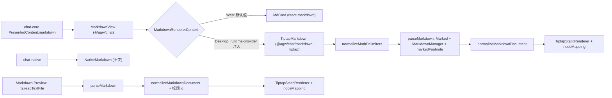

# Markdown 渲染接口与 Desktop Tiptap 渲染

## 名词解释

- **Markdown 渲染接口**：`@agw/chat` 中的 `MarkdownRenderer` 组件类型与 `MarkdownRendererProvider`。聊天消息通过 `MarkdownView` 渲染 Markdown，`MarkdownView` 从 React context 取得当前的渲染组件。
- **默认实现**：`MdCard`，基于 react-markdown + remark-gfm + remark-math + rehype-katex。Web 使用它。
- **Tiptap 实现**：`TiptapMarkdown`，由 `@agw/chat/markdown-tiptap` 入口导出。Desktop renderer 注入它。
- **紧凑列表**：CommonMark 中列表项之间没有空行的列表。remark 渲染紧凑列表时，列表项内的 paragraph 不输出 `<p>`。
- **脚注容器**：marked-footnote 在根 lexer 的 `tokens[0]` 放置的 `footnotes` token，收集全部脚注定义与引用。

## 背景

现在 Markdown 的渲染分布在三处：

- Web 与 Desktop 的聊天消息共用 `@agw/chat` 的 `MdCard`（`packages/chat/src/ui-web/components/message/renders/md-card.tsx`）。
- Mobile 的聊天消息使用 `@agw/chat-native` 的 `NativeMarkdown`（react-native-enriched-markdown）。
- Desktop 内置扩展 Markdown Preview（`packages/extensions/markdown-preview`）使用 react-markdown + remark-gfm + rehype-slug + rehype-highlight。

Desktop 的 Markdown 渲染改为 Tiptap，Web 与 Mobile 保持现状。Web 和 Desktop 共用 `@agw/chat`，因此需要在 `@agw/chat` 中把 Markdown 渲染定义为接口，由 Desktop 注入 Tiptap 实现。

## 设计目标

### 功能目标

1. `@agw/chat` 定义 Markdown 渲染接口，默认实现为 `MdCard`；Web 不做任何接线。
2. `MdCard` 中的代码块、链接、图片、表格部件移入共用模块，两种实现使用同一套部件。
3. `@agw/chat/markdown-tiptap` 提供 Tiptap 实现：解析使用 `@tiptap/markdown` 的 `MarkdownManager`，渲染使用 `@tiptap/static-renderer`。
4. Desktop renderer 注入 Tiptap 实现。
5. Markdown Preview 改为 Tiptap 解析与渲染。
6. 两种 Tiptap 渲染都满足：
   - HTML 块与标签原样显示为文字，其中的实体不解码；普通文字中的实体引用按 CommonMark 解码，与 remark 相同；
   - 支持 GFM 脚注，结构与 remark-gfm 的脚注区域相同；
   - 表格、任务列表（包括非紧凑任务列表、普通项与任务项混合的列表）、删除线、自动链接、行内图片、紧凑列表的显示与 remark 相同；Preview 的 DOM 结构与 remark 相同，聊天中列表项的内容始终放在 `p` 中（见 3.4）；
   - 聊天中支持 `$..$`、`$$..$$`、`\(..\)`、`\[..\]` 公式。
7. Mobile 不变。

### 技术目标

- Web 的打包结果不包含 Tiptap。
- 流式输出时，节点类型与在父节点中的位置都不变的元素保持挂载：图片不重新加载，代码块的换行开关状态不丢失。
  - 列表从紧凑变为非紧凑（例如 `- before ` 与空行之后出现第二项）不改变聊天中的 DOM 结构，已有元素保持挂载。
  - 后续文字改变了已有内容的 Markdown 结构时，发生变化的节点及其子树重新挂载，这与 react-markdown 的行为相同。例如文字下一行出现 `===` 后变成标题，出现分隔行后变成表格。
- 合法的 Markdown 输入及其每一个流式前缀都能解析与渲染。
- 在 39 KB、158 KB、631 KB 的输入下，解析加渲染的时间不超过同一输入下的现有实现（聊天对照 `MdCard`，Preview 对照现在的 react-markdown 管线）。
- 解析失败直接抛出，不做捕获与降级。

## 总体设计



### 技术选型

依赖版本：Tiptap 3.32.0、marked 17.0.6、marked-footnote 1.4.0、micromark-util-decode-string 2.0.1，全部为 MIT 许可。

**解析：`@tiptap/markdown` 的 `MarkdownManager`。**
- 它不需要 Editor 与 DOM。
- 构造时把各扩展的 tokenizer 注册到传入的 `Marked` 实例；不传入时使用 marked 的全局实例，多个配置不同的实例会相互干扰（issue #8316）。
- `parse()` 只调用 `Lexer.lex`，不运行 marked 的 `walkTokens` 与 renderer。

**脚注：marked-footnote。**
- 它的状态保存在每次 `markedFootnote()` 创建的闭包中，`hasFootnotes` 与编号只在 `walkTokens`/renderer 中复位，所以每次解析都新建 `Marked`、`markedFootnote()` 与 `MarkdownManager`。
- marked 的 `use()` 让后注册的扩展 tokenizer 先执行，`markedFootnote()` 在 `MarkdownManager` 构造之后注册，脚注容器才位于根 lexer 的 `tokens[0]`。
- 脚注容器留在文档开头，由后处理移到末尾。

**列表：marked 内置的 GFM 列表解析。**
- 不注册 Tiptap 的 `TaskList`、`TaskItem`，也不注册 `OrderedList` 自带的 tokenizer。普通列表与任务列表都由 marked 的列表 tokenizer 解析，空行、`loose`、续行和混合列表都按 CommonMark/GFM 处理；列表项的 inline 内容进入根 lexer 的 inline 队列，脚注引用能读到根 lexer `tokens[0]` 中的脚注容器。
- `OrderedList` 的 tokenizer 在块级阶段就调用 `lexer.inlineTokens` 解析列表项，这时文末的脚注定义还没有被解析，列表项中的脚注引用会变成文字；它产生的 token 也没有 `loose`。
- `TaskList` 的 tokenizer 遇到空行就结束列表（`- [ ] a\n\n- [ ] b` 得到两个 `taskList`，token 上没有 `loose`），并在块级阶段直接 inline 解析任务项第一行。没有 `taskList` 处理器时，`MarkdownManager.parseListToken` 走普通解析（`MarkdownManager.ts:511`），不会进入为续行另起 lexer 的分支（`MarkdownManager.ts:568`）；在那个 lexer 中，marked-footnote 从 `tokens[0]` 取不到脚注容器，会抛出 TypeError。
- 任务状态记录在 `ListItem` 的 `checked` 属性上（见 3.1）。

**渲染：`@tiptap/static-renderer` 的 `TiptapStaticRenderer`。**
- 它是纯函数，直接遍历 Tiptap JSON，由调用方提供创建元素的函数，plugin 与 node view 不运行，没有映射的节点类型直接抛出。
- 渲染函数用 `React.createElement(component, props, ...children)` 按位置传入子元素，内容增长时，节点类型与位置不变的已有元素保持挂载。
- 同包的 `renderToReactElement` 给元素分配按后序递增的 `key`（`dist/pm/react/index.js:362-364`），根元素的 `key` 随元素总数变化，并且每次调用都新建默认映射与 schema，流式输出的每个片段都会让整条消息重新挂载，因此不使用。

## 详细设计

### 1. Markdown 渲染接口

沿用 `ConversationImagePlatformProvider`（`conversation-image.tsx:23`）与 `ExecutionPlatformProvider`（`execution-platform.tsx`）的写法：`@agw/chat` 定义带默认值的 context，Desktop 在 `runtime-provider.tsx` 注入。

新文件 `packages/chat/src/ui-web/components/message/renders/markdown-renderer.tsx`：

```ts
export type MarkdownRendererProps = { markdown: string };
export type MarkdownRenderer = React.ComponentType<MarkdownRendererProps>;
export function MarkdownRendererProvider(props: React.PropsWithChildren<{ renderer: MarkdownRenderer }>): React.ReactNode;
export function MarkdownView(props: MarkdownRendererProps): React.ReactNode;
```

- `MarkdownRendererContext` 的默认值是 `MdCard`。
- `MdCard` 的 prop `mdText` 改名为 `markdown`，使其直接满足 `MarkdownRendererProps`；`enableMath` 保留为可选参数，生产代码中没有调用方传入它。
- 以下调用改为 `<MarkdownView markdown={...} />`：
  - `renders/text-content.tsx:10`
  - `renders/reasoning.tsx:32`
  - `renders/plan-card.tsx:48,79,84`
  - `message/human-interaction-questions.tsx:291`
- `packages/chat/src/index.ts` 导出 `MarkdownRendererProvider`、`type MarkdownRenderer`、`type MarkdownRendererProps`。

### 2. 共用显示部件

新文件 `packages/chat/src/ui-web/components/message/renders/markdown-elements.tsx`，内容从 `md-card.tsx` 移出：

- `isHttpLink`
- `MarkdownCodeBlock({ code, language, children })`：标题栏显示语言名、换行开关与复制按钮。`MdCard` 的 `pre` 映射继续用 `getCodeBlockDetails(children)` 与围栏判断计算出 `code`、`language` 后传入。
- `MarkdownLink({ href, title, children })`：http/https 地址在新窗口打开并带外链图标，其他地址显示为带文件图标、不可点击的文字。
- `MarkdownImage({ src, alt, title })`：`src` 为空时不输出，`alt` 缺省为 "Markdown image"，`name` 为 `alt`，内部是 `ConversationImage`。
- `MarkdownTable({ children })`：`region` "Scrollable table" 滚动容器加 `table.msg-content-md-table`。

`MdCard` 改用这些部件后，输出的 DOM 不变。

### 3. 聊天的 Tiptap 实现

代码位于 `packages/chat/src/ui-web/markdown-tiptap/`。`packages/chat/package.json` 的 `exports` 增加 `"./markdown-tiptap": "./src/ui-web/markdown-tiptap/index.ts"`。只有 Desktop renderer 导入这个入口，所以 Web 的依赖图中没有 Tiptap。

#### 3.1 扩展（`markdown-extensions.ts`）

- **StarterKit**：`StarterKit.configure({ underline: false, paragraph: false, codeBlock: false, bulletList: false, orderedList: false, listItem: false, listKeymap: false, dropcursor: false, gapcursor: false, undoRedo: false, trailingNode: false })`。
  - Underline 关闭：它的 `++text++` tokenizer 会把 `C++ and C++` 识别为下划线。
  - paragraph、列表与代码块关闭：由下面的扩展替代。
  - 其余关闭的扩展只用于编辑，不参与解析。
- **Paragraph**：`Paragraph.extend` 的 `parseMarkdown` 总是返回 `paragraph` 节点，内容为 `helpers.parseInline(token.tokens ?? [])`。默认实现（`@tiptap/extension-paragraph` dist 第 36–42 行）有两种特殊处理：
  - 只含一张图片的 paragraph 直接返回图片节点，不检查 `Image.inline`。
    - 顶层的 `` 会变成 doc 下的图片，`MdCard` 输出的是 `p > img`。
    - 先渲染 `- ` 与空行，再追加 `- y`：紧凑项的文字由 `ListItem` 包成 paragraph，变为非紧凑项后经过默认实现，结构从 `li > p > img` 变成 `li > img`，`img` 被重新创建。
  - 只含 `&nbsp;` 的 paragraph 返回空 paragraph，会被 3.3 节的后处理删除；remark 输出含不换行空格的 `p`。

  覆盖后，两种状态下解析结果都是 `listItem(paragraph(image))`，顶层图片为 `paragraph(image)`，`&nbsp;` 为 `paragraph(text)`。
- **HTML 块**：`LiteralHtmlBlock` 是 `markdownTokenName` 为 `"html"` 的 `Extension`，`parseMarkdown` 把块级 `html` token 转换为一个 paragraph，内容是去掉末尾换行的 `token.raw`。
  - `MarkdownManager.parseToken` 先调用已注册的处理器，处理器有结果时不再进入 `parseHTMLToken`，因此 HTML 块不会按 schema 解析成节点。
  - token 在 marked 中保持 `html` 类型。被扩展 `start` 截断的 paragraph 会让 marked 记录 `lastParagraphClipped`，之后的 paragraph 会合并进类型为 `paragraph` 的前一个 token，并改写 inline 队列中前一项的文本；如果 HTML 块的 token 类型是 `paragraph`，`first text\n$$x$$\n<div>a</div>\n\nmore text` 中的 `more text` 会合并进 HTML 块，第一个 paragraph 的文字也会被替换（已用 marked 17.0.6 验证）。
- **列表**：
  - `BulletList`、`OrderedList` 用 `.extend` 增加不输出到 HTML 的 `tight` 属性，`tight` 为 `!token.loose`。Preview 的映射用它决定是否输出 `<p>`；聊天的映射不使用它（见 3.4）。
    - `BulletList.parseMarkdown` 在原结果上设置 `tight`。
    - `OrderedList.parseMarkdown` 用 `helpers.parseChildren(token.items)` 创建 `orderedList`，属性为 `start`（`token.start`，不是数字时为 1）与 `tight`。原实现用 `parseListItems` 创建列表项，不经过 `ListItem.parseMarkdown`，任务项的复选框与紧凑项的 paragraph 都得不到处理。
    - `OrderedList` 设置 `markdownTokenizer: null`。`getExtensionField` 只在字段为 `undefined` 时读取父扩展，`null` 让 `MarkdownManager` 不注册父扩展的 tokenizer（原因见“技术选型”）。
  - `ListItem` 用 `.extend` 增加不输出到 HTML 的 `checked` 属性，`null` 表示普通项。`parseMarkdown` 依次处理：
    - `token.task` 为真时 `checked` 取 `token.checked`，否则为 `null`；
    - 去掉 marked 放入的 `checkbox` token：紧凑项在 `token.tokens` 开头，非紧凑项在第一个 `paragraph` token 的 `tokens` 开头；
    - 开头的 `text` token 包成 paragraph，其余 token 用 `helpers.parseChildren` 解析，其中的 `paragraph` token 由上面的 `Paragraph` 处理。默认实现会把紧凑任务项的文字直接放在 `listItem` 下，也会丢掉复选框状态。
  - 不注册 `TaskList`、`TaskItem`（原因见“技术选型”）。
- **代码块**：`FencedCodeBlock` 用 `CodeBlock.extend` 增加不输出到 HTML 的 `fenced` 属性。`parseMarkdown` 处理所有 `code` token：
  - `language` 取 `token.lang` 第一个空白之前的部分，没有时为 null；
  - `fenced: token.codeBlockStyle !== "indented"`；
  - 原有实现会丢弃以 1–3 个空格开头的围栏代码块，新实现保留它们。
- **表格**：注册 `Table.extend(...)`、`TableRow`、`TableHeader`、`TableCell`。marked 在每个块的位置都会调用块级扩展的 `start` 与 `tokenize`，而原实现的这两个函数都会处理剩余全文，耗时随文本长度按平方增长（issue #8458）：
  - `start` 每次都把剩余全文按行切开，但只用前两行。
  - `tokenize` 先用 `src.indexOf("\n\n")` 找到第一个空行，把空行之前的全部内容作为候选。在没有空行的文档中，候选就是剩余全文。
  - 候选中有含代码 `|` 的行时，`tokenize` 还会对整个候选执行 `preprocessTablePipes` 与 `helper.blockTokens`。`blockTokens` 又会在候选中后面每张表格的位置再次调用 `tokenize`。标题与表格交替且没有空行时，400 张表格（15.2 KB）的 `tokenize` 被调用 80600 次，累计处理 422 MB 文本，解析耗时 6278 ms。
  - 同一条路径还会丢内容：表格单元格含代码 `|`、并且表格后紧跟标题、引用或列表（中间没有空行）时，原实现会丢掉紧跟的那一行。

  `Table.extend` 替换这两个函数：
  - **前两行判断**：只用 `indexOf` 取出前两行，规则与原实现相同——第二行只含空白、`|`、`:`、`-`，并且包含 `|` 和 `-`。`start` 与 `tokenize` 共用这个判断。
  - **`start`**：前两行判断成立、并且第一行包含 `|` 时返回 0，否则返回 -1。
  - **`tokenize`**：
    - 前两行判断不成立时，直接返回 `undefined`。原实现在这种情况下同样返回 `undefined`。
    - 判断成立时，用 marked 的 GFM 表格规则 `Lexer.rules.block.gfm.table` 匹配当前这一张表格。这条规则就是 marked 判断表格范围的依据：表头行、分隔行，以及直到空行或其他块级结构开始之前的所有行。没有匹配时返回 `undefined`。
    - 匹配到时，把匹配到的文本作为 `src` 交给原 `tokenize`。`preprocessTablePipes` 逐行处理、不改变行数，所以表格范围不变；`preprocessTablePipes`、`blockTokens` 与 `raw` 的计算都只处理当前这一张表格。

  实测（只含解析）：
  - 631 KB，paragraph 之间有空行：704 ms 降到 55 ms。
  - 626 KB，标题与正文之间都没有空行：原实现 5038 ms；只替换 `start` 为 4183 ms；`tokenize` 只加前两行判断为 46 ms；同一输入下 remark 为 625 ms。
  - 标题与表格交替、没有空行、单元格含代码 `|`：
    - 400 张表格（15.2 KB）：6278 ms 降到 7 ms，remark 为 57 ms；
    - 4000 张表格（152 KB）：45 ms。
  - 对比解析结果：
    - 包含对齐、转义的 `|`、代码中的 `|`、表格后紧跟不带 `|` 的文字行（GFM 把它算作表格行）的输入，替换前后的结果完全相同；
    - 含代码 `|` 的表格后紧跟标题、引用或列表的输入，替换后保留了这些内容（原实现会丢掉紧跟的那一行），与 remark 一致。

  issue #8458 修复并发布后删除这两个替换。
- **图片**：`Image.configure({ inline: true })`。图片设为行内后才能留在 paragraph 中。
- **公式**：`InlineMath`、`BlockMath` 用 `.extend` 调整 `markdownTokenizer`：
  - `BlockMath` 的 `start` 只返回行首（允许 0–3 个空格）的 `$$` 位置，并要求结尾的 `$$` 之后到行尾只有空白。marked 用块级扩展的 `start` 寻找 paragraph 中断点；如果 `start` 返回 paragraph 中间的位置，`"a $$x$$ b"` 会被分成三个节点，`costs $$$` 会多出换行。
  - `InlineMath` 同时接受 `$..$` 与 `$$..$$`，开闭符号数量相同，与 remark-math 一致。
- **脚注**：处理 marked-footnote 产生的 token：
  - `FootnoteReference`：`markdownTokenName` 为 `"footnoteRef"`，行内 atom 节点，属性 `label`、`number`（来自 `token.id`）、`index`（来自 `token.index`）。
  - `FootnoteDefinition`：`markdownTokenName` 为 `"footnote"` 的 `Extension`，对应定义所在位置的 token，`parseMarkdown` 返回空数组，内容由脚注区域显示。处理器返回空数组时 `MarkdownManager` 改用 `parseFallbackToken`；定义 token 的内容在 `content` 中，没有 `tokens`，结果为空。
  - `Footnotes`：`markdownTokenName` 为 `"footnotes"`，内容为 `footnoteItem+`。`parseMarkdown` 按 `token.items` 的顺序创建 `FootnoteItem`。
  - `FootnoteItem`：属性 `label`、`number`、`refCount`，内容为 `helpers.parseChildren(item.content)`。
  - 三个节点都有 `renderHTML`，结构与 remark-gfm 的输出一致。
  - id 中的标签部分为 `encodeURIComponent(label.toLowerCase())`，与 remark 相同使用小写。

#### 3.2 解析（`parse-markdown.ts`）

`parseMarkdown(markdown)` 每次调用都执行以下步骤：

1. 创建 `const marked = new Marked()`，并调用 `marked.use({ tokenizer: { tag, inlineText } })`：
   - 两个 tokenizer 先用 `Tokenizer.prototype.tag/inlineText.call(this, src)` 取得原 token，这样 marked 对 `inLink`、`inRawBlock` 的状态维护以及强调符号前一个字符的判断保持不变。
   - `tag` 把行内 HTML 标签转换为 `escape` token，文字为 `token.raw`。
   - `inlineText` 把普通文字转换为 `escape` token，文字为 `decodeString(token.raw)`（`micromark-util-decode-string`，remark 解码文字用的就是这个函数）。marked 的 escape tokenizer 先于文字 tokenizer 处理反斜杠转义，文字 token 中不会出现反斜杠加 ASCII 标点。
   - `MarkdownManager` 对 `text` token 调用 `decodeHtmlEntities`，它只解码数字引用与 `lt`、`gt`、`quot`、`amp`，`&nbsp;`、`&copy;` 会原样显示；`escape` token 不经过这一步，也不会被二次解码。
   - 结果：HTML 块、标签以及其中的实体都原样显示；普通文字中的实体引用按 CommonMark 解码，与 remark 相同。`a &amp; b` 显示为 `a & b`，`hello <b>&amp;</b>` 显示为 `hello <b>&</b>`，`&amp;lt;` 显示为 `&lt;`，`&nbsp;` 显示为不换行空格，`<div>x &amp; y</div>` 原样显示。
   - HTML 块由 3.1 的 `LiteralHtmlBlock` 处理。
2. 创建 `const manager = new MarkdownManager({ marked, extensions })`。`marked` 选项的类型是全局的 `marked` 函数，`MarkdownManager` 只使用 `Marked` 实例同样提供的 `Lexer`、`defaults` 与 `use`，传入时做类型转换。
3. 调用 `marked.use(markedFootnote())`。
4. 返回 `manager.parse(markdown)`。

浏览器中有 `window.DOMParser`。HTML 不经过上述处理时，`MarkdownManager` 会按 schema 把内嵌 HTML 解析成节点，例如 `<b>` 变成 `bold` 标记，`` 变成图片节点。

#### 3.3 文档后处理（`normalize-document.ts`）

纯函数 `normalizeMarkdownDocument(json)` 依次处理：

- 把 `footnotes` 节点移到文档末尾；没有条目时删除它。
- 在父节点为 `paragraph` 或 `heading`、且没有 `code` 标记的文字中，删除 `\n` 前后的空格与制表符。marked 保留续行的行首空白，而聊天消息使用 `whitespace-pre-wrap`，这些空白会显示出来。codeBlock 中的文字不做这项处理，缩进保持原样。
- 删除空文字节点。
- 删除 doc、blockquote、listItem、footnoteItem 中没有内容的 paragraph。这些paragraph是 `MarkdownManager` 为多余空行和文档首尾生成的。删除后容器不会变空；表格单元格中的paragraph保留，由映射展开。

#### 3.4 渲染（`markdown-node-mapping.tsx`、`tiptap-markdown.tsx`）

**`TiptapMarkdown({ markdown })`**
- 文件开头为 `"use client"`，组件用 `React.memo` 包装。
- 用 `React.useId()` 作为脚注 id 的前缀。同一页面有多条消息，用户消息也会渲染 Markdown，所以 id 需要前缀避免重复。
- 在 `useMemo` 中依次调用 `normalizeMathDelimiters`（`@agw/chat-core`）、`parseMarkdown`、`normalizeMarkdownDocument`。
- 用模块级的 `renderMarkdownJson` 渲染，外层通过 context 提供前缀。

**`renderMarkdownJson`**
- 它是模块级的 `TiptapStaticRenderer`，`renderComponent` 为 `({ component, props: { children, ...props } }) => React.createElement(component, props, ...[].concat(children))`。
- `nodeMapping` 与 `markMapping` 是模块级常量，覆盖 `doc`、`text` 以及 `getSchema(extensions)` 中的每个节点和标记。映射函数会被当作组件类型使用，所以必须是模块级常量，保持引用稳定。

**节点映射**（class 与 `MdCard` 的输出一致，CSS 在 `packages/components/src/ui-tokens/tokens.css:695-795`）：
- `doc` → Fragment；`text` → `node.text`。
- `paragraph` → `p.msg-content-md-p`；父节点是表格单元格时只输出子内容。
  - 列表项中的 paragraph 不论列表是否紧凑都输出 `p`。原因是流式输出中列表可能从紧凑变为非紧凑：如果紧凑时只输出子内容，`li > img` 会变成 `li > p > img`，已有的 `img` 会被重新创建（已用 React 渲染实验确认）。
  - 显示效果与 `MdCard` 相同：`.msg-content-md-li > .msg-content-md-p:first-child` 把第一个 `p` 显示为行内元素，`MdCard` 输出的非紧凑列表也是这个结构。
- `bulletList` → `ul.msg-content-md-ul`。
- `orderedList` → `ol.msg-content-md-ol`，`start` 不为 1 时输出 `start`。
- `listItem` → `li.msg-content-md-li`。`checked` 不为 `null` 时，在第一个 paragraph 的开头输出复选框 `<input type="checkbox" disabled checked>` 与一个空格，复选框与文字在同一行。
- `codeBlock`：
  - `fenced` 为真时使用 `MarkdownCodeBlock`。`code` 是各文字子节点 `text` 的拼接，`language` 是 `node.attrs.language ?? "plain"`，内部为 `code.msg-content-md-code.language-x`。
  - `fenced` 为假时输出 `pre.msg-content-md-code.overflow-x-auto.agw-scrollbar`，内含 `code.msg-content-md-code`。
  - 两种情况下，`<code>` 内文字末尾都加一个换行，与 mdast-util-to-hast 的输出相同；复制使用的 `code` 不含这个换行。
- `table` → `MarkdownTable`：全部由 `tableHeader` 组成的首行放进 `thead`，其余行放进 `tbody`。
- `tableRow` → `tr`。
- `tableHeader`、`tableCell` → `th`、`td`，`align` 输出为 `style.textAlign`。
- `image` → `MarkdownImage`。
- `inlineMath`、`blockMath` → `katex.renderToString(latex, { displayMode, throwOnError: false })` 的结果。
- `heading` → `h{level}`；`blockquote` → `blockquote`；`horizontalRule` → `hr`；`hardBreak` → `br`。
- `footnoteReference` → `sup > a`，`a` 带以下属性，文字为编号：
  - `href="#{前缀}fn-{label}"`
  - `id="{前缀}fnref-{label}"`，第 n 次引用（n ≥ 2）加 `-n` 后缀
  - `data-footnote-ref`
  - `aria-describedby="{前缀}footnote-label"`
- `footnotes` → `section.msg-content-md-footnotes[data-footnotes]`，内含 `h2#{前缀}footnote-label.sr-only`（文字 "Footnotes"）与 `ol`。
- `footnoteItem` → `li#{前缀}fn-{label}`，`tabIndex` 为 -1。为每次引用追加一个空格与一个 `a[data-footnote-backref]`；最后一个子节点是 paragraph 时追加在它的末尾，否则追加在 `li` 的末尾，与 remark 相同：
  - `href` 为 `#{前缀}fnref-{label}`，第 k 次引用（k ≥ 2）加 `-k` 后缀；
  - `aria-label` 为 "Back to reference {编号}"，第 k 次引用为 "Back to reference {编号}-{k}"；class 为 `data-footnote-backref`；
  - 文字为 `↩`，从第 2 次引用起为 `↩<sup>k</sup>`。
- 点击脚注链接：调用 `preventDefault`，对目标元素执行 `scrollIntoView({ block: "nearest" })` 与 `focus({ preventScroll: true })`，不修改 `location.hash`。

**标记映射**：`bold` → `strong`；`italic` → `em`；`strike` → `del`；`code` → `code.msg-content-md-code`；`link` → `MarkdownLink`。

**样式**：`tokens.css` 在第 785 行之后增加 `.msg-content-md-footnotes`，以及它的 `ol`（显示有序编号）与 `li:focus-visible` 的样式。

**导出**：`index.ts` 导出 `TiptapMarkdown`。

### 4. Desktop 注入

修改 `src/clients/desktop/renderer/src/runtime/runtime-provider.tsx:403-408`：在 `ConversationImagePlatformProvider` 内层，用 `<MarkdownRendererProvider renderer={TiptapMarkdown}>` 包裹 `{children}`。

- `MarkdownRendererProvider` 从 `@agw/chat` 导入，`TiptapMarkdown` 从 `@agw/chat/markdown-tiptap` 导入。
- `desktop/renderer/next.config.ts` 的 `transpilePackages` 已包含 `@agw/chat`，不需要修改。

### 5. Markdown Preview

扩展包只能依赖 `@agw/extension-sdk`（`tools/scripts/check-client-boundaries.mjs:36-53`），所以解析与渲染代码在包内单独编写，不含数学公式。

`packages/extensions/markdown-preview/src/` 的改动：

- **新增文件**：`markdown-extensions.ts`、`parse-markdown.ts`、`normalize-document.ts`。内容与 3.1–3.3 相同，但去掉数学公式；StarterKit 关闭 `heading`，改用 `Heading.extend` 增加 `id` 属性。
- **`markdown-pipeline.ts`**：改为 `renderMarkdown(text, components)`，依次执行：
  1. `parseMarkdown`
  2. `normalizeMarkdownDocument`
  3. `assignHeadingIds`：每个文档使用一个 `GithubSlugger`，规则与 rehype-slug 相同，重复标题加后缀
  4. 用模块级的 `TiptapStaticRenderer` 渲染，写法与 3.4 相同

  `components` 的作用与 react-markdown 的 `components` 相同：可以传入 `a`、`img`，不传时输出普通的 `a`、`img`。
- **节点映射**（没有 class 的元素与 react-markdown 的默认输出相同）：
  - `heading` → `h{level}`，带 `id`。
  - `paragraph` → `p`；在表格单元格和紧凑列表项（列表映射通过 context 提供 `tight`）中只输出子内容。Preview 渲染完整文件，没有流式输出，因此 DOM 结构与 remark 保持一致。
  - `bulletList`、`orderedList`、`listItem` → `ul`、`ol`（带 `start`）、`li`。
  - 列表中任一项的 `checked` 不为 `null` 时，`ul`/`ol` 带 `contains-task-list` class；`checked` 不为 `null` 的 `li` 带 `task-list-item` class，与 remark-gfm 相同。复选框在紧凑列表中依次输出复选框、空格、内容，在非紧凑列表中放在第一个 `p` 的开头；props 顺序为 `type`、`disabled`、`checked`，以便 `renderToStaticMarkup` 输出 `<input type="checkbox" disabled="" checked=""/>`。
  - `codeBlock`：不做语言自动识别，与 rehype-highlight 的默认行为一致；三种情况下文字末尾都加一个换行。
    - 语言已在 `createLowlight(common)` 中注册：输出 `pre > code.hljs.language-x`，内容为 `toJsxRuntime(lowlight.highlight(language, text))`（来自 `hast-util-to-jsx-runtime`）。
    - 语言未注册：输出 `pre > code.language-x`。
    - 没有语言：输出 `pre > code`。
  - `table` → `table`，内含 `thead`、`tbody`；单元格规则与 3.4 相同。
  - `image` → `components.img`。
  - `link` → `components.a`；`href` 不满足 `isAllowedUri`（`@tiptap/extension-link`）时设为 `""`。
  - 脚注：DOM 与 remark-gfm 的输出相同。结构与 3.4 相同，区别如下：
    - 引用、返回链接与 `li` 的 id 前缀固定为 `user-content-`；`aria-describedby` 与 `h2` 的 id 为 `footnote-label`，不加前缀；
    - `section` 带 `footnotes` class，`li` 没有 `tabIndex`；
    - 引用与返回链接都经 `components.a` 输出，点击时由 `MarkdownLink` 的 `anchor` 分支滚动到目标（`markdown-components.tsx:31`）。
  - 其余元素：`blockquote`、`hr`、`br`、`strong`、`em`、`del`、`code`。
- **`markdown-components.tsx`**：
  - `MarkdownLink` 的 props 改为 `ComponentPropsWithoutRef<"a">`，`MarkdownImage` 的 props 改为 `{ src, alt, title }`，不再依赖 react-markdown 的 `ExtraProps`，逻辑不变。
  - 导出 `markdownComponents = { a: MarkdownLink, img: MarkdownImage }`。
- **`markdown-document.tsx`**：
  - `<Markdown ...>` 换成 `renderMarkdown(state.text, markdownComponents)` 的 `useMemo` 结果。
  - 这个 hook 放在所有提前 return 之前。
  - 外层的 `article.markdown-body` 与 `MarkdownContext` 不变。
- **不变的文件**：`markdown-links.ts`、`highlight-theme.ts`、`markdown.css`。
- **`package.json` 的 devDependencies**：
  - 删除 `react-markdown`、`remark-gfm`、`rehype-highlight`、`rehype-slug`。
  - 增加 Tiptap 相关包（不含 mathematics）、`marked`、`marked-footnote`、`micromark-util-decode-string`、`lowlight`、`hast-util-to-jsx-runtime`、`github-slugger`、`jsdom`、`@types/jsdom`。
  - 保留 `highlight.js`，主题 CSS 仍然使用它。

### 6. 依赖

**`src/clients/pnpm-workspace.yaml` 的 catalog**：
- 增加 3.32.0 版本的 Tiptap 包：`@tiptap/core`、`@tiptap/pm`、`@tiptap/markdown`、`@tiptap/static-renderer`、`@tiptap/starter-kit`、`@tiptap/extension-code-block`、`@tiptap/extension-heading`、`@tiptap/extension-image`、`@tiptap/extension-link`、`@tiptap/extension-list`、`@tiptap/extension-paragraph`、`@tiptap/extension-table`、`@tiptap/extension-mathematics`。
- 增加 `marked` 17.0.6。`@tiptap/markdown` 要求 `^17.0.1`，而根目录现有的 16.4.2 由 mermaid 引入。
- 增加 `marked-footnote` 1.4.0、`micromark-util-decode-string` 2.0.1、`lowlight` 3.3.0、`hast-util-to-jsx-runtime` 2.3.6、`github-slugger` 2.0.0。
- 删除只被 Preview 使用的 `rehype-highlight`、`rehype-slug`。

**`packages/chat/package.json` 的 dependencies**：
- 增加 `@tiptap/core`、`@tiptap/pm`。工作区设置了 `autoInstallPeers: false`，这两个 peer 依赖必须显式声明。
- 增加 `@tiptap/markdown`、`@tiptap/static-renderer`、`@tiptap/starter-kit`、`@tiptap/extension-code-block`、`@tiptap/extension-image`、`@tiptap/extension-list`、`@tiptap/extension-paragraph`、`@tiptap/extension-table`、`@tiptap/extension-mathematics`、`marked`、`marked-footnote`、`micromark-util-decode-string`。`marked` 同时提供表格 `tokenize` 使用的 `Lexer.rules`。
- `katex` 0.18.7 满足 `@tiptap/extension-mathematics` 的 peer 范围。

### 7. 与 remark 的差异与性能

**链接**
- Preview 允许的链接协议来自 `isAllowedUri`：http、https、ftp、ftps、mailto、tel、callto、sms、cid、xmpp，以及相对地址。
- react-markdown 的 `defaultUrlTransform` 允许 http、https、irc、ircs、mailto、xmpp，以及相对地址。

**性能**
- 每次内容变化都同步解析全文，这与现在的 `MdCard` 相同。流式消息的批次间隔为 50 ms（`STREAMING_MESSAGE_BATCH_INTERVAL_MS`，`execution-core/src/batcher.ts:1`），Preview 读取文件的上限为 100 MB（`MAX_CLOUD_TRANSFER_BYTES`）。
- 只含解析的实测值（每种取 2 次中的最小值）：
  - 157 KB：原 Table + TaskList 141 ms；只有原 Table 52 ms；不注册 TaskList 且替换 Table 的 `start` 21 ms；remark（remark-parse + remark-gfm + remark-rehype）130 ms。
  - 631 KB：原 Table + TaskList 2013 ms；只有原 Table 704 ms；不注册 TaskList 且替换 Table 的 `start` 55 ms；remark 520 ms。
  - 626 KB、标题与正文之间都没有空行：原 Table 5038 ms；只替换 `start` 4183 ms；`start` 与 `tokenize` 都替换 46 ms；remark 625 ms。
  - 标题与表格交替、没有空行、单元格含代码 `|`：400 张表格（15.2 KB）原 Table 6278 ms、替换后 7 ms、remark 57 ms；4000 张表格（152 KB）替换后 45 ms。
- 解析加渲染的实测值（`.scratch/markdown-perf/bench.ts`：jsdom，React 生产构建，用 `flushSync` 挂载到 DOM，每项取 3 次中的最小值；聊天为 `MdCard` / `TiptapMarkdown`，Preview 为现在的 react-markdown 管线 / `renderMarkdown`）：
  - paragraph 之间有空行：
    - 39 KB：聊天 281 ms / 83 ms；Preview 206 ms / 62 ms。
    - 158 KB：聊天 598 ms / 521 ms；Preview 734 ms / 366 ms。
    - 631 KB：聊天 2140 ms / 697 ms；Preview 1620 ms / 568 ms。
  - 标题与正文之间都没有空行：
    - 39 KB：聊天 56 ms / 23 ms；Preview 48 ms / 15 ms。
    - 158 KB：聊天 203 ms / 85 ms；Preview 172 ms / 56 ms。
    - 631 KB：聊天 705 ms / 323 ms；Preview 651 ms / 197 ms。
  - 标题与短表格交替、没有空行、单元格含代码 `|`：
    - 39 KB：聊天 184 ms / 82 ms；Preview 178 ms / 82 ms。
    - 158 KB：聊天 636 ms / 296 ms；Preview 646 ms / 275 ms。
    - 631 KB：聊天 3326 ms / 1088 ms；Preview 3224 ms / 1017 ms。
- 流式模拟：同一个已挂载的组件依次渲染 158 KB 输入的 200 个前缀（长度均匀递增），每次更新取 3 轮中的最小值。每次更新都同步解析全文，耗时只取决于当前文本长度，与 50 ms 的批次间隔无关。
  - paragraph 之间有空行：单次更新最长 `MdCard` 346 ms / `TiptapMarkdown` 72 ms，合计 32824 ms / 7130 ms。
  - 标题与正文之间都没有空行：单次更新最长 168 ms / 37 ms，合计 16170 ms / 3290 ms。
  - 标题与短表格交替：单次更新最长 601 ms / 141 ms，合计 58789 ms / 14282 ms。
  - 200 次更新中，`TiptapMarkdown` 每一次的耗时都不超过 `MdCard`。流式更新时已有元素保持挂载，React 只更新变化的部分。
- 打包体积：Markdown Preview 的 JS 从 557.73 kB（gzip 174.37 kB）变为 904.55 kB（gzip 286.29 kB），增加的部分是 ProseMirror 与 Tiptap。扩展页面从 Desktop 的本地资源加载。

### 8. 文档更新

- `docs/2.Architecture.md:332`：说明 `@agw/chat` 的 Markdown 渲染接口，以及 Web 的默认实现与 Desktop 注入的 Tiptap 实现。
- `src/clients/desktop/README.md:24` 附近：说明 Desktop 聊天的 Markdown 由 Tiptap 渲染。
- `docs/designs/2026-10-18-Desktop-内置Extension与文件查看器.md` 已提交，不修改。

## 实施步骤

1. 依赖（第 6 节）：修改 catalog、`packages/chat/package.json`、`packages/extensions/markdown-preview/package.json`，运行 `pnpm install`。检查：`pnpm test:boundaries` 通过；在 `packages/chat` 中运行 `pnpm why katex`，结果为 0.18.7。
2. 接口与共用部件（第 1、2 节）：
   - 新建 `markdown-renderer.tsx` 与 `markdown-elements.tsx`；
   - `MdCard` 的 prop 改名，四处调用改为 `MarkdownView`，`index.ts` 增加导出；
   - 共用场景移入 `markdown-renderer-cases.test-helper.ts`，新增 `markdown-renderer.test.ts`。

   检查：`pnpm --filter @agw/chat test` 通过；共用场景的断言与原 `md-card.test.ts` 相同，只改了 prop 名。
3. Tiptap 实现（第 3 节）：先写 `parse-markdown.test.ts` 与 `tiptap-markdown.test.ts`，再实现以下内容：
   - `markdown-extensions.ts`、`parse-markdown.ts`、`normalize-document.ts`；
   - `markdown-node-mapping.tsx`、`tiptap-markdown.tsx`、`index.ts`；
   - `package.json` 的 `exports`；
   - `tokens.css` 中的脚注样式。

   检查：`pnpm --filter @agw/chat test`、`typecheck`、`lint` 通过。
4. Desktop 注入（第 4 节）。检查：
   - `pnpm --filter @agw/desktop typecheck`、`test` 通过；
   - `pnpm --filter @agw/web build` 之后，`web/.next` 中没有 `@tiptap`。
5. Markdown Preview（第 5 节）：先修改 `markdown-pipeline.test.ts` 并加入新增用例，再修改实现。检查：`pnpm --filter @agw/extension-markdown-preview test`、`typecheck`、`lint`、`build` 通过。
6. 性能测试（见“性能测试”一节）：结果补充到第 7 节。检查：每种输入大小下，Tiptap 实现的耗时都不超过现有实现。
7. Electron 端到端测试：修改 `test-extensions.mjs` 的 `GUIDE_MARKDOWN`，在 `markdownPreview()` 中加入新断言，并新增 `chatMarkdown()`。检查：`pnpm --filter @agw/desktop test:extensions` 全部通过。
8. 文档（第 8 节），并只格式化改动过的文件。检查：`pnpm fmt:check`、`pnpm test` 通过。

## 测试计划

### 单元测试

聊天相关测试使用 `@agw/test-harness` 的 `setupDomEnvironment`。jsdom 提供 `window.DOMParser`，所以测试与浏览器走同一条 HTML 解析路径。

**`renders/markdown-renderer.test.ts`**
- 没有 Provider 时，`TextContent`、`Reasoning`、`PlanCard` 输出 `MdCard` 的 DOM。
- 提供 `TiptapMarkdown` 时，输出中出现 `a[data-footnote-ref]`。

**共用场景（`renders/markdown-renderer-cases.test-helper.ts`）**
- 从 `md-card.test.ts` 移入的场景：
  - 代码块：标题、换行开关、复制、无语言时显示 `plain`；
  - 缩进代码、diff 文本、行内代码；
  - 列表；
  - `\(x + 1\)` 生成 `.katex`；
  - http 链接与非 web 链接；
  - 表格 region。
- `md-card.test.ts` 与 Tiptap 的测试都运行这组场景。`md-card.test.ts` 改为调用共用场景，并保留 `enableMath` 用例，断言只修改 prop 名。

**`markdown-tiptap/parse-markdown.test.ts`（JSON 层）**
- 原始 HTML 与实体：
  - `<script>`、`<b>`、``、多行 `<div>` 块都解析为文字；
  - `<div>x &amp; y</div>` 与 `<a title="&amp;">` 中的实体原样保留；
  - `a &amp; b` 解析为 `a & b`，`hello <b>&amp;</b>` 解析为 `hello <b>&</b>`，`&copy; &amp;lt; &copy` 解析为 `© &lt; &copy`，与 react-markdown 的输出相同。
  - `first text\n$$x$$\n<div>a</div>\n\nmore text` 得到 paragraph、`blockMath`、HTML 原文 paragraph 与 `more text` paragraph，第一个 paragraph 的文字不变。
- 空paragraph：`a\n\n\n\nb` 只得到两个paragraph；文档首尾的空行、`\[..\]` 规范化后的结果都不产生空paragraph。
- 代码块：
  - 缩进 1–3 个空格的围栏；
  - 4 个反引号的围栏与 `~~~` 围栏；
  - `ts title=x` 取 `ts`；
  - 缩进代码得到 `fenced: false`；
  - 未闭合的围栏；
  - 经过后处理后，Python 代码块中 `if ready:` 下一行的 4 个缩进空格保持不变。
- `C++ and C++` 与 `++x++` 解析为纯文字。
- 列表与表格：
  - 紧凑与非紧凑列表的 `tight` 属性；
  - `- [ ] a\n\n- [ ] b` 是一个非紧凑列表，两个 `listItem` 都有 `checked` 与 paragraph；
  - 紧凑任务项的文字在 paragraph 中，复选框状态写入 `checked`，没有残留的 `checkbox` 内容；
  - 嵌套的任务项；
  - 普通项与任务项混合的列表是一个列表，普通项的 `checked` 为 `null`；
  - `- [x] done\n  more` 的续行与第一行在同一个 paragraph；
  - 表格的 `align` 与表头；
  - paragraph 中的行内图片。
- 只含图片的 paragraph：
  - 顶层的 `` 解析为 `paragraph(image)`；
  - `- \n\n` 与 `- \n\n- y` 中，第一项都是 `listItem(paragraph(image))`；
  - 只含 `&nbsp;` 的 paragraph 解析为含不换行空格的 paragraph，不会被删除。
- 表格的 `start` 与 `tokenize`：
  - 替换后的实现与原实现对同一组输入返回相同结果。输入包括：表格、非表格、只有一行、分隔行缺少 `|`、分隔行缺少 `-`、第二行为空行、含转义 `|` 与代码中 `|` 的表格、表格之后紧跟不带 `|` 的文字行。
  - 含代码 `|` 的表格后紧跟标题、引用或列表（中间没有空行）时，后面的内容都被保留，块的数量与类型与 remark 的结果相同。
  - 标题与表格交替、没有空行时，每张表格都单独解析为一个 `table`，数量与 remark 相同。
- 换行：`a\nb` 保留 `\n`；`a  \nb` 产生 `hardBreak`；`a\n   b` 得到 `a\nb`。
- 脚注：
  - 按首次引用的顺序编号；重复引用带 `index`；
  - `[^nope]` 显示为原文；未被引用的定义不显示；
  - `footnotes` 节点位于文档末尾；
  - 表格单元格中的引用能被解析；
  - 任务项第一行与续行中的引用都能被解析；
  - 普通项之后是任务项、任务项续行引用脚注、文末是脚注定义的输入，解析得到正确的引用与脚注区域；
  - 以任务列表或 `$$` 块开头、之后出现引用的文档能正常解析；
  - 连续两次解析都从 1 开始编号。
- 公式：
  - `$x$`、`\(x\)` 解析为 `inlineMath`；
  - `$$\nx\n$$` 解析为 `blockMath`；
  - `where $$x$$ is` 是一个包含 `inlineMath` 的paragraph；
  - `costs $$$` 的文字不变，也不多出换行。
- 流式：取一份覆盖以上全部语法的样例（包括上面的混合列表脚注输入），完整文本与逐字符取得的每一个前缀，解析并渲染都不抛出。

**`markdown-tiptap/tiptap-markdown.test.ts`**
- 运行共用场景。
- 脚注：
  - DOM 结构：`sup > a[data-footnote-ref][aria-describedby]`、`section[data-footnotes] h2.sr-only`、`li#…`，返回链接为 `↩` 与 `↩<sup>2</sup>`；
  - 两个实例生成的 id 不重复；
  - 点击引用后，`document.activeElement` 是对应的 `li`，`location.hash` 不变。
- 表格：有 `thead th` 与 `tbody td`，单元格内没有 `p`，单元格带 `textAlign`。
- 列表：
  - 紧凑与非紧凑列表中，列表项的内容都在 `p.msg-content-md-p` 中；
  - 复选框带 `disabled` 与 `checked`；
  - `- [ ] a\n\n- [ ] b` 输出一个 `ul`，两个 `li` 都有 `p`，复选框位于第一个 `p` 内；
  - 有序列表输出 `ol[start="3"]`；删除线输出 `del`。
- 代码块：Python 代码块显示的文字与 Copy code 写入剪贴板的内容都保留缩进。
- 原始 HTML 不产生元素。
- 图片：`alt` 缺省为 "Markdown image"；`src` 为空时不输出；行内图片位于paragraph中。
- 公式：存在 `.katex` 与 `.katex-display`。
- 流式稳定性：
  - 关闭代码块的换行开关后追加内容并重新渲染，`aria-pressed` 仍为 false，`pre` 与已有的 `img` 仍是同一个 DOM 对象。
  - 先渲染 `- before \n\n`，再渲染追加 `- y` 之后的内容（列表从紧凑变为非紧凑），`img` 仍是同一个 DOM 对象。
  - 列表项只含图片时同样如此：先渲染 `- \n\n`，再追加 `- y`，`img` 仍是同一个 DOM 对象，结构始终为 `li > p > img`。
  - 顶层先渲染 ``，再追加同一 paragraph 中的文字，`img` 仍是同一个 DOM 对象。
- 映射覆盖：`getSchema(extensions)` 中的每个节点和标记都有对应的映射。
- 与 `MdCard` 对照：同一组输入分别用 `MdCard` 与 `TiptapMarkdown` 渲染，对照两项：
  - 规范化空白后的 `textContent` 相同（不含 `.katex` 子树）；
  - `table`、`th`、`td`、`li`、`pre`、`.msg-content-md-code-block`、`img`、`input`、`.katex` 的数量相同。

**Markdown Preview**
- 测试中 `renderMarkdown` 不传组件。HTML 相关用例先用 `jsdom` 设置全局的 `window` 与 `DOMParser`。
- 保留 `markdown-pipeline.test.ts` 现有的全部断言：
  - 标题 id，包括重复标题与中文标题；
  - 原始 HTML 显示为文字；
  - GFM 表格、任务列表、删除线、`www.` 自动链接；
  - 代码高亮，以及无语言的代码；
  - 图片地址保持不变；
  - `javascript:` 链接的 `href` 为空。
- 新增：
  - 脚注 DOM 与 remark 的输出相同，前缀为 `user-content-`；
  - 紧凑与非紧凑列表中 `p` 的输出；
  - `- [ ] a\n\n- [ ] b` 输出一个 `ul.contains-task-list`，两个 `li.task-list-item` 都有 `p`；普通项与任务项混合的列表只有任务项带 `task-list-item`；
  - 表格的 `thead`、对齐，单元格内没有 `p`；
  - 前导空格的围栏、`C++`、行内图片、空 paragraph；
  - Python 代码块的缩进保持不变；
  - `a &amp; b` 显示为 `a & b`，`<div>x &amp; y</div>` 原样显示；
  - 未注册语言的代码不高亮。
- `markdown-links.test.ts` 不变。

**命令**（在 `src/clients` 下运行）
- `pnpm --filter @agw/chat test`、`typecheck`、`lint`
- `pnpm --filter @agw/extension-markdown-preview test`、`typecheck`、`lint`、`build`
- `pnpm --filter @agw/desktop test`、`typecheck`
- `pnpm test:boundaries`
- `pnpm --filter @agw/web build`，然后在 `web/.next` 中搜索 `@tiptap`，确认结果为空
- 只格式化改动过的文件

### 集成测试

使用 `pnpm --filter @agw/desktop test:extensions`（Electron + SQLite Standalone Host + 回显 LLM）。

**Markdown Preview**
- `desktop/scripts/test-extensions.mjs:34` 的 `GUIDE_MARKDOWN` 追加：脚注引用与定义、`- [x] done` / `- [ ] todo`、`<b>raw</b>`。
- `extensions.integration.ts` 的 `markdownPreview()` 保留现有断言（`h1`、`table td`、`pre code.hljs .hljs-keyword`、blob 图片、相对链接打开文件），再增加以下断言：
  - 存在 `h1#guide`；
  - 存在 `table thead th`，且 `td` 内没有 `p`；
  - 存在 `sup a[data-footnote-ref][href="#user-content-fn-note"]` 与 `section.footnotes li#user-content-fn-note`；
  - 有两个 `li.task-list-item input[disabled]`；
  - 没有 `b` 元素，文字中包含 `<b>raw</b>`。

**聊天 `chatMarkdown()`**

在 `run()` 中放在 `chatContributions()` 之后，因为 `chatContributions()` 依赖 `execution()` 打开的对话。步骤照 `execution()`（`extensions.integration.ts:700`）的写法：

1. 在 sample 扩展的主视图中，用 `api.execution.createSession` 发送一段 Markdown：以 `Markdown check[^n] and [^missing].` 开头，包含以下内容：
   - 右对齐列的表格；
   - 非紧凑任务列表（两个任务项之间有空行）；
   - 普通项之后是任务项、任务项续行为 `see [^n]` 的混合列表；
   - `ts` 围栏代码、含缩进的 `py` 围栏代码、缩进代码；
   - `<b>raw</b> C++ and C++ $x^2$`；
   - 文末的 `[^n]: Footnote text.`。
2. 等待 `agw-turn-finished`。
3. 在左侧列表中点开最新的对话。

在包含 "Echo: Markdown check" 的助手消息中断言：
- **脚注**
  - `sup > a[data-footnote-ref]` 的文字为 "1"，它的 `href` 指向同一消息中 `section[data-footnotes] li` 的 id。`MdCard` 会把这类链接渲染为文件引用 span，所以这一项也能确认使用的是 Tiptap 实现。
  - 文字中包含 `[^missing]`。
- **表格**：`[role=region][aria-label="Scrollable table"] thead th` 有 2 个，第二列 `td` 的 `style.textAlign` 为 `right`，`td` 内没有 `p`。
- **任务列表**：非紧凑任务列表是一个 `ul`，两个 `li` 内都有 `p`，复选框位于 `p` 内；混合列表是一个 `ul`，任务项续行中的引用是 `a[data-footnote-ref]`。
- **代码**
  - 代码块标题显示 "ts"。
  - 点击 Copy code 后，主进程中 `clipboard.readText()` 的结果为 `const answer = 42;`。
  - `py` 代码块显示的文字与复制结果都保留缩进。
  - 缩进代码渲染为没有标题的 `pre.msg-content-md-code`。
- **HTML 与公式**：没有 `b`、`u` 元素，文字中包含 `<b>raw</b>` 与 `C++ and C++`；存在 `.katex`。
- **页面整体**
  - 用户消息中也存在 `a[data-footnote-ref]`。
  - `.agw-main-workspace` 内所有 `[id]` 都不重复。
  - 点击引用后，`document.activeElement` 是对应的 `li`，`location.hash` 为空。
  - 切换到其他对话再切回，这条消息仍然正常显示，工作区没有出现 "This view couldn’t be loaded"。

### 性能测试

在 `.scratch/` 中运行，输入为 39 KB、158 KB、631 KB 三种大小，每种大小三组内容：
- paragraph 之间有空行，包含普通文字、表格、任务列表和代码块；
- 标题与正文之间都没有空行（`## Section title` 下一行直接是正文，整篇没有空行）；
- 标题与短表格交替、整篇没有空行，表格单元格含代码中的 `|`（例如 `` | `x|y` | z | ``）。

测量与验收：
- 聊天：测量 `TiptapMarkdown` 与 `MdCard` 一次解析加渲染的时间；再模拟流式输出，以 50 ms 的批次把 158 KB 输入逐段追加，记录每次更新的解析加渲染时间。
- Preview：测量 `renderMarkdown` 与现在的 react-markdown 管线的解析加渲染时间。
- 验收：每种大小下，以及流式模拟的每次更新中，Tiptap 实现的耗时都不超过同一输入下的现有实现。结果写入第 7 节。
