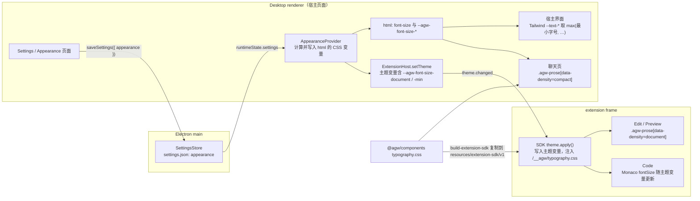

# Markdown 排版规范与 Desktop 字号设置

## 名词解释

- **排版规范**：Markdown 内容的一套共用规则，包括正文行高、块间距、标题字号阶梯，以及列表、引用、代码、表格、分隔线、脚注的规则。间距与标题都写为当前字号的倍数（`em`），由 `@agw/components` 的 `typography.css` 定义，作用于带 `agw-prose` class 的容器。
- **密度**：排版规范的两种取值。`compact` 用于聊天页，`document` 用于 Edit 与 Preview。两种密度的比例与间距规则相同，基础字号与行高不同。
- **基础字号**：Desktop 宿主页面根元素（`html`）的字号。宿主界面中以 `rem` 写的字号与间距都随它缩放。
- **聊天字号**：聊天页 Markdown 内容（`compact` 密度）的字号。
- **文档字号**：Edit 与 Preview 中 Markdown 内容（`document` 密度）的字号。
- **最小字号**：所有按比例缩小的文字（行内代码、表头、脚注、标签、徽标、时间等）的下限。
- **字号设置**：基础字号、聊天字号、文档字号、最小字号四项，保存在 Desktop 的 `settings.json` 中，每台设备各自保存。
- **第一行**：一个块在页面上显示的第一行文字的行框（line box）。块中没有文字时，第一行指块中第一个有尺寸的图片、分隔线或表单控件。
- 其余名词（Text Editor、Edit、Preview、Code、主题变量、`theme.apply()` 等）沿用 `2026-10-18-Desktop-文本文件编辑.md`。

## 背景

- 三处 Markdown 各用一套排版，数值互不相同：
  - 聊天页（`packages/components/src/ui-tokens/tokens.css` 的 `msg-content-md-*`）：正文 14px，行高 1.625，列表行高 1.5，paragraph 之间 8px；行内代码 12px，代码块 13px，表头 12px，脚注 12px。
  - Preview（`packages/extensions/text-editor/src/preview/markdown.css`）：GitHub 风格，正文 16px，行高 1.5，块间距 16px，H1 32px。
  - Edit（`packages/extensions/text-editor/src/editor/edit.css`）：正文 16px，行高 1.6，块间距 8px，H1 到 H3 为 30、24、20px。
- 聊天页的标题、引用块、分隔线没有样式。Tailwind 的基础样式把 `h1` 到 `h6` 重置为与正文相同的字号与字重，聊天消息中的 `# 标题` 显示为普通文字。
- Edit 的拖动手柄按块外框的顶部定位（floating-ui 的 `left-start`），带边框或内边距的块（图片占位、引用块、代码块标题栏、表格）以及行高与正文不同的标题，手柄与第一行文字错开。
- Desktop 没有字号设置。宿主界面的字号大多以 `rem` 写（`text-sm` 339 处、`text-xs` 288 处），另有约 40 处固定像素（`text-[9px]` 到 `text-[15px]`、CSS 中的 `13px`），无法整体缩放。
- 用户希望在 Desktop 的 Settings 中新增 Appearance 页面，按设备调整基础字号、聊天字号、文档字号与最小字号，调整后程序各处立即生效。

## 设计目标

### 功能目标

1. 排版规范：一份规则，聊天页（Web 与 Desktop）、Edit、Preview 共用；聊天页使用 `compact` 密度，Edit 与 Preview 使用 `document` 密度。聊天页的标题、引用块、分隔线按规范显示。
2. Appearance 页面（只在 Desktop）：基础字号、聊天字号、文档字号、最小字号四项设置，每项可恢复默认；页面中有预览；修改后立即生效，不需要重启或重新加载。
3. 宿主界面缩放：Desktop 宿主界面的字号与间距随基础字号缩放；固定像素的字号改为可缩放的写法；所有按比例缩小的文字不小于最小字号。
4. Text Editor 跟随设置：Edit、Preview 的 Markdown 内容使用文档字号；Code 编辑器字号随文档字号变化；三个查看器中按比例缩小的文字不小于最小字号。
5. 拖动手柄：Edit 的拖动手柄垂直居中在被悬停块的第一行上，对任何类型的块都成立；水平位置保持在内容列左侧的同一列。
6. Web：聊天页使用排版规范与固定的默认数值，没有字号设置入口；Web 的其他界面不变。

### 技术目标

- **单一来源**：排版规范只在 `packages/components/src/ui-tokens/typography.css` 定义一次。宿主通过 CSS 引入；extension 通过宿主提供的 `/__agw/typography.css` 使用同一份文件，不复制规则。
- **立即生效**：字号设置保存后，宿主界面、聊天页与已打开的 extension 视图在下一帧内使用新字号，不重建 extension frame，未保存修改不受影响。
- **性能**：修改字号只引起一次重新布局。Edit 在 631 KB 文档中的输入性能不因本方案变差（`2026-10-18-Desktop-文本文件编辑.md` 的性能测试在默认设置下重新测量）。
- **兼容**：`manifestVersion` 仍为 1；新增的主题变量与 `/__agw/typography.css` 都是增量，不使用它们的 extension 不受影响。Mobile（`packages/chat-native`）不变。Web 除聊天页的 Markdown 内容外不变。
- **失败直接抛出**：`settings.json` 中的字号设置不合法时，按现有设置字段的方式在加载时报错；渲染端缺少必需的主题变量时直接抛出。

## 总体设计

### 技术选型

**全局缩放使用根字号（`rem`），不使用 Electron 的页面缩放**

- `webContents.setZoomFactor` 会同时放大布局、图片、边框与滚动条，用户要求的是字号。宿主界面的 Tailwind 字号与间距已经以 `rem` 写，设置 `html { font-size }` 即可整体缩放，固定像素的少数地方改为 `rem` 或主题字号。

**最小字号使用 CSS `max()` 与 Tailwind 的主题变量**

- Tailwind v4 的 `text-xs` 等工具类编译为 `font-size: var(--text-xs)`。Desktop 在 `html` 上把 `--text-xs`、`--text-sm` 等重新定义为 `max(var(--agw-font-size-min), 原值)`，宿主界面的所有按比例缩小的文字自动遵守最小字号，不需要逐个修改组件。
- 排版规范中按比例缩小的字号同样写为 `max(var(--agw-font-size-min), 0.875em)` 等形式。

**排版规范放在 `@agw/components`，extension 经 `/__agw/` 获取**

- 聊天页的组件属于宿主共享包，extension 包只能依赖 `@agw/extension-sdk`，两者不能直接共用源码。宿主已经通过扩展协议在 `/__agw/` 下提供 `sdk.js`；把 `typography.css` 由 `build-extension-sdk.mjs` 复制到 `resources/extension-sdk/v1/` 并加入协议白名单，extension 就能以同源 URL 使用同一份文件，CSP 不变。
- 由 SDK 的 `theme.apply()` 注入这个样式表：任何调用 `theme.apply()` 的 extension 都能通过 `agw-prose` class 使用排版规范；样式表中的规则都限定在 `.agw-prose` 之内，不影响没有这个 class 的页面。

**设置变化通过现有的主题推送送达 extension**

- `ExtensionHost.setTheme` 已经把主题变量广播给所有 extension frame（`theme.changed`），extension 的 `theme.apply()` 与 `theme.onDidChange` 已经处理它。把字号变量加入 `THEME_TOKEN_NAMES`，并让推送在字号设置变化时也执行，就不需要新的 RPC。

## 数据库设计

不涉及。Desktop 的 `settings.json` 增加 `appearance` 字段（见 2.1 节）。

## 详细设计

### 1. 排版规范（`typography.css`）

#### 1.1 文件与作用范围

- 新文件 `packages/components/src/ui-tokens/typography.css`，由 `tokens.css` 所在的入口一同导出（`@agw/components/ui-tokens.css` 引入它，或新增导出 `@agw/components/typography.css` 并在 Web 与 Desktop 的 `globals.css` 中引入；由实现者按包的导出方式选择其一）。
- 规则全部写在 `.agw-prose` 之内，元素选择器使用 `:where()` 保持低优先级，组件自己的 class 可以覆盖。
- 容器用 `data-density` 选择密度：`compact` 或 `document`。

#### 1.2 变量

在 `typography.css` 的 `:root` 中定义默认值（Web 直接使用默认值；Desktop 由 `AppearanceProvider` 在 `html` 上覆盖，见第 3 节）：

- `--agw-font-size-base`：`16px`。
- `--agw-font-size-chat`：`calc(var(--agw-font-size-base) * 0.875)`（默认 14px）。
- `--agw-font-size-document`：`var(--agw-font-size-base)`（默认 16px）。
- `--agw-font-size-min`：`14px`。

密度变量（在 `.agw-prose[data-density=…]` 上定义）：

- `compact`：字号 `var(--agw-prose-font-size, var(--agw-font-size-chat))`，正文行高 `1.65`，块间距 `0.6em`。
- `document`：字号 `var(--agw-prose-font-size, var(--agw-font-size-document))`，正文行高 `1.75`，块间距 `0.8em`。

`--agw-prose-font-size` 默认不定义。个别调用方需要与所在区域一致的字号时，在容器上设置它（见 1.4 节），比例、行高与间距规则不变。

#### 1.3 元素规则

以下数值是两种密度共用的比例（`em` 相对于容器字号），按比例缩小的字号都写为 `max(var(--agw-font-size-min), …)`：

- **paragraph**：上下间距为块间距，容器中第一个块的上间距、最后一个块的下间距为 0。
- **标题**：字重 600，行高 1.35；字号 H1 `1.75em`、H2 `1.45em`、H3 `1.25em`、H4 `1.1em`、H5 `1em`、H6 `1em`（H6 使用 muted 颜色）；上间距 `1.4em`（H1、H2）或 `1.2em`（H3 至 H6），下间距 `0.5em`；H1、H2 下方有 1px 分隔线与 `0.3em` 内边距。容器中第一个块是标题时上间距为 0。
- **列表**：左内边距 `1.5em`；列表项之间 `0.25em`；嵌套列表上下 `0.25em`；列表项中的 paragraph 不额外加间距；任务项的复选框与第一行垂直居中。
- **引用块**：左内边距 `1em`，左边框 3px（border 颜色），文字颜色 muted；上下间距为块间距。
- **行内代码**：等宽字体（`--font-mono`），字号 `max(var(--agw-font-size-min), 0.875em)`，内边距 `0.15em 0.35em`，圆角，背景为 muted。
- **代码块**：字号 `max(var(--agw-font-size-min), 0.875em)`，行高 1.55，内边距 `0.85em 1em`，圆角，背景为 muted；可横向滚动。
- **表格**：字号 `max(var(--agw-font-size-min), 0.9375em)`；单元格内边距 `0.45em 0.75em`；表头字重 600；边框为 border 颜色。
- **分隔线**：1px，上下 `1.5em`。
- **图片**：最大宽度 100%。
- **脚注**：脚注区字号 `max(var(--agw-font-size-min), 0.875em)`，muted 颜色，上方 1px 分隔线；脚注引用（`sup`）字号 `max(var(--agw-font-size-min), 0.75em)`。
- **链接**：颜色为宿主的 link 颜色，下划线与文字的距离为 `0.15em`。

各处保留的局部样式（不在 `typography.css` 中）：聊天页代码块的标题栏与复制按钮、表格外框与横向滚动容器、KaTeX；Edit 的 node view（代码块标题栏、原文块标签、任务复选框、图片占位）、菜单与浮层。局部样式中的字号同样改为 `em` 并取 `max(var(--agw-font-size-min), …)`。

#### 1.4 使用位置

- **聊天页**：`MarkdownView` 渲染的内容外层容器加 `agw-prose` 与 `data-density="compact"`。`MarkdownView` 的四个使用位置：
  - 聊天正文（`text-content.tsx`）与推理内容（`reasoning.tsx`）：使用聊天字号。
  - 计划卡片（`plan-card.tsx`，现为 15px、`leading-7`）：容器设置 `--agw-prose-font-size: var(--text-15)`（第 3 节新增的主题字号），保持与现在相同的大小并随基础字号缩放；`leading-7` 删除，行高由排版规范决定。
  - 人工确认的选项预览（`human-interaction-questions.tsx`，固定高度 `h-48`，现为 `text-xs`）：容器设置 `--agw-prose-font-size: var(--text-xs)`（受最小字号约束），预览框保持固定高度并可纵向滚动。Desktop 的 Tiptap 渲染（`packages/chat/src/ui-web/markdown-tiptap`）与 Web 的 `MdCard` 都输出 `h1`–`h6`、`blockquote`、`hr` 等语义元素，由排版规范统一设置样式。`tokens.css` 中 `msg-content-md-*` 与排版规范重复的字号、行高、间距规则删除，只保留局部样式。
- **Edit**：编辑区（`.ProseMirror`）加 `agw-prose` 与 `data-density="document"`（通过 Tiptap 的 `editorProps.attributes`）。`edit.css` 中与排版规范重复的规则删除。
- **Preview**：`.markdown-body` 容器加 `agw-prose` 与 `data-density="document"`，`markdown.css` 中与排版规范重复的规则删除。

### 2. Desktop 字号设置

#### 2.1 设置项

`settings.json` 增加 `appearance`：

- `baseFontSize`：整数，12 到 20（px），默认 16。
- `chatFontSize`：`null` 或整数 12 到 24（px），默认 `null`，表示跟随基础字号（基础字号 × 0.875）。
- `documentFontSize`：`null` 或整数 12 到 28（px），默认 `null`，表示跟随基础字号（基础字号 × 1）。
- `minFontSize`：`14` 或 `12`，默认 14。

- 不小于最小字号：`baseFontSize`，以及不为 `null` 的 `chatFontSize`、`documentFontSize`，都不小于 `minFontSize`。最小字号为 14 时，三项都从 14 起选；用户先把最小字号改为 12，才能选 12 或 13。最小字号由 12 改为 14 时，同一次保存把小于 14 的已指定字号改为 14。
- `SettingsStore` 的 zod schema 增加这个字段，并校验上一条的跨字段规则；旧的 `settings.json` 没有该字段时使用默认值；值超出范围或违反跨字段规则时加载失败（与现有字段的处理相同）。
- `DesktopSettingsUpdate` 增加 `appearance`，沿用 `saveSettings` 的读改写队列与返回 `runtimeState` 的方式。

#### 2.2 Appearance 页面

- 新路由 `desktop/renderer/src/app/(app)/settings/appearance/page.tsx`，组件 `DesktopAppearancePage`；`SETTINGS_GROUPS`（`app-shell.tsx`）在 "Others" 组中增加 "Appearance"（图标 `ALargeSmall`）。
- 现有 Settings 页中的 `#appearance` 小节只有 "When closing the window"，改名为 "Window"（id `window`），导航项 "Appearance & close" 改为 "Window"。
- 页面内容：
  - "Base font size"：下拉选择 12 至 20 px，小于当前最小字号的选项不可选。
  - "Chat font size"：下拉选择 "Follow base size（{计算值} px）" 或 12 至 24 px，小于当前最小字号的选项不可选。
  - "Document font size"：下拉选择 "Follow base size（{计算值} px）" 或 12 至 28 px，小于当前最小字号的选项不可选；说明文字 "Used by Edit and Preview. Code uses 0.875 of this size."。
  - "Minimum font size"：选择 14 px 或 12 px；改为 14 时按 2.1 节把小于 14 的已指定字号一并改为 14。
  - 每项右侧的 "Reset" 恢复该项的默认值；页面底部 "Reset all"。
  - 预览区：左侧一段 `compact` 密度的聊天样式 Markdown（标题、paragraph、列表、行内代码），右侧一段 `document` 密度的文档样式 Markdown，使用当前设置显示。
- 修改任一项立即保存（`saveSettings({ appearance })`）并生效；保存失败时用现有的错误提示显示原因，界面恢复为保存前的值。

#### 2.3 计算与应用（`AppearanceProvider`）

- 纯函数 `resolveAppearance(appearance)` 返回 CSS 变量：
  - `--agw-font-size-base`：`{baseFontSize}px`
  - `--agw-font-size-chat`：`{chatFontSize ?? max(minFontSize, baseFontSize × 0.875)}px`
  - `--agw-font-size-document`：`{documentFontSize ?? baseFontSize}px`
  - `--agw-font-size-min`：`{minFontSize}px`
- `AppearanceProvider`（Desktop renderer，位于 `runtime-provider.tsx` 的 provider 链中）在设置变化时把这些变量与 `font-size: var(--agw-font-size-base)` 写到 `document.documentElement`，并写入 Tailwind 字号的下限：`--text-xs`、`--text-sm` 以及第 3 节新增的 `--text-2xs`、`--text-3xs` 设为 `max(var(--agw-font-size-min), 原值)`。原值以 `rem` 表示，随基础字号缩放。
- Web 不使用 `AppearanceProvider`，使用 `typography.css` 的默认值，Tailwind 字号不变。

### 3. 宿主界面的缩放

- 根字号：Desktop 的 `html` 字号为基础字号；宿主界面中以 `rem` 写的字号与间距随之缩放。
- 固定像素字号改为主题字号：在 `tokens.css` 的 `@theme` 中新增 `--text-3xs: 0.5625rem`（9px）、`--text-2xs: 0.625rem`（10px），以及与现有 11px、13px、15px 对应的 `--text-11: 0.6875rem`、`--text-13: 0.8125rem`、`--text-15: 0.9375rem`（名称由实现者按 Tailwind 的命名规则确定）。`packages/*/src`（不含 `chat-native` 与 `extensions`）、`desktop/renderer/src` 中的 `text-[Npx]` 与 CSS 中的固定像素字号改为这些主题字号。Web 的根字号为 16px，计算结果与现在相同，Web 外观不变；Desktop 中它们随基础字号缩放，并受最小字号约束。
- 标题栏（`.agw-titlebar`）的高度保持 48px，不随基础字号缩放：系统窗口按钮的位置是固定的（Windows、Linux 的 `titleBarOverlay.height` 为 48，macOS 的 `trafficLightPosition` 为 `{ x: 18, y: 18 }`）。`h-12` 改为固定的 `48px`，标题栏中的文字随基础字号缩放，并在基础字号 20 下不截断。
- 固定的高度、宽度若会截断放大后的文字（徽标、标签、按钮），改为 `rem` 或 `min-height`。实现时在基础字号 20 px、最小字号 14 px 下逐页检查宿主界面（聊天、Files、Agents、Settings、Extensions、对话框）不出现截断或重叠，问题处修改为可缩放的尺寸。

### 4. Text Editor 跟随设置

#### 4.1 主题变量

- `THEME_TOKEN_NAMES`（`desktop/renderer/src/runtime/extensions/extension-host-provider.tsx`）增加 `--agw-font-size-base`、`--agw-font-size-document`、`--agw-font-size-min`。`readTheme` 已按 `getComputedStyle(document.documentElement)` 读取计算值。
- 推送时机：现有的 `useEffect` 依赖 `[host, resolvedTheme]`，增加字号设置（`runtimeState.settings.appearance`），字号变化时同样 `host.setTheme(...)`。
- `@agw/extension-sdk` 的 `ThemeInfo.tokens` 说明增加字号变量（颜色、圆角、字体与字号变量），重新生成 `sdk.d.ts`。

#### 4.2 `/__agw/typography.css`

- `desktop/scripts/build-extension-sdk.mjs` 把 `packages/components/src/ui-tokens/typography.css` 复制到 `resources/extension-sdk/v1/typography.css`。
- `extension-protocol.ts` 的 `/__agw/` 白名单增加 `typography.css`（`text/css`）。
- SDK 的 `theme.apply()` 在第一次调用时向 `document.head` 加入 `<link rel="stylesheet" href="/__agw/typography.css">`（只加一次），之后照常写入主题变量。`ExtensionApi.theme.apply` 的说明增加这一点，`sdk.d.ts` 重新生成。

#### 4.3 三个查看器

- Edit、Preview、Code 的 `body` 字号改为 `var(--agw-font-size-base)`；页面中按比例缩小的文字（顶部条、菜单、状态栏、代码块标题栏、原文块标签、错误面板）写为 `max(var(--agw-font-size-min), …em)`。Text Editor 中所有固定像素的字号改为基于变量的写法。
- Edit 与 Preview 的 Markdown 内容使用 `document` 密度（第 1.4 节）。
- Code：Monaco 的字号为 `max(最小字号, 文档字号 × 0.875)`，取整到 0.5px；创建编辑器时按 `api.theme.get().tokens` 计算，`api.theme.onDidChange` 时调用 `editor.updateOptions({ fontSize })`。主题变量缺少字号变量时直接抛出。
- 字号变化后 Edit 中的拖动手柄重新定位（见第 5 节，手柄在下一次悬停或滚动时按新的行框计算）。

### 5. 拖动手柄与第一行对齐

- 水平位置保持现状：middleware 把 x 平移到编辑区左边缘。
- 垂直位置：`BlockHandle` 用 ref 记录 `onNodeChange` 给出的块位置；新的 floating-ui middleware 用 `editor.view.nodeDOM(pos)` 取得块的 DOM，按下面的规则求第一行，并把 y 设为第一行中心减去手柄高度的一半（相对于块外框顶部的位置差加到 floating-ui 算出的 y 上）。
- 第一行的求法（`firstLineRect(element)`，纯 DOM 函数，放在 `src/editor/first-line.ts`）：
  1. 用 `TreeWalker` 按文档顺序遍历元素中的文字节点，跳过空白文字节点与没有布局的节点（`getClientRects()` 为空，例如 `display: none`、`hidden`）。对第一个文字节点的第一个非空白字符创建 `Range`，取 `getClientRects()[0]`，这就是第一行的行框；行高以该文字所在元素的计算行高为准（行框高度不足行高时按行高居中）。
  2. 第一个文字节点之前若有表单控件（复选框、`select`、按钮）或图片，并且它的顶部不低于第 1 步得到的行框，则以该控件所在行为第一行（任务项的复选框与文字在同一行，结果相同）。
  3. 元素中没有文字时，取第一个有尺寸的 `img`、`hr`、`input`、`select`、`button` 的外框为第一行；都没有时取块外框，高度取块的计算行高。
- 适用于所有块：paragraph、H1 至 H6、列表项（含任务项）、引用块、代码块（标题栏是第一行）、原文块（标签是第一行）、front matter、表格（第一个单元格的第一行）、图片与图片占位、分隔线。

### 6. Web

- Web 的聊天页使用 `typography.css` 的默认值：聊天字号 14px、最小字号 14px，行高与间距按 `compact` 密度。行内代码、表格、脚注等原来小于 14px 的文字变为 14px，标题、引用块、分隔线开始有样式。
- Web 没有 `AppearanceProvider` 与设置入口，Tailwind 字号不变，宿主界面其他部分不变。

### 7. 兼容与迁移

- 旧的 `settings.json` 没有 `appearance` 时使用默认值，首次保存任一设置后写入。
- 默认设置下 Desktop 宿主界面中原来小于 14px 的文字变为 14px（最小字号默认 14px），用户可以在 Appearance 中改为 12px。
- `2026-10-18-Desktop-文本文件编辑.md` 中的 Edit 字号（正文 16px、H1 至 H3 为 30、24、20px）与 Code 编辑器字号（14）由本方案的排版规范与第 4.3 节取代。

## 接口文档

### Desktop 内部

- `DesktopSettings.appearance: { baseFontSize: number; chatFontSize: number | null; documentFontSize: number | null; minFontSize: 12 | 14 }`；`DesktopSettingsUpdate` 增加 `appearance`。
- `resolveAppearance(appearance): Record<string, string>`（CSS 变量名到值）。
- 新路由 `/settings/appearance/`。

### Extension API（`@agw/extension-sdk`，增量）

- `ThemeInfo.tokens` 增加 `--agw-font-size-base`、`--agw-font-size-document`、`--agw-font-size-min`（计算后的 px 值）。字号设置变化时 `theme.onDidChange` 收到新值。
- `theme.apply()` 另外在页面中加入 `/__agw/typography.css`；页面元素加 `agw-prose` 与 `data-density="document"` 或 `"compact"` 即可使用排版规范。
- 扩展协议 `/__agw/typography.css`（`text/css`）。

## 测试计划

### 单元测试

- `typography.css`（jsdom 不计算样式，用 Electron 集成测试或 Playwright 验证样式；单元测试只检查文件被正确导出与复制）：`build-extension-sdk.mjs` 产物中有 `v1/typography.css`，内容与源文件相同。
- `settings-store.test.ts`：没有 `appearance` 时为默认值；四项的边界值（12、20、24、28；`minFontSize` 只接受 12 与 14）；超出范围时加载失败；`saveSettings({ appearance })` 写入并保留其他字段。
- `resolveAppearance`：默认值得到 16、14、16、14 px；基础字号 14、最小字号 14 时聊天字号为 14（不小于最小字号）；最小字号 12、基础字号 12 时为 12、10.5 取 12（即 `max(12, 10.5)`）、12、12；单独指定聊天字号、文档字号后不再跟随基础字号；基础字号变化时跟随的两项随之变化。
- 跨字段规则：`settings-store.test.ts` 中最小字号 14 而基础字号 12 时加载失败；把最小字号由 12 改为 14 的保存把 12、13 的已指定字号改为 14。
- `AppearanceProvider`：设置变化后 `document.documentElement` 上的 CSS 变量、`font-size` 与 `--text-*` 下限更新。
- `ExtensionHost` / `extension-host-provider`：字号设置变化时调用 `setTheme`，主题变量包含三个字号变量。
- `extension-protocol.test.ts`：`/__agw/typography.css` 返回文件与 `text/css`；白名单以外的名称仍被拒绝。
- SDK：`theme.apply()` 只加入一次样式表链接。
- Code：Monaco 字号的计算（默认 14；文档字号 20 时 17.5；最小字号 14 而文档字号 14 时为 14）。
- `first-line.ts`：在 Electron 或无头 Chromium 中验证（需要浏览器计算布局），见集成测试。
- Appearance 页面组件测试：四项下拉的选项与默认值；"Follow base size" 显示计算值；Reset 与 Reset all；修改后调用 `saveSettings`。
- 聊天页渲染测试：`MarkdownView` 的容器带 `agw-prose` 与 `data-density="compact"`；计划卡片与人工确认预览的容器设置 `--agw-prose-font-size`；标题、引用块、分隔线渲染为语义元素。

### 集成测试

使用 `pnpm --filter @agw/desktop test:extensions`：

- 打开 Appearance 页面，把基础字号改为 20：宿主 `html` 的计算字号为 20px；聊天页 Markdown 正文的计算字号为 17.5px；Edit 与 Preview 中 paragraph 的计算字号为 20px，Code 编辑器字号为 17.5；不重建 extension frame，Edit 中的未保存修改保留。
- 单独把聊天字号设为 15、文档字号设为 18：两处分别为 15px 与 18px，基础字号再变化时两者不变；Reset 后恢复跟随。
- 最小字号：默认设置下宿主界面中使用 `text-xs` 的元素计算字号为 14px；改为 12px 后为 12px；Edit 中行内代码不小于最小字号。
- 拖动手柄：分别悬停 paragraph、H1、H3、列表项、任务项、引用块、代码块、表格、图片占位、分隔线，手柄中心与 `firstLineRect` 中心的垂直距离不超过 1px，水平位置相同；在基础字号 20 下重复一次。
- 重新启动 Desktop 后字号设置保持。

### 回归测试

- Web：`pnpm --filter @agw/web test:e2e`，并增加一项检查聊天消息中 `# 标题` 的计算字号大于正文、行内代码为 14px。
- 宿主界面截断检查：在基础字号 20 px、最小字号 14 px 下，集成测试逐页检查主要页面中文字元素的 `scrollWidth` 不大于 `clientWidth`（徽标、标签、按钮），发现问题的元素改为可缩放尺寸。
- `2026-10-18-Desktop-文本文件编辑.md` 的性能测试在默认设置下重新运行，结果不变差。
- `pnpm test`、`pnpm lint`、`pnpm build`、`pnpm --filter @agw/desktop test:extensions`。
