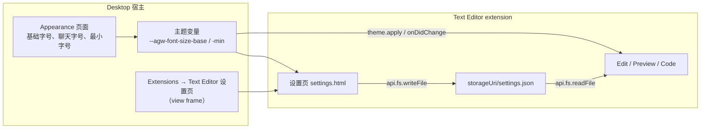

# Text Editor 设置

## 名词解释

- **Text Editor 设置**：Text Editor extension 自己的设置，保存在它的存储目录中，每台设备各自保存。当前包括文档字号与代码字号两项。
- **设置页**：extension 在 manifest 中通过 `contributes.settings.entry` 声明的页面，显示在 Desktop 的 Extensions → {extension} 设置页中，在 view frame 内由 extension 自己绘制（现有机制，见 `2026-10-16-Desktop-Extension.md`）。
- **文档字号**：Edit 与 Preview 中 Markdown 内容（`document` 密度）的字号。
- **代码字号**：Code 查看器（Monaco）的字号。
- **基础字号**、**最小字号**：Desktop Appearance 页面中的设置，宿主通过主题变量 `--agw-font-size-base`、`--agw-font-size-min` 推送给 extension（见 `2026-10-21-Markdown排版规范与Desktop字号设置.md`）。
- 其余名词（Edit、Preview、Code、排版规范、密度、`theme.apply()` 等）沿用 `2026-10-21-Markdown排版规范与Desktop字号设置.md`。

## 背景

- `2026-10-21-Markdown排版规范与Desktop字号设置.md` 把文档字号放在 Desktop 的 Appearance 页面中，由宿主推送 `--agw-font-size-document` 给 extension；Code 的字号固定为文档字号 × 0.875，用户不能单独调整。
- 文档字号只被 Text Editor 使用，属于 extension 自己的行为与样式。extension 已经可以通过 `contributes.settings.entry` 提供设置页，并且有专用的存储目录（`context.extension.storageUri`，读写不需要额外权限），Text Editor 还没有使用这两项能力。
- 用户希望 Text Editor 有独立的设置：把 Document font size 从 Appearance 移到 Text Editor 的设置页，并新增 Code editor font size。

## 设计目标

### 功能目标

1. Text Editor 在 manifest 中声明设置页，用户在 Extensions → Text Editor 的设置页中修改它的设置。
2. 设置项：Document font size（从 Appearance 移过来，用于 Edit 与 Preview）、Code editor font size（新增，用于 Code）。每项可恢复默认，页面有 Reset all。
3. Appearance 页面删除 Document font size 设置项与文档预览；宿主不再推送 `--agw-font-size-document`。
4. Text Editor 的三个查看器按自己的设置、基础字号与最小字号计算字号。
5. 设置每台设备各自保存，修改后立即保存，下次打开查看器时生效。

### 技术目标

- **数据归属**：Text Editor 设置只保存在 Text Editor 的存储目录中，宿主的 `settings.json` 不再包含文档字号。
- **失败直接抛出**：设置文件不合法时，设置页与查看器显示错误，不回退到默认值；用户在设置页点击 Reset all 才会写入默认值。
- **兼容**：`manifestVersion` 仍为 1。主题变量删除 `--agw-font-size-document`；这个变量只在未发布的 `2026-10-21` 方案中出现过，没有其他 extension 使用。
- **最小字号**：两项设置都不小于最小字号。

## 总体设计



## 数据库设计

不涉及。Text Editor 在自己的存储目录中新增 `settings.json`；Desktop `settings.json` 的 `appearance` 删除 `documentFontSize`（见第 4 节）。

## 详细设计

### 1. 设置文件

- 位置：`{storageUri}/settings.json`，`storageUri` 取自 `api.context.get().extension.storageUri`。读取用 `api.fs.readTextFile`，写入用 `api.fs.writeFile`（内容为 `TextEncoder` 编码的 UTF-8 JSON）。存储目录由宿主在 extension 启用时创建，读写不需要声明权限；宿主的写入是原子的（先写临时文件再改名，见 `extension-file-system.ts` 的 `commitFile`），读取方不会读到写了一半的文件。
- 设置页与三个查看器不会同时运行（打开设置页时查看器已经关闭），文件不需要额外的并发控制。
- 内容：

```json
{ "schemaVersion": 1, "documentFontSize": null, "codeFontSize": null }
```

- `documentFontSize`：`null` 或整数 12 到 28（px），默认 `null`，表示跟随基础字号。
- `codeFontSize`：`null` 或整数 12 到 28（px），默认 `null`，表示跟随文档字号 × 0.875。
- 文件不存在时使用默认值（两项都为 `null`），第一次修改时创建。
- 校验使用 zod 的严格对象（加入 Text Editor 的依赖，版本取 `pnpm-workspace.yaml` 的 catalog）。JSON 无法解析、字段缺失、出现未知字段、值超出范围或 `schemaVersion` 不是 1 时，读取抛出错误，错误信息包含文件名与 zod 给出的原因。
- 文件中保存的值可以小于当前最小字号（用户之后在 Appearance 中把最小字号由 12 改为 14 时），使用时按第 2 节取最小字号；文件不因此改写。

### 2. 字号计算

纯函数 `resolveTextEditorFontSizes(settings, tokens)`，放在 Text Editor 的 `src/shared/`，输入为设置与主题变量，返回 `{ document: number; code: number }`（px）：

- `base`、`min`：解析 `tokens["--agw-font-size-base"]`、`tokens["--agw-font-size-min"]`，格式必须为 `<数字>px`；缺少或格式不对时抛出（与现有 `codeFontSize` 的做法相同）。
- `document = max(min, documentFontSize ?? base)`。
- `code`：`codeFontSize` 不为 `null` 时为 `max(min, codeFontSize)`；为 `null` 时为 `max(min, round(document × 0.875 × 2) / 2)`（取整到 0.5px，与现在 Code 的字号相同）。

现有的 `src/code/code-font-size.ts`（`codeFontSize(tokens)`）由这个函数取代。

### 3. 查看器

- 三个查看器启动时先读取设置文件，读取成功后再打开文档（创建文档会话）；设置保存在内存中，之后不再读取文件。
- Edit 与 Preview：在 `document.documentElement` 上写入 `--agw-font-size-document: {document}px`（排版规范的 `document` 密度取这个变量）；`api.theme.onDidChange` 时用内存中的设置与新的基础字号、最小字号重新计算并写入。
- Code：创建 Monaco 时 `fontSize` 取 `code`；`api.theme.onDidChange` 时用内存中的设置重新计算并调用 `editor.updateOptions({ fontSize })`。
- 设置文件读取失败（含校验失败）时，查看器显示现有的错误面板（`src/shared/document-error.tsx`），内容为 "Text Editor settings are invalid: {原因}"，并提示 "Open Text Editor settings to reset them."；不创建文档会话，不打开文件。
- 打开设置页时 Text Editor 的视图已经关闭（离开聊天页面会关闭 extension 视图），所以查看器不监听设置文件的变化，下次打开时读取新值。

### 4. 设置页

- manifest 增加 `"contributes": { "settings": { "entry": "settings.html" } }`；Text Editor 的构建增加 `settings.html` 入口（`src/settings/`），页面调用 `api.theme.apply()`，使用宿主的颜色、字体与排版变量。
- 页面内容，样式与 Desktop 的 Appearance 页面一致（每行：标签、说明、下拉框、Reset 按钮）：
  - "Document font size"，说明 "Used by Edit and Preview."；选项 "Follow base size ({计算值} px)" 与 12 至 28 px。
  - "Code editor font size"，说明 "Used by Code."；选项 "Follow document size ({计算值} px)" 与 12 至 28 px。"Follow" 的计算值按第 2 节，随当前文档字号设置变化。
  - 小于当前最小字号的选项不可选。文件中保存的值小于最小字号时，该值的选项保持选中并显示为 "{值} px (uses {最小字号} px)"，其他小于最小字号的选项不可选；用户改选其他值后，这个选项恢复为普通的不可选选项。
  - 每行的 Reset 恢复该项为 `null`（按钮名称 "Reset document font size"、"Reset code editor font size"）；页面底部 "Reset all" 把文件写为默认值。
- 页面在内存中保存完整的设置对象。修改任一项时先更新内存中的对象，再把整个对象写入文件；写入按顺序排队执行，一次写入完成后才开始下一次。写入失败时用 `api.ui.notify({ type: "error", message })` 显示原因，界面恢复为最后一次写入成功的值。
- 设置文件不合法时，页面显示错误信息（同第 3 节），两个下拉框不可用，只有 "Reset all" 可用；点击后写入默认值并恢复正常显示。

### 5. Desktop 的调整

- Appearance 页面删除 "Document font size" 一行与右侧的文档预览，只保留聊天样式预览。
- `AppearanceSettings` 删除 `documentFontSize`；`DEFAULT_APPEARANCE`、`raiseToMinimum`、`resolveFontSizes`（不再返回 `document`）、`resolveAppearance`（不再写 `--agw-font-size-document`）、`settings-store.ts` 的 zod schema 同步修改。`DOCUMENT_FONT_SIZES` 删除。
- `THEME_TOKEN_NAMES` 删除 `--agw-font-size-document`；`@agw/extension-sdk` 的 `ThemeInfo.tokens` 与 `theme.apply` 说明同步修改，重新生成 `sdk.d.ts`。
- `typography.css` 的 `:root` 默认值 `--agw-font-size-document: var(--agw-font-size-base)` 保留，供不设置这个变量的页面使用。
- `2026-10-21` 方案尚未发布，不做 `settings.json` 迁移：`appearance` 中出现 `documentFontSize` 时按现有规则加载失败（开发环境的 `settings.json` 需要删除这个字段）。

### 6. 对 `2026-10-21` 方案的取代

本方案取代 `2026-10-21-Markdown排版规范与Desktop字号设置.md` 中的以下内容：第 2.1 节的 `documentFontSize`；第 2.2 节的 "Document font size" 设置项与文档预览；第 2.3 节的 `--agw-font-size-document`；第 4.1 节主题变量中的 `--agw-font-size-document`；第 4.3 节 Code 字号的计算；"接口文档" 中对应的字段与变量。

## 接口文档

### Text Editor（extension 内部）

- `settings.json`：`{ schemaVersion: 1; documentFontSize: number | null; codeFontSize: number | null }`。
- `readTextEditorSettings(api): Promise<TextEditorSettings>`、`writeTextEditorSettings(api, settings): Promise<void>`。
- `resolveTextEditorFontSizes(settings, tokens): { document: number; code: number }`。
- manifest：`contributes.settings.entry = "settings.html"`。

### Desktop

- `AppearanceSettings = { baseFontSize: number; chatFontSize: number | null; minFontSize: 12 | 14 }`。
- 主题变量：`--agw-font-size-base`、`--agw-font-size-min`（删除 `--agw-font-size-document`）。

## 测试计划

### 单元测试

- `resolveTextEditorFontSizes`：默认设置、基础字号 16、最小字号 14 → 文档 16、代码 14；基础字号 20 → 20、17.5；`documentFontSize` 18 → 文档 18、代码 16（15.75 取整到 0.5px 为 16）；`codeFontSize` 15 → 代码 15 且不随文档字号变化；最小字号 14 而 `documentFontSize` 12 → 文档 14；缺少主题变量或格式不对时抛出。
- 设置文件读写：文件不存在 → 默认值；边界值 12、28 可读；非法内容（11、29、16.5、未知字段、`schemaVersion` 2、非 JSON）读取抛出；写入后读回相同。
- 设置页组件：两个下拉框的默认显示与 "Follow" 计算值；小于最小字号的选项不可选；修改后写入文件；Reset 与 Reset all；写入失败时恢复；文件不合法时只有 Reset all 可用，点击后恢复。
- Desktop：`settings-store.test.ts`、`resolve-appearance.test.ts`、`appearance-provider.test.ts`、`appearance-settings-form.test.ts` 按第 5 节修改；`appearance` 中出现 `documentFontSize` 时加载失败；`THEME_TOKEN_NAMES` 不含 `--agw-font-size-document`。

### 集成测试

使用 `pnpm --filter @agw/desktop test:extensions`：

- Extensions → Text Editor 设置页显示两个设置项；把文档字号设为 20、代码字号设为 15，回到聊天页打开 Edit、Preview、Code：paragraph 为 20px，Monaco 字号为 15。
- Reset 后：Edit paragraph 为基础字号，Code 为文档字号 × 0.875。
- 设置文件写入非法内容后打开 Edit：显示 "Text Editor settings are invalid"；设置页只有 Reset all 可用，点击后恢复。
- Appearance 页面没有 Document font size；基础字号改为 20 后 Edit paragraph 为 20px（跟随）。
- 重新启动 Desktop 后 Text Editor 设置保持。
- 现有步骤中使用 Appearance 文档字号的检查（`appearanceSettings()`）改为使用 Text Editor 设置页。设置页的下拉框使用 id `text-editor-document-font-size`、`text-editor-code-font-size`（选项值为字号字符串，`"follow"` 表示 `null`），集成测试通过 extension 设置页的 view frame 操作它们。
- Text Editor 的测试宿主（`src/test-host.ts`、`src/editor/test-edit-host.ts`）提供 `--agw-font-size-base` 与 `--agw-font-size-min`，删除 `--agw-font-size-document`；需要设置文件的测试通过测试宿主的文件系统写入 `settings.json`。

### 回归测试

- `pnpm test`、`pnpm lint`、`pnpm build`、`pnpm --filter @agw/desktop test:extensions`、`pnpm --filter @agw/web test:e2e`。
