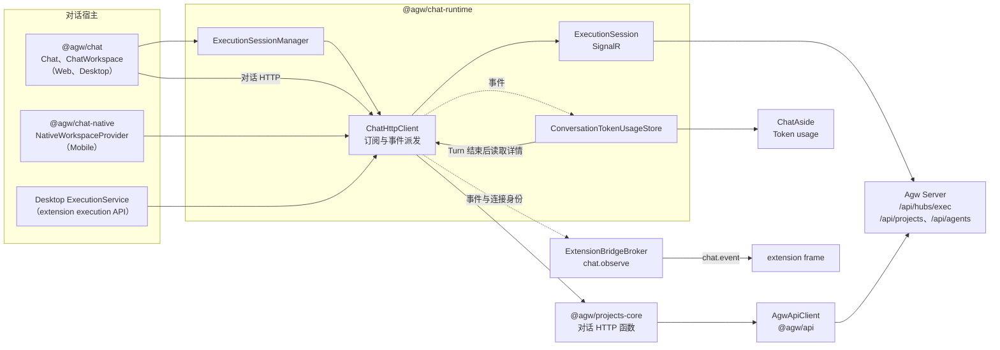
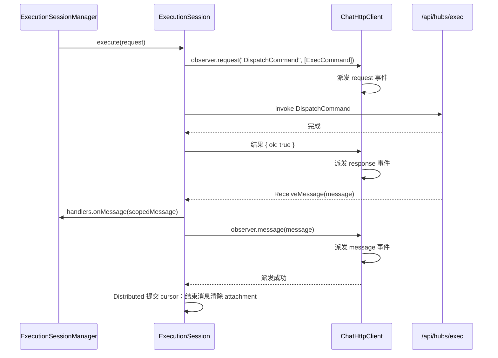
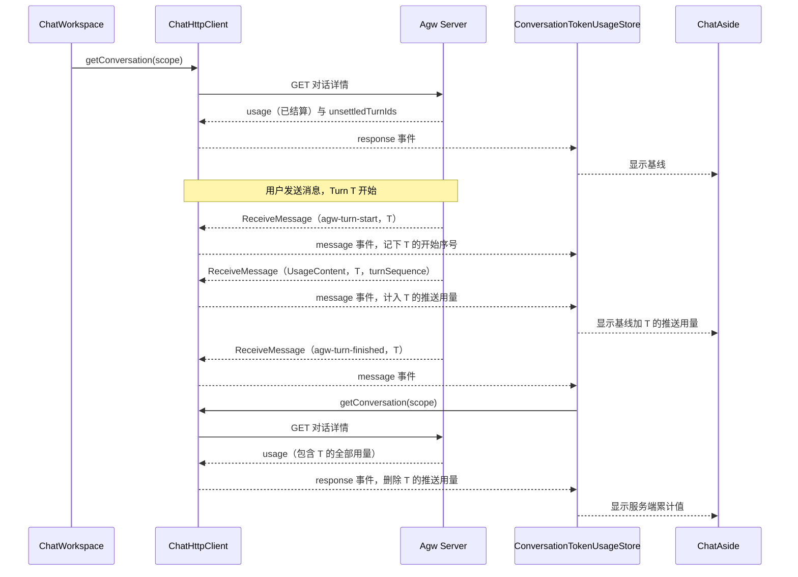
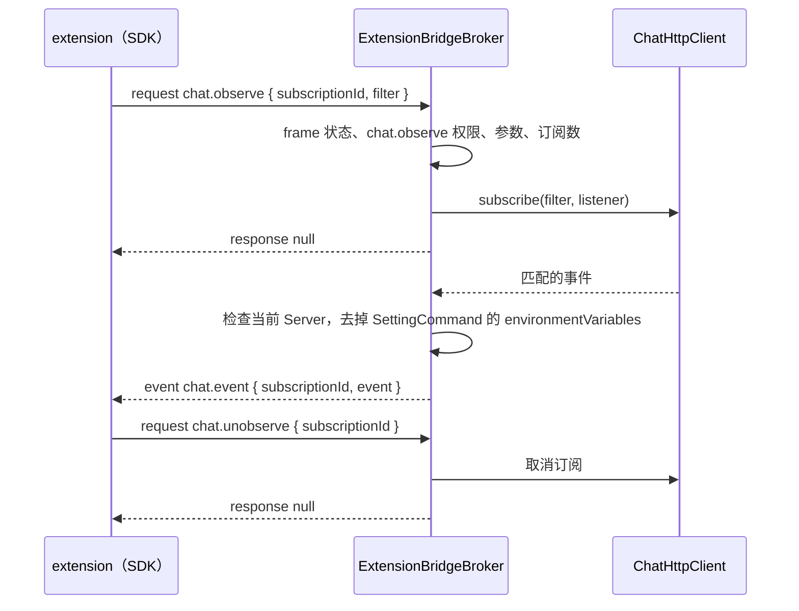

# ChatHttpClient 与通信事件订阅

## 名词解释

- **ChatHttpClient**：`@agw/chat-runtime` 中统一处理对话通信的客户端。对话与 Agw Server 之间的 SignalR 执行通道（`/api/hubs/exec`）和对话 HTTP 接口都经它发出；每一次请求、请求的结果和服务端返回的每一条消息，都作为通信事件派发给订阅方。
- **通信事件（`ChatEvent`）**：ChatHttpClient 派发的事件，共三种：
  - `request`：ChatHttpClient 发起的一次 HTTP 请求或一次 hub 方法调用；
  - `response`：该请求的结果，成功时带解包后的返回值，失败时带错误；
  - `message`：服务端返回的一条 `AiMessage`，来自 `ReceiveMessage` 推送或历史分页响应。
- **通道（channel）**：`execution` 表示 SignalR 执行通道，`http` 表示对话 HTTP 接口。
- **消息来源（source）**：message 事件的来源。`live` 是服务端通过 `ReceiveMessage` 推送的消息，包括断线重连或刷新页面后服务端按 cursor 补发的消息；`history` 是历史分页响应中的消息。推送消息与历史消息可以分别订阅。
- **作用范围（`ChatScope`）**：事件所属的 `serverId`、`projectId`、`conversationId`。`serverId` 与 `ExecutionSessionManager` 会话键中的值相同：Web 为 `browser`，Desktop 为当前 Server profile 的 id，Mobile 为已验证 Server profile 的 id。
- **发起方（`ChatEventOrigin`）**：`client` 表示 Agw 客户端自身；`extension` 表示 Desktop extension 通过 execution API 创建的执行会话，带 `extensionId`。
- **订阅条件（`ChatEventFilter`）**：按事件种类、通道、发起方、作用范围、消息来源、消息角色、消息类型、content 类型选择事件。空条件 `{}` 表示全量订阅。
- **消息角色**：`AiMessage.role`，取值为服务端 `AiRole` 的 `system`、`assistant`、`user`、`tool`。
- **消息类型**：`AiMessage.additionalProperties.type`，取值见服务端 `AgwMessageTypes`，例如 `agw-turn-start`、`agw-turn-finished`、`interaction-request`、`permission-status`、`result`。模型输出的普通消息没有这个字段。
- **content 类型**：`AiMessage.contents[].type`，取值见 `@agw/api` 的 `MessageContentType`，例如 `TextContent`、`FunctionCallContent`、`UsageContent`。
- **已结算 Turn 与未结算 Turn**：Turn 进入终态（`Completed`、`Failed`、`Interrupted`），并且已经到达它的用量结算时间（`usage_settles_at`）时为已结算，其余为未结算。InProcess 模式与 worker 正常提交结果时，结算时间等于结束时间；Distributed 中断时 worker 可能仍在运行，结算时间在 worker 退出之后（5.1 节）。
- **usage 基线**：对话详情接口 `GET /api/projects/{projectId}/conversations/{conversationId}` 返回的 `usage`，是该对话已结算 Turn 与不属于 Turn 的用量之和；同一响应的 `usage.unsettledTurnIds` 列出没有计入的未结算 Turn。
- **连接身份（`ChatConnectionIdentity`）**：一次通信所用连接的 `baseUrl` 与 Bearer token。HTTP 请求取发出时的值，执行会话取创建时的值。它只交给进程内的订阅函数，不出现在事件中（1.2 节）。

## 背景

- **产品需求**：
  - 把 Chat 与 Agw Server 之间的通信统一到一个客户端 ChatHttpClient。
  - 其他组件与 Desktop extension 可以订阅这些通信：ChatHttpClient 发起的请求，以及服务端响应中的任意消息；可以按消息角色、消息类型、content 类型订阅，也可以全量订阅。
  - Token usage 面板改为根据 ChatHttpClient 中的 `UsageContent` 计算。
- **Token usage 现状**：
  - Web 与 Desktop 的 `packages/chat/src/ui-web/components/message/chat.tsx` 中，`Chat` 用 `conversationUsage` state 保存用量。初始值为 `sessionSeed.usage`：`ChatWorkspace` 打开对话时取对话详情的 `usage`，Agent 与 Agentflow 执行抽屉传入 `EMPTY_TOKEN_USAGE`。`applyExecutionMessage` 对收到的每条执行消息调用 `getMessageTokenUsage` 并累加；恢复 Agentflow checkpoint 后，`calculateConversationUsage(retainedMessages)` 按保留下来的消息重新计算。`ChatAside` 显示这个 state。
  - 服务端按 Agent 的每次运行写入用量：`AgentTelemetryMiddleware` 在运行的流结束时，把观测到的 `UsageContent` 合计写入 `agent_usage`，记录只有 `ProjectId`、`ContextId`，没有所属 Turn。一个 Turn 中可能有多次运行：`AgentTurnExecutor` 的每一轮工具审批、Agentflow 的每个节点、Durable 模式下等待人工输入前后的每一段，所以 Turn 运行期间读取的对话详情可能已经包含该 Turn 的一部分用量。
  - `AgentMessageAdapters.Records` 不把 `UsageContent` 写入历史，因此历史分页中没有 `UsageContent`，只有 `ReceiveMessage` 推送中有。
  - 有些用量不经过推送：`AgentTurnSummaryService` 用非流式调用生成 summary，用量直接写入 `agent_usage`，返回的 Result 只含文字；`resultOnly` 开启时，`ResultOnlyMessageSink` 只转发 result、控制与错误消息，客户端收不到 `UsageContent`。
  - Distributed 中断时，`DurableExecutionCoordinator.InterruptAsync` 在加锁的事务中直接写入 `Interrupted`、Turn 结局与结束事件，之后才取消本实例上的执行（`CancellationTokenSource.CancelAsync` 不等待执行退出）；其他实例上的 worker 要到下一次续租失败（`LeaseRenewSeconds`，默认 10 秒）才停止。worker 停止时 telemetry 的 `finally` 才写入用量，晚于结束事件。
  - 刷新页面后，`ExecutionSession.configure` 从保存的 durable cursor 之后恢复订阅，cursor 之前已经收到的消息不会再次推送。
  - Distributed 模式下刷新页面时，`ChatWorkspace` 先读取对话详情，`Chat` 再用保存的 cursor 发送 `SubscribeTurnCommand`，服务端补发 cursor 之后的消息，Turn 已经结束时同样补发（`DurableExecutionAttachment.AttachAsync`）。断线期间结束的 Turn，其用量既在详情中，又随补发的 `UsageContent` 到达，现在的 `Chat` 会把它再加一次。切换回运行中的对话时，现在的 `Chat` 用新读取的 `usage` 替换已经累加的值，该 Turn 已推送的用量随之丢失。
  - `packages/chat-runtime/src/conversation-controller.ts` 的 `ConversationController` 有一份相同的累加逻辑，仓库中没有调用方。
  - Mobile 不显示 Token usage。
- **通信分散在多处**：
  - SignalR：`ExecutionSession` 在四处被直接创建：`ExecutionSessionManager`（Web 与 Desktop 的 Chat）、`NativeExecutionSession`（Mobile）、Desktop 宿主的 `ExecutionService`（extension 的 execution API）、`ConversationController`。
  - HTTP：`chat.tsx` 直接调用 `apiGet("/api/agents/permission-capabilities")`、`apiGet("/api/agents/suggestions")`，以及 `@agw/projects` 的 `getConversationTurnInputs`、`getProjectConversationMessages`、`clearProjectConversationRecords`；`ChatWorkspace` 调用 `getProjectConversationDetails` 与 `getProjectConversationMessages`；Mobile 通过 `createProjectConversationService(client)` 与 `client.apiGet` 调用同一组接口。
  - 没有可以订阅这些通信的位置。extension 的 execution API 只能收到自己创建的会话的消息；Token usage 这类面板只能写进 `Chat` 的消息处理代码中。

## 设计目标

### 功能目标

1. ChatHttpClient：Web、Desktop、Mobile 的 Chat 通过它使用 SignalR 执行通道与对话 HTTP 接口。
2. 通信事件与订阅：`request`、`response`、`message` 三种事件；订阅条件支持事件种类、通道、发起方、作用范围、消息来源、消息角色、消息类型、content 类型，推送消息（`live`）与历史消息（`history`）可以分别订阅，空条件为全量订阅。
3. Token usage：以 Turn 为统计边界。`ConversationTokenUsageStore` 订阅 ChatHttpClient，以对话详情中已结算 Turn 的用量为基线，加上未结算 Turn 推送的 `UsageContent`（按 `turnId` 与 `turnSequence` 去重）；每个 Turn 结束后在原连接下重新读取对话详情，Turn 已结束但用量尚未结算时继续读取；未结算 Turn 的推送用量保存在本地，刷新页面后恢复。
4. Mobile 改为通过 ChatHttpClient 通信。
5. Desktop extension：新增高风险权限 `chat.observe` 与 `api.chat.observe`，订阅当前 Server 上全部对话的通信，只接收属于当前连接身份的事件；extension 的 execution API 创建的会话也由 ChatHttpClient 创建，事件的发起方为该 extension。
6. 服务端：`agent_usage` 记录所属 Turn，Turn 记录用量的结算时间；对话详情的 `usage` 只计已结算 Turn 与不属于 Turn 的用量，并返回 `unsettledTurnIds`。

### 不在本次范围

- SignalR 协议不变。服务端只修改用量的 Turn 归属与对话详情的 `usage`（5.1 节），其他 HTTP 接口不变。
- 对话列表的读取、重命名、删除、清除项目全部对话，以及会话活动状态快照（`getConversationActivity`）仍由 `@agw/projects-core` 直接请求，不产生通信事件。
- 事件不保存、不回放：订阅只收到订阅之后派发的事件。
- Web 与 Mobile 不加载 extension，只有进程内的订阅方。
- `ConversationController` 的处理方式见“待办”。

### 技术目标

- **安全**：
  - `chat.observe` 为高风险权限：批准弹窗用警告色列出，broker 在每次 `chat.observe` 调用时检查。
  - 宿主只把属于当前连接的事件发给 extension：`scope.serverId` 等于当前 profile id，连接身份的 `baseUrl`、`token` 等于 `ContextService` 当前连接标识中的值。同一 profile 修改地址或更换身份后，旧配置下的会话与请求产生的事件不再发送。
  - 对话详情的同步请求只在对话的连接身份与当前 HTTP 连接身份相同时发出，不会用另一个 Server 的地址与凭据查询，也不会把另一个 Server 的数据写入这个对话的记录（5.3 节第 9 条）。
  - 发给 extension 的事件去掉 `SettingCommand.environmentVariables`。Context API 不提供环境变量，订阅同样不提供。
  - 事件中没有请求头与凭据：HTTP 事件只含方法、路径模板、参数与请求体；SignalR 的 Bearer token 由 `accessTokenFactory` 提供，不出现在 hub 方法参数中。
  - 订阅方收到深度冻结的副本，无法修改 Chat 正在使用的消息与请求对象。
- **性能**：
  - 没有任何订阅时，ChatHttpClient 不构造事件。
  - 有订阅时，每个事件对每个订阅做一次条件匹配，耗时与订阅数成正比；至少一个订阅匹配时才复制并冻结一次，所有匹配的订阅共用这一份副本。Web 与 Desktop 平时只有 `ConversationTokenUsageStore` 的四个订阅（5.2 节），流式文字消息不匹配其中任何一个，不产生副本。
  - 每个 Turn 结束后多一次对话详情请求。Distributed 中断的 Turn 在结算之前，再按 1、2、4、8 秒、之后每 10 秒请求一次，持续时间不超过 `LeaseSeconds`（默认 30 秒）加最后一次请求的间隔。
  - Desktop 中 extension 的每个订阅对应 ChatHttpClient 中的一个订阅，事件在宿主中按条件匹配后才写入端口。
- **稳定**：
  - 订阅函数抛出的异常不被捕获，从派发的位置继续抛出（2.5 节）。`ExecutionSession` 在 `handlers.onMessage` 之后才派发 `message` 事件，当前消息已经交给 Chat；Distributed 模式下，后续消息按第 4 节的恢复规则处理。
  - extension 的订阅属于创建它的 frame 页面；端口关闭（frame 关闭、页面被替换、extension 停用）时一起取消。每个 extension 最多同时有 16 个订阅。
- **准确**：
  - 每个 Turn 结束后的详情同步完成时，面板的值等于服务端该对话 `agent_usage` 的累计值，包括 summary、`resultOnly` 与非流式调用的用量。Turn 结束时仍在运行的后台 Agent 任务，其用量在完成之后的下一次详情读取时计入。
  - Turn 运行期间，面板显示已结算用量加上未结算 Turn 已推送的 `UsageContent`；同一条推送消息只计入一次，已经计入基线的 Turn 的补发用量不再计入。
  - Distributed 中断后，持有被中断租约的 worker 退出之前（最长到 `结束时间 + LeaseSeconds`）该 Turn 保持未结算，已推送的用量继续显示，结算之后的同步给出服务端累计值。
  - 刷新页面后，未结算 Turn 已推送的用量从本地恢复，显示值与刷新前相同；补发的消息按 `turnSequence` 去重。
- **兼容**：
  - `manifestVersion` 仍为 1，`chat.observe` 权限与 `api.chat.observe` 是增量。
  - 对话详情只增加 `usage.unsettledTurnIds`；`usage` 的计数不再包含未结算 Turn，Turn 结算后计入。中断与结束消息的发送时机不变。
  - 界面不变。恢复 Agentflow checkpoint 后 Token usage 继续累加（第 5 节）。
- **可观测**：extension 中订阅函数的异常发生在 extension frame 的端口消息处理中，SDK 现有的 `error` 监听以 `log.error` 转发到宿主控制台，带 extensionId 与视图 id。

## 总体设计



- ChatHttpClient 是创建 `ExecutionSession` 的入口（`ConversationController` 见“待办”），也是 Chat 调用对话 HTTP 接口的入口。
- `ExecutionSession` 把每次 hub 方法调用与每条 `ReceiveMessage` 报告给 ChatHttpClient；对话 HTTP 请求经 ChatHttpClient 包装后的 `AgwApiClient` 发出，再由 projects-core 的函数解析结果。
- 订阅方：Web 与 Desktop 中的 `ConversationTokenUsageStore`；Desktop 中按 extension 的 `chat.observe` 调用建立的订阅。其他组件可以在 `useEffect` 中调用 `chatHttpClient.subscribe(filter, listener)`，返回的函数作为 effect 的清理函数。

## 数据库设计

- 表 `agent_usage` 增加列 `turn_id`：
  - 类型：Guid，可以为 null；
  - 含义：写入这条用量时所在的 Turn，即 `project_conversation_turn.id`；不在 Turn 中执行时为 null；
  - 已有记录为 null，统计时视为已结算。
- 表 `project_conversation_turn` 增加列 `usage_settles_at`：
  - 类型：带时区的时间，可以为 null；
  - 含义：从这个时间起，该 Turn 的执行不再写入用量；Turn 进入终态时写入（5.1 节），Distributed 中断时可能晚于结束时间，worker 退出后提前到退出时间；
  - 迁移时为已经结束的 Turn 写入 `finished_at`，未结束的 Turn 保持 null。
- 表 `durable_execution` 增加列 `interrupted_lease_epoch`：
  - 类型：64 位整数，可以为 null；
  - 含义：中断时仍未过期的那份租约的 `LeaseEpoch`；持有这份租约的 worker 退出并确认结算后清空（5.1 节）；
  - 已有记录为 null。
- 查询先用现有索引 `(project_id, context_id)` 取得对话的用量记录，再按 `turn_id` 分组，关联 Turn 时按主键读取；不新增索引。
- 与仓库中其他关联列相同，不建立外键（`NoForeignKeyModelDiffer`）。
- 迁移：`Agw.Migrations.Sqlite` 与 `Agw.Migrations.Postgres` 各增加一个迁移，包含上面三列与 `usage_settles_at` 的数据填充，在用户要求时按 `docs/1.Development.md` 中的命令生成。

## 详细设计

### 1. ChatHttpClient

#### 1.1 位置与实例

- 类 `ChatHttpClient` 位于 `packages/chat-runtime/src/chat-http-client.ts`，从 `@agw/chat-runtime` 入口与新增的子路径 `@agw/chat-runtime/chat-http-client` 导出。`@agw/chat-native` 只使用子路径，与现在使用 `@agw/chat-runtime/execution-session` 的方式相同。
- `@agw/chat-runtime` 的 `package.json` 增加依赖 `@agw/projects-core`。两者都是平台无关、React Native 安全的包，`check-client-boundaries.mjs` 与 `.dependency-cruiser.cjs` 不需要修改。
- 构造参数：

```ts
export type ChatHttpClientOptions = {
  /** 对话 HTTP 接口使用的客户端。The client the conversation HTTP endpoints use. */
  api: Pick<AgwApiClient, "apiGet" | "apiPut" | "apiDelete">;
  /** HTTP 请求发出时的连接身份（1.2 节）。The connection identity when an HTTP request is sent (section 1.2). */
  identity: () => ChatConnectionIdentity;
  /** 创建执行会话时读取的 SignalR 配置。The SignalR configuration read when an execution session is created. */
  execution: () => ExecutionRuntimeConfig;
};
```

- Web 与 Desktop 使用同一文件中的模块单例：

```ts
/** Web 与 Desktop 的实例，使用全局的 API 与执行配置。The Web and Desktop instance, using the global API and execution configuration. */
export const chatHttpClient = new ChatHttpClient({
  api: { apiGet, apiPut, apiDelete },
  identity: () => {
    const { baseUrl, token } = getApiRuntime();
    return { baseUrl, token };
  },
  execution: getExecutionRuntime,
});
```

  - `apiGet` 等函数在调用时读取 `configureApiRuntime` 的当前配置，`identity` 读取同一份配置，两者在同一次调用中取值；`getExecutionRuntime` 是 `execution-session.ts` 新增的函数，返回 `configureExecutionRuntime` 的当前配置。Desktop 切换 Server 时不重建实例，与 `executionSessionManager` 相同：已创建的会话保留创建时的配置，之后创建的会话使用新配置。
  - `ExecutionSessionManager` 的 `ClientFactory` 增加第二个参数 `key: ExecutionSessionKey`，`attach` 创建会话时传入；默认工厂改为 `(handlers, key) => chatHttpClient.createExecutionSession(key, handlers)`。`ExecutionSessionKey` 的三个字段就是对话的作用范围。
- Mobile 在 `NativeWorkspaceSession` 中为每个已验证的 Server 创建实例（第 7 节）。

#### 1.2 方法

```ts
/** 一个对话的作用范围。The scope of one conversation. */
export type ChatConversationScope = {
  serverId: string;
  projectId: string;
  conversationId: string;
};

/** 对话详情接口的路径模板。The path template of the conversation details endpoint. */
export const CONVERSATION_DETAILS_PATH = "/api/projects/{projectId}/conversations/{conversationId}";

/**
 * 一次通信所用连接的身份：规范化后的 baseUrl（去掉首尾空白与末尾的 `/`，与 `configureApiRuntime` 相同）与 Bearer token。
 * 只交给进程内的订阅函数，不在事件与副本中。
 * The identity of the connection one piece of traffic used: the normalized baseUrl (trimmed and without trailing `/`, as
 * `configureApiRuntime` does) and the Bearer token. Passed only to in-process listeners, never part of the event or its snapshot.
 */
export type ChatConnectionIdentity = { baseUrl: string; token: string | null };

export class ChatHttpClient {
  public constructor(options: ChatHttpClientOptions);

  /**
   * 订阅通信事件，返回取消订阅的函数；条件不合法时抛出。
   * Subscribes to traffic events and returns the unsubscribe function; throws for an invalid filter.
   */
  public subscribe(
    filter: ChatEventFilter,
    listener: (event: ChatEvent<AiMessage>, connection: ChatConnectionIdentity) => void,
  ): () => void;

  /** 当前 HTTP 连接身份，即规范化后的 `options.identity()`。The current HTTP connection identity: the normalized `options.identity()`. */
  public getConnectionIdentity(): ChatConnectionIdentity;

  /** 创建一个对话的执行会话（1.3 节）。Creates the execution session of one conversation (section 1.3). */
  public createExecutionSession(
    scope: ChatConversationScope,
    handlers: ExecutionHubHandlers,
    options?: { runtime?: ExecutionRuntimeConfig; origin?: ChatEventOrigin },
  ): ExecutionSession;

  public getConversation(
    scope: ChatConversationScope,
    signal?: AbortSignal,
  ): Promise<ConversationDetails>;
  public getConversationMessages(
    scope: ChatConversationScope,
    options: ConversationMessagePageOptions,
  ): Promise<ConversationMessagePage>;
  public getConversationHistory(
    scope: ChatConversationScope,
    signal?: AbortSignal,
  ): Promise<ConversationHistory>;
  public getConversationTurnInputs(
    scope: ChatConversationScope,
    signal?: AbortSignal,
  ): Promise<ConversationTurnInputSummary[]>;
  public clearConversationRecords(scope: ChatConversationScope): Promise<boolean>;
  public getPermissionCapabilities(
    scope: ChatScope,
    target: { type: "agent" | "agentflow"; id: string },
    signal?: AbortSignal,
  ): Promise<ApiResponse<"/api/agents/permission-capabilities", "get">>;
  public getAgentSuggestions(
    scope: ChatScope,
    query: { projectId?: string; agentId: string },
    signal?: AbortSignal,
  ): Promise<AgentSuggestionsResponse>;
}
```

`ConversationDetails`、`ConversationMessagePage`、`ConversationMessagePageOptions`、`ConversationHistory`、`ConversationTurnInputSummary` 来自 `@agw/projects-core`，`ApiResponse` 来自 `@agw/api`，`AgentSuggestionsResponse` 来自 `@agw/chat-core`。

订阅函数的第二个参数是事件的连接身份：HTTP 事件为请求发出时 `options.identity()` 的值，同一个请求的 request、response 与 history 消息事件使用同一个值；执行通道事件为创建会话时 `runtime` 的 `baseUrl` 与 `token`（1.3 节）。两种来源的 `baseUrl` 都由 ChatHttpClient 做同样的规范化。Desktop 的 broker 用它判断事件是否属于当前连接（8.4 节），`ConversationTokenUsageStore` 用它判断同步请求能否发出（5.3 节第 9 条）。

各方法对应的接口：

- `getConversation`：`GET /api/projects/{projectId}/conversations/{conversationId}`，调用 `getProjectConversationDetails`。
- `getConversationMessages`：`GET /api/projects/{projectId}/conversations/{conversationId}/messages`，调用 `getProjectConversationMessages`；response 事件之后，为 `items` 中的每条消息按顺序派发 `source` 为 `history` 的 `message` 事件。
- `getConversationHistory`：先调用 `getConversation`，再以 `direction: "newer"`、`pageSize: 100` 循环调用 `getConversationMessages`，直到 `hasMore` 为 false 或没有 `nextCursor`；返回值与现在的 `getProjectConversationHistory` 相同，每一页都通过 `getConversationMessages` 产生事件。
- `getConversationTurnInputs`：分页请求 `GET /api/projects/conversation-turns`，调用 projects-core 的 `getConversationTurnInputs`。该函数增加第三个参数 `client: ProjectConversationApiClient = browserClient`，与同一文件中其他函数的写法相同。
- `clearConversationRecords`：`DELETE /api/projects/{projectId}/conversations/{conversationId}/clear-records`，调用 `clearProjectConversationRecords`。
- `getPermissionCapabilities`：`GET /api/agents/permission-capabilities`，query 为 `{ type, id }`，Agent 的 `type` 为 0，Agentflow 为 1。
- `getAgentSuggestions`：`GET /api/agents/suggestions`，query 为调用方传入的 `getAgentSuggestionQueryParams` 结果。

改动后没有调用方、一并删除的代码：

- projects-core 的 `getProjectConversationHistory` 与 `ProjectConversationService.getProjectConversationHistory`：唯一的调用方 Mobile 改用 `getConversationHistory`（第 7 节）。`projects-core.test.ts` 中对应的用例移到 `chat-http-client.test.ts`。
- projects-core 的 `ConversationDetails.usage` 与 `ProjectConversationResponse.usage`：唯一的使用方是 `ChatWorkspace` 写入 `sessionSeed.usage`（第 6 节删除），基线改由 `ConversationTokenUsageStore` 从 response 事件读取。`task-client.ts` 中因此不再使用的 `normalizeTokenUsage`、`TokenUsage`、`TokenUsageInput` 导入一并删除。

#### 1.3 执行会话

- `createExecutionSession` 返回 `new ExecutionSession(handlers, runtime, observer)`：
  - `runtime` 为 `options.runtime`，省略时为 `this.options.execution()`；
  - `observer` 绑定 `scope`、`origin`（省略时为 `{ kind: "client" }`）与连接身份，把 `ExecutionSession` 报告的 hub 调用与消息转换为 `execution` 通道的事件（第 4 节）；
  - 连接身份为 `{ baseUrl: 规范化后的 runtime.baseUrl, token: runtime.token }`，在会话的整个生命周期中不变，与会话实际使用的配置相同。
- 调用方：
  - `ExecutionSessionManager` 的默认工厂（1.1 节）；
  - Mobile 的 `NativeExecutionSession`（第 7 节）；
  - Desktop 的 `ExecutionService`：`runtime` 为连接标识对应的配置，`origin` 为 `{ kind: "extension", extensionId }`（8.5 节）。

#### 1.4 HTTP 请求

- 每个 HTTP 方法为本次调用创建一个包装后的客户端，形状为 projects-core 的 `ProjectConversationApiClient`（`apiGet`、`apiPut`、`apiDelete`），交给 projects-core 的函数，或在 `getPermissionCapabilities`、`getAgentSuggestions` 中直接调用。包装的每个函数依次完成：
  1. 派发 `request` 事件：`method` 为大写的 HTTP 方法，`path` 为调用时传入的 OpenAPI 路径模板，`params` 为调用时的 `params`（没有时为 null），`body` 为请求体（没有时为 null）；
  2. 调用 `options.api` 中的同名函数；
  3. 成功时派发 `ok: true` 的 `response` 事件，`value` 为解包后的返回值（没有返回值时为 null），然后返回该值；失败时派发 `ok: false` 的 `response` 事件，然后抛出原异常；
  4. 把本次 request 事件的 `id` 记录在包装上，`getConversationMessages` 用它作为历史消息事件的 `requestId`。
- 错误转换为 `ChatEventError`：
  - `ApiError`：`status` 为 HTTP 状态码，`body` 为解析后的响应体；
  - 其他异常（`ApiTransportError`、`AbortError` 等）：`status` 与 `body` 为 null；
  - `name`、`message` 取自异常。
- HTTP 事件的 `origin` 都是 `{ kind: "client" }`。

### 2. 通信事件

#### 2.1 类型

类型定义在 `packages/execution-core/src/chat-events.ts`，从 `@agw/execution-core` 入口导出。`@agw/extension-sdk` 只依赖 `@agw/execution-core`，Extension API 直接使用这些类型（8.2 节）。与 `message.ts` 相同，类型对消息类型泛型化，`@agw/chat-runtime` 使用 `ChatEvent<AiMessage>`。

```ts
import type { ExecutionMessage } from "./types";

/**
 * 事件所属的 Server、Project 与对话；不属于对话的请求中为 null。
 * The server, project and conversation of an event; null for requests outside a conversation.
 */
export type ChatScope = {
  serverId: string;
  projectId: string | null;
  conversationId: string | null;
};

/** 发起通信的一方。Who started the traffic. */
export type ChatEventOrigin = { kind: "client" } | { kind: "extension"; extensionId: string };

export type ChatChannel = "http" | "execution";

/** ExecutionSession 调用的 hub 方法。The hub methods ExecutionSession calls. */
export type ExecutionHubMethod =
  | "DispatchCommand"
  | "GetExecutionProvider"
  | "GetAgentflowCheckpoints"
  | "FindInProcessExecution"
  | "RecoverInProcessExecution";

export type ChatHttpRequest = {
  method: "GET" | "POST" | "PUT" | "DELETE";
  /** OpenAPI 路径模板。The OpenAPI path template, e.g. `/api/projects/{projectId}/conversations/{conversationId}`. */
  path: string;
  params: { path?: Record<string, unknown>; query?: Record<string, unknown> } | null;
  body: unknown;
};

export type ChatExecutionRequest = {
  method: ExecutionHubMethod;
  /** hub 方法参数；DispatchCommand 的第一个参数是命令对象。The hub method arguments; DispatchCommand's first one is the command. */
  args: readonly unknown[];
};

type ChatRequestPart =
  | { channel: "http"; request: ChatHttpRequest }
  | { channel: "execution"; request: ChatExecutionRequest };

export type ChatEventError = {
  name: string;
  message: string;
  /** HTTP 状态码；hub 调用与网络错误为 null。The HTTP status; null for hub calls and network failures. */
  status: number | null;
  /** 服务端返回的响应体；没有时为 null。The body the server returned; null when none. */
  body: unknown;
};

type ChatEventBase = {
  id: string;
  /** RFC 3339 UTC 时间。RFC 3339 UTC time. */
  time: string;
  scope: ChatScope;
  origin: ChatEventOrigin;
};

export type ChatRequestEvent = ChatEventBase & { kind: "request" } & ChatRequestPart;

export type ChatResponseEvent = ChatEventBase & {
  kind: "response";
  /** 对应的 request 事件 id。The id of the matching request event. */
  requestId: string;
} & ChatRequestPart &
  ({ ok: true; value: unknown } | { ok: false; error: ChatEventError });

/**
 * 消息来源：live 是 ReceiveMessage 推送的消息，经 execution 通道到达；history 是历史分页响应中的消息，经 http 通道到达，
 * requestId 为该页 request 事件的 id。
 * The message source: live is a message pushed by ReceiveMessage over the execution channel; history is a message of a
 * history page response over the http channel, and requestId is that page's request event id.
 */
type ChatMessageSourcePart =
  | { source: "live"; channel: "execution"; requestId: null }
  | { source: "history"; channel: "http"; requestId: string };

export type ChatMessageSource = ChatMessageSourcePart["source"];

export type ChatMessageEvent<TMessage extends ExecutionMessage = ExecutionMessage> =
  ChatEventBase & { kind: "message"; message: TMessage } & ChatMessageSourcePart;

export type ChatEvent<TMessage extends ExecutionMessage = ExecutionMessage> =
  | ChatRequestEvent
  | ChatResponseEvent
  | ChatMessageEvent<TMessage>;

export type ChatEventKind = ChatEvent["kind"];
```

- response 事件带有同一个请求，订阅方不需要按 `requestId` 自己关联请求。
- live 消息是服务端发送的原始消息，没有客户端 `scopeStreamingMessage` 设置的顶层 `streamingScopeId`。`ReceiveMessage` 推送的消息都是 live，包括断线重连或刷新页面后服务端按 cursor 补发的消息。
- history 消息只来自分页响应的 `items`，每页每条消息一次。`turns` 中的输入与 Result 是页中各个 Turn 的锚点，可能与 `items` 或其他页的内容重复，只出现在 response 事件的 `value` 中。
- 同一条消息先作为 live 推送、之后又出现在历史分页中时，两次各有一个事件，`source` 分别为 `live` 与 `history`。订阅推送消息用 `sources: ["live"]`，订阅历史消息用 `sources: ["history"]`（第 3 节）。

#### 2.2 标识与时间

- `id` 由 ChatHttpClient 用 `@agw/api` 的 `createUuidV7()` 生成；response 事件的 `requestId` 是对应 request 事件的 `id`。
- `time` 为派发事件时的 `new Date().toISOString()`。

#### 2.3 顺序

- 每个 ChatHttpClient 按产生的顺序同步派发事件。
- request 事件在请求发出之前派发；response 事件在结果返回之后、方法返回调用方之前派发；history 消息事件在该页 response 事件之后按 `items` 顺序派发。
- live 消息事件在 `handlers.onMessage` 处理该消息之后派发（第 4 节）。

#### 2.4 副本

- 派发时先用原对象做条件匹配，没有匹配的订阅时直接返回。
- 有匹配时，对整个事件做一次 `JSON.parse(JSON.stringify(event))` 得到副本，递归 `Object.freeze` 后交给每个匹配的订阅。这一步由 `@agw/execution-core` 导出的 `snapshotChatEvent(event)` 完成；broker 去掉环境变量时（8.4 节）也用它生成新的副本。
- 连接身份不在事件中，派发时作为订阅函数的第二个参数传入，不进入副本。
- 事件内容都是线上传输的 JSON 数据：SignalR 使用 JSON hub 协议，对话 HTTP 接口的请求与响应都是 JSON，JSON 副本就是线上的表示，在 Web、Desktop、Mobile 中的结果相同。值为 `undefined` 的字段在副本中不存在，因此 `value`、`body`、`params` 没有内容时写为 null。

#### 2.5 派发与异常

- 派发开始时确定匹配的订阅列表。派发过程中被取消的订阅不再收到当前事件；派发过程中新增的订阅从下一个事件开始。
- 订阅函数不应抛出异常。ChatHttpClient 不捕获订阅函数的异常，异常从派发的位置继续抛出：
  - request 事件中抛出：请求不发出，方法以该异常拒绝；
  - response 事件或历史消息事件中抛出：方法以该异常拒绝；
  - hub 调用的 request、response 事件中抛出：该 hub 调用以该异常拒绝，按 `ExecutionSession` 现有的错误流程处理；
  - `ReceiveMessage` 的 message 事件中抛出：异常在 SignalR 的回调中抛出，由 SignalR 记录为 error 日志；`handlers.onMessage` 已经处理过这条消息。Distributed 模式保留最后连续处理成功的 cursor，暂停后续 Turn 消息的处理，直到失败位置的消息补发并处理成功（第 4 节）。

### 3. 订阅条件

```ts
export type ChatEventFilter = {
  kinds?: readonly ChatEventKind[];
  channels?: readonly ChatChannel[];
  origins?: readonly ChatEventOrigin["kind"][];
  serverId?: string;
  projectId?: string;
  conversationId?: string;
  /** 以下四项只描述消息。The four fields below describe messages only. */
  sources?: readonly ChatMessageSource[];
  roles?: readonly string[];
  messageTypes?: readonly (string | null)[];
  contentTypes?: readonly string[];
};

/** 条件合法时返回 null，否则返回问题描述。Returns null for a valid filter, otherwise a description of the problem. */
export function validateChatEventFilter(value: unknown): string | null;

export function matchesChatEvent(filter: ChatEventFilter, event: ChatEvent): boolean;
```

匹配规则：

- 省略的字段不限制；给出的字段全部满足才匹配；数组字段中任一值满足即可。
- `kinds`、`channels`、`origins` 分别比较事件的 `kind`、`channel`、`origin.kind`。
- `sources` 比较 message 事件的 `source`：`["live"]` 只匹配推送消息，`["history"]` 只匹配历史消息。
- `serverId`、`projectId`、`conversationId` 与 `scope` 中同名字段相等时满足；`scope` 中为 null 的字段不满足。
- `roles` 与 `message.role` 比较，不区分大小写（服务端 `AiRole` 的相等比较不区分大小写）；没有 `role` 的消息不满足。
- `messageTypes` 与 `message.additionalProperties?.type` 比较；`null` 表示没有字符串类型 `type` 的消息。
- `contentTypes`：消息中至少有一个 content 的 `type` 在列表中。
- 给出 `sources`、`roles`、`messageTypes`、`contentTypes` 中任一项时，request 与 response 事件不满足。
- 空条件 `{}` 匹配全部事件。

校验规则（`validateChatEventFilter`）：

- 值必须是普通对象，只能有上面列出的字段。
- 数组不能为空；`kinds`、`channels`、`origins`、`sources` 的元素必须是已定义的值。
- `roles`、`contentTypes` 的元素以及 `serverId`、`projectId`、`conversationId` 必须是非空字符串；`messageTypes` 的元素是非空字符串或 null。
- `ChatHttpClient.subscribe` 遇到问题时抛出 `Error`，信息为问题描述；broker 返回 `ERR_INVALID_ARGUMENT`（8.4 节）。

常用条件：

- 全量订阅：`{}`。
- 一个对话的推送消息：`{ sources: ["live"], conversationId }`。
- 一个对话的历史消息：`{ sources: ["history"], conversationId }`。
- 运行中推送的 Result：`{ sources: ["live"], messageTypes: ["result"] }`；历史中的 Result：`{ sources: ["history"], messageTypes: ["result"] }`。
- Turn 开始与结束：`{ kinds: ["message"], messageTypes: ["agw-turn-start", "agw-turn-finished"] }`。
- 工具调用与结果：`{ contentTypes: ["FunctionCallContent", "FunctionResultContent"] }`。
- assistant 的输出：`{ roles: ["assistant"] }`。
- 发出的执行命令：`{ kinds: ["request"], channels: ["execution"] }`，再按 `request.method === "DispatchCommand"` 与 `request.args[0].type`（如 `ExecCommand`、`InterruptCommand`）区分。
- 用量：`{ sources: ["live"], contentTypes: ["UsageContent"] }`。

### 4. ExecutionSession 的观察点

```ts
/** ExecutionSession 向 ChatHttpClient 报告通信。How ExecutionSession reports traffic to ChatHttpClient. */
export type ExecutionTrafficObserver = {
  /**
   * hub 调用发出前调用；返回的函数在调用结束时接收结果。
   * Called before a hub call; the returned function receives its outcome.
   */
  request(
    method: ExecutionHubMethod,
    args: readonly unknown[],
  ): (outcome: { ok: true; value: unknown } | { ok: false; error: unknown }) => void;
  /** handlers.onMessage 处理一条 ReceiveMessage 之后调用。Called after handlers.onMessage handles a ReceiveMessage. */
  message(message: AiMessage): void;
};
```

- `ExecutionSession` 的构造函数增加第三个参数 `observer: ExecutionTrafficObserver | null = null`。
- 新增私有方法 `invoke<T>(method: ExecutionHubMethod, ...args: unknown[]): Promise<T>`：先调用 `this.observer?.request(method, args)`，再调用 `this.connection.invoke`；成功时以 `{ ok: true, value }` 调用返回的函数后返回 `value`，失败时以 `{ ok: false, error }` 调用后抛出原异常。现有的 7 处 `this.connection.invoke` 全部改为 `this.invoke`，分别在 `dispatch`、`listAgentflowCheckpoints`、`restoreAfterReconnect`、`discoverInProcessExecution`、`recoverInProcessExecution`、`restoreDurableSubscription`、`refreshExecutionProvider` 中。
- `ReceiveMessage` 回调在 `this.handlers.onMessage(scopedMessage)` 之后调用 `this.observer?.message(message)`，传入服务端原始消息；与 `handlers.onMessage` 相同，会话 dispose 之后不再报告。
- Distributed 模式下，恢复进度按以下规则更新：

  1. `streamCursor` 与 attachment store 中的 cursor 都表示当前 Turn 最后连续处理成功的位置。开始或恢复 Turn 时建立 `activeTurnId` 与初始 cursor；`ReceiveMessage` 提取的 `turnSequence` 只作为待提交位置。`this.handlers.onMessage(scopedMessage)` 与 `this.observer?.message(message)` 都正常返回后，才调用 `updateDurableProgress` 更新内存 cursor 并写入 attachment store。`observer` 为 null 时，处理成功以 `handlers.onMessage` 正常返回为准。
  2. 处理带有 `turnId`、`turnSequence` 的消息之前，记录待完成的位置；两个回调都成功后清除。任一回调抛出异常时，这个位置保留，异常继续抛出，内存与存储中的 cursor 保持不变。存在待完成位置时，只重新处理相同 `turnId`、`turnSequence` 的消息；其他带有 Turn 位置的消息不交给 `handlers.onMessage` 或 observer，也不推进 cursor，等待恢复订阅后由服务端补发。因此序号 N 失败后，收到 N+1 不会越过 N，订阅方记录的最大序号也不会提前增加。
  3. `restoreAfterReconnect` 与手动重连使用内存中的已确认 cursor；刷新页面后的 `configure` 使用 attachment store 中的已确认 cursor。重新订阅不会清除待完成位置；失败位置处理成功后，才继续处理其后的消息。`reconcileStartFailure` 从空 cursor 订阅时同样遵守这条规则。存在待完成位置时，`hasRunningTurn()` 保持 true，`execute` 与 `resumeCheckpoint` 不能覆盖当前 Turn 的恢复状态。
  4. 带有 Turn 位置的结束消息也必须完成两个回调，之后才调用 `finishActiveTurn` 清除 attachment、重置执行状态并完成等待结束的 Promise。结束消息处理失败时保留当前 Turn 与 cursor；无 Turn 位置的通知不能清除这份待恢复状态。`ExecutionSessionManager` 对每次收到的结束消息都在当前派发结束后检查发送队列，包括补发的结束消息；检查时仍由 `hasRunningTurn()` 阻止未处理成功的 Turn 继续发送。服务端明确返回 `DurableExecutionNotFound` 时，沿用现有的 attachment 清理流程。
  5. 订阅方（例如 `ConversationTokenUsageStore`）先保存自己的状态，`ExecutionSession` 再提交 cursor；页面在两次写入之间关闭时，这条消息在恢复后被补发，已经处理过它的订阅方按 `turnSequence` 去重。消息派发中途失败时，已经成功处理的订阅方在补发时同样可能再次收到该消息。
- 执行通道的事件只来自 hub 方法调用与 `ReceiveMessage`。`connection.start`、`connection.stop` 与自动重连本身没有事件；重连后恢复设置与订阅时发出的 `SettingCommand`、`SubscribeTurnCommand` 产生事件。
- ChatHttpClient 的 observer 把 `request` 转换为 `execution` 通道的 request 与 response 事件：`request` 为 `{ method, args }`；hub 方法返回 `undefined` 时 `value` 为 null；hub 错误的 `status`、`body` 为 null。`message` 转换为 `source` 为 `live`、`channel` 为 `execution`、`requestId` 为 null 的 message 事件。



### 5. Token usage

#### 5.1 服务端：用量所属的 Turn 与结算时间

- `AgentUsage` 增加 `TurnId`（`Guid?`，列 `turn_id`）；`ProjectConversationTurn` 增加 `UsageSettlesAt`（`DateTimeOffset?`，列 `usage_settles_at`），表示从这个时间起该 Turn 的执行不再写入用量（见“数据库设计”）。
- 写入用量：`IAgentUsageRecorder.AddAsync` 增加参数 `Guid? turnId`，`AgentUsageRecorder` 把它写入 `TurnId`。`AgentTelemetryMiddleware.RecordAsync` 与 `AgentTurnSummaryService.RecordUsageAsync` 传入 `ExecutionScope.Current?.Context.TurnId`，不在 Turn 中执行时为 null。
- 写入结算时间：
  - `IConversationTurnStore.FinishAsync` 增加参数 `DateTimeOffset usageSettlesAt`，与终态一起写入。
  - 以下位置写入终态时，执行已经退出或没有开始，传入结束时间：InProcess 模式的 `TurnPipeline`；worker 提交终态结果的 `CommitResultAsync`；`DurableExecutionCoordinator` 与 `TurnAcceptanceService` 中启动或受理失败时写入的 `Failed`；进程重启后 `InProcessTurnRecovery` 写入的 `Interrupted`。
  - Distributed 中断（`DurableExecutionCoordinator.InterruptAsync`）先提交终态与结束事件，执行之后才退出：本实例上的执行由 `CancellationTokenSource.CancelAsync` 取消，它不等待执行退出；其他实例上的 worker 要到下一次续租失败才停止。因此 `DurableExecutionStore.InterruptAsync` 在清空 `WorkerId` 与 `LeaseExpiresAt` 之前先读出它们：中断前有未过期的租约时，传入 `结束时间 + LeaseSeconds`，并把这份租约的代次（`LeaseEpoch`）写入新增的列 `durable_execution.interrupted_lease_epoch`；没有租约时（排队中、等待人工输入）传入结束时间，该列保持 null。
  - worker 的 `RunLeasedSegmentAsync` 在 `ExecuteSegmentAsync` 返回或抛出之后（Agent 的流已经释放，telemetry 的 `finally` 已经写入用量），在锁定 `durable_execution` 行的事务中（`IDurableExecutionLeases.RunLockedAsync`）确认结算：只有 `interrupted_lease_epoch` 等于自己租约的 `Epoch` 时，才清空该列，并调用新增的 `IConversationTurnStore.SettleUsageAsync(turnId)`；`SettleUsageAsync` 在 Turn 已是终态且 `UsageSettlesAt` 晚于当前时间时改为当前时间，其他情况不修改。
  - `TryClaimAsync` 每次领取租约都把 `LeaseEpoch` 加一，`InterruptAsync` 不修改它，所以一个代次只对应一份租约。租约过期后由另一实例接管、接管者又被中断时，先退出的旧 worker 代次不同，不能结算；只有被中断的那份租约的 worker 退出时才提前结算。
  - 中断后，持有被中断租约的 worker 最迟在一个 `LeaseRenewSeconds`（默认 10 秒）之后续租失败并停止，结算时间通常由它提前写入；它所在的实例已经停止时，到 `结束时间 + LeaseSeconds`（默认 30 秒）视为结算。
- `ProjectConversationAppService.GetUsageAsync` 依次执行两次查询：
  1. 按 `turn_id` 分组汇总该对话 `contextId` 下的用量，同一条查询关联 `project_conversation_turn`，得到每组所属 Turn 的状态与 `usage_settles_at`；
  2. 读取该对话中未结算的 Turn id。

  未结算 Turn 指状态为 `Accepted`、`Running` 的 Turn，以及终态但 `usage_settles_at` 晚于当前时间的 Turn。结果取两部分的并集：第 2 步的结果，以及第 1 步中所属 Turn 未结算的分组。`usage` 为其余分组之和（包括 `turn_id` 为 null 的分组），`usage.unsettledTurnIds` 为未结算 Turn 的 id。两次查询之间结算的 Turn 仍算作未结算，两次查询之间开始的 Turn 没有被汇总，两种情况下 `usage` 都不含这些 Turn 的用量，客户端继续计入它们的推送用量（5.3 节）。
- `ProjectConversationUsage` 增加 `UnsettledTurnIds`（`IReadOnlyList<Guid>`），对话详情的 `usage` 随之带上它。
- 统计边界成立的依据：
  - Agent 的每次运行在流结束时写入用量（`AgentTelemetryMiddleware` 的 `finally`），summary 在返回 Result 之前写入（`AgentTurnSummaryService.CreateResultAsync`）；
  - 除 Distributed 中断以外，终态都在执行退出之后写入：`TurnPipeline` 在消息流结束之后写入终态（`turn.FinishAsync`），再发出 `agw-turn-finished`；`CommitResultAsync` 在 Segment 执行返回之后提交终态与结束事件；
  - Distributed 中断时，从提交终态到执行退出的这段时间由结算时间覆盖。

  因此一个 Turn 不在 `unsettledTurnIds` 中时，`usage` 已经包含它在结算之前写入的全部用量，包括 summary、`resultOnly` 时没有推送的用量和非流式调用（例如后台 Agent 的运行）的用量。
- 用 `background_agents_start_task` 启动、在 Turn 结算时仍未完成的后台任务，在完成时写入用量。后台 Agent 的作用域由 `ExecutionScope.CreateBackgroundAgentScope` 从启动它的作用域派生，`TurnId` 不变，这条用量记在已经结算的 Turn 上，此后的详情响应都会计入。后台 Agent 没有交互通道，它的用量不经过推送，不会重复计入。worker 在结算时间之后才写入的用量（例如实例长时间停顿，或退出耗时超过 `LeaseSeconds`），同样在下一次读取详情时计入。

#### 5.2 客户端：`ConversationTokenUsageStore`

`packages/chat-runtime/src/conversation-token-usage.ts`：

```ts
export class ConversationTokenUsageStore {
  /**
   * 构造时订阅 client；storage 保存未结算 Turn 的推送用量，为 null 时只保存在内存中。
   * Subscribes to the client on construction; storage keeps the pushed usage of unsettled turns, which stays in memory only when it is null.
   */
  public constructor(
    client: Pick<ChatHttpClient, "subscribe" | "getConversation" | "getConnectionIdentity">,
    storage: ExecutionAttachmentStore | null,
  );
  /** 对话的用量；没有记录时为 EMPTY_TOKEN_USAGE。The conversation's usage; EMPTY_TOKEN_USAGE without a record. */
  public get(key: ExecutionSessionKey): TokenUsage;
  public subscribe(listener: () => void): () => void;
  /** 取消对 client 的订阅与已经安排的同步。Unsubscribes from the client and cancels scheduled syncs. */
  public dispose(): void;
}

/** Web 与 Desktop 使用的实例。The instance Web and Desktop use. */
export const conversationTokenUsage = new ConversationTokenUsageStore(
  chatHttpClient,
  globalThis.localStorage ?? null,
);
```

- `ExecutionAttachmentStore` 是 `execution-session.ts` 中 durable attachment 使用的存储接口（`getItem`、`setItem`、`removeItem`）。读写失败时与 durable attachment 的处理相同：统计照常进行，只失去刷新页面后的恢复。
- `packages/chat-runtime/src/use-conversation-token-usage.ts`：`useConversationTokenUsage(key: ExecutionSessionKey | null, store = conversationTokenUsage): TokenUsage`，用 `useSyncExternalStore` 读取，`key` 为 null 时返回 `EMPTY_TOKEN_USAGE`。两者从 `@agw/chat-runtime` 入口导出。

store 建立四个订阅：

- `{ kinds: ["request", "response"], channels: ["http"] }`：对话详情的请求与响应；
- `{ kinds: ["response"], channels: ["execution"] }`：hub 调用的结果，用于第 6 条规则；
- `{ sources: ["live"], contentTypes: ["UsageContent"] }`：推送的用量；
- `{ sources: ["live"], messageTypes: ["agw-turn-start", "agw-turn-finished"] }`：Turn 的开始与结束。

#### 5.3 统计规则

每个对话（按 `getExecutionSessionKey` 计算的键）记录：

- 基线：被采用的详情响应中的用量与 `unsettledTurnIds`，以及该响应对应请求的序号；
- 每个 Turn 的推送用量：`UsageContent` 合计、已经计入的最大 `turnSequence`、开始消息到达时的序号、是否收到结束消息；
- 该对话最近一个执行通道事件或被采用的详情响应的连接身份，第 9 条规则用它判断能否发出同步请求；
- 该对话最近一次确认没有运行中执行的序号，第 6 条规则使用。

序号是 store 为收到的每个事件依次分配的整数。ChatHttpClient 按产生顺序同步派发事件，序号的大小就是事件的先后。

规则：

1. 对话详情的 request 事件（`GET`，`CONVERSATION_DETAILS_PATH`）：记下请求序号，response 事件按 `requestId` 找到它。
2. 对话详情的 response 事件：`ok` 为 true 且请求序号大于当前基线的请求序号时采用，键使用 `scope.serverId` 与响应中的 `projectId`、`conversationId`（与 `ChatWorkspace` 随后传给 `Chat` 的 `details.conversationId` 相同）。失败的响应与较早请求的响应不改变用量。
3. live 的 `agw-turn-start`：记下该 Turn 开始消息到达时的序号。
4. live 的 `UsageContent`：`turnSequence` 不大于该 Turn 已经计入的最大序号时忽略，这样补发与重复投递的消息不会再次计入；否则加到该 Turn 的推送用量，并更新最大序号。服务端 `TurnBroadcast.Stamp` 给 Turn 内每条消息加上 `turnId` 与 `turnSequence`，并按序号顺序推送与补发，所以只记最大序号就能去重；缺少这两个字段时抛出异常。
5. live 的 `agw-turn-finished`：记下该 Turn 已结束，当前事件派发结束后（`queueMicrotask`）发出同步请求（第 9 条）。
6. 执行通道的 response 事件表明对话已经没有运行中的执行（`FindInProcessExecution` 返回 null，或 `RecoverInProcessExecution` 返回 false）时，记下这次确认的序号。同时满足以下两点时发出同步请求：
   - 该对话没有基线，或基线的请求早于这次确认；
   - 基线的 `unsettledTurnIds` 不为空，或 store 中有该对话未结算 Turn 的记录（推送用量可以为零）。

   收到确认时与采用新基线时各检查一次，确认先到、基线后到时同样会同步；同步得到的基线请求晚于确认，不会再次触发。InProcess 模式下刷新页面后，新的连接收不到原执行的结束消息，由这条规则结束统计；开启 `resultOnly`，或在第一条 `UsageContent` 到达之前刷新时，store 中没有推送用量，基线中的未结算 Turn 同样触发同步。
7. 显示值为基线加上满足以下任一条件的 Turn 的推送用量：Turn 在基线的 `unsettledTurnIds` 中；Turn 的开始消息晚于基线的请求到达。没有基线的对话（新对话）计入全部 Turn 的推送用量。
8. 采用新基线后：
   - 删除不满足第 7 条的 Turn 的记录，它们的用量已经包含在基线中；
   - 仍满足第 7 条、已经收到结束消息、并且列在 `unsettledTurnIds` 中的 Turn（Distributed 中断后 worker 尚未退出），在 1、2、4、8 秒后各发一次同步请求，之后每 10 秒一次，直到该对话没有这样的 Turn。服务端最迟在 `结束时间 + LeaseSeconds` 结算（5.1 节），所以这些请求的次数有上限。某次同步请求失败时停止，等待下一次读取详情。
9. 同步请求：以触发它的事件的作用范围调用 `getConversation(scope)`，并且只在该对话记下的连接身份等于 `getConnectionIdentity()` 时发出。比较与发出在同一次同步调用中完成，中间不会改变。两者不同时（例如 Desktop 已切换到另一个 Server，原 Server 上的后台会话随后结束），请求不发出，该对话的记录保持不变，之后在它自己的连接下读取详情时更新（例如切换回原 Server 并打开该对话）。这样不会用其他 Server 的地址与凭据查询，也不会把其他 Server 的数据写入这条记录。
10. 保存与恢复：storage 不为 null 时，每个对话未结算 Turn 的记录（推送用量、最大序号、是否收到结束消息）保存在键 `agw:turn-usage:v1:${JSON.stringify([serverId, projectId, conversationId])}` 下：第 4、5 条修改记录后写入，第 8 条删除记录后移除。store 第一次为某个对话建立记录时读取保存的内容；恢复的 Turn 没有开始序号，按第 7 条只在列入 `unsettledTurnIds` 时计入，没有基线时全部计入；恢复的已结束 Turn 在采用基线后按第 8 条继续同步。`ExecutionSession` 在消息处理成功后才更新内存与存储中的 durable cursor，失败之后的消息等待恢复订阅（第 4 节）；页面在用量与 cursor 两次写入之间关闭时，这条消息在恢复后被补发，由第 4 条去重。

各场景的结果：

- 打开对话后发送消息：显示基线加运行中 Turn 的推送用量；Turn 结束后的同步把显示值更新为服务端累计值。
- Turn 运行中重新打开对话：新基线把这个 Turn 列在 `unsettledTurnIds` 中，且不含它的用量，已经推送的用量继续计入。
- Distributed 模式下运行中刷新、继续等待审批：刷新前推送的用量从 storage 恢复，基线把该 Turn 列为未结算，显示值与刷新前相同；审批后新推送的用量按序号继续计入，补发的旧消息被第 4 条忽略；Turn 结束后的同步给出服务端累计值。
- InProcess 模式下运行中刷新：恢复的推送用量继续显示；`RecoverInProcessExecution` 确认原执行空闲后，第 6 条的同步给出服务端累计值。开启 `resultOnly`，或在第一条 `UsageContent` 到达之前刷新时，没有可恢复的推送用量，面板先显示基线；基线把该 Turn 列为未结算，确认空闲后同样同步。
- Distributed 模式下，租约过期后由另一实例接管、接管者又被中断：旧 worker 先退出时不能结算（5.1 节），该 Turn 仍列为未结算，推送用量继续计入；接管者退出或到达截止时间后，第 8 条的同步给出服务端累计值。
- Distributed 模式下断线期间 Turn 结束，之后刷新页面：基线已经包含这个 Turn，它不在 `unsettledTurnIds` 中，恢复的记录与补发的 `UsageContent` 都不计入，按第 8 条删除；补发的结束消息触发一次同步。
- 刷新发生在收到开始消息之前：补发包含开始消息，这个 Turn 在补发期间计入；补发的结束消息触发的同步完成后，按第 8 条删除它的记录，显示服务端累计值。
- Distributed 中断，worker 在其他实例上：结束后的同步响应仍把该 Turn 列为未结算，推送用量继续计入；worker 退出（或租约时长过去）之后，第 8 条的同步给出包含该 Turn 全部用量的值。
- Desktop 切换 Server 之后，原 Server 上的后台会话结束：按第 9 条不发同步请求；切换回原 Server 并打开该对话时更新。
- 重复投递（例如 `reconcileStartFailure` 以空 cursor 重新订阅）：按第 4 条去重。
- `resultOnly` 与启用 summary 的 Turn：运行期间显示值不含没有推送的用量，Turn 结束后的同步把它们计入。
- Turn 结算时仍在运行的后台 Agent 任务：任务完成后写入的用量在下一次读取对话详情时计入，例如下一个 Turn 结束后的同步或重新打开对话。
- 清空对话记录、恢复 Agentflow checkpoint：用量不变。服务端 `agent_usage` 保留已经消耗的 token，之后的同步返回同一个累计值；恢复 checkpoint 时不再按保留的消息重新计算。
- 连接中断、没有收到结束消息：显示值保持不变，下一次读取对话详情时更新。

每个产生过事件的对话在内存中保留一条记录，直到页面或应用关闭；storage 中的记录在对应 Turn 被基线包含时移除。用量变化时通知 `subscribe` 的函数，`get` 返回的对象在用量不变时保持同一个引用。

#### 5.4 时序



### 6. Web 与 Desktop 的 Chat

`packages/chat/src/ui-web/components/message/chat.tsx`：

- 删除 `conversationUsage` state 与 `setConversationUsage` 的三处调用（会话水合、`applyExecutionMessage` 中的 `getMessageTokenUsage`、`handleResumeCheckpoint`），删除 `calculateConversationUsage`，以及因此不再使用的 `addTokenUsage`、`EMPTY_TOKEN_USAGE`、`getMessageTokenUsage`、`TokenUsage` 导入。
- 增加 `const conversationUsage = useConversationTokenUsage(queueKey)`，`queueKey` 为现有的 `{ serverId: executionServerId, projectId, conversationId: executionConversationId }`，结果传给 `ChatAside`。`ChatAside` 不变。
- `ChatSessionSeed` 删除 `usage` 字段。
- 对话 HTTP 改为 `chatHttpClient`：
  - 权限能力查询：`chatHttpClient.getPermissionCapabilities({ serverId: executionServerId, projectId, conversationId: executionConversationId }, target, signal)`；
  - Agent 建议：`chatHttpClient.getAgentSuggestions(scope, suggestionQueryParams, signal)`，`scope` 同上；
  - 用户输入导航：`chatHttpClient.getConversationTurnInputs({ serverId: executionServerId, projectId, conversationId: persistedConversationId }, signal)`，查询在 `projectId` 与 `persistedConversationId` 都存在时启用；
  - 加载更早的历史（`loadOlderMessages`、`loadHistoryThroughInput`）：`chatHttpClient.getConversationMessages({ serverId: executionServerId, projectId: activeProjectId, conversationId: activeConversationId }, options)`；
  - 清空记录：`chatHttpClient.clearConversationRecords({ serverId: executionServerId, projectId, conversationId: conversationToClear })`。
  - 删除不再使用的 `@agw/projects` 导入 `clearProjectConversationRecords`、`getProjectConversationMessages`、`getConversationTurnInputs` 与 `@agw/api` 导入 `apiGet`。

`packages/chat/src/ui-web/pages/chat/chat-workspace.tsx`：

- `loadConversationHistory` 改为 `chatHttpClient.getConversation(scope, abortController.signal)` 与 `chatHttpClient.getConversationMessages(scope, { direction: "older", pageSize: 50, signal: abortController.signal })`，`scope` 为 `{ serverId: executionServerId, projectId, conversationId: nextConversationId }`。
- 初始 state、`clearLocalSessionState`、切换 Project 时的 `replaceChatSession` 与 `loadConversationHistory` 中的 `ChatSessionSeed` 都删除 `usage`；删除不再使用的 `EMPTY_TOKEN_USAGE`、`getProjectConversationDetails`、`getProjectConversationMessages` 导入。

`packages/agents` 的 `execute-agent-drawer.tsx` 与 `execute-agentflow-drawer.tsx`：`sessionSeed` 删除 `usage`，删除 `EMPTY_TOKEN_USAGE` 导入。

### 7. Mobile

`packages/chat-native/src/native-workspace-provider.tsx` 的 `NativeWorkspaceSession`：

- 创建实例：

```ts
const chatClient = React.useMemo(
  () =>
    verifiedServer
      ? new ChatHttpClient({
          api: verifiedServer.client,
          identity: () => ({
            baseUrl: verifiedServer.profile.serverUrl,
            token: verifiedServer.token,
          }),
          execution: () => ({
            baseUrl: verifiedServer.profile.serverUrl,
            token: verifiedServer.token,
            withCredentials: false,
            webSocket: globalThis.WebSocket,
            attachmentStore: null,
          }),
        })
      : null,
  [verifiedServer],
);
```

  Server 的 endpoint 或身份变化时，`NativeWorkspaceProvider` 已经用新的 `workspaceScope` 重建 `NativeWorkspaceSession`，实例随之重建。
- 作用范围的 `serverId` 为 `verifiedServer.profile.id`。
- `conversationDetailsQuery` 改为 `chatClient.getConversationHistory({ serverId, projectId: selectedProjectId, conversationId: selectedConversationId }, signal)`。
- 清空记录改为 `chatClient.clearConversationRecords(scope)`。
- 权限能力与 Agent 建议查询改为 `chatClient.getPermissionCapabilities` 与 `chatClient.getAgentSuggestions`，scope 为 `{ serverId, projectId: selectedProjectId, conversationId: readyConversationId }`。
- 对话列表的读取、重命名、删除仍使用 `conversationService`。

`packages/chat-native/src/native-execution-session.ts`：

- `NativeExecutionSessionOptions` 的 `serverUrl`、`token` 改为 `client: ChatHttpClient` 与 `scope: ChatConversationScope`；构造函数用 `options.client.createExecutionSession(options.scope, handlers)` 创建会话。连接配置（`withCredentials: false`、`webSocket`、`attachmentStore: null`）移到上面的 `execution` 中。
- `ensureConfiguredSession` 创建会话时传入 `chatClient` 与 `{ serverId, projectId: selectedProjectId, conversationId }`。
- chat-native 从 `@agw/chat-runtime/chat-http-client` 导入 `ChatHttpClient` 与 `ChatConversationScope`。

### 8. Desktop extension：`chat.observe`

#### 8.1 权限

- `packages/extension-sdk/src/permissions.ts`：`EXTENSION_PERMISSIONS` 增加 `"chat.observe"`，并加入 `HIGH_RISK_EXTENSION_PERMISSIONS`。manifest 的 zod schema 使用这个列表，`extension-manifest.ts` 不需要修改。
- `desktop/renderer/src/runtime/desktop-extensions-page.tsx` 的 `PERMISSION_DESCRIPTIONS` 增加 `"chat.observe": "Observe chat traffic on the current Server: requests sent by chat and every message the Server returns, in all conversations."`。
- 批准规则不变：启用前批准全部声明；Reload 或替换安装后新增 `chat.observe` 时停用并等待重新批准。

#### 8.2 Extension API

`packages/extension-sdk/src/api.ts`：

```ts
import type { ChatEvent, ChatEventFilter } from "@agw/execution-core";

export interface ExtensionApi {
  // 其他成员不变。Other members are unchanged.
  readonly chat: {
    composer: { insertText(text: string): Promise<void> };
    /**
     * 订阅当前 Server 上全部对话的通信事件；需要 chat.observe。宿主接受订阅后返回。
     * Subscribes to the traffic events of every conversation on the current Server; requires chat.observe.
     * Resolves once the host accepts the subscription.
     */
    observe(filter: ChatEventFilter, listener: (event: ChatEvent) => void): Promise<Disposable>;
  };
}
```

- 与 `ExecutionMessage` 相同，`api.ts` 用 `export type` 转出 `ChatEvent`、`ChatEventFilter`、`ChatScope`、`ChatEventOrigin`、`ChatChannel`、`ChatEventKind`、`ChatMessageSource`、`ChatRequestEvent`、`ChatResponseEvent`、`ChatMessageEvent`、`ChatHttpRequest`、`ChatExecutionRequest`、`ChatEventError`、`ExecutionHubMethod`，生成 `sdk.d.ts` 时一起打包。
- 错误：
  - `ERR_FRAME_CLOSING`：所属 frame 正在关闭；
  - `ERR_PERMISSION_DENIED`：没有 `chat.observe`；
  - `ERR_INVALID_ARGUMENT`：条件不合法；
  - `ERR_TOO_MANY_SUBSCRIPTIONS`：该 extension 已有 16 个订阅。
- 宿主接受订阅后立即开始推送，`listener` 可能在 `observe` 返回的 Promise 完成之前收到事件。
- 订阅在以下情况结束，之后不再收到事件：调用 `dispose`；所属 frame 关闭、页面被替换、extension 停用。连接标识变化时订阅保留，之后只收到属于新连接的事件（8.4 节）。

#### 8.3 SDK

`packages/extension-sdk/src/sdk/api.ts` 的 `chat.observe` 与 `a2a.stream` 的写法相同：

1. 用 `crypto.randomUUID()` 生成 `subscriptionId`，先在事件路由中订阅 `chat.event`，只处理 `subscriptionId` 相同的事件，把其中的 `event` 交给 `listener`；
2. 请求 `chat.observe`，参数为 `{ subscriptionId, filter }`；请求失败时取消第 1 步的路由订阅并抛出；
3. 返回的 `dispose` 取消路由订阅并请求 `chat.unobserve`（`{ subscriptionId }`），该请求的失败用 `console.error` 输出。

#### 8.4 broker

`desktop/renderer/src/runtime/extensions/extension-bridge-broker.ts`：

- `ExtensionBridgeBrokerOptions` 增加 `chat: Pick<ChatHttpClient, "subscribe">`，`ExtensionHost` 传入 `chatHttpClient`。
- `FrameConnection` 增加 `chatSubscriptions: Map<string, () => void>`，记录 `subscriptionId` 与取消订阅的函数。
- `chat.observe`（`{ subscriptionId: string; filter: ChatEventFilter }`）依次检查：
  1. `isFrameClosing(frameId)` 为 true 时返回 `ERR_FRAME_CLOSING`；
  2. `requirePermission(connection, "chat.observe")`；
  3. `subscriptionId` 必须是 1 到 64 个字符的字符串，且当前连接没有使用过，否则返回 `ERR_INVALID_ARGUMENT`；
  4. `validateChatEventFilter(filter)` 返回问题时返回 `ERR_INVALID_ARGUMENT`，信息为问题描述；
  5. 该 extension 全部连接上的订阅数达到 `MAX_CHAT_SUBSCRIPTIONS_PER_EXTENSION`（16）时返回 `ERR_TOO_MANY_SUBSCRIPTIONS`。

  检查通过后调用 `chat.subscribe(filter, listener)`，把返回的函数存入 `chatSubscriptions`，返回 null。
- `listener` 收到事件后：
  1. 没有连接，或事件不属于当前连接时丢弃。属于当前连接要求三项都相等，与 `connectionKeyOf` 使用的字段相同：`event.scope.serverId` 等于 `context.connection.profileId`（profile id 也是 `ExecutionPlatformProvider` 的 `serverId`）；连接身份的 `baseUrl`、`token` 等于 `context.connection` 的 `baseUrl`、`token`。同一 profile 修改地址或更换身份后，按旧配置创建、仍在后台运行的会话的事件，以及修改之前发出、之后才返回的 HTTP 请求的事件，都因 `baseUrl` 或 `token` 不同而被丢弃；
  2. 调用 `redactChatEventForExtension(event)`：`channel` 为 `execution`、`request.method` 为 `DispatchCommand` 且 `request.args[0].type` 为 `SettingCommand` 的 request 与 response 事件，返回去掉命令中 `environmentVariables` 字段的冻结副本；其他事件原样返回；
  3. 调用 `connection.endpoint.emit("chat.event", { subscriptionId, event })`。
- `chat.unobserve`（`{ subscriptionId: string }`）：取消并删除该订阅，返回 null；当前连接没有该订阅时也返回 null，`dispose` 可以重复调用。
- `disconnect` 取消该连接的全部订阅。



#### 8.5 extension 发起的执行会话

- `desktop/renderer/src/runtime/extensions/execution-service.ts`：`ExecutionServiceOptions` 的 `createSession?(handlers, runtime)` 改为 `chat: Pick<ChatHttpClient, "createExecutionSession">`；`ExecutionSessionLike` 不变。
- `createSession` 在 `context.request` 的回调中创建会话：

```ts
session = this.options.chat.createExecutionSession(
  { serverId: identity.profileId, projectId: options.projectId, conversationId },
  handlers,
  { runtime, origin: { kind: "extension", extensionId: owner.extensionId } },
);
```

  `runtime` 仍为现有的 `{ baseUrl: identity.baseUrl, token: identity.token, attachmentStore: null, webSocket: TrackedWebSocket }`。
- `ExtensionHost` 构造 `ExecutionService` 时传入 `chatHttpClient`。
- 这些会话的事件 `origin` 为 `{ kind: "extension", extensionId }`。订阅方（其他 extension、该 extension 自己、`ConversationTokenUsageStore`）都会收到，可以用 `origins` 条件或 `origin.extensionId` 选择。
- `ExecutionService` 中 `execution.message` 的投递与对话列表刷新不变。

### 9. 兼容设计

- 服务端：
  - SignalR 协议不变；
  - 对话详情只增加 `usage.unsettledTurnIds`，`usage` 的计数不再包含未结算 Turn。现有客户端只读取计数字段：Turn 运行期间它们看到的基线不含该 Turn，Turn 结束后读取到的值包含它；
  - `IAgentUsageRecorder.AddAsync` 增加参数，两个调用方一起修改；`IConversationTurnStore.FinishAsync` 增加 `usageSettlesAt`，六个调用位置一起修改，并新增 `SettleUsageAsync`；
  - `agent_usage.turn_id` 可以为 null，已有记录不需要回填；`project_conversation_turn.usage_settles_at` 在迁移时为已结束的 Turn 填入结束时间；`durable_execution.interrupted_lease_epoch` 可以为 null，已有记录不需要回填；
  - 中断、结束消息的发送时机与内容不变。
- 新客户端依赖 `unsettledTurnIds`、`turn_id` 与结算时间，需要与本次服务端一起升级。
- 客户端新增 localStorage 键 `agw:turn-usage:v1:...`（5.3 节第 10 条），与 durable attachment 的键 `agw:durable-execution:v2:...` 互不影响。
- `@agw/chat-runtime`：
  - `ExecutionSession` 构造函数增加可选的第三个参数，现有调用与测试不受影响；
  - `ExecutionSessionManager` 的 `ClientFactory` 增加第二个参数，只接收第一个参数的工厂仍然可用；
  - 新增 `ChatHttpClient`、`chatHttpClient`、`CONVERSATION_DETAILS_PATH`、`ConversationTokenUsageStore`、`conversationTokenUsage`、`useConversationTokenUsage`、`getExecutionRuntime` 与子路径 `./chat-http-client`。
- `@agw/chat`：`ChatSessionSeed` 删除 `usage`，宿主（`ChatWorkspace`、两个执行抽屉）与测试一起修改。
- `@agw/projects-core`：`getConversationTurnInputs` 增加可选参数；删除 `getProjectConversationHistory`、`ProjectConversationService.getProjectConversationHistory`、`ConversationDetails.usage`。
- `@agw/chat-native`：`NativeExecutionSessionOptions` 的字段变化只影响包内代码。
- Desktop：`ExecutionServiceOptions` 与 `ExtensionBridgeBrokerOptions` 只在宿主内部使用。
- Extension API：`manifestVersion` 仍为 1。旧版 Desktop 的 manifest 校验不认识 `chat.observe`，声明它的 extension 在旧版中校验失败、不能启用；使用 `api.chat.observe` 的 extension 应把 `minAppVersion` 设为包含本功能的 Desktop 版本。
- 行为变化：恢复 Agentflow checkpoint 后，Token usage 保留恢复前的值并继续累加（第 5 节）。

### 10. 文档

- `src/clients/packages/execution-core/README.md`：职责中增加 `src/chat-events.ts`（通信事件类型、订阅条件的校验与匹配）。
- `src/clients/directory-structure.md`：`chat-runtime` 一行增加 ChatHttpClient 与 Token usage。
- `docs/2.Architecture.md`：`@agw/chat-runtime` 的说明增加 ChatHttpClient。
- `AGENTS.md`：Client architecture 中 `@agw/chat-runtime` 的说明增加 ChatHttpClient。
- `src/clients/desktop/README.md`：Extension API 的 `chat` 增加 `observe`，并说明 `chat.observe` 权限。
- `src/server/Agw.Agents.Execution/README.md`：Summary 的 token usage 一段增加“记录所属 Turn”；说明对话详情的 `usage` 只计已结算 Turn，未结算 Turn 列在 `unsettledTurnIds` 中；在 Distributed 中断的说明中写明结算时间：中断前有租约时为结束时间加 `LeaseSeconds`，持有被中断租约（按 `LeaseEpoch` 匹配）的 worker 退出后提前到退出时间。

## 接口文档

### 基础信息

- Agw Server 修改一个 HTTP 接口：对话详情中的 `usage`（见“Server HTTP”）。SignalR 接口不变。
- 其余小节列出客户端包之间的接口与 Extension API。

### Server HTTP

- 修改接口：`GET /api/projects/{projectId}/conversations/{conversationId}`，认证方式与 Bens.Results 信封不变。
- `usage` 的计数字段只包含已结算 Turn 与不属于 Turn 的用量；新增 `usage.unsettledTurnIds`，列出没有计入的未结算 Turn，其中包括已经结束、用量尚未结算的 Turn（5.1 节）。
- 解包后的 `data` 示例，其余字段不变，省略：

```json
{
  "projectId": "11111111-1111-1111-1111-000000000001",
  "conversationId": "0199b6ef-1a2b-7c3d-8e4f-5a6b7c8d9e0f",
  "usage": {
    "inputTokenCount": 18100,
    "outputTokenCount": 836,
    "totalTokenCount": 18936,
    "cachedInputTokenCount": 8704,
    "reasoningTokenCount": 750,
    "unsettledTurnIds": ["0199b6f0-0000-7000-8000-000000000001"]
  }
}
```

- 兼容性见第 9 节。服务端修改后运行 `pnpm gen:api` 更新 `openapi.d.ts`。

### ChatHttpClient（`@agw/chat-runtime`）

- 类型与方法见 1.2 节；`subscribe` 的条件规则见第 3 节；`createExecutionSession` 见 1.3 节。

### 通信事件（`@agw/execution-core`）

- 类型见 2.1 节，`snapshotChatEvent` 见 2.4 节，`validateChatEventFilter` 与 `matchesChatEvent` 见第 3 节。
- message 事件示例：

```json
{
  "kind": "message",
  "id": "0199b6f0-7c1e-7d2a-9f3b-2c4d5e6f7a8b",
  "time": "2026-10-23T08:00:00.000Z",
  "scope": { "serverId": "local", "projectId": "11111111-1111-1111-1111-000000000001", "conversationId": "0199b6ef-1a2b-7c3d-8e4f-5a6b7c8d9e0f" },
  "origin": { "kind": "client" },
  "source": "live",
  "channel": "execution",
  "requestId": null,
  "message": {
    "messageId": "chatcmpl-1",
    "role": "assistant",
    "contents": [
      {
        "type": "UsageContent",
        "content": {
          "inputTokenCount": 18100,
          "outputTokenCount": 836,
          "totalTokenCount": 18936,
          "cachedInputTokenCount": 8704,
          "reasoningTokenCount": 750
        }
      }
    ],
    "additionalProperties": { "turnId": "0199b6f0-0000-7000-8000-000000000001", "turnSequence": 12 }
  }
}
```

- request 事件示例：

```json
{
  "kind": "request",
  "id": "0199b6f0-7b00-7d2a-9f3b-2c4d5e6f7a8b",
  "time": "2026-10-23T07:59:58.000Z",
  "scope": { "serverId": "local", "projectId": "11111111-1111-1111-1111-000000000001", "conversationId": "0199b6ef-1a2b-7c3d-8e4f-5a6b7c8d9e0f" },
  "origin": { "kind": "client" },
  "channel": "execution",
  "request": {
    "method": "DispatchCommand",
    "args": [
      {
        "type": "ExecCommand",
        "conversationId": "0199b6ef-1a2b-7c3d-8e4f-5a6b7c8d9e0f",
        "agentId": "0199a000-0000-7000-8000-000000000002",
        "agentType": 0,
        "turnId": "0199b6f0-0000-7000-8000-000000000001",
        "stream": true,
        "input": { "messageId": "0199b6f0-0000-7000-8000-000000000003", "contents": [{ "type": "TextContent", "content": "1+1=?" }] }
      }
    ]
  }
}
```

### Extension API（`@agw/extension-sdk`）

- `api.chat.observe(filter, listener): Promise<Disposable>`，需要 `chat.observe`，见 8.2 节。

### Bridge 方法

- `chat.observe`：
  - 方向：extension → 宿主；
  - 权限：`chat.observe`；
  - 参数：`{ subscriptionId: string; filter: ChatEventFilter }`；
  - 返回：null；
  - 错误：`ERR_FRAME_CLOSING`、`ERR_PERMISSION_DENIED`、`ERR_INVALID_ARGUMENT`、`ERR_TOO_MANY_SUBSCRIPTIONS`。
- `chat.unobserve`：
  - 方向：extension → 宿主；
  - 权限：不需要，只能取消当前连接上的订阅；
  - 参数：`{ subscriptionId: string }`；
  - 返回：null。
- `chat.event`（事件）：
  - 方向：宿主 → extension；
  - 数据：`{ subscriptionId: string; event: ChatEvent }`。

## 测试计划

### 单元测试

**服务端**

- `tests/Agw.Agents.Tests/AgentTelemetryUsageTests.cs`：在 Turn 的 `ExecutionScope` 中运行时，写入的用量带该 Turn 的 id；没有 `ExecutionScope` 时为 null；审批的每一轮各写入一条，都带同一个 Turn id；后台 Agent（`BackgroundAgentScopeAgent`）的用量带启动它的 Turn 的 id。
- `tests/Agw.Agents.Tests/AgentTurnSummaryServiceTests.cs`：summary 的用量带当前 Turn 的 id。
- `tests/Agw.Projects.Tests/AgentUsageRecorderTests.cs`：`turnId` 写入 `TurnId`。
- `tests/Agw.Projects.Tests/ProjectConversationAppServiceTests.cs`：
  - `Running` 与 `Accepted` 的 Turn 的用量不计入 `usage`，Turn id 出现在 `unsettledTurnIds` 中；
  - Turn 为终态且已经到达结算时间时计入，不出现在 `unsettledTurnIds` 中；
  - Turn 为终态但 `usage_settles_at` 晚于当前时间（用 `TestTimeProvider` 控制时间）时仍在 `unsettledTurnIds` 中，时间过去之后计入；
  - `TurnId` 为 null 的记录计入；
  - 还没有用量记录的运行中 Turn 也出现在 `unsettledTurnIds` 中；
  - 其他对话的 Turn 与用量不影响结果。
- `Agw.Projects.Tests` 中 `ConversationTurnStore` 的测试：`FinishAsync` 写入 `usage_settles_at`；`SettleUsageAsync` 只在 Turn 为终态、结算时间晚于当前时间时改为当前时间，非终态与已经结算的 Turn 不修改。
- `Agw.Agents.Tests` 中 Durable 执行的测试：
  - `InterruptAsync`：中断前有未过期的租约时，`usage_settles_at` 为结束时间加 `LeaseSeconds`；排队中或等待人工输入时为结束时间；
  - `InterruptAsync`：中断前有未过期的租约时，`interrupted_lease_epoch` 为这份租约的 `LeaseEpoch`，没有租约时为 null；
  - `RunLeasedSegmentAsync`：被中断的 Segment 退出后确认结算并清空 `interrupted_lease_epoch`，退出时 telemetry 写入的用量带该 Turn 的 id，并且写在结算之前；
  - 接管后中断，旧 worker 先退出：worker A 的租约过期，worker B 接管（`LeaseEpoch` 加一）后被中断；A 先退出时 `usage_settles_at` 不变，该 Turn 仍在 `unsettledTurnIds` 中；B 退出后结算；B 没有退出时，到 `结束时间 + LeaseSeconds` 之后结算；
  - 跨实例中断（两个 coordinator 共用一个 PostgreSQL 数据库）：实例 A 运行 Segment，实例 B 中断；B 提交结束事件之后读取对话详情，该 Turn 在 `unsettledTurnIds` 中，`usage` 不含它；A 续租失败、退出并写入用量之后，详情不再列出该 Turn，`usage` 包含 A 写入的用量；A 在中断前已经停止时，到 `结束时间 + LeaseSeconds` 之后该 Turn 计入。
- `GetUsageAsync` 的分组与关联查询、跨实例中断在 PostgreSQL 测试中运行（`Category=Postgres`，测试名登记到 `.github/scripts/verify-postgres-tests.py`）。
- 运行 `tests/Agw.Architecture.Tests`（实体增加字段）。

**`@agw/execution-core`（`src/chat-events.test.ts`）**

- 空条件匹配 request、response、message 三种事件。
- `kinds`、`channels`、`origins`、`serverId`、`projectId`、`conversationId` 分别只放行对应的事件；多个字段同时给出时，只有全部满足的事件匹配。
- `scope` 中为 null 的字段不满足给出的同名条件。
- `roles` 不区分大小写；没有 `role` 的消息不匹配。
- `messageTypes`：`"result"` 匹配 `additionalProperties.type` 为 `result` 的消息；`null` 匹配没有 `type` 的消息，不匹配有 `type` 的消息。
- `contentTypes`：消息含任一列出的 content 类型时匹配。
- `sources`：`["live"]` 只匹配推送消息，`["history"]` 只匹配历史消息，两者都给出时两种消息都匹配。
- 给出 `sources`、`roles`、`messageTypes` 或 `contentTypes` 时，request 与 response 事件不匹配。
- `validateChatEventFilter`：合法条件返回 null；非对象、未知字段、空数组、未定义的 `kinds`/`channels`/`origins`/`sources` 值、空字符串、`messageTypes` 中既非字符串也非 null 的值，分别返回问题描述。
- `snapshotChatEvent`：副本与原事件内容相同；副本及其中的嵌套对象、数组都已冻结；之后修改原事件不影响副本；值为 `undefined` 的字段不在副本中。

**`@agw/chat-runtime`**

`src/chat-http-client.test.ts` 的 HTTP 部分用 `@agw/test-harness` 的 `startApiServer` 在本机启动 HTTP 服务，`createBearerApiClient` 作为 `api`，请求经过网络发出：

- `getConversation` 依次派发 request 与 response 事件：`scope`、`origin`（`client`）、`channel`（`http`）、`request.method`、`request.path`（路径模板）、`request.params` 与 `value`（解包后的响应）都正确；返回值与 `getProjectConversationDetails` 相同。
- `getConversationMessages` 在 response 事件之后按 `items` 顺序派发 `source` 为 `history`、`channel` 为 `http` 的 message 事件，`requestId` 为该次 request 事件的 `id`；`turns` 中的输入与 Result 不产生 message 事件。
- `getConversationHistory` 读取两页历史：每页各自产生 request、response 与 message 事件，返回全部消息（替代 `projects-core.test.ts` 中 `getProjectConversationHistory` 的用例）。
- `getConversationTurnInputs` 分页读取时每次请求都有事件，请求带传入 client 的 Bearer 头。
- 测试服务返回 404 的 ApiResult：response 事件为 `ok: false`，`error.status` 为 404，`error.body` 为 ApiResult；`clearConversationRecords` 返回 false。
- 测试服务已关闭：response 事件的 `error.status` 与 `error.body` 为 null，方法以 `ApiTransportError` 拒绝。
- 订阅方收到的事件已冻结，修改时抛出 `TypeError`；方法返回给调用方的对象可以修改，修改不影响已派发的事件。
- 取消订阅后不再收到事件；派发过程中被取消的订阅不收到当前事件，派发过程中新增的订阅从下一个事件开始。
- request 事件的订阅函数抛出异常时，方法以该异常拒绝，测试服务没有收到请求。
- 订阅函数的第二个参数为请求发出时 `identity()` 的值，`baseUrl` 末尾的 `/` 被去掉；请求进行中 `identity()` 的返回值改变时，response 与 history 消息事件仍为发出时的值。
- `subscribe` 的条件不合法时抛出。

`src/chat-http-client.test.ts` 的执行通道部分沿用 `execution-hub.test.ts` 替换 `HubConnectionBuilder.prototype.build` 的方式：

- `createExecutionSession` 后 `configure`：依次派发 `GetExecutionProvider` 与 `DispatchCommand`（`SettingCommand`）的 request、response 事件，`scope` 为传入的作用范围，`DispatchCommand` 的 `value` 为 null。
- hub 调用失败：response 事件为 `ok: false`，`error.message` 为 hub 错误信息，调用方收到原异常。
- `ReceiveMessage`：`handlers.onMessage` 先收到消息，之后派发 `source` 为 `live` 的 message 事件；事件中的消息没有客户端设置的顶层 `streamingScopeId`；`dispose` 之后收到的消息不派发。
- 按来源分别订阅：先读取一页历史，再收到 `ReceiveMessage` 推送；`{ sources: ["live"] }` 只收到推送消息，`{ sources: ["history"] }` 只收到历史消息，`{ kinds: ["message"] }` 两种都收到。
- `options.origin` 为 extension 时事件的 `origin` 为该值；`options.runtime` 的 `webSocket` 用于建立连接。
- 执行通道事件的第二个参数为创建会话时 `runtime` 的 `baseUrl`（规范化后）与 `token`；之后全局执行配置改变，已创建会话的事件仍为原来的值。
- 重连后恢复设置与 durable 订阅：`SettingCommand` 与 `SubscribeTurnCommand` 产生 request 事件。
- Distributed 模式下，`handlers.onMessage` 与 `observer.message` 都成功后，才更新内存 cursor 与 attachment store；没有 observer 时以 handler 成功为准。
- Distributed 模式下，序号 N 的订阅函数抛出异常，随后收到 N+1：N+1 不交给 handler 或 observer，attachment store 保留 N 之前的 cursor；触发自动重连，断言实际发出的 `SubscribeTurnCommand.cursor` 同样是 N 之前的位置。订阅函数恢复正常后，补发 N、N+1，依次处理并提交 cursor。手动重连与重新创建会话的刷新场景检查相同的请求参数；首条消息失败时 cursor 为 null。
- Distributed 模式下，`handlers.onMessage` 抛出异常：observer 不收到这条消息，内存与存储中的 cursor 不变，恢复订阅后从失败位置继续。
- Distributed 模式下，结束消息的订阅函数抛出异常：attachment 保留，`hasRunningTurn()` 为 true，等待结束的 Promise 尚未完成，新执行不能覆盖恢复状态；补发结束消息并处理成功后，才清除 attachment 并完成等待。恢复期间再次处理失败时仍保留原 cursor；服务端明确返回 `DurableExecutionNotFound` 时按现有流程清理。

`src/conversation-token-usage.test.ts` 直接使用 `ChatHttpClient`：详情响应来自 `startApiServer`，每次请求返回测试设定的 `usage` 与 `unsettledTurnIds`；推送消息来自执行会话的 `ReceiveMessage`（连接替换方式同上）：

- 采用详情响应中的已结算用量；未结算 Turn 的 `UsageContent` 计入；收到该 Turn 的结束消息后发出同步请求，响应到达后显示响应中的值，该 Turn 的推送用量被删除。
- Turn 运行中再次读取详情，响应把该 Turn 列在 `unsettledTurnIds` 中：已经推送的用量继续计入。
- 刷新场景：新的 store 先收到已包含 Turn R 的基线（R 不在 `unsettledTurnIds` 中），再收到 R 补发的 `UsageContent` 与结束消息：显示值一直等于基线，同步响应之后不变。
- 补发包含 R 的开始消息：R 在补发期间计入，同步响应之后被删除，显示响应中的值。
- `turnId` 与 `turnSequence` 相同的 `UsageContent` 只计入一次；一条消息中的多个 `UsageContent` 全部计入。
- Distributed 模式下，分别在用量订阅之前、之后注册会抛出异常的订阅：序号 N 失败后收到 N+1，记录的最大序号不能越过 N；订阅恢复正常后重新连接，补发 N、N+1 后两条用量各计入一次。用量状态已保存、cursor 尚未提交时重新创建会话与 store，补发同一消息也只计入一次。
- `resultOnly`：Turn 没有推送 `UsageContent`，结束后的同步把用量更新为响应中的值。
- summary：同步响应的 `usage` 比推送合计多出 summary 的用量，显示响应中的值。
- 两个详情请求的响应以相反的顺序到达：采用较晚请求的响应。
- 详情请求失败、同步请求失败时用量不变。
- 跨 Server 后台完成：会话按连接 A 创建；`identity()` 改为连接 B 之后，会话收到结束消息：A、B 两个测试服务都没有收到详情请求，记录不变；`identity()` 改回 A 之后读取详情，记录更新。
- Distributed 中断：结束后的同步响应仍列出该 Turn 时，推送用量继续计入，并在 1、2、4、8 秒后各同步一次（用 `t.mock.timers` 控制时间），之后每 10 秒一次；响应不再列出该 Turn 时删除记录并停止；某次同步失败时停止。
- 运行中刷新、继续等待审批：store A 与 Distributed 执行会话（连接替换方式）收到 Turn T 的 `UsageContent`（`turnSequence` 为 3）后，写入 storage 与 durable cursor；用同一个 storage 与 attachment store 新建 ChatHttpClient、执行会话与 store B，模拟刷新：基线把 T 列为未结算，显示值与刷新前相同；恢复订阅时补发的序号 3 被忽略，审批之后的序号 5 计入；T 结束、同步之后，storage 中的记录被移除。
- InProcess 模式下刷新：恢复的记录在 `RecoverInProcessExecution` 返回 false 之后触发同步，同步响应到达后被删除。
- InProcess 模式下，开启 `resultOnly` 时刷新、在第一条 `UsageContent` 到达之前刷新：store 中没有推送用量，基线列出该 Turn；`RecoverInProcessExecution` 返回 false 之后发出同步，面板显示响应中的值。
- `FindInProcessExecution` 返回 null：基线没有未结算 Turn、也没有未结算记录时不发请求；基线列出未结算 Turn 时发出一次；确认先到、基线后到时，采用基线之后发出；同步得到的基线不再触发请求。
- storage 的读写抛出异常时统计照常进行。
- 缺少 `turnId` 或 `turnSequence` 的 `UsageContent`：订阅函数抛出异常。
- 新对话没有基线：全部 Turn 的推送用量计入。
- 不同对话、不同 `serverId` 的用量互不影响；history 消息中带 `UsageContent` 时不计入。
- 没有记录的对话返回 `EMPTY_TOKEN_USAGE`；用量变化时调用 `subscribe` 的函数，未变化时 `get` 返回同一个对象；`dispose` 之后不再变化。

`src/execution-session-manager.test.ts`：

- 默认工厂经 `chatHttpClient` 创建会话：`attach` 后的 `configure` 产生以会话键为作用范围的事件。
- Distributed 模式下，结束消息的订阅函数抛出异常时，等待发送的条目保留且不发送；自动重连后补发结束消息并处理成功，队列只继续发送下一条。补发的结束消息已经被 manager 处理过时，同样会再次检查队列。

**`@agw/projects-core` 与 `@agw/projects`**

- `getConversationTurnInputs` 使用传入的 client：请求带该 client 的 Bearer 头。
- `projects-core.test.ts` 与 `projects/src/services/task-client.test.ts` 中对 `ConversationDetails.usage` 的断言随删除修改。

**`@agw/chat`**

- `chat-workspace-hydration.test.ts`：模块替换改为由 `@agw/chat-runtime` 提供 `chatHttpClient.getConversation` 与 `chatHttpClient.getConversationMessages`；打开对话时以 `{ serverId, projectId, conversationId }` 调用；`ChatSessionSeed` 不含 `usage`。
- 新增 `chat-token-usage.test.ts`（`setupDomEnvironment`，`configureApiRuntime` 指向 `startApiServer`，执行会话沿用连接替换方式）：
  - 用 `chatHttpClient.getConversation` 读取带 `usage` 的详情后渲染 `Chat`，`ChatAside` 显示该基线；
  - 该对话的执行会话收到 `UsageContent` 后，`ChatAside` 显示基线加推送用量；收到结束消息、同步响应到达后，显示响应中的值；
  - 恢复 Agentflow checkpoint 后，`ChatAside` 的值不变。
- `chat-extensions.test.ts` 与 `chat-workspace-hydration.test.ts` 的 `sessionSeed` 删除 `usage`。

**`@agw/chat-native`**

- `native-execution-session.test.ts`：用 `ChatHttpClient` 与作用范围构造 `NativeExecutionSession`，原有用例的断言不变；新增用例：会话收到的消息派发 message 事件，作用范围为传入的 `serverId`、`projectId`、`conversationId`。

**Desktop**

- `desktop/src/shared/extension-manifest.test.ts`：`chat.observe` 是合法权限。
- `extension-bridge.test.ts`（使用实际的 broker、SDK 与 `MessageChannel`；broker 与 `ExecutionService` 的 `chat` 是 `api` 指向测试 API 服务的同一个 `ChatHttpClient`；需要执行会话的用例沿用 `execution-hub.test.ts` 的连接替换方式）：
  - 没有 `chat.observe` 时 `api.chat.observe` 以 `ERR_PERMISSION_DENIED` 拒绝；
  - 条件不合法、`subscriptionId` 重复时为 `ERR_INVALID_ARGUMENT`；
  - 订阅 `{ sources: ["history"] }` 后，宿主调用 `getConversationMessages`，extension 按顺序收到每条历史消息，没有收到 request 与 response 事件；同时存在的 `{ sources: ["live"] }` 订阅没有收到这些消息；
  - 不属于当前连接的事件不发送：profile id 不同的事件；同一 profile 修改 `baseUrl` 之后，修改之前创建的执行会话的事件（修改之后创建的会话的事件照常发送）；同一 profile 更换 token 之后的同样情形；修改之前发出、之后才返回的 HTTP 请求的 response 与 history 消息事件；
  - `SettingCommand` 的 request 与 response 事件中没有 `environmentVariables`，其他字段不变；
  - `dispose` 之后不再收到事件，重复 `dispose` 不报错；
  - 第 17 个订阅为 `ERR_TOO_MANY_SUBSCRIPTIONS`，取消一个之后可以再订阅；
  - `broker.disconnect` 之后，该连接的订阅从 ChatHttpClient 中取消（测试包装 `subscribe` 统计未取消的订阅数）；
  - frame 正在关闭时为 `ERR_FRAME_CLOSING`；
  - extension 用 `api.execution.createSession` 创建的会话，其 hub 调用事件的 `origin` 为 `{ kind: "extension", extensionId: "sample" }`，`scope.serverId` 为当前 profile id。

### 集成测试

`pnpm --filter @agw/desktop test:extensions` 启动 SQLite Standalone Host 与回显服务，Desktop 通过网络连接它们：

- `scripts/test-extensions.mjs` 的回显服务在流式响应的 `data: [DONE]` 之前写出用量 chunk：`{ id, object: "chat.completion.chunk", created, model, choices: [], usage: { prompt_tokens: 1, completion_tokens: 1, total_tokens: 2 } }`。`execution()` 步骤的回复文字断言不变。
- `test-fixtures/extensions-src/sample/manifest.json` 的 `permissions` 增加 `chat.observe`；`enableSample` 检查批准弹窗列出它。
- 新步骤 `chatObserve()` 在 `chatMarkdown()` 之后运行，前面步骤对已打开对话内容的断言不受影响：
  1. sample 主视图建立四个订阅，把收到的事件分别保存到 `window`：`{ kinds: ["response"], channels: ["http"] }`、`{ sources: ["live"], contentTypes: ["UsageContent"] }`、`{ kinds: ["request"], channels: ["execution"] }`、`{ sources: ["history"] }`；
  2. 宿主先开始一个新对话，再从对话列表打开 `execution()` 创建的对话，使详情请求与历史请求发生在订阅之后；sample 收到 `request.path` 为对话详情路径的 response 事件，记下其中的 `usage.totalTokenCount` 为基线；`{ sources: ["history"] }` 订阅收到该对话的历史消息，其中有用户输入 `integration hello`，`UsageContent` 订阅此时没有收到事件；
  3. `ChatAside` 只在对话区域宽度不小于 64rem 时显示：宽度不足时先用 sample 的 `api.workspace.setSidebarVisible(false)` 隐藏 Left Sidebar，测试确认它可见（`getBoundingClientRect` 与 `elementFromPoint`）后，再检查 Total 行为 `formatTokenCount(基线)`；
  4. 在对话输入框中发送 `observe hello`，等待回复 `Echo: observe hello` 出现；
  5. sample 收到 `request.args[0].type` 为 `ExecCommand`、`origin.kind` 为 `client`、`scope.conversationId` 为该对话的 request 事件；收到的 `UsageContent` 合计 `totalTokenCount` 为 2；`ChatAside` 的 Total 为 `formatTokenCount(基线 + 2)`；
  6. 测试脚本另建一个启用 summary 的 Agent（`enableSummary` 为 true，`summaryModelProviderId` 为回显服务的 Provider）。sample 用 `api.execution.createSession({ projectId, conversationId: 该对话 })` 以这个 Agent 运行一轮：sample 收到 `origin` 为 `{ kind: "extension", extensionId: "sample" }` 的 request 与 `UsageContent` 事件，`UsageContent` 合计为 2；Turn 结束、同步完成后，`ChatAside` 的 Total 再增加 4，即 Agent 推送的 2 加上没有推送的 summary 的 2（回显服务的非流式响应返回 `total_tokens: 2`）。

### 回归测试

- `dotnet build Agw.slnx`、`dotnet test Agw.slnx`，以及 `docs/1.Development.md` 中的 PostgreSQL 测试命令。
- `pnpm test`（先运行 `test:boundaries`，再运行每个包的 `typecheck` 与 `test`）、`pnpm lint`、`pnpm fmt:check`、`pnpm build`。
- `pnpm --filter @agw/web test:e2e`。
- `pnpm --filter @agw/mobile test`。

## 实施步骤

1. 服务端（5.1 节）：先写“单元测试 · 服务端”中的测试，再修改 `AgentUsage`、`ProjectConversationTurn`、`IAgentUsageRecorder`、`AgentUsageRecorder`、`AgentTelemetryMiddleware`、`AgentTurnSummaryService`、`IConversationTurnStore`（`FinishAsync` 的结算时间、`SettleUsageAsync`）及其六个调用位置、`durable_execution` 实体的 `interrupted_lease_epoch`、`DurableExecutionStore.InterruptAsync`、`RunLeasedSegmentAsync` 中按租约代次确认结算、`ProjectConversationUsage` 与 `GetUsageAsync`；用户要求时按 `docs/1.Development.md` 生成 SQLite 与 PostgreSQL 迁移；运行 `pnpm gen:api` 更新 `openapi.d.ts`。检查：`dotnet build Agw.slnx`，`dotnet test tests/Agw.Agents.Tests`、`tests/Agw.Projects.Tests`、`tests/Agw.Architecture.Tests` 与 PostgreSQL 测试通过，`dotnet csharpier check` 只针对改动过的文件。
2. `@agw/execution-core`：先写 `chat-events.test.ts`，再实现 `chat-events.ts` 并从入口导出。检查：`pnpm --filter @agw/execution-core test`、`typecheck`、`lint` 通过。
3. `@agw/chat-runtime` 执行通道：先写观察点、cursor 提交与失败恢复的测试，再给 `ExecutionSession` 增加 `observer` 参数与 `invoke`，按第 4 节实现内存与存储 cursor 的连续确认、失败位置保留和结束消息成功后的清理，并让 `ExecutionSessionManager` 在补发结束消息后检查队列；增加 `getExecutionRuntime`。检查：`pnpm --filter @agw/chat-runtime test` 通过，`execution-hub.test.ts` 与 `execution-session-manager.test.ts` 的原有用例继续通过。
4. ChatHttpClient：projects-core 的 `getConversationTurnInputs` 增加 `client` 参数；`@agw/chat-runtime` 增加 `@agw/projects-core` 依赖与 `./chat-http-client` 导出，运行 `pnpm install`；先写 `chat-http-client.test.ts`，再实现 `ChatHttpClient`（包括 `getConnectionIdentity`）、`chatHttpClient` 与 `ExecutionSessionManager` 的默认工厂。检查：`pnpm test:boundaries`、`pnpm --filter @agw/chat-runtime test`、`pnpm --filter @agw/projects-core test` 通过。
5. Token usage：先按 5.3 节的规则与场景写 `conversation-token-usage.test.ts`，再实现 `ConversationTokenUsageStore`（包括保存与恢复、结算之前的同步、同步请求的连接身份检查）、`conversationTokenUsage` 与 `useConversationTokenUsage`。检查：`pnpm --filter @agw/chat-runtime test`、`typecheck` 通过。
6. Web 与 Desktop 的 Chat（第 6 节）：先写 `chat-token-usage.test.ts`，再修改 `chat.tsx`、`chat-workspace.tsx`、两个执行抽屉与相关测试，删除 `ConversationDetails.usage`。检查：`pnpm --filter @agw/chat test`、`pnpm --filter @agw/agents test`、`pnpm --filter @agw/projects test`、`pnpm --filter @agw/projects-core test` 与各包的 `typecheck` 通过。
7. Mobile（第 7 节）：修改 `native-execution-session.ts`、`native-workspace-provider.tsx` 与测试，删除 `getProjectConversationHistory`。检查：`pnpm --filter @agw/chat-native test`、`typecheck`，`pnpm --filter @agw/mobile test` 通过。
8. Desktop extension（第 8 节）：先写 `extension-bridge.test.ts` 与 manifest 测试的新用例，再修改权限、Extension API、SDK、broker、`ExecutionService`、`ExtensionHost` 与 Extensions 页面。检查：`pnpm --filter @agw/extension-sdk test`、`pnpm --filter @agw/desktop test`、`typecheck` 通过。
9. 集成测试（见“集成测试”一节）。检查：`pnpm --filter @agw/desktop test:extensions` 全部通过。
10. 文档（第 10 节），只格式化改动过的文件。检查：`pnpm fmt:check`、`pnpm lint`、`pnpm test`、`pnpm build`、`pnpm --filter @agw/web test:e2e` 通过。

## 待办

- **`ConversationController` 的处理方式待定**：
  - 现状：`packages/chat-runtime/src/conversation-controller.ts` 的 `ConversationController` 与 `use-conversation-controller.ts` 的 `useConversationController` 没有调用方。`ConversationController` 直接调用 `new ExecutionSession(handlers, adapter.execution)`，会话不经过 ChatHttpClient；它用 `getMessageTokenUsage` 自行累加 `usage`。
  - 可以选择的处理：删除这两个文件、`conversation-controller.test.ts` 与 `package.json` 中的 `./controller` 导出；或者改为通过 `ChatHttpClient.createExecutionSession` 创建会话，`usage` 改为读取 `ConversationTokenUsageStore`。
  - 处理时一并考虑：子路径 `@agw/chat-runtime/react` 指向 `use-conversation-controller.ts`，该文件还转出 `useWorkSummary`，`@agw/chat` 的 `conversation.tsx` 与 `@agw/chat-native` 的 `conversation-history.tsx` 从这个子路径导入它；`@agw/api` 的 `getMessageTokenUsage` 在本次改动后只剩 `ConversationController` 一个调用方。
