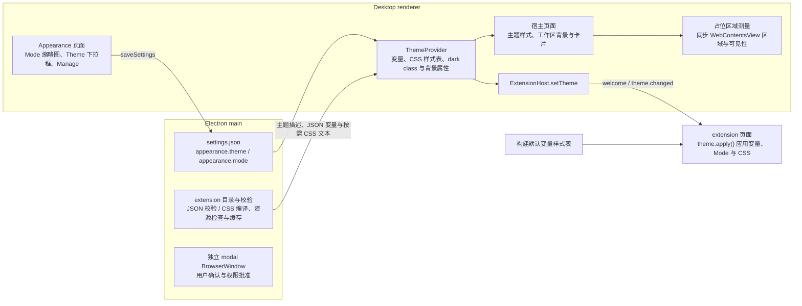

# Desktop 主题

## 名词解释

- **主题（theme）**：通过 JSON 变量或 CSS 样式表定义 Desktop 宿主与接入主题的 extension 页面的外观，支持浅色与深色。
- **JSON 主题**：通过 JSON 文件提供 `common`、`light`、`dark` 变量值的主题，变量清单见第 1 节。
- **CSS 主题**：通过 CSS 文件定义自定义变量、组件样式与 DOM 布局的主题。
- **公共主题变量**：宿主通过 `ThemeInfo.tokens` 提供的变量计算值，名称由 `THEME_TOKEN_NAMES` 定义。
- **主题样式文本**：读取 CSS 入口、展开包内 `@import` 并内嵌资源后得到的 `cssText`，由宿主和接入主题的 extension 页面使用。
- **默认变量样式表**：构建时从宿主 CSS 提取的根元素变量规则，供 SDK 建立与宿主相同的默认变量来源。
- **`styleId`**：主题样式文本 UTF-8 内容的 SHA-256，用于内容识别、缓存和增量传输。
- **Mode**：浅色、深色或跟随系统（`light`、`dark`、`system`），对所有主题生效。
- **主题 extension**：在 manifest 中通过 `contributes.themes` 提供主题的 extension，与其他 extension 一样安装、启用、停用与删除。
- **Default**：宿主内置的主题，默认变量由共享样式与 Desktop 样式提供，保持宿主当前外观，不能删除。
- **Soft**：随 Desktop 提供的内置主题 extension（`soft-theme`），可以像其他内置 extension 一样删除。
- **Warm Minimalism**：随 Desktop 提供的内置主题 extension（`warm-minimalism-theme`），在浅色与深色下提供几何背景。
- **工作区背景**：主题变量 `--agw-workspace-backdrop` 定义的背景图形。
- **卡片**：主题提供工作区背景时显示内容的圆角区域，四周露出背景图形。
- **主题名称**：`ThemeInfo` 中正在使用的主题的 `id` 与 `title`。
- **按比例缩小的文字**：字号写为容器字号或根字号的小于 1 的倍数的文字，例如行内代码、表格、脚注和 Tailwind 的 `text-xs`、`text-sm`。
- 其余名词（Appearance 页面、主题变量推送 `theme.changed`、`theme.apply()`、文档字号与代码字号等）沿用 `2026-10-21-Markdown排版规范与Desktop字号设置.md`、`2026-10-22-Text-Editor设置.md`、`2026-10-16-Desktop-Extension.md`。这些引用用于名词解释，字号与排版规则以本文件第 9 节为准。

## 背景

- 用户希望在 Appearance 页面选择主题与 Mode，并通过 extension 安装、启用、停用与删除主题。
- 主题作者需要通过变量设置配色、字体、圆角与工作区背景，也需要直接通过 CSS 定义组件样式和布局。主题中的样式依赖、图片和字体由主题 extension 包提供。
- Soft 参考 ChatGPT 风格的配色。Warm Minimalism 参考产品插画中悬浮白色卡片承载内容的设计，卡片四周由浅桃色圆、浅灰斜面与珊瑚橙光晕组成几何背景，Main Workspace 与 Text Editor 使用卡片呈现内容。
- 宿主和 extension 使用独立页面。extension 根据公共主题变量、主题名称和主题样式决定自己的页面外观。
- 各字号设置支持从 12px 开始选择，按比例缩小的文字按照所在容器或根元素的字号计算。

## 设计目标

### 功能目标

1. Appearance 页面的 Visual style：Mode（System、Light、Dark 三张缩略图）与 Theme（下拉框与 Manage 按钮）。颜色与字体由主题决定。
2. 内置 Default、Soft 与 Warm Minimalism 主题。
3. 主题 extension：manifest 中的 `contributes.themes` 通过 JSON 或 CSS 文件声明主题；在 Extensions 页面安装、启用、停用、删除；Manage 按钮打开只显示主题 extension 的 Extensions 页面。
4. 切换主题或 Mode 后立即生效；调用了 `theme.apply()` 的 extension 视图在已打开时同样立即更新。设置每台设备各自保存，页面、文档会话与未保存内容继续保留。
5. 宿主自有颜色（聊天代码块等）使用主题变量，侧栏表面使用侧栏变量，切换主题时一起变化。
6. 使用主题是 extension 的可选项：extension 自己决定是否使用主题变量，宿主不强制。
7. 主题通过 `--agw-workspace-backdrop` 提供工作区背景，Main Workspace 中的 Chat 列、文件 Source 区域，以及 Text Editor 的 Edit、Preview 使用卡片显示内容。
8. extension 通过 `theme.get()` 与 `theme.onDidChange` 得到主题的 `id`、`title`、公共变量与可选的 CSS 文本。
9. 基础字号支持 12–20，聊天字号支持 12–24，Text Editor 的文档字号与代码字号支持 12–28；跟随设置按照比例计算。
10. CSS 主题支持包内 `@import`、图片、字体和 data URL，可以离线使用；主题引起布局变化时，`WebContentsView` 跟随占位区域更新位置、尺寸和可见性。
11. 用户确认和权限批准由 Electron main 管理独立的受控页面。

### 技术目标

- **主题格式**：JSON 主题使用严格的变量清单与值类型校验；CSS 主题使用标准 CSS，按照浏览器级联规则定义变量、组件样式和布局。
- **extension 自行选择**：宿主通过 `ThemeInfo` 与 `theme.changed` 提供公共变量、主题名称和 CSS 样式。SDK 只有在 extension 调用 `theme.apply()` 后才应用主题，未接入主题的页面保持自身样式；extension 也可以读取主题状态自行使用。
- **CSS 解析与资源范围**：使用成熟的 CSS 解析库处理语法和资源引用。引用文件经过实际路径检查，资源范围限定在主题 extension 根目录内。
- **失败直接抛出**：主题文件不合法时，该 extension 在 Extensions 页面显示校验错误，主题不出现在下拉框中。
- **CSS 样式生命周期**：每个 document 复用自己创建的 `CSSStyleSheet`，只有 `styleId` 改变时替换主题文本，Mode 变化通过 `dark` class 生效。
- **资源预算**：限制主题输入、展开次数和内嵌后的体积，缓存完整依赖图的编译结果，按连接传输发生变化的样式文本。
- **背景性能**：工作区背景与卡片样式由 `data-workspace-backdrop` 属性控制。主题没有提供背景时，根元素没有该属性，背景与卡片规则不匹配任何元素；更新主题保留当前 frame。
- **兼容**：`manifestVersion` 为 1，JSON 与 CSS 入口共用 `contributes.themes`，`ThemeInfo.cssText` 为可选字段。
- **应用范围**：主题选择、CSS 主题应用与工作区背景由 Desktop 提供；共享排版规则在 Desktop 与 Web 中使用相同的字号计算。

## 总体设计



## 详细设计

### 1. 主题变量

JSON 主题可以设置以下变量，其他名称一律不合法；CSS 主题可以定义任意自定义变量：

- 界面颜色：`--background`、`--foreground`、`--card`、`--card-foreground`、`--popover`、`--popover-foreground`、`--primary`、`--primary-foreground`、`--secondary`、`--secondary-foreground`、`--muted`、`--muted-foreground`、`--accent`、`--accent-foreground`、`--destructive`、`--border`、`--input`、`--ring`、`--chart-1` 至 `--chart-5`、`--sidebar`、`--sidebar-foreground`、`--sidebar-primary`、`--sidebar-primary-foreground`、`--sidebar-accent`、`--sidebar-accent-foreground`、`--sidebar-border`、`--sidebar-ring`、`--agw-sidebar-muted-foreground`、`--agw-prose-link`。
- 聊天与 Markdown 颜色：`--agw-user-message`、`--agw-user-message-foreground`、`--agw-code-block`、`--agw-code-block-foreground`、`--agw-code-block-muted`、`--agw-code-block-border`、`--agw-code-block-button`、`--agw-code-block-button-hover`、`--agw-prose-code-background`。
- 图片预览颜色：`--agw-image-backdrop`、`--agw-image-toolbar`、`--agw-image-toolbar-foreground`、`--agw-image-toolbar-border`、`--agw-image-toolbar-hover`、`--agw-image-toolbar-focus`、`--agw-image-toolbar-shadow`。
- 其他宿主颜色：`--agw-status-running`、`--agw-server-online-halo`、`--agw-agentflow-edge`、`--agw-agentflow-edge-fan-out`、`--agw-agentflow-edge-fan-in`、`--agw-agentflow-edge-switch-case`、`--agw-agentflow-edge-switch-default`。默认值与使用位置见第 5 节。
- 工作区背景：`--agw-workspace-backdrop`，默认值为 `none`。JSON 主题的值类型与校验见第 1.1 节。
- 基础色阶：沿用 Tailwind 的 `--color-{名称}-{级别}`，允许的名称和级别为下列明确集合；另外允许 `--color-black`、`--color-white`。这些变量覆盖状态指示器、提示、徽标、文件变更标记和 Agentflow 节点中现有的颜色 utility，默认值沿用仓库锁定的 Tailwind 版本。[Tailwind 颜色变量说明](https://tailwindcss.com/docs/colors#referencing-in-css)。
  - `slate`：400；`zinc`：50、200、800、900。
  - `red`：50、100、200、400、700、800、900、950。
  - `orange`：50、100、200、400、600、900、950。
  - `amber`：50、100、200、300、400、500、600、700、800、900、950。
  - `yellow`：100、400、700、900。
  - `green`：50、100、200、300、400、600、700、800、900、950。
  - `emerald`：50、200、300、500、600、700、800。
  - `teal`：50、200、800；`sky`：50、200、600、800。
  - `blue`：50、100、200、300、400、500、600、700、800、900、950。
  - `indigo`：50、200、900；`violet`：50、100、200、300、700、900、950。
  - `rose`：50、200、300、500、800。
- 圆角：`--radius`（`--radius-sm` 至 `--radius-4xl` 由它计算，不单独设置）。
- 字体：`--agw-font-sans`、`--agw-font-mono`。`tokens.css` 使用这两个变量保存字体值，Tailwind 的 `--font-sans`、`--font-mono` 引用它们。

JSON 主题未设置的变量使用 Default 的值：共享样式与 Desktop 样式中的 `:root`、`.dark` 默认值，以及 Tailwind 的默认色阶。第 5.2 节的 Desktop 默认值仅在 Desktop 生效，JSON 主题写入 `html.style` 的值优先。

推送给 extension 的 `THEME_TOKEN_NAMES` 包含第 1 节全部可设置的变量，包括基础色阶与工作区背景，另外包含 `--font-sans`、`--font-mono`、`--radius-sm` 至 `--radius-xl`。字号变量提供 `--agw-font-size-base`，由 Appearance 设置管理。`--radius-*`、`--font-*` 由对应变量计算，extension 可以直接使用。构建检查确认清单中的默认变量在 Desktop 的构建 CSS 中均有定义。

#### 1.1 工作区背景值

- `desktop/src/shared/theme-tokens.ts` 的 `ThemeTokenKind` 包含 `image`，`--agw-workspace-backdrop` 使用该类型。
- JSON 值使用 css-tree 解析，顶层只接受 `linear-gradient`、`radial-gradient`、`conic-gradient` 及对应的 `repeating-` 形式、`none` 和层之间的逗号；整体必须匹配 `background-image` 的属性语法，排除 CSS-wide 关键字。`url()`、`image-set()`、`cross-fade()`、`element()`、`var()` 和 CSS-wide 关键字返回 `INVALID_THEME_VALUE`。
- JSON 背景值的长度上限为 4000 字符（`MAX_THEME_IMAGE_VALUE_LENGTH`），其他变量为 200（`MAX_THEME_VALUE_LENGTH`）；超出时返回 `INVALID_FIELD`。
- Desktop `renderer/src/app/globals.css` 的 `:root` 声明 `--agw-workspace-backdrop: none`，`check-theme-tokens.mjs` 检查构建 CSS 中的定义。
- CSS 主题中的背景声明遵循 CSS 规则，资源引用按第 10 节校验。

#### 1.2 CSS 变量与默认样式表

- CSS 入口可以声明任意自定义变量、选择器、组件属性、Grid/Flex 布局、媒体查询、`@supports`、`@layer` 和 `@keyframes`。
- `:root` 的规则用于两种 Mode；浅色专用规则使用 `:root:not(.dark)`，深色专用规则使用 `:root.dark`。宿主和 SDK 根据当前 Mode 设置根元素上的 `dark` class。
- `ThemeInfo.tokens` 提供公共变量的宿主计算值；CSS 主题下，extension 页面通过自己的默认变量样式表与主题规则计算 CSS 值。
- Desktop 构建通过 CSS AST 提取宿主构建 CSS 中的全部根元素自定义属性规则，生成 `/__agw/theme-defaults.css`，包括 `--spacing`、`--text-*`、宿主构建包含的色阶和主题变量。提取保留选择器、来源顺序、Mode、`@media`、`@supports` 与 cascade layer 上下文，并包含变量依赖及相关 `@property` 定义。
- 默认变量提取与 `check-theme-tokens.mjs` 共用构建 CSS 的 AST 输入；名称检查和规则提取分别验证。SDK 初始化完成前加载同一 Desktop 构建生成的默认变量文本，只有调用 `theme.apply()` 时才将其应用到 document。现有 typography 组件样式继续使用。
- 宿主与 SDK 使用 constructed stylesheet 应用 CSS 主题，SDK 的默认变量样式表位于主题样式表之前。每个 document 创建自己的样式表对象；`document.adoptedStyleSheets` 保留其他代码创建的样式表，仅更新主题系统拥有的部分。其来源顺序位于普通 `<style>`、`<link>` 样式表之后，包括稍后动态加入的样式，依据 [CSSOM](https://drafts.csswg.org/cssom/#dom-documentorshadowroot-adoptedstylesheets)。
- 选择器特异性、cascade layer、inline 属性和 `!important` 遵循 [CSS Cascade](https://www.w3.org/TR/css-cascade-5/#cascade-sort)。来源顺序只决定相同级联条件下的结果；`!important` 声明的 layer 顺序与普通声明相反。
- 应用 CSS 主题前，清除主题系统之前写入的 inline 主题变量。Appearance 管理字号属性；SDK 将推送的 `--agw-font-size-base` 写入自己管理的 inline 属性，保证主题普通规则和 typography 默认值之间的字号传递。

### 2. 主题 extension

- manifest：

```json
{
  "contributes": {
    "themes": [
      { "id": "soft", "title": "Soft", "path": "themes/soft.json" },
      { "id": "custom", "title": "Custom", "path": "themes/custom.css" }
    ]
  }
}
```

  `id` 在 extension 内唯一（与其他 contribution 的 id 规则相同），`title` 为显示名称，`path` 为包内的 `.json` 或 `.css` 文件。主题在设置中使用 `"{extensionId}:{themeId}"` 标识。
- JSON 主题文件：

```json
{
  "common": {
    "--radius": "0.75rem",
    "--agw-font-sans": "-apple-system, BlinkMacSystemFont, \"Segoe UI\", \"Helvetica Neue\", Arial, sans-serif",
    "--agw-font-mono": "ui-monospace, \"SF Mono\", Menlo, Consolas, monospace"
  },
  "light": { "--background": "#ffffff" },
  "dark": { "--background": "#212121" }
}
```

  `common` 用于浅色与深色，`light`、`dark` 中的同名变量覆盖 `common`。三项都可以省略，但至少一项不为空。
- 校验在 Electron main 中进行，位于 manifest 的 zod 校验之后：按与 `entry` 相同的包内路径规则解析 `path`，目标必须位于包目录内，再根据入口格式读取并校验主题文件。
- JSON 主题使用 zod 严格对象校验；变量名必须在第 1 节的清单中；值为非空字符串，长度遵守第 1.1 节的上限。颜色变量必须是合法 CSS 颜色，`--radius` 必须是合法 CSS 长度，字体变量必须是合法 `font-family` 值。值的校验使用能在 Node 中运行的成熟 CSS 解析库。
- CSS 主题使用第 10 节的加载流程，读取入口、展开导入、内嵌资源并检查完整结果。
- 失败返回 `ExtensionValidationError`，字段路径位于 `["contributes", "themes", 序号, …]` 下；CSS 入口及依赖文件的错误指向对应的 `contributes.themes[index].path`，消息包含相关包内文件路径和可获得的行号、列号。任一主题文件校验失败时，所属 extension 显示为不合法，其主题不出现在可用主题列表中。
- PostCSS 的 `CssSyntaxError` 表示结构解析错误；资源表达式无法检查、资源类型不允许、路径不合法和超出预算分别报告对应原因。选择器、属性名称和值的语义支持由 Chromium 判断，通过结构与资源检查的未知或不支持声明遵循浏览器处理规则。
- 安装校验、目录读取与 `build-bundled-extensions.mjs` 共用主题加载逻辑。内置 JSON 或 CSS 主题处理失败时构建失败。
- 内部 `ExtensionTheme` 使用 `format: "json" | "css"` 区分数据：JSON 分支包含 `common`、`light`、`dark`；CSS 分支包含 `styleId` 与 UTF-8 `byteLength`。两个分支都包含 `id` 和 `title`，完整 CSS 保存在 main 的编译缓存中。
- 只包含 `contributes.themes` 的 manifest 是合法的。extension 启用且合法时，它的主题出现在 Theme 下拉框中；停用、删除或不合法时消失。Soft 与 Warm Minimalism 使用 JSON 文件。

### 3. 设置

- `settings.json` 的 `appearance` 包含：
  - `theme`：`"default"` 或 `"{extensionId}:{themeId}"`，缺失时加载为 `"default"`。
  - `mode`：`"system"`、`"light"` 或 `"dark"`，可以缺失。缺失表示还没有从 `next-themes` 迁移（旧版本的 `settings.json`、全新安装）。Reset all 恢复的值是 `"system"`。
- `appearance` 的字号字段为 `baseFontSize`（整数 12–20）与 `chatFontSize`（`null` 或整数 12–24），使用 zod 严格对象校验。已有设置值在范围内时按原值读取；字号计算见第 9 节。
- `mode` 缺失时保持缺失，直到 renderer 完成迁移：设置存储加载时不补入 `mode`（`DEFAULT_APPEARANCE` 也不包含 `mode`）。`settings.json` 的每次写入都是读出全部设置后整体写回，包括 main 在创建窗口之前保存内置 extension 的设置项；`mode` 缺失时写回后仍然缺失。
- 有效 Mode：`mode` 存在时就是 `mode`；缺失时为 `next-themes` 在 localStorage 中的值（`light`、`dark` 或 `system`），localStorage 中没有值时为 `system`。renderer 中所有用到 Mode 的地方（`ThemeProvider`、Appearance 页面、标题栏按钮）都使用有效 Mode。
- 迁移：renderer 收到第一份设置且其中没有 `mode` 时，把有效 Mode 保存为 `mode`，保留旧版本用户的选择。迁移完成之前 renderer 保存 `appearance` 时，修改字号或主题写入有效 Mode，修改 Mode 写入新的 Mode，这次保存也完成迁移。
- `settings.json` 是 Mode 的保存位置。Desktop 继续使用 `next-themes` 设置 `dark` class，它在 localStorage 中的值只用于启动时的第一次绘制（避免闪烁）与上面的迁移：设置加载后，有效 Mode 与 `next-themes` 当前值不同时，以有效 Mode 为准调用 `setTheme`。修改 Mode 时先保存 `settings.json`，再调用 `setTheme`。
- 标题栏的深浅色按钮保持现在的行为，在浅色与深色之间切换，并把 `mode` 保存为 `light` 或 `dark`；回到 System 在 Appearance 页面进行。
- 当前选中的主题不可用（所属 extension 被停用、删除、校验失败，或启动时找不到）时，renderer 把 `theme` 保存为 `"default"`，并显示提示 "{主题名或 id} is no longer available. Using Default."。启动时这项检查在 renderer 收到第一份 extension 状态之后进行，在那之前不判断主题是否可用（Desktop 只有一个窗口）。

### 4. 应用主题（`ThemeProvider`）

#### 4.1 宿主应用与切换

- Desktop renderer 的 `ThemeProvider` 位于 `runtime-provider.tsx` 的 provider 链中，与 `AppearanceProvider` 并列，按有效 Mode 与系统设置得到实际的浅色或深色，由 `next-themes` 设置 `html` 的 `dark` class。
- main 把每个合法 extension 的主题描述放进 renderer 已经收到的 extension 状态中，随安装、启用、停用、删除事件更新。JSON 主题描述包含校验后的 `common`、`light`、`dark`；CSS 主题描述包含 `styleId` 与 `byteLength`，renderer 按需获取完整文本。
- JSON 主题把 `common` 与当前 `light`、`dark` 合并后写到 `document.documentElement.style`。Default 清除主题覆盖后，由宿主默认样式提供变量。CSS 主题通过宿主 bridge 获取已校验的样式文本，准备完成后应用主题样式表，获取期间继续显示当前主题。
- CSS、JSON 和 Default 相互切换时，在一次同步提交中清除旧主题拥有的变量与样式，并应用新主题，保留其他代码拥有的样式表与属性。CSS 主题切换 Mode 时复用样式表，由实际的 `dark` class 选择规则。
- JSON 主题的 `useLayoutEffect` 依赖选中的主题与 `next-themes` 的实际深浅色。切换主题、Mode 或系统深浅色变化时，先删除上一次写入的全部主题变量，再写入当前 `common` 与对应 Mode 合并后的变量；同一 JSON 主题只在另一 Mode 中定义的变量也须清除，随后使用 Default 的对应值。变量与实际深浅色对应的 class 在同一次绘制之前生效。
- `next-themes` 的 `disableTransitionOnChange` 在其自身修改深浅色时执行；同一 Mode 下切换主题时，过渡由 `ThemeProvider` 管理。`ThemeProvider` 在切换主题、Mode 或系统深浅色变化引起的每次主题样式更新时禁用过渡：在 `head` 插入禁用全部过渡的 style（规则与 `next-themes` 相同），更新主题变量与样式表，调用 `getComputedStyle(document.body)` 使新值立即生效，再在下一个任务（`setTimeout`）中删除该 style。
- 通过 `MutationObserver` 监听根元素 class 属性；class 变化、主题内容变化、JSON 变量变化、字号变化及字体加载完成均调度下一帧状态读取，多个触发合并为一次读取。
- 状态读取等待 `next-themes` 完成 class 更新，按根元素当前 class 确定 `kind`；随后读取 `--agw-workspace-backdrop` 的计算值，判断有效背景并更新 `data-workspace-backdrop`，再读取公共变量、页面背景色并发布主题。背景属性与主题样式在同一次绘制之前生效。Light、Dark、System 使用同一顺序，CSS 文本不变时也重新执行。属性名与判断函数位于 `resolve-theme.ts`（`WORKSPACE_BACKDROP_ATTRIBUTE`、`hasWorkspaceBackdrop`）。
- `--font-sans` 等引用其他变量的公共值以替换后的字符串推送。字号推送提供 `--agw-font-size-base`。主题不可用时按第 3 节处理，清除对应样式并使用 Default；provider 卸载时清理其拥有的样式表、变量与背景属性。
- 主题切换通过已有页面和 frame 完成，保留当前文档会话与未保存内容。

#### 4.2 主题名称

- `ThemeInfo.id`：Default 为 `"default"`，extension 提供的主题为 `"{extensionId}:{themeId}"`，与 `appearance.theme` 的格式相同。
- `ThemeInfo.title`：Default 为 `"Default"`，extension 提供的主题取 manifest 中 `contributes.themes` 的 `title`。
- `ThemeProvider` 提供 `appliedTheme`，表示当前已经应用的主题的 `id` 与 `title`，与实际变量及样式表一致。初始状态使用 Default，CSS 文本获取完成并提交样式后更新为对应主题。
- `extension-host-provider.tsx` 的 `readTheme(kind, appliedTheme)` 将名称与变量放入 `ThemeInfo`，`appliedTheme` 变化也触发推送。`ExtensionHost` 在第一次推送之前使用 Default 的名称；`welcome` 与 `theme.changed` 均包含当前名称。
- extension 通过 `api.theme.get().id`、`api.theme.get().title` 与 `api.theme.onDidChange` 读取主题名称，可以据此决定页面样式。

#### 4.3 extension 页面应用

- `ThemeInfo` 包含可选的 `cssText`：CSS 主题提供处理后的完整文本，JSON 和 Default 省略该字段。SDK 对外的 `theme.get()` 和 `theme.onDidChange` 始终提供完整状态。
- SDK 接收 `welcome`、`theme.changed` 时保存完整主题状态，`theme.get()` 读取状态，`theme.get().tokens` 提供公共变量，`theme.onDidChange` 提供变化通知。只有调用 `theme.apply()` 后，SDK 才按主题格式向该 document 应用主题；宿主与 SDK 不会自动向未接入主题的页面注入主题样式。
- 宿主根元素保留 `data-agw-desktop="true"`，设置 `data-agw-document="desktop"`。SDK 为 extension 根元素设置 `data-agw-document="extension"` 与 `data-agw-extension="<extensionId>"`，extension id 来自宿主提供的 manifest。
- `theme.apply()` 同步 Mode，并按格式应用主题：CSS 主题使用第 1.2 节的默认变量样式表、主题样式表与字号 inline 属性；JSON 和 Default 应用宿主推送的变量，清除之前的 CSS 主题与默认变量样式表。
- 通用的 `body`、`button`、`*` 等选择器作用于所有接入主题的 document；主题作者通过根元素标记限定宿主规则或指定 extension 的规则。
- 重复调用 `theme.apply()` 复用同一 document 的样式表。Mode 或公共变量变化且主题内容相同时继续使用现有样式表，不同 document 分别创建、解析和保存自己的样式表。
- `theme.apply()` 返回的 `Disposable` 停止该次订阅，当前外观继续保留；页面卸载时释放文档资源。
- Text Editor 和 Excalidraw 调用 `theme.apply()`，均接入主题 CSS。规则可以影响这些页面中匹配的 DOM 元素；Monaco 和 canvas 自身的绘制内容继续由对应组件控制。
- Monaco 将字体作为创建编辑器时的选项，字体选项不会随 CSS 变量变化自动更新。Text Editor 的 Code 视图在 `theme.onDidChange` 中更新 `fontSize`，同时使用 `theme.tokens["--font-mono"]` 调用 `updateOptions({ fontFamily })`，已打开的编辑器在同一个 frame 中更换字体。

#### 4.4 extension 消息

- 每个连接的 `welcome.theme` 是完整 `ThemeInfo`，另带 `themeStyleId`。CSS 主题首次连接包含完整 `cssText`；JSON 和 Default 的 `themeStyleId` 为 `null`。
- `theme.changed` 携带完整主题元数据及明确的样式操作：`unchanged` 保留当前文本，`replace` 携带新的 `styleId` 与完整 `cssText`，`clear` 删除已有 CSS。消息格式见接口文档。
- broker 按连接记录已发送的 `styleId`。Mode、字号、名称或公共变量变化且样式内容相同时发送 `unchanged`；CSS 内容变化时发送 `replace`；转入 JSON 或 Default 时发送 `clear`。重新连接重新发送完整快照。
- SDK 在触发公开事件之前完成状态合并；`unchanged` 的标识必须与已有状态一致，否则报告协议错误。字段省略不承担保留或清除样式的含义。
- background 连接保持主题读取和事件能力，遵循相同的快照及增量规则，主题应用遵守第 4.3 节的接入条件。各 WebContentsView 进程分别保存当前主题文本，接入主题的 document 保存对应样式表，字体及图片编码体积计入第 10.4 节的主题预算。

### 5. 宿主样式

#### 5.1 聊天与图片预览

宿主自有样式中的颜色通过第 1 节的变量表达。共享样式的 `:root` 与 `.dark` 提供默认值，Web 与 Desktop Default 使用对应 Mode 的默认配色。下列规则描述组件的默认样式与公共变量映射，CSS 主题按第 1.2 节参与级联。

- 聊天：
  - 用户消息气泡 `.agw-msg-user` 的背景与文字分别使用 `--agw-user-message`、`--agw-user-message-foreground`，浅色默认值为 `#f3f5fc`、`#17191d`；深色默认值与共享消息样式的深色计算颜色一致。
  - 聊天代码块 `.msg-content-md-code-block` 的背景与文字分别使用 `--agw-code-block`、`--agw-code-block-foreground`，浅色默认值为 `#f4f4f4`、`#17191d`，深色为 `#202124`、`#f1f3f4`。标题栏 `.msg-content-md-code-header` 的文字与边框分别使用 `--agw-code-block-muted`、`--agw-code-block-border`，文字默认值为浅色 `#5f6368`、深色 `#bdc1c6`，边框为浅色 `black/10`、深色 `white/10`。
  - `markdown-elements.tsx` 代码块按钮的普通文字使用 `--agw-code-block-button`（浅色 `#71757a`，深色 `#aeb2b8`），悬停与 `aria-pressed` 状态使用 `--agw-code-block-button-hover`（浅色 `#17191d`，深色 `#ffffff`）；背景继续使用 `--color-black`、`--color-white` 和现有透明度。
- Memory Markdown 预览等使用 `.prose` 的页面：`tokens.css` 中 `.prose code` 与 `.prose pre` 的背景使用 `--agw-prose-code-background`，浅色默认值为 `oklch(0.95 0 0)`，深色默认值为 `oklch(0.2 0 0)`。保留 `.prose.dark` 与 `.dark .prose` 的适用范围，以及 `pre code` 的透明背景规则。字号按第 9 节计算，间距与圆角由共享默认样式提供；CSS 主题遵循第 1.2 节的级联规则。
- `packages/chat/src/image-preview.css` 的默认值在两个 Mode 下相同：`--agw-image-backdrop: rgb(9 11 15 / 96%)`；`--agw-image-toolbar: #202329`；`--agw-image-toolbar-foreground: #f5f6f7`；`--agw-image-toolbar-border: rgb(255 255 255 / 16%)`；`--agw-image-toolbar-hover: rgb(255 255 255 / 12%)`；`--agw-image-toolbar-focus: #ffffff`；`--agw-image-toolbar-shadow: rgb(0 0 0 / 24%)`。`.agw-image-preview` 的 `--yarl__color_backdrop` 引用 `--agw-image-backdrop`；`.agw-image-zoom` 的背景、文字、边框、悬停、焦点与阴影颜色分别引用对应变量，保留现有尺寸、透明度和禁用态 opacity。

#### 5.2 侧栏

- `.agw-ribbon`、`.agw-left-sidebar`、`.agw-settings-nav` 使用 `--sidebar` 作为背景，普通文字与图标使用 `--sidebar-foreground`，次要文字使用 `--agw-sidebar-muted-foreground`，悬停和选中状态使用 `--sidebar-accent`、`--sidebar-accent-foreground`，边框与分隔线使用 `--sidebar-border`，焦点指示使用 `--sidebar-ring`；保留各处原有的透明度。范围包括 ribbon 项、设置导航、对话列表、文件树及侧栏标题。
- 共享组件在 Desktop 侧栏中的颜色通过这三个容器内的 CSS 变量引用连接：`--foreground` 引用 `--sidebar-foreground`，`--muted-foreground` 引用 `--agw-sidebar-muted-foreground`，`--muted` 与 `--accent` 引用 `--sidebar-accent`，`--accent-foreground` 引用 `--sidebar-accent-foreground`，`--border` 引用 `--sidebar-border`，`--ring` 引用 `--sidebar-ring`。背景使用侧栏变量；悬停或选中的项将普通文字的 `--foreground` 设为 `--sidebar-accent-foreground`，次要文字仍使用 `--agw-sidebar-muted-foreground`，各元素保留原有文字层级与透明度。挂在 `body` 下的 dialog、popover 等继续使用其界面变量。业务状态标记使用第 5.3 节的变量。
- Default 的 `--sidebar`、`--sidebar-foreground`、`--sidebar-accent`、`--sidebar-accent-foreground` 分别与界面默认的 `--card`、`--foreground`、`--muted`、`--foreground` 一致。`--agw-sidebar-muted-foreground` 在 `:root` 上默认引用 `--muted-foreground`。Desktop 的 `globals.css` 在全部样式导入之后的 `:root` 中为 `--sidebar-border`、`--sidebar-ring` 分别声明 `var(--border)`、`var(--ring)`，这些引用在根元素计算，随后由侧栏继承。Default 的边框为浅色 `#ebebeb`、深色 `#5f6060`，焦点颜色使用根元素 `--ring` 的默认值；主题可以覆盖这些变量。运行状态图标使用第 5.3 节的独立变量。Web 的侧栏默认值由共享 `tokens.css` 提供，Desktop 使用上述默认值。

#### 5.3 状态、提示与其他宿主颜色

- 状态指示器使用已有色阶变量：idle、offline 为 `--color-slate-400`，waiting-approval 为 `--color-amber-500`，completed-unread、online 为 `--color-emerald-500`，failed-unread 使用 `--destructive`。running 使用 `--agw-status-running`，默认值为浅色 `#006fee`、深色 `#338ef7`；标题栏、后台对话按钮、`ConversationList` 的运行图标和运行状态光环统一引用它，保留原有透明度与动画。`.agw-server-state.is-online` 的光环使用 `--agw-server-online-halo`，两个 Mode 的默认值均为 `#10b981`，保留 14% 的混色比例。
- Extensions 警告、聊天队列提示、Server 状态徽标、Git 变更标记及 Agentflow 节点等现有 `text-*`、`bg-*`、`border-*`、`shadow-*` 色阶 utility 保留，通过第 1 节允许的 `--color-*` 变量响应主题。主题可分别设置 light 与 dark 中的色阶；透明度与 `dark:` 条件继续由组件控制。
- `visual-agentflow-builder.tsx` 的边线与 SVG 箭头同时使用 `--agw-agentflow-edge`（普通边，`#475569`）、`--agw-agentflow-edge-fan-out`（`FanOut`，`#2563eb`）、`--agw-agentflow-edge-fan-in`（`FanInBarrier`，`#d97706`）、`--agw-agentflow-edge-switch-case`（`SwitchCase`，`#7c3aed`）、`--agw-agentflow-edge-switch-default`（`SwitchDefault`，`#db2777`）；两个 Mode 的默认值相同，宽度与动画保持现有设置。
- dialog 等宿主样式中的黑色阴影引用 `--color-black`，透明度由组件默认样式提供。`transparent`、`currentColor`、`inherit` 保持各自含义。图片本身、代码高亮与第三方绘图内容使用各自的内容配色；宿主覆盖第三方组件的样式遵守本节规则。
- 实现检查覆盖 `packages/*/src`（排除 `chat-native`、`extensions`）与 `desktop/renderer/src` 的颜色声明、任意颜色 utility 和色阶 utility，包括十六进制、命名颜色及 `rgb()`、`hsl()`、`oklch()` 等颜色函数。使用 `rg` 定位后逐项核对实际样式用途，所有宿主自有颜色均须引用本节变量或允许的基础色阶；检查产出的 CSS，确认既有色阶 utility 使用对应变量。测试数据、注释和图片资源中的颜色不作为界面样式处理。

#### 5.4 Excalidraw 工具栏与菜单

- `packages/extensions/excalidraw/src/styles.css` 在库样式之后加载，按 [Excalidraw 样式接口](https://docs.excalidraw.com/docs/@excalidraw/excalidraw/customizing-styles)使用 `.editor .excalidraw` 与 `.editor .excalidraw.theme--dark` 两个选择器声明相同的变量映射，覆盖两个 Mode 下的库默认值。映射以仓库使用的 [v0.18.1 变量定义](https://github.com/excalidraw/excalidraw/blob/v0.18.1/packages/excalidraw/css/theme.scss)为依据：
  - `--island-bg-color`、`--popup-bg-color`、`--sidebar-bg-color` 引用 `--popover`；`--default-bg-color`、`--input-bg-color`、`--color-surface-lowest` 引用 `--background`。
  - `--popup-secondary-bg-color`、`--color-surface-low`、`--color-surface-mid` 引用 `--muted`；`--color-on-surface`、`--text-primary-color`、`--popup-text-color`、`--icon-fill-color` 引用 `--foreground`；`--input-label-color`、`--keybinding-color`、`--color-disabled` 引用 `--muted-foreground`。
  - `--default-border-color`、`--dialog-border-color`、`--sidebar-border-color`、`--color-border-outline`、`--color-border-outline-variant` 引用 `--border`；`--input-border-color` 引用 `--input`。
  - `--button-hover-bg`、`--button-active-bg`、`--input-hover-bg-color`、`--color-surface-high`、`--color-primary-light`、`--color-primary-light-darker`、`--color-surface-primary-container` 引用 `--accent`；`--color-on-primary-container` 引用 `--accent-foreground`。
  - `--color-primary`、`--color-primary-darker`、`--color-primary-darkest`、`--color-primary-hover`、`--color-brand-hover`、`--color-brand-active`、`--button-active-border` 引用 `--primary`；`--popup-text-inverted-color` 引用 `--primary-foreground`；`--focus-highlight-color`、`--select-highlight-color` 引用 `--ring`；`--link-color` 引用 `--agw-prose-link`。
- `theme.apply()` 更新 `html` 上的宿主变量后，上述引用立即重新计算；同一 Mode 下切换主题不依赖 React 重新渲染。`App` 继续把 `theme.kind` 传给 Excalidraw 控制浅色与深色。Default 下的工具栏和菜单使用宿主 Default 变量，Soft 下使用 Soft 变量。
- 映射仅调整工具栏、菜单、属性面板、输入框与弹窗的界面配色。场景的 `viewBackgroundColor`、元素的 stroke、fill、文字颜色和文件内容保持原有值；切换主题保留当前 frame、文档会话和未保存修改。Text Editor 的工具栏继续引用宿主变量，代码高亮与 Monaco 内容配色继续使用各自原有的浅色、深色配置。

#### 5.5 Main Workspace 的背景与卡片

- 样式位于 Desktop 的 `globals.css`，使用不在 cascade layer 中的规则，使卡片尺寸规则可以覆盖 `utilities` layer 中的 Chat 列尺寸 utility。规则由 `:root[data-workspace-backdrop]` 限定。
- `.agw-main-workspace` 使用 `background-image: var(--agw-workspace-backdrop)`，背景相对 Main Workspace 定位，Chat 滚动时背景保持位置。
- Chat 列 `.agw-chat-column` 与文件 Source 区域 `.agw-file-source` 使用卡片样式：背景 `--card`，文字 `--card-foreground`，圆角 `--radius-xl`；阴影由一圈 1px 的 `--border`（60%）与一层柔和投影（`--color-black` 18%）组成。
- 卡片内的 `--background`、`--foreground` 指向卡片颜色，输入框区域的渐变、输入框与 Source 行号栏等使用 `bg-background` 的元素与卡片一致。
- `.agw-chat-column-area` 的内边距为 16px，Chat 列在其中拉伸。内容少时卡片高度为 Main Workspace 高度减去上下 32px，内容多时随内容增高并在底部留出 16px；窄窗口时两侧至少留出 16px。输入框区域 `.agw-chat-composer` 的下边角与卡片相同。
- `.agw-file-source` 的外边距为 16px，卡片内部滚动，通过圆角裁剪滚动内容。
- `@agw/chat` 的 `chat.tsx` 提供 `agw-chat-column-area`、`agw-chat-column`、`agw-chat-composer` 类名；`@agw/projects` 的 `file-content.tsx` 提供 `agw-file-source` 类名，供 Desktop 样式使用。
- 文件标题行、extension 视图标题行、Chat 旁的用量面板与空状态位于背景图形之上。extension 的 `WebContentsView` 由 extension 自己绘制背景，宿主背景不会透过该原生视图；宿主与 extension 页面分别按各自区域定位图形。
- 背景属性清除后，使用组件默认排版。Default 与 Soft 下的 Main Workspace、Edit、Preview 使用各自的默认背景与内容布局；Web 使用共享组件默认样式。

#### 5.6 Text Editor 的背景与卡片

- `src/shared/workspace-backdrop.ts` 的 `applyWorkspaceBackdrop(api)` 在 Edit 与 Preview 的 `onLoad` 中紧接 `theme.apply()`、`applyHighlightTheme(api)` 调用。`theme.tokens["--agw-workspace-backdrop"]` 存在且不为 `none` 时在页面的 `html` 上设置 `data-workspace-backdrop`，否则清除；随后监听 `theme.onDidChange` 更新。
- `theme.apply()` 的监听器先注册，同一次推送中先写入主题样式，再更新背景属性，两者在同一帧生效。
- Edit：`.edit-scroll` 使用背景图形，背景相对滚动区域定位，内容滚动时背景保持位置；`.edit-column` 使用卡片样式，`margin: 32px auto 48px`，最大宽度 `min(856px, 100% - 32px)`，内边距与拖动手柄的位置保持现有设置。
- Preview：`body` 使用背景图形、`background-attachment: fixed`、`min-height: 100vh` 与内边距 `32px 16px 48px`；`.markdown-body` 使用相同卡片样式。
- 卡片颜色、圆角与阴影与宿主卡片相同，规则由 `data-workspace-backdrop` 限定。Code 查看器由 Monaco 绘制编辑器背景。
- 性能验证依据：Default 主题下，631 KiB 表格文档在有无背景规则时的按键耗时记录分别为 52.8 ms 与 52.6 ms，差异处于测量波动范围内。回归测试继续检查文档打开与按键耗时。

### 6. Appearance 页面

- 字号设置上方为 "Visual style" 区域：
  - "Mode"：三张缩略图按钮，依次为 System（左半浅色、右半深色）、Light、Dark，选中的有强调边框；按钮名称 "System mode"、"Light mode"、"Dark mode"。
  - "Theme"：下拉框列出 Default 与所有可用主题（显示 `title`，同名时附上 extension 名称），右侧 "Manage" 按钮打开 `/extensions/?category=themes`。
- 基础字号下拉框列出 12–20，聊天字号下拉框列出跟随选项与 12–24。跟随选项显示计算值，例如基础字号 12 时为 "Follow base size (10.5 px)"。
- 修改立即保存并生效；保存失败时用现有的错误提示显示原因，界面恢复为保存前的值。
- 页面底部的 "Reset all" 同时把 `theme` 恢复为 `"default"`、`mode` 恢复为 `"system"`。

### 7. Extensions 页面

- 分类筛选 `category=themes`：只显示提供 `contributes.themes` 的 extension（也提供视图的 extension 同样显示）；页面顶部显示当前筛选与 "Show all"，"Show all" 打开 `/extensions/`（去掉参数）。`category` 为其他值时，页面显示 "Unknown category: {值}" 与 "Show all"，不显示列表。
- 主题 extension 的卡片显示 "Theme" 标记与它提供的主题名称（停用的 extension 也显示，名称取自 manifest 的 `title`）。

### 8. 内置主题

#### 8.1 Soft

内置 extension `packages/extensions/soft-theme`，`contributes.themes` 为 `[{ "id": "soft", "title": "Soft", "path": "themes/soft.json" }]`。包内有 `package.json`，其 `build` 脚本（Node 脚本）把 `manifest.json` 与 `themes/` 复制到 `dist/`，构建产物与其他内置 extension 一样复制到 `resources/extensions/soft-theme`。删除后按现有的 `removedBundledExtensions` 规则处理，Desktop 升级后不会重新出现。变量值：

- common：`--radius: 0.75rem`；`--agw-font-sans: -apple-system, BlinkMacSystemFont, "Segoe UI", "Helvetica Neue", Arial, sans-serif`；`--agw-font-mono: ui-monospace, "SF Mono", Menlo, Consolas, monospace`。
- light：background `#ffffff`，foreground `#0d0d0d`，card `#ffffff`，card-foreground `#0d0d0d`，popover `#ffffff`，popover-foreground `#0d0d0d`，primary `#0d0d0d`，primary-foreground `#ffffff`，secondary `#f4f4f4`，secondary-foreground `#0d0d0d`，muted `#f4f4f4`，muted-foreground `#5d5d5d`，accent `#ececec`，accent-foreground `#0d0d0d`，destructive `#e02e2a`，border `#e5e5e5`，input `#e5e5e5`，ring `#0169cc`，sidebar `#f9f9f9`，sidebar-foreground `#0d0d0d`，sidebar-primary `#0169cc`，sidebar-primary-foreground `#ffffff`，sidebar-accent `#ececec`，sidebar-accent-foreground `#0d0d0d`，sidebar-border `#e5e5e5`，sidebar-ring `#0169cc`，agw-prose-link `#0169cc`，agw-user-message `#f4f4f4`，agw-user-message-foreground `#0d0d0d`，agw-code-block `#f9f9f9`，agw-code-block-foreground `#0d0d0d`，agw-code-block-muted `#5d5d5d`，agw-code-block-border `#e5e5e5`，agw-code-block-button `#5d5d5d`，agw-code-block-button-hover `#0d0d0d`。
- dark：background `#212121`，foreground `#ececec`，card `#262626`，card-foreground `#ececec`，popover `#2f2f2f`，popover-foreground `#ececec`，primary `#ffffff`，primary-foreground `#0d0d0d`，secondary `#303030`，secondary-foreground `#ececec`，muted `#303030`，muted-foreground `#afafaf`，accent `#2f2f2f`，accent-foreground `#ececec`，destructive `#f0524f`，border `#363636`，input `#424242`，ring `#48aaff`，sidebar `#181818`，sidebar-foreground `#ececec`，sidebar-primary `#48aaff`，sidebar-primary-foreground `#0d0d0d`，sidebar-accent `#2f2f2f`，sidebar-accent-foreground `#ececec`，sidebar-border `#2a2a2a`，sidebar-ring `#48aaff`，agw-prose-link `#48aaff`，agw-user-message `#303030`，agw-user-message-foreground `#ececec`，agw-code-block `#181818`，agw-code-block-foreground `#ececec`，agw-code-block-muted `#afafaf`，agw-code-block-border `#363636`，agw-code-block-button `#afafaf`，agw-code-block-button-hover `#ffffff`。
- Soft 的 `--agw-sidebar-muted-foreground`：light 为 `#5d5d5d`，dark 为 `#afafaf`；`--agw-prose-code-background`：light 为 `#f9f9f9`，dark 为 `#181818`；`--agw-status-running`：light 为 `#0169cc`，dark 为 `#48aaff`。图片预览默认使用深色背景：两个 Mode 的 `--agw-image-backdrop` 均为 `rgb(13 13 13 / 96%)`，`--agw-image-toolbar` 为 `#303030`，`--agw-image-toolbar-foreground` 为 `#ececec`，`--agw-image-toolbar-border` 为 `#424242`，`--agw-image-toolbar-hover` 为 `#424242`，`--agw-image-toolbar-focus` 为 `#48aaff`，`--agw-image-toolbar-shadow` 为 `rgb(0 0 0 / 24%)`。基础色阶、Server 光环和 Agentflow 边线使用 Default 的值。

#### 8.2 Warm Minimalism

`packages/extensions/warm-minimalism-theme/themes/warm-minimalism.json` 的 `light` 与 `dark` 各设置一个六层渐变，从上到下依次为：

- 右下角的珊瑚橙光晕：`radial-gradient(30vmax 18vmax at 86% 100%, …, transparent 70%)`。
- 三个浅桃色圆：顶部偏右（半径 `20vmax`，圆心 `58% 4%`）、右侧中部（`16vmax`，`96% 56%`）、左下大圆（`34vmax`，`18% 86%`）；色标在 99% 到 100% 之间过渡，边缘清晰平滑。
- 两个浅灰斜面：右侧 62° 的斜带（64% 到 80%）与左上角 120° 的三角（0 到 16%）。

浅色使用带透明度的浅桃色、浅灰与珊瑚橙；深色保持相同形状，使用深暖棕与深暖灰，光晕透明度降低。圆的大小使用 `vmax`，随所在页面的尺寸缩放。卡片使用主题的 `--card`：浅色为 `#fffefc`，深色为 `#23201d`。

### 9. 字号与排版

#### 9.1 宿主与共享样式

- `shared/appearance.ts` 的 `BASE_FONT_SIZES` 为 12–20，`CHAT_FONT_SIZES` 为 12–24。`resolveFontSizes` 按 `chatFontSize ?? baseFontSize × 0.875` 计算聊天字号；默认基础字号为 16px，跟随时聊天字号为 14px。
- `resolveAppearance` 输出 `--agw-font-size-base` 与 `--agw-font-size-chat`；`AppearanceProvider` 管理根元素的 `font-size` 与这两个字号变量。Tailwind 的 `text-xs`（默认 `0.75rem`）、`text-sm`（默认 `0.875rem`）等使用 `tokens.css` 中的 `rem` 值随基础字号缩放，例如基础字号 16 时 `text-xs` 为 12px，基础字号 12 时为 9px。
- `packages/components/src/ui-tokens/typography.css` 的 `--agw-prose-size`：`compact` 密度使用 `var(--agw-prose-font-size, var(--agw-font-size-chat))`，`document` 密度使用 `var(--agw-prose-font-size, var(--agw-font-size-document))`。
- 行内代码、代码块与脚注区为 `0.875em`，表格为 `0.9375em`，脚注引用为 `0.75em`。`tokens.css` 的 `.prose` 样式在 Desktop 与 Web 中使用相同的字号计算；聊天代码块标题栏 `.msg-content-md-code-header` 与其他按比例缩小的局部文字为 `0.875em`。

#### 9.2 Text Editor

- `TEXT_EDITOR_FONT_SIZES` 与设置文件的校验范围为 12–28，`documentFontSize`、`codeFontSize` 为 `null` 或该范围内的整数。已有设置文件中的这两个字段按原值读取，保留数值与 `null` 表示的跟随选择。设置页面提供跟随选项与 12–28。
- `resolveTextEditorFontSizes(settings, tokens)` 读取 `--agw-font-size-base`，返回 `{ document, code }`：`document = documentFontSize ?? base`；`code = codeFontSize ?? round(document × 0.875 × 2) / 2`。主题变量缺少 `--agw-font-size-base` 或值未使用 px 单位时抛出。
- `code.css`、`edit.css`、`markdown.css`、`settings.css`、`document-error.css` 中按比例缩小的字号使用 `0.875em`、`0.85em` 等倍数。测试宿主提供 `--agw-font-size-base` 作为字号输入。

### 10. CSS 依赖、资源与编译缓存

#### 10.1 导入与路径

- CSS 加载流程使用 PostCSS、`postcss-import` 17.0.1 和 css-tree AST。`postcss-import` 设置 `skipDuplicates: false`，重复导入保持来源顺序，media、supports、命名及匿名 layer 保持原有条件。匿名 layer 使用该版本已有的处理能力，参考[插件文档](https://github.com/postcss/postcss-import/tree/17.0.1)及[条件处理实现](https://github.com/postcss/postcss-import/blob/17.0.1/lib/apply-conditions.js)。
- 自定义 `resolve` 对每个导入返回经过实际路径检查的绝对文件路径，`load` 只读取已检查的文件。来源 AST 建立导入依赖图，检查循环引用与资源预算。导入只接受包内 `.css`，循环导入返回校验错误；所有导入均经过解析和校验。展开结果中存在残留 `@import` 时校验失败。
- 相对路径按照发出引用的 CSS 文件所在目录解析；以 `/` 开头的包内路径从主题 extension 根目录解析。嵌套导入中的资源使用各自的来源文件目录。
- 每个依赖文件在读取之前通过 `realpath` 检查，目标必须是主题 extension 根目录内的普通文件。缓存命中时同样复核引用路径与实际路径的对应关系。

#### 10.2 资源引用校验

- 资源处理同时检查各来源文件和处理后的完整 `cssText`。css-tree 显式启用 `parseCustomProperty: true`；资源校验使用解析库处理 URL、函数名和 at-rule 名称中的 CSS escape，检查覆盖自定义属性、普通声明、函数参数与相关 at-rule。
- 包内图片、字体及 `image-set()`、`-webkit-image-set()` 中的字符串资源地址均转换为 data URL。处理完成后，所有具有资源加载含义的 URL 只能是已验证的 data URL 或当前 document 的片段引用，例如 `url(#filter)`。
- `image-set()` 的图片候选项必须可以静态检查：允许字面量 URL、字符串地址，以及可递归检查的图片函数。渐变候选项继续可用。候选图片地址不接受 `var()`、`env()` 或 `attr()` 等动态表达式；渐变内部的颜色和长度变量按照 CSS 规则使用。`image-set(var(--s) 1x)` 即使 `--s` 声明在其他位置，也返回校验错误。
- 其他能够从字符串产生资源地址的语法同样必须由解析库明确识别并检查；无法检查的资源表达式、值中的 `Raw` 节点或相关解析恢复错误使校验失败。HTTP、HTTPS、协议相对地址、其他 extension、`file:`、`blob:` 和其他包外资源引用均返回错误。
- `@namespace` 的 URI 按 namespace 标识符处理，允许 `http://www.w3.org/2000/svg` 等名称，依据 [CSS Namespaces](https://www.w3.org/TR/css-namespaces-3/#syntax)。为保持 stylesheet 范围，包含 `@namespace` 的主题使用没有 `@import` 的单独入口；导入文件中的 namespace 或 namespace 与导入组合使用时返回明确的校验错误。

#### 10.3 文件类型与 MIME

- 图片允许 PNG、JPEG、GIF、WebP、AVIF、SVG、ICO，对应 `image/png`、`image/jpeg`、`image/gif`、`image/webp`、`image/avif`、`image/svg+xml`、`image/vnd.microsoft.icon`。
- 字体允许 WOFF、WOFF2、TTF、OTF，对应 `font/woff`、`font/woff2`、`font/ttf`、`font/otf`。`@font-face` 的 URL 使用字体类型。
- 包内文件的 MIME 通过 [`mime-types`](https://github.com/jshttp/mime-types) 的 MIME 数据库查询，并与允许的扩展名和类型核对；未知类型返回校验错误。内嵌时生成明确的 MIME 与 base64 数据。
- 已有 data URL 使用 [`data-urls`](https://github.com/jsdom/data-urls) 解析，校验 MIME、使用位置及解码后的体积。CSS、HTML、JavaScript 和未列出的 data MIME 均返回错误。
- SVG 作为图片资源使用，通过成熟 XML parser 检查其属性和内嵌 CSS；外部实体、脚本和无法检查的资源表达式返回错误。SVG 内的资源地址按照 SVG 文件所在目录解析，使用相同的包内资源、data URL 和片段规则；内嵌 CSS 使用同一套 CSS 资源检查，嵌套资源同样计入依赖图和体积预算。

#### 10.4 资源预算

- 单个 CSS 文件最多 1 MiB，单个图片或字体资源解码后最多 4 MiB；每个主题的不同输入文件与已有 data URL 的解码数据合计最多 8 MiB。
- 每个主题最多读取 256 个不同文件，导入深度最多 32 层，导入展开累计最多 256 次。重复导入计入展开次数，限制依赖复用造成的输出增长。
- 完整 `cssText` 按 UTF-8 计算最多 16 MiB，包括重复展开的样式、条件包装和 base64 数据。读取、导入展开与内嵌过程中累计检查预算，在构造超限结果之前终止处理；最终文本再次核对体积。
- 以上数值为固定上限。超限返回 `ExtensionValidationError`，`code` 为 `THEME_SIZE_LIMIT_EXCEEDED`，`path` 指向主题入口声明，消息包含触发上限的文件、实际值及允许值。

#### 10.5 编译缓存与获取

- main 缓存入口及完整依赖图，包括每个引用路径、`realpath`、文件标识、大小、纳秒级修改时间和状态变更时间，以及编译器版本和选项。导入 CSS、图片和字体均参与缓存有效性判断。
- 目录刷新复核全部依赖元数据和实际路径；依赖变化、缺少文件、符号链接变化、安装替换、显式 reload 或编译规则变化时使缓存失效。文件监听事件主动使相关条目失效，显式 reload 始终重新读取依赖。
- 缓存命中时复用编译文本及资源编码。缓存按编译文本体积采用 64 MiB 的 LRU 上限，超出后释放未使用条目；当前正在使用的主题保持引用。Mode 和字号变化复用编译结果。
- `InstalledExtension.themes` 的 CSS 分支只传递描述信息，合法但已停用的主题同样只包含描述。renderer 通过宿主 bridge 的 `getThemeStyle({ themeId, styleId })` 获取当前选中主题的完整文本，main 核对主题仍然启用、校验通过且内容标识一致。
- renderer 复用当前 `styleId` 的文本；切换请求使用递增序号，过期获取结果不能覆盖新的主题选择。主题切换完成后释放不再使用的文本。

### 11. 原生视图布局同步

- CSS 主题启用期间，为已挂载的占位区域运行统一的 `requestAnimationFrame` 测量循环，包括暂时被 CSS 隐藏的区域。每帧读取区域和有效可见性，仅在结果变化时发送视图更新；位置变化、`:hover`、`:has()`、`:focus-within`、过渡及动画均能触发更新。
- 保留 `ResizeObserver`、窗口 resize、主题与 Mode 更新及字体加载通知，统一调度测量。宿主 document 隐藏时暂停帧循环，重新显示时立即测量；CSS 主题移除、占位区域注销或 provider 卸载时停止对应采样。
- 可见性判断包括元素连接状态、非空区域及 `checkVisibility({ visibilityProperty: true, opacityProperty: true, contentVisibilityAuto: true })`，同时检查占位元素自身的 `content-visibility: hidden`，参考 [CSSOM View](https://drafts.csswg.org/cssom-view/#dom-element-checkvisibility)。`display: none`、`visibility: hidden`、有效透明度为零或没有可见布局区域时隐藏原生视图，重新显示后恢复。
- `WebContentsView` 同步宿主内容区域坐标系下的轴向矩形位置、尺寸和可见性，沿用 renderer 与原生视图之间的坐标转换。占位区域及祖先上的圆角、部分透明、filter、clip-path、旋转和缩放只作用于宿主 DOM；DOM 的 z-index、遮挡和重叠也不决定原生视图层次。主题布局遵守该原生视图范围。

### 12. 用户确认与权限批准

- `HostConfirmationDialog` 涵盖的外部链接确认、未保存内容确认、extension 消息框，以及安装和启用 extension 的权限批准，统一通过 Electron main 的确认服务显示。
- 确认服务创建以主窗口为 parent 的 modal `BrowserWindow`，使用独立 document、固定的应用资源和样式、系统字体以及独立 preload。该窗口不接入主题系统，其外观与布局由应用固定资源提供，显示位置和生命周期由 main 管理。
- 确认窗口启用 `sandbox` 和 `contextIsolation`，关闭 `nodeIntegration`，禁止页面导航和创建新窗口。确认页面通过专用本地资源入口返回 CSP 响应头，使用 `default-src 'none'`、`script-src 'self'`、`style-src 'self'`、`connect-src 'none'`、`img-src 'none'`、`frame-ancestors 'none'`，仅加载确认界面必需的资源。
- 确认界面明确显示请求来源、extension 名称和 id、待批准的权限或目标地址。来自 extension 的名称、消息和按钮文字按文本渲染；权限说明、动作含义与批准按钮由应用控制。
- main 保存一次性请求标识、所属窗口及待执行动作。批准结果只接受对应确认窗口的 IPC，并核对 sender、请求标识和仍有效的请求数据；安装或启用的请求绑定已校验的包摘要、版本与权限集合。关闭窗口、包数据变化或请求失效时按取消处理。
- 权限保存和需要批准的操作依赖确认服务返回的结果。宿主与 extension 页面中的普通点击或任意 `approved` 参数不能产生批准结果。确认期间 parent 窗口接受系统 modal 限制，主题 CSS 无法覆盖确认窗口。

### 13. extension 开发与发布说明

- `@agw/extension-sdk` 的说明列出第 1 节公共变量、`ThemeInfo.id`、`ThemeInfo.title`、可选的 `cssText` 与主题事件；接入条件、状态读取与主题应用遵守第 4.3 节。字号变量说明提供 `--agw-font-size-base`，发布的 `sdk.d.ts` 包含完整类型。
- 主题使用示例展示 `var(--background)`、`var(--primary)`、`var(--radius)`、`var(--font-sans)` 等公共变量，以及 CSS 主题规则的使用方式。
- Desktop README、SDK 类型说明与示例覆盖 JSON 和 CSS 入口、Mode 选择器、默认变量来源、字号顺序、工作区背景、资源类型与上限、document 标记、内置 extension 的接入范围及原生视图限制。

## 接口文档

### 主题声明与文件

- manifest：`contributes.themes: Array<{ id: string; title: string; path: string }>`，`path` 接受包内 `.json` 或 `.css`，`manifestVersion` 为 1。
- JSON 文件：`{ common?: Record<string, string>; light?: Record<string, string>; dark?: Record<string, string> }`，变量与校验规则见第 1 节。
- JSON 工作区背景示例：

```json
{
  "light": {
    "--agw-workspace-backdrop": "radial-gradient(circle 20vmax at 58% 4%, rgb(251 229 216 / 85%) 0 99%, transparent 100%), linear-gradient(120deg, rgb(230 226 221 / 85%) 0 16%, transparent 16.1%)"
  }
}
```

- CSS 文件示例：

```css
@import "./components.css";

:root {
  --custom-workspace-gap: 20px;
}

:root:not(.dark) {
  --background: #fffdf8;
  --foreground: #24211d;
}

:root.dark {
  --background: #24211d;
  --foreground: #fffdf8;
}

:root[data-agw-document="desktop"] .agw-main-workspace {
  gap: var(--custom-workspace-gap);
}

:root[data-agw-document="desktop"] .agw-extension-view-header {
  min-height: 40px;
}

:root[data-agw-document="extension"] body {
  color: var(--foreground);
}
```

### 设置与路由

- `AppearanceSettings`：`theme: string`、`mode?: "system" | "light" | "dark"`、`baseFontSize: number`、`chatFontSize: number | null`。`theme` 与 `mode` 的规则见第 3 节，基础字号范围为 12–20，聊天字号范围为 12–24。
- Text Editor `settings.json`：`documentFontSize`、`codeFontSize` 为 `null` 或整数 12–28。
- `resolveTextEditorFontSizes(settings, tokens): { document: number; code: number }`，字号输入为 `tokens["--agw-font-size-base"]`。
- Extensions 筛选路由：`/extensions/?category=themes`。

### ThemeInfo

```typescript
export interface ThemeInfo {
  id: string;
  title: string;
  kind: "light" | "dark";
  tokens: Record<string, string>;
  cssText?: string;
}
```

- Default 的名称为 `id: "default"`、`title: "Default"`；extension 主题的 id 为 `"{extensionId}:{themeId}"`，title 来自 manifest。
- `tokens` 为公共变量的宿主计算值，包括 `--agw-workspace-backdrop` 与字号变量 `--agw-font-size-base`。Default 的工作区背景值为 `none`。
- `cssText` 用于完整快照和 SDK 公开状态。SDK 合并增量消息后，`theme.get()`、`theme.onDidChange` 的 CSS 主题状态均包含当前完整文本。
- `theme.apply(): Disposable` 接入变量、深浅色和可选的 CSS 样式。

### 内部样式传输

`welcome` 提供完整 `theme` 与 `themeStyleId: string | null`。`theme.changed` 的内部消息格式为：

```typescript
type ThemeStyleUpdate =
  | { operation: "unchanged"; styleId: string | null }
  | { operation: "replace"; styleId: string; cssText: string }
  | { operation: "clear"; styleId: null };

interface ThemeChangedNotification {
  theme: Omit<ThemeInfo, "cssText">;
  style: ThemeStyleUpdate;
}
```

- `replace` 提供完整 CSS，`clear` 对应 JSON 或 Default，`unchanged` 复用该连接已经收到的内容。
- Desktop 宿主 bridge 的 `getThemeStyle({ themeId, styleId })` 返回 `{ styleId, cssText }`。`themeId` 使用 `"{extensionId}:{themeId}"` 格式，请求结果必须匹配当前已校验的主题描述。
- 编译和资源预算错误使用 `ExtensionValidationError`，超限错误码为 `THEME_SIZE_LIMIT_EXCEEDED`。

## 测试计划

### 单元测试

- manifest 与 JSON 主题校验：合法的 Soft、Warm Minimalism 文件通过；未知变量名、非字符串值、不合法的颜色、长度或字体值、三项都为空时失败；`path` 不存在、格式不支持或超出包目录时失败；JSON 与 CSS 入口均通过对应格式校验。
- JSON 渐变值：`none`、单层与多层渐变、`repeating-linear-gradient`、`conic-gradient`、色标中使用 `color-mix()` 的渐变均合法；`url()`、`image-set()`、`cross-fade()`、`element()`、CSS-wide 关键字、`var()`、颜色值与 `no-repeat` 等其他背景属性值均不合法。超过 200 且不超过 4000 字符的渐变合法，超过 4000 时返回 `INVALID_FIELD`。
- 设置存储：缺少 `theme` 时加载为 `"default"`；缺少 `mode` 时加载结果中没有 `mode`，经过 `applyBundledExtensions`、`setFileViewerDefault` 与不含 `appearance` 的 `save` 之后文件中仍然没有 `mode`；`mode` 存在时只接受三个值；`theme` 格式不对时加载失败；保存其他字段时保留它们。
- 字号设置加载：基础字号 12、20 与聊天字号 12、24 可读；基础字号 11、21 加载失败，聊天字号 11、25 加载失败。字号设置保存：基础字号或聊天字号为 11 时，保存请求被拒绝。
- `ThemeProvider`：Default 使用默认变量；Soft 在浅色与深色下应用对应变量；CSS、JSON、Default 切换后变量与样式表正确，仅移除主题拥有的资源，保留其他 adopted stylesheet；选中主题不可用时保存 `"default"` 并提示。
- JSON 变量清理：同一主题在 Light 与 Dark 之间切换，以及 System 跟随系统深浅色变化时，先清除上次写入的变量，再写入当前 Mode 的合并变量；只在 Light 定义的变量在切到 Dark 时恢复对应 Default 值，反向切换也执行相同检查。
- 过渡处理：切换主题、Mode 与系统深浅色变化时，更新变量或样式表期间 `head` 中存在禁用过渡的 style；验证同一 Mode 下切换主题也执行该处理，并确认 style 在后续任务中被删除。
- 主题名称与背景：未选中主题时 `appliedTheme` 为 Default，选中主题应用后为对应的 `id`、`title`；`readTheme` 和 `welcome.theme` 带有正在使用的主题名称。只有提供背景的主题在设置背景的 Mode 下设置 `data-workspace-backdrop`；覆盖同一主题仅在 Light 提供背景的情况，Dark 下清除属性，System 按实际深浅色处理。切换到未提供背景的主题、Default 或卸载时清除属性。
- `applyWorkspaceBackdrop`：调用时当前主题没有背景则不设置属性，当前主题已有背景则立即设置；收到背景更新时更新属性，收到 `none` 时清除属性。
- 迁移：设置中没有 `mode`、localStorage 为 `dark` 时，页面为深色并保存 `mode: "dark"`；迁移保存完成之前修改字号，保存的 `appearance` 中 `mode` 为 `"dark"`；localStorage 中没有值时保存 `"system"`。
- Appearance 页面：三张 Mode 缩略图与选中状态；Theme 下拉框列出可用主题；Manage 的链接；Reset all 恢复主题与 Mode。
- Extensions 页面：`category=themes` 只显示主题 extension。
- `THEME_TOKEN_NAMES` 包含第 1 节公共变量与字号变量 `--agw-font-size-base`。
- 颜色变量与基础色阶全部接受颜色校验；不在清单中的色阶级别失败。Default 下所有允许变量均有计算值，Soft 未设置的变量使用对应 Default 值；切换回 Default 后清除所有已写入的主题变量，字号属性继续由 `AppearanceProvider` 管理。
- 字号计算：默认基础字号 16px、聊天字号 14px；基础字号 12 时聊天字号 10.5px。`resolveAppearance` 输出两项宿主字号变量，`AppearanceProvider` 管理 `font-size` 与这两个变量；下拉框按范围显示选项和跟随值。
- Text Editor 字号：公共字号输入为 `--agw-font-size-base`，默认文档字号 16、代码字号 14；文档字号 12 时代码字号 10.5。校验代码字号取整到 0.5px，缺少基础字号或值未使用 px 单位时抛出；设置值 12、28 可读，11、29 读取失败；已有设置的数值与 `null` 读取后保持原值；设置页提供跟随选项与 12–28。
- CSS 加载：使用实际主题文件验证自定义变量、组件样式、Grid/Flex、深浅色规则、媒体查询、`@supports`、`@layer` 和动画。
- 包内依赖：覆盖重复导入、嵌套导入、循环导入、media、supports、命名及匿名 layer、各来源目录下的相对路径、包内根路径、图片、字体、data URL 和 document 片段引用；残留导入和未解析的路径返回错误。
- 资源检查：覆盖自定义属性中的外部 URL、escape URL、`image-set()` 与前缀形式的字符串地址、`image-set(var(--s) 1x)`、渐变候选项及无法检查的表达式；同时检查来源文件和最终文本。
- 文件类型：覆盖允许的图片与字体 MIME、未知扩展名、不允许的 data MIME、字体位置的图片资源、SVG 的外部引用与内嵌 CSS、namespace 标识符及 namespace 与导入的组合。
- 失败路径与预算：覆盖结构解析失败、缺少依赖、路径超出包目录、符号链接指向包外及外部资源引用，错误包含来源信息。对每项体积与数量上限分别覆盖低于上限、恰好达到上限与超过上限的边界；覆盖重复导入造成的展开增长、base64 后的输出大小和 data URL 解码体积，验证超限错误码。
- 缓存：覆盖依赖未变时命中、导入或资源变化、路径目标变化、依赖删除、安装替换、显式 reload 和 LRU 释放；Mode 与字号变化复用编译结果。
- 默认变量提取：验证 `--spacing`、`--text-sm`、`--color-red-500` 及变量依赖，保留 Mode、条件和 layer；分别检查名称清单及变量规则。
- SDK：验证首次应用、重复调用、CSS 内容更新、Mode 更新、旧变量清理、字号 inline 属性、document 标记和停止订阅行为。
- SDK 接入条件：未调用 `theme.apply()` 的 document 接收含 `cssText` 的完整 welcome 和后续样式更新时，`theme.get()` 与 `theme.onDidChange` 提供完整状态，页面样式保持自身设置；调用 `theme.apply()` 后才解析并应用主题 CSS 与默认变量样式表。覆盖 background 连接读取和接收事件时保持完整主题状态的情况。
- 状态推送：验证完整 welcome、`unchanged`、`replace`、`clear`、同一主题 id 的内容更新、重新连接、background 状态、过期获取结果及错误的 `styleId`；公开事件始终获得完整状态。
- 受控确认：验证请求与 sender、一次性标识、窗口及包权限数据绑定；关闭或失效时取消，普通 renderer 消息不能形成批准结果。

### 集成测试

使用真实 Electron 与主题 fixture，通过计算样式、字体加载结果和视图区域数值验证；相关用例纳入 `pnpm --filter @agw/desktop test:extensions`：

- Appearance 选择 Soft、Mode Light：宿主 `body` 背景为 `rgb(255, 255, 255)`，ribbon、左侧栏与设置导航的背景为 `rgb(249, 249, 249)`；Edit 页面中 `--background` 的计算值为 `#ffffff`，聊天链接颜色为 `rgb(1, 105, 204)`。
- 保持 Light，在 Appearance 页面从 Default 切换到 Soft：下一帧中 `document.getAnimations()` 没有 `CSSTransition`，设置导航中选中项（带 `transition-colors`）的计算背景已经是 Soft 的 `--sidebar-accent`（`rgb(236, 236, 236)`）。
- 安装测试主题：主界面保持浅色，`--sidebar` 为 `#17191d`，`--sidebar-foreground` 为 `#ffffff`，`--agw-sidebar-muted-foreground` 为 `#d1d5db`，`--sidebar-accent` 为 `#303030`，`--sidebar-accent-foreground` 为 `#ffffff`，`--sidebar-border` 为 `#525252`，`--sidebar-ring` 为 `#48aaff`。检查 ribbon、设置导航、对话列表、文件树及侧栏标题的普通、悬停、选中、键盘焦点状态和边框；同时确认主区域与挂在 `body` 下的弹窗仍使用主界面的变量。
- 打开图片预览后切换 Default 与 Soft：背景、工具栏文字、边框、按钮悬停、键盘焦点与阴影立即更新，图片内容、缩放比例和当前图片保持。测试主题另外覆盖这些变量以及 `--color-slate-400`、`--color-amber-500`、`--color-emerald-500`、`--agw-status-running`、`--agw-server-online-halo`，检查状态指示器、运行图标、警告提示与 Server 光环；单独修改 `--sidebar-ring` 时运行图标颜色保持，清除主题后恢复默认计算值。
- 在 Memory Markdown 预览中打开包含 inline code 和 fenced code 的内容，两种 Mode 下切换 Default、Soft 和覆盖 `--agw-prose-code-background` 的测试主题：代码背景立即更新，`pre code` 仍为透明背景，内容与排版保持。
- 在 Agentflow 视图中打开包含五种边线的图，切换覆盖对应变量的主题：边线与 SVG 箭头同时变化，图中的节点、边数据、选中状态与未保存修改保持。
- 打开有未保存修改的 Excalidraw 文件与菜单，在同一 Mode 下切换 Default、Soft 和测试主题：检查工具栏、菜单、Save 按钮、属性面板、输入框与弹窗的普通、悬停、选中、焦点配色；两种 Mode 均执行。frame 和文档会话保持，场景背景、元素颜色与未保存修改保持；切回 Default 后这些界面重新使用宿主 Default 变量。
- 已打开 Code 视图时从 Default 切换到 Soft：同一个 frame 中 `.view-lines` 的计算 `font-family` 变为 Soft 的 `--agw-font-mono`。
- Mode Dark：宿主背景 `rgb(33, 33, 33)`；已打开、调用了 `theme.apply()` 的 extension 视图收到新的变量值，不重建 frame；一个不调用 `theme.apply()` 的测试 extension 页面上没有主题变量，样式不变。
- 标题栏的深浅色按钮修改后，Appearance 页面的 Mode 同步变化，`settings.json` 中 `mode` 相应变化。
- 停用 Soft 所属的 extension：主题恢复为 Default，出现提示，`settings.json` 中 `theme` 为 `"default"`。
- 安装一个测试用的主题 extension（目录安装）：出现在下拉框中，选择后生效；删除后恢复 Default。
- 主题文件不合法的 extension 在 Extensions 页面显示校验错误，不出现在下拉框中。
- 选择 Warm Minimalism 与 Light：extension 的 `theme.get()` 返回 `id: "warm-minimalism-theme:warm-minimalism"`、`title: "Warm Minimalism"`；根元素有背景属性，Main Workspace 的 `background-image` 为渐变。Chat 列背景为 `rgb(255, 254, 252)`、圆角 `18px`，其中 `--background` 为 `#fffefc`，外层内边距为 `16px`，输入框区域下边角为 `18px`；Source 区域背景为 `rgb(255, 254, 252)`、外边距为 `16px`。
- 打开 `readme.md`：Edit 的 `.edit-scroll` 为渐变背景，`.edit-column` 为卡片，上边距 `32px`；Preview 的 `body` 为渐变背景，各层 `background-attachment` 为 `fixed`，`.markdown-body` 为卡片。
- 保持当前页面切换到 Dark：Warm Minimalism Preview 背景包含 `rgba(58, 40, 31, 0.7)`，卡片背景为 `rgb(35, 32, 29)`。切换 Default 时，Preview、Edit 与 Main Workspace 清除背景图形与背景属性，卡片背景透明，圆角、边距与内边距为 `0px`，extension 收到 Default 名称；再次选择 Warm Minimalism 时，Edit 与 Main Workspace 显示深色背景与卡片。整个过程保留 frame。
- 字号：基础字号 16 时 `text-xs` 为 12px；基础字号 12 时为 9px，聊天正文为 10.5px，Edit 正文为 12px、行内代码为 10.5px，Code 为 10.5px；基础字号 18 时 `text-xs` 为 13.5px。
- 安装 CSS 主题后可以在 Appearance 中选择，宿主的自定义变量、组件样式和 Grid/Flex 布局生效。已打开且调用 `theme.apply()` 的 extension 页面应用相同 CSS，自己的组件和布局随主题更新；未接入主题的页面在首次收到 CSS、CSS 内容更新与 Mode 变化时保持原有样式。
- 检查宿主与 extension 的默认间距、字号变量、色阶和变量依赖；Appearance 设置字号后，Text Editor 的 code、preview、settings 页面使用对应字号。验证通用规则对 Text Editor、Excalidraw 中匹配 DOM 的作用，以及 document 和 extension id 选择器的范围。
- 主题应用后动态加入 Monaco 样式、普通 `<style>` 和 `<link>`，验证同等特异性的来源顺序，以及更高特异性、inline、layer 和 `!important` 的标准行为。
- 嵌套导入中的图片和字体可以离线加载，使用真实 HTTP 请求计数确认合法资源引用不产生外部请求；外部资源用例在应用前被拒绝，SVG 内的外部引用同样不产生请求；namespace URI 通过校验且不触发请求。
- Light、Dark、System 变化时验证 `:root`、`:root:not(.dark)`、`:root.dark`。CSS 文本不变且背景只由深色规则定义时，公共变量、`kind` 和背景属性保持一致；CSS、JSON、Default 切换及主题 extension 停用、删除后的变量和样式表清理正确。
- 在 CSS 主题之间及 CSS 与 JSON、Default 之间切换时，frame、文档会话和未保存内容保持。
- 覆盖尺寸变化、仅位置变化、hover、focus、`:has()`、动画和字体加载，验证 `WebContentsView` 区域与占位区域一致；覆盖 `visibility: hidden`、透明度为零及重新显示，确认隐藏期间不接收输入。
- 验证宿主隐藏和恢复、占位区域注销及主题移除时的测量生命周期，确认没有无变化的重复视图 IPC。
- 使用尝试隐藏权限列表、改变按钮文字和排列顺序、覆盖整个宿主的 CSS，触发各类确认及权限批准，验证独立窗口的内容、交互与实际批准结果。
- 分别选择 JSON 与 CSS 主题后重新启动 Desktop，主题选择与 Mode 保持。

### 回归测试

- 客户端执行 `pnpm test`、`pnpm lint`、`pnpm build`、`pnpm --filter @agw/desktop test:extensions` 与 `pnpm --filter @agw/web test:e2e`。检查范围覆盖 Desktop、Text Editor、Excalidraw、`@agw/extension-sdk`、`@agw/chat`、`@agw/projects` 的 `typecheck` 与 `test`、Desktop 与 SDK 的 `lint`、Desktop 构建，以及 `pnpm test` 包含的 `test:boundaries`。
- 使用构建后的 CSS 在浏览器中检查 Web 与 Desktop Default：用户消息气泡、代码块、代码块标题栏、代码块按钮（含悬停和选中）、Memory Markdown 预览的 inline code 与 fenced code、图片预览、状态指示器、提示、徽标、Git 变更标记、Agentflow 节点与边线、阴影在浅色与深色下的计算颜色符合第 5 节的默认配色；Desktop Default 下 ribbon、左侧栏、设置导航及其中共享组件的背景、文字、交互状态、边框和焦点颜色符合第 5.2 节的默认值。Excalidraw 按第 5.4 节验证其界面与宿主主题的映射。
- 确认 Electron main 构建产物包含 CSS 处理依赖，安装后的应用可以读取和使用 CSS 主题。
- Default 与 Soft 下验证 Main Workspace、Edit、Preview 的排版、拖动手柄与字号；检查背景规则存在前后各文档的打开与按键耗时，要求处于测量波动范围内。
- Web 聊天消息行内代码为 12.25px（14px × 0.875）。
- 通过相关组件和集成测试后，运行 Desktop 主流程，检查 Default、Soft、Warm Minimalism、主题切换、文件编辑、原生视图布局与 extension 生命周期。
