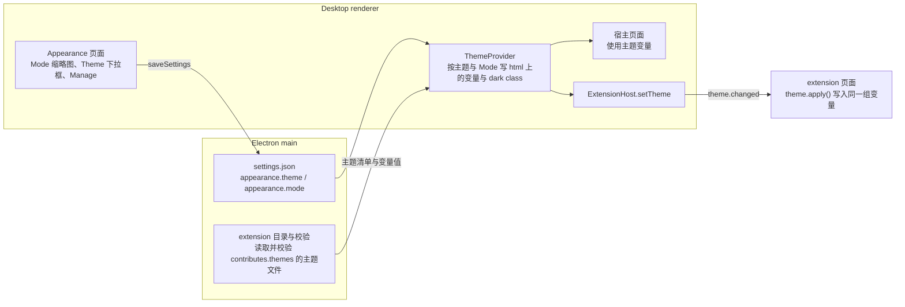

# Desktop 主题

## 名词解释

- **主题（theme）**：一组 CSS 变量的值，分为浅色与深色两套，决定 Desktop 宿主与 extension 的颜色、字体与圆角。
- **主题变量**：主题可以设置的 CSS 变量，清单见第 1 节。宿主页面与 extension 页面都通过这些变量取得颜色、字体与圆角。
- **Mode**：浅色、深色或跟随系统（`light`、`dark`、`system`），对所有主题生效。
- **主题 extension**：在 manifest 中通过 `contributes.themes` 提供主题的 extension，与其他 extension 一样安装、启用、停用与删除。
- **Default**：宿主内置的主题，默认变量由共享样式与 Desktop 样式提供，保持宿主当前外观，不能删除。
- **Soft**：随 Desktop 提供的内置主题 extension（`soft-theme`），可以像其他内置 extension 一样删除。
- 其余名词（Appearance 页面、主题变量推送 `theme.changed`、`theme.apply()` 等）沿用 `2026-10-21-Markdown排版规范与Desktop字号设置.md`、`2026-10-16-Desktop-Extension.md`。

## 背景

- Desktop 现在只有一套配色（`tokens.css` 的 `:root` 与 `.dark`），深浅色由标题栏的按钮切换（`next-themes`，保存在页面的 localStorage）。
- 用户希望在 Appearance 页面选择主题与 Mode：内置现在的配色（Default）与一套参考 ChatGPT 风格的配色（Soft），并且主题作为 extension 可以自由安装与删除。
- 主题必须用 CSS 变量表达，extension 页面使用同一组变量，与宿主风格一致。

## 设计目标

### 功能目标

1. Appearance 页面的 Visual style：Mode（System、Light、Dark 三张缩略图）与 Theme（下拉框与 Manage 按钮）。颜色与字体完全由主题决定，没有单独的自定义项。
2. 内置两套主题：Default（现有配色）与 Soft。
3. 主题 extension：manifest 中的 `contributes.themes` 声明主题；在 Extensions 页面安装、启用、停用、删除；Manage 按钮打开只显示主题 extension 的 Extensions 页面。
4. 切换主题或 Mode 后立即生效；使用主题变量的 extension 视图（调用了 `theme.apply()`）在已打开时同样立即更新。设置每台设备各自保存。
5. 宿主中直接写的颜色值（聊天代码块等）改为使用主题变量，侧栏表面使用侧栏变量，切换主题时一起变化。
6. 使用主题是 extension 的可选项：extension 自己决定是否使用主题变量，宿主不强制。

### 技术目标

- **只用 CSS 变量**：主题只提供变量值，不包含 CSS 规则或脚本，不能改变布局。
- **extension 自行选择**：宿主通过现有的主题变量推送（`ThemeInfo.tokens`、`theme.changed`）把所有主题变量提供给 extension。是否使用由每个 extension 自己决定：调用 `theme.apply()` 或读取 `theme.get().tokens` 的 extension 使用主题变量，与宿主风格一致；不使用的 extension 保持自己的样式，不受主题影响。
- **失败直接抛出**：主题文件不合法时，该 extension 在 Extensions 页面显示校验错误，主题不出现在下拉框中。
- **兼容**：`manifestVersion` 仍为 1，`contributes.themes` 是增量；Web 不变。

## 总体设计



## 数据库设计

不涉及。Desktop `settings.json` 的 `appearance` 增加 `theme` 与 `mode`（见第 3 节）。

## 详细设计

### 1. 主题变量

主题可以设置以下变量，其他名称一律不合法：

- 界面颜色：`--background`、`--foreground`、`--card`、`--card-foreground`、`--popover`、`--popover-foreground`、`--primary`、`--primary-foreground`、`--secondary`、`--secondary-foreground`、`--muted`、`--muted-foreground`、`--accent`、`--accent-foreground`、`--destructive`、`--border`、`--input`、`--ring`、`--chart-1` 至 `--chart-5`、`--sidebar`、`--sidebar-foreground`、`--sidebar-primary`、`--sidebar-primary-foreground`、`--sidebar-accent`、`--sidebar-accent-foreground`、`--sidebar-border`、`--sidebar-ring`、`--agw-sidebar-muted-foreground`、`--agw-prose-link`。
- 聊天与 Markdown 颜色：`--agw-user-message`、`--agw-user-message-foreground`、`--agw-code-block`、`--agw-code-block-foreground`、`--agw-code-block-muted`、`--agw-code-block-border`、`--agw-code-block-button`、`--agw-code-block-button-hover`、`--agw-prose-code-background`。
- 图片预览颜色：`--agw-image-backdrop`、`--agw-image-toolbar`、`--agw-image-toolbar-foreground`、`--agw-image-toolbar-border`、`--agw-image-toolbar-hover`、`--agw-image-toolbar-focus`、`--agw-image-toolbar-shadow`。
- 其他宿主颜色：`--agw-status-running`、`--agw-server-online-halo`、`--agw-agentflow-edge`、`--agw-agentflow-edge-fan-out`、`--agw-agentflow-edge-fan-in`、`--agw-agentflow-edge-switch-case`、`--agw-agentflow-edge-switch-default`。默认值与使用位置见第 5 节。
- 基础色阶：沿用 Tailwind 的 `--color-{名称}-{级别}`，允许的名称和级别为下列明确集合；另外允许 `--color-black`、`--color-white`。这些变量覆盖状态指示器、提示、徽标、文件变更标记和 Agentflow 节点中现有的颜色 utility，默认值沿用仓库锁定的 Tailwind 版本。[Tailwind 颜色变量说明](https://tailwindcss.com/docs/colors#referencing-in-css)。
  - `slate`：400；`zinc`：50、200、800、900。
  - `red`：50、100、200、400、700、800、900、950。
  - `orange`：50、100、200、400、600、900、950。
  - `amber`：50、100、200、300、400、500、600、700、800、900、950。
  - `yellow`：100、400、700、900。
  - `green`：50、100、200、300、400、600、700、800、900、950。
  - `emerald`：50、200、300、500、600、700、800。
  - `teal`：50、200、800；`sky`：50、200、600、800。
  - `blue`：50、100、200、300、400、500、600、700、800、900、950。
  - `indigo`：50、200、900；`violet`：50、100、200、300、700、900、950。
  - `rose`：50、200、300、500、800。
- 圆角：`--radius`（`--radius-sm` 至 `--radius-4xl` 由它计算，不单独设置）。
- 字体：`--agw-font-sans`、`--agw-font-mono`。`tokens.css` 中的 `--font-geist-sans`、`--font-geist-mono` 改名为这两个名字（值不变，Tailwind 的 `--font-sans`、`--font-mono` 改为引用它们）。这两个旧名字只在 `tokens.css` 中出现，Web 使用同一个文件，外观不变。

主题没有设置的变量使用 Default 的值：共享样式与 Desktop 样式中的 `:root`、`.dark` 默认值，以及 Tailwind 的默认色阶。第 5.2 节的 Desktop 默认值仅在 Desktop 生效，主题写入 `html.style` 的值优先。

推送给 extension 的 `THEME_TOKEN_NAMES` 包含第 1 节全部可设置的变量，包括基础色阶，另外保留 `--font-sans`、`--font-mono`、`--radius-sm` 至 `--radius-xl` 与现有字号变量。`--radius-*`、`--font-*` 由对应变量计算，extension 可以直接使用。构建检查确认清单中的默认变量在 Desktop 的构建 CSS 中均有定义。

### 2. 主题 extension

- manifest：

```json
"contributes": {
  "themes": [{ "id": "soft", "title": "Soft", "path": "themes/soft.json" }]
}
```

  `id` 在 extension 内唯一（与其他 contribution 的 id 规则相同），`title` 为显示名称，`path` 为包内的 JSON 文件。
- 主题文件：

```json
{
  "common": { "--radius": "0.75rem", "--agw-font-sans": "…", "--agw-font-mono": "…" },
  "light": { "--background": "#ffffff", "…": "…" },
  "dark": { "--background": "#212121", "…": "…" }
}
```

  `common` 用于浅色与深色，`light`、`dark` 中的同名变量覆盖 `common`。三项都可以省略，但至少一项不为空。
- 校验在 Electron main 中进行，位于 manifest 的 zod 校验之后，是读取文件的第二步：按与 `entry` 相同的包内路径规则解析 `path`（不能离开包目录），读取并校验主题文件，失败时返回 `ExtensionValidationError`（路径为 `["contributes", "themes", 序号, …]`），整个 extension 显示为不合法。`build-bundled-extensions.mjs` 也运行这一步，内置主题文件不合法时构建失败。
- 主题文件的校验：zod 严格对象；变量名必须在第 1 节的清单中；值为非空字符串，长度不超过 200；颜色变量的值必须是合法的 CSS 颜色、`--radius` 必须是合法的 CSS 长度、字体变量必须是合法的 `font-family` 值。值的校验使用能在 Node 中运行的成熟 CSS 解析库，由实现者选择（不手写解析）。
- 只包含 `contributes.themes` 的 manifest 是合法的，不需要 background 或视图（实现时确认现有规则没有拒绝它）。extension 启用且合法时，它的主题出现在 Theme 下拉框中；停用、删除或不合法时消失。

### 3. 设置

- `settings.json` 的 `appearance` 增加：
  - `theme`：`"default"` 或 `"{extensionId}:{themeId}"`，缺失时加载为 `"default"`。
  - `mode`：`"system"`、`"light"` 或 `"dark"`，可以缺失。缺失表示还没有从 `next-themes` 迁移（旧版本的 `settings.json`、全新安装）。Reset all 恢复的值是 `"system"`。
- `mode` 缺失时保持缺失，直到 renderer 完成迁移：设置存储加载时不补入 `mode`（`DEFAULT_APPEARANCE` 也不包含 `mode`）。`settings.json` 的每次写入都是读出全部设置后整体写回，例如 main 在创建窗口之前为新增的内置 extension（Soft）写入设置项；`mode` 缺失时写回后仍然缺失。
- 有效 Mode：`mode` 存在时就是 `mode`；缺失时为 `next-themes` 在 localStorage 中的值（`light`、`dark` 或 `system`），localStorage 中没有值时为 `system`。renderer 中所有用到 Mode 的地方（`ThemeProvider`、Appearance 页面、标题栏按钮）都使用有效 Mode。
- 迁移：renderer 收到第一份设置且其中没有 `mode` 时，把有效 Mode 保存为 `mode`，保留旧版本用户的选择。迁移完成之前 renderer 保存 `appearance` 时，修改字号或主题写入有效 Mode，修改 Mode 写入新的 Mode，这次保存也完成迁移。
- `settings.json` 是 Mode 的保存位置。Desktop 继续使用 `next-themes` 设置 `dark` class，它在 localStorage 中的值只用于启动时的第一次绘制（避免闪烁）与上面的迁移：设置加载后，有效 Mode 与 `next-themes` 当前值不同时，以有效 Mode 为准调用 `setTheme`。修改 Mode 时先保存 `settings.json`，再调用 `setTheme`。
- 标题栏的深浅色按钮保持现在的行为，在浅色与深色之间切换，并把 `mode` 保存为 `light` 或 `dark`；回到 System 在 Appearance 页面进行。
- 当前选中的主题不可用（所属 extension 被停用、删除、校验失败，或启动时找不到）时，renderer 把 `theme` 保存为 `"default"`，并显示提示 "{主题名或 id} is no longer available. Using Default."。启动时这项检查在 renderer 收到第一份 extension 状态之后进行，在那之前不判断主题是否可用（Desktop 只有一个窗口）。

### 4. 应用主题（`ThemeProvider`）

- Desktop renderer 新增 `ThemeProvider`（位于 `runtime-provider.tsx` 的 provider 链中，与 `AppearanceProvider` 并列）：
  - 按有效 Mode 与系统设置得到实际的浅色或深色，设置 `html` 的 `dark` class。
  - 选中主题不是 Default 时，把主题在当前浅色或深色下的变量（`common` 与对应一侧合并）写到 `document.documentElement.style`；切换主题、Mode 或系统深浅色变化时，先删除上一次写入的变量再写入新的。Default 不写入任何变量。写入在 `useLayoutEffect` 中进行，依赖选中主题与 `next-themes` 的实际深浅色，与 class 的变化在同一次绘制之前完成。
  - 禁用过渡动画：`next-themes` 的 `disableTransitionOnChange` 只在它自己修改深浅色时执行，同一 Mode 下切换主题时不会执行。`ThemeProvider` 每次删除或写入主题变量（切换主题、Mode、系统深浅色变化）时自行禁用过渡：先在 `head` 中插入禁用全部过渡的 style（规则与 `next-themes` 相同），删除旧变量并写入新变量，调用 `getComputedStyle(document.body)` 使新值立即生效，再在下一个任务（`setTimeout`）中删除这个 style。
- 主题变量推送：`extension-host-provider.tsx` 的推送在主题或实际深浅色变化时执行（与字号变化相同），在写入之后的下一帧读取计算后的变量值，推送全部主题变量与字号变量；`--font-sans` 等引用其他变量的值以替换后的字符串推送。
- Text Editor 的 Code 视图：Monaco 把字体作为创建编辑器时的选项，不会随 CSS 变量变化。`theme.onDidChange` 中除 `fontSize` 外，同时用 `theme.tokens["--font-mono"]` 调用 `updateOptions({ fontFamily })`，已打开的编辑器在同一个 frame 中更换字体，不重建视图。
- 主题清单：main 把每个合法 extension 的主题（id、title、校验后的 `common`/`light`/`dark` 变量）放进 renderer 已经收到的 extension 状态中，随现有的 extension 状态变化事件更新（安装、启用、停用、删除）。可用的主题是“extension 启用且合法”的主题。

### 5. 宿主样式

#### 5.1 聊天与图片预览

宿主自有样式中的颜色通过第 1 节的变量表达。新增变量在共享样式的 `:root` 与 `.dark` 中提供默认值，Web 与 Default 宿主界面的计算颜色保持不变。

- 聊天：
  - 用户消息气泡 `.agw-msg-user`（`bg-[#f3f5fc] text-[#17191d]`）→ `--agw-user-message`、`--agw-user-message-foreground`（深色默认值取现在深色下的实际颜色）。
  - 聊天代码块 `.msg-content-md-code-block`（`bg-[#f4f4f4] text-[#17191d]`，深色 `#202124`、`#f1f3f4`）→ `--agw-code-block`、`--agw-code-block-foreground`；标题栏 `.msg-content-md-code-header`（`text-[#5f6368]`，深色 `#bdc1c6`；边框 `black/10`，深色 `white/10`）→ `--agw-code-block-muted`、`--agw-code-block-border`。
  - `markdown-elements.tsx` 代码块按钮的普通文字使用 `--agw-code-block-button`（浅色 `#71757a`，深色 `#aeb2b8`），悬停与 `aria-pressed` 状态使用 `--agw-code-block-button-hover`（浅色 `#17191d`，深色 `#ffffff`）；背景继续使用 `--color-black`、`--color-white` 和现有透明度。
- Memory Markdown 预览等使用 `.prose` 的页面：`tokens.css` 中 `.prose code` 与 `.prose pre` 的背景使用 `--agw-prose-code-background`，浅色默认值为 `oklch(0.95 0 0)`，深色默认值为 `oklch(0.2 0 0)`。保留 `.prose.dark` 与 `.dark .prose` 的适用范围，以及 `pre code` 的透明背景规则。主题只改变背景变量，字号、间距和圆角保持现有设置。
- `packages/chat/src/image-preview.css` 的默认值在两个 Mode 下相同：`--agw-image-backdrop: rgb(9 11 15 / 96%)`；`--agw-image-toolbar: #202329`；`--agw-image-toolbar-foreground: #f5f6f7`；`--agw-image-toolbar-border: rgb(255 255 255 / 16%)`；`--agw-image-toolbar-hover: rgb(255 255 255 / 12%)`；`--agw-image-toolbar-focus: #ffffff`；`--agw-image-toolbar-shadow: rgb(0 0 0 / 24%)`。`.agw-image-preview` 的 `--yarl__color_backdrop` 引用 `--agw-image-backdrop`；`.agw-image-zoom` 的背景、文字、边框、悬停、焦点与阴影颜色分别引用对应变量，保留现有尺寸、透明度和禁用态 opacity。

#### 5.2 侧栏

- `.agw-ribbon`、`.agw-left-sidebar`、`.agw-settings-nav` 使用 `--sidebar` 作为背景，普通文字与图标使用 `--sidebar-foreground`，次要文字使用 `--agw-sidebar-muted-foreground`，悬停和选中状态使用 `--sidebar-accent`、`--sidebar-accent-foreground`，边框与分隔线使用 `--sidebar-border`，焦点指示使用 `--sidebar-ring`；保留各处原有的透明度。范围包括 ribbon 项、设置导航、对话列表、文件树及侧栏标题。
- 共享组件在 Desktop 侧栏中的颜色通过这三个容器内的 CSS 变量引用连接：`--foreground` 引用 `--sidebar-foreground`，`--muted-foreground` 引用 `--agw-sidebar-muted-foreground`，`--muted` 与 `--accent` 引用 `--sidebar-accent`，`--accent-foreground` 引用 `--sidebar-accent-foreground`，`--border` 引用 `--sidebar-border`，`--ring` 引用 `--sidebar-ring`。背景使用侧栏变量；悬停或选中的项将普通文字的 `--foreground` 设为 `--sidebar-accent-foreground`，次要文字仍使用 `--agw-sidebar-muted-foreground`，各元素保留原有文字层级与透明度。挂在 `body` 下的 dialog、popover 等继续使用其界面变量。业务状态标记使用第 5.3 节的变量。
- Default 的 `--sidebar`、`--sidebar-foreground`、`--sidebar-accent`、`--sidebar-accent-foreground` 分别与现有侧栏使用的 `--card`、`--foreground`、`--muted`、`--foreground` 一致。新增 `--agw-sidebar-muted-foreground` 在 `:root` 上默认引用 `--muted-foreground`。Desktop 的 `globals.css` 在全部样式导入之后的 `:root` 中为 `--sidebar-border`、`--sidebar-ring` 分别声明 `var(--border)`、`var(--ring)`，这些引用在根元素计算，随后由侧栏继承。Default 的边框保持浅色 `#ebebeb`、深色 `#5f6060`，焦点颜色保持当前值；主题可以覆盖这些变量。运行状态图标使用第 5.3 节的独立变量。共享 `tokens.css` 中原有的侧栏变量值保持不变，Web 继续使用原有默认值。

#### 5.3 状态、提示与其他宿主颜色

- 状态指示器使用已有色阶变量：idle、offline 为 `--color-slate-400`，waiting-approval 为 `--color-amber-500`，completed-unread、online 为 `--color-emerald-500`，failed-unread 使用 `--destructive`。running 使用 `--agw-status-running`，默认值为浅色 `#006fee`、深色 `#338ef7`；标题栏、后台对话按钮、`ConversationList` 的运行图标和运行状态光环统一引用它，保留原有透明度与动画。`.agw-server-state.is-online` 的光环使用 `--agw-server-online-halo`，两个 Mode 的默认值均为 `#10b981`，保留 14% 的混色比例。
- Extensions 警告、聊天队列提示、Server 状态徽标、Git 变更标记及 Agentflow 节点等现有 `text-*`、`bg-*`、`border-*`、`shadow-*` 色阶 utility 保留，通过第 1 节允许的 `--color-*` 变量响应主题。主题可分别设置 light 与 dark 中的色阶；透明度与 `dark:` 条件继续由组件控制。
- `visual-agentflow-builder.tsx` 的边线与 SVG 箭头同时使用 `--agw-agentflow-edge`（普通边，`#475569`）、`--agw-agentflow-edge-fan-out`（`FanOut`，`#2563eb`）、`--agw-agentflow-edge-fan-in`（`FanInBarrier`，`#d97706`）、`--agw-agentflow-edge-switch-case`（`SwitchCase`，`#7c3aed`）、`--agw-agentflow-edge-switch-default`（`SwitchDefault`，`#db2777`）；两个 Mode 的默认值相同，宽度与动画保持现有设置。
- dialog 等宿主样式中直接指定的黑色阴影改为引用 `--color-black` 并保留原透明度。`transparent`、`currentColor`、`inherit` 保持原有含义。图片本身、代码高亮与第三方绘图内容使用各自的内容配色；宿主覆盖第三方组件的样式仍遵守本节规则。
- 实现检查覆盖 `packages/*/src`（排除 `chat-native`、`extensions`）与 `desktop/renderer/src` 的颜色声明、任意颜色 utility 和色阶 utility，包括十六进制、命名颜色及 `rgb()`、`hsl()`、`oklch()` 等颜色函数。使用 `rg` 定位后逐项核对实际样式用途，所有宿主自有颜色均须引用本节变量或允许的基础色阶；检查产出的 CSS，确认既有色阶 utility 使用对应变量。测试数据、注释和图片资源中的颜色不作为界面样式处理。

#### 5.4 Excalidraw 工具栏与菜单

- `packages/extensions/excalidraw/src/styles.css` 在库样式之后加载，按 [Excalidraw 样式接口](https://docs.excalidraw.com/docs/@excalidraw/excalidraw/customizing-styles)使用 `.editor .excalidraw` 与 `.editor .excalidraw.theme--dark` 两个选择器声明相同的变量映射，覆盖两个 Mode 下的库默认值。映射以仓库使用的 [v0.18.1 变量定义](https://github.com/excalidraw/excalidraw/blob/v0.18.1/packages/excalidraw/css/theme.scss)为依据：
  - `--island-bg-color`、`--popup-bg-color`、`--sidebar-bg-color` 引用 `--popover`；`--default-bg-color`、`--input-bg-color`、`--color-surface-lowest` 引用 `--background`。
  - `--popup-secondary-bg-color`、`--color-surface-low`、`--color-surface-mid` 引用 `--muted`；`--color-on-surface`、`--text-primary-color`、`--popup-text-color`、`--icon-fill-color` 引用 `--foreground`；`--input-label-color`、`--keybinding-color`、`--color-disabled` 引用 `--muted-foreground`。
  - `--default-border-color`、`--dialog-border-color`、`--sidebar-border-color`、`--color-border-outline`、`--color-border-outline-variant` 引用 `--border`；`--input-border-color` 引用 `--input`。
  - `--button-hover-bg`、`--button-active-bg`、`--input-hover-bg-color`、`--color-surface-high`、`--color-primary-light`、`--color-primary-light-darker`、`--color-surface-primary-container` 引用 `--accent`；`--color-on-primary-container` 引用 `--accent-foreground`。
  - `--color-primary`、`--color-primary-darker`、`--color-primary-darkest`、`--color-primary-hover`、`--color-brand-hover`、`--color-brand-active`、`--button-active-border` 引用 `--primary`；`--popup-text-inverted-color` 引用 `--primary-foreground`；`--focus-highlight-color`、`--select-highlight-color` 引用 `--ring`；`--link-color` 引用 `--agw-prose-link`。
- `theme.apply()` 更新 `html` 上的宿主变量后，上述引用立即重新计算；同一 Mode 下切换主题不依赖 React 重新渲染。`App` 继续把 `theme.kind` 传给 Excalidraw 控制浅色与深色。Default 下的工具栏和菜单使用宿主 Default 变量，Soft 下使用 Soft 变量。
- 映射仅调整工具栏、菜单、属性面板、输入框与弹窗的界面配色。场景的 `viewBackgroundColor`、元素的 stroke、fill、文字颜色和文件内容保持原有值；切换主题保留当前 frame、文档会话和未保存修改。Text Editor 的工具栏继续引用宿主变量，代码高亮与 Monaco 内容配色继续使用各自原有的浅色、深色配置。

### 6. Appearance 页面

- 字号设置上方新增 "Visual style" 区域：
  - "Mode"：三张缩略图按钮，依次为 System（左半浅色、右半深色）、Light、Dark，选中的有强调边框；按钮名称 "System mode"、"Light mode"、"Dark mode"。
  - "Theme"：下拉框列出 Default 与所有可用主题（显示 `title`，同名时附上 extension 名称），右侧 "Manage" 按钮打开 `/extensions/?category=themes`。
- 修改立即保存并生效；保存失败时用现有的错误提示显示原因，界面恢复为保存前的值。
- 页面底部的 "Reset all" 同时把 `theme` 恢复为 `"default"`、`mode` 恢复为 `"system"`。

### 7. Extensions 页面

- 新增分类筛选 `category=themes`：只显示提供 `contributes.themes` 的 extension（也提供视图的 extension 同样显示）；页面顶部显示当前筛选与 "Show all"，"Show all" 打开 `/extensions/`（去掉参数）。`category` 为其他值时，页面显示 "Unknown category: {值}" 与 "Show all"，不显示列表。
- 主题 extension 的卡片显示 "Theme" 标记与它提供的主题名称（停用的 extension 也显示，名称取自 manifest 的 `title`）。

### 8. Soft 主题

内置 extension `packages/extensions/soft-theme`，`contributes.themes` 为 `[{ "id": "soft", "title": "Soft", "path": "themes/soft.json" }]`。包内有 `package.json`，其 `build` 脚本（Node 脚本）把 `manifest.json` 与 `themes/` 复制到 `dist/`，构建产物与其他内置 extension 一样复制到 `resources/extensions/soft-theme`。删除后按现有的 `removedBundledExtensions` 规则处理，Desktop 升级后不会重新出现。变量值：

- common：`--radius: 0.75rem`；`--agw-font-sans: -apple-system, BlinkMacSystemFont, "Segoe UI", "Helvetica Neue", Arial, sans-serif`；`--agw-font-mono: ui-monospace, "SF Mono", Menlo, Consolas, monospace`。
- light：background `#ffffff`，foreground `#0d0d0d`，card `#ffffff`，card-foreground `#0d0d0d`，popover `#ffffff`，popover-foreground `#0d0d0d`，primary `#0d0d0d`，primary-foreground `#ffffff`，secondary `#f4f4f4`，secondary-foreground `#0d0d0d`，muted `#f4f4f4`，muted-foreground `#5d5d5d`，accent `#ececec`，accent-foreground `#0d0d0d`，destructive `#e02e2a`，border `#e5e5e5`，input `#e5e5e5`，ring `#0169cc`，sidebar `#f9f9f9`，sidebar-foreground `#0d0d0d`，sidebar-primary `#0169cc`，sidebar-primary-foreground `#ffffff`，sidebar-accent `#ececec`，sidebar-accent-foreground `#0d0d0d`，sidebar-border `#e5e5e5`，sidebar-ring `#0169cc`，agw-prose-link `#0169cc`，agw-user-message `#f4f4f4`，agw-user-message-foreground `#0d0d0d`，agw-code-block `#f9f9f9`，agw-code-block-foreground `#0d0d0d`，agw-code-block-muted `#5d5d5d`，agw-code-block-border `#e5e5e5`，agw-code-block-button `#5d5d5d`，agw-code-block-button-hover `#0d0d0d`。
- dark：background `#212121`，foreground `#ececec`，card `#262626`，card-foreground `#ececec`，popover `#2f2f2f`，popover-foreground `#ececec`，primary `#ffffff`，primary-foreground `#0d0d0d`，secondary `#303030`，secondary-foreground `#ececec`，muted `#303030`，muted-foreground `#afafaf`，accent `#2f2f2f`，accent-foreground `#ececec`，destructive `#f0524f`，border `#363636`，input `#424242`，ring `#48aaff`，sidebar `#181818`，sidebar-foreground `#ececec`，sidebar-primary `#48aaff`，sidebar-primary-foreground `#0d0d0d`，sidebar-accent `#2f2f2f`，sidebar-accent-foreground `#ececec`，sidebar-border `#2a2a2a`，sidebar-ring `#48aaff`，agw-prose-link `#48aaff`，agw-user-message `#303030`，agw-user-message-foreground `#ececec`，agw-code-block `#181818`，agw-code-block-foreground `#ececec`，agw-code-block-muted `#afafaf`，agw-code-block-border `#363636`，agw-code-block-button `#afafaf`，agw-code-block-button-hover `#ffffff`。
- `--chart-*` 不设置（使用 Default）。
- Soft 的 `--agw-sidebar-muted-foreground`：light 为 `#5d5d5d`，dark 为 `#afafaf`；`--agw-prose-code-background`：light 为 `#f9f9f9`，dark 为 `#181818`；`--agw-status-running`：light 为 `#0169cc`，dark 为 `#48aaff`。图片预览默认使用深色背景：两个 Mode 的 `--agw-image-backdrop` 均为 `rgb(13 13 13 / 96%)`，`--agw-image-toolbar` 为 `#303030`，`--agw-image-toolbar-foreground` 为 `#ececec`，`--agw-image-toolbar-border` 为 `#424242`，`--agw-image-toolbar-hover` 为 `#424242`，`--agw-image-toolbar-focus` 为 `#48aaff`，`--agw-image-toolbar-shadow` 为 `rgb(0 0 0 / 24%)`。基础色阶、Server 光环和 Agentflow 边线使用 Default 的值。

### 9. extension 开发说明

- 使用主题是 extension 的可选项，不是要求。宿主不会向 extension 页面注入任何样式；extension 调用 `theme.apply()` 后，页面上才有这些变量。
- `@agw/extension-sdk` 的 `ThemeInfo.tokens` 说明列出第 1 节的变量，并说明它们是可选的：需要与宿主一致的 extension 调用 `theme.apply()`，然后在样式中使用 `var(--background)`、`var(--primary)`、`var(--radius)`、`var(--font-sans)` 等；不调用的 extension 不受主题影响。重新生成 `sdk.d.ts`。

## 接口文档

- manifest：`contributes.themes: Array<{ id: string; title: string; path: string }>`。
- 主题文件：`{ common?: Record<string, string>; light?: Record<string, string>; dark?: Record<string, string> }`。
- `AppearanceSettings` 增加 `theme: string`、`mode?: "system" | "light" | "dark"`（缺失表示还没有迁移，见第 3 节）。
- 路由：`/extensions/?category=themes`。

## 测试计划

### 单元测试

- manifest 与主题文件校验：合法的 Soft 文件通过；未知变量名、非字符串值、不合法的颜色、长度或字体值、三项都为空时失败；`path` 不存在时失败。
- 设置存储：缺少 `theme` 时加载为 `"default"`；缺少 `mode` 时加载结果中没有 `mode`，经过 `applyBundledExtensions`、`setFileViewerDefault` 与不含 `appearance` 的 `save` 之后文件中仍然没有 `mode`；`mode` 存在时只接受三个值；`theme` 格式不对时加载失败；保存其他字段时保留它们。
- `ThemeProvider`：Default 不写变量；Soft 在浅色与深色下写入对应的变量；切换主题、Mode 与系统深浅色时删除旧变量、写入新变量；删除与写入变量时 `head` 中有禁用过渡的 style，之后被删除；选中主题不可用时保存 `"default"` 并提示。
- 迁移：设置中没有 `mode`、localStorage 为 `dark` 时，页面为深色并保存 `mode: "dark"`；迁移保存完成之前修改字号，保存的 `appearance` 中 `mode` 为 `"dark"`；localStorage 中没有值时保存 `"system"`。
- Appearance 页面：三张 Mode 缩略图与选中状态；Theme 下拉框列出可用主题；Manage 的链接；Reset all 恢复主题与 Mode。
- Extensions 页面：`category=themes` 只显示主题 extension。
- `THEME_TOKEN_NAMES` 包含第 1 节的变量。
- 新增颜色变量与基础色阶全部接受颜色校验；不在清单中的色阶级别失败。Default 下所有允许变量均有计算值，Soft 未设置的变量使用对应 Default 值；切换回 Default 后清除所有已写入的变量。

### 集成测试

使用 `pnpm --filter @agw/desktop test:extensions`：

- Appearance 选择 Soft、Mode Light：宿主 `body` 背景为 `rgb(255, 255, 255)`，ribbon、左侧栏与设置导航的背景为 `rgb(249, 249, 249)`；Edit 页面中 `--background` 的计算值为 `#ffffff`，聊天链接颜色为 `rgb(1, 105, 204)`。
- 保持 Light，在 Appearance 页面从 Default 切换到 Soft：下一帧中 `document.getAnimations()` 没有 `CSSTransition`，设置导航中选中项（带 `transition-colors`）的计算背景已经是 Soft 的 `--sidebar-accent`（`rgb(236, 236, 236)`）。
- 安装测试主题：主界面保持浅色，`--sidebar` 为 `#17191d`，`--sidebar-foreground` 为 `#ffffff`，`--agw-sidebar-muted-foreground` 为 `#d1d5db`，`--sidebar-accent` 为 `#303030`，`--sidebar-accent-foreground` 为 `#ffffff`，`--sidebar-border` 为 `#525252`，`--sidebar-ring` 为 `#48aaff`。检查 ribbon、设置导航、对话列表、文件树及侧栏标题的普通、悬停、选中、键盘焦点状态和边框；同时确认主区域与挂在 `body` 下的弹窗仍使用主界面的变量。
- 打开图片预览后切换 Default 与 Soft：背景、工具栏文字、边框、按钮悬停、键盘焦点与阴影立即更新，图片内容、缩放比例和当前图片保持。测试主题另外覆盖这些变量以及 `--color-slate-400`、`--color-amber-500`、`--color-emerald-500`、`--agw-status-running`、`--agw-server-online-halo`，检查状态指示器、运行图标、警告提示与 Server 光环；单独修改 `--sidebar-ring` 时运行图标颜色保持，清除主题后恢复默认计算值。
- 在 Memory Markdown 预览中打开包含 inline code 和 fenced code 的内容，两种 Mode 下切换 Default、Soft 和覆盖 `--agw-prose-code-background` 的测试主题：代码背景立即更新，`pre code` 仍为透明背景，内容与排版保持。
- 在 Agentflow 视图中打开包含五种边线的图，切换覆盖对应变量的主题：边线与 SVG 箭头同时变化，图中的节点、边数据、选中状态与未保存修改保持。
- 打开有未保存修改的 Excalidraw 文件与菜单，在同一 Mode 下切换 Default、Soft 和测试主题：检查工具栏、菜单、Save 按钮、属性面板、输入框与弹窗的普通、悬停、选中、焦点配色；两种 Mode 均执行。frame 和文档会话保持，场景背景、元素颜色与未保存修改保持；切回 Default 后这些界面重新使用宿主 Default 变量。
- 已打开 Code 视图时从 Default 切换到 Soft：同一个 frame 中 `.view-lines` 的计算 `font-family` 变为 Soft 的 `--agw-font-mono`。
- Mode Dark：宿主背景 `rgb(33, 33, 33)`；已打开、调用了 `theme.apply()` 的 extension 视图收到新的变量值，不重建 frame；一个不调用 `theme.apply()` 的测试 extension 页面上没有主题变量，样式不变。
- 标题栏的深浅色按钮修改后，Appearance 页面的 Mode 同步变化，`settings.json` 中 `mode` 相应变化。
- 停用 Soft 所属的 extension：主题恢复为 Default，出现提示，`settings.json` 中 `theme` 为 `"default"`。
- 安装一个测试用的主题 extension（目录安装）：出现在下拉框中，选择后生效；删除后恢复 Default。
- 主题文件不合法的 extension 在 Extensions 页面显示校验错误，不出现在下拉框中。
- 重新启动 Desktop 后主题与 Mode 保持。

### 回归测试

- `pnpm test`、`pnpm lint`、`pnpm build`、`pnpm --filter @agw/desktop test:extensions`、`pnpm --filter @agw/web test:e2e`（Web 外观不变）。
- 使用构建后的 CSS 在浏览器中检查 Web 与 Desktop Default：用户消息气泡、代码块、代码块标题栏、代码块按钮（含悬停和选中）、Memory Markdown 预览的 inline code 与 fenced code、图片预览、状态指示器、提示、徽标、Git 变更标记、Agentflow 节点与边线、阴影在浅色与深色下的计算颜色与修改前相同；Desktop Default 下 ribbon、左侧栏、设置导航及其中共享组件的背景、文字、交互状态、边框和焦点颜色与修改前相同。Excalidraw 按第 5.4 节验证其界面与宿主主题的映射。
