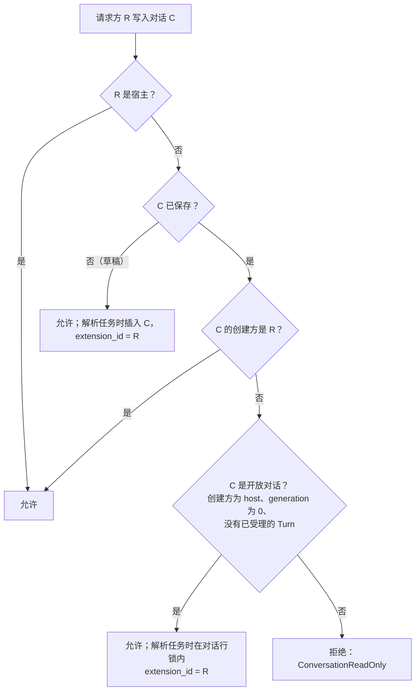
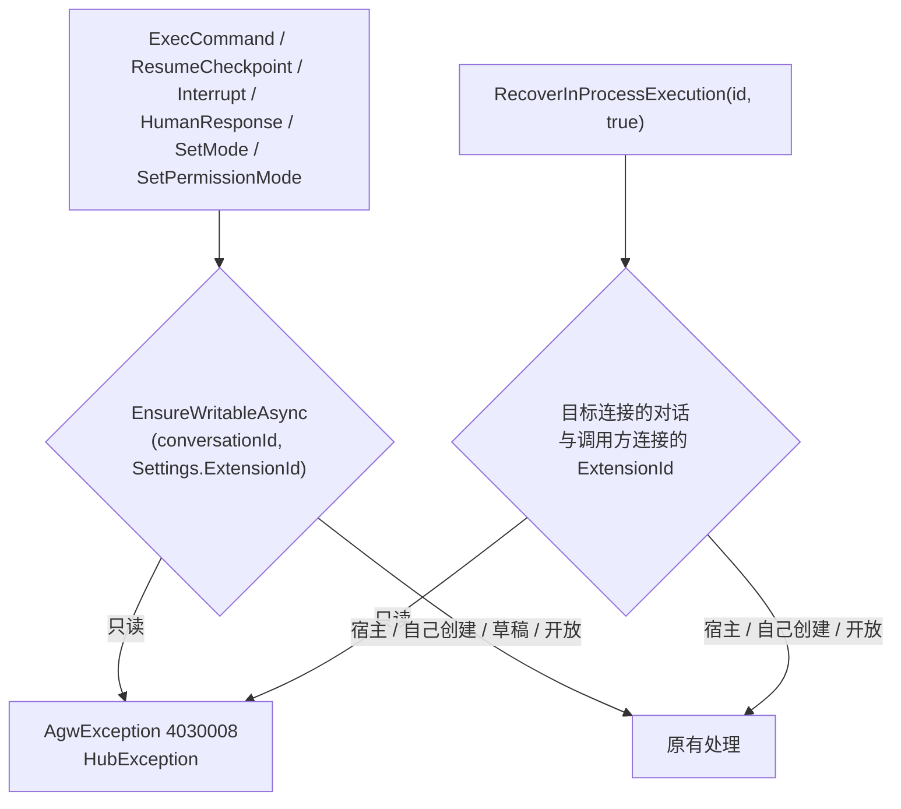
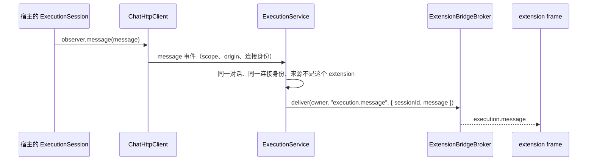

# 对话创建方与 Extension 只读规则

## 名词解释

- **宿主（host）**：不经过 extension 的一方，包括 Desktop 自己的界面（Chat、Agent 与 Agentflow 的执行抽屉）、Web、Mobile，以及在 Server 内创建对话的 Jobs 与 A2A。需求中的"主进程""主程序"都指宿主。
- **extension**：Desktop 中运行的 extension，经宿主的 `ExecutionService` 与 `ChatHttpClient` 使用执行会话，用 manifest 的 `id`（3 到 64 个小写字母、数字与单个连字符）标识。extension 的 `id` 与 `name` 都不能是 `host`（忽略大小写，`name` 去掉首尾空白后再核对）。
- **请求方（requester）**：一条执行连接所代表的一方，即宿主（连接没有 extension 身份）或某个 extension（`extensionId`）。
- **已受理的 Turn**：受理事务写入 `project_conversation_turn` 的 Turn 行。受理之后执行失败的 Turn 也算已受理；在受理之前失败（例如 Agent 不存在、权限模式不支持）的请求不写入 Turn 行。清空记录会删除对话的全部 Turn 行。
- **创建方（creator）**：保存在 `project_conversation.extension_id`，值为 `host` 或 extension 的 `id`，不为空。写入时机：
  - 第一个 `ExecCommand` 解析任务、插入对话行时，记录这个请求方（宿主记为 `host`），与这一轮之后是否受理成功无关；
  - 其他途径插入的对话（A2A、执行之外写入历史、Jobs）为 `host`；
  - extension 的 `ExecCommand` 在开放对话中解析任务时，记录这个 extension。
- **开放对话**：同时满足以下条件的对话，所有 extension 都可以读写：
  - `extension_id` 为 `host`；
  - `generation` 为 0（从未清空记录；清空记录是唯一会把 `generation` 加 1 的操作）；
  - 没有已受理的 Turn。

  例如：宿主发起的第一个 Turn 受理失败的对话、执行之外写入历史时创建的对话、A2A 只保存任务快照时创建的对话、Job 第一个 Turn 受理失败的对话。
- **草稿对话**：客户端已经生成 `conversationId`、Server 还没有保存的对话。第一个 `ExecCommand` 解析任务时插入它，并记录创建方。
- **写入操作**：改变对话或其运行中 Turn 的操作，包括：
  - 发送消息（`ExecCommand`，每一轮都算）；
  - 恢复 Agentflow checkpoint（`ResumeCheckpointCommand`）；
  - 中断 Turn（`InterruptCommand`，以及 hub 方法 `RecoverInProcessExecution(connectionId, true)`）；
  - 回答人工交互（`HumanResponseCommand`）；
  - 切换 Agent 模式（`SetModeCommand`）；
  - 切换权限模式（`SetPermissionModeCommand`）。
- **只读**：请求方不能对该对话执行写入操作。以下操作仍然可用：
  - 配置会话（`SettingCommand`），创建执行会话，接收这台 Desktop 收发的该对话实时消息（详细设计第 8 节）；
  - 订阅 Turn（`SubscribeTurnCommand`）；
  - 查询 checkpoint（`GetAgentflowCheckpoints`）与进程内执行（`FindInProcessExecution`、`RecoverInProcessExecution(connectionId, false)`）；
  - `chat.observe`。

## 背景

现状：

- `ChatHttpClient` 创建执行会话时已经接收 `origin`，extension 的会话是 `{ kind: "extension", extensionId }`，但它只用于进程内的通信事件。
- 宿主与 extension 的会话使用同一个 token 与 hub 地址（`/api/hubs/exec`，WebSocket，没有请求头和查询参数），Server 无法区分。
- extension 可以用任意 `conversationId` 创建会话并发送消息，因此能在宿主创建的对话、其他 extension 的对话中继续聊天。
- 进程内模式下，extension 的会话配置到宿主正在运行的对话后，`RecoverInProcessExecution(connectionId, true)` 会停止宿主的 Turn：Server 只校验两条连接属于同一用户。
- extension 的会话只收到自己连接上的消息：进程内模式没有订阅其他连接 Turn 的方式，Distributed 模式下会话不知道正在运行的 Turn，SDK 的 `onMessage` 只接收 `execution.message`。

需求：

1. extension 经 `ChatHttpClient` 发出请求时，宿主知道是哪个 extension 发出的，并把这个身份带给 Server。
2. `project_conversation` 增加一列，标识对话由哪个 extension 创建，或由宿主创建。
3. 规则：
   - extension 创建的对话，宿主可以继续聊天；
   - 宿主创建的对话，extension 只能读取，不能继续聊天；
   - extension 创建的对话，其他 extension 只能读取。

## 设计目标

### 功能目标

1. 请求方身份：extension 的执行会话在每个 `SettingCommand` 中带上 `extensionId`。这个字段由宿主写入，宿主自己的会话不带。`ChatHttpClient` 的 HTTP 方法接受 `origin`，宿主代 extension 发出的请求在通信事件中标为该 extension。
2. 创建方记录：按"名词解释"中的时机写入 `extension_id`（`host` 或 extension 的 `id`）；extension 成为创建方之后不再修改；清空记录不改变它。
3. 保留名称：extension 的 `id` 与 `name` 不能是 `host`；Server 拒绝值为 `host` 的 `extensionId`。
4. 写入规则：Server 在每个写入操作之前核对请求方、创建方与开放条件，拒绝时任何数据都不改变。
5. 公开创建方：对话详情与列表响应增加创建方 `extensionId` 与 `openToExtensions`；extension 的执行会话增加 `readOnly`，extension 在发送之前就知道对话是否只读。Web、Desktop 与 Mobile 的对话列表在标题前显示创建方图标。
6. 只读会话的消息：Desktop 把本机收发的对话实时消息转发给该对话上的 extension 会话。
7. 错误：拒绝写入时 Server 抛出 `ErrorCodes.ConversationReadOnly`（403_0008），extension 收到 `ERR_CONVERSATION_READ_ONLY`。

本方案不包含：

- extension 读取对话历史的接口。
- extension 的 A2A 请求。A2A 对话由 Server 的 A2A 入口按 contextId 创建，创建方为 `host`。

### 技术目标

- 安全：
  - extension 身份只由宿主写入。extension 不能构造 `SettingCommand`，`ExecutionService` 使用 broker 连接记录的 `extensionId`，与 extension 传入的参数无关。
  - `host` 是保留名称：Desktop 不加载 `id` 或 `name` 为 `host` 的 extension，Server 拒绝值为 `host` 的 `extensionId`，extension 不能冒充宿主创建的对话。
  - Server 信任已认证连接报告的身份。extension 拿不到 token，只能经宿主访问 Server。
  - extension 传入的 `projectId` 与 `conversationId` 会进入请求路径，broker 只接受小写 UUID，extension 不能借助点段访问其他接口。
  - 规则只在 Server 判定；客户端的 `readOnly` 只供 extension 提前显示。
  - 拒绝发生在任何写入之前：对话标题、更新时间、历史记录、checkpoint 截断与 Durable 状态都保持不变。
  - 转发的消息只到达同一对话、同一 Server 连接身份上的 extension 会话。
- 性能：
  - extension 的每个写入操作多两次按索引的读取（对话行、是否有已受理的 Turn）；
  - extension 在开放对话中记录创建方时多一个加锁的事务；
  - 宿主的写入不增加读取；
  - 对话详情多一次是否有 Turn 的查询，列表的每一行多一个 `EXISTS` 子查询。
- 可观测：拒绝以 HubException `4030008` 返回客户端，与现有错误一样记录。

## 总体设计

```mermaid
flowchart LR
  Ext["extension frame"] -->|"execution.*"| Broker["ExtensionBridgeBroker"]
  Broker --> Service["ExecutionService<br/>owner.extensionId"]
  Service -->|"origin: extension"| Client["ChatHttpClient"]
  Host["宿主 Chat / Web / Mobile"] -->|"origin: client"| Client
  Client --> Session["ExecutionSession<br/>extensionId 或不带"]
  Session -->|"SettingCommand { extensionId }"| Hub["/api/hubs/exec"]
  Hub --> Context["ExecutionConnectionContext<br/>Settings.ExtensionId"]
  Context -->|"写入操作"| Gate["IProjectConversationAccessFacade<br/>EnsureWritableAsync"]
  Gate --> Rule["ProjectConversationBehavior<br/>EnsureWritableBy"]
  Context -->|"ExecCommand"| Accept["TurnAcceptanceService"]
  Accept -->|"RequesterExtensionId"| Create["TaskExecutionAppService<br/>GetOrCreateConversationAsync"]
  Create -->|"新对话"| Table[("project_conversation<br/>extension_id")]
  Create -->|"开放对话"| Claim["IConversationCreatorStore<br/>对话行锁内记录"]
  Claim --> Table
  Client -.->|"message 事件"| Service
  Service -.->|"execution.message 转发"| Ext
```



身份的选择：在 `SettingCommand` 上增加 `extensionId`，不改 hub 地址或请求头。理由：

- 对话只在 `TurnAcceptanceService.ResolveTaskAsync` 中创建，它从连接的 `ExecutionSettings` 生成请求；每个写入操作也已经读取 `Settings.ConversationId`。
- 需要请求方身份的命令不止 `ExecCommand`，"名词解释"列出的写入操作都要用它；`SettingCommand` 在 `configure` 与每次重连恢复时都先于其他命令发送，连接上的每个命令都能拿到同一个身份。
- 字段不合法时 `DispatchCommand` 以 `4000001` 拒绝，`createSession` 收到错误码；在连接建立时校验只能断开 WebSocket，没有错误码。
- `ExecutionSettings` 的相等判定已经处理设置变化：执行期间拒绝修改、释放 runtime、清除缓存的任务，所以为一个请求方解析的任务不会被另一个请求方复用。

## 数据库设计

表 `project_conversation` 增加一列：

- 列名：`extension_id`
- 类型：SQLite `TEXT`（模型长度 64），PostgreSQL `character varying(64)`
- 不可为空，默认值 `'host'`，没有索引
- 含义：`host` 表示宿主创建；其他值是创建对话的 extension 的 `id`
- 写入时机见"名词解释"；清空记录只删除依附的记录并把 `generation` 加 1，不改变这一列
- 已有记录由默认值填为 `host`。已有对话中，没有清空过、也没有已受理 Turn 的对话成为开放对话

保留值 `host` 定义为常量 `ConversationCreators.Host`（`Agw.Shared/Contracts/Conversations/ConversationCreators.cs`）。Agw.Data、Agw.Projects 与 Agw.Agents.Execution 都已引用 Agw.Shared。

开放条件使用已有的数据：`generation`（`project_conversation`）与 `project_conversation_turn` 中是否有该对话的行，不增加其他列。

SQLite 迁移：

```sql
-- Up
ALTER TABLE "project_conversation" ADD "extension_id" TEXT NOT NULL DEFAULT 'host';
-- Down（手工改为直接删除列，与 AddTurnUsageSettlement 相同，避免重建表）
ALTER TABLE "project_conversation" DROP COLUMN "extension_id";
```

PostgreSQL 迁移：

```sql
-- Up
ALTER TABLE project_conversation ADD extension_id character varying(64) NOT NULL DEFAULT 'host';
-- Down
ALTER TABLE project_conversation DROP COLUMN extension_id;
```

两个迁移按 `docs/1.Development.md` 的命令生成，名称为 `AddConversationCreatorExtension`。生成之前先确认 `InitialMigrationTests` 没有待生成的模型变化，使新迁移只包含这一列。

## 详细设计

### 1. 写入规则

请求方 R 对对话 C 执行写入操作时：



宿主 R 在草稿中发起第一个 Turn 时，插入的对话创建方为 `host`。

与需求的对应：

- extension 创建的对话：创建方是该 extension，宿主可以继续（第一个判断）。
- 宿主创建的对话：创建方为 `host`；有已受理的 Turn 或清空过记录时不是开放对话，extension 只读。
- 宿主第一个 Turn 受理失败的对话：没有已受理的 Turn，是开放对话，所有 extension 都可以读写；第一个在其中解析任务的 extension 成为创建方。
- extension E 创建的对话：其他 extension 只读。
- extension E 第一个 Turn 受理失败：创建方已经记录为 E，E 重试可以写入，其他 extension 只读。

并发：

- 不是开放对话的状态不会再变回开放：
  - extension 成为创建方之后，创建方不再修改；
  - 创建方为 `host` 且有已受理 Turn 的对话，只有清空记录会删除 Turn，而清空会把 `generation` 加 1；
  - `generation` 只增加。

  所以"创建方是请求方"与"只读"这两个结论不需要加锁。
- 开放是唯一会变化的状态。extension 在开放对话中记录创建方时，先取得对话行锁，在锁内重新读取创建方、`generation` 与是否有已受理的 Turn，再检查并保存（第 4 节）。两个 extension 同时写入同一个开放对话时，先取得锁的一方成为创建方；后一方在锁内读到已经确定的创建方而被拒绝，不会覆盖它，也就无法中断前一方的 Turn。
- 宿主的第一个 Turn 已插入对话行、尚未受理时，对话仍是开放对话，extension 可以在这期间成为创建方；宿主之后照常受理（宿主可以写入任何对话）。

### 2. 客户端：请求方身份

`packages/execution-core/src/protocol.ts`：

- `ExecutionSettingCommandInput` 增加 `extensionId?: string`。
- `buildSettingCommand` 在 `extensionId` 有值时写入命令，没有值时不写。

`packages/chat-runtime/src/execution-session.ts`：

- 构造函数增加第四个参数 `extensionId: string | null = null`，现有的两参数与三参数调用不变。
- 私有方法生成 `SettingCommand`：`buildSettingCommand({ ...this.setting, extensionId: this.extensionId ?? undefined })`。`configure` 与 `restoreAfterReconnect` 都使用它，所以每次配置与重连都带上身份。宿主的会话没有 `extensionId`，从不发送这个字段，调用方在设置中多传的属性也会被覆盖。
- 公开的 `ExecutionSetting` 类型与导出的 `buildSettingCommand(setting)` 不变。
- `recoverInProcessExecution(interrupt)`：现在调用失败时直接抛出，不再安排每秒一次的状态查询。改为在 `interrupt` 为 true 且 Server 明确拒绝（`isServerRejection`）时，先重新安排查询再抛出。只读会话发现宿主的 Turn 后，停止请求会被拒绝；不重新安排时，这个会话会一直保持忙碌。

`packages/chat-runtime/src/chat-http-client.ts`：

- `createExecutionSession` 把 `origin.kind === "extension" ? origin.extensionId : null` 交给会话。会话的身份与通信事件的 `origin` 来自同一个选项。
- HTTP 方法都增加最后一个参数 `origin: ChatEventOrigin = CLIENT_ORIGIN`，`createApi(scope, origin)` 用它生成 request 与 response 事件，`getConversationMessages` 的 history 消息事件也使用它：
  - `getConversation(scope, signal?, origin)`
  - `getConversationMessages(scope, options, origin)`
  - `getConversationHistory(scope, signal?, origin)`，转交给它调用的两个方法
  - `getConversationTurnInputs(scope, signal?, origin)`
  - `clearConversationRecords(scope, origin)`
  - `getPermissionCapabilities(scope, target, signal?, origin)`
  - `getAgentSuggestions(scope, query, signal?, origin)`
- 现有调用方不需要修改。

### 3. Server：请求方身份的传递

`Agw.Agents.Execution/Commands/Setting`：

- `SettingCommand` 增加构造参数 `string? extensionId = null` 与属性 `ExtensionId`，`==` 与 `GetHashCode` 包含它（按序号对比）。
- `SettingCommandMapper` 校验：
  - 没有值：连接代表宿主；
  - 与 `ConversationCreators.Host` 忽略大小写相等：抛出 `AgwException(ErrorCodes.InvalidParam, "SettingCommand.extensionId cannot be \"host\".")`；
  - 长度不是 3 到 64，或不匹配 `^[a-z0-9]+(?:-[a-z0-9]+)*\z`（静态的 `Regex` 字段，与 `AgentTurnResultText` 相同；`GeneratedRegex` 会在程序集中生成名为 `Runner` 的类型，违反 `ExecutionTypeNames_UseLayerSuffixes`；.NET 的 `$` 允许末尾的换行，所以用 `\z`）：抛出 `AgwException(ErrorCodes.InvalidParam, "SettingCommand.extensionId must have 3 to 64 lowercase letters, digits and single hyphens.")`。
  - Desktop 安装目录的保留名称（`agw` 前缀、`data`、`packages`）只属于 Desktop，Server 不重复检查。

`Agw.Agents.Execution/Runtimes/ExecutionSettings.cs`：

- 构造函数最后增加 `string? extensionId = null`，属性 `ExtensionId`；每个 `With*` 方法复制它；`Equals` 与 `GetHashCode` 包含它。
- 身份变化等同于设置变化：`ApplySettingsAsync` 要求连接空闲、释放 runtime、清除 `_resolvedTask`。

Durable 执行：

- `DurableExecutionMapper.FromSettings` 不保存 `ExtensionId`，`ToRuntimeSettings` 得到的设置没有 extension 身份。
- 检查在 hub 所在节点、Durable 登记之前完成；Durable 的 checkpoint 恢复会复制源 Turn 的 manifest，保存的身份会被他人发起的恢复继承，所以不写入 manifest。

传递到对话创建：


- `ResolveProjectTaskRequest`、`ExecutionTaskRequest` 各增加位置参数 `string? RequesterExtensionId`（宿主为 null）。
- `TaskAppService` 的三条创建路径传入 `request.RequesterExtensionId`；公开的 `CreateTaskForExecutionAsync` 传 null。
- `TaskExecutionAppService` 内部的 `CreateForExecutionAsync` 与私有的 `CreateAsync` 接收显式的 `requesterExtensionId`；Jobs 与 A2A 使用的公开入口传 null。
- 受理事务（`TurnAcceptanceWriter`、`ConversationTurnStore.AcceptAsync`）不需要请求方：开放对话的创建方只在对话行锁内记录，其他状态不会变回开放，受理之前的检查结论在受理时仍然成立。

### 4. Projects：创建方与规则

实体与配置：

- `ProjectConversation.ExtensionId`（`string`，初始值 `ConversationCreators.Host`）；`ProjectConversationConfiguration` 中 `IsRequired().HasMaxLength(64).HasDefaultValue(ConversationCreators.Host)`，与 `Title` 的 `"Untitled"` 写法相同。
- `tests/Agw.Architecture.Tests` 的 `EntityOwners` 不变（表的所有者仍是 Agw.Projects）。

Behavior（`ProjectConversationBehavior`），与 `EnsureIdentity` 的写法相同。"是否有已受理的 Turn"由调用方查询后作为值传入：

```csharp
/// <summary>
/// 请求方可以写入这个对话：宿主可以写入任何对话，extension 只能写入自己创建的对话与开放对话。
/// The requester may write the conversation: the host may write any conversation, an extension only its own and open ones.
/// </summary>
public void EnsureWritableBy(string? requesterExtensionId, bool hasAcceptedTurns)

/// <summary>
/// extension 写入开放对话时成为它的创建方。
/// An extension that writes an open conversation becomes its creator.
/// </summary>
public void RecordCreatorIfOpen(string? requesterExtensionId, bool hasAcceptedTurns)

/// <summary>
/// 对话由这个 extension 创建。The conversation was created by this extension.
/// </summary>
public bool IsCreatedBy(string requesterExtensionId)
```

- 开放条件：`ExtensionId == ConversationCreators.Host && Generation == 0 && !hasAcceptedTurns`。
- `IsCreatedBy`：`ExtensionId` 与 `requesterExtensionId` 按序号相等。
- `EnsureWritableBy`：`requesterExtensionId` 为 null（宿主）、`IsCreatedBy` 成立、或开放条件成立时允许；其他情况抛出 `AgwException(ErrorCodes.ConversationReadOnly)`。`extensionId` 不会是 `host`，所以 extension 不会与宿主的创建方相等。
- `RecordCreatorIfOpen`：`requesterExtensionId` 不为 null 且开放条件成立时，`ExtensionId = requesterExtensionId`。

`TaskExecutionAppService.GetOrCreateConversationAsync`（解析任务时）：

- 新对话：初始化时 `ExtensionId = requesterExtensionId ?? ConversationCreators.Host`，随 `SaveConversationChangesAsync` 提交，与这一轮之后是否受理成功无关。同一个 `conversationId` 的并发插入由主键冲突识别，进入下面的并发插入分支。
- 已有对话：在 `ReloadAsync` 与 Detached 检查之后、修改 `ContextId` 与 `UpdateExistingConversation` 之前，`requesterExtensionId` 不为 null 时（私有方法 `EnsureWritableByRequesterAsync`）：
  1. `IsCreatedBy` 成立：继续；
  2. 查询该对话是否有 `ProjectConversationTurns`，`EnsureWritableBy` 对不是开放对话的情况抛出 `ConversationReadOnly`；
  3. 开放对话：调用 `IConversationCreatorStore.ClaimOpenConversationAsync`，在对话行锁内重新判断并记录创建方；返回之后再次 `ReloadAsync`，跟踪的实体取得已提交的创建方。

  `ReloadAsync` 已经重置跟踪状态，拒绝时长期存在的连接 DbContext 中没有待保存的修改，历史记录、标题与更新时间都不会写入。创建方由第 3 步的事务提交，跟踪的实体不修改这一列，之后的 `SaveConversationChangesAsync` 只写入改变的属性，不会写入一个此前读到的创建方。
- 并发插入（另一方先保存了同一个 `conversationId`）：在复用 `concurrentConversation` 并调用 `UpdateExistingConversation` 之前做同样的三步。
- 其他插入路径不修改：`ExternalTaskSnapshotStore.SaveAsync`（A2A）、`ConversationHistoryStore.AppendRecordsCoreAsync`、Jobs 经 `GetOrCreateAsync` 的创建，实体的初始值使创建方为 `host`。

记录开放对话的创建方：`Agw.Projects/Application/Persistence/IConversationCreatorStore.cs`，实现在 `Agw.Infrastructure/Projects/ConversationCreatorStore.cs`。与 `IProjectProviderSessionCoordinator` 相同，Infrastructure 负责锁、读取与保存，规则由 Application 提供的操作委托执行（Behavior 只由 Application 或 DomainService 创建）：

```csharp
/// <summary>
/// 在对话行锁内记录开放对话的创建方：取得项目锁与对话行锁后重新读取对话及是否有已受理的 Turn，执行 Application 提供的操作委托，再保存创建方并提交。
/// Records the creator of an open conversation under the conversation row lock: after taking the project and conversation row locks, re-reads the conversation and whether it has accepted turns, runs the operation delegate supplied by Application, then saves the creator and commits.
/// </summary>
Task ClaimOpenConversationAsync(
    Guid conversationId,
    int expectedGeneration,
    Action<ConversationCreatorClaim> operation,
    CancellationToken cancellationToken = default
);

public sealed record ConversationCreatorClaim(ProjectConversation Conversation, bool HasAcceptedTurns);
```

`ConversationCreatorStore` 使用调用方 scope 中的 `AgwDbContext`，在一个事务中依次执行（已有事务时加入它），使用与 `SaveConversationChangesAsync` 相同的锁：

1. `LockOwnedProjectAsync` 锁定所属 Project；
2. 以 generation 为条件的更新（`SET generation = generation WHERE id = @id AND generation = @expectedGeneration`，所有者条件与 `SaveConversationChangesAsync` 相同）取得对话行锁；对话不存在或没有更新到一行时抛出 `ConversationSessionConflict`；
3. 在锁内以 AsNoTracking 重新读取对话与是否有已受理的 Turn。跟踪查询会返回调用方跟踪的旧实体，所以这里不使用它；
4. 执行操作委托。`TaskExecutionAppService` 提供的委托在读取的对话上调用 `EnsureWritableBy` 与 `RecordCreatorIfOpen`：创建方已是请求方时不修改；不是开放对话、创建方又不是请求方时抛出 `ConversationReadOnly`，事务回滚；
5. 以 `ExecuteUpdate` 只写入 `extension_id` 并提交。调用方 DbContext 中的其他修改不会随这一步保存。

两个 extension 先后在锁内执行时，后一方读到前一方已提交的创建方。其他写入对话行的操作（`SaveConversationChangesAsync`、清空记录）也先取得同一行的锁，所以不会与这一步交错。raw persistence 清单只检查模块项目，`Agw.Infrastructure` 中的这个文件不需要登记。

供 Agents.Execution 使用的检查接口：

- `Agw.Projects.Contracts/Execution/IProjectConversationAccessFacade.cs`：

  ```csharp
  /// <summary>写入操作之前检查请求方能否写入对话。Checks whether the requester may write a conversation before a write.</summary>
  Task EnsureWritableAsync(Guid conversationId, string? requesterExtensionId, CancellationToken cancellationToken = default);
  ```

- 实现 `Agw.Projects/Application/Facades/ProjectConversationAccessFacade.cs`（public sealed，依赖 `IProjectsDbContext`），在 `AddProjects` 中注册为 scoped：
  - `requesterExtensionId` 为 null（宿主）时直接返回，不读取数据库。
  - 否则按 `Id == conversationId`、`CreateBy == UserInfoUtil.RequiredUserId`、`Project.CreateBy` 与所有者相同读取（AsNoTracking），与 `ConversationTurnStore` 读取用户的方式相同。
  - 没有找到：返回。这是草稿对话；其他用户的对话同样按没有找到处理，之后的受理照常以 `InvalidParam` 拒绝。
  - 找到：查询是否有已受理的 Turn，然后 `new ProjectConversationBehavior(row).EnsureWritableBy(requesterExtensionId, hasAcceptedTurns)`。
- 使用新接口的原因：
  - 规则只在 Projects 中实现一份；
  - 实现 `IProjectTaskFacade` 的 7 个测试替身不需要修改，也不需要在 Agents 的测试替身中再写一遍规则；
  - Agents 的测试使用实际的 Projects 实现（`TurnPersistenceTestKit` 已经在 `AgwDbContext` 上组合实际的 Projects 存储）。

### 5. Agents.Execution：写入操作的检查位置

`ExecutionConnectionContext` 增加必需的构造参数 `IProjectConversationAccessFacade conversationAccess`（在 `projectTasks` 之后），`ExecutionConnectionContextFactory` 从连接 scope 中取得，与 runtime scope 的 DbContext 分开。所有检查都在推入用户 scope 之后进行。



各命令：

- `StartTurnAsync`：在 agentId、conversationId 与对话不一致的检查之后检查，位置在 Durable 同一 turnId 重发的订阅、`EnsureIdleForNewTurnAsync`、写入 `WithConversationId` 与 `RefreshResolvedTaskAsync` 之前。每个 `ExecCommand` 都重新检查，所以 `_resolvedTask` 缓存不会跳过检查。进程内 checkpoint 恢复调用 `StartTurnAsync` 时再检查一次，结果与恢复入口的检查相同。
- `ResumeCheckpointAsync`：在参数检查之后、generation 检查之前检查，也就在 `PrepareInProcessResumeAsync`（在已提交的事务中删除历史与之后创建的 checkpoint）和 Durable 的 `_attachment.ResumeCheckpointAsync` 之前。
- `InterruptTurnAsync(turnId, reason)`、`SubmitHumanDecisionAsync`、`SetModeAsync`、`SetPermissionModeAsync`：设置中有对话时首先检查，位置在 `_pendingModeChange`、权限校验、Durable 的 `InterruptAsync`/`RespondAsync`/`SetPermissionModeAsync` 与写入 `Settings` 之前。没有运行中的 Turn 时只读请求方同样被拒绝。
- 删除没有检查的重载 `InterruptTurnAsync(string? reason, CancellationToken)`，它只被 `ExecutionConnection` 调用。原有的中断逻辑移到私有的 `InterruptCoreAsync(turnId, reason, cancellationToken)`：`InterruptTurnAsync(turnId, reason)` 用本连接的请求方检查后调用它；新增的 `internal Task InterruptForRecoveryAsync(string? requesterExtensionId, CancellationToken)` 用给定的请求方检查本连接设置中的对话，然后以 `turnId: null` 调用它。

跨连接的中断：

- `ExecutionHub.RecoverInProcessExecution` 把 `Context.ConnectionId` 传给注册表，hub 方法的签名不变。
- `ExecutionConnectionRegistry.RecoverInProcessExecutionAsync(connectionId, userId, callerConnectionId, interrupt, cancellationToken)`：
  - 目标连接不存在或属于其他用户：返回 false，与现在相同。
  - `interrupt` 为 true 时取得调用方连接；不存在或属于其他用户时抛出 `InvalidParam "Execution connection is not available."`，与 `DispatchAsync` 相同。
- `ExecutionConnection` 增加 `internal string? RequesterExtensionId => _context.Settings?.ExtensionId`。SignalR 默认的 `MaximumParallelInvocationsPerClient = 1` 使调用方自己的命令不会同时执行，读取它不需要命令锁。
- 目标连接的 `RecoverInProcessExecutionAsync(interrupt, requesterExtensionId, cancellationToken)` 在 `interrupt && HasActiveTurn` 时调用 `InterruptForRecoveryAsync`。检查的是目标连接的对话，也就是会被改变的对话。
- `interrupt` 为 false 只查询状态，不检查。

不检查的操作：`ApplySettingsAsync`、`SubscribeTurnAsync`、`GetAgentflowCheckpointsAsync`、`FindInProcessExecution`、`RecoverInProcessExecution(…, false)`。

### 6. 错误码

`Agw.Shared/Exceptions/ErrorCodes.cs` 在 `FileNotWritable` 之后增加：

```csharp
public static readonly ErrorCode ConversationReadOnly = new(
    403_0008,
    "The conversation is read-only for this extension.",
    HttpStatusCode.Forbidden
);
```

- 使用 403：拒绝取决于请求方是谁，与对话所处的状态无关。
- 客户端收到 `HubException: 4030008: The conversation is read-only for this extension.`。
- 只在请求方是 extension 时出现。

### 7. 公开创建方

Server（`Agw.Projects/Contracts/TaskRequests.cs` 与 `ProjectConversationAppService`）：

- `ProjectConversationSummaryResponse` 与 `ProjectConversationResponse` 在 `ErrorMessage` 之后增加 `string ExtensionId` 与 `bool OpenToExtensions`（详情响应中位于 `Usage` 之前）。
- `ExtensionId` 是创建方：`host` 或 extension 的 `id`。
- `OpenToExtensions` 与 Behavior 的开放条件相同：`ExtensionId == ConversationCreators.Host && Generation == 0 && 没有该对话的 Turn 行`。
- 列表：`ConversationListRow` 与 `SelectConversationListRows` 增加这两项，`OpenToExtensions` 在投影中以 `EXISTS` 子查询计算，`ToSummaryResponse` 传入。
- 详情：`ToResponseAsync` 传入 `conversation.ExtensionId`，并多一次是否有 Turn 的查询。
- 用 `artifacts/openapi-export/export.sh` 导出 `openapi.json`，再运行 `pnpm gen:api`；差异只有两个 schema 中的这两个字段。

`packages/projects-core/src/task-client.ts`：

- 本地的 `ProjectConversationSummaryResponse` 增加可选的 `extensionId?: string` 与 `openToExtensions?: boolean`，使现有测试数据不需要修改。
- `ConversationSummary` 增加 `extensionId: string | null` 与 `openToExtensions: boolean`；null 只出现在 Server 没有返回这个字段时（旧版 Server）。
- `toConversationSummary` 写入 `extensionId: conversation.extensionId ?? null` 与 `openToExtensions: conversation.openToExtensions ?? false`；`toConversationDetails` 经展开得到它们。
- 导出 `HOST_EXTENSION_ID`（`"host"`），对话列表用它判断宿主创建的对话。

对话列表在标题前显示创建方图标。`lucide-react` 与 `lucide-react-native` 升级到 1.56.0：`MessageCircleText` 从这个版本开始提供，1.47.0 的图标名称在 1.56.0 中全部保留。

- `extensionId` 为 `HOST_EXTENSION_ID`：`MessageCircleText`，名称为 "Created by Agw"。
- 其他值：`Puzzle`，名称为 `Created by extension "<extensionId>"`。列表由 Web 与 Desktop 共用，Web 没有已安装 extension 的信息，所以显示 extension 的 id。
- null（旧版 Server）：没有图标，保留同样宽度的位置，标题从同一位置开始。
- 开放对话的创建方是 `host`，显示 `MessageCircleText`；extension 写入之后，列表刷新时变为 `Puzzle`。
- Web 与 Desktop（`packages/projects/src/ui-web/components/task/conversation-list.tsx`）：标题前 16px 的位置，与标题间隔 `mr-2`，颜色为 `text-muted-foreground`；与行末的状态图标相同，带 Tooltip，外层 `span` 设置 `role="img"` 与 `aria-label`。
- Mobile（`packages/chat-native/src/native-conversation-list.tsx`）：宽 16 的位置，与标题间隔 10，颜色为 `theme.muted`；外层 `View` 设置 `accessibilityRole="image"` 与 `accessibilityLabel`。

### 8. Desktop extension

#### 8.1 保留名称 `host`

`desktop/src/shared/extension-manifest.ts`：

- `id`：`EXTENSION_ID_PATTERN` 的保留名称加入 `host`：`/^(?!agw)(?!(?:data|packages|host)$)[a-z0-9]+(?:-[a-z0-9]+)*$/u`。`id` 只允许小写字母，`HOST`、`Host` 本来就不合法，所以忽略大小写的要求同样满足。注释说明 `host` 是 Agw 自己创建的对话的创建方。
- `name`：`z.string().min(1).max(64)` 之后增加 `regex(/^(?!\s*[Hh][Oo][Ss][Tt]\s*$)/u)`：去掉首尾空白后忽略大小写等于 `host` 时不合法。大小写写在模式中，不使用 `i` 标志：`z.toJSONSchema` 只输出模式的 `source`，生成的 JSON Schema（`extensionManifestJsonSchema`）因此做同样的检查。
- 不合法时 `evaluateExtensionManifest` 返回 `invalid`，错误路径为 `id` 或 `name`；`readExtensionDirectory` 把已安装的这类 extension 标为无效，不会加载。

#### 8.2 `readOnly` 与错误

`desktop/renderer/src/runtime/extensions/execution-service.ts`：

- `ExecutionServiceOptions.chat` 改为 `Pick<ChatHttpClient, "createExecutionSession" | "getConversation" | "subscribe">`。
- `createSession` 在 `context.request` 中、创建执行会话之前确定 `readOnly`：
  - 没有传入 `conversationId`（新对话）：`readOnly` 为 false，不发请求。
  - 否则调用 `chat.getConversation(scope, requestSignal, origin)`，`origin` 为该 extension：
    - 成功：`readOnly = !(details.openToExtensions || details.extensionId === owner.extensionId)`；
    - `ApiError` 的状态为 404 且响应体错误码为 4040007：草稿对话，`readOnly` 为 false；
    - 其他失败：继续抛出，不建立 SignalR 连接。
  - 返回 `{ sessionId, conversationId, readOnly }`。
- 错误映射：`send`、`interrupt`、`respond`、`setPermissionMode` 收到包含 `HubException: 4030008:` 的错误时，转换为 `createExtensionError("ERR_CONVERSATION_READ_ONLY", "The conversation is read-only for this extension.")`。`send` 中这个判断位于 `ERR_EXECUTION_BUSY` 的判断之前。
- `readOnly` 在创建时确定，之后不更新；最终以 Server 的判定为准，例如开放对话先被其他 extension 写入时，发送会收到 `ERR_CONVERSATION_READ_ONLY`。
- 进程内模式下，只读会话发现宿主的 Turn 正在运行时，`send` 先因本地忙碌检查收到 `ERR_EXECUTION_BUSY`，宿主的 Turn 结束后收到 `ERR_CONVERSATION_READ_ONLY`；`readOnly` 已经告诉 extension 不要发送。
- broker 的 `execution.createSession` 在权限与 frame 检查之后校验参数：`projectId` 必须是小写 UUID，给出 `conversationId` 时它也必须是小写 UUID，否则以 `ERR_INVALID_ARGUMENT` 失败，不发出任何请求。
  - 这两个 id 会进入详情请求的路径。`encodeURIComponent` 保留 `.` 与 `..`，URL 解析会去掉这些点段，例如 `projectId: "."`、`conversationId: ".."` 会变成 `GET /api/projects/`，响应经通信事件到达持有 `chat.observe` 的 extension。校验之后详情请求只能到达对话详情接口。
  - Server 返回的 id 与 `createUuidV7` 生成的 id 都是小写。只接受小写时，会话的范围与宿主事件的范围可以直接按字符串对比，消息转发才能匹配。
- `readOnly` 经 RPC 原样传递。

#### 8.3 转发对话的实时消息

每个 extension 会话（只读的与可以写入的都一样）除了自己连接上的消息，还会收到这台 Desktop 从其他方收到的该对话实时消息：宿主的会话（Chat、执行抽屉）与其他 extension 的会话。



- `createSession` 在会话配置成功并登记之后订阅：

  ```ts
  chat.subscribe(
    { kinds: ["message"], sources: ["live"], serverId: identity.profileId, projectId, conversationId },
    listener,
  );
  ```

- 订阅函数依次检查并转发：
  1. 事件来自这个 extension（`origin.kind === "extension" && origin.extensionId === owner.extensionId`）时跳过：这个 extension 的会话经自己的连接收到这些消息；
  2. 事件的连接身份（规范化后的 `baseUrl` 与 `token`）与会话创建时的身份不同时跳过；
  3. 调用 `deliver(owner, "execution.message", { sessionId, message: event.message })`。
- 会话关闭（`dispose`、frame 关闭、页面替换、extension 停用、连接身份变化）时取消订阅；创建失败时不留下订阅。
- 转发的是 `ChatHttpClient` 派发的服务端原始消息（`event.message`）；会话自己的消息保持现有内容。
- 转发不改变会话自己的执行状态，也不触发对话列表刷新（宿主的会话已经处理）。
- 范围：只包括这台 Desktop 收发的消息。宿主在 Chat 中打开或发送该对话、或后台 Turn 仍有会话时，宿主的会话才收到消息；在其他设备上运行的 Turn 不会转发；历史消息不转发。
- 权限：只需要 `execution`，与创建会话相同。

#### 8.4 Extension SDK

- `packages/extension-sdk/src/api.ts`：`ExecutionSessionApi` 增加 `readonly readOnly: boolean`，并说明：
  - 创建时确定；对话已经保存、不是开放对话、并且由其他一方（Desktop、Web、Mobile、Job、A2A 或其他 extension）创建时为 true；
  - `onMessage` 除了会话自己的消息，还收到这台 Desktop 从其他方收到的该对话实时消息；
  - `send`、`interrupt`、`respond`、`setPermissionMode` 对只读对话以 `ERR_CONVERSATION_READ_ONLY` 失败。
- `createSession` 的说明增加只读规则，`projectId` 与 `conversationId` 的说明写明必须是小写 UUID；文档列出的错误码增加 `ERR_CONVERSATION_READ_ONLY`。
- `packages/extension-sdk/src/sdk/api.ts`：从 RPC 结果读取 `readOnly` 并放到会话对象上。

### 9. 兼容设计

- 已有对话由默认值填为 `host`：有已受理的 Turn 或清空过记录的对话属于宿主；其他对话是开放对话。升级之前由 extension 创建、并且有已受理 Turn 的对话，对该 extension 变为只读；没有记录能说明它们的创建方。
- 已安装的 `id` 或 `name` 为 `host` 的 extension 在升级之后的扫描中标为无效，不会加载。
- 没有发送 `SettingCommand` 的连接按宿主处理，协议允许这种连接（ws-flow："Without a prior Setting command…"）；宿主的 `ExecutionSession` 总是先配置。
- 旧版 Desktop 不发送 `extensionId`，它的 extension 会话按宿主处理。
- 新版 Desktop 连接旧版 Server：旧版 Server 的命令 JSON 忽略未知字段 `extensionId`，不执行规则；对话详情没有创建方 `extensionId` 与 `openToExtensions`，`readOnly` 得到 true。
- `ChatHttpClient` 的新参数都是可选的最后一个参数；`ExecutionSession` 的新构造参数有默认值；`ExecutionServiceOptions` 只在宿主内部使用。
- `SettingCommand`、`ExecutionSettings` 的新字段有默认值，A2A 与 Jobs 创建的设置没有 extension 身份。

## 接口文档

### SignalR：SettingCommand

修改命令，新增可选字段 `extensionId`：

```json
{
  "type": "SettingCommand",
  "projectId": "0192f0c5-3c2a-7cc1-9d4e-6f1a2b3c4d5e",
  "conversationId": "0192f0c5-4b1d-7a10-8f2e-1c2d3e4f5a6b",
  "permissionMode": "alwaysAsk",
  "extensionId": "sample"
}
```

- 只由 Desktop 为 extension 的会话写入；Web、Mobile 与 Desktop 自己的会话不发送。
- 值为 3 到 64 个小写字母、数字与单个连字符，并且不是 `host`（忽略大小写）；不合法时以 `4000001` 拒绝。
- 修改它等同于修改设置：执行期间以 `4090021` 拒绝。

### SignalR：写入操作的拒绝

请求方是 extension、对话已保存、创建方不同并且不是开放对话时，以下操作以 `HubException: 4030008: The conversation is read-only for this extension.` 拒绝：

- `DispatchCommand` 的 `ExecCommand`、`ResumeCheckpointCommand`、`InterruptCommand`、`HumanResponseCommand`、`SetModeCommand`、`SetPermissionModeCommand`
- `RecoverInProcessExecution(connectionId, true)`：核对调用方连接的 `extensionId` 与目标连接的对话；调用方连接不存在或属于其他用户时以 `4000001` 拒绝

### HTTP：对话列表与详情

修改接口，响应增加两个字段：

- `extensionId`：`host`（宿主创建）或创建对话的 extension 的 `id`
- `openToExtensions`：是否为开放对话

涉及的接口：

- `GET /api/projects/{projectId}/conversations`：每一项增加这两个字段
- `GET /api/projects/{projectId}/conversations/{conversationId}`：响应增加这两个字段

```json
{
  "projectId": "0192f0c5-3c2a-7cc1-9d4e-6f1a2b3c4d5e",
  "conversationId": "0192f0c5-4b1d-7a10-8f2e-1c2d3e4f5a6b",
  "title": "integration hello",
  "errorMessage": null,
  "extensionId": "sample",
  "openToExtensions": false
}
```

### Extension manifest

- `id` 不能是 `host`（与 `data`、`packages` 一样是保留名称）。
- `name` 去掉首尾空白后忽略大小写不能等于 `host`。

### Extension API

- `api.execution.createSession(options)` 返回的会话增加 `readOnly: boolean`。
- 会话的 `onMessage` 还收到这台 Desktop 从其他方收到的该对话实时消息。
- 新错误码 `ERR_CONVERSATION_READ_ONLY`：`send`、`interrupt`、`respond`、`setPermissionMode` 在只读对话上失败时返回。

## 测试计划

### 单元测试

服务端（Agw.Shared.Tests、Agw.Projects.Tests）：

- `ProjectConversationBehaviorTests`：
  - `EnsureWritableBy_RequesterWithoutExtension_AllowsAnyConversation`（Theory：创建方为 `host` 与 "sample"，有无已受理的 Turn）
  - `EnsureWritableBy_CreatorExtension_Allows`
  - `EnsureWritableBy_OpenConversation_AllowsAnyExtension`
  - `EnsureWritableBy_HostConversationWithAcceptedTurn_ThrowsConversationReadOnly`
  - `EnsureWritableBy_ClearedHostConversation_ThrowsConversationReadOnly`（generation 为 1、没有 Turn）
  - `EnsureWritableBy_OtherExtension_ThrowsConversationReadOnly`，同时断言错误码为 403_0008、状态为 Forbidden
  - `IsCreatedBy_RequesterExtension_ComparesWithCreatorOrdinally`（Theory："sample"、"Sample"、"other"）
  - `RecordCreatorIfOpen_ExtensionOnOpenConversation_RecordsCreator`
  - `RecordCreatorIfOpen_HostOrNotOpen_KeepsCreator`（Theory）
- `TaskProjectionModelTests.ProjectConversation_ExtensionId_MapsToRequiredColumnWithHostDefault`（长度 64、不可为空、默认值 `host`）
- `InitialMigrationTests`：脚本列与表结构中包含 `extension_id`
- 新文件 `Infrastructure/ConversationCreatorExtensionMigrationTests`（参照 `TurnUsageSettlementMigrationTests`）：
  - `Upgrade_Sqlite_ExistingConversationsGetHostCreator`
  - `Upgrade_Postgres_AddsRequiredColumnWithHostDefault`（需要 `AGW_TEST_POSTGRES_CONNECTION_STRING`）
  - `Downgrade_Sqlite_DropsColumnWithoutRebuildingTables`（脚本中没有 `ef_temp_` 与 `FOREIGN KEY`）
- 新文件 `ProjectConversationAccessFacadeTests`：
  - `EnsureWritableAsync_DraftConversation_Allows`
  - `EnsureWritableAsync_OwnConversation_Allows`
  - `EnsureWritableAsync_RequesterWithoutExtension_Allows`
  - `EnsureWritableAsync_OpenConversation_Allows`
  - `EnsureWritableAsync_HostConversationWithAcceptedTurn_ThrowsConversationReadOnly`
  - `EnsureWritableAsync_ClearedHostConversation_ThrowsConversationReadOnly`
  - `EnsureWritableAsync_OtherExtensionConversation_ThrowsConversationReadOnly`
  - `EnsureWritableAsync_ConversationOfAnotherUser_AllowsLikeDraft`
- `TaskAppServiceTests`（实际的 SQLite）：
  - `ResolveTaskAsync_NewConversationForExtension_RecordsCreatorExtension`
  - `ResolveTaskAsync_NewConversationWithoutExtension_RecordsHostCreator`
  - `ResolveTaskAsync_HostContinuesExtensionConversation_KeepsCreatorExtension`
  - `ResolveTaskAsync_ExtensionContinuesOwnConversation_ReusesConversation`
  - `ResolveTaskAsync_ExtensionOnHostConversationWithAcceptedTurn_ThrowsConversationReadOnlyWithoutWrites`（没有新的历史记录，标题、UpdateTime、UpdateBy 不变）
  - `ResolveTaskAsync_ExtensionOnOtherExtensionConversation_ThrowsConversationReadOnlyWithoutWrites`
  - `ResolveTaskAsync_ExtensionOnOpenConversation_RecordsCreatorExtension`
  - `ResolveTaskAsync_ExtensionOnClearedHostConversation_ThrowsConversationReadOnly`
  - `ResolveTaskAsync_ConcurrentInsertOfHostConversationWithAcceptedTurn_ThrowsConversationReadOnlyForExtension`
  - `ResolveTaskAsync_ConcurrentInsertBySameExtension_ReusesConversation`
  - `ResolveTaskAsync_OpenConversationClaimedAndAcceptedByOtherExtension_ThrowsConversationReadOnlyWithoutWrites`：A 记录创建方并受理 Turn 之后，B 的解析以 `ConversationReadOnly` 失败，B 的历史记录、标题与更新时间都没有写入
  - `ResolveAsync_RequesterExtension_RecordsCreatorOnNewConversation`（经 `ProjectTaskFacade`）
  - 现有的 `ExecutionTaskRequest` 构造补上 `RequesterExtensionId: null`（包括 `TaskResolutionResetTests`）
- 新文件 `Infrastructure/ConversationCreatorStoreTests`（实际的 SQLite；PostgreSQL 用例需要 `AGW_TEST_POSTGRES_CONNECTION_STRING`）：
  - `ClaimOpenConversationAsync_OpenConversation_RecordsCreator`
  - `ClaimOpenConversationAsync_SameExtensionAgain_KeepsCreator`
  - `ClaimOpenConversationAsync_ClaimedByOtherExtension_ThrowsConversationReadOnly`
  - `ClaimOpenConversationAsync_OtherExtensionAcceptedFirst_ThrowsConversationReadOnlyAndKeepsCreator`：B 先读到开放状态与 generation；A 记录创建方并受理 Turn；B 随后以读到的 generation 调用，在锁内读到 A 而失败，创建方仍为 A
  - `ClaimOpenConversationAsync_HostTurnAcceptedAfterOpenRead_ThrowsConversationReadOnly`
  - `ClaimOpenConversationAsync_GenerationChanged_ThrowsConversationSessionConflict`
  - `Postgres_ConcurrentClaims_RecordExactlyOneCreator`：两个连接同时调用，只有一个成功，另一个以 `ConversationReadOnly` 失败
- `ProjectConversationAppServiceTests`：
  - `ListResponsesAsync_ConversationsOfHostExtensionAndOpen_ReturnCreatorAndOpenState`
  - `GetResponseAsync_ConversationCreatedByExtension_ReturnsExtensionId`
  - `GetResponseAsync_HostConversationWithoutTurns_IsOpenOnlyBeforeClearing`（Theory：generation 0 为开放对话，1 不是）

服务端（Agw.Agents.Tests）：

- 测试工具：`TurnPersistenceTestKit` 提供 `CreateConversationAccess()`（实际的 `ProjectConversationAccessFacade`）、`CreateProjectTasks()`（实际的 `ProjectTaskFacade`、`TaskExecutionAppService` 与 `ConversationCreatorStore`，需要记录创建方的用例使用它）、`SeedProjectAsync`、`AddTurnAsync`、`ReadConversationAsync` 与 `CountTurnsAsync`；`SeedConversationAsync` 增加参数 `string extensionId = ConversationCreators.Host`；`CreateSettings` 增加可选的 `extensionId`。`ExecutionCommandHandlerTests.CreateContext`、`ExecutionConnectionTests` 的连接与 DI 测试加入该 facade。
- `ExecutionRequestsTests`：
  - `Deserialize_SettingCommand_ReturnsExtensionId`
  - `Deserialize_SettingCommandWithoutExtensionId_LeavesItNull`
  - `Equals_WhenExtensionIdDiffers_ReturnsFalse`
  - `FromCommand_HostExtensionId_ThrowsInvalidParam`（Theory："host"、"HOST"、"Host"）
  - `FromCommand_InvalidExtensionId_ThrowsInvalidParam`（Theory：""、"ab"、"Sample"、"-a1"、"a1-"、"a--b"、"a_b"、" sample"、"sample\n"）
  - `FromCommand_ExtensionIdLength_AcceptsUpTo64Characters`（64 个字符与 "my-ext-2" 通过，65 个字符拒绝）
- `ExecutionSettingsTests`：
  - `ExtensionId_IsPreservedAndParticipatesInEquality`
  - `ExtensionId_SurvivesDerivedSettings`
  - `DurableSettings_RoundTrip_LeavesExtensionIdOut`
- `TurnAcceptanceTests`：
  - `AcceptAsync_ExtensionFirstTurnRejected_KeepsCreatorAndAllowsRetry`（Agent 不存在时受理失败，创建方为该 extension；同一 extension 重试成功，其他 extension 被拒绝）
  - `AcceptAsync_HostFirstTurnRejected_LeavesOpenConversationForExtension`（宿主受理失败后，extension 写入并成为创建方）
- 新的 partial 文件 `ExecutionConnectionWriteAccessTests`（属于 `ExecutionCommandHandlerTests`）：
  - `ApplySettingsAsync_ChangedExtensionId_ReleasesRuntimeAndClearsResolvedTask`
  - `StartTurnAsync_ExtensionOnDraftConversation_ResolvesWithRequesterAndAcceptsNextTurn`
  - `StartTurnAsync_ExtensionOnHostConversationWithAcceptedTurn_ThrowsConversationReadOnlyBeforeResolving`（没有解析、没有 runtime、没有 Turn 行）
  - `StartTurnAsync_ExtensionOnOtherExtensionConversation_ThrowsConversationReadOnly`
  - `StartTurnAsync_ExtensionOnOpenConversation_AcceptsTurnAndRecordsCreator`
  - `StartTurnAsync_HostOnExtensionConversation_AcceptsTurn`
  - `StartTurnAsync_ConversationRecreatedByAnotherExtension_ThrowsConversationReadOnlyWithCachedTask`
  - `ResumeCheckpointAsync_ReadOnlyRequester_ThrowsConversationReadOnlyBeforeCheckpointAccess`
  - `InterruptTurnAsync_ReadOnlyRequester_ThrowsConversationReadOnlyWithoutMessages`
  - `SubmitHumanDecisionAsync_ReadOnlyRequester_ThrowsConversationReadOnly`
  - `SetModeAsync_ReadOnlyRequester_ThrowsConversationReadOnly`
  - `SetPermissionModeAsync_ReadOnlyRequester_ThrowsConversationReadOnlyAndKeepsSettings`
  - `GetAgentflowCheckpointsAsync_ReadOnlyRequester_ReturnsCheckpoints`
  - Durable（宿主受理 Turn，只读连接先成功订阅）：
    - `InterruptTurnAsync_ReadOnlyRequesterAttachedToDurableTurn_ThrowsConversationReadOnlyAndKeepsTurnRunning`
    - `SubmitHumanDecisionAsync_ReadOnlyRequesterOnDurableTurn_ThrowsConversationReadOnly`
    - `SetPermissionModeAsync_ReadOnlyRequesterOnDurableTurn_ThrowsConversationReadOnlyAndKeepsSettings`
- `ExecutionConnectionTests`：
  - `RecoverInProcessExecution_ForeignOrMissingConnection_DoesNotExposeOrInterruptTurn` 改为注册调用方连接
  - `RecoverInProcessExecution_InterruptFromOtherExtension_ThrowsConversationReadOnlyAndKeepsTurn`
  - `RecoverInProcessExecution_InterruptFromHostOrCreator_StopsTurn`（Theory）
  - `RecoverInProcessExecution_StatusFromOtherExtension_ReportsRunningTurn`
  - `RecoverInProcessExecution_InterruptFromUnknownCaller_ThrowsInvalidParam`

客户端：

- desktop `src/shared/extension-manifest.test.ts`：
  - `host` 不是合法的 `id`，包含它的 `id`（`host-tools`、`my-host`、`hosts`）合法；
  - `name` 为 `host`、`Host`、` HOST ` 时不合法，错误路径为 `name`；包含它的 `name`（`Host Tools`、`My host`）合法；
  - 生成的 JSON Schema 对这些样例给出相同的结果。
- execution-core `protocol.test.ts`：`buildSettingCommand` 只在给出 `extensionId` 时写入。
- chat-runtime `chat-http-client.test.ts`：
  - 以 extension 的 `origin` 调用 HTTP 方法时，request、response 与 history 消息事件都带这个 `origin`；
  - extension 的会话在每个 `SettingCommand` 中发送 `extensionId`，包括 `hubs[0].reconnect()` 之后；
  - 宿主的会话从不发送。
- chat-runtime `execution-hub.test.ts`：进程内停止被拒绝（`HubException: 4030008`）后继续查询，`t.mock.timers.tick(1000)` 之后会话变为空闲。
- projects-core：列表与详情带创建方 `extensionId` 与 `openToExtensions`（`host`、extension 的 `id`；缺少时分别为 null 与 false）。
- projects `conversation-list.test.ts`：`extensionId` 为 `host`、`sample` 与没有这个字段的对话，标题前分别是 `lucide-message-circle-text`（"Created by Agw"）、`lucide-puzzle`（`Created by extension "sample"`）与没有图标。
- Mobile `history-screen.test.tsx`：同样三种对话，"Created by Agw" 与 `Created by extension "sample"` 各出现一次，没有其他创建方标签。
- `extension-bridge.test.ts`（实际的 broker、SDK 与 `MessageChannel`；harness 的 `deliver` 接到 `broker.deliverExecution`）：
  - 宿主创建（有已受理 Turn）的对话上的会话 `readOnly` 为 true；`onInvoke` 抛出 `HubException: 4030008` 时，`send`、`interrupt`、`respond`、`setPermissionMode` 都以 `ERR_CONVERSATION_READ_ONLY` 失败；InProcess 与 Distributed（SubscribeTurnCommand 返回 4040011）各一次；
  - 自己的对话、开放对话（`openToExtensions` 为 true）、草稿对话（404/4040007）与新对话的会话 `readOnly` 为 false，新对话不发详情请求；
  - 第二个 frame（`extensionId: "other"`）看到 sample 的对话为只读；
  - 详情请求返回 500 时 `createSession` 失败，不建立 hub 连接；
  - `projectId` 或 `conversationId` 不是小写 UUID（`"."`、`".."`）时 `createSession` 以 `ERR_INVALID_ARGUMENT` 失败，测试 API 服务没有收到请求，`chat.observe` 没有收到事件，也不建立 hub 连接；
  - 详情请求的通信事件 `origin` 为该 extension；
  - `SettingCommand` 带 `extensionId: "sample"`；
  - 转发：宿主的会话（`chat.createExecutionSession`，origin 为 client）在同一对话收到消息时，extension 会话的 `onMessage` 收到该消息；第二个 extension 的会话消息同样转发；同一 extension 的消息、其他对话的消息、旧连接身份的消息都不转发；`dispose` 之后不再转发；
  - 现有的"extension 会话的 hub 调用带 extension origin"用例增加详情路由（测试 API 服务对未知路由返回 404/4040000，现在会使 `createSession` 失败）。

### 集成测试

`pnpm --filter @agw/desktop test:extensions`：

- 第二个可以执行的 extension：`test-fixtures/extensions-src/no-background/manifest.json` 增加 `"permissions": ["execution"]` 并更新说明。现有断言不受影响：`enableSample()` 只检查 sample 的批准弹窗与它的 11 个权限，`failureModes()` 不检查 no-background 的弹窗文字。
- `chatObserve()` 之后的新步骤（规则 1、2 与转发）：
  1. 宿主开始新对话，在输入框的目标选择（`#chat-target-select`）中选中 Echo（新对话默认采用项目最近的选择或默认 Agent），发送 `host hello`，等待 Turn 结束；
  2. `hostApi` 的列表中该对话 `extensionId` 为 `host`、`openToExtensions` 为 false；sample 的 `integration hello` 对话在宿主继续聊天之后仍为 "sample"；
  3. sample 在宿主的对话上创建会话，`readOnly` 为 true，`send`、`interrupt`、`setPermissionMode`、`respond` 都返回 `ERR_CONVERSATION_READ_ONLY`；
  4. 宿主在该对话中发送 `host again`，sample 会话的 `onMessage` 收到 `Echo: host again`；
  5. 该对话的 Turn 只有宿主的两轮；
  6. 最后调用 `showMarkdownReply()` 恢复此前打开的对话。
- `failureModes()` 之后的新步骤（规则 3，使用 no-background 的视图）：
  1. 在 sample 的对话上创建会话，`readOnly` 为 true，`send` 失败；
  2. 新对话可以写入，发送之后对话的 `extensionId` 为 "no-background"；
  3. sample 看到这个对话为只读。

### 回归测试

- `dotnet build Agw.slnx`、`dotnet test Agw.slnx`，以及 `docs/1.Development.md` 中的 PostgreSQL 测试命令。
- `dotnet test --project tests/Agw.Architecture.Tests`、`tests/Agw.Shared.Tests`。
- `pnpm test`（包括 `test:boundaries`）、`pnpm lint`、`pnpm fmt:check`、`pnpm build`、`pnpm --filter @agw/web test:e2e`、`pnpm --filter @agw/mobile test`。

## 实施步骤

每一步先写测试并看到它失败，再修改实现。

1. `ConversationCreators.Host`、错误码、实体、配置与 Behavior（`EnsureWritableBy`、`RecordCreatorIfOpen`）。检查：`dotnet test --project tests/Agw.Shared.Tests`，`ProjectConversationBehaviorTests`、`TaskProjectionModelTests` 通过。
2. 生成 SQLite 与 PostgreSQL 迁移，SQLite 的 `Down` 改为直接删除列。检查：`ConversationCreatorExtensionMigrationTests`、`InitialMigrationTests` 通过（PostgreSQL 用例设置 `AGW_TEST_POSTGRES_CONNECTION_STRING`）。
3. Projects 的请求方参数、解析任务时的创建方记录与检查、`IConversationCreatorStore` 与 Infrastructure 实现。检查：`TaskAppServiceTests`、`TaskResolutionResetTests`、`ConversationCreatorStoreTests`（含 PostgreSQL）、`tests/Agw.Architecture.Tests` 通过。
4. `IProjectConversationAccessFacade` 与注册。检查：`ProjectConversationAccessFacadeTests` 与 `tests/Agw.Architecture.Tests` 通过。
5. 响应字段与映射。检查：`ProjectConversationAppServiceTests` 通过。
6. `SettingCommand`、`SettingCommandMapper`（包括拒绝 `host`）与 `ExecutionSettings`。检查：`ExecutionRequestsTests`、`ExecutionSettingsTests` 通过。
7. `ExecutionConnectionContext` 的检查、受理传递、工厂、注册表、连接与 hub，以及测试工具的修改。检查：`TurnAcceptanceTests`、`ExecutionCommandHandlerTests`、`ExecutionConnectionTests`、`DurableExecutionStoreTests`，然后整个 `tests/Agw.Agents.Tests` 与 PostgreSQL 的 Durable 测试通过。
8. 服务端全部测试。检查：`dotnet test Agw.slnx`；`dotnet csharpier check` 只针对改动过的文件。
9. 导出 OpenAPI、`pnpm gen:api` 与 projects-core。检查：差异只有 `extensionId` 与 `openToExtensions`；`pnpm --filter @agw/projects-core test`、`pnpm --filter @agw/projects test` 通过。
10. execution-core 与 chat-runtime。检查：`pnpm --filter @agw/execution-core test`、`pnpm --filter @agw/chat-runtime test` 通过。
11. Desktop（manifest 的保留名称、`readOnly`、错误映射、消息转发、broker 的 id 校验）与 SDK。检查：`pnpm --filter @agw/desktop test`、`pnpm --filter @agw/extension-sdk typecheck`、`pnpm typecheck`、`pnpm test:boundaries` 通过。
12. 对话列表的创建方图标：`lucide-react` 与 `lucide-react-native` 升级到 1.56.0，projects-core 的 `HOST_EXTENSION_ID`，Web/Desktop 与 Mobile 的列表。检查：`pnpm --filter @agw/projects test`、`pnpm --filter @agw/mobile test` 通过。
13. fixture 与集成测试步骤。检查：`pnpm --filter @agw/desktop test:extensions` 的 first 与 restart 阶段全部通过。
14. 文档：
    - `docs/ws-flow.md`：`SettingCommand` 的 `extensionId`（不能是 `host`）、extension 请求方的规则、开放对话、被拒绝的操作与 `4030008`、`RecoverInProcessExecution(id, true)` 的检查、没有 `SettingCommand` 的连接按宿主处理；
    - `src/server/Agw.Agents.Execution/README.md`：进程内恢复、命令表与 `SettingCommandMapper` 校验、上下文与 `IProjectConversationAccessFacade`、写入检查、创建方的记录时机与开放对话、`InterruptTurnAsync` 示例；
    - `src/clients/desktop/README.md`：`id` 与 `name` 的保留名称 `host`，执行会话的 `readOnly`、`ERR_CONVERSATION_READ_ONLY`、消息转发的范围、宿主可以继续 extension 的对话、升级之前的对话的处理，`createSession` 的 id 必须是小写 UUID，以及 `createSession` 的详情请求带 extension 的 `origin`；
    - `docs/2.Architecture.md`：实体关系中的 `ProjectConversation.ExtensionId`，Desktop extension 一段增加一句规则说明；
    - `CONTEXT.md`：增加"Creator Extension"与"Open Conversation"条目；
    - SDK 的文档注释。
15. 回归测试（见"回归测试"一节）。
