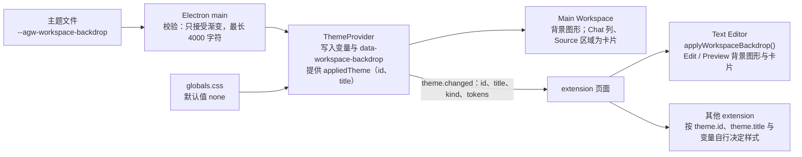

# 工作区几何背景与主题名称

## 名词解释

- **工作区背景**：主题变量 `--agw-workspace-backdrop` 的值，由 CSS 渐变组成的背景图形。
- **卡片**：主题提供工作区背景时显示内容的圆角区域，四周露出背景图形。
- **主题名称**：`ThemeInfo` 中正在使用的主题的 `id` 与 `title`。
- 其余名词（主题、主题变量、Mode、主题 extension、Main Workspace、`theme.apply()` 等）沿用 `2026-10-23-Desktop主题.md`、`2026-10-16-Desktop-Extension.md`。

## 背景

- Warm Minimalism 主题参考的产品插画中，内容放在悬浮的白色卡片上，卡片四周是浅桃色大圆、浅灰斜面与珊瑚橙光晕组成的几何背景。
- 用户希望整个 Desktop 的 Main Workspace 呈现这种背景；extension 的页面由 extension 自己决定外观：可以使用主题定义的 CSS 变量，并且知道当前主题的名称。
- 现有主题变量只有颜色、长度、字体三类值，无法表达背景图形；extension 收到的 `ThemeInfo` 只有 `kind` 与 `tokens`，不知道当前是哪个主题。

## 设计目标

### 功能目标

1. 主题新增变量 `--agw-workspace-backdrop`，值为 `none` 或 CSS 渐变。
2. Desktop 的 Main Workspace：变量不为 `none` 时显示背景图形，宿主绘制的 Chat 列与文件 Source 区域显示为卡片；为 `none` 时外观与排版保持现状。
3. `ThemeInfo` 增加 `id` 与 `title`：extension 通过 `theme.get()`、`theme.onDidChange` 得到当前主题的名称，结合 `theme.tokens` 或 `theme.apply()` 写入的变量，为自己的页面决定样式。
4. Text Editor 的 Edit 与 Preview 自己绘制背景图形与卡片。
5. Warm Minimalism 在浅色与深色下提供几何背景。

### 技术目标

- **主题文件只是数据**：背景只接受渐变函数，`url()` 等会加载资源的图片函数不合法。
- **失败直接抛出**：不合法的值让主题文件校验失败，与其他变量的处理相同。
- **立即生效**：切换主题或 Mode 时，宿主页面与已打开的 extension 页面立即更新，不重建 frame。
- **性能**：主题没有提供背景时，背景与卡片规则不匹配任何元素，编辑与聊天时的样式计算不受影响。
- **兼容**：`manifestVersion` 仍为 1；`ThemeInfo` 的新字段是增量；没有设置这个变量的主题与没有使用它的 extension 不受影响；Web 不变。

## 总体设计



## 数据库设计

不涉及。

## 详细设计

### 1. 主题变量 `--agw-workspace-backdrop`

- `desktop/src/shared/theme-tokens.ts`：`ThemeTokenKind` 增加 `image`，变量清单增加 `--agw-workspace-backdrop`（类型 `image`）。`THEME_TOKEN_NAMES` 随之包含它，宿主通过 `theme.tokens` 推送给所有 extension。
- 校验（`desktop/src/main/extensions/extension-theme-file.ts`）：
  - 用 css-tree 解析值，顶层只能是渐变函数（`linear-gradient`、`radial-gradient`、`conic-gradient` 以及对应的 `repeating-` 形式）、`none` 与层之间的逗号，并且整体匹配 `background-image` 的属性语法（属性语法不含 CSS-wide 关键字）。`url()`、`image-set()`、`cross-fade()`、`element()`、`var()` 与 CSS-wide 关键字都不合法，错误码为 `INVALID_THEME_VALUE`。
  - 多层渐变的文字很长，这个变量的长度上限为 4000 字符（`MAX_THEME_IMAGE_VALUE_LENGTH`），其他变量仍为 200（`MAX_THEME_VALUE_LENGTH`）；超出时错误码为 `INVALID_FIELD`。
- 默认值：Desktop `renderer/src/app/globals.css` 的 `:root` 声明 `--agw-workspace-backdrop: none`，构建检查 `check-theme-tokens.mjs` 确认它在构建的 CSS 中有定义。

### 2. Desktop Main Workspace

- `ThemeProvider`（`renderer/src/runtime/appearance/theme-provider.tsx`）在写入主题变量的同一次修改中，按 `hasWorkspaceBackdrop(appliedTokens)`（变量存在且不为 `none`）设置或去掉 `<html>` 的 `data-workspace-backdrop`，与变量在同一帧生效；卸载时去掉属性。属性名与判断函数位于 `resolve-theme.ts`（`WORKSPACE_BACKDROP_ATTRIBUTE`、`hasWorkspaceBackdrop`）。
- 样式位于 Desktop 的 `globals.css`，不在 cascade layer 中：Tailwind 的 utility 位于 `utilities` layer，组件 layer 中的规则不能覆盖 Chat 列的 `max-w-3xl`、`min-h-full` 等尺寸，不在 layer 中的规则可以。Web 不加载这些规则，`<html>` 上也没有这个属性。
  - `:root[data-workspace-backdrop] .agw-main-workspace`：`background-image: var(--agw-workspace-backdrop)`。背景属于 Main Workspace 本身，不随 Chat 滚动。
  - Chat 列 `.agw-chat-column` 与文件 Source 区域 `.agw-file-source` 为卡片：背景 `--card`，文字 `--card-foreground`，圆角 `--radius-xl`，阴影由一圈 1px 的 `--border`（60%）与一层柔和投影（`--color-black` 18%）组成。卡片内的 `--background`、`--foreground` 指向卡片颜色，输入框区域的渐变、输入框与 Source 的行号栏等使用 `bg-background` 的元素与卡片一致；Desktop 侧栏已经用同样的方式连接侧栏变量。
  - `.agw-chat-column-area`（Chat 列外层）的内边距为 16px：Chat 列在其中拉伸，内容少时卡片高度为 Main Workspace 高度减去上下 32px，内容多时随内容增高并在底部留出 16px；窄窗口时两侧至少留出 16px。输入框区域 `.agw-chat-composer` 的下边角与卡片相同。
  - `.agw-file-source` 的外边距为 16px，卡片内部滚动，圆角裁剪滚动的内容。
- 共享组件增加的类名：`@agw/chat` 的 `chat.tsx` 中 `agw-chat-column-area`、`agw-chat-column`、`agw-chat-composer`；`@agw/projects` 的 `file-content.tsx` 中 `agw-file-source`。类名只供 Desktop 的样式使用，Web 的外观不变。
- 文件标题行、extension 视图标题行、Chat 旁的用量面板与空状态位于背景图形之上。extension 视图是叠在宿主页面上的 `WebContentsView`，由 extension 自己绘制，宿主背景不会透过；宿主与 extension 页面各自按自己的区域定位渐变，两处图形各自独立。

### 3. 主题名称（`ThemeInfo.id`、`ThemeInfo.title`）

- `@agw/extension-sdk` 的 `ThemeInfo` 增加：
  - `id`：Default 为 `"default"`，extension 提供的主题为 `"{extensionId}:{themeId}"`，与 `settings.json` 中 `appearance.theme` 的格式相同。
  - `title`：Default 为 `"Default"`，extension 提供的主题为 manifest 中 `contributes.themes` 的 `title`。
- `ThemeProvider` 提供 `appliedTheme`：选中且可用的主题的 `id` 与 `title`；没有选中或选中的主题不可用时为 Default。它与 `appliedTokens` 一致，表示变量正在使用的主题。
- `extension-host-provider.tsx` 的 `readTheme(kind, appliedTheme)` 把 `id`、`title` 与变量一起放入 `ThemeInfo`；推送在 `appliedTheme` 变化时同样执行。`ExtensionHost` 在第一次推送之前使用 Default 的 `id` 与 `title`。`welcome` 与 `theme.changed` 都带有这两个字段。
- extension 用法：`api.theme.get().id`、`api.theme.get().title` 读取当前主题，`api.theme.onDidChange` 在主题变化时收到新的 `ThemeInfo`；调用 `theme.apply()` 后页面上有全部主题变量。按主题名称使用自己的样式是 extension 的选择，宿主不强制。

### 4. Text Editor 的背景与卡片

- `src/shared/workspace-backdrop.ts` 的 `applyWorkspaceBackdrop(api)`：Edit 与 Preview 在 `onLoad` 中紧接 `theme.apply()`、`applyHighlightTheme(api)` 调用。`theme.tokens["--agw-workspace-backdrop"]` 存在且不为 `none` 时在页面的 `html` 上设置 `data-workspace-backdrop`，否则去掉；之后在每次 `theme.onDidChange` 时更新。`theme.apply()` 的监听器先注册，同一次推送中变量先写入、属性后更新，两者在同一帧生效。
- Edit：滚动区域 `.edit-scroll` 使用背景图形，背景相对滚动区域定位，不随内容滚动；内容列 `.edit-column` 成为卡片：`margin: 32px auto 48px`，最大宽度 `min(856px, 100% - 32px)`，内边距与拖动手柄的位置保持现状。
- Preview：`body` 使用背景图形，`background-attachment: fixed`，`min-height: 100vh`，内边距 `32px 16px 48px`；`.markdown-body` 成为相同样式的卡片。
- 卡片的颜色、圆角与阴影与宿主卡片相同。没有 `data-workspace-backdrop` 时规则不匹配任何元素：集成测试的性能阶段（Default 主题）中，631 KiB 表格文档的按键耗时有无这些规则分别为 52.8 ms 与 52.6 ms，在测量波动范围内。
- Code 查看器不变：Monaco 自行绘制编辑器背景。

### 5. Warm Minimalism 的几何背景

`packages/extensions/warm-minimalism-theme/themes/warm-minimalism.json` 的 `light` 与 `dark` 各设置一个六层渐变，从上到下依次为：

- 右下角的珊瑚橙光晕：`radial-gradient(30vmax 18vmax at 86% 100%, …, transparent 70%)`。
- 三个浅桃色圆：顶部偏右（半径 `20vmax`，圆心 `58% 4%`）、右侧中部（`16vmax`，`96% 56%`）、左下大圆（`34vmax`，`18% 86%`）；色标在 99% 到 100% 之间过渡，边缘清晰平滑。
- 两个浅灰斜面：右侧 62° 的斜带（64% 到 80%）与左上角 120° 的三角（0 到 16%）。

浅色使用带透明度的浅桃色、浅灰与珊瑚橙；深色保持相同的形状，颜色换为深暖棕与深暖灰，光晕透明度降低。圆的大小使用 `vmax`，随所在页面的尺寸缩放。卡片使用主题的 `--card`：浅色为 `#fffefc`，深色为 `#23201d`。

## 接口文档

- 主题文件：增加可选变量 `--agw-workspace-backdrop`，例如：

```json
{
  "light": {
    "--agw-workspace-backdrop": "radial-gradient(circle 20vmax at 58% 4%, rgb(251 229 216 / 85%) 0 99%, transparent 100%), linear-gradient(120deg, rgb(230 226 221 / 85%) 0 16%, transparent 16.1%)"
  }
}
```

- `ThemeInfo`（`welcome.theme`、`theme.changed`、`theme.get()`），新增 `id` 与 `title`，例如：

```json
{
  "id": "warm-minimalism-theme:warm-minimalism",
  "title": "Warm Minimalism",
  "kind": "light",
  "tokens": { "--background": "#f7f4f0", "--agw-workspace-backdrop": "radial-gradient(…)" }
}
```

- `ThemeInfo.tokens`：增加 `--agw-workspace-backdrop`，Default 下为 `none`。

## 测试计划

### 单元测试

- 渐变值：`none`、单层与多层渐变、`repeating-linear-gradient`、`conic-gradient`、色标中使用 `color-mix()` 的渐变均合法；`url()`、`image-set()`、`cross-fade()`、`element()`、CSS-wide 关键字、`var()`、颜色值、带其他背景属性值（`no-repeat`）的值均不合法；长度超过 200 且不超过 4000 的渐变合法，超过 4000 时报 `INVALID_FIELD`。
- 内置 Warm Minimalism 主题文件通过校验；推送给 extension 的变量包含 `--agw-workspace-backdrop`。
- `ThemeProvider`：`appliedTheme` 在没有选中主题时为 Default，选中主题时为它的 `id` 与 `title`；只有提供背景的主题在设置背景的 Mode 下给 `<html>` 加上 `data-workspace-backdrop`，切换到其他 Mode、其他主题、Default 或卸载时去掉。
- `readTheme` 带有正在使用的主题的 `id` 与 `title`；`welcome.theme` 带有这两个字段。
- `applyWorkspaceBackdrop`：当前主题没有背景时不设置属性；推送带渐变的主题后设置属性，再推送 `none` 后去掉；调用时当前主题已有背景则立即设置。

### 集成测试

使用 `pnpm --filter @agw/desktop test:extensions`：

- 选择 Warm Minimalism 与 Light：extension 的 `theme.get()` 返回 `["warm-minimalism-theme:warm-minimalism", "Warm Minimalism"]`；`<html>` 有 `data-workspace-backdrop`，Main Workspace 的 `background-image` 为渐变；Chat 列背景为 `rgb(255, 254, 252)`、圆角 `18px`，其中的 `--background` 为 `#fffefc`，外层内边距 `16px`，输入框区域下边角 `18px`；Source 区域背景为 `rgb(255, 254, 252)`、外边距 `16px`。
- 打开 `readme.md`：Edit 中 `.edit-scroll` 为渐变背景，`.edit-column` 为卡片（上边距 `32px`）；Preview 中 `body` 为渐变背景且每一层的 `background-attachment` 都为 `fixed`，`.markdown-body` 为卡片。
- 不离开页面切换到 Dark：Preview 的背景包含 `rgba(58, 40, 31, 0.7)`，卡片背景为 `rgb(35, 32, 29)`。切换到 Default：Preview、Edit 与 Main Workspace 都没有背景图形，卡片背景透明，圆角、边距与内边距为 `0px`，`<html>` 没有属性，extension 收到 `["default", "Default"]`。再切换回 Warm Minimalism：Edit 与 Main Workspace 显示深色背景与卡片。整个过程中 frame 没有重建。

### 回归测试

- `pnpm --filter @agw/desktop test`、`typecheck`、`lint`；Text Editor、Excalidraw、`@agw/extension-sdk`、`@agw/chat`、`@agw/projects` 的 `typecheck` 与 `test`。
- Default 与 Soft 下 Main Workspace、Edit、Preview 的排版与颜色保持现状（集成测试中原有的 Chat、Edit 字号、拖动手柄、Preview 相关检查继续通过）。
- 性能阶段：有无背景规则时各文档的打开与按键耗时在测量波动范围内。
