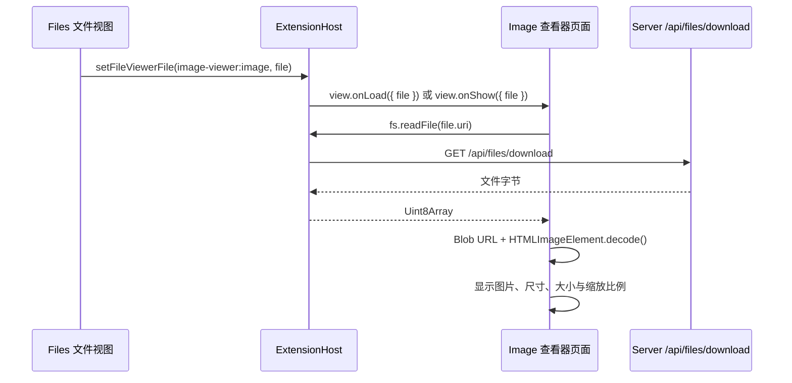
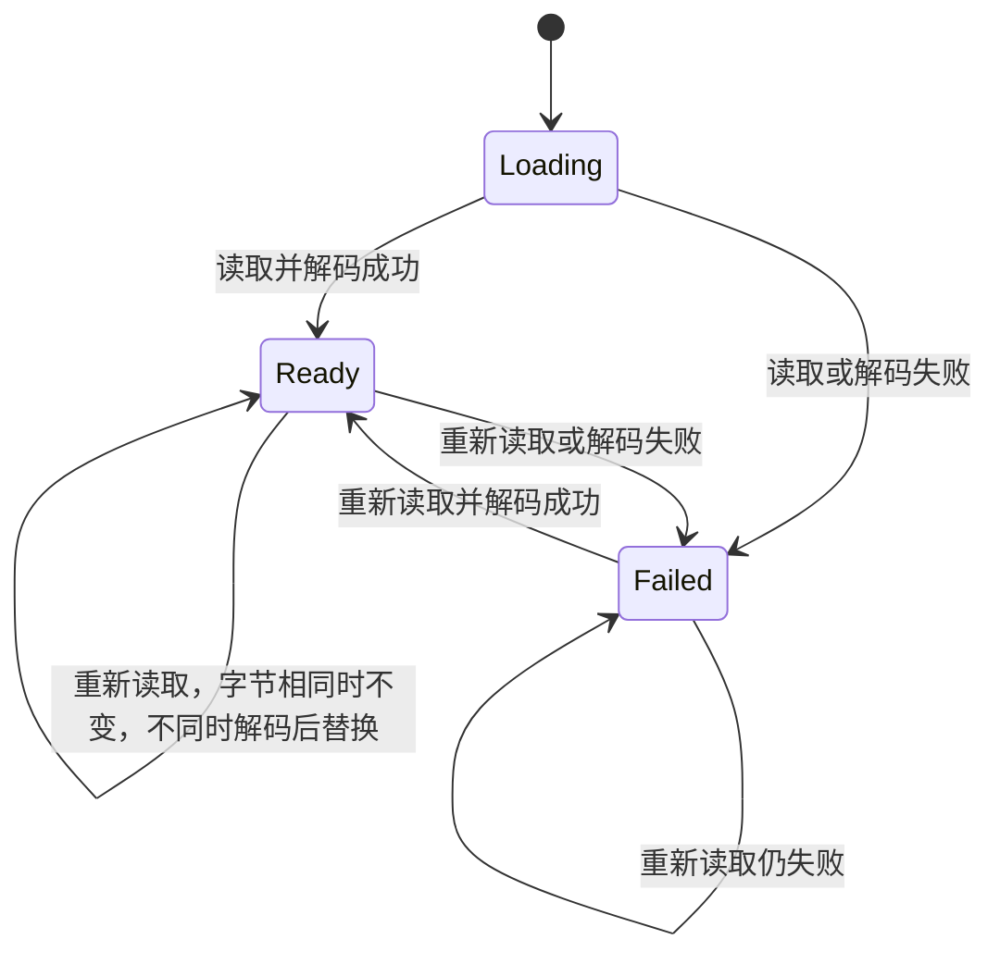

# Desktop 图片查看器

## 名词解释

- **Image Viewer**：本方案新增的内置 extension，id 为 `image-viewer`。
- **Image 查看器**：Image Viewer 注册的文件查看器，宿主中的 id 为 `image-viewer:image`。
- **显示区**：Image 查看器中显示图片、可以滚动的区域，不含底部状态栏。
- **缩放比例**：图片显示宽度与像素宽度之比，1 表示一个图片像素对应一个 CSS 像素。
- 其余名词（文件查看器、内置 extension、frame 等）沿用 `2026-10-18-Desktop-内置Extension与文件查看器.md`。

## 背景

Files 的文件视图中，图片文件只匹配 Text Editor 的 Code 查看器（`patterns` 为 `*`）与 Source：Code 显示 "This file is binary, so it can't be edited as text."，Source 把文件字节当作文字显示。Agent 在 Project 中生成的图片（例如 `outputs/*.png`）无法在 Desktop 中查看。

## 设计目标

### 功能目标

1. 内置 extension Image Viewer：为常见图片格式注册 Image 查看器。
2. 读取与显示：读取文件、解码、显示读取或解码失败的说明；查看器再次显示时重新读取文件。
3. 缩放与平移：默认适应显示区；按钮缩放、实际大小、适应显示区；`Ctrl`/`Cmd` + 滚轮与触控板捏合按指针位置缩放；拖动与滚动平移。
4. 状态栏：像素尺寸、文件大小、缩放比例与缩放按钮。
5. 外观：使用宿主主题变量，透明像素下显示棋盘格。

### 技术目标

- **安全**：只声明 `fs.cloud.read`，不声明 `hostPermissions`，不访问网络。图片由 Blob URL 交给 `` 显示：`` 中的 SVG 不执行脚本、不加载外部资源。extension 页面的 CSP（`img-src 'self' data: blob:`）已允许 Blob URL，宿主不需要修改。
- **资源**：替换图片、切换文件或卸载页面时调用 `URL.revokeObjectURL`；切换文件时中止进行中的读取。
- **大小**：云端文件经 `/api/files/download` 读取，单个文件不超过 100 MiB（Server 的限制），超过时显示读取失败的说明。
- **兼容**：只新增一个内置 extension，`manifestVersion`、Extension API 与宿主代码不变。

## 总体设计



查看器按 `2026-10-18-Desktop-内置Extension与文件查看器.md` 的规则排序：Image 查看器的 `priority` 为缺省的 `default`，Code 为 `option`，图片文件的切换按钮依次为 Image、Code、Source，默认显示 Image。

## 数据库设计

不涉及。

## 详细设计

### 1. 包与 manifest

- 包：`src/clients/packages/extensions/image-viewer`（`@agw/extension-image-viewer`），结构与 Excalidraw 相同：`manifest.json`、`index.html`、`src/`、`vite.config.ts`（把 `manifest.json` 输出到 `dist/`，`@agw/extension-sdk` 映射为 `/__agw/sdk.js`）。`desktop/scripts/build-bundled-extensions.mjs` 按目录发现并校验它，构建脚本不需要修改。
- 依赖：devDependencies 只有 `@agw/extension-sdk`、`react`、`react-dom`、`@vitejs/plugin-react`、`vite`，全部来自 catalog。
- manifest：

```json
{
  "manifestVersion": 1,
  "id": "image-viewer",
  "name": "Image Viewer",
  "version": "1.0.0",
  "description": "Shows image files in the Files view.",
  "author": "Agw",
  "contributes": {
    "fileViewers": [
      {
        "id": "image",
        "title": "Image",
        "icon": "Image",
        "patterns": ["*.png", "*.apng", "*.jpg", "*.jpeg", "*.jfif", "*.gif", "*.webp", "*.avif", "*.bmp", "*.ico", "*.svg"],
        "entry": "index.html"
      }
    ]
  },
  "permissions": ["fs.cloud.read"]
}
```

- `patterns` 是 Chromium 的 `` 能解码的格式。按扩展名取 MIME 类型：`png` → `image/png`，`apng` → `image/apng`，`jpg`/`jpeg`/`jfif` → `image/jpeg`，`gif` → `image/gif`，`webp` → `image/webp`，`avif` → `image/avif`，`bmp` → `image/bmp`，`ico` → `image/x-icon`，`svg` → `image/svg+xml`。SVG 的 Blob 必须带 `image/svg+xml` 才能显示；位图格式带上正确的类型。扩展名不在表中时抛出错误（manifest 只把这些扩展名交给查看器）。

### 2. 读取与显示

页面入口：

- `onLoad(api, { file })`：调用 `api.theme.apply()`，渲染 `ImageViewer`。
- `onShow({ file })`：同一个文件（`uri` 相同）时版本号加 1，查看器重新读取文件并保留缩放；另一个文件以 `key = uri` 重新挂载，从适应显示区开始。宿主在查看器从隐藏变为显示（例如从 Source 切换回 Image）与文件切换时发送 `onShow`。
- `onUnload`：卸载 React 根节点。

`ImageViewer` 的状态：



- 读取：`api.fs.readFile(file.uri, { signal })`。文件或版本号变化时中止上一次读取。
- 重新读取：读到的字节与正在显示的图片相同时什么都不做；不同时先解码，成功后替换，旧的 Blob URL 随之释放。解码完成之前继续显示旧图片，不出现空白。
- 解码：用字节与 MIME 类型创建 Blob URL，赋给新的 `HTMLImageElement` 并等待 `decode()`；成功后得到 `naturalWidth`、`naturalHeight`。`decode()` 失败时释放 URL。
- 显示：
  - Loading：`Loading {文件名}…`。
  - Failed（读取）：标题 `Could not read {文件名}`，第二行为错误信息。
  - Failed（解码）：标题 `Could not display {文件名}`，第二行为 `The file is not a valid image, or its format is not supported.`。
  - Ready：显示区与状态栏（第 3、4 节）。

### 3. 缩放与平移

全部计算是纯函数（`src/zoom.ts`），组件只负责事件与 DOM。

- **布局**：显示区四周留 `PADDING = 16` 像素。缩放比例为 `s`、图片像素尺寸为 `w × h`、显示区可见尺寸为 `W × H` 时，内容区尺寸为 `max(W, w·s + 2·PADDING) × max(H, h·s + 2·PADDING)`，图片在内容区中居中。内容区大于显示区时显示区可以滚动。
- **适应显示区**：`fit = min(1, (W − 2·PADDING) / w, (H − 2·PADDING) / h)`，结果不大于 1，小图按实际大小显示。缩放模式为 `fit` 时显示区尺寸变化后重新计算；用户缩放后模式变为固定比例，尺寸变化时比例不变。
- **测量显示区**：`W × H` 是 `clientWidth × clientHeight`，不含滚动条。窗口等外部原因引起的变化由 ResizeObserver 报告；内容区变大使常显的滚动条出现（或变小使它消失）时 ResizeObserver 不报告，所以每次 React 提交后在 layout effect 中重新测量，尺寸变化时以新尺寸重新渲染，直到尺寸稳定。滚动条只因内容区大于显示区而出现，内容区随测量结果缩小后多余的滚动条随之消失，测量在两三次提交内稳定。
- **缩放档位**：`ZOOM_LEVELS = [0.05, 0.1, 0.25, 0.5, 0.75, 1, 1.5, 2, 3, 4, 6, 8, 12, 16, 20]`。放大取大于当前比例的第一个档位，缩小取小于当前比例的最后一个档位，没有档位时对应按钮不可用。比较时允许 `1e-6` 的误差。
- **滚轮与捏合**：`wheel` 事件带 `ctrlKey` 或 `metaKey` 时缩放（触控板捏合在 Chromium 中是带 `ctrlKey` 的 `wheel` 事件），监听器为非 passive 并调用 `preventDefault()`。`deltaMode` 为行时乘以 16，为页时乘以显示区高度；新比例为 `s · exp(−deltaY / 300)`，限制在 `[min(0.05, fit), 20]`。不带修饰键的 `wheel` 由浏览器滚动显示区。
- **按指针位置缩放**：缩放前后，指针下的图片点位置不变。设缩放前布局中图片左边位置为 `L0`、滚动位置为 `x0`，指针在显示区中的横坐标为 `a`，则该点的图片坐标 `u = (x0 + a − L0) / s0`（`imagePointUnder`）；缩放后图片左边位置为 `L1`，新的滚动位置为 `L1 + u · s1 − a`，再限制在 `[0, 内容区宽度 − W]`（`scrollToPoint`）。纵向相同。按钮缩放以显示区中心为指针位置。
- **等待中的缩放**：缩放时记录新比例、图片点 `u` 与指针位置 `a`，滚动位置在新比例提交且显示区尺寸稳定后的 layout effect 中按当时的 `W × H` 计算并设置，滚动条出现后图片点仍然准确地停在指针下。连续的滚轮事件在上一次缩放应用之前到达时，以等待中的比例与它对应的滚动位置为起点。
- **平移**：内容区大于显示区时，按住左键拖动显示区按位移滚动（`setPointerCapture`），光标为 `grab`/`grabbing`；图片设置 `draggable={false}`。
- **像素显示**：比例不小于 3 时图片使用 `image-rendering: pixelated`，放大后可以看清单个像素；小于 3 时使用浏览器默认的平滑缩放。

### 4. 状态栏

显示区下方 26 像素高的状态栏，样式与 Code 查看器的状态栏相同：

- 左侧：像素尺寸 `{w} × {h}`，文件大小（`B`、`KB`、`MB`，保留一位小数，与文件树相同）。
- 右侧：`−`（Zoom out）、缩放比例（`Math.round(s · 100)%`）、`+`（Zoom in）、`Fit`（Fit to window，模式为 `fit` 时 `aria-pressed` 为 true）、`1:1`（Actual size）。

### 5. 外观

- 页面背景与文字使用 `var(--background)`、`var(--foreground)`，状态栏使用 `var(--border)`、`var(--muted-foreground)`，按钮的悬停与按下使用 `var(--accent)`、`var(--accent-foreground)`，字号为 `var(--agw-font-size-base)`。
- 图片元素的背景为 8 像素方格的棋盘格，两种颜色由 `color-mix()` 从 `--foreground` 与 `--background` 计算，深浅色主题都清楚可见，只在透明像素下可见。

## 测试计划

### 单元测试

`pnpm --filter @agw/extension-image-viewer test`（Node test runner + tsx）：

- `fitScale`：小图为 1；宽图、高图按比例较小的一边适应，四周留 PADDING；很小的显示区结果仍大于 0。
- `layoutImage`：图片小于显示区时内容区等于显示区，图片居中；大于时内容区为图片加两侧 PADDING。
- `zoomIn`/`zoomOut`：在档位上、档位之间取相邻档位；两端返回 null。
- `wheelScale`：向上滚动放大、向下缩小；行与页按规则换算；结果限制在 `[min(0.05, fit), 20]`。
- `imagePointUnder`：居中的小图与放大滚动后的图片返回正确的图片像素坐标。
- `scrollToPoint`（与 `imagePointUnder` 组合为缩放）：指针下的图片点位置不变；结果限制在可滚动范围内；图片小于显示区时为 0。
- `imageMimeType`：manifest 的每个 pattern 都有 MIME 类型；扩展名不区分大小写；未知扩展名抛出错误。
- `formatFileSize` 与文件树的格式相同；`sameBytes` 比较长度与每个字节。

### 集成测试

`pnpm --filter @agw/desktop test:extensions`：

- 测试项目增加 `images/broken.png`（文字内容）与 `images/shape.svg`（200 × 100）。
- 首次启动时 Image Viewer 为 Active，已批准的权限为 `fs.cloud.read`。
- 打开 `images/logo.png`（1024 × 1024）：切换按钮为 Image、Code、Source，默认选中 Image；`` 的 `naturalWidth` 为 1024；状态栏显示 `1024 × 1024` 与文件大小；缩放比例等于按显示区尺寸计算的适应比例。
- `1:1` 后比例为 100%，显示区可以滚动且滚动位置使图片中心位于显示区中心；`+` 后为 150%，`−` 后回到 100%；带 `Ctrl` 的滚轮改变比例；拖动使滚动位置按位移变化；`Fit` 后回到适应比例且不能滚动。
- 打开 `images/broken.png` 显示 `Could not display broken.png`。
- 打开 `images/shape.svg`：切换按钮为 Image、Code、Source，状态栏显示 `200 × 100`；在磁盘上改为 300 × 150 后切换到 Source 再切换回 Image，状态栏显示 `300 × 150`。

### 回归测试

- `pnpm test`（工作区边界检查与全部包的 typecheck、test）。
- `test:extensions` 的其他步骤全部通过；文件查看器的顺序检查不受影响（Markdown、Excalidraw、TypeScript 文件不匹配 Image 查看器）。
