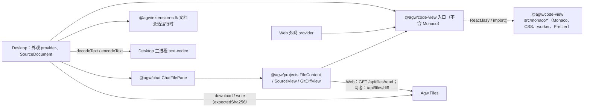

# Files 的 Monaco Source 与 Diff

## 名词解释

- **Source**：Files 文件视图中宿主内置的查看方式，每个文件都有。Web（`/chat`）与 Desktop 使用同一套界面；Desktop 中可以编辑并保存，Web 中只读。
- **Only diff**：Files 的 diff 模式，按 git 暂存区范围（scope）显示文件的改动：`staged` 为 HEAD 与 index，`unstaged` 为 index 与工作区，缺省为 HEAD 与工作区。
- **行评论**：用户在 Source 或 diff 的某一行写下的评论（`LineComment`），发送消息时作为 `<file_comments>` 附加在文字后面。
- **行区域**：编辑器中某一行下方插入的一块区域，用来显示行评论。
- **文档会话**：一个文件的读取、编码、未保存状态、保存、冲突处理与刷新。extension 通过 `api.documents.openText` 使用；Desktop 的 Source 使用同一套状态转换与运行时。
- **code-view**：工作区包 `@agw/code-view`，提供 Monaco 编辑器、diff 查看器与状态栏。

## 背景

Source 原来由 `@agw/projects` 的 `file-viewer.tsx` 自绘：每一行都渲染为 DOM，没有语法高亮、查找与折叠，大文件打开很慢。Only diff 由 `diff-viewer.tsx` 解析 unified diff 文本，只显示 hunk。

Desktop 的 Text Editor extension 用 Monaco 提供 Code 查看器，可以编辑并保存文本文件。Source 与 Code 同时存在时，两者的布局与功能不同：Code 铺满主区、带状态栏、可以编辑；Source 只读、带行评论，工作区背景主题下显示在卡片中。用户需要在两者之间切换。

本方案让 Source 的布局与功能与 Code 相同，然后删除 Code：

- `2026-10-18-Desktop-文本文件编辑.md` 第 6 节（Code 查看器）由本方案取代；该文档的目标之一"Web 的打包结果中没有 Monaco 与 Tiptap 编辑器"也随之改变：Web 在第一次显示 Source 或 diff 时按需加载 Monaco 的 chunk，首屏打包结果中仍然没有 Monaco。
- `2026-10-22-Text-Editor设置.md` 中的 Code font size 移到 Desktop 的 Appearance 设置。

## 设计目标

### 功能目标

1. Source 使用 Monaco，布局与 Code 相同：编辑器铺满文件标题行以下的区域，工作区背景主题下没有卡片，底部为状态栏。
2. Desktop 的 Source 可以编辑，功能与 Code 相同：保存（More 菜单与 `Cmd/Ctrl+S`）、未保存标记与保存状态、识别编码并按原编码、BOM 与换行写回、Reopen with Encoding 与 Save with Encoding、切换换行与语言、Format（Prettier 与 JSON 语言服务）、Word wrap、JSON 校验、保存冲突与磁盘变化的处理、二进制文件与无法识别编码的说明面板、切换文件与关闭窗口时确认放弃修改。
3. Web 的 Source 只读，布局与 Desktop 相同；状态栏显示光标、缩进、换行与语言，不显示编码。
4. Only diff 改为只读的 Monaco DiffEditor：左右两栏显示两侧全文，未改动的区域折叠，只保留改动附近的 3 行。
5. 行评论保留在 Source 与 diff 中；`LineComment` 的字段与 Chat 的使用方式不变。可编辑的 Source 中，评论跟随代码的编辑移动。
6. Server 的 `/api/files/diff` 返回两侧全文与二进制标记，响应在 OpenAPI 中有类型。
7. 外观：编辑器颜色与 Code 相同，跟随宿主主题与深浅色；字体为宿主等宽字体；Desktop 的字号来自 Appearance 中新增的 Code font size，Web 为 `0.875rem`。
8. 删除 Text Editor extension 的 Code 查看器；Text Editor 设置删除 Code font size。

### 技术目标

- **按需加载**：Monaco、它的 CSS 与 worker 只在第一次显示 Source 或 diff 时加载；Prettier 只在 Desktop 第一次显示可编辑的 Source 时加载。`window.MonacoEnvironment` 在此之前不存在。
- **构建**：Web 开发与 e2e（webpack）、Web 生产静态导出（Turbopack）、Desktop renderer（webpack）三种构建都能处理 Monaco 的 CSS、字体与 worker；Monaco 不能退回主线程运行 worker 代码。
- **边界**：只有 `@agw/code-view` 可以引用 `monaco-editor` 与 `prettier`；只有 `@agw/projects`、Web 与 Desktop 可以引用 `@agw/code-view`，Mobile 无法间接引入 Monaco。`@agw/code-view` 不依赖 `@agw/extension-sdk` 与 Desktop。
- **一致性**：Source 与 extension 的文档会话使用同一个状态转换（`document-state.ts`）与运行时（`documents.ts`），冲突、刷新、排队、通知与保存状态的规则相同。
- **安全**：Desktop 的 Source 经 `/api/files/download` 与 `/api/files/write`（带 `expectedSha256` 写入前提）读写，编码转换由主进程的 text-codec 完成；Web 不提供写入。

## 总体设计



- `@agw/code-view` 负责编辑器、文本模型、状态栏中与编辑器有关的部分、Format 与行区域，不了解评论、文件读写与编码。
- `@agw/projects` 负责文件标题行、Source 与 diff 的组合、评论、说明面板与编码菜单。
- Desktop 负责可编辑文档：文档会话、文件读写、编码转换、确认窗口、未保存检查与保存状态。

## 数据库设计

不涉及。

## 详细设计

### 1. `@agw/code-view` 包

位置 `src/clients/packages/code-view`，`exports` 为 `.`（`./src/index.ts`）、`./text-model`（`./src/text-model.ts`）与 `./code-view.css`。`dependencies` 为 `monaco-editor` 与 `prettier`（catalog），React 与 React DOM 为 catalog peer 依赖。

- **入口（不引用 Monaco，也不引用它的类型）**：`index.ts`、`types.ts`、`appearance.tsx`、`code-viewer.tsx`、`code-diff-viewer.tsx`、`popup-button.tsx`、`line-remap.ts`。`CodeViewer` 与 `CodeDiffViewer` 用 `React.lazy(() => import("./monaco/..."))` 加载实现，只在客户端挂载后渲染。
- **`@agw/code-view/text-model`**：`loadCodeTextModel()` 用 `import()` 加载文本模型的实现，只有 Desktop 引用；Web 的模块图中没有这个 `import()`，webpack 开发构建不会在首屏带上 Monaco 的 CSS。
- **实现（`src/monaco/`）**：`setup.ts`、`editor.worker.ts`、`json.worker.ts`、`languages.ts`、`host-appearance.ts`、`text-model-impl.ts`、`status-bar.tsx`、`formatting.ts`（Prettier）、`use-document-formatting.ts`、`line-zones.ts`、`line-zone-action.ts`、`overlay-geometry.ts`、`code-viewer-impl.tsx`、`code-diff-viewer-impl.tsx`。

**Monaco 模块**：`setup.ts` 导入 `editor/editor.api` 与 Code 原来使用的全部编辑器功能（查找、折叠、括号匹配、多光标、行操作、注释、缩进、建议、片段、悬停、链接、格式化动作、Go to Line 等快速访问、粘贴与拖放、sticky scroll、Unicode 高亮等），以及 `basic-languages/monaco.contribution`（各语言的语法在第一次使用时加载）与 `languages/features/json/register`。不导入 `editor.main`，不包含 TypeScript、CSS、HTML 的语言服务。

- JSON 校验与 Code 相同：`validate: true`、`allowComments: true`、`trailingCommas: "ignore"`、`schemaValidation: "ignore"`、`enableSchemaRequest: false`。
- `Shift+Alt+F` 绑定 `editor.action.formatDocument`，条件为 `editorTextFocus && !editorReadonly`。

**Worker**：`self.MonacoEnvironment.getWorker` 只接受 `editorWorkerService`（diff 计算等）与 `json` 两个 label，其他 label 抛出错误。worker 用 `new Worker(new URL("./editor.worker.ts", import.meta.url), { type: "module" })` 创建，webpack 与 Turbopack 都按这个写法输出独立的 worker 文件。

**语言识别**：`languages.ts` 中的 `detectLanguage(fileName, languages)`（从 Code 移入）：先找 `filenames` 中与文件名相同的一项（不区分大小写），再找文件名结尾匹配的最长扩展名，都不匹配时为 `plaintext`。只读与可编辑的模型都用它，model URI 仍为 `agw-code-view://<实例 id>/<文件路径>`，用于区分模型。

**编辑器选项**：

- Source 与 Code 相同：`automaticLayout`、关闭 minimap、`scrollBeyondLastLine: false`、`wordWrap` 跟随 Word wrap，其他选项为独立 Monaco 的默认值（没有 glyph margin，有折叠）；`fixedOverflowWidgets: true`，右键菜单与建议列表不被容器裁剪。Web 的只读 Source 另加 `readOnly`、`domReadOnly`。
- Diff：`readOnly`、`domReadOnly`、`originalEditable: false`；`renderSideBySide: true`、`useInlineViewWhenSpaceIsLimited: false`（原始侧的评论需要左侧编辑器）；`enableSplitViewResizing: true`；`ignoreTrimWhitespace: false`（与 git 一致）；`hideUnchangedRegions: { enabled: true, contextLineCount: 3, minimumLineCount: 3, revealLineCount: 20 }`；`renderGutterMenu: false`、`renderMarginRevertIcon: false`。
- 只读模型收到同一个文件的新文字时，`setValue` 前后保存并恢复 view state；切换文件或 scope 时重新创建编辑器。

### 2. 外观

`host-appearance.ts` 在编辑器容器上读取计算后的值：

- 颜色与 Code 相同：`editor.background` ← `--background`；`editor.foreground` ← `--foreground`；`editorLineNumber.foreground` ← `--muted-foreground`；`editor.selectionBackground` ← `--sidebar-primary`（alpha 0x40）。其他颜色（菜单、建议列表、查找框、diff 的增删）沿用基础主题。颜色值可能是 `oklch(...)` 或 `color-mix(...)`：先用 `CSS.supports("color", value)` 检查，再画到 1×1 canvas 上读回像素，转为 `#rrggbbaa`；缺少变量或不是颜色时抛出错误。
- 主题名为 `agw-light`（基于 `vs`）与 `agw-dark`（基于 `vs-dark`），`inherit: true`；深浅色以 `html` 上的 `dark` class 为准。
- 字体为容器 `font-family` 的计算值（`font-mono`，即宿主的 `--font-mono`）；字号为容器 `font-size` 的计算值，CSS 中为 `var(--agw-font-size-code, 0.875rem)`。行高不设置，取 Monaco 按字号计算的默认值，与 Code 相同。值不是 px 时抛出错误。
- `CodeViewAppearanceProvider({ revision })` 由宿主放在主题 provider 之内，`revision` 变化后下一帧重新读取并应用。Web 传 next-themes 的 `resolvedTheme`；Desktop 传 `useDesktopTheme().publishedTheme`，它在模式、JSON 主题、CSS 主题、字号与工作区背景变化后都会更新。

### 3. 布局与状态栏

Source 区域（`.agw-file-source`）在文件标题行以下铺满主区，自上而下为编辑器与状态栏。Desktop `globals.css` 的工作区背景规则只作用于 Chat 列，不再作用于 `.agw-file-source`，所以 Source 与 Only diff 都没有卡片与外边距，编辑器背景等于主区背景，与原来的 Code 相同。

状态栏（`status-bar.tsx`）高 26px，上边框为 `--border`，文字为 `--muted-foreground`、`0.875em`，项目靠右排列，与 Code 相同：

- **光标**：`Ln 3, Col 5`，有选区时加 `(12 selected)`；
- **缩进**：`Spaces: 4` 或 `Tab Size: 4`；
- **编码**：可编辑时为编码菜单（宿主提供的节点），只读时不显示；
- **换行**：可编辑时为按钮，点击在 `LF` 与 `CRLF` 之间切换并成为未保存修改；只读时为文字；
- **语言**：按钮，打开语言列表，选择后改变高亮。

按钮与弹出菜单的外观与 Code 相同：按钮高 24px、圆角 `--radius-md`，悬停与展开时为 `--accent`；菜单在按钮上方，宽度至少 200px、最高 320px，背景 `--popover`，点击外部或按 `Esc` 关闭。

### 4. 文件标题行

`FileContent` 的标题行：文件名、保存状态，右侧为查看器切换（有 extension 查看器时）与 "More" 菜单。

- 有 extension 查看器时显示切换按钮，Source 有未保存修改时在它的按钮前显示 `●`。
- "More" 菜单在没有 extension 查看器时也显示。选中 Source 时，刷新与 Source 的条目依次为：
  - **Reload file**：Desktop 中为文档会话的 `reload`（有未保存修改时先确认放弃）；Web 中重新读取文件；
  - **Format**：只在 Desktop，编辑器提供格式化程序时可用；
  - **Word wrap**：勾选项，Web 与 Desktop 都有，切换文件后保持；
  - **Save**：只在 Desktop，有未保存修改时可用。
- 选中 Source 时，文件名后的保存状态来自 Source 的文档会话（`Saved`、`Unsaved changes`、`Saving…`、`Changed on disk` 与 Reload 按钮），规则与 extension 查看器相同。
- 查看器说明、默认查看器设置与其他条目的规则不变。

### 5. 可编辑的 Source（Desktop）

#### 5.1 文本模型

`loadCodeTextModel(): Promise<CodeTextModel>` 加载 Monaco 并创建一个文本模型对象，供文档会话的适配器与编辑器共用。它的规则与原来的 `CodeDocument` 相同：

- `load(text, eol, file)`：模型属于同一个文件时 `setValue`（同时清空撤销历史）；换了文件时用 `detectLanguage` 创建新模型、通知编辑器换模型、释放旧模型；最后设置换行。
- `snapshot()` 与 `matches(snapshot)` 使用 `getAlternativeVersionId()`，撤销到基线时恢复为已保存；`serialize()` 为全文；`version()` 为 `getVersionId()`；`eol()` 为模型的换行。
- `onDidChangeContent(listener)` 在每次内容变化后调用，`onDidChangeModel(listener)` 在换了文件之后调用；`dispose()` 释放模型。

模型在 Source 切换到其他查看器时保留，切回 Source 时编辑器重新挂载到同一个模型，未保存的修改与撤销历史都在。

#### 5.2 文档会话运行时

`@agw/extension-sdk` 的 `documents.ts` 改为依赖一个平台接口：

```ts
type DocumentPlatform = {
  readFile(uri: string): Promise<Uint8Array>; // 冲突与刷新时读取哈希
  showMessageBox(options: MessageBoxOptions): Promise<number>;
  notifyError(message: string): void;
  setUnsavedChanges(unsaved: boolean): Promise<void>;
};
```

- `openDocumentSession(platform, host, kind, options, port)` 由 SDK 入口导出；`openTextDocument` 与 `openBinaryDocument` 用 `ExtensionApi` 组成平台接口与读写端口后调用它，extension 的行为不变。
- 保存快捷键由调用方决定：extension 页面在 `window` 上监听；Desktop 的 Source 传 `saveShortcut: false`，由 Source 区域处理（5.4 节）。

#### 5.3 `SourceDocument`

位于 Desktop renderer（`runtime/source/source-document.ts`），一个 Files 视图同一时间最多一个：

- **读取**：`CloudFileSystem.readFile({ kind: "host" }, uri)` 得到字节，`bridge.decodeText(bytes, encoding)` 识别或按指定编码解码，得到文字、编码、BOM、换行与哈希；
- **写入**：`bridge.encodeText(text, { encoding, bom, eol })` 编码，`CloudFileSystem.writeFile` 写入：`expectedSha256` 为字符串时覆盖写入并检查写入前提，为 null 时只创建；成功后文件树按写入的路径刷新（与 extension 的写入相同）；
- **哈希**：读取字节后计算 SHA-256；
- **消息框**：冲突（Overwrite、Reload、Cancel）与放弃修改（Discard、Cancel）显示在主进程的确认窗口中，来源为宿主（5.5 节）；文档释放时撤回等待回答的消息框；
- **通知**：错误显示为宿主的 toast；
- **未保存与保存状态**：写入 `ExtensionHost`（5.5 节），Files 视图由此显示标题行的状态与 `●`。

生命周期：

- 第一次显示 Source 时创建（先加载文本模型，再打开会话）；之后在 Source 与其他查看器之间切换都保留；
- 选中的文件变化时调用 `session.show(file)`：切换文件之前宿主已经确认放弃修改（5.5 节），会话切换到新文件并读取；
- 每次显示 Source 时对当前文件调用 `session.show(file)`，规则与 extension 查看器相同：只在没有未保存修改时读取，磁盘内容变化时读入新内容；有未保存修改时保留修改、不读取；读取期间出现编辑时不替换内容，磁盘内容变化时显示 `Changed on disk`；
- 关闭 Files 视图、切换 Project、目录或连接时释放。

Chat 工作区在 Desktop 中不再为 Source 调用 `/api/files/read`：`ChatWorkspaceProvider` 的 `readSourceContent` 为 false 时，选中文件只更新选择，内容由 `SourceDocument` 读取。Only diff 仍由 Chat 工作区读取 diff。

#### 5.4 Source 区域的交互

- 读取中显示 "Loading {name}…"；失败时显示说明面板（与 Code 相同）：标题 `Could not read {name}`；`ERR_NOT_TEXT` 为 "This file is binary, so it can't be edited as text."；`ERR_UNKNOWN_ENCODING` 为 "The encoding of this file couldn't be detected." 并提供 "Reopen with Encoding…" 与编码列表。编辑器在这两种状态下隐藏但保持挂载。
- 编码菜单：按钮显示编码名称（带 BOM 时加 ` with BOM`），菜单项 "Reopen with Encoding…" 与 "Save with Encoding…" 打开编码列表；保存时 UTF-8、UTF-16LE、UTF-16BE 另有 "with BOM" 一项。
- 焦点在 Source 区域中时，`Cmd+S`（macOS）或 `Ctrl+S`（其他平台）保存，判断规则与 SDK 的 `isSaveShortcut` 相同。
- 新打开的文件显示后编辑器获得焦点。
- Format：文件名受 Prettier 支持时，为模型的语言注册 Prettier 格式化（按模型的缩进设置）；JSON 使用 JSON 语言服务的格式化；Prettier 失败时显示错误，内容不变。

#### 5.5 宿主的未保存检查与确认窗口

- `ExtensionHost` 增加宿主自身的未保存文件：`setSourceUnsaved(fileName | null)`。`hasUnsavedChanges()`（窗口关闭前的检查）与 `confirmDiscardUnsaved()`（切换文件、切换 Server、重新加载视图前的确认）都包括它。
- 确认窗口的请求标明来源，替换原来的 `extensionId`、`extensionName` 字段：

```ts
type ConfirmationOrigin =
  | { kind: "host" }
  | { kind: "extension"; extensionId: string; extensionName: string };
```

  `discard-unsaved` 的每一项与 `message` 都带 `origin`。宿主来源的放弃修改显示为 `guide.md · Source`；宿主来源的消息框标题与来源行为 "Agw Desktop"。
- `CloudAccess` 改为 `{ kind: "host" } | { kind: "extension"; extensionId; permissions }`，宿主的读写不经过 extension 的权限与授权检查。

### 6. 行区域与 "Add comment"

`@agw/code-view` 提供通用的行区域，`@agw/projects` 用它显示评论：

- `LineZone { key; afterLineNumber }`、`LineZoneAction { label; canRun(line); run(line) }`；
- `CodeViewSideProps { lineZones; renderLineZone(zone); markedLines; lineZoneAction }`。

每个行区域按 VS Code ZoneWidget 的做法由三部分组成：

1. **view zone**：空的 `domNode`，`heightInPx` 为内容高度，通过 `onDomNodeTop` 得到它在编辑器中的位置；
2. **overlay widget**：位置为 `null`，只作为锚点；
3. **frame**：锚点中由我们定位的元素，`top` 取自 `onDomNodeTop`，`left` 与 `width` 由 `overlay-geometry.ts` 根据 `contentLeft`、宽度、竖向滚动条与 minimap 计算，并在 `onDidLayoutChange`（含拖动 diff 分隔条）时更新。

内容放在 overlay 中，横向滚动时不随代码移动。`ResizeObserver` 观察 frame，高度变化后更新 `heightInPx` 并调用 `layoutZone`。React 内容通过 `createPortal` 渲染进 frame。同一个 key 的 `afterLineNumber` 变化时，修改 view zone 的 `afterLineNumber` 并调用 `layoutZone`，frame 与其中的 React 内容保留。

**键盘隔离**：锚点上注册原生 `keydown`、`keyup`、`keypress` 监听并调用 `stopPropagation()`；React 已在 portal 容器上处理过事件，评论框的 `Ctrl/Shift/Meta+Enter` 与 `Esc` 照常工作，Monaco 收不到这些按键。

**"Add comment"**：编辑器没有 glyph margin，按钮（`codicon-add`，16×16）放在另一个位置为 `null` 的 overlay widget 中，显示在鼠标所在行的行号列左侧，滚动与布局变化时重新对齐；只在 `canRun(line)` 时显示，鼠标移到按钮上时保持显示，按下时调用 `run(line)`，编辑器的焦点与选区不变。`editor.addAction` 在右键菜单中提供同名操作，作用于光标所在行；`markedLines` 中的行用整行装饰标出。行号列、行装饰区与内容区的位置因此与原来的 Code 相同。

**diff 两侧对齐**：DiffEditor 计算对齐时会计入非它自己创建的 view zone，所以一侧的评论区域会在另一侧的对应位置得到同样高度的空白。

**评论跟随编辑**：可编辑的编辑器在每次内容变化（`isFlush` 为 false）后，把 `IModelContentChangedEvent.changes` 转为 `{ startLineNumber, endLineNumber, insertedLineCount }` 交给 `onDidChangeLines`。`line-remap.ts` 的 `remapLine(line, changes)` 按事件中从后向前的顺序处理每个改动：

- 行号小于等于改动的起始行：不变；
- 行号大于改动的结束行：加上 `insertedLineCount - (endLineNumber - startLineNumber)`；
- 行号在改动范围内（起始行之后）：变为 `startLineNumber + min(line - startLineNumber, insertedLineCount)`。

`@agw/projects` 用它更新当前文件 `current` 一侧的评论行号与正在新增评论的行。读入文件或放弃修改（`isFlush` 为 true）不改变行号。行区域的 key 为该行第一条评论的 id（正在新增、还没有评论的行为 `new`），行号变化时评论框不重新挂载，输入中的文字保留。

### 7. `@agw/projects` 的改动

- `line-comments.ts`（纯函数）：判断评论是否属于当前目标（文件、目录、项目、side、diffScope），按行分组，新增评论，按 `remapLine` 更新当前目标的行号。
- `use-line-comment-zones.tsx`：为一个目标生成 `lineZones`、`markedLines`、"Add comment" 操作（`canRun` 为该行没有评论）、`renderLineZone`（蓝色强调条与 `CommentSection`）与 `onDidChangeLines`。
- `source-view.tsx`：Web 为只读 `CodeViewer`；Desktop 为可编辑 `CodeViewer` 加读取中与失败的面板、编码菜单与保存快捷键。
- `source-document.ts`：`SourceDocumentState`，Desktop 交给 `FileContent` 的可编辑文档：文本模型、会话状态（`loading`、`clean`、`dirty`、`saving`、`conflict`、`failed`）、保存状态、未保存标记、编码、错误，以及 `save`、`reload`、`reloadChanged`、`reopenWithEncoding`、`saveWithEncoding`、`listEncodings`、`isSaveShortcut`。
- `git-diff-view.tsx`：
  - `isBinary`：显示 "Binary file" 与 `diff` 文字；
  - `unchanged`：显示 "No changes detected"，下方是 `originalContent ?? modifiedContent ?? ""` 的只读查看器，side 为 `original`；
  - 两侧文字相同而 `diff` 不为空（例如只改了文件模式）：用 `<pre>` 显示 `diff`；
  - 其他情况：`CodeDiffViewer`，标题沿用 HEAD / Staged、Staged / Working Tree、Original / Modified，某一侧不存在时 `present` 为 false。
- `file-content.tsx`：标题行按第 4 节显示；主体容器为 `.agw-file-source flex min-h-0 flex-1 flex-col overflow-hidden`；`ErrorBoundary`（`FileError` 显示错误，`resetKeys` 为文件、模式与 scope）包住 `GitDiffView` 或 `SourceView`。
- 删除 `diff-parser.ts`（及其测试）、`diff-viewer.tsx`、`file-viewer.tsx`、`unchanged-file.tsx` 以及 `types.ts` 中只被它们使用的类型，更新 `file-explorer/README.md`。

### 8. Server：diff 的两侧全文

- `Abstracts/Dtos/GitResults.cs`：`GitDiffResult` 改为 `(bool Success, string Diff, string? Error)`；新增 `GitBlobSource { Head, Index }` 与 `GitBlobResult(bool Success, string? Content, string? Error)`。
- `IGitCommandService.ReadBlobAsync(string filePath, GitBlobSource source, CancellationToken)`。`GitCommandService` 以 `FindGitDirectory` 的结果为基准计算相对路径，对象名为 `HEAD:<path>` 或 `:0:<path>`：
  - `git rev-parse --verify --quiet <spec>` 退出码为 1：该侧没有这个文件，返回成功与 `null`；
  - 退出码为 0：`git cat-file blob <spec>` 读取内容；
  - 其他退出码：失败，带 stderr。
- `GetDiffAsync` 保留 untracked 文件的 `--no-index` 比较。
- `FileDiffOutput` 为 `sealed class`，属性为 required init：`Diff`、`Unchanged`、`IsBinary`、`OriginalContent`、`ModifiedContent`。
- `FileAppService.DiffAsync` 在现有校验之后：原始侧 `unstaged` 读 index，其他 scope 读 HEAD；修改侧 `staged` 读 index，其他 scope 通过项目文件系统读取工作区（`ExistsFileAsync` 为 false 时为 `null`）；`Unchanged` 为 diff 文字为空白；任一侧前 8000 个字符中有 `'\0'` 时 `IsBinary` 为 true，两侧内容为 `null`；git 失败时返回 `Invalid("Git diff failed", error)` 并记录结构化日志。

### 9. Desktop 的 Code font size

- `AppearanceSettings` 增加 `codeFontSize: number | null`（12 到 28 的整数，与原来 Text Editor 的范围相同），null 时为基础字号 × 0.875，按 0.5px 四舍五入。`settings-store.ts` 的 schema 中这个字段可以缺失，缺失时为 null。
- `resolveAppearance` 增加 `--agw-font-size-code`，写在根元素上。
- Appearance 设置页在 Chat font size 之后增加 "Code font size"，选项为 Default 与 12 到 28。

### 10. 删除 Code 查看器

- Text Editor 的 manifest 删除 `code` 查看器，删除 `code.html`、`src/code/`、`monaco-editor` 与 `prettier` 依赖以及 Vite 的 worker 配置。
- Text Editor 设置的 schema 升为 `schemaVersion: 2`，只有 `documentFontSize`；读取 `schemaVersion: 1` 的文件时丢弃 `codeFontSize`，下次保存时写为 2。设置页删除 Code font size。
- 匹配所有文件的查看器只剩 Source：Markdown 为 Mixed、Preview、Source；`.excalidraw` 为 Excalidraw、Source；图片为 Image、Source；其他文件只有 Source，标题行不显示切换按钮。用户设置中值为 `text-editor:code` 的默认查看器不再匹配，按顺序选中第一个查看器。

### 11. 边界规则

- `.dependency-cruiser.cjs`：
  - `monaco-only-in-code-view`：`packages/code-view` 以外的代码不能引用 `node_modules/monaco-editor` 与 `node_modules/prettier`；
  - `code-view-monaco-behind-lazy-import`：`packages/code-view/src/` 中 `src/monaco/` 以外的文件只能用 `import()` 引用 `src/monaco/`、`monaco-editor` 与 `prettier`；
  - `code-view-importers`：只有 `packages/projects`、`packages/code-view`、`web`、`desktop` 能引用 `packages/code-view`。
- `tools/scripts/check-client-boundaries.mjs`：只有 `@agw/code-view` 能声明 `monaco-editor` 与 `prettier`；只有 `@agw/projects`、`@agw/web`、`@agw/desktop` 能声明 `@agw/code-view`。
- Web 与 Desktop 的 `transpilePackages` 加入 `@agw/code-view`。

## 接口文档

### 基础信息

与其他 Files 接口相同：Bearer 认证，响应为 Bens.Results 信封，参数在 query 中。

### 接口列表

**GET `/api/files/diff`**（修改接口）

- 参数不变：`projectId`（必填）、`path`、`scope`（`staged`、`unstaged`，缺省为 HEAD 与工作区）、`directoryId`。
- 响应 `data` 为 `FileDiffResponse`：

```json
{
  "diff": "diff --git a/src/app.ts b/src/app.ts\n...",
  "unchanged": false,
  "isBinary": false,
  "originalContent": "export const a = 1;\n",
  "modifiedContent": "export const a = 2;\n"
}
```

- `originalContent`、`modifiedContent` 为 `null` 表示该侧没有这个文件，或文件是二进制。
- 删除字段 `message`。`diff` 保留，Mobile 继续使用。
- 客户端执行 `pnpm gen:api`，`GitDiffResponse` 为生成的 `FileDiffResponse` 类型。

Desktop 的 Source 使用现有的 `GET /api/files/download` 与 `PUT /api/files/write`（`overwrite`、`expectedSha256`），接口不变。

## 测试计划

### 单元测试

- `@agw/code-view`（Node）：`overlay-geometry` 的位置与宽度；`remapLine` 的插入、删除、范围内与多个改动；`detectLanguage`；Prettier 支持判断与格式化（从 Code 移入）。
- `@agw/projects`（Node）：`line-comments` 的匹配、分组、新增与行号更新。
- `@agw/extension-sdk`：现有文档会话测试不变，验证运行时改为平台接口后 extension 的行为相同。
- Desktop：确认窗口按 `origin` 显示宿主与 extension 的来源；`resolveAppearance` 与设置 schema 的 `codeFontSize`；`SourceDocument` 的读写端口（编码、BOM、换行、写入前提、文件树刷新）；`ExtensionHost` 的未保存检查包括 Source。
- Text Editor：设置 schema 2 与读取 schema 1 的文件。
- `Agw.Files.Tests`：`ReadBlobAsync` 与 `DiffAsync` 在临时 git 仓库中的结果；`ProjectDirectoryTests` 的两侧内容；`/api/files/diff` 的 JSON 字段。

### 集成测试

- `@agw/code-view` 浏览器测试（Vite 构建测试页，Playwright Chromium）：worker 与 diff 装饰；颜色转换与字号变量；行区域、键盘隔离与 diff 对齐；可编辑模型的编辑、撤销到基线、换行切换、语言切换、状态栏、Word wrap、Format（Prettier 与 JSON）与 `onDidChangeLines`。
- `@agw/projects` 浏览器测试：Source 与 diff 的评论；可编辑 Source 中评论随编辑移动、`Cmd/Ctrl+S`、标题行的 Format、Word wrap、Save 与保存状态、读取中与失败面板、编码菜单。
- Web e2e（webpack 开发服务器与 Turbopack 静态导出）：打开文件前没有 Monaco；只读 Source 的高亮、状态栏与 Word wrap；diff 的 worker；评论；深色。
- Desktop `test:extensions`（每次运行前征得确认）：原来针对 Code 的步骤改为 Source：Format 与 Save、高亮与 worker、JSON 校验、CRLF 与 BOM、UTF-16LE 与 GB18030、无法编码的字符与 Save with Encoding、二进制与未识别编码的面板、冲突与磁盘变化、切换文件时确认放弃修改、Code font size 与主题；工作区背景主题下 Source 没有卡片；查看器顺序不再有 Code；performance 阶段测量 Source 打开 `perf/large.ts`。

### 回归测试

- `pnpm test`（边界检查、全部包的 typecheck 与 test）、`pnpm lint`、`pnpm fmt:check`。
- `pnpm --filter @agw/desktop build:renderer`（含 `check-theme-tokens`）。
- `dotnet test tests/Agw.Files.Tests`、`dotnet test tests/Agw.Architecture.Tests`。
- Mobile 只读取 `diff` 字段，行为不变。
