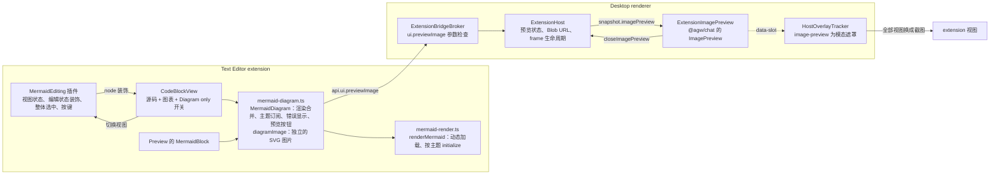
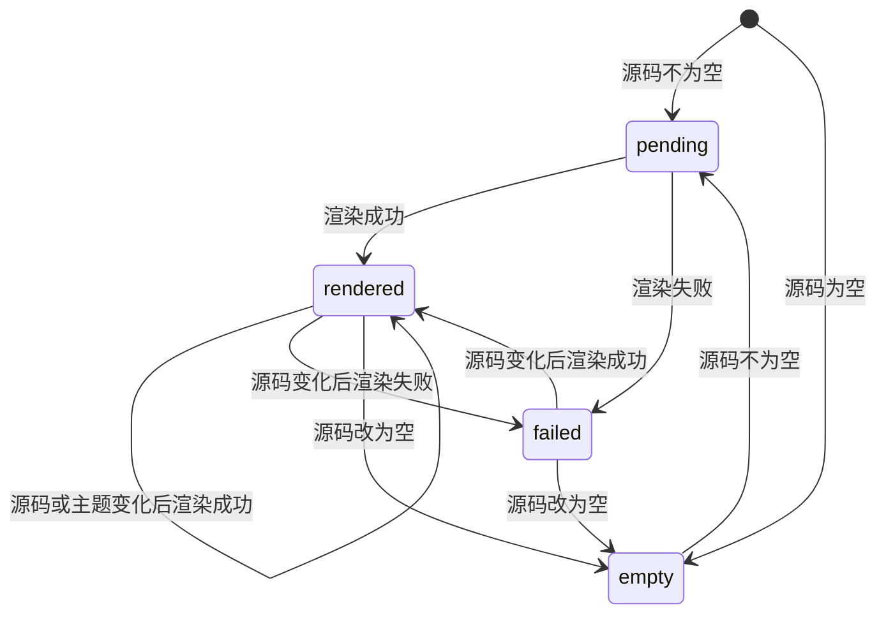
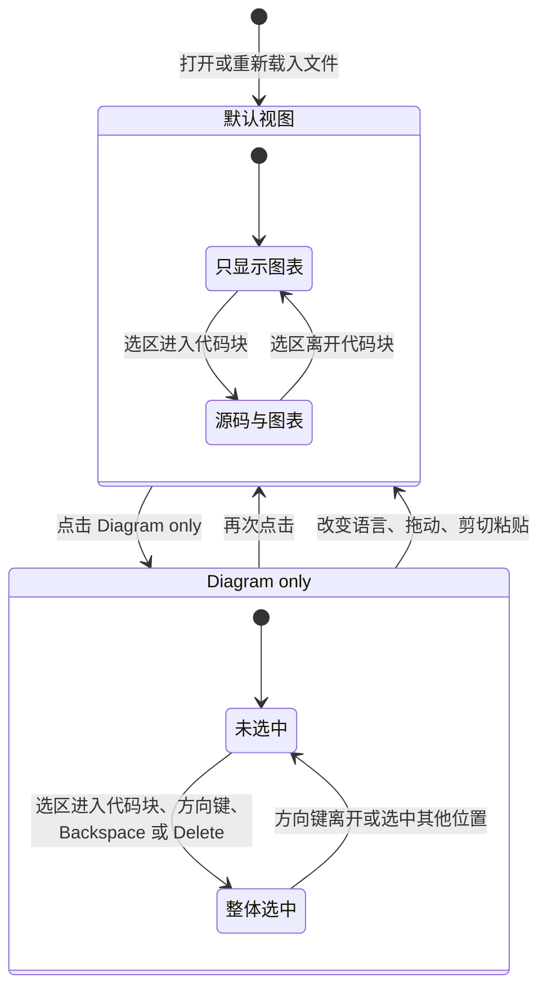
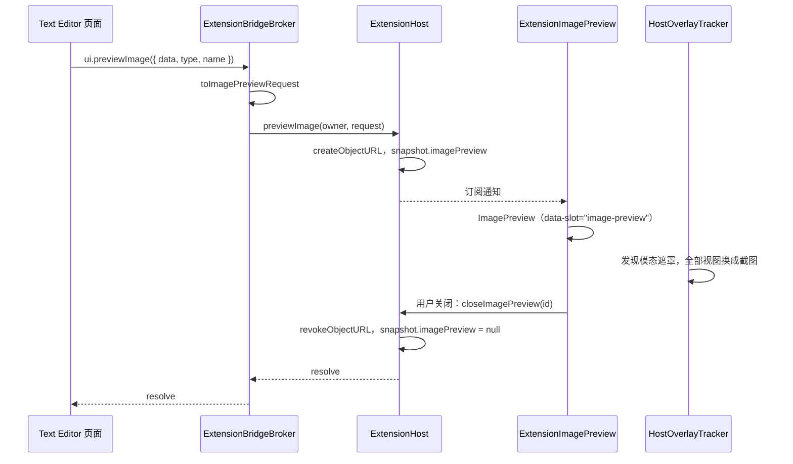

# Markdown Mermaid 图表渲染

## 名词解释

- **Mermaid 代码块**：info 的第一个词为 `mermaid`（不区分大小写）的 fenced code block，例如 ` ```mermaid `。
- **Edit**、**Preview**：Text Editor extension 的两个 Markdown 查看器，见 `2026-10-18-Desktop-文本文件编辑.md`。
- **默认视图**：Edit 中 Mermaid 代码块打开文件时的视图。显示图表，代码块处于编辑状态时同时显示源码。
- **"Diagram only" 视图**：Edit 中 Mermaid 代码块只显示图表的视图，由代码块标题栏的 "Diagram only" 开关切换。
- **编辑状态**：Edit 中选区的一端（`$from` 或 `$to`）在某个默认视图的 Mermaid 代码块内，这个代码块处于编辑状态。
- **整体选中**：选区为选中整个代码块的 `NodeSelection`，与选中图片相同。
- **全局图片预览**：Desktop 宿主在整个窗口上显示的图片预览，与对话中点击图片打开的预览相同（深色背景、底部的缩放控件、右上角的关闭按钮）。

## 背景

Edit 与 Preview 把 Mermaid 代码块显示为普通代码：Edit 的语言选择显示 `mermaid`，内容没有高亮；Preview 输出 `<pre><code class="language-mermaid">`。用户在文档中只能看到源码，看不到图表。Mermaid 是 Markdown 文档中常用的图表写法，GitHub 等平台会把它显示为图表。

用户在此基础上要求：Edit 中保留默认视图，另外提供只看图表的视图；图表可以点击后放大、缩小、平移，Edit 与 Preview 都使用与对话图片预览相同的全局弹窗。extension 页面在各自的 `WebContentsView` 中，只能在自己的区域内绘制，覆盖整个 Desktop 窗口的预览需要由宿主显示，因此新增 Extension API `ui.previewImage`。

## 设计目标

### 功能目标

1. Preview 把 Mermaid 代码块显示为图表。
2. Edit 默认视图显示图表；代码块处于编辑状态时同时显示源码与图表，输入时图表随之更新。点击图表，光标放到源码末尾；方向键可以从相邻的块进入源码隐藏的代码块。
3. Edit 的 "Diagram only" 视图：只显示图表，光标不进入源码，代码块像图片一样整体选中。视图不写入 Markdown，打开文件时为默认视图。
4. 全局图片预览：Preview 与 "Diagram only" 视图中点击图表、每个图表右上角的预览按钮（默认视图中点击图表进入源码，因此通过按钮预览），都由宿主在 Desktop 窗口上显示图表：滚轮与按钮缩放，拖动平移，右键菜单复制或另存图片，点击背景或 Esc 关闭。
5. Extension API `ui.previewImage(image)`：任何 extension 的视图都可以请求宿主显示一张图片（PNG、JPEG、GIF、WebP、AVIF、BMP、SVG）。
6. 源码有错误时显示 mermaid 给出的错误信息。默认视图与 Preview 同时显示源码。
7. 图表随宿主主题的深浅切换；预览的图片带主题的背景色。

### 技术目标

- **安全**：使用 `securityLevel: "strict"`。mermaid 用 DOMPurify 清理输出的 SVG，并禁用 `click` 回调等交互。文档中的 `%%{init: ...}%%` 指令不能修改 `securityLevel`、`suppressErrorRendering` 等配置（它们属于 mermaid 的 `secure` 配置项）。宿主用 `` 显示 extension 提供的图片，SVG 中的脚本与外部资源在图片中不执行、不加载；图片的类型、大小与名称都在 broker 中检查。
- **CSP**：extension 页面的 CSP 为 `script-src 'self' 'wasm-unsafe-eval'`、`style-src 'self' 'unsafe-inline'`。mermaid 12.0.0 及其依赖（d3、dagre-d3-es、chevrotain、langium、cytoscape、elkjs、katex）不使用 `eval` 或 `new Function`；SVG 中的 `<style>` 由 `'unsafe-inline'` 允许。
- **加载**：mermaid 体积很大，只在页面第一次渲染 Mermaid 代码块时用动态 `import()` 加载，Vite 把它输出为单独的 chunk；没有 Mermaid 代码块的文档不加载它。
- **写回不变**：Mermaid 代码块的 schema、解析与写回都不变。图表、视图与预览只用于显示；切换视图不修改文档，不进入撤销历史，文档仍为 clean。
- **输入时的渲染次数**：每个图表同时最多有一次渲染在进行；渲染期间的修改合并为结束后的一次渲染。
- **宿主资源**：预览的图片以 Blob URL 交给宿主页面，预览关闭、被替换或发出请求的页面关闭时释放。同一时间只有一个预览。
- **遮挡**：extension 视图是位于宿主页面之上的原生视图。预览打开时，所有 extension 视图都换成截图，预览始终在最上层。

## 总体设计



## 数据库设计

不涉及。

## 详细设计

### 1. 共用的渲染与图表

**`src/shared/mermaid-render.ts`**

- `isMermaidLanguage(language)`：`language` 转为小写后等于 `mermaid`。Edit 与 Preview 都用它判断 Mermaid 代码块。
- `renderMermaid(source, theme)`：返回 SVG 文字。
  - 第一次调用时 `import("mermaid")`，之后复用同一个模块。
  - 宿主主题 `kind` 为 `dark` 时使用 mermaid 的 `dark` 主题，否则使用 `default` 主题。主题与上一次 `initialize` 的不同时重新调用 `mermaid.initialize`：`{ startOnLoad: false, securityLevel: "strict", suppressErrorRendering: true, theme }`。mermaid 12 中 flowchart 等图表各自的默认主题为 `redux-color`，`initialize` 设置的顶层 `theme` 优先于它们，所有图表类型都使用这一对主题。
  - `suppressErrorRendering: true`：源码有错误时 mermaid 直接抛出错误，删除它在 `document.body` 中创建的临时元素，不生成错误图表。
  - 每次渲染使用新的 id `mermaid-diagram-{n}`（页面内递增）。SVG 中的样式以这个 id 为选择器，同一页面的多个图表 id 必须不同。
  - mermaid 的 `render` 在内部排队，多个图表的渲染依次执行。

**`MermaidDiagram`**（`src/shared/mermaid-diagram.ts`）：一个图表的显示，Edit 的 node view 与 Preview 的 React 组件共用，不使用 React。

- `dom`：`div.mermaid-diagram`，`contentEditable = false`。渲染成功时内容为 SVG 与右上角的预览按钮，失败时为 `div.mermaid-diagram-error`（错误的 `message`，等宽字体，保留换行；mermaid 的语法错误包含行号与出错位置）。
- `update(source)`：源码与上一次相同时不做任何事。
- 状态通过构造函数的回调告知使用方，使用方据此决定是否显示源码与点击图表的效果。



- `pending`：还没有任何渲染结果，图表区域为空。重新渲染期间保留上一次的结果，状态不回到 `pending`，图表不闪烁。
- **渲染合并**：`update` 记录最新的源码。没有渲染在进行时开始渲染；渲染期间收到的修改只记录，当前渲染结束后丢弃它的结果，用最新的源码再渲染一次。
- **主题**：构造时订阅 `api.theme.onDidChange`，主题变化时用当前源码重新渲染。
- **预览按钮**：`button.mermaid-diagram-open`（Lucide maximize-2 图标，`aria-label` 为 "Preview diagram"），只在 `rendered` 状态时放在图表区域中。它自己处理 `mousedown`（阻止默认行为，编辑器保持焦点与选区）与 `click`，并停止这两个事件继续传递，使用方对图表区域的处理收不到它们。点击时调用 `openPreview()`，失败用通知显示。
- `openPreview()`：读取根元素的 `--background`（主题提供，`theme.apply()` 写入），用 `diagramImage` 生成图片，调用 `api.ui.previewImage({ data, type: "image/svg+xml", name: "mermaid-diagram.svg" })`；用户关闭预览时完成。只用于 `rendered` 状态；其他状态或主题没有 `--background` 时抛出错误。
- `destroy()`：释放主题订阅；之后完成的渲染不再修改 DOM，也不调用回调。

**`diagramImage(svg, background)`**：页面中的 SVG 元素转换为独立的 SVG 文件（UTF-8 字节）。

- 复制元素，不改变页面中的图表。
- 按 `viewBox` 的原始大小设置 `width`、`height`，四周各留 16 px（`viewBox` 同时扩大），删除 mermaid 写在 `style` 中的 `max-width`。宿主按图片的原始像素计算缩放上限，原始大小使预览与对话图片的缩放范围一致。
- 在最前面加入铺满 `viewBox` 的 `rect`，`fill` 为 `background`。宿主预览的背景为深色，浅色主题的图表（深色文字、透明背景）需要自己的背景才能看清。
- 删除 `foreignObject` 中元素上作为普通属性留下的 `xmlns`：mermaid 输出的标签带有 `xmlns` 属性，经 HTML 解析后它不是命名空间声明，`XMLSerializer` 再按元素的命名空间输出声明时会重复，得到的 XML 无法解析。
- 用 `XMLSerializer` 输出，标签为 XHTML 命名空间的元素，图片中的 `foreignObject` 照常显示。

**共用样式**（`src/shared/mermaid-diagram.css`，Edit 与 Preview 的入口都导入）：图表区域没有内容时不占位置；SVG 居中，mermaid 输出的 SVG 宽度为 100%、`max-width` 为图表原本的宽度，超出内容列时按比例缩小；错误信息为等宽字体、保留换行，颜色为 `--destructive`；预览按钮只在鼠标悬停于图表或按钮有键盘焦点时显示。

### 2. Edit 默认视图

**CodeBlockView**（`src/editor/code-block-view.ts`）

- 语言为 Mermaid 时创建 `MermaidDiagram`，它的 `dom` 放在 `<pre>` 之后；内容变化时调用 `update(node.textContent)`；语言改为其他语言时销毁并移除；node view 销毁时一起销毁。
- `dom.dataset.diagram` 为图表的状态；处于编辑状态时 `dom` 带 `data-editing` 属性。
- **源码的显示**：状态为 `rendered` 并且不在编辑状态时隐藏 `<pre>`；其他情况都显示源码，因此源码有错误、源码为空或图表还没有渲染出来时，用户都能看到并修改源码。标题栏一直显示：语言选择在左，右侧为 "Diagram only" 开关（只在 Mermaid 代码块中显示，第 3 节）与 Copy。
- **点击图表**：图表区域的 `mousedown` 中阻止默认行为，把光标放到源码末尾并聚焦编辑器。`stopEvent` 对标题栏与图表区域的事件返回 `true`；`ignoreMutation` 已经忽略 `contentDOM` 之外的变化，SVG 的插入不会被当作文档修改。预览由右上角的按钮打开。

**MermaidEditing 插件**（`src/editor/mermaid-editing.ts`，加入 `createEditExtensions`）

- `decorations`：选区 `$from`、`$to` 所在的 textblock 是 Mermaid 代码块时，为它加 node 装饰，spec 为 `{ mermaidEditing: true }`。`CodeBlockView.update(node, decorations)` 根据它设置 `data-editing`。选区移出代码块时装饰消失，源码随之隐藏。
- `handleKeyDown`：源码隐藏时浏览器自带的光标移动会跳过隐藏的内容，插件处理进入 Mermaid 代码块的方向键：
  - 只处理没有修饰键的 `ArrowUp`、`ArrowDown`、`ArrowLeft`、`ArrowRight`，选区为空的 `TextSelection`，并且 `view.endOfTextblock(方向)` 为 `true`。
  - 向下、向右时从当前 textblock 之后，向上、向左时从它之前，用 `Selection.findFrom(位置, 方向, true)` 找到下一个文字位置。它所在的 textblock 是 Mermaid 代码块时选中它（向下、向右为源码开头，向上、向左为源码末尾）并返回 `true`；否则返回 `false`，由 ProseMirror 与浏览器处理。

**样式**（`edit.css`）

- `.code-block[data-diagram="rendered"]:not([data-editing]) > pre` 隐藏。
- `.mermaid-diagram`：内边距与源码一致，鼠标为文字光标（点击进入编辑）。处于编辑状态或渲染失败（源码与图表区域同时显示）时，图表区域上方加一条分隔线（`1px dashed`）。

### 3. Edit "Diagram only" 视图

**视图状态**（MermaidEditing 插件的 state）

- 插件状态为一个 `DecorationSet`，每个 "Diagram only" 视图的代码块有一个 node 装饰，spec 为 `{ mermaidView: "diagram" }`。每个事务按 `tr.mapping` 映射这些装饰，文档的其他修改不影响它们。`decorations` 把它们与编辑状态的装饰一起交给 node view。
- 切换：`setMermaidDiagramOnly(view, pos, diagramOnly)` 发出只带 meta 的事务，插件按 meta 增加或删除 `pos` 处的装饰。事务不修改文档：会话的修改计数不变，文档仍为 clean，撤销历史没有新的记录。
- 不写入 Markdown。载入文件（打开、Reload、按其他编码重新打开）时 `EditDocument` 用新的 `EditorState`，插件状态从空开始，所有代码块回到默认视图。
- 映射时代码块的边界被删除或替换的操作会让装饰失效，代码块回到默认视图：改变语言（`setNodeMarkup`）、拖动或剪切粘贴代码块、撤销这类操作。这些操作得到的代码块按新的代码块处理。

**CodeBlockView**

- 标题栏的 `button.code-block-view`，文字为 "Diagram only"，`aria-pressed` 表示当前视图，按下时与鼠标悬停相同的背景。点击时切换这个代码块的视图。
- 装饰中有视图装饰时 `dom.dataset.view = "diagram"`。这个视图中 `<pre>` 始终隐藏；源码有错误时图表区域只显示错误信息，用户切换回默认视图修改源码。
- 图表区域的 `mousedown` 阻止默认行为，不改变选区；`click` 在 `rendered` 状态时调用 `openPreview()`，失败用通知显示。鼠标为放大镜光标（`zoom-in`）。

**整体选中**（MermaidEditing 插件）

- `appendTransaction`：选区（`NodeSelection` 除外）的 `$from` 或 `$to` 在 "Diagram only" 视图的代码块中时，改为整体选中这个代码块。因此光标不会停在隐藏的源码中：在默认视图编辑时切换为 "Diagram only"、撤销恢复的选区、`setTextSelection` 等都会得到整体选中。整体选中的代码块显示 `2px solid var(--ring)` 外框，与选中的图片相同。
- 方向键进入：沿用第 2 节的处理，光标放进代码块后由 `appendTransaction` 改为整体选中。
- 方向键离开：整体选中 "Diagram only" 代码块时，没有修饰键的方向键把光标放到之后（向下、向右，`Selection.findFrom(代码块之后, 1, true)`）或之前（向上、向左，`Selection.findFrom(代码块之前, -1, true)`）的文字位置。
- Backspace 与 Delete：光标在 textblock 开头按 Backspace、在末尾按 Delete，并且这一侧紧邻 "Diagram only" 代码块时（用与 prosemirror-commands 的 `findCutBefore`、`findCutAfter` 相同的方法找到相邻节点），整体选中这个代码块。这个 textblock 为空并且与代码块同级时先删除它，与 ProseMirror 在图片等节点旁边的处理相同。ProseMirror 自己的 `joinBackward`、`joinForward` 会把相邻的文字合并进隐藏的源码，或把源码合并进相邻的 paragraph，并且改动代码块的边界使视图装饰失效，因此这里不交给它们。整体选中之后再按 Backspace 或 Delete 由 ProseMirror 删除整个代码块。



**样式**（`edit.css`）

- `.code-block[data-view="diagram"] > pre` 隐藏；`[data-view="diagram"][data-diagram="rendered"]` 的图表区域使用 `zoom-in` 光标；分隔线只用于默认视图。
- `.code-block-actions` 横向排列 "Diagram only" 与 Copy；`button[aria-pressed="true"]` 使用 `--accent` 背景。
- `.code-block.ProseMirror-selectednode` 的外框为 `2px solid var(--ring)`。

### 4. 全局图片预览

#### 4.1 Extension API（`@agw/extension-sdk`）

```ts
ui: {
  previewImage(image: PreviewImage): Promise<void>;
}

type PreviewImageType =
  "image/png" | "image/jpeg" | "image/gif" | "image/webp" | "image/avif" | "image/bmp" | "image/svg+xml";

interface PreviewImage {
  data: Uint8Array; // 1 字节到 32 MiB，ArrayBuffer 随调用转移给宿主
  type: PreviewImageType;
  name: string; // 1 到 255 个字符：替代文字与 "Save image as…" 的默认文件名
}
```

- 用户关闭预览时 resolve。同一时间只有一个预览：新的预览（来自任何视图）替换当前预览，被替换的调用 resolve。
- 发出调用的 frame 关闭时预览关闭，调用为 `ERR_FRAME_GONE`；页面被替换时预览关闭（旧页面的端口随之关闭，调用为 `ERR_CONNECTION_CLOSED`）。
- 只有视图可以调用，background 为 `ERR_UNSUPPORTED_OPERATION`。不需要权限：预览只在宿主窗口中显示 extension 自己提供的图片。
- 图片类型与主进程 "Save image as…" 支持的类型相同（`image-context-menu.ts`），BMP 之外都是常见的网页图片格式。

#### 4.2 broker（`extension-bridge-broker.ts`）

- `ui.previewImage`：background 连接直接为 `ERR_UNSUPPORTED_OPERATION`；参数经 `toImagePreviewRequest` 检查后交给 `options.previewImage(owner, request)`。
- 检查：参数为对象；`data` 为 `Uint8Array`、`buffer` 为 `ArrayBuffer`（排除 `SharedArrayBuffer`，`Blob` 只接受前者）、大小在 1 字节到 `MAX_PREVIEW_IMAGE_BYTES`（32 MiB）之间；`type` 属于 `PreviewImageType`；`name` 为 1 到 255 个字符。不符合时为 `ERR_INVALID_ARGUMENT`，消息说明哪一项不符合。

#### 4.3 ExtensionHost（`extension-host.ts`）

- `previewImage(owner, request)`：frame 不存在、正在关闭或页面已经替换时为 `ERR_FRAME_GONE`。否则先结束当前预览（它的调用 resolve），再用 `URL.createObjectURL(new Blob([data], { type }))` 生成 Blob URL，记录 `{ preview: { id, src, name }, frameId, pageId, resolve, reject }` 并发布 snapshot。`id` 在宿主中递增。
- `ExtensionHostSnapshot.imagePreview`：当前预览的 `{ id, src, name }`，没有时为 null。同一预览期间是同一个对象，其他状态变化时组件不会重新创建预览（缩放与位置不变）。
- `closeImagePreview(id)`：`id` 为当前预览时结束它，调用 resolve；其他 `id`（已经替换的预览）不做任何事。
- `dismissImagePreview(frameId, pageId?)`：在 `closeFrame` 与 `pageReplaced` 中调用，位置与 `dismissMessageBoxes` 相同，预览属于这个 frame（或页面）时结束它，调用为 `ERR_FRAME_GONE`。
- 结束预览时用 `URL.revokeObjectURL` 释放 Blob URL 并发布 snapshot。

#### 4.4 宿主显示

- **`ImagePreview`**（`@agw/chat`，`conversation-image-preview.tsx`）：从对话的 `ConversationImagePreview` 中提出的通用组件，参数为 `{ image: ConversationImageSource; onClose }`。它使用 yet-another-react-lightbox 与 Zoom 插件，设置与对话预览相同：`maxZoomPixelRatio: 4`、滚轮缩放、点击背景关闭、底部的缩放控件（Zoom out、比例、Zoom in）、图片的右键菜单（`ConversationImagePlatformProvider`，Desktop 中为主进程的 "Copy image" 与 "Save image as…"，支持 `blob:` 与 `image/svg+xml`）。`portal.container` 给预览的根元素加 `data-slot="image-preview"`（导出为 `IMAGE_PREVIEW_SLOT`）。`ConversationImagePreview` 改为使用它，关闭时照旧恢复焦点与滚动位置。
- **`ExtensionImagePreview`**（`runtime/extensions/extension-image-preview.tsx`）：用 `useSyncExternalStore` 读取 `snapshot.imagePreview`，有预览时显示 `ImagePreview`（`key` 为预览的 `id`，`alt` 与 `name` 为请求的名称），关闭时调用 `host.closeImagePreview(id)`。它放在 `ExtensionHostProvider` 中、`children` 之后，位于 `DesktopRuntimeProvider` 提供的 `ConversationImagePlatformProvider` 之内。
- **遮挡**（`host-overlay-tracker.ts`）：`OVERLAY_SLOTS` 与 `MODAL_SLOTS` 加入 `image-preview`。预览打开期间它是覆盖整个窗口的模态遮罩，所有可见的 extension 视图换成截图，预览在最上层；关闭后视图恢复。对话中的图片预览也使用同一个组件，同样遮挡 extension 视图。
- 关闭预览后焦点留在宿主页面；宿主没有把焦点交还给 extension 视图的接口，与消息框关闭后的情况相同。



### 5. Preview

- `MarkdownComponents` 增加 `mermaid?: ElementType<{ source: string; children: ReactNode }>`。`CodeBlockNode` 遇到 Mermaid 代码块并且传入了 `mermaid` 时，输出 `mermaid` 组件，`children` 为原来的 `<pre><code class="language-mermaid">`，`source` 为代码文字（不含末尾补的换行）。不传 `mermaid` 时输出与原来相同。
- `MermaidBlock`（`src/preview/markdown-components.tsx`，加入 `markdownComponents`）：输出 `div.mermaid-block`，内容为 `children` 与一个容器。挂载时创建 `MermaidDiagram` 放进容器，卸载时销毁；源码变化（每次 `onShow` 重新读取文件）时调用 `update`，新的结果出来之前保留当前图表。状态保存在 React state 中并写到 `data-diagram`。
- 状态为 `rendered` 时隐藏 `<pre>`，其他状态显示源码；失败时源码下方显示错误信息。
- 点击容器时，`rendered` 状态的图表调用 `openPreview()`，失败用通知显示；鼠标为 `zoom-in` 光标。右上角的按钮同样请求预览（按钮停止事件传递，不会请求两次）。
- 样式写在 `markdown.css`：`.mermaid-block` 的外间距取块间距，文章中第一个与最后一个块不留外间距（与排版规范的规则相同；排版规范在 `@layer components` 中，未分层的规则需要自己处理首尾块），其中的 `<pre>` 不再有外间距。

### 6. 依赖与文档

- `src/clients/pnpm-workspace.yaml` 的 catalog 增加 `mermaid: 12.0.0`（`packages/agents` 现在使用的版本）。
- `packages/agents` 的 `mermaid` 改为 `catalog:`；`packages/extensions/text-editor` 的 devDependencies 增加 `mermaid: catalog:`。
- `src/clients/desktop/README.md`：Extension API 说明中加入 `ui.previewImage`；运行时说明中，盖住 extension 视图的宿主界面加入图片预览。

## 测试计划

### 单元测试

jsdom 没有 SVG 排版。`src/test-mermaid-dom.ts` 为 `SVGElement.prototype` 提供返回空 `DOMRect` 的 `getBBox`（与 `test-edit-host.ts` 中 `Range` 的几何方法相同的处理），并把 jsdom 的 `CSSStyleSheet` 与 `XMLSerializer` 放到全局对象上；`test-edit-host.ts` 与 Preview 的测试都调用它。测试直接调用 mermaid 渲染 flowchart，不替换它的实现。`src/shared/test-mermaid.ts` 提供测试用的源码、主题与 SVG id 的辅助函数。Text Editor 的两个测试宿主记录 `ui.previewImage` 收到的图片，并立即作为已关闭回答。

`@agw/test-harness` 的 `setupDomEnvironment`：jsdom 没有 Blob URL，全局 `Blob` 为 jsdom 的实现，与 Node 的 `URL.createObjectURL` 不配套。测试工具像浏览器一样提供 `URL.createObjectURL`、`URL.revokeObjectURL`，登记 Blob URL 与 Blob，`objectUrls` 供测试读取 URL 指向的 Blob。

**`src/shared/mermaid-render.test.ts`**

- `isMermaidLanguage`：`mermaid`、`Mermaid` 为 `true`；`null`、`ts`、`mermaid-js` 为 `false`。
- `renderMermaid` 输出源码中的标签，两次渲染的 SVG id 依次递增。
- 浅色与深色主题渲染同一源码，SVG 中分别含有 mermaid `default` 主题（`#ECECFF`）与 `dark` 主题（`#1f2020`）的节点背景色，并且不含另一个主题的颜色。

**`src/shared/mermaid-diagram.test.ts`**

- `MermaidDiagram` 的状态：源码为空时为 `empty`；正确源码先为 `pending`，渲染后为 `rendered` 并显示 SVG；改为错误源码后，结果出来之前仍显示原来的图表，之后为 `failed`，错误信息包含 `Parse error`；改正后回到 `rendered`；改为空白后为 `empty` 并清空图表区域。回调依次收到 `pending`、`rendered`、`failed`、`rendered`、`empty`。
- 第一次 `update` 开始渲染后又 `update` 两次：第一次渲染的结果作废，之后只再渲染一次（SVG id 共增加 2），显示最后一次的源码。
- `destroy()` 之后完成的渲染不修改 DOM，也不调用回调。
- 宿主主题改为深色后重新渲染为 `dark` 主题，改回浅色后恢复。
- `diagramImage`：输出能按 `image/svg+xml` 解析，`viewBox`、`width`、`height` 为原始大小加四周 16 px；`style` 中的 `max-width` 删除、其他样式保留；第一个子元素为铺满 `viewBox`、`fill` 为背景色的 `rect`；`<style>` 与标签保留，标签为 XHTML 命名空间的元素；页面中的图表不变。
- 预览按钮：渲染之前 `openPreview()` 抛出错误，没有按钮；渲染后出现按钮（"Preview diagram"）；按钮上的 `mousedown` 被阻止默认行为，`mousedown` 与 `click` 不传到图表区域；点击后宿主收到一个 `image/svg+xml`、名称为 `mermaid-diagram.svg` 的图片，内容等于用 `--background` 生成的 `diagramImage`；渲染失败后按钮移除。
- 主题没有 `--background` 时 `openPreview()` 抛出错误。

**`src/editor/edit-mermaid.test.ts`**（`EditDocument`、`EditView` 与 SDK 测试宿主）

- 默认视图：打开含 Mermaid 代码块的文件，`data-diagram` 变为 `rendered`，没有 `data-editing`；光标放进代码块后带 `data-editing`，移出后去掉；只移动光标时文档仍为 clean。
- 在源码末尾输入：图表更新为新源码的结果；再输入错误语法后为 `failed`，显示 `Parse error`；保存后写回的 Markdown 只改变代码块的内容。
- 图表区域的 `mousedown`：阻止默认行为，光标位于源码末尾，代码块带 `data-editing`。
- 方向键：前一个 paragraph 末尾按 `ArrowRight`、`ArrowDown`，光标到源码开头；后一个 paragraph 开头按 `ArrowLeft`、`ArrowUp`，光标到源码末尾；普通代码块之前的 paragraph 末尾按 `ArrowRight`，插件不处理，光标不变。
- 语言从 `mermaid` 改为 Plain text（之前为 "Diagram only"）：图表区域移除，`data-diagram`、`data-view` 与 `data-editing` 删除，开关隐藏；改回 `mermaid` 后重新显示图表，为默认视图。
- 主题改为深色：图表重新渲染为 `dark` 主题，改回浅色后恢复。
- "Diagram only" 开关只在 Mermaid 代码块中显示；点击后 `data-view` 为 `diagram`、`aria-pressed` 为 `true`，文档仍为 clean，不能撤销；再次点击回到默认视图。
- 光标在源码中时切换为 "Diagram only"：改为整体选中，没有 `data-editing`，代码块带 `ProseMirror-selectednode`；之后把光标放进源码也得到整体选中。
- 方向键：前一个 paragraph 末尾按 `ArrowRight`、`ArrowDown` 整体选中代码块，再按一次到后一个 paragraph 开头；后一个 paragraph 开头按 `ArrowLeft`、`ArrowUp` 整体选中，再按一次到前一个 paragraph 末尾。
- Backspace 与 Delete：后一个 paragraph 开头按 Backspace、前一个 paragraph 末尾按 Delete，整体选中代码块，文档不变；代码块之后的空 paragraph 中按 Backspace、之前的空 paragraph 中按 Delete，删除这个 paragraph 并整体选中代码块，文档回到原来的内容，代码块仍为 "Diagram only"。
- 预览：默认视图中右上角的按钮请求预览，光标不进入源码；默认视图中点击图表进入源码，不请求预览；"Diagram only" 视图中点击图表请求预览，选区不变；请求的图片为 `image/svg+xml`，包含图表的标签。
- 重新载入文件（`session.reload()`）后代码块回到默认视图。

**`src/preview/markdown-document.test.ts`、`markdown-pipeline.test.ts`**

- Preview 打开含 Mermaid 代码块的文件：`.mermaid-block` 中显示 SVG，`data-diagram` 为 `rendered`，源码的代码块仍在 DOM 中；文件内容改变后再次显示，同一个图表区域显示新的图表。
- 错误源码：`data-diagram` 为 `failed`，显示 `Parse error` 与源码。
- 点击图表：宿主收到名称为 `mermaid-diagram.svg` 的 `image/svg+xml` 图片，能按 SVG 解析，第一个子元素的 `fill` 为 `--background`，包含图表的标签。
- `renderMarkdown` 不传 `mermaid` 组件时，Mermaid 代码块仍输出 `<pre><code class="language-mermaid">`；传入时组件收到不含末尾换行的 `source`，`children` 为原来的代码块。

**Desktop renderer**

- `extension-bridge.test.ts`：`ui.previewImage` 把检查后的图片交给宿主（frame、页面、类型、名称与字节都正确），调用方的 `ArrayBuffer` 已转移；非对象参数、`data` 不是 `Uint8Array`、0 字节、超过 32 MiB、不支持的类型、空名称、256 个字符的名称都为 `ERR_INVALID_ARGUMENT` 并且不交给宿主；background 为 `ERR_UNSUPPORTED_OPERATION`。
- `extension-host.test.ts`：
  - 预览出现在 snapshot 中，`src` 为 Blob URL，指向请求的图片；另一个视图的预览替换它，被替换的调用 resolve，旧的 Blob URL 释放；关闭旧 `id` 不影响当前预览；关闭当前预览后调用 resolve，snapshot 为 null，Blob URL 释放。
  - 发出请求的 frame 关闭：预览关闭，调用为 `ERR_FRAME_GONE`，Blob URL 释放。
  - 页面被替换：预览关闭，frame 仍在。
  - `ExtensionImagePreview` 显示带 `data-slot="image-preview"` 的对话框，图片的 `src` 为预览的 Blob URL、`alt` 为名称；点击 Close 后调用 resolve，预览移除。
- `host-overlay-tracker.test.ts`：渲染 `@agw/chat` 的 `ImagePreview`，打开时识别到 `image-preview`，卸载后消失；它是模态遮罩；`IMAGE_PREVIEW_SLOT` 为 `image-preview`。
- `extension-view.test.ts`：snapshot 的构造加入 `imagePreview: null`。

### 浏览器验证

jsdom 中图表没有尺寸，样式与 CSP 也不生效，因此另外在 Chromium 中验证：用 Vite 把 Edit 的 `EditDocument`/`EditView` 与 Preview 的 `MarkdownDocument` 接上 SDK 测试宿主（`src/test-host.ts`）分别构建为页面，用本地 HTTP 服务返回这些页面并带上 `buildExtensionCsp([])` 生成的 CSP，再由 Playwright 打开。验证页的宿主把 `ui.previewImage` 收到的图片用 Blob URL 载入 ``，检查图片作为 `` 时的显示。检查：

- Preview 的两个图表（flowchart 与 sequenceDiagram）宽高大于 0，节点标签都有宽度，源码隐藏；预览按钮平时透明，鼠标悬停时显示；图表上的光标为 `zoom-in`；主题改为深色后重新渲染为 `dark` 主题。
- 预览图片（Preview 点击图表、Edit 默认视图的按钮、Edit "Diagram only" 点击图表）：`` 能载入，原始宽高等于图表原始大小加 32 px；四角的像素为背景色；节点标签所在区域有文字的深色像素（`foreignObject` 中的标签在图片中显示）。
- Edit 默认视图：点击图表后编辑器获得焦点，光标在源码末尾，源码显示；点击其他 paragraph 后源码隐藏；右上角的按钮请求预览，代码块不进入编辑状态。
- Edit "Diagram only"：开关按下，源码隐藏；点击图表请求预览，选区不变；`ArrowDown` 从前一个 paragraph 整体选中代码块（外框为 solid，源码仍隐藏），再按一次到后面的标题；`ArrowUp` 反向相同；标题开头按 Backspace 整体选中代码块，文档不变；再次点击开关回到默认视图。
- 两个页面都没有 CSP 违规、控制台错误、意外的 RPC，`body` 中没有 mermaid 遗留的临时元素。

### 回归测试

- Text Editor 的全部单元测试（Markdown 往返、随机编辑、Edit 界面、Preview 管线）。
- `src/clients` 下的 `pnpm test`：客户端边界检查与每个包的 typecheck、test（包括 `@agw/chat` 的对话图片预览、`@agw/desktop` 的主进程与 renderer 测试）。
- `pnpm --filter @agw/extension-text-editor lint`、`format:check`、`build`，构建产物用 acorn 解析并检查对 SDK 的导入（与 `desktop/scripts/build-bundled-extensions.mjs` 的检查相同）。
