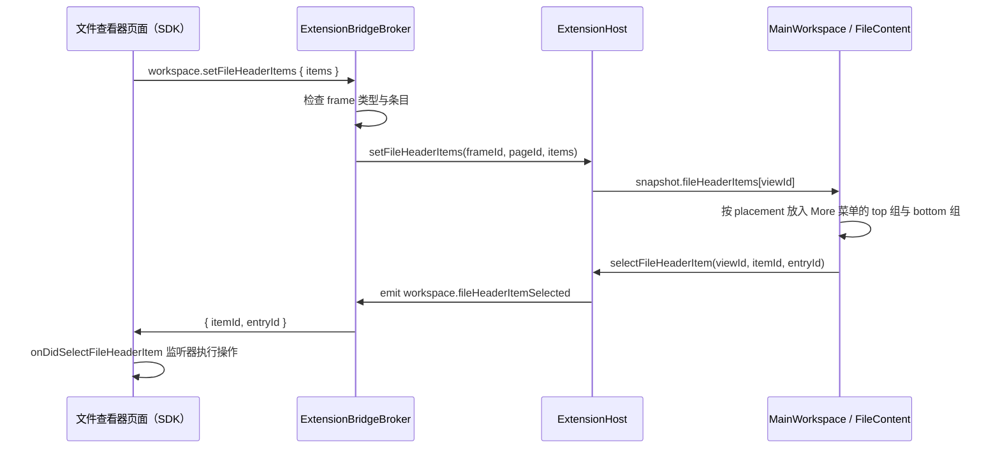

# 文件标题栏的 Extension 条目

## 名词解释

- **文件标题栏**：Files 视图中文件内容上方的 `FileHeader`（`@agw/projects`），左侧为文件名与保存状态，右侧为查看器切换按钮与 "More" 菜单。
- **More 菜单**：文件标题栏右侧 `MoreHorizontal` 图标打开的下拉菜单，包含查看器说明、刷新、默认查看器设置与查看器声明的条目。
- **查看器说明**：More 菜单顶部不能点击的一行（Desktop `ExtensionViewInfo`），显示查看器的图标、名称与所属 extension。
- **条目**：文件查看器通过 Extension API 声明、由宿主绘制在 More 菜单中的操作。
- **Mixed**：Text Editor 的 Markdown 块编辑查看器（`text-editor:markdown`）。

## 背景

- Mixed 页面顶部条中的编码按钮（显示编码名称，菜单为 "Reopen with Encoding…" 与 "Save with Encoding…"）与 Save 按钮需要移到宿主的 More 菜单，Mixed 页面只保留内容。
- Code 页面顶部工具栏的 Format、Word wrap 与 Save 需要移到宿主的 More 菜单，Code 页面只保留编辑器与底部状态栏。
- 文件标题栏右侧的刷新按钮与 Info 按钮需要并入 More 菜单，使标题栏右侧只有查看器切换按钮与 More 按钮。
- extension 页面运行在独立的 WebContentsView 中，宿主文件标题栏中的内容只能由宿主绘制。文件查看器目前无法在文件标题栏中加入自己的操作，需要在 More 菜单中给 extension 预留位置，并提供声明条目的 API。

## 设计目标

### 功能目标

1. Extension API：文件查看器用 `workspace.setFileHeaderItems` 声明条目，每个条目指定在 More 菜单中的位置（`top` 或 `bottom`），可以是普通项、勾选项、不可用的项或子菜单；用户选择后页面经 `workspace.onDidSelectFileHeaderItem` 收到通知。
2. 宿主：broker 检查条目，`ExtensionHost` 按 frame 记录；`FileContent` 在 More 菜单中依次绘制查看器说明、刷新与 `top` 条目、默认查看器设置、`bottom` 条目。
3. Mixed 的编码按钮与 Save 改为 `top` 条目，去掉顶部条。Code 状态栏中的编码按钮不变。
4. Code 顶部工具栏的 Format、Word wrap、Save 改为 `top` 条目，去掉工具栏。

### 技术目标

- 安全：只有文件查看器可以设置条目；broker 检查条目的结构、长度与数量，不合法时整个调用失败；文字作为 React 文本绘制。
- 条目只在它的查看器为当前选中的查看器时显示和响应；选中 Source 时，查看器说明描述切换前的查看器，菜单中没有它的条目。
- 页面关闭或重新加载后，宿主清除它的条目。

## 总体设计



## 数据库设计

不涉及。

## 详细设计

### 1. Extension API

`@agw/extension-sdk` 的 `WorkspaceApi` 增加：

```ts
/**
 * 文件查看器在宿主文件标题栏中的条目，替换之前设置的全部条目，空数组清除。
 * 只有文件查看器可以调用，其他 frame 为 ERR_UNSUPPORTED_OPERATION；条目不合法时为 ERR_INVALID_ARGUMENT。
 * 页面关闭或重新加载后条目清除。
 */
setFileHeaderItems(items: FileHeaderItem[]): Promise<void>;
/** 用户选择了条目或条目菜单中的一项。 */
onDidSelectFileHeaderItem(listener: (selection: FileHeaderItemSelection) => void): Disposable;

export interface FileHeaderItem {
  /** 1 到 64 个字符，在全部条目中唯一。 */
  id: string;
  /** 在 More 菜单中的位置。top：查看器说明与 "Reload view" 之后；bottom：默认查看器设置之后，菜单的最后。 */
  placement: "top" | "bottom";
  /** 1 到 80 个字符。 */
  label: string;
  /** true 时显示为不可用，不能选择。 */
  disabled?: boolean;
  /** 提供时条目为勾选项，true 时显示勾号；不能与 menu 同时提供。 */
  checked?: boolean;
  /** 条目的菜单；省略时选择条目本身。 */
  menu?: FileHeaderMenuEntry[];
}

export interface FileHeaderMenuEntry {
  /** 1 到 64 个字符，在同一条目的全部菜单项中唯一。 */
  id: string;
  /** 1 到 80 个字符。 */
  label: string;
  /** true 时显示为不可用，不能选择。 */
  disabled?: boolean;
  /** 提供时为勾选项，true 时显示勾号；不能与 menu 同时提供。 */
  checked?: boolean;
  /** 子菜单；省略时选择这一项。 */
  menu?: FileHeaderMenuEntry[];
}

export interface FileHeaderItemSelection {
  itemId: string;
  /** 选择的菜单项；条目没有菜单时为 null。 */
  entryId: string | null;
}
```

限制（broker 检查）：

- 条目数：0 到 16。
- `id`：字符串，1 到 64 个字符；条目 `id` 在全部条目中唯一，菜单项 `id` 在同一条目中唯一。
- `label`：字符串，1 到 80 个字符。
- `placement`：`"top"` 或 `"bottom"`。
- `disabled`、`checked`：提供时为布尔值；`checked` 不能与 `menu` 同时提供。
- `menu`：提供时为 1 到 100 项的数组；条目的菜单项可以再带一层 `menu`，这一层的菜单项不能再带。
- 菜单项总数：全部条目合计不超过 500。

带 `menu` 的条目与菜单项是子菜单，本身不能被选择；`disabled` 为 true 的项也不能被选择。选择通知只报告没有 `menu` 的菜单项，或没有 `menu` 的条目（`entryId` 为 null）。勾选项被选择时宿主只发送通知，页面改变状态后重新声明条目，勾号随之更新。

### 2. 宿主

#### 2.1 broker

`ExtensionBridgeBroker` 增加 `workspace.setFileHeaderItems` 处理函数：

1. `connection.kind` 不是 `fileViewer` 时抛出 `ERR_UNSUPPORTED_OPERATION`（与 `workspace.setUnsavedChanges` 相同）。
2. 按第 1 节的限制检查 `params.items`，不合法时抛出 `ERR_INVALID_ARGUMENT`，信息指明不合法的字段。
3. 检查通过后复制为只含已知字段的新对象（`disabled`、`checked` 只在提供时保留），交给 `options.setFileHeaderItems(frameId, pageId, items)`。

#### 2.2 ExtensionHost

- 字段 `fileHeaderItems: Map<frameId, readonly FileHeaderItem[]>`；`setFileHeaderItems` 在 frame 为 `fileViewer`、`pageId` 相同且没有关闭时记录，空数组删除记录，然后发布 snapshot。
- `ExtensionHostSnapshot.fileHeaderItems: Record<viewId, readonly FileHeaderItem[]>`，与 `saveStatuses` 一样由 frameId 转为视图 id。
- 清除：页面被替换（`pageReplaced`）与 frame 关闭时删除记录。切换文件（`setFileViewerFile`）时保留：条目由页面维护，页面按新文件的状态更新它们。
- `selectFileHeaderItem(viewId, itemId, entryId)`：视图的 frame 已加载并且没有关闭时，向页面发送事件 `workspace.fileHeaderItemSelected`（与 `reloadFileViewerDocument` 发送 `documents.reloadRequested` 相同）。

#### 2.3 绘制

- `@agw/projects` 增加 `FileViewerMenuEntry = { id; label; disabled?; checked?; menu? }` 与组件 `FileViewerMenuEntries({ entries, onSelect })`：带 `menu` 的项绘制为 `DropdownMenuSub`（`DropdownMenuSubTrigger` + 经 `DropdownMenuPortal` 的 `DropdownMenuSubContent`），提供 `checked` 的项绘制为 `DropdownMenuCheckboxItem`，其他项绘制为 `DropdownMenuItem`；`disabled` 交给对应组件。子菜单的最大高度为可用高度，超出时滚动。
- `FileViewerOption` 增加 `topItems` 与 `bottomItems`（`readonly FileViewerMenuEntry[]`）；`FileContent` 增加 `onSelectFileViewerItem?: (viewerId, itemId, entryId) => void`。
- 文件标题栏右侧为查看器切换按钮与 More 按钮。More 菜单（`file-content.tsx` 的 `DropdownMenu`）分为四组，按顺序排列，非空的组之间有分隔线：
  1. 查看器说明：`renderFileViewerInfo(viewerId)` 的内容放在 `DropdownMenuLabel` 中；选中 Source 时对应切换前的查看器。
  2. 刷新与 `top` 条目：选中查看器时为 "Reload view"（`onReloadFileViewer`），选中 Source 时为 "Reload file"（`onReloadSource`）；之后是当前查看器的 `topItems`。
  3. 默认查看器设置：原有的 "Open with {title} by default for {文件类型}" 与 "Reset default for {文件类型}"（`onSetDefaultFileViewer` 存在时）。
  4. 当前查看器的 `bottomItems`。
- 四组都为空时不显示 More 按钮。选中 Source 时第 2 组只有 "Reload file"，第 4 组为空。
- 条目按声明顺序绘制，每个条目作为一项交给 `FileViewerMenuEntries`；没有 `menu` 的条目被选择时 `entryId` 为 null。
- `ExtensionViewInfo` 只返回图标、名称与 extension 名称，由 `FileContent` 放入菜单标签。
- `MainWorkspace` 从 `snapshot.fileHeaderItems[view.id]` 按 `placement` 分出 `topItems` 与 `bottomItems`；选择时调用 `host.selectFileHeaderItem`。`ChatFilePane` 原样传递 `onSelectFileViewerItem`。

### 3. Text Editor 的条目

#### 3.1 Mixed 的编码与 Save

- Mixed 页面去掉顶部条，只有内容列与编辑器的菜单；失败面板中的 "Reopen with Encoding…" 不变。
- 新模块 `src/editor/header-items.ts` 的 `publishHeaderItems(api, session): Disposable`，在 `editor/main.tsx` 中随 `EditDocument` 创建，在视图卸载时释放。同一个页面的条目由它一次声明（`setFileHeaderItems` 替换全部条目）：
  1. 读取一次 `fs.listTextEncodings()`；失败时用 `ui.notify` 显示错误，条目中没有编码一项。
  2. 编码列表读取结束后，会话有编码并且状态不是 `failed` 时依次声明两个 `top` 条目，否则声明空数组：
     - 编码：`id: "encoding"`，`label` 为编码名称（`encodingName`，例如 `UTF-8`、`UTF-16LE with BOM`），在 More 菜单中显示为 "Reload view" 之后的子菜单。菜单：`Reopen with Encoding`（`id: "reopen"`），子菜单为每个编码（`id: "reopen:<编码 id>"`，文字为编码的 `label`）；`Save with Encoding`（`id: "save"`），子菜单为每个编码（`id: "save:<编码 id>"`），可以带 BOM 的编码（`utf-8`、`utf-16le`、`utf-16be`）另有 `"{label} with BOM"`（`id: "save:<编码 id>:bom"`）。
     - Save：`id: "save"`，会话状态不是 `dirty` 时 `disabled`。
  3. 每次 `session.onDidChange` 后重新计算，结果与上次发送的不同时才调用 `setFileHeaderItems`；调用失败记录到控制台。条目只随会话变化更新，输入不经过 React 提交（编辑器有焦点时每次提交都会在整个编辑区中计算选区位置）。
  4. 选择通知：`save` 条目调用 `session.save()`；编码条目按最近一次计算的菜单项找到操作，`reopen:*` 调用 `session.reopenWithEncoding`，`save:*` 调用 `session.saveWithEncoding`；失败由 `notifyFailure` 显示；找不到时不处理（条目已经更新）。
  5. 释放时取消订阅并声明空数组。

#### 3.2 Code 的 Format、Word wrap 与 Save

- Code 页面去掉顶部工具栏，只有 Monaco 编辑器与底部状态栏；状态栏（光标位置、缩进、编码菜单、LF/CRLF、语言）继续使用页面内的按钮与 `EncodingMenu`。
- 新模块 `src/code/code-header-items.ts` 的 hook `useCodeHeaderItems(api, session, { shown, canFormat, wordWrap }, { format, toggleWordWrap })`，在 `CodeView` 中调用：
  1. 编辑器显示文档时（没有在读取中或失败）声明三个 `top` 条目，否则声明空数组；状态变化时重新声明：
     - `format`："Format"，没有格式化程序（JSON 语言服务或 Prettier 支持的文件名之外）时 `disabled`。
     - `word-wrap`："Word wrap"，勾选项，`checked` 为当前的换行设置。
     - `save`："Save"，会话没有未保存修改时 `disabled`（`useSessionValue` 只在 dirty 变化时重新渲染）。
  2. 选择通知：`format` 运行 Monaco 的 Format Document，`word-wrap` 切换换行，`save` 调用 `session.save()`（失败由 `notifyFailure` 显示）；操作取最近一次渲染的值。
  3. 卸载时声明空数组。

### 4. 兼容

- Web 不传查看器，文件标题栏没有切换按钮与 More 菜单，行为不变。
- 已发布的 extension 不调用新 API 时，More 菜单只有查看器说明、刷新与默认查看器设置。
- 本设计替代《Desktop 文本文件编辑》5.7 节中 Mixed（原名 Edit）顶部条的部分，以及第 6 节中 Code 顶部工具栏的部分；Code 状态栏（6.6 节）不变。

## 接口文档

### 基础信息

页面与宿主之间的 RPC（`RpcEndpoint`，与其他 Extension API 相同）。

### 接口列表

- 新增请求 `workspace.setFileHeaderItems`

  ```json
  {
    "items": [
      {
        "id": "encoding",
        "placement": "top",
        "label": "UTF-8",
        "menu": [
          { "id": "reopen", "label": "Reopen with Encoding", "menu": [{ "id": "reopen:utf-8", "label": "Unicode (UTF-8)" }] },
          { "id": "save", "label": "Save with Encoding", "menu": [{ "id": "save:utf-8:bom", "label": "Unicode (UTF-8) with BOM" }] }
        ]
      },
      { "id": "word-wrap", "placement": "top", "label": "Word wrap", "checked": false },
      { "id": "save", "placement": "top", "label": "Save", "disabled": true }
    ]
  }
  ```

  回复 `null`。错误码：`ERR_UNSUPPORTED_OPERATION`（不是文件查看器）、`ERR_INVALID_ARGUMENT`（条目不合法）。

- 新增事件 `workspace.fileHeaderItemSelected`（宿主到页面）

  ```json
  { "itemId": "encoding", "entryId": "reopen:utf-8" }
  ```

## 测试计划

### 单元测试

- **只有文件查看器可以设置条目，不合法的条目被拒绝**（`extension-bridge.test.ts`）：主视图调用为 `ERR_UNSUPPORTED_OPERATION`；重复 id、超长文字、未知 placement、非布尔的 `disabled` 与 `checked`、同时带 `checked` 与 `menu`、三层菜单、空菜单、超出数量为 `ERR_INVALID_ARGUMENT`；合法条目只保留已知字段。
- **宿主记录条目并把选择交给页面**（`extension-host.test.ts`）：页面设置后 snapshot 按视图 id 给出条目；`selectFileHeaderItem` 后页面监听器收到 `{ itemId, entryId }`；切换文件后条目保留；空数组清除；Reload view 关闭 frame 后清除；页面被替换后清除，frame 保留。
- **More 菜单的说明与刷新**（`file-content.test.ts`）：标题栏右侧只有切换按钮与 More 按钮；菜单第一行为查看器说明，之后为 "Reload view"，选中 Source 时为 "Reload file"；两种刷新调用对应的回调；选中 Source 时说明对应切换前的查看器；没有刷新回调时菜单中没有刷新项。
- **More 菜单的条目**（`file-content.test.ts`）：顺序为 "Reload view"、`top` 条目、默认查看器项、`bottom` 条目，组之间三条分隔线；勾选项的 `aria-checked` 随 `checked`，不可用的项点击后没有回调；打开子菜单后选择回调 `(viewerId, itemId, entryId)`；没有子菜单的条目回调 `entryId` 为 null；没有 `onSetDefaultFileViewer` 但有条目时显示 More；选中 Source 或其他查看器时没有该查看器的条目。
- **查看器说明**（`extension-view.test.ts`）：`ExtensionViewInfo` 显示图标、名称与 extension 名称。
- **Mixed 的条目**（`header-items.test.ts`）：读取后声明 `UTF-8` 编码条目（两个子菜单含 BOM 项）与不可用的 Save；第一次输入使 Save 可用，之后的输入不再发送；选择 `save` 写入文件并使 Save 再次不可用；选择 `reopen:*` 按编码重新读取，`save:*` 按编码与 BOM 写入并更新条目文字；失败的会话不声明条目；读取编码列表失败时显示通知、只声明 Save；释放后为空数组。
- **Mixed 没有顶部条**（`edit-view.test.ts`）：页面中没有 `header`，第一个元素为滚动区域。
- **Code 的条目**（`code-header-items.test.ts`）：文档没有显示时为空数组；显示后为 Format（按 `canFormat` 不可用）、Word wrap（`checked` 随设置）、Save（输入后可用）；选择 `format`、`word-wrap` 调用最近一次渲染的操作，`save` 写入文件；其他条目不执行操作；卸载后为空数组。

### 集成测试

`extensions.integration.ts`：

- 文件标题栏右侧只有切换按钮与 More 按钮，都在窗口内可以点到；More 菜单打开时查看器换成截图，菜单第一行为 "Preview Text Editor"，"Reload view" 用新的 frame 重新加载查看器；选中 Source 时说明对应切换前的查看器，"Reload file" 重新读取源码。
- Mixed 打开 `edit.md` 后页面没有顶部条，More 菜单中 "Reload view" 之后为 `UTF-8` 子菜单与不可用的 Save；选择 "Reopen with Encoding" → GB18030 后子菜单文字变为 `GB18030`，再按 UTF-8 重新读取；输入后 Save 可用，选择它写入文件，撤销后再保存，文件回到原样。
- 拖动手柄的检查把鼠标停放在滚动区域左上角（内容列内边距中，不在编辑器元素上）。
- 有未保存修改时 More 菜单的 "Reload view" 先确认放弃修改。
- Code 打开 `src/app.ts`：页面中没有工具栏；Prettier 注册后 More 菜单中的 Format 变为可用，选择后内容为格式化结果，再选择 Save 写入磁盘。
