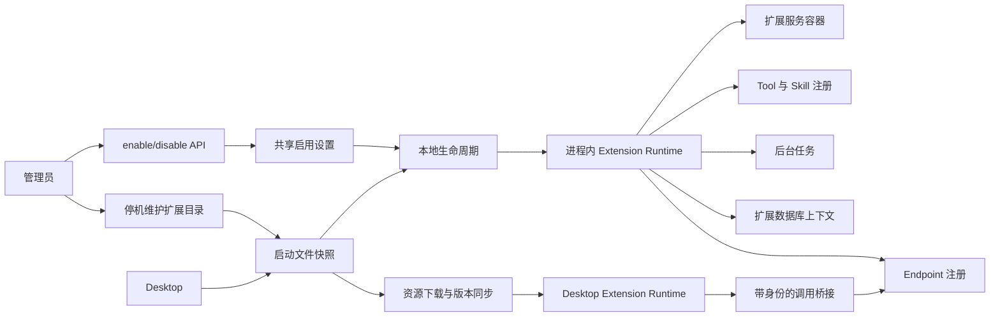

# Agw extension 设计

## 名词解释

### extension 与运行平台

extension 是为 agw 提供附加功能的独立扩展单元，可以包含一个或多个运行平台的功能。

`ExtensionTarget` 使用可组合的标志枚举：

| 成员 | 数值 | 含义 |
| --- | ---: | --- |
| `None` | 0 | 内部默认值，扩展包必须声明有效平台 |
| `Server` | 1 | Server 业务扩展 |
| `Desktop` | 2 | Desktop 界面和交互扩展 |
| `Web` | 4 | 预留给后续 Web 扩展 |
| `Mobile` | 8 | 预留给后续 Mobile 扩展 |

当前运行能力覆盖 `Server`、`Desktop` 和 `Server | Desktop`。后续增加平台时沿用按位组合规则。

安装行为如下：

- `Server`：由管理员停机安装，运行期间管理启用和停用。
- `Desktop`：由 Desktop 用户独立安装和管理。
- `Server | Desktop`：在 Server 停机安装，启用后 Desktop 自动同步对应资源。

### 标识与名称

- `id`：不可变的小写 GUID v7，识别同一个 extension。
- `name`：不可变的技术名称，使用小写字母、数字和短横线，在同一个 Server 部署中唯一。
- `displayName`：界面显示名称，允许中文、空格及后续修改。
- `version`：扩展发布版本，使用 SemVer。
- `releaseHash`：通过文件校验的 `manifest.json` 原始 UTF-8 字节的 SHA-256，标识扩展内容。
- `packageHash`：下载 ZIP 的 SHA-256，校验传输内容。
- `generation`：一次运行时加载实例。每次重新加载都会创建新的 generation。
- `catalogRevision`：当前资源目录和启用状态的变化标识，用于 Desktop 同步。
- `epoch`：本地运行实例的执行标识，与 generation 一起检查当前作用域的访问资格。

`extension-name` 对应 manifest 中的 `name`。例如，`name` 为 `calendar` 时，endpoint 前缀为 `/api/ext/calendar/`。

Server extension 停机安装是在 Server 停机期间添加、更新或删除扩展目录，启动后提供启用和停用能力。

## 背景

agw 需要提供统一的 extension 扩展机制，使用户编写的扩展能够提供 Server 业务逻辑、数据库能力和 Desktop 界面。

现有 Desktop extension 已经具备界面、权限、安装校验和生命周期机制。Server 通过统一管理模块、运行时和公开 SDK 承载业务扩展，并向 Desktop 分发组合扩展的界面资源。

## 设计目标

### 功能目标

- 使用 `ExtensionTarget` 表示运行平台，支持平台组合。
- Server extension 在 Server 进程内运行，安装、更新和移除通过停机修改目录完成，运行期间提供 enable/disable。
- extension 管理自己的数据库表，表名必须以 `zext` 开头。
- extension 可以定义 endpoint，路径必须位于 `/api/ext/{extension-name}/` 下。
- Server 与 Desktop 组合扩展在 Server 安装后，由 Desktop 自动获取界面资源并同步版本。
- 停用时等待已接收的工作完成，调用占用覆盖完整响应及资源释放。
- 目录移除后保留启用设置、业务数据和 migration history。
- 支持本地 Server、远程 Server，以及 ControlPlane/DataPlane 部署。

### 技术目标

- 支持大量 extension 同时启用，业务服务按调用创建。
- 为每个运行 generation 管理程序集、服务、缓存和资源生命周期。
- 数据库扩展适配 SQLite 和 PostgreSQL，并执行用户所有权和审计规则。
- 启用设置使用现有 Settings 存储，各 Host 按设置版本独立应用状态。
- 扩展作者负责代码、数据库 schema、已保存状态和调用参数的兼容性。
- 为运行阶段、调用占用、失败原因和回收结果提供可观测信息。
- 宿主与 extension 通过公开接口交互，为后续 IPC 实现保留接口边界。

## 总体设计



### Server 组成

`Agw.Extensions` 负责启动目录扫描、文件快照、启用状态、本地运行和客户端资源目录。

配套接口分为两部分：

- `Agw.Extensions.Contracts`：供 agw 模块调用的接口和 DTO。
- `Agw.Extensions.Sdk`：供扩展作者使用的入口、注册、数据库和生命周期能力。

宿主通过以下接口组织扩展：

| 接口 | 职责 |
| --- | --- |
| `IServerExtension` | 扩展入口和生命周期 |
| `IExtensionRegistration` | 注册 endpoint、Tools、Skills 和后台任务 |
| `IExtensionContext` | 当前扩展身份、运行 generation、日志及宿主能力 |
| `IExtensionInvoker` | 执行扩展调用并管理调用占用 |
| `IExtensionRuntime` | 加载、停止、清理和卸载 generation |
| `IExtensionDatabase` | 数据库模型校验、迁移和数据清理 |

当前 `IExtensionRuntime` 使用进程内实现。调用接口传递稳定 DTO、JSON 数据和具有明确生命周期的流。

### 服务与依赖

每个 Server generation 拥有：

- 一个可回收的 `AssemblyLoadContext`。
- 一个独立服务容器。
- 独立的序列化选项、数据库上下文和相关缓存。
- endpoint、Tool、后台任务及事件订阅的注册记录。
- 当前调用和 generation 租约。

Server 根服务容器持有扩展管理服务和调用代理。扩展业务服务由 generation 容器创建，随 generation 清理。

扩展程序集和业务依赖在对应加载上下文中加载。SDK 接口及必要的宿主框架类型使用共享程序集。扩展的 EF Core、数据库 provider 和模型缓存归对应 generation 管理。

宿主长期保存的描述信息使用稳定 DTO。扩展实体、反射类型、异常对象和业务回调的生命周期必须限制在对应 generation 内。

## 数据库设计

### 表的归属和命名

extension 只管理自己的业务表。核心业务数据通过 agw 公开接口访问。

平台为每个 extension 分配稳定前缀：`zext_<extensionId 去除短横线>_`。

扩展作者声明表短名，平台生成完整名称。迁移记录表同样使用该前缀。以双下划线开头的表短名保留给 SDK 内部使用。

这一规则同时满足 `zext` 前缀要求和扩展之间的名称隔离。数据库前缀由不可变的 extension ID 确定。

扩展模型和迁移操作必须通过以下校验：

- 操作对象属于当前 extension 的表名空间。
- 字段使用 `snake_case`。
- 遵循现有无外键规则。
- 表名、索引名和字段定义满足对应 provider 的限制。
- 迁移中的临时表同样符合 `zext` 前缀要求。

SQLite 的表重建通过 generation 专属的 `ISqlGenerationHelper` 处理临时标识符，覆盖 identifier API 的各个重载。SQL 结构继续由 EF Core provider 生成，并对 provider 升级执行回归测试。[SQLite 迁移实现](https://github.com/dotnet/efcore/blob/release/10.0/src/EFCore.Sqlite.Core/Migrations/SqliteMigrationsSqlGenerator.cs)

### 用户隔离

扩展使用独立 `DbContext`，SDK 提供统一的所有权和审计支持：

- 根业务记录具有不可变的 `CreateBy`。
- 子记录继承所属根记录的用户范围。
- 当前用户通过宿主身份上下文读取。
- 缺少用户上下文时，业务查询失败关闭。
- 创建和更新操作记录审计时间与操作者。
- 其他用户的资源 ID 与不存在的资源使用一致的错误行为。

数据库迁移使用单独的 schema 操作上下文。普通业务请求持续执行用户范围检查。

### 迁移

每个 extension 随包提供 SQLite 和 PostgreSQL 的迁移，使用独立 migration history。

平台在执行迁移前检查模型及结构化迁移操作。自定义数据迁移通过扩展数据库上下文执行；包中的 SQL 处理使用框架或成熟解析能力。

迁移期间暂停该 extension 的业务访问。数据库访问与迁移的互斥必须覆盖事务提交：

- **PostgreSQL**：业务事务在同一连接、同一事务中取得共享 advisory lock，再检查当前本地 generation 和调用作用域，直到提交或回滚才释放。迁移在固定连接上取得同一锁域的独占 session lock，覆盖全部迁移命令和 provider 管理的事务边界。迁移连接持续保持打开，连接归还连接池前明确释放锁。
- **SQLite**：同一个数据库由单个 Server 进程持有。平台的异步读写锁覆盖 extension 数据事务的完整生命周期；迁移持有独占锁直到整个迁移批次结束。事务取消或连接异常时，确认事务已经结束后才释放数据访问锁。

迁移连接丢失或命令失败时，本地 generation 进入失败状态，业务入口保持不可用。重新启用或重启时重新取得锁，检查实际 schema 和 migration history。

### 管理数据

启用设置复用 Settings 所属的 `setting` 表。全局键为 `extensions.enabled.<ExtensionId>`，值包含 `Enabled`；缺少设置时默认为停用。读写通过 `ISettingsStore`，更新使用 `SettingSnapshot.Version` 完成并发检查。

每个 Host 在内存维护扫描清单、运行状态、错误和调用租约。本地快照提供版本及下载文件。启用的 Extension 通过运行时能力目录提供注册的 Skills，Skill 身份使用 Extension 的 descriptor ID。

运行设置属于部署共享配置；各 Host 分别应用设置版本，管理页面展示当前 Host 的状态。操作日志使用现有日志系统。

### 目录移除与数据保留

停机删除扩展目录后，下次启动的清单中移除该扩展，保留全局启用设置、业务表、migration history 和 Server 数据目录。重新放回相同 ID 的目录后使用保留的启用设置。扩展作者负责新代码与保留数据的兼容性。

## 详细设计

### 目录与启动扫描

`Extensions.Directory` 默认 `./Extensions`，相对路径以 Server 程序目录为基准，也支持绝对路径。每个直接子目录表示一个扩展，根部包含 `manifest.json`，其余声明路径相对于该目录。目录名称用于组织文件，扩展身份由 manifest 决定。

各 Host 在启动阶段扫描一次，检查重复 ID、重复技术名称、manifest 格式、平台入口、路径和全部文件摘要，并保存本地文件快照。安装目录不存在时使用空清单；目录或文件校验失败时启动报错。数据库初始化完成后恢复共享启用设置，运行期间只读取本地快照和启用设置。

安装、更新和移除需要停止全部相关 Host，为各 Host 准备相同扩展内容，再启动 Server。首次发现的扩展默认为 disable；已存在的扩展保留启用设置。

### 统一扩展包

统一包采用 `manifestVersion: 2`，包含身份信息、运行平台和各平台入口。示例结构如下：

```json
{
  "manifestVersion": 2,
  "id": "019a4c17-5f00-7a80-8b3d-2b732f48a100",
  "name": "calendar",
  "displayName": "预约管理",
  "version": "1.0.0",
  "targets": 3,
  "server": {
    "apiVersion": 1,
    "entryAssembly": "server/Calendar.Extension.dll",
    "entryType": "Calendar.Extension.Entry"
  },
  "desktop": {
    "apiVersion": 1,
    "contributes": {
      "mainViews": [
        {
          "id": "appointments",
          "title": "预约管理",
          "icon": "Calendar",
          "entry": "desktop/index.html"
        }
      ]
    }
  }
}
```

各平台分别声明权限和入口。`manifestVersion` 描述包结构，平台的 `apiVersion` 描述 SDK 版本。Server 校验 manifest 格式，扩展作者负责运行兼容性。

扩展包携带 Server 程序集及依赖、数据库迁移、Desktop 资源和文件校验信息。启动扫描时检查身份、版本格式、平台入口、包内路径和文件摘要。

组合扩展的 Desktop 文件保存在 `desktop/` 目录下，入口、主题和图标路径必须声明于 `files`。下载 ZIP 保留原始 `manifest.json`，包含 `desktop/` 下全部已校验文件，通过文件流返回。

现有 Desktop manifest v1 按 `Desktop` 专用扩展读取，原 `name` 映射为 `displayName`。作者升级到 v2 时声明技术名称。现有扩展 ID、数据和用户授权继续保留。

### Server 生命周期

generation 运行阶段包含：

- `Loading`：正在创建 generation 和服务容器。
- `Prepared`：服务及能力注册已完成，等待启动扩展服务。
- `Ready`：扩展服务已启动，等待接收新工作。
- `Active`：可以接收新工作。
- `Draining`：停止接收新工作，等待已接收工作结束。
- `Stopping`：停止任务调度并清理注册和资源。
- `Unloading`：已发起程序集卸载，正在确认回收。
- `Faulted`：加载、迁移或清理失败。
- `UnloadFailed`：未能在规定时间内确认卸载完成。

当前 Host 在内存保存运行阶段和错误，管理 API 同时返回共享启用设置及本地状态。管理状态还包含等待启动的 `Starting`、已停用的 `Disabled` 和记录本地错误的 `Failed`。

#### 启用

启用按以下顺序执行：

1. 保存共享启用设置，取得启动阶段已校验的本地快照。
2. 创建 generation，校验服务及能力注册。
3. 校验数据库模型和待执行迁移。
4. 完成数据库准备。
5. 创建扩展服务，启动已声明的后台能力。
6. 发布 endpoint、Tool 和 Skill 描述。
7. 将 generation 标记为 `Active`，更新同步目录。

发布前的失败保持明确的失败状态，相关入口不接受业务调用。

#### 停用

各 Host 独立应用停用设置，执行以下停止过程：

1. 关闭新工作的接收入口。
2. 暂停新的定时任务和事件任务调度。
3. 等待已接收的请求、Tool 调用、后台工作及持久执行结束。
4. 清理 endpoint、Tool、Skill 和事件订阅。
5. 释放服务作用域、数据库资源、流、缓存和取消回调。
6. 释放 generation 服务容器。
7. 发起 `AssemblyLoadContext.Unload()`。
8. 通过弱引用确认加载上下文已被回收。

调用占用覆盖完整响应生命周期，包括流式响应、异步枚举和资源释放。

默认等待已接收工作完成的时间为 60 秒。超时记录当前 Host 的运行错误，保留仍在使用的 generation 和任务资源。Web 展示当前 Host 的结果，各 Host 依据共享设置分别处理。

进入清理或卸载阶段后的失败记录为 `Faulted` 或 `UnloadFailed`，对应 extension 保持不可用。

.NET 程序集卸载采用协作机制，必须释放相关引用和正在执行的代码；调用 `Unload()` 后仍需确认回收结果。[.NET 卸载说明](https://learn.microsoft.com/en-us/dotnet/standard/assembly/unloadability)

#### 停机更新

停止全部 Host，替换对应扩展目录中的 manifest 和文件，再启动 Host。启动阶段形成新的本地快照；此前已经启用的扩展使用新代码恢复运行。数据库迁移通过现有 SDK 的模型校验及迁移锁执行，保留已提交的 migration history。

### 持久执行

执行清单保存使用到的 `ExtensionIds`。恢复时按 ID 获取当前实现，兼容性由 extension 自己保证；不兼容调用按正常执行失败处理。在 `Draining` 阶段：

- 已接收执行可以继续运行、恢复和处理人工响应。
- 新执行无法取得该 extension 的新占用。
- 执行进入终态后释放相关占用。

停用的持久执行等待按扩展 ID 查询。停机更新和启动使用新目录清单恢复服务。

### ControlPlane 与 DataPlane

`ExtensionTarget.Server` 表示 Server 平台。ControlPlane、DataPlane 和 Standalone 使用现有 Host 职责：

- ControlPlane 负责启用设置、扩展 endpoint、目录分发和任务调度。
- DataPlane 承载 Agent 执行所需的扩展能力。
- Standalone 同时承担两类职责。

每个 Host 配置自己的扩展目录，也可以指向共享目录；部署时准备相同内容。启用设置通过现有 Settings 存储共享，各 Host 定期读取设置版本并独立执行本地生命周期。管理接口返回保存后的目标状态及当前 Host 的运行状态。

新调用检查共享启用设置及本地 generation。数据库操作检查当前 generation 和有效作用域。状态读取失败时调用失败，日志记录具体原因。

### 扩展 endpoint

扩展通过 SDK 注册相对路径和处理方法，宿主添加固定前缀 `/api/ext/{name}/`。

例如：

- `GET /api/ext/calendar/appointments`
- `POST /api/ext/calendar/appointments`
- `POST /api/ext/calendar/cancel`

`name` 在注册时替换为确定的技术名称。业务 ID 和其他参数放在 query 或 body 中。

宿主负责：

- 验证路径始终位于当前 extension 的前缀下。
- 执行认证、授权、扩展身份和当前 generation 检查。
- 为调用取得占用，并在完整响应结束后释放。
- 统一处理预期错误。
- 为非 WebSocket JSON 响应提供 Bens.Results 格式。

动态路由使用宿主拥有的 `EndpointDataSource`。路由 delegate 保存扩展身份和 endpoint 标识，通过运行时获取处理器。发布或撤销路由时更新快照并通知路由缓存。[EndpointDataSource](https://learn.microsoft.com/en-us/dotnet/api/microsoft.aspnetcore.routing.endpointdatasource?view=aspnetcore-10.0)

扩展的业务类型由 generation 内的序列化选项处理。宿主 OpenAPI 使用可序列化的 endpoint 和 schema 描述。

### Tools、Skills 和后台任务

- 动态能力目录按 release 和 generation 管理注册。
- Tools 显式声明 `AgwToolPermission`。
- 启用的 Extension 自动将注册的 Skills 提供给运行时能力组合，使用当前 generation 的内容提供器。
- `skill` 表保存现有 BuiltIn、Local 和 Remote Skills；Extension Skills 由内存目录提供。
- Skill 所属 Tools 通过 Skill 注册进入能力组合。
- 新执行保存提供 Skills 及选定 Tools 的 `ExtensionIds`，恢复执行使用这些 Extension 的当前实现。
- 新执行和恢复执行使用当前能力目录，进行中的调用保留自己的 generation 租约。
- 后台任务、定时器和订阅登记到 generation 生命周期。
- 停止接收工作后，已有后台工作完成，随后释放调度和订阅资源。

### Desktop 自动分发与版本同步

#### 实例与缓存

Server 管理的 Desktop 实例按 `ServerId + UserId + ExtensionId` 区分。

`ServerId` 是部署中持久保存的身份，通过 Server 信息接口提供。Setup 创建身份；已初始化的旧部署在首次启动升级中保存身份和完成标记。运行期间只读取身份，记录缺失或格式无效时返回服务不可用。

包资源按内容的 release hash 保存为不可变缓存，下载 ZIP 通过 packageHash 校验。Server 校验 manifest 原始字节及全部声明文件；Desktop 校验原始 manifest 摘要与完整的 Desktop 文件集合后，允许相同内容复用缓存。实例状态、权限和业务缓存按来源身份分别管理。

当前 Server 提供同 ID 的扩展时，使用该 Server 对应的实例。本地安装包及其状态保留，切换连接目标后重新计算可用实例。

#### 同步流程

Desktop 在连接、重新连接、窗口恢复以及定期检查时获取目录，默认检查间隔为 15 秒。目录 revision 由当前可用清单内容生成，使用 JavaScript 安全整数；Desktop 通过相等判断减少重复传输。

同步步骤为：

1. 获取当前 Server、账户和扩展目录。
2. 校验 Desktop 版本和 SDK 兼容要求。
3. 下载当前 Server release 对应的 Desktop 资源。
4. 校验内容摘要、manifest 和包内路径。
5. 检查本地权限。
6. 准备新实例并完成版本切换。
7. 发布新的视图、命令和其他界面贡献。

下载或校验失败时记录同步失败状态，不执行未通过校验的资源。

#### 权限与 Server 调用

Server 的启用管理权限和 Desktop 本地授权分别管理。

新增本地文件、网络等权限时，Desktop 要求本机用户授权。已有授权只在同一来源和已批准的权限范围内继续使用。

新增 `agw.server.request`，由 Desktop 宿主：

- 确定当前 Server 和 extension 的 endpoint 前缀。
- 附加当前用户身份及对应 release 信息。
- 执行路径、来源身份和当前连接检查。
- 返回已解析的 API 结果。

扩展页面通过这一接口访问自身 Server 能力。认证凭据由宿主管理。

#### 内容更新

Server 在启动时形成资源快照，Desktop 校验下载包及内容身份。Server endpoint 调用当前已启用实现，由 extension 处理请求格式的兼容性。SDK 不自动重放已经失败的业务写入。

Server 发布新版本后：

- Desktop 下载并准备匹配资源。
- 当前页面没有未保存内容时，完成实例切换。
- 当前页面有未保存内容时，保留内容并显示待更新状态。
- 旧实例的调用资格随当前连接和扩展可用状态重新计算。
- 本地保存或导出仍按有效的本地权限执行；依赖旧 Server 的保存操作显示不可用状态。

切换 Server 或账户时，旧实例的 Server 调用资格立即失效。尚未保存的内容保留在原实例中，直到用户处理。

#### 停用与目录移除同步

Server 停用 extension 或在停机删除目录后重新启动时，资源目录变化撤销对应实例的 Server 能力和界面入口。

Desktop 保留用户数据和待处理内容。缓存清理在没有活动 frame、没有未保存内容且没有版本占用后执行。

### 可观测性与默认配置

日志和管理状态至少记录：

- `ExtensionId`
- `ExtensionName`
- `ReleaseHash`
- `GenerationId`
- `ServerId`
- `HostId`
- 操作阶段、耗时和错误码

指标覆盖加载和卸载耗时、活跃调用数量、等待超时、迁移结果、同步结果及已加载 generation 数量。

默认值：

| 配置 | 默认值 |
| --- | --- |
| 等待已接收工作完成 | 60 秒 |
| 卸载回收确认期限 | 30 秒 |
| 共享启用设置检查间隔 | 5 秒 |
| 扩展安装目录 | `./Extensions` |
| Desktop 目录检查间隔 | 15 秒 |

配置使用项目规定的配置文件和管理配置方式。审计时间使用 `DateTimeOffset`，时间读取使用 `TimeProvider`。

Server 启动时根据目录快照和共享启用设置恢复本地状态。运行错误显示在当前 Host 的管理状态和日志中。

## 接口文档

### 基础信息

管理 API 使用 query 或 body 传递标识，非 WebSocket JSON 响应采用 Bens.Results 格式。

enable/disable 的 body 使用 `{ "extensionId": "<id>" }`。重复设置相同目标状态保持幂等，返回保存的启用设置和当前 Host 状态。

管理 API 要求管理员身份；目录和资源下载要求已认证用户，并根据可用范围返回结果。

新增错误统一进入 `ErrorCodes`，覆盖扩展不可用、等待超时、包校验失败、迁移失败和卸载失败等情况。

### 管理与分发 API

| 方法与路径 | 用途 |
| --- | --- |
| `GET /api/extensions` | 查询管理状态 |
| `POST /api/extensions/enable` | 启用已安装扩展 |
| `POST /api/extensions/disable` | 停用扩展 |
| `GET /api/extensions/catalog` | 获取当前用户可使用的客户端资源目录 |
| `GET /api/extensions/package` | 下载指定 release 的 Desktop 资源 |

## 测试计划

测试使用实际编译的 extension、实际 HTTP 调用、SQLite 和 PostgreSQL。

### 单元与组件测试

- `ExtensionTarget` 组合、无效值及未来标志位兼容检查。
- manifest v1 到统一模型的适配。
- 技术名称唯一性、版本与包内容一致性。
- endpoint 前缀校验和重复注册。
- 数据库表归属、`zext` 前缀和 provider 标识符限制。
- 重复启用及停用设置的幂等行为和并发更新检查。

### 启动与生命周期集成测试

- 停机安装、更新、删除目录及重新启动后清单与启用设置一致。
- 运行期间修改安装目录，启用和停用继续使用启动文件快照。
- 等待超时后保留仍在使用的 generation，已有请求继续完成。
- 流式响应和异步资源释放完成后才释放调用占用。
- 执行过 EF 查询、JSON 序列化和异常处理的 extension 能够完成卸载。
- 重复启用和停用，确认旧加载上下文可回收。
- 后台任务、事件订阅和取消回调在卸载后停止。
- 人工响应和恢复按扩展 ID 使用当前实现，不兼容调用记录正常执行失败。

### 数据库与多 Host 测试

- SQLite、PostgreSQL 分别验证创建表、修改字段、索引和数据迁移。
- SQLite 重建过程中所有扩展表和临时表保持 `zext` 前缀。
- 旧事务提交前，迁移无法进入受保护阶段。
- 两个用户互相访问资源 ID 时得到一致的拒绝结果。
- 启用设置在多个 Host 间传播，各 Host 展示自己的运行状态。
- 已释放 generation 的数据库上下文无法继续访问数据。
- 目录移除保留数据，重新安装后使用保留的设置及 migration history。

### Desktop 测试

- Server 安装组合扩展后，Desktop 自动取得界面资源。
- 同一个 extension 在不同 Server 上使用不同版本时互不覆盖。
- 新权限等待本地授权。
- 下载中断、摘要错误和版本不匹配具有明确状态。
- Server 或账户切换后，旧 frame 无法使用新的身份上下文。
- 未保存页面在升级、停用和断线时保留内容。
- 现有 Desktop 专用扩展及用户数据继续正常使用。

### 性能验证

使用同一环境，对照核心 endpoint 和 extension endpoint，记录调用延迟、吞吐、分配量和内存。

验证负载包含 100 个启用 extension、10 个并发活跃 extension，以及重复生命周期操作。重点检查业务调用路径的额外开销、空闲扩展的资源占用和历史 generation 的持续增长情况。

实施验收同时执行项目要求的架构、异常规则及相关客户端边界检查。Desktop extension 集成测试按仓库要求，在每次运行前取得用户确认。
