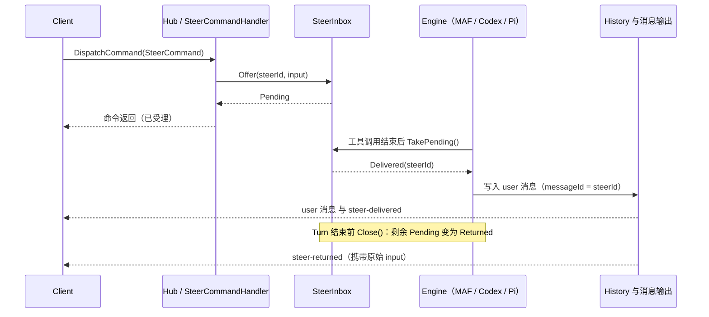
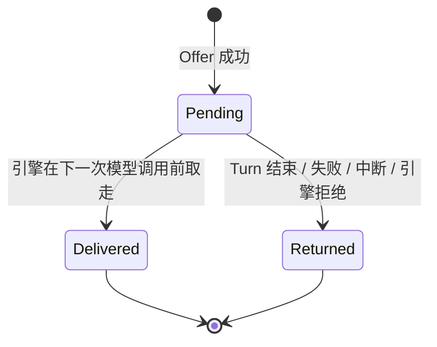
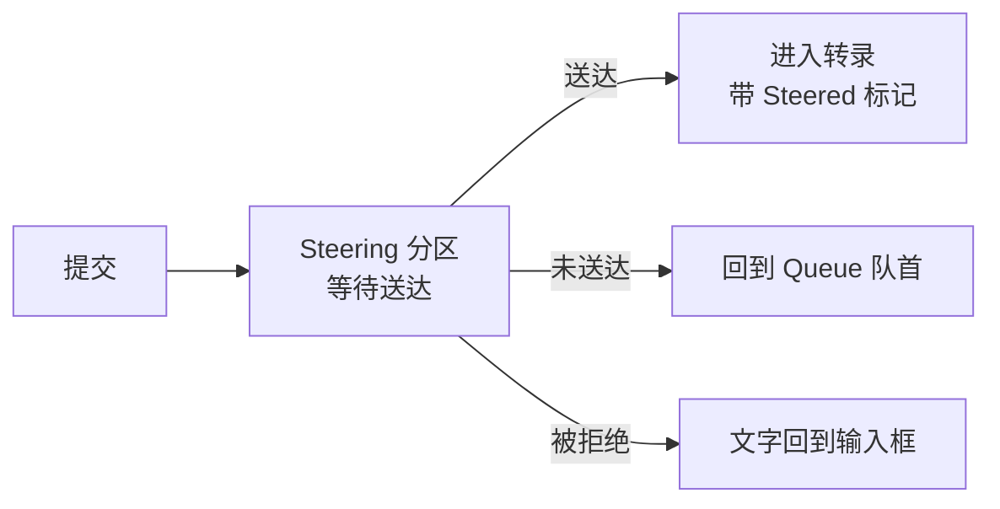

# Composer Steer 模式

## 名词解释

| 名词 | 含义 |
| --- | --- |
| Queue | 执行期间提交的输入先排队，等当前 Turn 完成后再作为新 Turn 发送。 |
| Steer | 执行期间提交的输入在当前这批工具调用结束之后、下一次模型调用之前送达同一个 Turn，不中断执行。 |
| SteerInbox | 每个活动 Turn 一个的待送达输入集合，保存 Pending 状态的 Steer。 |
| Delivered / Returned | Steer 的两个终态。Delivered 表示已进入模型输入，Returned 表示未送达并交还给客户端。 |

## 背景

- Web 与 Desktop 的 composer 在 Turn 运行期间只支持 Queue。队列在 `src/clients/packages/chat-runtime/src/execution-session-manager.ts` 中，收到该条目自身 `turnId` 的 `turn-finished(completed)` 后才发送队首。
- 服务端一个连接同时只运行一个 Turn。Turn 运行时再发 `ExecCommand` 会得到 `ExecutionBusy`（4090021），没有任何方式把新输入送进正在运行的 Turn。
- Mobile 的 composer 在执行期间整体禁用，也没有队列。
- 用户在发现模型走偏时，需要在不中断执行、不丢失已有进度的前提下补充或纠正指令。

## 设计目标

### 功能目标

- composer 在 Turn 运行期间提供 Queue 与 Steer 两种提交方式，默认保持 Queue。
- Steer 输入进入同一个 Turn，在转录中出现在它实际被模型看到的位置。
- 支持 InProcess 与 Distributed 两种执行提供者。
- 支持 System Agent（MAF）、Codex、Pi。Claude Code 与 Agentflow 默认不支持，composer 禁用 Steer 并显示原因。
- 能力查询接口告知客户端目标是否支持 Steer。

### 技术目标

- 每条 Steer 恰好有一个终态：Delivered 或 Returned。Returned 的输入回到客户端，内容不丢失。
- 同一个 `steerId` 重复提交只受理一次。
- 沿用用户隔离、`ConversationReadOnly` 检查与 Distributed 的领取权规则。
- 可观测：结构化日志，以及按引擎统计 accepted、delivered、returned 的指标。
- 不修改 `docs/human/` 下的文档。

## 总体设计





Delivered 与 Returned 的转换在同一把锁内完成。InProcess 使用 `Lock`，Distributed 使用带条件的 `UPDATE ... WHERE status = Pending`。`Close()` 与 `TakePending()` 互斥，不会出现既送达又退回的情况。

## 数据库设计

只有 Distributed 需要。InProcess 的 SteerInbox 保存在内存中。

新增实体 `ExecutionSteer`，表 `execution_steer`，实体文件放在 `Agw.Data/Entities`，逻辑所有者是 Agents 模块。

| 列 | 说明 |
| --- | --- |
| `id` | `steerId`，等于客户端生成的 messageId（UUIDv7），主键。 |
| `turn_id` | 所属 durable Turn。 |
| `status` | `Pending`、`Delivered`、`Returned`。 |
| `payload_json` | `AgwUserInput`，沿用现有 durable JSON 的加密方式。 |
| `step_index` | 送达时的 Step，可空。 |
| `return_reason` | Returned 的原因，可空。 |
| `create_by`、`create_time`、`update_by`、`update_time` | 审计列，由现有拦截器写入。 |

索引：`(create_by, turn_id, status)`，用于每次模型调用前的查询。

配套修改：

- 在 `tests/Agw.Architecture.Tests/BackendArchitectureTests.cs` 的 `EntityOwners` 登记。
- 在 `IAgentsDbContext` 增加 `DbSet`。
- 更新 `RawPersistenceInventoryTests` 的清单。
- 没有外键，列名使用 `snake_case`。
- `Agw.Migrations.Sqlite` 与 `Agw.Migrations.Postgres` 各需一份迁移，按仓库规则在被要求时再生成。

## 详细设计

### 提交方式：Queue 与 Steer

**Hub 契约**

新增 `Commands/Steer/SteerCommand` 与 `SteerCommandHandler`，按 Execution README「Command 扩展」的步骤注册。

```csharp
public sealed class SteerCommand : AgentRunCommand
{
    public Guid ConversationId { get; set; }   // 必须等于连接已配置的对话
    public Guid TurnId { get; set; }           // 客户端正在跟踪的 Turn
    public Guid SteerId { get; set; }          // 客户端生成，同时是 user 消息的 messageId
    public AgwUserInput Input { get; set; }
}
```

命令返回表示已受理：InProcess 是 `Offer` 成功，Distributed 是 `execution_steer` 行已提交。

校验顺序：

1. `ConversationReadOnly` 检查。`SteerCommand` 加入 `docs/ws-flow.md` 中 extension 写操作的列表。
2. `ConversationId` 与连接配置一致。
3. 存在活动 Turn 且 `TurnId` 相同，否则抛 `AgwException(ErrorCodes.SteerNoActiveTurn)`。
4. 目标引擎支持 Steer，否则抛 `SteerNotSupported`。
5. 内容非空，待送达数量不超过 `Execution:Steer:MaxPendingPerTurn`，否则抛 `SteerLimitExceeded`。
6. 相同 `steerId` 重复提交，返回已有状态，不重复创建。

**错误码**

在 `Agw.Shared/Exceptions/ErrorCodes.cs` 新增 `SteerNotSupported`（400）、`SteerNoActiveTurn`（409）、`SteerLimitExceeded`（409）。码值取合并时目标分支的下一个序号。`4e6af2e0` 中 400 序列最大为 `0076`，409 序列最大为 `0026`，开发时需要与当前主线上已使用的序号核对，不得重排已有编号。修改后运行 `tests/Agw.Shared.Tests`。

**下发消息**

结果通过 `AgwMessage` 的 `additionalProperties.type` 下发。Distributed 下走带序号、可回放的普通事件，重连后可补收。

- `steer-delivered`：`turnId`、`steerId`、`stepIndex`。紧邻它之前发送一条 user 角色的消息，`messageId = steerId`，带本 Turn 的 `producerScopeId`。
- `steer-returned`：`turnId`、`steerId`、`reason`，并携带原始 `input`，客户端丢失本地记录（如刷新页面）时也能恢复内容。

**配置项**

| key | value | 默认值 | 说明 |
| --- | --- | --- | --- |
| `Execution:Steer:MaxPendingPerTurn` | 整数 | 8 | 单个 Turn 同时处于 Pending 的 Steer 上限。 |

写在 `src/server/Agw.Host/appsettings.json`，遵循标准 ASP.NET 配置优先级。

**安全设计**

- `execution_steer` 属于用户拥有的执行子记录，继承根的 `CreateBy`，读取受用户范围查询过滤器保护。
- 外来或不存在的 `turnId` 返回与 `SteerNoActiveTurn` 相同的结果。
- Distributed 下，只有持有该 Turn 领取权的 attempt 可以把行置为 Delivered。迟到的 attempt 的条件更新不会命中任何行。

### 各引擎的送达点

**System Agent（MAF）**

- `AgentRuntimeFactory` 已使用 `UsePerServiceCallChatHistoryPersistence`，`AgwChatHistoryProvider` 在每次模型请求前运行，工具结果也在这里写入历史。
- 在管线最内层增加 `SteerInjectionChatClient`（`DelegatingChatClient`）。每次请求前调用 `inbox.TakePending()`，把取到的 user 消息追加到发给模型的消息列表末尾，位于上一 Step 的工具结果之后。
- 同时通过 `HistoryRecording.WriteMessagesAsync` 写入历史行，`MessageId = steerId`，`stepIndex` 取当前值。历史行排在已写入的工具结果之后，下一次读取历史的顺序与模型实际看到的顺序一致。
- `AgentTurnExecutor.RunStepsAsync` 在 `approvals.Count == 0` 即将结束循环前调用 `inbox.TakePendingOrClose()`。仍有 Pending 时，把它们作为下一轮 `currentRequestMessages` 继续循环，成为同一个 Turn 的新 Step；没有 Pending 时在同一把锁内关闭集合，之后到达的 Steer 得到 `SteerNoActiveTurn`。这样模型最后一轮输出期间到达的 Steer 也会送达。
- Turn 结束时，`TurnPipeline` 在写出 `turn-finished` 之前调用 `inbox.Close()`，把剩余输入以 `steer-returned` 交还客户端。
- 等待人工审批期间到达的 Steer 保持 Pending，审批完成后在下一次模型调用时送达。Distributed 下 segment 结束时行保持 Pending，恢复的 segment 在第一次模型调用前读取。

**Codex**

- `CodexSdk.AppServer` 包内的 schema 含 `turn/steer`，参数 `expectedTurnId` 必须等于活动 Turn，并有 `clientUserMessageId`。SDK 中存在 `TurnSteerAsync`。
- `CodexProviderSessionTrackingAgent` 已持有 `CodexAppServerClient` 并观察 thread 与 turn 的 ID。新增 `TrySteerAsync(input, steerId)`，把 `steerId` 作为 `clientUserMessageId` 传入。
- 调用成功即 Delivered，Agw 自己合成对应的 user 消息并写入历史。`expectedTurnId` 不匹配，或 Turn 类型不可 steer（`ActiveTurnNotSteerable`，如 review、compact），按 Returned 处理。

**Pi**

- Pi RPC 的 `steer` 命令：在当前这批工具调用执行完之后、下一次 LLM 调用之前送达。`clear_queue` 可取回尚未送达的文本。
- `src/sdks/pi-agent-sdk-csharp` 的 `PiCommands` 目前只有 `prompt` 与 `abort`。新增 `Steer(message, images)`，`PiSession` 增加对应方法。`PiQueueUpdateEvent` 已能解析队列状态。
- Turn 结束或中断时先调用 `clear_queue`，取回的文本对应的 Steer 置为 Returned。

**Claude Code 与 Agentflow**

- Claude Code：`SupportsSteer = false`。`ClaudeCodeSdk` 提供 `SendAsync`，但运行中写入的消息是否被当前 Turn 接收尚未验证。公开 issue 中有人报告 `--input-format stream-json` 下运行中的 stdin 消息被忽略，这是第三方说法，未在本机确认。验证方法：让 Claude Code 执行多次工具调用的任务，运行中调用 `SendAsync`，检查模型下一次请求是否包含该消息。通过后再打开能力开关。
- Agentflow：`SupportsSteer = false`。一个 Turn 含多个节点，没有明确的接收方。

**能力查询**

新增 `GET /api/agents/input-capabilities?type={0|1}&id={id}`，返回 `supportsSteer` 与 `reason`。风格与 `permission-capabilities` 相同，使用 `ApiResult.Ok`，不使用路径参数。后端契约变化后运行 `pnpm gen:api`。

**可观测性**

- 日志使用结构化模板，字段：`TurnId`、`SteerId`、`Engine`、`Status`、`ReturnReason`。
- 指标：`agw_steer_total{engine, outcome=accepted|delivered|returned}`，以及 Pending 到终态的耗时直方图。

### 客户端：ExecutionSessionManager

位置：`src/clients/packages/chat-runtime`。

- `submit(submission, mode: "queue" | "steer")`。Turn 空闲时两种模式行为相同，都是立即发送。
- `mode = "steer"` 且有进行中的 Turn：创建 `SteerRecord { id, turnId, submission, status: "sending" | "accepted" }`，调用 `client.steer(...)`。
- 收到 `steer-delivered`：移除记录。user 消息由 `@agw/execution-core` 的流合并按 `messageId` 与 scope 放入转录。需要补 `chat-core` 测试，确认 user 消息出现在 Turn 中间时按到达位置渲染。
- 收到 `steer-returned`：转成队列条目，放在队首，使用新的 `turnId`，不暂停队列。Turn 以 `failed` 结束时沿用现有规则：退回的条目放队首并暂停队列。
- Hub 明确拒绝（HubException）：通过新增的 `onSteerRejected` 事件把文字与附件还给 composer 草稿。
- 连接关闭、结果未知：重连后 Turn 仍在运行则用同一个 `steerId` 重发，服务端按 `steerId` 只受理一次。重连后已无活动执行则沿用「结果无法确认」路径：条目回队首、锁定编辑、暂停队列。
- `stop()`：清空队列时一并丢弃未送达的 Steer 记录，之后发送 `InterruptCommand`。
- `ExecutionQueueSnapshot` 增加 `steers`（只读列表与状态）。

### 客户端：Composer 交互

位置：`src/clients/packages/chat`（`user-input.tsx`、`chat-input.tsx`、`chat-input-queue.tsx`）。

**发送按钮**

执行中且输入框有内容时，发送按钮变成分体按钮：主按钮加一个小箭头。

| 状态 | 主按钮 | 小箭头菜单 |
| --- | --- | --- |
| 空闲 | 发送 | 无 |
| 执行中，默认 Queue | 排队（Queue 图标） | 改为 Steer 发送 |
| 执行中，默认 Steer | 引导（Steer 图标） | 改为 Queue 发送 |
| 执行中，输入框为空 | 停止 | 无 |

- 回车键走默认模式，`Mod+Enter` 走另一种模式。实现时先核对该键位是否被占用。
- 默认模式是客户端偏好，初始值 Queue。不修改偏好时行为与现在一致。
- 两种模式的按钮图标、`aria-label` 与占位文字均不同。
- 输入框下方的提示行显示当前两个快捷键。

**目标不支持 Steer**

- 菜单中的 Steer 选项置灰，旁边显示 `reason`。
- 默认模式为 Steer 但当前目标不支持时，主按钮自动回到 Queue，并显示一行小字说明。
- `Mod+Enter` 此时不发送，只弹出同一个原因提示。

**输入框上方的列表**

在现有队列列表上方增加「Steering」分区。

- 每条显示文字摘要、附件与状态「等待送达」，带转圈图标。
- 该条已发给服务端，不能编辑，也不能删除。
- Queue 分区保持现状。

**一条 Steer 的界面变化**



- 送达：该条从分区消失，作为用户消息出现在 Turn 中间它被模型看到的位置，旁边有「Steered」小标记。
- 未送达：回到 Queue 队首，列表显示一行提示「未送达，已加入队列」。
- 被拒绝：文字与图片放回输入框，输入框下方显示错误。

**停止**

点击停止会清空 Queue 与 Steering 两个分区，再发送中断。

**范围**

Mobile 的 composer 在执行期间整体禁用，也没有队列，本次不修改。

### 兼容设计

- 新增命令、新增消息类型和新增能力接口，不修改现有字段。
- 旧客户端不会发送 `SteerCommand`，行为不变。
- 新客户端连接旧服务端时，能力接口返回 404，客户端把 `supportsSteer` 视为 false，不显示 Steer 入口。
- 服务端与客户端同版本发布。

## 接口文档

### 基础信息

- 认证与授权：沿用现有的 Hub 认证与管理 API 认证。
- 响应格式：管理 API 使用 Bens.Results 信封。
- Hub 协议：`DispatchCommand(AgentRunCommand)`，输出通过 `ReceiveMessage(AgwMessage)`。

### 接口列表

**新增 Hub 命令 `SteerCommand`**

```json
{
  "type": "steer",
  "conversationId": "0197f0c2-0000-7000-8000-000000000001",
  "turnId": "0197f0c2-0000-7000-8000-000000000002",
  "steerId": "0197f0c2-0000-7000-8000-000000000003",
  "input": { "contents": [{ "type": "text", "text": "只修改 tests 目录" }] }
}
```

- 命令的判别值 `type` 以实际 JSON discriminator 注册为准。
- 成功返回表示已受理，不表示已送达。
- 失败抛 HubException，错误码见上文。

**新增消息**

```json
{ "additionalProperties": { "type": "steer-delivered", "turnId": "...", "steerId": "...", "stepIndex": 3 } }
```

```json
{ "additionalProperties": { "type": "steer-returned", "turnId": "...", "steerId": "...", "reason": "turn-finished" } }
```

**新增接口 `GET /api/agents/input-capabilities`**

- 查询：`type`（0 为 Agent，1 为 Agentflow）、`id`。
- 响应（Bens.Results 解包后）：

```json
{ "supportsSteer": true, "reason": null }
```

- 新增接口，无兼容性问题。客户端在选择目标后查询，结果按目标缓存。

## 测试计划

### 配置测试

- `Execution:Steer:MaxPendingPerTurn` 为默认值、自定义值、0 或负数时的行为。

### 单元测试

xUnit v3，使用真实实现，不使用 mock。

| 用例 | 目的 |
| --- | --- |
| `SteerInbox_ConcurrentTakeAndClose_EachSteerHasOneOutcome` | Offer、Take、Close 并发竞争时，每条 Steer 只有一个终态。 |
| `SteerInbox_DuplicateSteerId_AcceptedOnce` | 幂等。 |
| `MafPipeline_SteerAfterToolResult_ModelInputOrderIsToolThenUser` | 发给模型的顺序是 assistant 工具调用、tool 结果、user；分别覆盖 OpenAI Chat、OpenAI Responses、Anthropic 三种适配器。 |
| `AgentTurnExecutor_SteerDuringFinalResponse_ContinuesSameTurn` | 最后一轮输出期间到达的 Steer 继续同一个 Turn。 |
| `AgentTurnExecutor_TurnFails_PendingSteersReturned` | Turn 失败时 Pending 全部退回。 |
| `SteerCommandHandler_ReadOnlyConversation_Rejected` | `ConversationReadOnly`。 |
| `SteerCommandHandler_NoActiveTurn_Rejected` | `SteerNoActiveTurn`。 |
| `SteerCommandHandler_ExceedsLimit_Rejected` | `SteerLimitExceeded`。 |
| `PiCommands_Steer_SerializesExpectedJson` | Pi 命令序列化。 |
| `PiSession_ClearQueue_MapsToReturnedSteers` | `clear_queue` 的结果映射。 |
| 客户端 `execution-session-manager.test.ts` | 覆盖 sending、accepted、delivered、returned、rejected、连接关闭几条路径，以及 `stop()` 清空。 |
| 客户端 composer 测试 | 按钮状态表、快捷键、不支持时的降级。 |
| `chat-core` 渲染测试 | Turn 中间的 user 消息按到达位置渲染。 |

### 集成测试

- Distributed（需要 `AGW_TEST_POSTGRES_CONNECTION_STRING`）：segment 在 WaitingForHuman 结束后，恢复的 segment 能读取 Pending；迟到的 attempt 不能把行置为 Delivered。
- Codex、Pi 的真实进程集成测试在有对应环境时运行。
- Claude Code 的验证运行（见「各引擎的送达点」）。

### 回归测试

- `dotnet test tests/Agw.Architecture.Tests`（新增实体、持久化访问、Behavior 变化）。
- `dotnet test tests/Agw.Shared.Tests`（新增 `ErrorCodes`）。
- `pnpm test:boundaries` 与 `pnpm test`。
- 默认 Queue 路径的现有测试全部保持通过。

## 待验证事项

- MAF 管线中，Anthropic 适配器对 tool_result 之后紧跟 user 文本消息的处理方式。
- Codex `turn/steer` 在 Turn 即将结束时的返回值，以及是否回显 user 消息。目前只确认了 schema 与 SDK 方法存在。
- Pi 的 `steer` 被消费时是否发出 user 角色的消息事件。没有时，用 `queue_update` 中 steering 列表的变化判断送达。
- Claude Code 运行中输入的行为。
