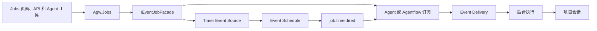

# 将 Jobs 统一到 Events 的 Timer 调度

## 背景

Jobs 和 Events 各有一套定时调度。Jobs 到期后直接执行 Agent 或 Agentflow，Events 通过 Timer 发布事件，再由订阅决定执行目标。统一后，定时、触发、执行、重试和运行记录都由 Events 提供，Jobs 是 Timer Event Source 和订阅之上的管理入口。

本方案对现有的 Job 数据、接口和执行行为没有兼容性要求。

## 设计目标

### 功能目标

- 用户在 Jobs 页面、API 和 Agent 工具中创建、编辑、启停和删除定时任务，查看下一次触发时间、最近一次投递和运行历史。
- 每个 Job 由一个 Timer Event Source 和一条 Agent 或 Agentflow 订阅组成。
- 项目会话记录自己的类型和对应的事件：原生会话，或者事件中心创建的会话及其事件来源的类型。

### 技术目标

- 复用 Events 的调度、去重、并发和投递重试规则。
- 在同一数据库事务内修改 Job 对应的来源、计划和订阅。
- Job 的字段使用 Events 中对应字段的名称和格式。
- 沿用资源归属校验，确保 Job 只能关联当前账号有权使用的项目和执行目标。其他用户的 Job ID 与不存在的 Job 返回相同错误。

## 总体设计



| 模块 | 职责 |
| --- | --- |
| `Agw.Jobs` | Jobs API、Agent 工具、请求校验和默认名称，没有自己的表和调度器 |
| `Agw.Events` | Timer、订阅、计划、事件和投递；实现 `Agw.Events.Contracts` 中的 `IEventJobFacade`，供 `Agw.Jobs` 读取和修改 Job |
| `Agw.Infrastructure` | 删除 Project 时删除它的 Job，删除 Agent 时检查 Job 订阅 |
| `Agw.Agents.Execution` | 后台执行为事件投递创建的会话写入类型和关联 ID |
| `Agw.Projects` | 项目会话增加类型 `kind`，`job_id` 改为关联 ID `relate_id` |

`Agw.Jobs` 增加对 `Agw.Events.Contracts` 的项目引用，移除 `Job`、`JobLog` 实体和 `IJobsDbContext`，移除调度器、尝试的执行与结果记录、InProcess 和 Distributed 两种恢复 worker、唤醒信号以及项目执行锁 `IProjectExecutionLock` 和它在 `Agw.Infrastructure/Jobs` 中的实现。`Agw.Infrastructure` 移除对 `Agw.Jobs` 的项目引用，`Agw.Host` 增加对 `Agw.Jobs` 的项目引用。Events 的 worker 运行在 Control Plane 和 Standalone，Agent 和 Agentflow 按 `Execution:Provider` 的拓扑执行。

## 数据库设计

| 表 | 修改 |
| --- | --- |
| `event_source` | 增加 `managed_by`（text，不为空，默认 `user`）和 `managed_key`（text，可以为空）；`(create_by, managed_by, managed_key)` 唯一（`managed_key` 不为空） |
| `event_subscription` | 增加 `managed_by`（text，不为空，默认 `user`），替换 `managed_by_extension_id`；唯一索引改为 `(create_by, managed_by, managed_key)`（`managed_key` 不为空） |
| `event_delivery` | 增加索引 `(subscription_id, id)`，用于读取 Job 订阅的最近一次投递和全部投递 |
| `event_delivery_attempt` | 增加 `turn_id`（Guid，可以为空），保存这次尝试提交的执行；增加索引 `(delivery_id, attempt)` |
| `job`、`job_log` | 删除 |
| `project_conversation` | 增加 `kind`（text，不为空，默认 `native`）；`job_id` 重命名为 `relate_id`，索引随之重命名 |
| `project_conversation_chat_history` | 删除 `job_id` |

现有的 Job 和运行记录随 migration 删除，升级后在 Jobs 页面重新创建 Job。已有会话的 `kind` 为 `native`，原 `job_id` 的值清空。

`project_conversation.kind` 表示会话的类型，`relate_id` 是与类型对应的关联 ID：

| `kind` | 含义 | `relate_id` |
| --- | --- | --- |
| `native` | 原生会话，由 Desktop、Web、Mobile、A2A 或 extension 创建 | 空 |
| `event:<来源类型>` | 事件中心的事件投递创建的会话。`<来源类型>` 是事件所属来源的 `EventSourceKind` 的小写名称：`timer`、`webhook`、`httppoll`、`provider`、`publisher` | 触发这次执行的事件的 `event.id` |

`kind` 的取值定义在 `Agw.Shared/Contracts/Conversations`。

`event_source` 和 `event_subscription` 的 `managed_by` 表示记录的管理方，`managed_key` 是管理方内部的标识：

| `managed_by` | 含义 | `managed_key` |
| --- | --- | --- |
| `user` | 用户在 Events 中创建的记录 | 空 |
| `job` | Job 的 Timer 和订阅 | Job ID |
| `ext:<extensionId>` | extension 管理的订阅 | extension 提供的 key |

`managed_by` 的取值定义在 `Agw.Shared/Contracts/Events`。Events API 只修改 `managed_by` 为 `user` 的记录。`managed_version` 和 `managed_state` 只用于 extension 管理的订阅。已有的 extension 订阅在 migration 中把 `managed_by_extension_id` 的值写成 `ext:<extensionId>` 保存到 `managed_by`。

Timer 和订阅的 `managed_by` 都是 `job`，`managed_key` 保存相同的 Job ID，Job ID 在创建 Job 时生成。Job 的字段保存在 Events 的记录中：

| Job 字段 | 保存位置 |
| --- | --- |
| `id` | `event_source.managed_key`、`event_subscription.managed_key` |
| 所属用户 | Timer 和订阅的 `create_by` |
| `name` | `event_source.name`、`event_subscription.name` |
| `enabled` | `event_source.enabled`、`event_subscription.enabled` |
| `schedule` | `event_source.config_json` 中 Timer 配置的 `kind`、`at`、`interval`、`cron` |
| `projectId` | `event_subscription.project_id` |
| `targetKind`、`agentId` | `event_subscription.target_kind`、`event_subscription.agent_id` |
| `instructions` | `event_subscription.instructions` |
| `dueAt` | `event_schedule.due_at`，计划的 `caller_key` 和 `business_key` 都是 `source:<sourceId>` |
| `scheduleCompleted` | 对应的 `event_schedule.state` 为 `Completed` |
| `lastDelivery` | Job 订阅中 `id` 最大的 `event_delivery` |
| 运行历史 | Job 订阅的 `event_delivery_attempt` |

SQLite 和 PostgreSQL 各提供对应的 migration。

## 详细设计

### 管理定时任务

`IEventJobFacade` 定义在 `Agw.Events.Contracts`，由 `Agw.Events` 实现并登记。`Agw.Jobs` 通过它完成下列操作：

| 操作 | 处理 |
| --- | --- |
| 创建 | 生成 Job ID，保存 Timer 和订阅，按时间规则建立计划 |
| 修改 | 修改 Timer 和订阅；时间规则变化时重新建立计划 |
| 启用、停用 | 同时修改 Timer 和订阅的 `enabled`；启用时建立计划，停用时取消计划 |
| 删除 | 取消计划，Timer 停用并写入 `deleted_at`，删除订阅记录 |
| 查询 | 返回 Job 的字段，可以按 Project 筛选 |
| 运行历史 | 返回 Job 订阅的投递尝试 |
| 计数 | 返回当前用户的 Job 数量 |

Timer 的时区固定为 UTC，事件类型固定为 `job.timer.fired`，`subject` 是 Job ID。每天 UTC 01:00 运行的 Job 对应的 Timer 配置：

```json
{
  "kind": "Cron",
  "cron": "0 1 * * *",
  "timeZone": "UTC",
  "event": { "type": "job.timer.fired", "subject": "019a4c17-0000-7000-8000-000000000030" }
}
```

订阅的 `source_ids_json` 只包含这个 Job 的 Timer，`event_types_json` 只包含 `job.timer.fired`，`filter_json` 为空，`permission_mode` 为 `FullAccess`。

`schedule` 使用 Timer 配置的字段和校验规则，不满足时返回 `InvalidParam`：

| `schedule.kind` | 字段 | 建立计划时的第一次触发 |
| --- | --- | --- |
| `Once` | `at`，RFC 3339 时间 | `at`；`at` 不晚于当前时间时，计划建立后立即触发一次 |
| `Interval` | `interval`，大于零的 ISO 8601 时长 | 当前时间加间隔 |
| `Cron` | `cron`，标准 5 段表达式，按 UTC 计算 | 当前时间之后的第一个匹配时间 |

写入规则：

- facade 的创建、修改、启停和删除各自在一个事务内完成，Timer、订阅和计划一起提交，任何一步失败时全部回退。
- 修改、启停和删除 Job 时，facade 先取得以 Job ID 命名的应用锁，再开启事务，事务提交后释放锁。facade 在事务内重新读取 Timer 和订阅，再判断和保存。
- 创建时锁定目标 Project 的数据库行。修改、启停和删除时锁定当前 Project 的数据库行。移动 Job 时按 Project ID 顺序锁定当前和目标 Project。
- 创建和修改时，`Agw.Jobs` 在 `AgentDefinitionLock` 内校验 Project 和执行目标属于当前用户，然后调用 facade。
- Project、执行目标和指令必填，指令为空白时返回 `InvalidParam`。
- 名称为空时生成 `job-{序号}-{yyyyMMdd}`，序号是 facade 返回的 Job 数量加 1。名称沿用 Events 来源名称的上限，超过 200 个字符时返回 `InvalidParam`。
- 计划在创建、时间规则变化和启用时按上表建立，停用的 Job 没有 `Active` 计划。只修改名称、Project、执行目标或指令时，计划的 `due_at` 和 `revision` 保持不变。
- `Once` 的计划触发后变为 `Completed`，Job 的 `dueAt` 为空，Jobs 页面显示为已结束。这个 Job 停用后再次启用时，按原来的 `at` 重新建立计划并立即触发一次。
- Job 有执行正在进行时也可以修改、停用和删除。

停用和删除：

- 停用 Job 后，计划改为 `Cancelled`，Timer 和订阅停用，新的到期时间不发布事件。停用之前已经创建的投递按 Events 规则继续执行和重试。
- 删除之前已经创建的投递按 Events 对已删除订阅的规则处理：没有保存执行请求的投递（还没有被领取，或者执行失败后等待重试）在处理时改为 `Cancelled`；保存了执行请求的投递继续按这个请求处理，已经提交的执行运行到结束。
- 删除 Project 时，`ProjectDeletionCoordinator` 在持有 Project 行锁的事务内取消活动计划，停用 Timer、写入 `deleted_at` 并把 `version` 加 1，然后删除订阅。更新请求读取 Job 后，如果 Project 删除先提交，更新返回 `JobModificationConflict`。
- 删除 Agent 时，存在以它为目标的 Job 订阅则返回 `AgentInUse`。检查在 `AgentDefinitionLock` 内执行。

Events 页面显示受 Job 管理的 Timer 和订阅，标明所属的 Job，修改入口只在 Jobs 页面提供。Events API 修改、启停或删除这些记录时，来源返回 `EventSourceManaged`，订阅返回 `EventSubscriptionManaged`。用户可以在 Events 中创建其他订阅来接收某个 Job 的 Timer 事件。

### 触发事件并执行 Agent

计划到期后，Events 在一个事务内发布 `job.timer.fired` 并推进计划：`Interval` 的下一次触发是处理时间加间隔，`Cron` 是处理时间之后的第一个匹配时间，`Once` 触发后计划改为 `Completed`。事件的 CloudEvents `id` 是 `<scheduleId>:<revision>:<occurrence>`，同一次触发只保存一个事件，Job 订阅在每个事件上只有一条投递。

投递 worker 按订阅提交后台执行：

- 投递 worker 领取投递时按订阅建立执行请求并保存在投递上：执行目标、Project 和指令读取订阅，权限为 `FullAccess`，人工交互策略为 `Reject`，使用新的会话，会话标题是 Job 名称。
- 执行以失败结束后，下一次尝试重新读取订阅，使用新的 `turn_id` 和新的会话。提交结果没有得到确认的尝试（提交时出现异常，或者 `Running` 超时）在重试时沿用已保存的请求和 `turn_id`。
- 执行输入包含两个文本块：订阅的指令，以及用 CloudEvents JSON 表示的触发事件。事件文本块的开头标明它是参考资料。
- 输入消息使用 `turn_id` 作为 `MessageId`。同一事件的各条订阅和各次新执行分别保存输入，重新提交同一轮执行时复用消息 ID。
- 投递 worker 领取尝试时，把这次尝试使用的 `turn_id` 写入 `event_delivery_attempt`。沿用同一个 `turn_id` 的尝试对应同一个会话。

事件投递创建的会话记录它的类型和对应的事件：

- 后台执行处理事件投递提交的请求时，用 `ParentEventId` 通过 `IEventContextFacade` 和 `IEventSourceFacade` 读取事件所属来源的类型，创建会话时写入 `kind = event:<来源类型>` 和 `relate_id = ParentEventId`。
- Job 的执行创建的会话是 `event:timer`。通过 `relate_id` 找到对应的 `job.timer.fired` 事件，再通过事件的来源找到 Job。
- extension 提交的后台执行、SignalR 执行和 A2A 创建的会话是 `native`，`relate_id` 为空。`BackgroundExecutionRequest` 没有这两个字段。
- A2A 的执行准备和任务快照共用 A2A 任务锁，同一个 Task ID 复用已创建的会话。
- `kind` 和 `relate_id` 在创建会话时写入，之后保持不变。`native` 的会话带有 `relate_id`，或者 `event:` 的会话缺少 `relate_id` 时，创建会话返回 `InvalidParam`。
- `StartProjectTaskRequest` 的 `JobId` 改为 `Kind` 和 `RelateId`。
- 会话列表的筛选条件按 `kind` 判断：`native` 的会话全部列出，事件投递创建的会话在已有历史记录但都不带消息时不列出。
- 移除 `ProjectConversationChatHistory.JobId`，以及 `ProjectTaskSnapshot`、`AgentExecutionTask` 和 Projects 任务响应中的 `JobId`。
- 移除 `IProjectTaskFacade.FinishAsync`，它只被尝试的结果记录使用。
- 移除 `IAgentExecutionFacade.ExecuteAsync`，它只被 Job 的执行使用。

执行规则沿用 Events：

- 每次触发独立产生事件和投递。上一次触发的执行还没有结束时，新的触发照常开始执行。同一个 Project 的多个 Job 可以同时执行。
- 投递失败后按 `Events:Delivery:BaseBackoff` 和 `Events:Delivery:MaxBackoff` 退避重试，达到 `Events:Delivery:MaxAttempts` 后进入 `Parked`，可以在 Events 页面手动重试。Job 保持启用，Timer 继续按时间规则触发。
- 一次投递的重试与 Timer 的下一次到期相互独立。
- Host 停止期间错过的触发在启动后补发一次，下一次触发时间从补发的时刻计算。
- Project 详情页的 Create Task 通过 `POST /api/jobs/create` 创建一个 `Once` Job，它使用相同的执行规则。

Job 的写入只修改数据库记录。Data Plane 上的 Agent 工具创建或修改的 Job，由 Control Plane 的计划扫描读取数据库后触发。

### 查看运行状态和历史

- `dueAt` 是计划的 `due_at`。计划不是 `Active` 时，`dueAt` 为空。
- Once 计划为 `Completed` 时，`scheduleCompleted` 为 `true`，Next Run 显示 `Ended`。停用且尚未触发的 Once Job 显示 `-`。
- `lastDelivery` 是 Job 订阅中 `id` 最大的投递，包含 `id`、`state`、`attempt` 和 `lastError`。Job 还没有投递时，`lastDelivery` 为空。
- 运行历史是 Job 订阅的全部投递中已经结束的尝试，按 `startedAt` 倒序分页返回。投递处于 `Running` 或 `WaitingExecution` 时，序号等于投递当前 `attempt` 的尝试还在进行，结束后进入运行历史。
- 运行历史的 `conversationId` 用尝试的 `turn_id` 查询项目会话得到，没有提交过执行的尝试为空。
- 在 Events 中取消 `WaitingExecution` 的投递时，同一事务结束它当前的尝试记录：`ended_at` 是取消时间，`result` 是 `Failed`，`error` 是取消原因。
- Dashboard 的 `jobCount` 读取 facade 的计数。

## 接口文档

### Jobs API

JSON 接口返回 Bens.Results，标识放在 query 或 body 中。不存在的 Job 和其他用户的 Job 返回 `JobNotFound`。

| 方法与路径 | 用途 |
| --- | --- |
| `GET /api/jobs/list` | Job 列表，可以用 `projectId` 筛选；按 `dueAt` 升序，`dueAt` 为空的排在最后 |
| `GET /api/jobs/get?id=` | Job 详情 |
| `POST /api/jobs/create` | 创建 Job |
| `POST /api/jobs/update` | 修改 Job，请求带 `id` |
| `POST /api/jobs/enable` | 启用或停用 Job，请求为 `{ "id", "enabled" }` |
| `POST /api/jobs/delete` | 删除 Job，请求为 `{ "id" }` |
| `GET /api/jobs/runs/list?jobId=` | 运行历史，`offset` 从 0 开始，`limit` 为 1 到 500 |

Job 的字段：

| 字段 | 类型 | 说明 |
| --- | --- | --- |
| `id` | Guid | Job ID，只出现在响应和修改请求中 |
| `name` | string | 名称，创建和修改时可以为空 |
| `enabled` | bool | 启用状态 |
| `projectId` | Guid | 执行使用的 Project |
| `targetKind` | int | `0` Agent，`1` Agentflow，取值与 Events 订阅的 `targetKind` 相同 |
| `agentId` | Guid | 执行目标 |
| `instructions` | string | 指令 |
| `schedule.kind` | string | `Once`、`Interval`、`Cron` |
| `schedule.at` | DateTimeOffset? | `Once` 的触发时间 |
| `schedule.interval` | string? | `Interval` 的 ISO 8601 时长 |
| `schedule.cron` | string? | `Cron` 的表达式 |
| `dueAt` | DateTimeOffset? | 下一次触发时间，只出现在响应中 |
| `scheduleCompleted` | bool | 当前计划已完成，只出现在响应中 |
| `lastDelivery` | object? | 最近一次投递，只出现在响应中；`state` 的取值与 `GET /api/events/deliveries/list` 相同 |

创建请求示例：

```json
{
  "name": "daily-summary",
  "enabled": true,
  "projectId": "11111111-1111-1111-1111-000000000001",
  "targetKind": 0,
  "agentId": "22222222-2222-2222-2222-000000000001",
  "instructions": "Summarize the latest project progress.",
  "schedule": { "kind": "Cron", "cron": "0 1 * * *" }
}
```

响应示例：

```json
{
  "code": 0,
  "data": {
    "id": "019a4c17-0000-7000-8000-000000000030",
    "name": "daily-summary",
    "enabled": true,
    "projectId": "11111111-1111-1111-1111-000000000001",
    "targetKind": 0,
    "agentId": "22222222-2222-2222-2222-000000000001",
    "instructions": "Summarize the latest project progress.",
    "schedule": { "kind": "Cron", "cron": "0 1 * * *" },
    "dueAt": "2026-11-13T01:00:00Z",
    "scheduleCompleted": false,
    "lastDelivery": {
      "id": "019a4c17-0000-7000-8000-000000000041",
      "state": 3,
      "attempt": 1,
      "lastError": null
    }
  }
}
```

运行历史的字段与 `event_delivery_attempt` 相同，另外带有 `conversationId`：

| 字段 | 类型 | 说明 |
| --- | --- | --- |
| `id` | Guid | 尝试 ID |
| `deliveryId` | Guid | 所属投递 |
| `attempt` | int | 尝试序号 |
| `startedAt`、`endedAt` | DateTimeOffset | 开始和结束时间 |
| `result` | int | `0` Succeeded，`1` Retry，`2` Failed |
| `error` | string? | 错误 |
| `conversationId` | Guid? | 这次尝试的项目会话 |

### Events、Projects 和 Dashboard

- `EventSourceResponse` 增加 `managedBy` 和 `managedKey`。`EventSubscriptionResponse` 增加 `managedBy`，移除 `managedByExtensionId`。
- `POST /api/events/sources/update`、`enable`、`delete` 作用于受 Job 管理的来源时返回 `EventSourceManaged`。
- `POST /api/events/subscriptions/update`、`delete` 作用于受 Job 管理的订阅时返回 `EventSubscriptionManaged`。
- Projects 的会话响应中，`jobId` 改为 `kind` 和 `relateId`；任务响应移除 `jobId`。`@agw/projects-core` 的会话类型使用相同的字段。
- `GET /api/dashboard/stats` 的 `jobCount` 是当前用户的 Job 数量。

### Agent 工具

| 工具 | 参数 |
| --- | --- |
| `agw_job_list` | 无，返回当前 Project 的 Job |
| `agw_job_get` | `jobId` |
| `agw_job_create` | `instructions`、`targetKind`、`agentId`、`kind`、`at`、`interval`、`cron`、`name`、`enabled` |
| `agw_job_update` | `jobId` 和需要修改的字段，省略的字段保持原值 |
| `agw_job_delete` | `jobId`、`confirmation` |

工具返回的字段与 Jobs API 的 Job 相同。Project 在装配时绑定，`job-trigger-reference` 按上面的 `schedule` 规则更新。

### 错误码

| 名称 | HTTP 状态 | 说明 |
| --- | --- | --- |
| `EventSourceManaged` | 409 | 新增，按 `ErrorCodes` 现有序号分配 |
| `EventSubscriptionManaged` | 409 | 已有，作用于受 Job 管理的订阅时，消息说明订阅由 Job 管理 |
| `JobNotFound` | 404 | 已有，Jobs API 和 Agent 工具共用 |
| `JobModificationConflict` | 409 | 已有，Job 的写入与其他写入冲突时返回 |

移除没有引用的错误码：`InvalidOnceTriggerValue`、`InvalidIntervalTriggerValue`、`InvalidCronTriggerValue`、`UnsupportedTriggerType`、`JobAgentTargetRequired`、`JobActiveAttemptConflict`。

后端接口修改后执行 `pnpm gen:api`，同步更新 Web 和 Desktop 的 Jobs 页面与 Events 页面，以及 `@agw/projects` 中 Project 详情页的 Create Task 请求。

## 测试计划

测试使用真实的 SQLite、PostgreSQL 和 Redis，不使用 mock。

### 单元测试

- `schedule` 与 Timer 配置的对应关系：`Once`、`Interval`、`Cron`，以及缺少字段、时长不大于零、表达式无法解析时返回 `InvalidParam`。
- 建立计划的规则：只修改名称、Project、执行目标或指令时计划保持不变；停用的 Job 不建立计划。
- 名称为空时生成默认名称；名称超过 200 个字符、指令为空白时返回 `InvalidParam`。
- 计划不是 `Active` 时 `dueAt` 为空；还没有投递时 `lastDelivery` 为空。
- 运行历史按 `startedAt` 倒序分页，进行中的尝试不出现。
- 会话类型的规则：`EventSourceKind` 的每个取值对应一个 `event:<来源类型>`；`native` 带有 `relate_id`、`event:` 缺少 `relate_id` 时返回 `InvalidParam`。

### 集成测试

- 创建 Job 后，Timer、订阅和计划同时存在，Timer 和订阅的 `managed_by` 为 `job` 并保存相同的 `managed_key`；订阅保存失败时三者都不存在。
- 修改时间规则后计划按新规则建立；修改其他字段后计划的 `due_at` 和 `revision` 保持不变。
- `Once` 的 `at` 不晚于当前时间时，创建后立即触发一次；已结束的 `Once` Job 修改名称不产生新的触发，停用后再次启用触发一次。
- 停用后到期的计划不发布事件；启用后按当前时间重新建立计划。
- 删除 Job 后，Timer 写入 `deleted_at`，订阅记录被删除，还没有被领取的投递和执行失败后等待重试的投递改为 `Cancelled`，执行中的投递正常结束。
- 其他用户的 Job ID 在查询、修改、启停、删除和运行历史接口中返回 `JobNotFound`。
- Events API 修改、启停或删除受 Job 管理的来源和订阅时返回对应的错误，记录保持不变。
- 删除 Project 后它的 Job 全部删除；存在 Job 订阅的 Agent 无法删除，删除 Job 后可以删除。
- 删除 Project 与修改它的 Job 同时进行时，Job 的修改先提交或者返回 `JobModificationConflict`，Project 删除后没有属于它的 Timer、订阅和 `Active` 计划。
- 一次到期只产生一个事件和一条 Job 投递；执行使用 Job 的 Project、执行目标和指令；尝试记录保存 `turn_id`，运行历史返回对应的 `conversationId`。
- 执行失败后按退避规则重试，每次尝试使用新的会话；达到上限后投递为 `Parked`，Job 保持启用，下一次到期照常触发。
- 提交执行时出现异常后，重试沿用同一个 `turn_id`，两条尝试记录对应同一个会话。
- 在 Events 中取消 `WaitingExecution` 的投递后，当前尝试记录写入结束时间和取消原因，运行历史中这次尝试的 `result` 为 `Failed`。
- 上一次触发的执行还没有结束时，下一次到期产生新的投递和执行。
- 事件投递创建的会话 `kind` 为 `event:<来源类型>`，`relate_id` 为触发事件的 ID；Job 的会话为 `event:timer`，通过 `relate_id` 和事件的来源可以找到 Job。
- extension 提交的后台执行、SignalR 执行和 A2A 创建的会话 `kind` 为 `native`，`relate_id` 为空；在已有会话中继续执行时，`kind` 和 `relate_id` 保持不变。
- 会话列表列出没有消息的原生会话，不列出已有历史记录但都不带消息的事件会话；会话响应返回 `kind` 和 `relateId`。
- 在 SQLite 和 PostgreSQL 验证 migration：`job`、`job_log` 和 `project_conversation_chat_history.job_id` 被删除；`project_conversation` 增加 `kind`，已有会话为 `native`，`job_id` 改为 `relate_id` 并清空；已有的 extension 订阅的 `managed_by` 为 `ext:<extensionId>`；新增的列和索引存在。
- Dashboard 的 `jobCount` 等于当前用户的 Job 数量。
- 在 Standalone 和 Control Plane、Data Plane 独立部署中验证到期发布、Agent 和 Agentflow 执行、失败重试和完成记录；Data Plane 上的 Agent 工具创建的 Job 由 Control Plane 触发。

### 回归测试

- 架构测试：项目引用清单增加 `Agw.Jobs` 到 `Agw.Events.Contracts`、`Agw.Host` 到 `Agw.Jobs` 的引用，移除 `Agw.Infrastructure` 到 `Agw.Jobs` 的引用；`EntityOwners` 移除 `Job` 和 `JobLog`；模块 DbContext 清单移除 `IJobsDbContext`。
- `Agw.Shared.Tests`：新增和移除的错误码。
- PostgreSQL CI：`.github/scripts/verify-postgres-tests.py` 的 `job_tests` 和对应的 workflow 步骤改为新的 Job 用例。
- 客户端：类型检查、lint 和测试，包含 `@agw/projects` 的 Create Task 请求和 `@agw/projects-core` 的会话类型。
- 文档：更新 `AGENTS.md`、`CONTEXT.md`、`docs/1.Development.md`、`docs/2.Architecture.md`、`docs/4.Deployment.md` 和 `src/server/Agw.Jobs/README.zh-CN.md` 中关于 Jobs 调度、Jobs 表和 Jobs 测试的说明。
- 集成与组件测试通过后，在 Standalone 中使用真实模型验证创建 Job、到期执行、查看运行历史和打开会话。
