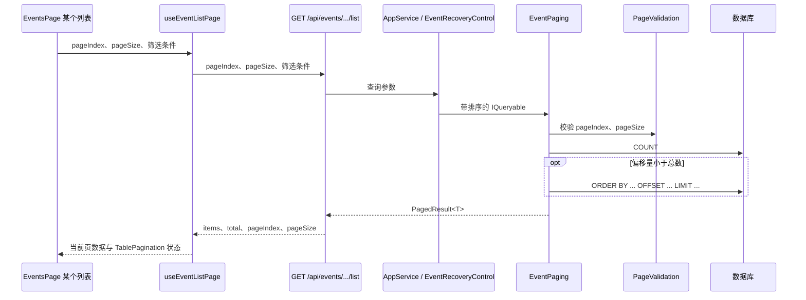

# 事件中心列表翻页

## 背景

事件中心页面（`@agw/events` 的 `EventsPage`，Web 与 Desktop 共用）有六个列表：Events、Sources、Subscriptions、Deliveries、Schedules、Waiting records。目前这些列表都不能翻页：

- Events 固定读取最新的 100 条。接口有 `Offset`/`Limit` 参数，页面没有使用。
- Deliveries、Schedules 最多返回 200 条。Waiting records 从事件、投递、通知派发三类记录中各读取 200 条，合并后返回。
- Sources、Subscriptions 一次返回全部记录。

超出上限的记录在页面上看不到，记录少于上限时又要一次加载全部数据。本方案为六个列表增加翻页，每页条数可选 10、20、50、100，每页最多 100 条。

没有兼容性要求。六个列表接口直接改为翻页接口，Web 与 Desktop 客户端同步修改。

## 设计目标

### 功能目标

1. 六个列表接口按页码和每页条数返回一页数据与总数。
2. 页面上的六个列表各自翻页，每页条数可选 10、20、50、100，默认 20。
3. Subscription 对话框的 Source 勾选列表仍然列出当前用户的全部 Source。
4. 共享翻页组件 `TablePagination` 支持调用方指定每页条数的选项。

### 技术目标

- 页码从 1 开始。每页条数只接受 10、20、50、100，其他值返回错误。
- 每个列表的排序以唯一键结尾，数据不变时翻页不会重复或遗漏记录。
- 计数与分页在数据库中完成。一个部署只使用一种数据库，文字列（`Name`）按该数据库的排序规则排列，同一个数据库中的顺序稳定。
- 用户隔离保持不变：沿用现有查询条件与 user-scope 查询过滤器。

## 总体设计



## 数据库设计

不修改表结构，不增加 migration。

## 详细设计

### 翻页参数与结果

Events 模块的 Application 与 `Agw.Infrastructure/Events` 共同使用 `src/server/Agw.Events/Application/Persistence/EventPaging.cs`。该类位于架构测试允许引用的 `Agw.Events.Application.Persistence` 命名空间，入口为 `ToPagedResultAsync<TSource, TItem>(IQueryable<TSource> ordered, int pageIndex, int pageSize, Func<TSource, TItem> map, CancellationToken cancellationToken)`。

`ToPagedResultAsync` 调用 `Agw.Shared.Pagination.PageValidation.Validate(pageIndex, pageSize, allowPageSize100: true)`。共享校验默认允许每页 10、20、50 条，供 `UpdatedTimePagination`、`ProjectConversationAppService` 和 `UserMemoryAppService` 使用。Events 额外允许每页 100 条。错误消息根据允许的每页条数生成。

- `pageIndex < 1` 时抛出 `AgwException(ErrorCodes.InvalidParam, "pageIndex must be at least 1.")`。
- Events 请求的每页条数超出允许范围时抛出 `AgwException(ErrorCodes.InvalidPageSize, "pageSize must be one of 10, 20, 50, or 100.")`。

校验通过后执行 `CountAsync`，以 `long` 计算偏移量 `((long)pageIndex - 1) * pageSize`。偏移量小于总数时，执行 `Skip((int)offset).Take(pageSize).ToListAsync`，并用 `map` 转换当前页。返回 `Agw.Shared.Contracts.Pagination.PagedResult<TItem>`（`Items`、`Total`、`PageIndex`、`PageSize`）。页码超过最后一页时返回空的 `Items` 和实际的 `Total`，由客户端退回到最后一页。

### 各列表的查询与排序

每个列表在数据库中排序，排序以唯一键结尾：

- Events（`EventManagementAppService.ListEventsAsync`）：筛选条件不变（SourceId、Type、Subject、ChainId、From、To），按 `ReceivedAt` 降序、`Id` 降序。
- Sources（`EventSourceAppService.ListAsync`）：当前用户、未删除，按 `Name`、`Id`。
- Subscriptions（`EventManagementAppService.ListSubscriptionsAsync`）：按 `Name`、`Id`。
- Deliveries（`EventManagementAppService.ListDeliveriesAsync`）：筛选条件不变（eventId、state），按 `Id` 降序。
- Schedules（`EventManagementAppService.ListSchedulesAsync`）：按 `DueAt == null`、`DueAt`、`Id`。`DueAt` 可以为空，SQLite 升序时空值在前，PostgreSQL 在后；先按 `DueAt == null` 排序，没有到期时间的计划在两种数据库中都排在最后。
- Waiting records（`EventRecoveryControl.ListAsync`）：见下一节。

`/api/events/chain` 读取同一处理链的事件，页面没有使用它，它也不属于本方案的六个列表。`ListEventsAsync` 改为翻页后，chain 接口改用新的 `EventManagementAppService.ListChainAsync(Guid chainId)`，查询条件、排序和 500 条上限保持现在的行为。

### Waiting records 的合并翻页

Waiting records 合并三类超过恢复时间、仍未发布的记录，三类记录的筛选条件保持现状：

- 事件：`DispatchState == Pending` 且 `RecoverAfter <= now`。
- 投递：`State == Pending` 且 `RecoverAfter <= now`。
- 通知派发：`ChannelKey != "desktop"`，并且状态为 Pending/UpdatePending 且 `RecoverAfter <= now`，或状态为 Sending 且 `ClaimExpiresAt <= now`。

三个查询在数据库中投影为 `WaitingRow`，包含 `Topic`、`EntityId`、`NotificationState`（`NotificationDispatchState?`）和 `RecoverAfter`。事件、投递和通知派发的 `Topic` 分别为 `EventMessages.Accepted`、`EventMessages.Delivery`、`EventMessages.NotificationDispatch`。事件和投递的 `NotificationState` 为 `null`，通知派发使用记录的 `State`。

用 `Concat` 合成一个 `UNION ALL` 查询，按 `RecoverAfter`、`EntityId` 排序后交给 `EventPaging.ToPagedResultAsync`。`ToUnpublishedRecord` 将当前页映射为 `UnpublishedEventRecord`。通知派发的 `State` 为枚举名称，事件和投递均返回 `"Pending"`。

事件与通知相关表的时间列在 SQLite 中保存为 `UtcTicks` 整数（`AgwDbContext.ConfigureEventTimestampColumns`），PostgreSQL 中为 `timestamptz`，两种数据库都能在 `UNION ALL` 之后排序。

`IEventRecoveryControl.ListAsync` 的签名改为 `Task<PagedResult<UnpublishedEventRecord>> ListAsync(int pageIndex, int pageSize, CancellationToken cancellationToken)`。

### Subscription 对话框的 Source 选项

Subscription 对话框需要列出全部 Source 供勾选，Sources 接口改为翻页后不能再满足这个需要。新增 `GET /api/events/sources/options`：

- `EventSourceAppService.ListOptionsAsync` 返回当前用户全部未删除的 Source，只读取 `Id` 和 `Name`，按 `Name`、`Id` 排序。
- 响应为 `EventSourceOptionResponse[]`，每项包含 `id`、`name`。
- 对话框打开时请求这个接口，query key 为 `["events", "sources", "options"]`。勾选列表的界面不变。

### 共享翻页组件

`@agw/components` 的 `table-pagination.tsx`：

- `TablePagination` 增加可选属性 `pageSizeOptions?: readonly number[]`，默认值为 `PAGE_SIZE_OPTIONS`（10、20、50）。`PaginatedTable` 把这个属性传给 `TablePagination`。现有调用方不传这个属性，行为不变。
- 导出 `TablePagination`，供以卡片和行列表展示数据的页面直接放在卡片底部使用。

### Events 页面

新增 `packages/events/src/ui-web/pages/use-event-list-page.ts`：

- `EVENT_PAGE_SIZE_OPTIONS = [10, 20, 50, 100]`，默认每页 20 条。
- `useEventListPage` 保存一个列表的 `pageIndex`、`pageSize`，用 `useQuery` 请求当前页（`placeholderData: keepPreviousData`，翻页时保留上一页的内容），并提供 `onPageIndexChange`、`onPageSizeChange`。
- 修改每页条数时回到第 1 页。传入的筛选条件变化时回到第 1 页。
- 数据返回后用 `getClampedPageIndex` 检查页码：删除或重新发布使总数减少、当前页超过最后一页时，退回到最后一页。

`events-page.tsx` 中六个列表都使用 `useEventListPage`：

- 每个列表的卡片底部放 `TablePagination`，传入 `EVENT_PAGE_SIZE_OPTIONS`。总数为 0 时 `TablePagination` 不显示，卡片显示现有的空状态文字。
- Event stream 卡片的说明文字显示总数（`{total} events`）。列表区域保留 `max-h-[38rem] overflow-auto`，与右侧的 Event details 并排显示。
- Events 点击 Apply filters、Show chain，以及 Deliveries 修改 Event ID 筛选时，对应列表回到第 1 页。
- 六个列表的翻页状态保存在 `EventsPage` 中，切换标签页后保留各自的页码与每页条数。
- query key 为 `["events", "list", filters, pageIndex, pageSize]`、`["events", "sources", pageIndex, pageSize]`、`["events", "subscriptions", pageIndex, pageSize]`、`["events", "deliveries", eventId, pageIndex, pageSize]`、`["events", "schedules", pageIndex, pageSize]`、`["events", "unpublished", pageIndex, pageSize]`。现有的 `invalidateQueries({ queryKey: ["events"] })` 与按列表前缀的失效写法继续生效。

### 客户端 API 类型

后端接口修改后，导出 Development 环境的 OpenAPI 文档到 `src/clients/packages/api/openapi.json`，在 `src/clients` 运行 `pnpm gen:api` 更新 `packages/api/src/openapi.d.ts`。

## 接口文档

### 基础信息

所有接口需要登录（`RequireAuthorization`），响应使用 Bens.Results 信封。翻页接口的响应 `data` 为：

```json
{
  "items": [],
  "total": 0,
  "pageIndex": 1,
  "pageSize": 20
}
```

翻页参数 `pageIndex` 默认 1，`pageSize` 默认 20，取值为 10、20、50、100。

### 接口列表

修改的接口：

- `GET /api/events/list?Type=agw.execution.completed&PageIndex=2&PageSize=50`
  - 删除 `Offset`、`Limit`，增加 `PageIndex`、`PageSize`。参数名沿用 `EventListQuery` 现有的属性命名。
  - `data` 为 `PagedResult<EventResponse>`。
- `GET /api/events/sources/list?pageIndex=1&pageSize=20`，`data` 为 `PagedResult<EventSourceResponse>`。
- `GET /api/events/subscriptions/list?pageIndex=1&pageSize=20`，`data` 为 `PagedResult<EventSubscriptionResponse>`。
- `GET /api/events/deliveries/list?eventId=...&state=...&pageIndex=1&pageSize=20`，`data` 为 `PagedResult<EventDeliveryResponse>`。
- `GET /api/events/schedules/list?pageIndex=1&pageSize=20`，`data` 为 `PagedResult<EventScheduleResponse>`。
- `GET /api/events/unpublished/list?pageIndex=1&pageSize=20`，`data` 为 `PagedResult<UnpublishedEventRecord>`。

新增的接口：

- `GET /api/events/sources/options`

```json
{
  "code": 0,
  "title": "OK",
  "data": [{ "id": "01a1d8d5-4154-7313-80c3-2e75dc53ed02", "name": "GitHub webhook" }]
}
```

参数错误的响应：

```json
{ "code": 4000025, "title": "pageSize must be one of 10, 20, 50, or 100." }
```

## 测试计划

### 单元测试

后端测试放在 `tests/Agw.Events.Tests`，用 `ModuleCompositionTestHost`（SQLite）调用 `EventPaging`、AppService 与 `EventRecoveryControl`。

- `ToPagedResultAsync_InvalidPageIndex_ThrowsInvalidParam` 验证 `pageIndex` 为 0 时的错误码和消息。
- `ToPagedResultAsync_UnsupportedPageSize_ThrowsInvalidPageSize` 验证 `pageSize` 为 30 或 101 时的错误码和消息。
- `ToPagedResultAsync_SupportedPageSize_ReturnsPage` 验证每页 10、20、50、100 条时返回正确的分页信息。
- `ListEventsAsync_SecondPage_ReturnsOrderedItemsAndTotal` 验证筛选后第 2 页每页 10 条，返回第 11–20 条，`Total` 为 25。前两页依次返回筛选后的前 20 条。
- `ListEventsAsync_PagePastEnd_ReturnsEmptyItemsAndActualTotal` 验证第 4 页和 `int.MaxValue` 页均返回空的 `Items`、`Total = 25` 和请求的 `PageIndex`。
- `ListAsync_SourcePages_ReturnUserSourcesWithoutOverlap`：同名 Source 跨页按 `Id` 排序，各页没有重复；其他用户与已删除的 Source 不计入 `Total`。
- `ListOptionsAsync_ManySources_ReturnsAllSources`：写入 101 个 Source，选项接口返回全部 101 个，按 `Name`、`Id` 排序。
- `ListSubscriptionsAsync_SameNames_PagesWithoutOverlap`。
- `ListDeliveriesAsync_EventFilter_PagesFilteredDeliveries`：eventId 与 state 筛选和翻页同时生效。
- `ListSchedulesAsync_NullDueAt_SortsLast`。
- `ListAsync_WaitingRecords_PagesAcrossRecordKinds`：写入超过恢复时间的事件、投递、通知派发，以及未超过恢复时间的记录；`Total` 为三类符合条件的记录之和，各页按 `RecoverAfter`、`EntityId` 排序，`Topic` 与 `State` 正确。

PostgreSQL 测试从 `.scratch/postgres-tests.json` 读取连接字符串，缺少连接字符串时跳过。两个用例均标记 `Category=Postgres`，与同类的 SQLite 用例共用私有场景方法。

- `Agw.Infrastructure.Events.EventRecoveryControlTests.ListAsync_WaitingRecordsOnPostgres_PagesAcrossRecordKinds` 验证 Waiting records 的 `UNION ALL` 翻页，调用 `WaitingRecordsScenarioAsync`。
- `Agw.Events.Application.EventManagementListTests.ListSchedulesAsync_NullDueAtOnPostgres_SortsLast` 验证 Schedules 的空值排序，调用 `NullDueAtScenarioAsync`。

CI 通过以下配置运行并核验两个用例。

- `.github/workflows/build-server.yml` 的 PostgreSQL job 构建 `tests/Agw.Events.Tests`，增加一步以 `-filterVSTest "Category=Postgres"`、`-failSkips` 运行，结果写入 `TestResults/Postgres/events.trx`。
- `.github/scripts/verify-postgres-tests.py` 增加 `events` 测试组，列出这两个 PostgreSQL 测试的名称。
- `docs/1.Development.md` 中的 PostgreSQL CI 命令同步增加 Events 测试。

修改 `tests/Agw.Architecture.Tests` 涉及的持久化访问清单（如有变化），运行 `dotnet test tests/Agw.Architecture.Tests`。

前端测试：

- `packages/components/src/ui-web/table-pagination.test.ts`：传入 `pageSizeOptions` 后，每页条数选项为 10、20、50、100；不传时为 10、20、50。
- `packages/events/src/ui-web/pages/events-page.test.ts`：用 `startApiServer` 通过真实 HTTP 提供接口，检查请求参数与页面状态：
  - 六个列表首次请求 `pageIndex=1`、`pageSize=20`。
  - 选择每页 100 条后请求第 1 页、每页 100 条；点击 Next 请求第 2 页。
  - Apply filters 与修改 Deliveries 的 Event ID 后回到第 1 页。
  - 当前页超过最后一页时退回到最后一页。
  - Subscription 对话框列出 `sources/options` 返回的全部 Source。
  - 切换标签页后保留各列表的页码。

### 集成测试

Desktop 集成测试的 `eventsViewLayout` 步骤创建 30 个 Source：默认每页 20 条，检查第一页显示 20 行和翻页栏，再检查视图宽度与滚动。
