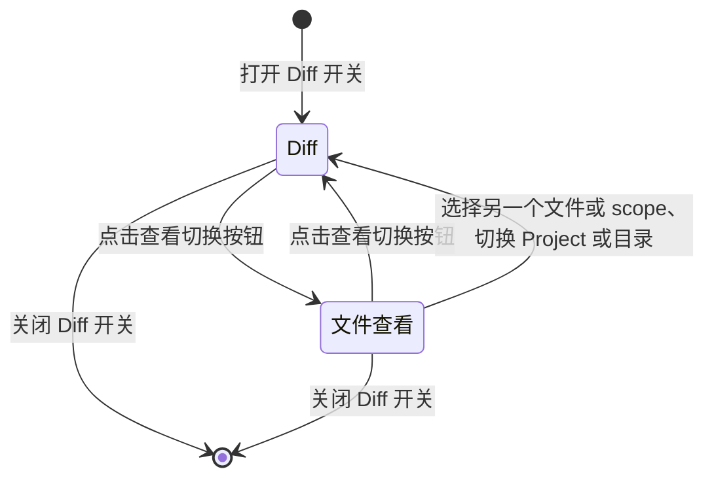
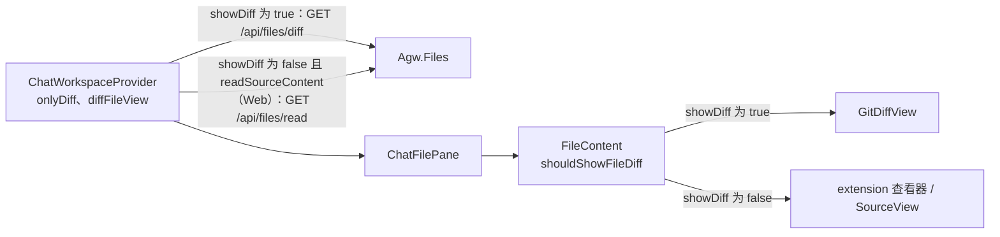

# Diff 模式下查看文件

## 名词解释

- **Diff 模式**：File Explorer 标题行的 Diff 开关打开后的状态（工作区状态 `onlyDiff`）。文件树只列出有改动的文件，按 Staged 与 Unstaged 分组。主区默认显示所选 scope 下的左右两栏 diff（`GitDiffView`）。
- **文件查看**：主区显示文件本身，内容与 Diff 开关关闭时相同：匹配文件的 extension 查看器（Markdown 为 Mixed、Preview，图片为 Image，`.excalidraw` 为 Excalidraw）与 Source，按默认查看器规则选中其中一个。
- **查看切换按钮**：Diff 模式下文件标题行最右侧的图标按钮，在 diff 与文件查看之间切换。

## 背景

Diff 模式下主区只能显示 diff。用户检查改动时经常需要看文件本身：Markdown 排版后的样子、图片的内容，或者直接修改源码。现在只能关闭 Diff 开关，文件树随之变为完整的目录树，要在其中重新找到这个文件；看完后再打开 Diff 开关，重新选择文件。

现有代码中：

- `FileContent`（`@agw/projects`）在 `onlyDiff` 为 true 时不使用查看器列表与可编辑 Source，"More" 菜单的四组都为空，所以 diff 的标题行右侧没有按钮。
- `ChatWorkspaceProvider`（`@agw/chat`）的 `loadFileContent` 在 `onlyDiff` 为 true 时只请求 `/api/files/diff`，不读取文件内容。

## 设计目标

### 功能目标

1. Diff 模式下文件标题行最右侧显示查看切换按钮：diff 显示时点击进入文件查看，文件查看时点击回到 diff。
2. 文件查看与 Diff 开关关闭时的主区相同：查看器切换、默认查看器、"More" 菜单、保存状态、Desktop 中可编辑的 Source、Web 中只读的 Source、行评论。
3. Diff 模式中选择另一个文件或 scope 时返回 diff。切换 Project 或目录时清空预览，选中文件后显示对应的 diff。关闭 Diff 开关后恢复普通文件浏览。
4. 从文件查看回到 diff 时保留未保存的修改，diff 显示期间按钮带未保存标记。
5. 回到 diff 时重新请求 diff。文件查看中保存的修改写入工作区，出现在 Unstaged 与默认 scope 的 diff 中。Staged 的 diff 显示 HEAD 与 index 之间的改动。

### 技术目标

- 只修改 `@agw/projects` 的 `FileContent`，以及 `@agw/chat` 的 `ChatWorkspaceProvider` 与 `ChatFilePane`。Server 接口、Desktop renderer、extension 与 Mobile 都不变。
- 文件查看使用现有的查看器、`SourceDocument` 与文档会话，没有新的读写路径；Desktop 的写入仍经 `/api/files/write` 并检查 `expectedSha256`。

## 总体设计





- 工作区持有 `diffFileView`。工作区与 `FileContent` 共用 `shouldShowFileDiff(onlyDiff, diffFileView)`，决定读取与显示的内容。
- `FileContent` 用 `showDiff` 决定显示方式。在 Diff 模式下提供 `onDiffFileViewChange` 时，`showViewToggle` 为 true，标题行显示查看切换按钮。

## 数据库设计

不涉及。

## 详细设计

### 1. 工作区状态

`packages/chat/src/ui-web/pages/chat/chat-workspace.tsx`：

- 新状态 `diffFileView`，初始为 false。`ChatWorkspaceContextValue` 增加：

  ```ts
  /** Diff 模式下主区显示文件本身。In Diff mode the main area shows the file itself. */
  diffFileView: boolean;
  /** 在 diff 与文件查看之间切换。Switches between the diff and the file view. */
  setDiffFileView: (diffFileView: boolean) => void;
  ```

- `shouldShowFileDiff(onlyDiff, diffFileView)` 在 Diff 开关打开且主区未进入文件查看时返回 true。
- `fileSelection` 记录文件路径、scope、Project、目录及工作区路径。`fileInDirectory` 对预览选择和待打开文件使用相同的 Project 与目录匹配规则。标题行在选择后显示文件名，读取期间显示加载状态，读取失败时在该文件名下显示错误。
- `selectFileForPreview` 更新预览选择，把 `diffFileView` 置为 false，并让旧的读取结果失效。
  - `handleOnFileSelected`：文件与 scope 相同时保留当前显示。文件相同且 scope 变化时直接更新选择。选择另一个文件时，等待 `afterFileChangeConfirmed` 确认。
  - `openFile`：确认后更新选择。打开其他目录中的文件时，记录待打开文件并切换目录，目录切换的 effect 清空预览后更新选择。
- `loadFileContent(filePath, diffScope, readDiff)` 按 `readDiff` 读取 diff 或文件内容。预览选择或 `showDiff` 变化时，同一个 effect 传入当前的 `showDiff` 并发起读取。Desktop 的 `readSourceContent` 为 false，文件查看的内容由 `SourceDocument` 与查看器读取。
- `handleOnFileReseted` 用当前的 `showDiff` 重新读取。Desktop 的 `handleFileWritten` 刷新文件树。当前目录的当前文件处于文件查看时，它清空工作区的文件内容、diff 数据与读取错误，并保留行评论。Desktop 通过 `SourceDocument` 读取 Source 内容。
- `setOnlyDiff` 更新开关并把 `diffFileView` 置为 false。`clearFilePreview` 在切换 Project 或目录、删除当前文件时清空预览，并把 `diffFileView` 置为 false。
- `handleOnFileGitScopeChanged`（在文件树中 stage 或 unstage 当前文件）只改变 scope，显示方式不变。

`ChatFilePane` 把 `workspace.diffFileView` 与 `workspace.setDiffFileView` 传给 `FileContent` 的 `diffFileView` 与 `onDiffFileViewChange`。Web 的 `/chat` 与 Desktop 都经 `ChatFilePane` 显示文件，Desktop 的 `MainWorkspace` 不需要修改。

### 2. `FileContent`

`packages/projects/src/ui-web/components/file-explorer/file-content.tsx` 的 props 增加：

```ts
/**
 * Diff 模式下主区显示文件本身，与 Diff 开关关闭时相同。
 * In Diff mode the main area shows the file itself, as with the Diff switch off.
 */
diffFileView?: boolean;
/**
 * 有值时 Diff 模式的标题行最右侧显示查看切换按钮。
 * When set, Diff mode shows the view toggle at the far right of the title row.
 */
onDiffFileViewChange?: (diffFileView: boolean) => void;
```

- `shouldShowFileDiff` 的结果保存为 `showDiff`，用于查看器列表 `viewers`、`sourceEditing`、`sourceEntries`、`reload`、`ErrorBoundary` 的 `resetKeys` 与 `GitDiffView` 的显示条件。`choice` 按文件记录查看器选择，同一个文件在 diff 与文件查看之间往返时保持上次选中的查看器。
- 标题行的 `actions` 依次为查看器切换、"More" 按钮、查看切换按钮；三者都没有时不显示 `actions`。

### 3. 查看切换按钮

- 显示条件：`onlyDiff` 为 true 并且有 `onDiffFileViewChange`。
- 位置：标题行最右侧。diff 与文件查看中位置相同，来回切换时不需要移动鼠标；diff 显示时它是标题行右侧唯一的按钮。
- 查看切换按钮使用 `Button`，并设置 `type="button"`、`variant="ghost"`、`size="icon"` 和 `className="relative size-6"`。图标使用 `size-3.5`。
- diff 显示时：图标 `Eye`（lucide-react），`aria-label` 与 `title` 为 "View file"，点击调用 `onDiffFileViewChange(true)`。
- 文件查看时：图标 `FileDiff`，`aria-label` 与 `title` 为 "View changes"，点击调用 `onDiffFileViewChange(false)`。
- 未保存标记：diff 显示时，`editableSource?.document?.unsaved` 为 true，或 `fileViewers` 中有 `unsaved` 为 true 的查看器，按钮右上角显示一个 6px 的圆点（`bg-foreground`），`aria-label` 与 `title` 为 "View file, unsaved changes"。这里读取 props 中的 `fileViewers` 与 `editableSource`，因为 diff 显示时 `viewers` 为空、`sourceEditing` 为 undefined。

### 4. 文件查看的内容

Desktop 按 `fileViewersFor` 与用户的默认查看器选中：

- Markdown：Mixed（或用户设置的默认查看器），标题行为 Mixed、Preview、Source；
- 代码与其他文本文件：Source，可以编辑、保存、格式化；
- 图片：Image，标题行为 Image、Source；
- `.excalidraw`：Excalidraw，标题行为 Excalidraw、Source。

Web 没有 extension 查看器，文件查看为只读 Source，与 Diff 开关关闭时相同。

文件查看显示工作区中的文件，与所选 scope 无关；回到 diff 时仍使用原来的 scope，diff 中的行评论（`side` 为 `original` 或 `modified`，带 `diffScope`）与 Source 中的行评论（`side` 为 `current`）按现有规则各自显示。

工作区中已经没有这个文件时（例如未暂存的删除），查看器读取失败并显示各自的失败说明：Desktop 的 Source 为读取失败面板，extension 查看器为它们自己的失败面板，Web 为 `FileError`。标题行与查看切换按钮保持显示，可以回到 diff。

### 5. 未保存的修改

- 文件查看中的修改保存在 `SourceDocument` 的文本模型与 extension 页面中。按现有规则，它们在查看器之间切换时保留：`useEditableSource` 的文档与 `SourceView` 是否挂载无关，Desktop 按当前文件名保留匹配查看器的 frame（`retainFileViewers`），diff 显示期间都不释放。
- 回到 diff 时不确认、不丢弃修改。diff 显示磁盘上的内容，按钮带未保存标记（第 3 节）。再次进入文件查看时，修改与撤销历史都在；`SourceDocument.show` 在有未保存修改时不重新读取。
- 选择另一个文件时，现有的 `confirmFileChange`（Desktop 为 `confirmDiscardUnsaved`）先确认放弃修改；关闭窗口前的检查不变。

### 6. 文档

`packages/projects/src/ui-web/components/file-explorer/README.md` 的 `FileContent` 一节加入文件查看、`diffFileView` 与 `onDiffFileViewChange`。

## 接口文档

不涉及 Server 接口。组件接口见详细设计第 1、2 节。

## 测试计划

### 单元测试

`packages/projects/src/ui-web/components/file-explorer/file-content.test.ts`（jsdom，只覆盖不渲染 Monaco 的情况）：

- `FileContent_FileViewInDiffMode_ShowsViewerTabsAndActions`：`onlyDiff` 与 `diffFileView` 为 true、有两个查看器时，显示第一个查看器，标题行有查看器切换与 Source。"More" 菜单有 "Reload view" 与默认查看器项。标题行最后一个按钮为 "View changes"，点击后回调收到 false。
- `FileContent_DiffModeOff_HasNoViewToggle`：Diff 开关关闭时，即使有 `onDiffFileViewChange` 也没有查看切换按钮。
- `FileContent_DiffModeWithUnsavedViewer_MarksViewFile`：显示二进制 diff 且某个查看器 `unsaved` 为 true 时，按钮的 `aria-label` 为 "View file, unsaved changes"。
- `FileContent_FileViewReadErrorInDiffMode_KeepsViewChangesToggle`：文件读取失败时显示 `FileError`，标题行保留 "More" 和 "View changes"。

`packages/projects/browser-tests/file-content.test.ts`（Chromium；fixture 的 `Scenario` 增加 `diffFileView`，`onDiffFileViewChange` 的调用记入 `fixture.calls`）：

- `FileContent_DiffMode_ShowsOnlyViewFileInHeader`：diff 显示时标题行右侧只有 "View file"，点击后 `calls` 记录 true。
- `FileContent_DiffModeWithUnsavedSource_MarksViewFile`：可编辑文档 `unsaved` 为 true 时按钮带未保存标记。
- `FileContent_FileViewInDiffMode_EnablesEditableSource`：文件查看中 Source 可以编辑，"More" 菜单有 Format、Word wrap 与 Save，保存状态显示在文件名后，"View changes" 在最右侧。
- 现有回归用例 `FileContent_DiffMode_DisplaysReadOnlyChanges` 检查 diff 显示时的只读行为。

### 集成测试

- Web e2e（`web/e2e/file-code-view.spec.ts`）使用独立 Standalone Host、SQLite 与 Git 工作区。`standalone-file-project.ts` 创建测试 Project 并转发 Server 响应。
  - `ChatFilePane_DiffMode_ShowsWorkingFileAndReadsEachScopeOnce` 检查 Staged 与 Unstaged 的 diff、重复选择同一条目、stage 后的显示方式，以及每次选择的请求次数。用例在 Source 中输入文字，确认只读编辑器保留工作区内容。
  - `ChatFilePane_SelectionChangesInDiffMode_LoadsTheSelectedFile` 检查切换文件、Diff 开关和目录时预览与请求使用的文件。
  - `ChatFilePane_DelayedSourceError_KeepsTheLatestDiff` 检查文件读取错误、标题行切换按钮，以及迟到的错误响应是否会影响当前 diff。
- Desktop `test:extensions`（`desktop/src/main/extensions.integration.ts`，每次运行前征得确认）：
  - Diff 模式中选择改动的 Markdown 文件，点击 "View file" 后显示 Mixed，标题行为 Mixed、Preview、Source 与 "View changes"；
  - 在 Unstaged 分组中选择改动的文件，选中 Source 并输入，点击 "View changes"：diff 显示磁盘内容，按钮带未保存标记；再次进入文件查看后修改仍在，保存后回到 diff，修改侧出现保存的行；
  - 改动的图片文件进入文件查看后显示 Image 查看器。

### 回归测试

- `pnpm test`（边界检查、全部包的 typecheck 与 test）、`pnpm lint`、`pnpm fmt:check`。
- `pnpm --filter @agw/projects test:browser`。从仓库根目录运行 `dotnet build src/server/Agw.Standalone.Host`，在 `src/clients` 运行 `pnpm --filter @agw/web test:e2e` 与 `pnpm --filter @agw/web test:e2e:export`。
