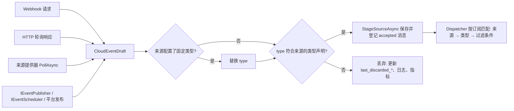

# 事件来源与订阅配置简化

## 名词解释

| 名词 | 说明 |
| --- | --- |
| 来源名称 | `event_source.name`，由“前缀 + 后缀”组成，例如 `webhook.demo-ticket`。前缀由来源类型和管理方确定，用户只编辑后缀。同一用户下来源名称唯一。 |
| 内置来源 | 平台自己发布事件的来源，名称以 `agw.` 开头，例如 `agw.execution`、`agw.notifications`。 |
| extension 发布方来源 | extension 通过 `IEventPublisher` 发布的事件和通过 `IEventScheduler` 预约的事件所属的来源，每个 extension 一个，名称以 `ext.` 开头。 |
| 类型声明 | 一个来源允许产生的事件类型集合，写法为完整类型或 `前缀.*`。 |
| 固定类型 | Webhook 和 HTTP 轮询来源可以配置的一个完整类型。配置后，来源收到的每条事件都改用这个类型。 |
| 丢弃 | 事件不保存、不派发，只更新来源的最近丢弃记录、写日志和指标。 |

## 背景

事件中心（`docs/designs/2026-11-08-事件中心与TaskPilot.md`）的来源和订阅配置对普通用户难以理解：

- 来源对话框只有 “Configuration JSON” 和 “Secret JSON” 两个文本框。Webhook 必须写出 `format`、`auth`、`mapping`，HTTP 轮询必须写出 `request`、`pagination`、`items`、`key`、`change`、`event`、`interval`，其中的取值规则是 JsonLogic 表达式。Secret 的格式随认证方式变化，界面没有任何提示。
- extension 来源提供器需要手工输入 Extension ID 和 Provider ID，配置也是手写 JSON。
- 订阅的 filter 是一整条 JsonLogic 表达式。
- 订阅同时有 “Sources” 和 “Publisher keys” 两种指定来源的方式。`EventSubscriptionMatcher` 用“并且”组合两者，“`agw.execution` 或者某个 Job 的 Timer”这样的订阅无法配置。publisher key 指向的其实也是 `event_source` 中 `kind = Publisher` 的行，同一个概念有两种写法。
- 来源名称可以任意填写，可以重名；任何来源都可以产生任意类型的事件。

本设计没有兼容性要求，现有数据不做转换。

## 设计目标

### 功能目标

1. 来源名称使用固定前缀，同一用户下唯一。
2. 去掉 publisher key，内置来源和 extension 发布方来源都作为普通来源出现在 Sources 中，订阅只按来源选择。
3. 每个来源声明自己产生的事件类型。Webhook 和 HTTP 轮询可以配置固定类型。类型不在声明范围内的事件被丢弃。
4. Webhook 默认接收 CloudEvents 请求，创建时只需要名称和事件类型。
5. HTTP 轮询默认读取 CloudEvents 批量响应，创建时只需要名称、事件类型、URL、间隔和认证方式。
6. extension 来源提供器从下拉框选择，配置从 extension 声明的具名配置中选择。
7. 来源对话框按类型显示表单，其他配置放在默认收起的高级设置中。
8. 订阅表单的来源和事件类型改为多选，过滤条件改为表单并放在高级设置中。

### 技术目标

- 安全：`agw.` 前缀和 `agw.` 开头的事件类型只属于平台；`ext.` 前缀只属于 extension。Webhook 密钥由服务端生成，只在创建和轮换时返回一次。extension 管理的订阅中，`kind = Publisher` 的来源只能是内置来源或这个 extension 自己的发布方来源。
- 可观测：丢弃事件时记录指标、Warning 日志，并在来源上保存最近一次被丢弃的类型和时间。

## 总体设计



`IEventPublisher` 和 `IEventScheduler` 由 extension 代码调用，类型不符合 manifest 发布权限时保持现有行为，向调用方返回 `EventPublishTypeDenied`。平台自己发布的事件类型是代码中的常量，不会出现不符合声明的情况。丢弃规则用于 Webhook、HTTP 轮询和来源提供器这三种外部输入。

## 数据库设计

### event_source

| 变化 | 字段或索引 | 说明 |
| --- | --- | --- |
| 删除 | `publisher_key` 及唯一索引 `(create_by, publisher_key)` | 发布方来源改用 `managed_by` + `managed_key` 识别 |
| 修改 | `name`，最长 200 字符 | PostgreSQL 使用 `character varying(200)`，SQLite 通过来源名称校验限制长度 |
| 新增 | 唯一索引 `(create_by, name)`，过滤条件 `deleted_at IS NULL` | 同一用户下来源名称唯一，已写入 `deleted_at` 的来源不占用名称 |
| 新增 | `last_discarded_type`，可空，最长 200 | 最近一次被丢弃事件的类型 |
| 新增 | `last_discarded_at`，可空 | 最近一次丢弃的时间 |

`managed_by` 和 `managed_key` 的取值：

| 来源 | `kind` | `managed_by` | `managed_key` |
| --- | --- | --- | --- |
| 内置来源 | `Publisher` | `agw` | 来源名称，例如 `agw.execution` |
| extension 发布方来源 | `Publisher` | `ext:<extensionId>` | `publisher` |
| Job 的 Timer | `Timer` | `job` | Job ID |
| 用户创建的来源 | 其他 | `user` | 空 |

`EventManagedBy` 增加常量 `Agw = "agw"`。`managed_by` 不是 `user` 的来源，用户不能修改、启停和删除，现有的 `EventManagedRecordGuard` 规则保持不变。

`config_json` 的结构见“详细设计”中各类来源的配置。

### event_subscription

| 变化 | 字段 | 说明 |
| --- | --- | --- |
| 删除 | `publisher_keys_json` | 订阅只按 `source_ids_json` 选择来源 |

### Migration

模型变化需要 `Agw.Migrations.Sqlite` 和 `Agw.Migrations.Postgres` 各一份 migration。

事件中心还没有进入发布版本。migration 在修改表结构之前清空以下表，开发数据库中的旧来源、旧订阅和 Job 一起清空；全新安装时这些表为空：

- `event_source`、`event_source_item`
- `event_subscription`
- `event`、`event_delivery`、`event_delivery_attempt`
- `event_schedule`、`event_outbox`

TaskPilot 增加一份 Sqlite 和一份 Postgres migration，清空它保存的订阅状态：

- 用户状态的 `SystemSubscriptionId`、`SystemSubscriptionOutboxId`、`SystemSubscriptionError` 置空。下次调用 TaskPilot endpoint 时，`TaskPilotSystemSubscription.EnsureAsync` 按新的请求重新创建系统订阅。
- 规则的 `SubscriptionId`、`SubscriptionOutboxId` 置空，`SubscriptionError` 写入“请重新保存规则”。用户重新保存规则后重新创建订阅。

两份 TaskPilot migration 使用公开 SDK 操作 `ExtensionUpdateAllRowsOperation` 更新扩展自己的业务表。操作接收带完整前缀的表名和逐列赋值的 `Assignments`，按 migration 目标模型的列映射生成 SQL。SDK 管理的收件箱、发件箱和 migration 历史表由 SDK 保留。

## 详细设计

### 1. 来源名称

来源名称为“前缀 + 后缀”：

| 来源 | 前缀 | 后缀 |
| --- | --- | --- |
| 内置来源 | `agw.` | 固定，例如 `execution` |
| Job 的 Timer | `agw.timer.` | Job 名称 |
| 用户创建的定时来源 | `timer.` | 用户填写 |
| Webhook | `webhook.` | 用户填写 |
| HTTP 轮询 | `http.` | 用户填写 |
| extension 来源提供器 | `ext.` | 默认为 extension manifest 的 `name`，用户可以修改 |
| extension 发布方来源 | `ext.` | extension manifest 的 `name` |

规则：

- 后缀由小写字母、数字、`-`、`.` 组成，以字母或数字开头和结尾，不能出现连续的 `.`。名称总长度不超过 200。
- 接口的 `name` 字段传完整名称。服务端按来源类型和管理方校验前缀，前缀不符时返回 `InvalidParam`。用户创建的来源不能使用 `agw.` 前缀；`ext.` 前缀只能用于来源提供器。
- 同一用户下名称已被未删除的来源使用时，创建和改名返回 `EventSourceNameConflict`（`409_0035`）。
- 平台自动生成的名称（extension 发布方来源）已被占用时，依次在后缀末尾加 `-2`、`-3`，直到可用。
- Job 的名称同时是 Timer 的后缀：
  - Jobs 创建和修改 Job 时按后缀规则校验名称，不符合时返回 `InvalidParam`，名称冲突时返回 `EventSourceNameConflict`。
  - `JobDefinitionDomainService.ResolveNameAsync` 为未命名的 Job 生成 `job-{序号}-{UTC 日期}`，序号从现有 Job 数量加 1 开始递增，直到对应的 Timer 名称没有被占用。
  - Jobs 页面的名称输入框、`agw_job` 工具的参数说明（`JobManagementToolExecutor`、`JobManagementSkill`）和 `src/server/Agw.Jobs/README.zh-CN.md` 写明名称格式。
  - Job 的名称从订阅的 `name` 读取，`EventJobFacade.ReadDefinition` 改为读取 `Subscription.Name`。

### 2. 内置来源与 extension 发布方来源

#### 内置来源

`Agw.Shared/Contracts/Events/EventBuiltInSources` 定义内置来源：

| 名称 | `ce_source` | 类型声明 |
| --- | --- | --- |
| `agw.execution` | `/agw/executions` | `agw.execution.completed` |
| `agw.notifications` | `/agw/notifications` | `agw.notification.answered` |

- 每个用户的每个内置来源对应一行 `event_source`。`Agw.Events/Application/Sources/EventPublisherSources` 提供 `EnsureBuiltInAsync(name)` 和 `EnsureExtensionAsync(extensionId)`，按 `(create_by, managed_by, managed_key)` 查找，缺少时创建，返回来源行。并发创建沿用 `EventStaging.StageAsync` 的应用锁和唯一索引。暂存编排位于同一目录，Webhook 接收、轮询和扫描位于 `Agw.Events/Infrastructure/Sources`。
- 以下位置调用 `EnsureBuiltInAsync`，使内置来源在产生第一条事件之前就能被选择：
  - 平台发布事件时（`EventStaging`）。
  - `GET /api/events/sources/options` 和 `GET /api/events/sources/list` 查询之前。
  - `IEventSourceFacade.GetBuiltInSourceIdAsync`。
- `EventStagingRequest.PublisherKey` 删除，改为二选一的两个字段：`BuiltInSource`（内置来源名称，宿主模块使用）和 `ExtensionId`（extension 发布和预约使用）。`BackgroundExecutionCompletionTransaction` 和 `NotificationAppService` 改用 `BuiltInSource`。

#### extension 发布方来源

- 每个用户的每个 extension 一行，名称见“来源名称”，`ce_source` 为 `/agw/extensions/<extensionId>`，类型声明为 manifest 的 `server.permissions.events.publish`。
- `IEventPublisher` 发布的事件属于这个来源。
- `IEventScheduler` 中 `caller_key` 为 `ext:<extensionId>` 的计划到期后，事件也属于这个来源，`EventScheduledPublisher` 不再使用 `agw.scheduler:*` 发布方。`caller_key` 为 `source:<sourceId>` 的计划按现有逻辑属于定时来源。其他 `caller_key` 返回 `InvalidParam`。

#### 可信来源规则

`EventSubscriptionMatcher.IsTrustedPublisher` 改为按来源判断。订阅由 extension E 管理，事件来源为 `kind = Publisher` 时，来源的 `managed_by` 必须是 `agw` 或 `ext:<E>`，否则不匹配。其他类型的来源不受这条规则限制。`EventSubscriptionFacade.UpsertManagedAsync` 保存前用同一规则校验 `SourceIds`，不符合时返回 `InvalidParam`。

#### 宿主接口

`IEventSourceFacade`（`Agw.Events.Contracts`）：

```csharp
public interface IEventSourceFacade
{
    Task<EventSourceIdentity?> GetAsync(Guid sourceId, CancellationToken cancellationToken);

    Task<Guid> GetBuiltInSourceIdAsync(string name, CancellationToken cancellationToken);

    Task<Guid> GetExtensionSourceIdAsync(CancellationToken cancellationToken);
}

public sealed record EventSourceIdentity
{
    public required Guid SourceId { get; init; }
    public required EventSourceKind Kind { get; init; }
    public required string Name { get; init; }
    public required string ManagedBy { get; init; }
    public string? ManagedKey { get; init; }
    public required string Source { get; init; }
}
```

- `GetExtensionSourceIdAsync` 返回当前调用方 extension 的发布方来源，调用方取自 `EventCaller.RequiredExtension()`。
- `EventExecutionCompletionHandler` 按 `ManagedBy == "agw"` 且 `Name == "agw.execution"` 识别执行完成事件。
- TaskPilot 系统订阅的 `SourceIds` 为 `agw.execution`、`agw.notifications` 和 TaskPilot 自己的发布方来源，通过上面两个方法取得。`TaskPilotEventHandlers` 用同样的来源 ID 核对 `delivery.SourceId`。
- TaskPilot 的发布方来源同时包含预约事件和规则回执发布的事件。系统类型 `taskpilot.review.due`、`taskpilot.round.retry`、`taskpilot.delivery.tick` 只能由 TaskPilot 的预约产生：`TaskPilotEndpointService.ValidateRule` 拒绝 `EmitTypes` 中的这三个类型，应用回执时遇到这三个类型按回执无效处理。

### 3. 类型声明、固定类型与丢弃

#### 类型声明

| 来源 | 类型声明 |
| --- | --- |
| Webhook、HTTP 轮询 | 配置中的 `eventTypes`，或只包含 `fixedType` 一项 |
| 定时来源 | 配置中的 `event.type` |
| extension 来源提供器 | 提供器描述中的 `EventTypes` |
| 内置来源 | `EventBuiltInSources` 中的常量 |
| extension 发布方来源 | manifest 的 `server.permissions.events.publish` |

- 写法为完整类型或 `前缀.*`，与订阅的 `event_types_json` 相同，匹配函数共用。
- 用户和 extension 声明的类型不能以 `agw.` 开头，保存来源和注册提供器时校验。
- `Agw.Events/Application/Sources/EventSourceTypeDeclaration` 按来源类型解析声明，接收入口和来源查询接口使用同一实现。

#### 固定类型

- Webhook 和 HTTP 轮询的配置中 `eventTypes` 与 `fixedType` 必须且只能填写一个。`fixedType` 是完整类型，不能包含 `*`。
- 配置了 `fixedType` 时，Webhook `mapped` 格式的 `mapping.type` 和 HTTP 轮询条目比对方式的 `typeOnNew`、`typeOnChange` 可以不填，填写时同样被替换。
- 没有配置 `fixedType` 时，HTTP 轮询条目比对方式的 `typeOnNew`、`typeOnChange` 保存时必须符合 `eventTypes`。
- 替换只修改 `type`，`id`、`source`、`data` 等属性保持原样，去重不受影响。

#### 丢弃

- 三个外部入口在生成 `CloudEventDraft` 之后、调用 `StageSourceAsync` 之前，先替换固定类型，再检查类型声明。检查由 `EventStaging.StageExternalAsync(source, draft, cancellationToken)` 完成，返回保存结果或丢弃结果。
- 被丢弃的事件不保存、不派发。来源的 `last_discarded_type`、`last_discarded_at` 被更新，与本次接收或扫描在同一事务提交。
- 指标 `agw.events.discarded`，标签 `source_kind` 和 `reason`。`reason` 取值：`undeclared_type`（类型不在声明内，`agw.` 开头的类型也属于这一类）、`invalid_event`（轮询得到的单条事件转换失败，例如带有 `agw` 开头的扩展属性）。
- Warning 日志：`Event {CeId} from source {SourceId} was discarded: {Reason}, type {EventType}`。
- Webhook：丢弃时仍返回 `202`，响应为 `{ "eventId": null, "discarded": true }`。请求本身无效（认证失败、格式错误）时的响应保持不变。
- HTTP 轮询和来源提供器：同一次扫描中，丢弃的事件不影响其他事件，扫描进度照常前进，`last_error` 照常清空。现在保留类型使整次扫描失败的逻辑删除。

### 4. Webhook

配置：

```json
{
  "fixedType": "demo.ticket.created",
  "format": "cloudevents",
  "auth": { "kind": "BearerToken", "tokenHeader": "Authorization" },
  "contentTypes": ["application/cloudevents+json", "application/json"],
  "cloudEvent": { "summary": { "var": "data.title" } }
}
```

| 字段 | 必填 | 默认值 | 说明 |
| --- | --- | --- | --- |
| `eventTypes` / `fixedType` | 二选一 | 无 | 见“类型声明” |
| `format` | 否 | `cloudevents` | `cloudevents` / `mapped` |
| `auth.kind` | 否 | `BearerToken` | `BearerToken` / `HmacSha256` |
| `auth.tokenHeader` | 否 | `Authorization` | BearerToken 读取的请求头。去除首尾空白后为空时使用默认值 |
| `auth.signatureHeader`、`auth.timestampHeader`、`auth.maxClockSkewSeconds` | 否 | 无 | 与现有规则相同 |
| `contentTypes` | 否 | `cloudevents`：`application/cloudevents+json`、`application/json`；`mapped`：`application/json` | Content-Type 白名单 |
| `mapping` | `mapped` 时必填 | 无 | `id` 必填；`type` 在没有 `fixedType` 时必填 |
| `cloudEvent` | 否 | 无 | `cloudevents` 格式的展示字段 `summary`、`link` |

- `EventSourceConfigParser.ParseWebhook` 补全默认值后返回，保存的 `config_json` 是补全后的完整配置。
- 密钥：创建 Webhook 时服务端生成 32 字节随机值（Base64Url，与 `RotateSecretAsync` 相同），在创建响应的 `secret` 中返回一次。请求中带有 `secret` 时返回 `InvalidParam`。修改时密钥保持不变，需要更换时使用轮换接口。

### 5. HTTP 轮询

配置：

```json
{
  "eventTypes": ["com.example.order.*"],
  "request": {
    "method": "GET",
    "url": "https://example.com/events",
    "headers": {},
    "auth": { "kind": "bearer" }
  },
  "interval": "PT5M",
  "pagination": { "kind": "none" },
  "format": "cloudevents"
}
```

| 字段 | 必填 | 默认值 | 说明 |
| --- | --- | --- | --- |
| `eventTypes` / `fixedType` | 二选一 | 无 | 见“类型声明” |
| `request.url` | 是 | 无 | 规则不变 |
| `request.method` | 否 | `GET` | `GET` / `POST` |
| `request.headers`、`request.body` | 否 | 无 | 规则不变 |
| `request.auth` | 否 | `{ "kind": "none" }` | 规则不变 |
| `interval` | 是 | 无 | ISO 8601 时长，不小于 `Events:HttpPoll:MinInterval` |
| `pagination` | 否 | `{ "kind": "none" }` | `cloudevents` 格式支持 `none`、`linkHeader`、`page`；`mapped` 格式另外支持 `cursor` |
| `format` | 否 | `cloudevents` | `cloudevents` / `mapped` |
| `mapping` | `mapped` 时必填 | 无 | 包含现有的 `items`、`key`、`change`、`event`，规则不变 |

`mapped` 格式的条目比对规则与现在相同，只是配置移入 `mapping`。

分页参数名称去除首尾空白。`pageParameter` 为空时使用 `page`，`cursorParameter` 在 `cursor` 模式下必填。

`cloudevents` 格式：

- 响应体是 CloudEvents JSON 批量格式（事件对象组成的数组），Content-Type 为 `application/cloudevents-batch+json` 或 `application/json`。媒体类型忽略大小写。其他类型使本次扫描失败并写入 `last_error`。
- `CloudEventEnvelopeSerializer` 增加批量解码方法，使用 `CloudNative.CloudEvents.SystemTextJson` 的 `JsonEventFormatter.DecodeBatchModeMessage`。数组整体解码失败时本次扫描失败。单条事件转为 `CloudEventDraft` 的规则与 Webhook `cloudevents` 格式相同，单条转换失败时按 `invalid_event` 丢弃。
- 事件的 `source` 原样保存。
- 已处理的事件记录在 `event_source_item`：`item_key` 为 `JsonSerializer.Serialize(new[] { source, id })`，`fingerprint` 为空，`change_seq` 为 0。
- 首次扫描只写入 `event_source_item` 和 `baseline_at`，不产生事件。后续扫描中，`item_key` 未出现过的事件经过固定类型和类型声明检查后保存或丢弃，两种情况都写入 `event_source_item`，下次扫描不再处理。

### 6. extension 来源提供器

#### 注册

```csharp
public sealed record ExtensionEventSourceProviderDescriptor
{
    public required string Id { get; init; }

    public required IReadOnlyList<string> EventTypes { get; init; }

    public IReadOnlyList<ExtensionEventSourceConfiguration> Configurations { get; init; } = [];
}

public sealed record ExtensionEventSourceConfiguration
{
    public required string Id { get; init; }

    public required string Name { get; init; }

    public string? Description { get; init; }

    public required JsonElement Config { get; init; }
}

public interface IExtensionEventSourceProvider
{
    ValueTask<ExtensionSourcePollResult> PollAsync(
        ExtensionSourcePollRequest request,
        CancellationToken cancellationToken
    );
}

public sealed record ExtensionSourcePollRequest
{
    public required Guid SourceId { get; init; }
    public string? ConfigurationId { get; init; }
    public JsonElement? Configuration { get; init; }
    public JsonElement? Cursor { get; init; }
    public required bool Baseline { get; init; }
}
```

- `ConfigSchema`、`ValidateConfigAsync` 和 `ExtensionSourcePollRequest.Config` 删除。
- `ExtensionRegistration.RegisterEventSourceProvider` 校验：`EventTypes` 不为空、写法合法、不以 `agw.` 开头；配置的 `Id` 符合标识符规则且不重复；`Config` 是 JSON 对象。不符合时返回 `ExtensionPackageInvalid`。

#### 来源配置与轮询

- 来源提供器的 `config_json` 为 `{ "configurationId": "<id>" }`；提供器没有声明配置时为 `{}`。
- 创建时校验提供器在当前启用的 extension 中存在；提供器声明了配置时 `configurationId` 必填且必须存在，没有声明配置时不能填写。
- 每次轮询按当前 extension 版本的描述读取配置内容，填入 `ConfigurationId` 和 `Configuration`。配置已不存在时本次扫描失败，`last_error` 写明配置不可用。
- 提供器返回的事件经过类型声明检查后保存或丢弃。

### 7. 来源对话框

所有类型共有：

- 名称：前缀作为固定文字显示在输入框前面，用户编辑后缀。来源类型变化时前缀随之变化。
- 事件类型（Webhook、HTTP 轮询）：单选“使用事件自带的类型”或“固定为一个类型”。前者显示类型列表输入（可以添加多项），后者显示一个类型输入框。

各类型的主要字段和高级设置（高级设置默认收起）：

| 类型 | 主要字段 | 高级设置 |
| --- | --- | --- |
| Webhook | 名称、事件类型 | 请求格式（CloudEvents / 自定义映射）；自定义映射时显示 `mapping` 的 JSON 编辑框，CloudEvents 时显示展示字段 `cloudEvent` 的 JSON 编辑框；认证方式（Bearer Token / HMAC-SHA256）及对应请求头；Content-Type 白名单 |
| HTTP 轮询 | 名称、事件类型、URL、轮询间隔、认证方式 | 请求方法；请求头（键值行）；请求体（POST 时，JSON 编辑框）；分页方式及参数；响应格式（CloudEvents / 条目比对），条目比对时显示 `mapping` 的 JSON 编辑框 |
| extension 来源提供器 | 名称、来源提供器（下拉框） | 配置（下拉框，显示配置的名称和说明；提供器没有声明配置时不显示） |

- 轮询间隔用“数字 + 单位（分钟、小时、天）”输入，界面转换为 `PT{n}M`、`PT{n}H`、`P{n}D`。默认 5 分钟。
- HTTP 轮询的认证方式为下拉框：无、Bearer Token（显示 Token 输入框）、Basic（显示用户名和密码输入框）、请求头（显示请求头名称和值）、Connection（显示 Integrations Connection 下拉框）。界面按认证方式组装接口的 `secret`。修改来源时密钥输入框留空表示保持现有密钥。
- 来源提供器下拉框的选项来自 `GET /api/events/sources/providers`，显示为“extension 显示名称 · 提供器 ID”，选中后名称后缀默认填入 extension 的 `name`，事件类型以只读文字显示提供器的声明。
- Webhook 创建成功后，对话框显示接收地址和密钥，各带复制按钮，并提示密钥只显示这一次。
- 界面上的 Secret JSON 文本框和 Configuration JSON 文本框删除。
- 来源列表显示名称、类型、事件类型声明、最近一次丢弃的类型和时间、`last_error`。

### 8. 订阅

#### 匹配

- 事件的来源在 `source_ids_json` 中时匹配来源条件；`source_ids_json` 为空时匹配所有来源，与现在相同。
- `MatchesPublisherKeys` 删除，其余匹配步骤（可信来源、类型、过滤条件）不变。

#### 订阅表单

主要字段：

- 来源：多选下拉框，至少选择一项，选项来自 `GET /api/events/sources/options`，包括内置来源、extension 发布方来源、Job 的 Timer 和用户创建的来源，按名称显示。事件类型的选项来自已选来源，所以表单要求先选来源。
- 事件类型：多选输入框。选项为已选来源的类型声明合集；也可以输入完整类型，输入的类型必须符合某个已选来源的声明，否则在界面上提示，不能保存。服务端只校验写法。

高级设置中的过滤条件：

- 一行一个条件，由“字段”和“值列表”组成。同一行的多个值满足任意一个即可，多行之间要求全部满足。没有条件行时 `filter` 为空。
- 字段：`subject`、`scope`、`tags`（事件的标签中包含任意一个值）、`data` 路径（界面显示固定的 `data.`，用户输入后面的路径，例如 `status`、`pull_request.state`）。
- 值为文本，每行至少一个值。

表单与 JsonLogic 的对应关系：

| 条件 | JsonLogic |
| --- | --- |
| `scope` 是 `proj1` 或 `proj2` | `{"in": [{"var": "scope"}, ["proj1", "proj2"]]}` |
| `subject` 是 `a` 或 `b` | `{"in": [{"var": "subject"}, ["a", "b"]]}` |
| `tags` 包含 `x` 或 `y` | `{"some": [{"var": "tags"}, {"in": [{"var": ""}, ["x", "y"]]}]}` |
| `data.status` 是 `1` 或 `open` | `{"in": [{"cat": [{"var": "data.status"}]}, ["1", "open"]]}` |

全部条件行组合为 `{"and": [条件1, 条件2, ...]}`。`data` 路径的值经过 `cat` 转为文本后再判断是否在值列表中，数字和布尔值也能按文本匹配。

- 转换函数放在 `@agw/events`，Web 和 Desktop 共用。读取已有订阅时，`filter` 符合上表生成的结构则还原为条件行；不符合时，过滤条件区域只读显示 JSON 并提供“清除条件”按钮，清除后可以用表单重新填写。
- extension 管理的订阅只读显示，过滤条件只读显示 JSON。
- 界面上的 Publisher keys 输入框删除。

## 接口文档

### 基础信息

所有接口沿用现有的认证方式和 Bens.Results 响应格式。Webhook 接收接口沿用来源认证。

### 接口列表

| method | path | 变化 |
| --- | --- | --- |
| POST | `/api/events/sources/create` | 修改：`name` 为完整名称并校验前缀；Webhook 不接收 `secret`，响应返回生成的 `secret`；`config` 按本设计的结构 |
| POST | `/api/events/sources/update` | 修改：`name` 校验同上；`config` 按本设计的结构 |
| GET | `/api/events/sources/list`、`/api/events/sources/get` | 修改：响应增加 `eventTypes`、`lastDiscardedType`、`lastDiscardedAt` |
| GET | `/api/events/sources/options` | 修改：响应增加 `kind`、`managedBy`、`eventTypes` |
| GET | `/api/events/sources/providers` | 新增 |
| GET | `/api/events/sources/http-poll-options` | 返回当前 `maxPages`。指定 `cursorPath` 时，同时返回服务端解析结果 `cursorPathValid` |
| POST | `/api/events/webhooks/receive` | 修改：响应 `eventId` 可空，增加 `discarded` |
| POST | `/api/events/subscriptions/create`、`/api/events/subscriptions/update` | 修改：删除 `publisherKeys` |
| GET | `/api/events/subscriptions/list`、`/api/events/subscriptions/get` | 修改：删除 `publisherKeys` |

`GET /api/events/sources/options` 响应示例：

```json
[
  {
    "id": "019a8c17-0000-7000-8000-000000000001",
    "name": "agw.execution",
    "kind": 4,
    "managedBy": "agw",
    "eventTypes": ["agw.execution.completed"]
  },
  {
    "id": "019a8c17-0000-7000-8000-000000000002",
    "name": "webhook.demo-ticket",
    "kind": 1,
    "managedBy": "user",
    "eventTypes": ["demo.ticket.created"]
  }
]
```

`GET /api/events/sources/providers` 响应示例：

```json
[
  {
    "extensionId": "019a4c17-5f00-7a80-8b3d-2b732f48a101",
    "extensionName": "feishu",
    "extensionDisplayName": "Feishu",
    "providerId": "messages",
    "eventTypes": ["feishu.message.*"],
    "configurations": [{ "id": "default", "name": "默认", "description": "接收全部消息" }]
  }
]
```

`POST /api/events/webhooks/receive` 丢弃时的响应：

```json
{ "eventId": null, "discarded": true }
```

宿主接口和 SDK 的变化：

| 接口 | 变化 |
| --- | --- |
| `IEventSourceFacade` | 增加 `GetBuiltInSourceIdAsync`、`GetExtensionSourceIdAsync`；`EventSourceIdentity` 删除 `PublisherKey`，增加 `Name`、`ManagedBy`、`ManagedKey` |
| `ManagedSubscriptionRequest` | 删除 `PublisherKeys` |
| `EventStagingRequest` | `PublisherKey` 改为 `BuiltInSource` 和 `ExtensionId` 二选一 |
| `ExtensionEventSourceProviderDescriptor` | 删除 `ConfigSchema`，增加 `EventTypes`、`Configurations` |
| `IExtensionEventSourceProvider` | 删除 `ValidateConfigAsync` |
| `ExtensionSourcePollRequest` | `Config` 改为 `ConfigurationId` 和 `Configuration` |

### 错误码

| 名称 | 编号 | 说明 |
| --- | --- | --- |
| `EventSourceNameConflict` | `409_0035` | 同一用户下来源名称已被使用 |

后端接口变化后执行 `pnpm gen:api` 更新 `packages/api/src/openapi.d.ts`。

## 测试计划

### 单元测试

| 测试 | 目的 |
| --- | --- |
| `ValidateName_PrefixDoesNotMatchKind_ThrowsInvalidParam` | 各类型来源只能使用自己的前缀，用户来源不能使用 `agw.` |
| `ValidateName_SuffixBreaksRule_ThrowsInvalidParam` | 大写字母、空白、连续 `.`、以 `-` 结尾等后缀被拒绝 |
| `CreateAsync_NameUsedByActiveSource_ThrowsNameConflict` | 名称冲突返回 `EventSourceNameConflict`，已写入 `deleted_at` 的来源的名称可以再次使用 |
| `CreateAsync_JobNameBreaksRule_ThrowsInvalidParam` | Job 名称按后缀规则校验 |
| `ResolveNameAsync_GeneratedNameTaken_UsesNextNumber` | 删除 Job 后自动生成的名称跳过已占用的序号 |
| `EnsureExtensionAsync_NameTaken_AppendsSequence` | extension 发布方来源名称被占用时依次加 `-2`、`-3` |
| `EnsureBuiltInAsync_CalledConcurrently_CreatesOneRow` | 并发调用只创建一行内置来源 |
| `ParseWebhook_OnlyTypes_FillsDefaults` | 只填 `eventTypes` 时补全 `cloudevents`、BearerToken 和 Content-Type 默认值 |
| `ParseWebhook_TypesAndFixedTypeBothSet_ThrowsInvalidParam` | `eventTypes` 和 `fixedType` 必须且只能填写一个 |
| `ParseWebhook_MappedWithFixedType_TypeRuleOptional` | 有固定类型时 `mapping.type` 可以不填 |
| `ParseHttpPoll_MappedTypesOutsideDeclaration_ThrowsInvalidParam` | 条目比对方式的类型必须符合声明 |
| `ParseHttpPoll_CloudEventsWithCursorPagination_ThrowsInvalidParam` | `cloudevents` 格式不支持 `cursor` 分页 |
| `CreateAsync_WebhookWithSecret_ThrowsInvalidParam` | Webhook 创建请求不能带密钥，响应返回生成的密钥 |
| `TypeDeclaration_Matches_ExactAndPrefixPatterns` | 完整类型和 `前缀.*` 的匹配 |
| `ReceiveAsync_FixedType_ReplacesType` | Webhook 固定类型替换 `type`，其他属性不变 |
| `ReceiveAsync_UndeclaredType_ReturnsDiscarded` | 类型不在声明内时丢弃事件，来源记录最近丢弃 |
| `ReceiveWebhook_UndeclaredType_ReturnsAcceptedWithDiscarded` | 实际 HTTP 入口返回 `202`，响应数据含 `eventId: null` 和 `discarded: true` |
| `ReceiveAsync_ReservedType_ReturnsDiscarded` | `agw.` 开头的类型按丢弃处理 |
| `ScanHttpPoll_CloudEventsBaseline_RecordsItemsWithoutEvents` | 首次扫描只记录 |
| `ScanHttpPoll_CloudEventsMixedBatch_StagesDeclaredAndDiscardsOthers` | 同一批中合法事件保存、不合法事件丢弃，扫描进度前进 |
| `ScanHttpPoll_CloudEventsSeenItem_SkipsEvent` | 已记录的事件不再处理 |
| `ScanHttpPoll_UnsupportedContentType_RecordsLastError` | 非 JSON 响应使扫描失败 |
| `ScanProvider_ConfigurationRemoved_RecordsLastError` | 选中的配置不存在时扫描失败 |
| `ScanProvider_UndeclaredType_Discards` | 提供器事件按声明丢弃 |
| `RegisterEventSourceProvider_InvalidDeclaration_Throws` | 空类型声明、`agw.` 类型、重复配置 ID 被拒绝 |
| `Match_SourceIdsContainBuiltInAndJobTimer_MatchesBoth` | 选择 `agw.execution` 和某个 Job 的 Timer 的订阅匹配两者的事件 |
| `Match_ExtensionSubscriptionWithOtherExtensionSource_DoesNotMatch` | extension 管理的订阅不能匹配其他 extension 的发布方来源 |
| `UpsertManagedAsync_UntrustedSource_ThrowsInvalidParam` | 托管订阅保存时校验来源；其他 extension 的发布方来源被拒绝，Job 的 Timer 和用户创建的来源可以使用 |
| `ValidateRule_EmitTypesContainSystemType_ThrowsInvalidParam` | TaskPilot 规则不能发布三个系统类型 |
| `StageScheduled_ExtensionCaller_UsesExtensionSource` | extension 预约的事件属于 extension 发布方来源 |
| `Match_GeneratedFilters_EvaluateExpectedResults` | 表单生成的 `in`、`some`、`cat` 结构在服务端按预期匹配，覆盖 `scope` 为 `proj1` 或 `proj2` 的示例和数字 `data` 值 |

客户端（`@agw/events`，Node test runner）：

| 测试 | 目的 |
| --- | --- |
| 条件行转为 JsonLogic | 每种字段生成上表中的结构，多行组合为 `and` |
| JsonLogic 还原为条件行 | 生成的结构可以还原；其他结构识别为不能用表单编辑 |
| 间隔转换 | 分钟、小时、天与 ISO 8601 的转换 |
| 事件类型校验 | 输入的类型必须符合已选来源的声明 |
| 来源名称 | 前缀随类型变化，提供器默认后缀为 extension `name` |

### 集成测试

- Job 创建、修改后 Timer 名称为 `agw.timer.<Job 名称>`，Job 名称冲突返回 `EventSourceNameConflict`，Jobs 页面读取的名称来自订阅。
- TaskPilot 系统订阅使用内置来源和自己的发布方来源，执行完成、通知回答和预约事件都能投递到 TaskPilot 处理器，处理器核对来源 ID 通过。
- 修改实体后运行 `dotnet test tests/Agw.Architecture.Tests`，修改错误码后运行 `dotnet test tests/Agw.Shared.Tests`。

### 回归测试

- 事件中心页面的 Playwright e2e：创建 Webhook（只填名称和固定类型）、创建 HTTP 轮询、创建订阅并选择内置来源和事件类型、填写过滤条件后保存再打开，条件行保持一致。
