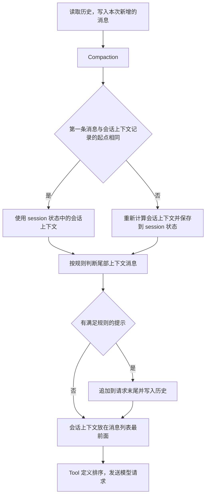

# System Agent 模型请求 token 优化

## 名词解释

| 名词 | 说明 |
| --- | --- |
| 模型请求 | System Agent 向模型服务发送的一次请求。一个 Turn 中每个 Step 对应一次模型请求。 |
| 固定部分 | 每次模型请求都携带、内容不随对话增长的部分：Tool 定义（`tools`）和 system 文本。 |
| system 静态部分 | system 文本中只由 Agw 代码和当前 Agent 的定义决定的内容：Agent 的 System Prompt、Tool 与 Tool Block 的 Instructions。 |
| system 动态部分 | system 文本中由 Project、Host 或者其他定义决定的内容：Project Workspace 说明、Shell environment、Docker 目录说明、Background Agent 说明、Skill 列表。 |
| 会话上下文 | 一个对话期间保持不变的上下文：User Memory 正文和 Project Memory 索引。作为第一条 user 消息随每次模型请求发送。 |
| 尾部上下文消息 | 按规则追加在最新消息之后并写入历史的提示：Plan 模式说明、退出 Plan 模式提示、Todo 提醒。 |
| 只追加 | 同一个对话中，后一次模型请求的内容等于前一次请求的内容加上新增的消息，前面的内容逐字节相同。 |
| cache read | 模型服务对与之前请求相同的前缀按缓存价格计费的输入 token，对应用量中的 `CachedInputTokenCount`。 |

## 背景

模型服务的接口没有状态，每次模型请求都必须携带固定部分和完整历史。模型服务按前缀缓存输入：请求的顺序是 `tools` → system → 消息，前缀与之前的请求逐字节相同的部分按 cache read 计费，从第一个不同的字节开始，后面的内容全部按完整价格计费。因此输入费用由两件事决定：固定部分和历史的 token 数量，以及相邻请求之间相同前缀的长度。

本设计没有兼容性要求。

### 一次模型请求的固定部分

采集方式：隔离数据目录的 SQLite Standalone Host，模型服务使用记录请求的 OpenAI Chat Completions 服务（`.scratch/prompt-token-opt/run.sh`）。Agent 配置 `diff`、`git_clone`、`run_shell`、`ask_user_question`、`web_fetch` 五个 Tool，以及 `file-access`、`todo`、`mode`、`project-memory`、`user-memory` 五个 Tool Block，Project 为 `default-built-in`。

| 部分 | 字符数 |
| --- | --- |
| `tools`（31 个 Tool 定义的 JSON） | 19,746 |
| system 文本 | 7,440 |
| 合计 | 27,186 |

按 4 个字符 1 个 token 估算，固定部分约 6,800 token，每次模型请求都携带。

system 文本各部分按出现顺序的字符数：

| 部分 | 字符数 |
| --- | --- |
| Agent 的 System Prompt | 29 |
| Project Workspace | 326 |
| Shell Usage | 655 |
| Shell environment | 518 |
| File Access | 1,266 |
| Todo Items | 1,589 |
| Agent Mode | 1,429 |
| Project Memory | 797 |
| User Memory | 831 |

`tools` 各组的字符数：

| 组 | Tool 数量 | 字符数 |
| --- | --- | --- |
| `file_access_*` | 8 | 7,021 |
| `ask_user_question` | 1 | 4,085 |
| `project_memory_*` | 7 | 3,416 |
| `diff`、`git_clone`、`run_shell`、`web_fetch` | 4 | 1,876 |
| `todos_*` | 5 | 1,638 |
| `user_memory_*` | 4 | 1,221 |
| `mode_*` | 2 | 457 |

### 开发环境的用量

开发库 `agent_usage` 表 2026-10-07 至 2026-11-15 的记录：

| Agent | 输入 token | cache read token | cache read 占比 |
| --- | --- | --- | --- |
| `general-agent`（System Agent，OpenAI Responses，`deepseek-flash`） | 46,073,417 | 35,551,360 | 77.2% |
| `ClaudeCode`（External Agent） | 766,739,192 | 749,712,927 | 97.8% |
| `Codex`（External Agent） | 100,770,984 | 90,662,272 | 90.0% |

`general-agent` 按 Turn 的输入 token 数量分组：

| Turn 的输入 token | Turn 数量 | 输入 token | cache read 占比 |
| --- | --- | --- | --- |
| 少于 100K | 9 | 488,614 | 95.5% |
| 100K 至 500K | 15 | 3,801,864 | 85.7% |
| 500K 至 2M | 1 | 744,471 | 38.8% |
| 2M 以上 | 4 | 41,038,468 | 76.9% |

2M 以上的 4 个 Turn 占用全部输入 token 的 89%。`deepseek-flash` 的上下文窗口为 500,000，输出上限为 384,000，输入预算为 116,000 token，历史超过 58,000 token 后开始清空 Tool result。

### 相邻请求的前缀在这些位置发生变化

第 1 至 5 项来自采集到的请求（`.scratch/prompt-token-opt/run-baseline`、`.scratch/prompt-token-opt/run-compaction`），第 6 项来自代码。

1. **每个 Turn 的第一次模型请求与之后的请求内容不同。** 第一次请求中，User Memory 正文与用户输入合并为一条消息，Todo 列表和 Project Memory 索引排在后面，三者都不写入历史。第二次请求从历史读取，用户输入恢复为原文，三条上下文消息消失。从第二个 Step 开始，请求中没有 User Memory 正文，Todo 列表和 Project Memory 索引只在下面第 2 项的情况中出现。
2. **审批之后重新进入运行时，上下文消息写入历史。** 自动批准的写入类 Tool 执行后，Provider 再次运行，内容发生变化的 Todo 列表和 Project Memory 索引追加在 Tool result 之后并写入历史。同一种上下文消息有时写入历史，有时不写入。
3. **LoopAgent 的继续执行提示在历史中保存两行。** 请求路径写入一行（行 Id 为消息自身的 GUID），输出流写入另一行（新的行 Id，`sourceMessageId` 相同）。当前 Turn 的请求中只出现一条，下一个 Turn 从历史读取时每条提示出现两次。采集中第二个 Turn 的第一次请求有 40 条消息，与上一次请求相同的开头只有 11 条。
4. **超过清空阈值后，每次模型请求都修改靠前的历史。** `ToolResultEvictionCompactionStrategy` 的停止条件是 token 数刚好回到阈值以下，下一次请求增加新的 Tool result 后再次触发，清空下一个最旧的 Tool result。采集的 18 次请求中，从第 8 次开始有 10 次请求把靠前的 Tool result 替换为占位文本，被保留的整个窗口都排在这次修改之后，全部按完整价格计费。
5. **Anthropic 类型的 Provider 没有设置 `cache_control`。** OpenAI 的接口对相同前缀自动缓存。Anthropic 的缓存需要请求显式标记缓存位置，当前请求中没有标记，固定部分和历史每次都按完整价格计费。
6. **Mode 切换时 system 文本和 Tool 列表都发生变化。** `ModeToolBlock` 的 Instructions 模板包含 `Current mode: {current_mode}`。Plan 模式下 `PlanModeToolGuardProvider` 在 system 文本末尾追加 enforcement 说明并移除受限 Tool，`PlanModeToolVisibilityChatClient` 在请求中隐藏受限 Tool。`tools` 排在请求的最前面，切换一次 Mode，整个请求都按完整价格计费。

### Claude Code 对同类内容的处理

本设计中 system 文本、Tool 定义和上下文消息的处理方式与 Claude Code 保持一致。Claude Code 的处理方式：

| 内容 | 在请求中的位置 | 计算时机 | 写入 transcript | Compaction 之后 |
| --- | --- | --- | --- | --- |
| system prompt 的静态部分（身份、任务要求、跨 Tool 的使用说明） | system，位于分界标记之前，块上带缓存标记 | 固定文本 | 否 | 不变 |
| system prompt 的动态部分（工作目录、平台等环境信息） | system，位于分界标记之后 | 每个 session 计算一次并缓存 | 否 | 清除缓存，重新计算 |
| Tool 定义 | `tools`。内置 Tool 按名称排序排在前面，MCP Tool 按名称排序排在后面；Plan 模式不改变列表 | schema 每个 session 计算一次并缓存 | 否 | 不变 |
| 单个 Tool 的使用说明 | 该 Tool 的 description | 同 Tool 定义 | 否 | 不变 |
| 记忆文件的内容（user context） | 第一条 user 消息，正文包裹在 `<system-reminder>` 中 | 每个对话计算一次并缓存，发送请求时放在消息列表最前面 | 否 | 清除缓存，重新计算 |
| attachment（Plan 模式说明、Todo 提醒、各类增量） | 追加在最新消息之后，`<system-reminder>` 包裹的 user 消息 | 用户输入时和每次 Tool 执行之后按规则判断，规则依据对话中已有的 attachment 和 Tool 调用 | 是 | 规则在压缩后的消息上重新判断 |
| 缓存标记 | system 的块上，以及最后一条消息上的一个标记 | 每次请求 | 否 | 不变 |

## 设计目标

### 功能目标

1. system 文本分为静态部分和动态部分，静态部分排在前面。
2. Tool 定义按固定顺序排列，Mode 不改变 Tool 列表和 system 文本。
3. User Memory 正文和 Project Memory 索引作为会话上下文，每个对话计算一次，作为第一条 user 消息发送。
4. Plan 模式和 Todo 的提示作为尾部上下文消息，按规则追加在最新消息之后并写入历史。
5. LoopAgent 的继续执行提示在历史中只保存一行。
6. Compaction 成批执行，两次 Compaction 之间的模型请求只追加。
7. Anthropic 类型的 Provider 在请求中设置缓存位置。
8. 精简 Tool Block 的 Instructions 和 `ask_user_question` 的参数定义。

### 技术目标

- 只追加：同一个对话中，除发生 Compaction 的那一次请求外，每次模型请求的 `tools`、system 和消息都以前一次请求的全部内容作为开头。Mode 切换不改变 `tools` 和 system。
- 上下文可见：User Memory 正文和 Project Memory 索引出现在每一次模型请求中。
- 固定部分：采集配置下从 27,186 个字符减少到 23,371 个字符。
- 可观测：使用现有的 `agent_usage.cached_input_token_count` 与 `input_token_count` 计算 cache read 占比，不增加字段。

## 总体设计

模型请求的内容顺序为：`tools` → system 静态部分 → system 动态部分 → 会话上下文 → 历史 → 本次新增的消息 → 尾部上下文消息。

| 内容 | 在请求中的位置 | 计算时机 | 发送时机 | 写入历史 | Compaction 之后 |
| --- | --- | --- | --- | --- | --- |
| Agent 的 System Prompt | system 静态部分的开头 | runtime 创建时 | 每次模型请求 | 否 | 不参与 Compaction，继续完整发送 |
| Tool 与 Tool Block 的 Instructions | system 静态部分，排在 System Prompt 之后，顺序固定 | runtime 创建时 | 每次模型请求 | 否 | 不参与 Compaction，继续完整发送 |
| Project Workspace 说明 | system 动态部分的开头 | runtime 创建时；Project 定义修改后 runtime 重建时重新计算 | 每次模型请求 | 否 | 不参与 Compaction，继续完整发送 |
| Tool 定义 | `tools`，按名称排序，Mode 不改变列表 | runtime 创建时 | 每次模型请求 | 否 | 不参与 Compaction，继续完整发送 |
| 会话上下文（User Memory 正文、Project Memory 索引） | 第一条 user 消息 | 对话的第一次模型请求计算一次，保存在 session 状态中 | 每次模型请求 | 否 | 消息被截断后重新计算，Tool result 清空不影响 |
| 尾部上下文消息（Plan 模式说明、退出 Plan 模式提示、Todo 提醒） | 追加在本次新增的消息之后 | 每次模型请求按规则判断 | 满足规则时发送一次，之后作为历史出现在每次请求中 | 是 | 规则在 Compaction 之后的消息上判断，被截断的提示按规则重新发送 |

一次模型请求的处理顺序：



## 详细设计

### system 文本分为静态部分和动态部分

各个 Instructions 来源的归属：

| 来源 | 内容 | 部分 |
| --- | --- | --- |
| `Agent.SystemPrompt` | Agent 的 System Prompt | 静态 |
| `ShellFileAccessInstructionsProvider` | Shell Usage | 静态 |
| `AgwFileAccessProvider`、`AgwFileReadonlyAccessProvider` | File Access | 静态 |
| `AgwTodoProvider` | Todo Items | 静态 |
| `AgentModeProvider`（`ModeToolBlock` 的模板） | Agent Mode | 静态 |
| `ProjectMemoryProvider` | Project Memory | 静态 |
| `UserMemoryProvider` | User Memory | 静态 |
| `AgwWorkspaceProvider` | Project Workspace 说明 | 动态 |
| `ShellEnvironmentProvider` | Shell environment | 动态 |
| `DockerDirectoryProvider` | Docker 目录说明 | 动态 |
| `BackgroundAgentsProvider` | Background Agent 说明 | 动态 |
| `AgentSkillsProvider` | Skill 列表 | 动态 |

- **顺序。** `ToolContribution` 增加 `DynamicContextProviders`，Tool 和 Tool Block 把 Instructions 属于动态部分的 Provider 放在这里。`AgentCapabilityComposer` 按以下顺序排列 Provider：`ContextProviders`（按 `ToolDefinitionNames.All`、`ToolBlockDefinitionNames.All` 的顺序，与 Agent 和 Project 配置中的顺序无关）→ `AgwWorkspaceProvider` → `DynamicContextProviders` → `AgentSkillsProvider`。MAF 按 Provider 的顺序合并 Instructions，合并结果就是：System Prompt → 静态部分的 Instructions → 动态部分。
- **分界标记。** `AgwWorkspaceProvider` 在自己的内容之前输出一行分界标记（常量 `SystemPromptBoundary.Marker`）。`ModelInputFilteringChatClient` 从 `ChatOptions.Instructions` 中移除这一行，并把静态部分的字符数写入 `ChatOptions.AdditionalProperties["agw.staticInstructionsLength"]`。Instructions 中没有分界标记时，全部文本属于静态部分。
- **Mode。** `ModeToolBlock` 的模板去掉 `Current mode: {current_mode}`，`PlanModeToolGuardProvider` 不再向 Instructions 追加内容。当前 Mode 由尾部上下文消息告知模型。

### Tool 定义按固定顺序排列，Mode 不改变 Tool 列表

- **顺序。** `ToolOrderingChatClient` 位于 `PlanModeToolVisibilityChatClient` 原来的位置，对所有 System Agent 生效，在每次模型请求中对 `ChatOptions.Tools` 排序：Agw 的 Tool、Tool Block 和 Skill 的 Tool 按名称排序排在前面，Connection、MCP Tool Server、Extension 的 Tool 按名称排序排在后面，名称按 ordinal 规则排序。`AgentCapabilityComposition` 增加 `ExternalToolNames`，由 `AgentCapabilityComposer` 在加入 Connection、MCP、Extension 的 Tool 时填写。
- **Mode。** Plan 模式下发送给模型的 Tool 列表与 Execute 模式相同。`PlanModeToolGuardProvider` 在两种模式下都把受限的 Tool 包装为 `PlanModeRestrictedAIFunction`，包装时记录当前 Mode 是否为 plan。为 plan 时它不提供 `ApprovalRequiredAIFunction`，调用直接返回 `PlanModeToolNotAllowed`，不进入审批。
- **删除的代码。** `PlanModeToolVisibilityChatClient`、`PlanModeToolGuardProvider.EnforcementInstructions`，以及 `PlanModeToolGuardProvider` 中移除 Tool 的逻辑。

### 会话上下文

**来源。** `ToolContribution` 增加 `ConversationContextSources`，每个来源返回一个标题和一段正文，正文为空时不参与：

| Tool Block | 标题 | 正文 |
| --- | --- | --- |
| `user-memory` | `User Memory` | 最多 50 条 User Memory 的正文，沿用 `UserMemoryProvider.CreateContextMessageAsync` 的格式 |
| `project-memory` | `Project Memory Index` | Project Memory 索引（`memories.md`，最多 50 项） |

**格式。** 一条 user 消息，各来源按上表的顺序排列：

```text
<system-reminder>
Context for this conversation. Use it when it is relevant to the request.

# User Memory
...

# Project Memory Index
...
</system-reminder>
```

**计算与保存。** `ConversationContextChatClient` 位于 Compaction 之后、`ModelInputFilteringChatClient` 之前。对话的第一次模型请求调用全部来源，把生成的文本和起点（Compaction 之后第一条消息的 `MessageId`）保存在 `AgentSession` 的状态中（键 `agw.conversationContext`），随 session 一起序列化。之后的模型请求直接使用保存的文本。

**发送。** 每次模型请求把会话上下文放在消息列表的最前面。它不写入历史，不出现在界面和跨 Agent 交接中，也不参与 Compaction。

**重新计算。** 请求中第一条消息的 `MessageId` 与保存的起点不同时，说明靠前的消息已被截断，这时重新调用全部来源并保存新的文本和起点。Tool result 清空不改变第一条消息，不触发重新计算。对话进行中 User Memory 或者 Project Memory 发生的变化，在下一次重新计算时进入会话上下文。

**相关修改。**

- `CreateDefinitionAgentAsync` 创建 `HistoryRecordingAgent` 时不传入 `createMemoryContextAsync`，用户输入按原文发送。
- `ProjectMemoryProvider` 不再通过 `AIContext.Messages` 返回索引。

### 尾部上下文消息

**来源。** `ToolContribution` 增加 `ContextAttachmentSources`。每个来源接收当前 session 和 Compaction 之后的消息列表，返回零条或者一条提示：

| 类型 | 来源 | 发送条件 | 正文 |
| --- | --- | --- | --- |
| `plan_mode` | `mode` | 当前 Mode 为 plan，并且满足其一：最近一条 `plan_mode_exit` 之后没有 `plan_mode`；距离上一条 `plan_mode` 已有 5 条 assistant 消息 | 最近一条 `plan_mode_exit` 之后的第 1、6、11 条为完整说明（`ModeToolBlock.PlanModeInstructions` 加上受限 Tool 会返回 `PlanModeToolNotAllowed` 的说明），其余为一句简短提示 |
| `plan_mode_exit` | `mode` | 当前 Mode 为 execute，并且消息列表中最近的一条 Mode 提示是 `plan_mode` | Plan 模式已经结束，当前为 Execute 模式 |
| `todo_reminder` | `todo` | 距离上一次 `todos_*` 调用已有 10 条 assistant 消息，并且距离上一条 `todo_reminder` 已有 10 条 assistant 消息 | 当前 Todo 列表，以及在适用时使用 Todo Tool 的提示 |

条件中的数量都在 Compaction 之后的消息列表上统计。消息列表中没有对应的调用或者提示时，从列表的第一条消息开始统计。

**判断与写入。** `ConversationContextChatClient` 在每次模型请求中调用全部来源。返回的提示以 user 角色、`<system-reminder>` 包裹的形式追加在请求的末尾，并通过 `AgwChatHistoryProvider` 写入历史，Step 序号与本次新增的消息相同。写入前为消息生成 GUID v7 作为 `MessageId`，请求中的副本与历史行使用同一个 ID。历史行带有 `_attribution`（客户端按 `isSystemInjectedMessage` 隐藏）和 `additionalProperties.contextAttachmentType`（常量定义在 `ConversationHistoryMetadata`，值为上表的类型）。

**读取。** 尾部上下文消息作为普通历史行进入之后的每一次模型请求。`ConversationHandoffProvider` 生成跨 Agent 交接内容时跳过带有 `contextAttachmentType` 的行。

**相关修改。**

- `TodoToolBlock` 创建 `AgwTodoProvider` 时设置 `SuppressTodoListMessage`。
- `AgwChatHistoryProvider.InvokingCoreAsync` 移除请求中来源类型为 `AIContextProvider`、且没有交接标记的消息，不发送也不写入。`AgentModeProvider` 的 Mode 切换提示由 `plan_mode` 和 `plan_mode_exit` 代替。
- 删除 `FunctionLoopContextTracker`、`FunctionLoopContextScopeAgent`，以及 `FunctionLoopMessageIsolationChatClient` 中对重复上下文的过滤。`FunctionLoopMessageIsolationChatClient` 保留消息副本的隔离。

### LoopAgent 的继续执行提示只保存一行

输出流记录 LoopAgent 的继续执行提示时，行 Id 使用来源消息的 GUID（`sourceMessageId`）。随后的模型请求携带同一条消息，`HistoryRecording.PutAsync` 按相同的行 Id 更新这一行。处理方式与 Tool result 相同：流式副本与请求副本写入同一行。

### Compaction 成批执行

`ContextWindowCompactionPipeline` 为两个阶段分别设置触发阈值和目标值，输入预算为上下文窗口减去输出上限：

| 阶段 | 触发阈值 | 目标值 |
| --- | --- | --- |
| Tool result 清空 | 超过输入预算的 50% | 不超过输入预算的 30% |
| 消息截断 | 超过输入预算的 80% | 不超过输入预算的 40% |

- 触发后一次清空或者截断到目标值，使用 `CompactionTriggers.TokensBelow` 作为 `target`。到下一次触发之前，模型请求只追加。
- 截断的目标值低于清空的触发阈值，截断之后不会立即再次触发清空。
- 截断之后的第一次模型请求重新计算会话上下文，并在截断后的消息上重新判断尾部上下文消息。

以 `deepseek-flash` 的配置为例，请求消息超过 58,000 token 时清空到 34,800 token 以下，之后至少再增长 23,200 token 才会再次清空。

### Anthropic 请求设置缓存位置

`AnthropicReasoningChatClient` 在发送请求前，在请求副本上设置三个缓存位置，都使用 `WithCacheControl(new CacheControlEphemeral())`（`Microsoft.Extensions.AI.AIContentCacheExtensions`，不设置 `Ttl`）：

1. system 静态部分的末尾。
2. system 动态部分的末尾。
3. 最后一条消息的最后一个内容。

`AnthropicReasoningChatClient` 按 `agw.staticInstructionsLength` 把 `ChatOptions.Instructions` 分为两个 system 消息，各包含一个带标记的 `TextContent`，并清空 `ChatOptions.Instructions`。动态部分为空时只有一个 system 消息。标记只设置在请求副本上，不写入历史。

### 精简固定部分

**Tool Block 的 Instructions。** 每个 Tool Block 的 Instructions 只包含 Tool description 无法表达的内容：适用范围、与其他 Tool Block 的分工、跨 Tool 的使用顺序。逐个说明 Tool 用途的内容由各 Tool 的 description 承担。

`AgwTodoProvider`（1,589 → 384 个字符）：

```text
## Todo Items
Track multi-step work with the `todos_*` tools. Answer single-step requests directly without a todo list.
- Break complex work into todo items before starting, and ask the user when an item needs clarification.
- Mark items complete with a reason as you finish them, and remove items that no longer apply.
- When the user changes the request, update the list first.
```

`AgwFileAccessProvider`（1,266 → 482 个字符）：

```text
## File Access
The `file_access_*` tools read, write, and manage files in the Project directories. Paths are relative to the selected Project directory.
- Never delete or overwrite existing files unless the user explicitly asked for it.
- For a small edit, use `file_access_replace` or `file_access_replace_lines`.
- To change part of a file, find line numbers with `file_access_grep`, read around them with `file_access_read_lines`, then edit with `file_access_replace_lines`.
```

`ProjectMemoryProvider`（797 → 439 个字符）：

```text
## Project Memory
The `project_memory_*` tools store durable project knowledge shared by all agents and conversations of this project: architecture decisions, conventions, plans, reusable results. Private user information belongs in user memory.
- Before related work, look up existing memories with `project_memory_ls` and `project_memory_grep`.
- Write each memory with a descriptive file name and a description, and keep it current.
```

`UserMemoryProvider`（831 → 392 个字符）：

```text
## User Memory
The `user_memory_*` tools store private memory that follows the current user across projects and conversations: preferences, personal conventions, recurring context. Knowledge that belongs to one project goes to project memory.
Up to 50 memory bodies are provided as context. Use `user_memory_list` and `user_memory_read` for memories beyond those, and keep memories current.
```

`ModeToolBlock` 模板中 `{available_modes}` 之后的内容（Agent Mode 部分 1,429 → 1,494 个字符）：

```text
The conversation is in Execute mode unless a system reminder says Plan mode is active.
Follow the instructions for the current mode. Use mode_get when the current mode must be checked. mode_set requires explicit human confirmation when requested by the Agent.
```

**`ask_user_question` 的参数定义。** `AskUserQuestionTool` 发送给模型的 JSON schema 只包含 `questions`。`answers`、`annotations`、`metadata` 由 Host 在用户回答后写入调用参数，调用时仍然绑定到 `AskUserQuestionToolParams`，不出现在发送给模型的定义中（4,085 → 2,991 个字符）。

精简后的字符数：

| 部分 | 当前 | 精简后 |
| --- | --- | --- |
| system 文本 | 7,440 | 4,719 |
| `tools` | 19,746 | 18,652 |
| 合计 | 27,186 | 23,371 |

## 测试计划

### 单元测试

| 测试项目 | 用例 | 目的 |
| --- | --- | --- |
| `Agw.Agents.Tests` | `ComposeAsync_StaticAndDynamicProviders_OrdersStaticInstructionsBeforeBoundary` | Instructions 的顺序为 System Prompt、静态部分、分界标记、动态部分，静态部分的顺序与配置中 Tool 的顺序无关。 |
| `Agw.Agents.Tests` | `GetResponseAsync_InstructionsWithBoundary_RemovesMarkerAndRecordsStaticLength` | `ModelInputFilteringChatClient` 移除分界标记并写入 `agw.staticInstructionsLength`。 |
| `Agw.Agents.Tests` | `GetResponseAsync_ToolsFromAllSources_SortsAgwToolsBeforeExternalTools` | `ToolOrderingChatClient` 输出的顺序为 Agw 的 Tool 按名称排序、外部 Tool 按名称排序。 |
| `Agw.Agents.Tests` | `AsAgwAgent_ModeSwitched_KeepsToolsAndInstructionsIdentical` | Mode 切换前后两次模型请求的 `tools` 和 system 文本逐字节相同。 |
| `Agw.Agents.Tests` | `AsAgwAgent_PlanModeRestrictedToolCalled_ReturnsPlanModeToolNotAllowedWithoutApproval` | Plan 模式下受限 Tool 出现在 Tool 列表中，被调用时直接返回错误，不产生审批请求。 |
| `Agw.Agents.Tests` | `GetResponseAsync_FirstRequestOfConversation_ComputesAndPrependsConversationContext` | 第一次模型请求生成会话上下文，放在消息列表最前面，并保存到 session 状态。 |
| `Agw.Agents.Tests` | `GetResponseAsync_LaterRequest_ReusesStoredConversationContext` | 之后的请求（包括 session 序列化再还原之后）使用保存的文本，来源内容变化不影响请求。 |
| `Agw.Agents.Tests` | `GetResponseAsync_FirstMessageChangedByTruncation_RecomputesConversationContext` | 第一条消息的 `MessageId` 改变后重新计算；Tool result 清空之后不重新计算。 |
| `Agw.Agents.Tests` | `GetResponseAsync_PlanModeActive_AppendsFullThenSparseReminders` | Plan 模式的第一次请求追加完整说明，之后每 5 条 assistant 消息追加一次，第 6 条为完整说明。 |
| `Agw.Agents.Tests` | `GetResponseAsync_ModeBackToExecute_AppendsPlanModeExitOnce` | 退出 Plan 模式后的第一次请求追加 `plan_mode_exit`，之后不再追加。 |
| `Agw.Agents.Tests` | `GetResponseAsync_TodoToolsUnusedForTenAssistantMessages_AppendsTodoReminder` | 满足两个 10 条的条件时追加 `todo_reminder`，不满足时不追加。 |
| `Agw.Agents.Tests` | `GetResponseAsync_ContextAttachment_PersistsRowWithTypeAndSameMessageId` | 尾部上下文消息写入历史，带有 `contextAttachmentType`，下一次请求从历史读取到相同内容。 |
| `Agw.Agents.Tests` | `InvokingCoreAsync_ContextProviderMessages_AreRemoved` | 来源类型为 `AIContextProvider`、没有交接标记的请求消息不发送也不写入。 |
| `Agw.Agents.Tests` | `AsAgwAgent_ConsecutiveModelRequests_EachStartsWithPreviousRequest` | 两个 Turn（包含 Tool 循环、自动批准、LoopAgent 迭代、Mode 切换）中，每次请求都以前一次请求的全部内容作为开头。 |
| `Agw.Agents.Tests` | `RunStreamingAsync_LoopAgentFeedback_PersistsOneRow` | 每条继续执行提示在历史中只有一行，下一个 Turn 的请求中只出现一次。 |
| `Agw.Agents.Tests` | `Create_TokensExceedEvictionTrigger_EvictsToTargetInOneRequest` | 超过 50% 后一次清空到 30% 以下，之后的请求在再次超过 50% 之前不修改之前的消息。 |
| `Agw.Agents.Tests` | `Create_TokensExceedTruncationTrigger_TruncatesToTarget` | 超过 80% 后一次截断到 40% 以下。 |
| `Agw.Agents.Tests` | `GetStreamingResponseAsync_AnthropicRequest_MarksStaticDynamicAndLastContent` | 请求副本中两个 system 消息和最后一个内容带有 `anthropic:cache_control`，传入的消息对象没有被修改。 |
| `Agw.Agents.Tests` | `BuildHandoff_ContextAttachmentRows_AreSkipped` | 交接内容不包含带有 `contextAttachmentType` 的行。 |
| `Agw.Tools.Tests` | `MaterializeAsync_UserMemoryAndProjectMemory_ContributeConversationContextSources` | 两个 Tool Block 各提供一个会话上下文来源，正文为空时不参与。 |
| `Agw.Tools.Tests` | `AskUserQuestion_ModelSchema_ContainsOnlyQuestions` | 发送给模型的参数定义不包含 `answers`、`annotations`、`metadata`，Host 写入的回答仍然能够绑定。 |

### 集成测试

使用 `.scratch/prompt-token-opt/run.sh` 采集请求，使用 `analyze.mjs` 对比相邻请求：

| 场景 | 当前 | 目标 |
| --- | --- | --- |
| `baseline`：3 个 Turn，包含 Tool 循环、自动批准、LoopAgent 迭代 | 第 2、14、15、26、27 次请求的消息开头与前一次请求不同 | 每次请求都以前一次请求的全部内容作为开头，第一条消息是会话上下文 |
| `baseline`：固定部分 | 27,186 个字符，Project Workspace 排在 Tool Block 的 Instructions 之前 | 23,371 个字符，Project Workspace 与 Shell environment 排在 system 文本的末尾 |
| `compaction`：上下文窗口 12,000、输出上限 2,000，连续读取文件 | 第 8 至 14 次、第 16 至 18 次请求各修改一条靠前的 Tool result | 只有超过 50% 的那一次请求修改之前的消息，修改后 token 数不超过 30% |
| Mode 切换：Execute → Plan → Execute | system 文本和 Tool 列表随 Mode 变化 | 三个阶段的 `tools` 和 system 文本相同，请求末尾依次出现 `plan_mode` 和 `plan_mode_exit` |

### 回归测试

- `dotnet test tests/Agw.Agents.Tests`、`dotnet test tests/Agw.Tools.Tests`、`dotnet test tests/Agw.Architecture.Tests`。
- 使用 Anthropic 类型的 Provider 执行包含两个以上 Step 的 Turn，`agent_usage.cached_input_token_count` 大于 0。
- 使用 `general-agent` 执行输入超过 58,000 token 的 Turn，查询该 Turn 的 `cached_input_token_count / input_token_count`。
- 更新 `src/server/Agw.Agents.Execution/README.md` 中 Compaction 阈值、Plan 模式和 User Memory 注入的说明。
