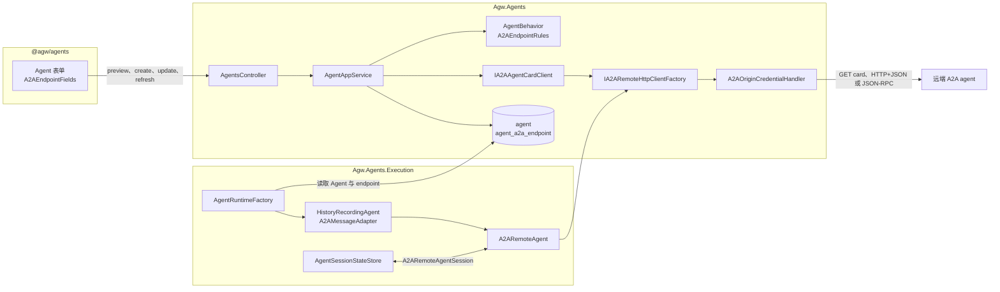
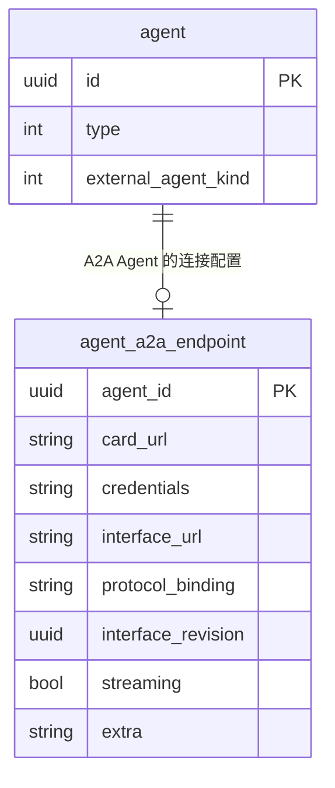
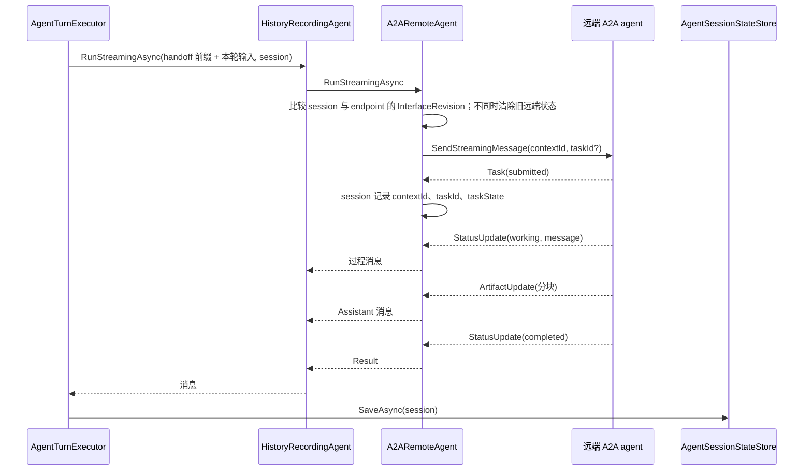

# A2A 外部 Agent 接入

文中每一项设计都标有变更类型，含义相对于当前代码：

- 【新增】：当前代码中不存在。
- 【修改】：当前代码中存在，结构或行为有变化。
- 【删除】：从当前代码中移除。

## 名词解释

- **A2A**：Agent2Agent 协议。本文使用它的 1.0 数据模型，由 NuGet 包 `A2A` 1.0.0-preview2 提供。
- **Agent Card**：远端 agent 的自描述 JSON 文档，包含名称、描述、skills、`capabilities` 与 `supportedInterfaces`。下文称 card。
- **interface**：card 中的一个调用入口，由 `url` 与 `protocolBinding` 组成。
- **protocol binding**：A2A 的传输方式。本文涉及 `HTTP+JSON` 与 `JSONRPC`。
- **context**：远端 agent 的一段会话，由远端生成的 `contextId` 标识。
- **task**：远端 agent 的一个有状态的工作单元，由 `taskId` 标识，状态为 `submitted`、`working`、`input-required`、`auth-required`、`completed`、`failed`、`canceled`、`rejected` 之一。
- **artifact**：task 产出的结果，由若干 part 组成，可以分块追加。
- **A2A Agent**【新增】：`Type = External` 并且 `ExternalAgentKind = A2A` 的 Agent 定义，它的每个 Turn 由一个远端 A2A agent 执行。
- **A2A endpoint**【新增】：一个 A2A Agent 的连接配置，包括 card 地址、按 origin 保存的请求凭据、选定的 interface 与 card 快照。

## 背景

- External Agent 现有 Claude Code、Codex、Pi 三种 Engine，它们都是 agw 主机上的本地进程。
- `Agw.A2A` 把 agw 的 Agent 作为 A2A server 提供给外部系统调用。agw 调用外部 A2A agent 的能力还不存在。
- 用户已有的 A2A agent（其他团队的服务、第三方产品）需要接入 agw，并与本地 Agent 一样用于 Chat、Agentflow 节点、后台 Agent、Jobs 与 Events。
- 本方案没有兼容性要求，按最终状态设计。

## 设计目标

### 功能目标

1. Agent 定义支持 A2A Agent 的创建、更新、删除与查询。
2. 预览、保存与刷新 card，并从 card 中选定 interface。
3. A2A Agent 作为执行目标运行 Turn：支持流式与轮询，输出内容、过程消息与 Result。
4. 远端 context 与 task 在同一个对话的多个 Turn 之间延续，包括 `input-required` 之后的续答。
5. 中断 Turn 时取消远端 task。
6. 在 InProcess 与 Distributed 两种执行提供者下运行，可用于 Chat、Agentflow 节点、后台 Agent、Jobs、Events 与 agw 对外的 A2A 接口。
7. Web 与 Desktop 的 Agents 页面支持 A2A Agent 的创建与编辑。

### 技术目标

- 安全
  - A2A endpoint 随所属 Agent 的 `CreateBy` 隔离，其他用户读取与修改时得到与不存在相同的结果。
  - 凭据按 origin 保存；每个 origin 的 header JSON 由 `[Encrypted]` 保护，接口、日志、Activity 与 Durable manifest 不返回或记录凭据值。
  - 每个请求只使用其目标 origin 对应的凭据；出站连接不跟随重定向，handler 不保存或自动发送远端 `Set-Cookie`。用户明确配置的 `Cookie` header 仍按 origin 规则发送。
  - 可以通过配置禁止访问回环与私有网络地址。
  - 发往远端的内容只有本轮输入与 `IConversationHandoffProvider` 生成的 handoff 前缀。
- 可观测：结构化日志、Activity、按结果统计的指标。
- 高可用：请求时限、流空闲时限、流中断后重新订阅 task、不支持流式的远端按间隔查询 task；Distributed 下沿用 segment 至少执行一次的规则。
- 依赖：使用已有的 `A2A` 1.0.0-preview2；`Agw.Agents` 与 `Agw.Agents.Execution` 增加对它的包引用，项目之间的引用关系没有变化。

## 总体设计



技术选型：

- A2A Agent 是 External Agent 的第四种 Engine，`EngineKind.A2A = 4`。它使用与 Claude Code、Codex、Pi 相同的创建入口、`HistoryRecordingAgent`、`AgentTelemetryMiddleware` 与 `TurnPipeline`，Chat、Agentflow 节点、后台 Agent、Jobs、Events 与对外 A2A 接口都把它当作一个 Agent。
- 协议部分使用 `A2A` 1.0.0-preview2：`A2ACardResolver` 获取 card，`A2AHttpJsonClient` 与 `A2AClient` 发送请求，同一个包中的 `Microsoft.Extensions.AI.AIContentExtensions` 在 `Part`、`Message` 与 `AIContent`、`ChatMessage` 之间转换。
- `A2ARemoteAgent` 是 `Microsoft.Agents.AI.AIAgent` 的派生类，与 Claude Code、Codex、Pi 的 `AIAgent` 适配器处于同一层。它负责构造请求、把远端事件转换为 `AgentResponseUpdate`、维护会话状态、取消 task 与重新订阅。
- 远端会话状态保存在 `A2ARemoteAgentSession` 中，由 `AgentSessionStateStore` 按对话、Agent、Agentflow 节点与 Generation 持久化。
- 支持的 card 是 A2A 1.0 的格式，interface 的 `protocolBinding` 为 `HTTP+JSON` 或 `JSONRPC`。

### 变更清单

数据库（见"数据库设计"）：

| 对象 | 变更 |
| --- | --- |
| `agent_a2a_endpoint` 表 | 【新增】 |
| `agent.external_agent_kind` | 【修改】增加取值 4（A2A） |

HTTP 接口（见"接口文档"）：

| 接口 | 变更 |
| --- | --- |
| `POST /api/agents/a2a-card/preview` | 【新增】 |
| `POST /api/agents/a2a-card/refresh` | 【新增】 |
| `GET /api/agents/external-options` | 【修改】增加 A2A 一项 |
| `POST /api/agents`、`PUT /api/agents/{id}` | 【修改】请求体增加 `a2aEndpoint` |
| `GET /api/agents/{id}`、`GET /api/agents/paged` | 【修改】响应增加 `a2aEndpoint` |

执行协议（见第 5 节与"接口文档"）：

| 对象 | 变更 |
| --- | --- |
| Turn 失败时 `AgwErrorContent` 的错误码 `5020010`、`5020011`、`5020012`、`5040001` | 【新增】 |

Server 代码：

| 位置 | 变更 |
| --- | --- |
| `Agw.Data/Entities/Agents/AgentA2AEndpoint.cs`、`AgentA2AEndpointConfiguration.cs`、`AgentA2AEndpointExtra.cs` | 【新增】 |
| `Agw.Data/Conversions/ExtraJson.cs` | 【新增】与《Agentflow 编辑器》方案中的同名文件是同一个，由先实施的一方创建 |
| `Agw.Shared/Net/PrivateNetworkAddresses.cs` | 【新增】内容来自 `EventHttpPoller.IsPrivateAddress` |
| `Agw.Agents/Definitions/Domain/Rules/A2AEndpointRules.cs` | 【新增】 |
| `Agw.Agents/Application/A2A/IA2AAgentCardClient.cs`、`IA2ARemoteHttpClientFactory.cs` | 【新增】 |
| `Agw.Agents/Infrastructure/A2A/A2AAgentCardClient.cs`、`A2ARemoteHttpClientFactory.cs`、`A2AOriginCredentialHandler.cs` | 【新增】 |
| `Agw.Agents/ExternalAgents/A2A/A2ARemoteAgentOptions.cs`、`A2AClientDiagnostics.cs` | 【新增】定义管理与执行共用 |
| `Agw.Agents.Execution/Agents/ExternalAgents/A2A/A2ARemoteAgent.cs`、`A2ARemoteAgentSession.cs` | 【新增】 |
| `Agw.Migrations.Sqlite`、`Agw.Migrations.Postgres` 各一个 migration | 【新增】 |
| `EngineKind`、`Agent`、`IAgentsDbContext`、`AgwDbContext` | 【修改】 |
| `AgentRequests.cs`、`AgentsController`、`AgentAppService`、`AgentBehavior`、`AgentUpdate`、`AgentUpdateCommand`、`AgentUpdateField`、`ExternalAgentDefaults` | 【修改】 |
| `ExecutionPermissionService`、`ExecutionInputCapabilities` | 【修改】 |
| `IAgentSessionStatePersistence`、`AgentSessionStatePersistence`、`AgentDeletionCoordinator` | 【修改】 |
| `EngineKinds`、`AgentRuntimeFactory.CreateExternalAgents.cs`、`AgentRuntime`、`ExternalProviderSessionBindings`、`AgentSessionStateStore` 及它的调用方（`AgentTurnExecutor`、`AgentRuntimeFactory.Mode.cs`） | 【修改】 |
| `AgwChatHistoryProvider.Create`、`AgentMessageAdapters.cs`（增加 `A2AMessageAdapter`） | 【修改】 |
| `DurableExecutionCoordinator.RunAgentSegmentAsync` | 【修改】 |
| `EventHttpPoller` | 【修改】改为调用 `PrivateNetworkAddresses` |
| `ErrorCodes`、`Agw.Agents/DependencyInjection.cs`、`Agw.Host/appsettings.json` | 【修改】 |
| `Agw.Agents.csproj`、`Agw.Agents.Execution.csproj` | 【修改】增加 `A2A` 包引用 |
| `BackendArchitectureTests.EntityOwners`、原始持久化访问清单 | 【修改】 |
| `docs/2.Architecture.md`、`Agw.Agents.Execution/README.md`、`Runtimes/README.md`、`Persistence/README.md` | 【修改】 |

客户端代码（Agent 表单的文件都在 `src/clients/packages/agents/src/ui-web/pages/agents/components/`）：

| 位置 | 变更 |
| --- | --- |
| `a2a-endpoint-fields.tsx`、`a2a-endpoint.ts` 及它们的测试 | 【新增】 |
| `types.ts`、`agent-form-fields.tsx`、`create-agent-dialog.tsx`、`edit-agent-dialog.tsx`、`agents-table.tsx`、`agents/page.tsx`、`copy-requests.ts` | 【修改】 |
| `packages/agents/src/types/agentflow.ts` | 【修改】`externalAgentKind` 增加 4 |
| `packages/extension-sdk/src/api.ts`、`desktop/renderer/src/runtime/extensions/extension-bridge-broker.ts` | 【修改】`externalAgentKind` 增加 `"a2a"` |
| `@agw/api` 的 `openapi.json`、`openapi.d.ts`（`pnpm gen:api`） | 【修改】 |

## 数据库设计



数据库没有外键，图中的关系由 Application 与 Infrastructure 代码维护。列名使用 `snake_case`。

### `agent`【修改】

| 列 | 类型 | 变更 | 说明 |
| --- | --- | --- | --- |
| `external_agent_kind` | int | 【修改】 | 增加取值 4，表示 A2A |

### `agent_a2a_endpoint`【新增】

每个 A2A Agent 有一行，其他 Agent 没有。该表属于 Agents 模块，是 Agent 聚合内的子记录，归属与修改时间由所属的 `agent` 行给出，本表没有审计列。

| 列 | 类型 | 变更 | 说明 |
| --- | --- | --- | --- |
| `agent_id` | uuid，主键 | 【新增】 | 所属 Agent 的 `id` |
| `card_url` | varchar(2048)，非空 | 【新增】 | card 的地址 |
| `credentials` | text，非空，默认 `{}` | 【新增】 | EF JSON converter 保存按规范 origin 索引的对象；每个 value 是序列化 header 对象，`[Encrypted]` 字典加密每个 value |
| `interface_url` | varchar(2048)，非空 | 【新增】 | 选定 interface 的 `url` |
| `protocol_binding` | varchar(32)，非空 | 【新增】 | 选定 interface 的 `protocolBinding`，取值 `HTTP+JSON` 或 `JSONRPC` |
| `interface_revision` | uuid，非空 | 【新增】 | 当前 interface 目标的修订标识；目标地址或 binding 改变时重新生成 |
| `streaming` | boolean，非空 | 【新增】 | card 的 `capabilities.streaming` |
| `extra` | text，非空，默认 `{}` | 【新增】 | JSON 对象，保存只作记录的值，见下一节 |

`AgentA2AEndpoint.Credentials` 的 CLR 类型为 `[Encrypted] Dictionary<string, string>`：key 是规范 origin，value 是该 origin 的 header 对象 JSON 文本。EF JSON converter 把外层字典存为 JSON 对象；现有加密处理器逐项加密字典 value，保留 origin key。`A2AEndpointCredentialsJson` 将这个持久化形式转换为 API 与执行所用的 `origin → header dictionary`。存储列形态为 `{"https://agents.example.com:443":"<protected-header-json>"}`，数据库默认值是 `{}`。`AgentA2AEndpoint` 的其余属性为 `AgentId`、`CardUrl`、`InterfaceUrl`、`ProtocolBinding`、`InterfaceRevision`、`Streaming`、`Extra`。每个 origin 最多保存一组 headers。`Agent` 增加导航属性 `A2AEndpoint`。

`A2AEndpointCredentialsJson` 位于 `Agw.Agents/Definitions/Domain/Rules/`，负责 map 与存储字典的 JSON 转换。它不改变 `[Encrypted]` 对 `Dictionary<string, string>` 的处理方式。

origin 的规范值由 scheme、规范化 host 与有效 port 组成：scheme 与 host 转为小写，host 使用 IDNA ASCII 形式，未显式写出的 port 使用 `https` 的 443 或 `http` 的 80。路径、查询与片段不属于 origin。凭据只能用于规范值完全相同的目标 origin。

### `extra`【新增】

执行逻辑读取的值使用专用列，只作记录与展示的值保存在 `extra` 中：

- 内容是一个 JSON 对象，键使用 camelCase。
- `card`：保存时由 A2A SDK 序列化得到的 card 快照。
- `cardFetchedAt`：获取这份 card 的时间，RFC 3339 格式。
- `AgentA2AEndpoint.Extra` 的类型是 record `AgentA2AEndpointExtra`，属性为 `Card`（`JsonElement`）与 `CardFetchedAt`（`DateTimeOffset`）。
- `Agw.Data/Conversions/ExtraJson.cs` 提供 `ExtraJson.Converter<T>()`，使用 `JsonNamingPolicy.CamelCase` 在 record 与 JSON 文本之间转换。
- 查询接口返回这一列，属性名是 `extra`：`A2AEndpointDto.Extra` 的内容与该列相同。

示例：

```json
{
  "card": { "name": "Travel Planner", "supportedInterfaces": [] },
  "cardFetchedAt": "2026-11-21T08:00:00Z"
}
```

### Migration

`Agw.Migrations.Sqlite` 与 `Agw.Migrations.Postgres` 各增加一个 migration，使用 `docs/1.Development.md` 中对应 provider 的命令生成，内容只有创建 `agent_a2a_endpoint` 表。

`BackendArchitectureTests.EntityOwners` 增加 `AgentA2AEndpoint`，owner 为 `Agw.Agents`。`IAgentsDbContext` 与 `AgwDbContext` 增加 `DbSet<AgentA2AEndpoint> AgentA2AEndpoints`。

## 详细设计

### 1. A2A Agent 的定义

#### 1.1 Engine 种类【修改】

- `EngineKind` 增加 `A2A = 4`。
- `EngineKinds.Resolve` 与 `AgentBehavior.EnsureAgentKindIsValid` 接受 `A2A`。
- `ExternalAgentDefaults`：`SupportedKinds` 增加 `A2A`；`GetDisplayName` 返回 `A2A`；`GetDefaultExtra` 返回 `{}`；`GetSupportedProviderTypes` 返回空数组。

#### 1.2 字段规则【新增】

`AgentBehavior` 对 `ExternalAgentKind = A2A` 的 Agent 执行以下规则，违反时抛出 `AgwException(ErrorCodes.InvalidParam)`：

- 必须有 A2A endpoint。其他 Engine 的 Agent 带有 `a2aEndpoint` 时同样拒绝。
- `modelProviderId` 为 null。
- `extra` 为 null、空白或 `{}`，保存为 `{}`。
- `environmentVariables` 为空。
- `responseSchema` 为 null。

`A2AEndpointRules` 是无状态的规则类，校验 endpoint 的输入：

- `cardUrl`：绝对地址，scheme 为 `http` 或 `https`，没有 userinfo，长度不超过 2048。
- `credentials`：最多 2 个 origin 项，origin 规范化后互不相同；输入值是绝对 HTTP(S) 地址，只包含 scheme、host 与可选有效 port，不含 userinfo、非根路径、query 或 fragment，随后转成 scheme、IDNA 小写 host 与 effective port 的规范值；每项的 headers 最多 20 项。名称符合 HTTP token 语法，不区分大小写时互不相同，并且不属于 `Host`、`Content-Length`、`Content-Type`、`Transfer-Encoding`、`Connection`、`Accept`、`A2A-Version`、`A2A-Extensions`；`Cookie` 可由用户明确配置；值的长度为 1 到 8192，不含 CR 与 LF。只为 card origin 配置凭据时，card 请求可使用该组值；interface origin 没有对应项时不发送自定义 headers。

#### 1.3 创建【修改】

`AgentAppService.CreateAgentAsync` 在 `AgentDefinitionLock` 内依次执行：

1. `AgentBehavior` 与 `A2AEndpointRules` 校验输入。
2. `IA2AAgentCardClient.FetchAsync(cardUrl, credentials)` 获取 card；它只取与 `cardUrl` origin 完全相同的凭据。
3. `A2AEndpointRules.SelectInterface(card)` 选定 interface（第 2 节）。
4. `AgentBehavior.SetA2AEndpoint` 通过 `A2AEndpointCredentialsJson.Serialize` 写入 `AgentA2AEndpoint.Credentials`，并设置 `CardUrl`、`InterfaceUrl`、`ProtocolBinding`、`InterfaceRevision`、`Streaming`、`Extra.Card`、`Extra.CardFetchedAt`。创建时生成新的 `InterfaceRevision`。
5. 与 Agent 一起保存。

#### 1.4 更新【修改】

`AgentUpdateField` 增加 `A2AEndpoint`，`AgentUpdate` 与 `AgentUpdateCommand` 增加对应的值。A2A Agent 的更新可以带 `displayName`、`description` 与 `a2aEndpoint`；带有非 null 的 `modelProviderId`、非空的 `extra`、非空的 `environmentVariables` 或非 null 的 `responseSchema` 时拒绝。

请求中有 `a2aEndpoint` 时，`AgentAppService.UpdateAgentAsync` 在 `AgentDefinitionLock` 内读取现有 endpoint 并执行：

- `cardUrl` 省略时沿用现有值。
- `credentials` 省略时沿用现有值。给出时它是完整的 origin 集合；每个 origin 项的 headers 是完整名称集合，值为 null 的名称只可沿用同一规范 origin 下已保存的值，该名称必须已经存在；省略的 header 名称与 origin 项都会移除。读取 entity 时先用 `A2AEndpointCredentialsJson.Deserialize` 还原存储字典，再传给 `ResolveCredentials`；保存时用 `Serialize` 写回。
- origin 由 scheme、规范化 host 与有效 port 比较。请求不能沿用另一个 origin 的 header 值；某 origin 下值为 null 的名称必须在同一 origin 已保存，否则返回 `InvalidParam`。
- 用得到的 `cardUrl` 与 `credentials` 重新获取 card、重新选定 interface，并整体替换 endpoint 的各列与 `Extra`。如果规范化后的 `interfaceUrl` 或 `protocolBinding` 改变，生成新的 `InterfaceRevision`；其他字段更新时保留原值。如果刷新后的 `interfaceUrl` 属于另一个 origin，旧 origin 的凭据仍只用于原 origin；新 origin 没有配置项时，interface 请求不附加自定义 headers。用户可编辑该 origin 的凭据。

endpoint 发生变化时 Agent 行的 `UpdateTime` 同时更新（沿用现有的把 `DisplayName` 标为已修改的做法），已有 Runtime 在下一个 Turn 按 definition 版本重建。

#### 1.5 刷新与预览【新增】

- `AgentAppService.RefreshA2ACardAsync(agentId)`：用已保存的 `cardUrl` 与经 `A2AEndpointCredentialsJson.Deserialize` 还原的凭据执行 1.4 的最后一步。
- `AgentAppService.PreviewA2ACardAsync(cardUrl, credentials, agentId)`：校验输入、获取 card、选定 interface 并返回结果，不写数据库。`agentId` 有值时先还原该 Agent 的凭据，值为 null 的 header 只能沿用同一规范 origin 下已保存的值；origin 不同时返回 `InvalidParam`。

card 快照只在创建、更新与刷新时改变，执行 Turn 时不获取 card。

#### 1.6 删除【修改】

`AgentDeletionCoordinator` 在删除 Agent 的同一个事务中删除它的 `agent_a2a_endpoint` 行。

### 2. card 的获取与 interface 选定【新增】

`IA2AAgentCardClient.FetchAsync(Uri cardUrl, IReadOnlyDictionary<string, Dictionary<string, string>> credentials, CancellationToken)` 返回 `A2A.AgentCard`。`A2AAgentCardClient` 的做法：

- 用 `IA2ARemoteHttpClientFactory.Create(cardUrl, credentials)` 得到只绑定到 `cardUrl` origin 的 `HttpClient`，交给 `A2ACardResolver`。请求只附加与 `cardUrl` origin 匹配的凭据。`A2ACardResolver` 的 `baseUrl` 与 `agentCardPath` 由 `cardUrl` 分解得到，发出的请求地址与 `cardUrl` 完全相同。
- 总时限为 `CardFetchTimeout`，响应体超过 `CardMaxBytes` 时中止读取。
- 连接失败、超时、非 2xx 状态抛出 `A2AAgentCardFetchFailed`（`5020008`），公开消息带有 HTTP 状态码。
- 响应体超限或无法解析为 card 时抛出 `A2AAgentCardInvalid`（`5020009`）。

`A2AEndpointRules.SelectInterface(AgentCard)` 按 `supportedInterfaces` 的顺序，取第一个同时满足以下条件的 interface：

- `protocolBinding` 是 `HTTP+JSON` 或 `JSONRPC`（不区分大小写）。
- `url` 是绝对地址，scheme 为 `http` 或 `https`，没有 userinfo，长度不超过 2048。

没有满足条件的 interface 时抛出 `A2AAgentCardInvalid`。card 中的顺序是远端声明的优先顺序。

### 3. 出站 HTTP【新增】

`Agw.Agents/DependencyInjection.cs` 注册命名 `HttpClient` `a2a-remote`，它的主 handler 是 `SocketsHttpHandler`：

- `AllowAutoRedirect = false`。
- `UseCookies = false`，避免所有 A2A Agent 共用 pooled handler 的 CookieContainer；远端 `Set-Cookie` 不保存、不自动发送。用户明确配置的 `Cookie` header 仍由外层 handler 按 origin 校验后发送。见 [Microsoft 的 IHttpClientFactory 文档](https://learn.microsoft.com/en-us/dotnet/core/extensions/httpclient-factory)。
- `PooledConnectionLifetime` 为 5 分钟，handler 的生存期为无限，Runtime 长时间持有的 `HttpClient` 仍能跟随 DNS 变化。
- `AllowPrivateNetworks` 为 `false` 时：`UseProxy = false`，`ConnectCallback` 解析目标主机，任一地址属于 `PrivateNetworkAddresses.IsPrivate` 时抛出 `AgwException(ErrorCodes.InvalidParam, "A2A endpoint resolves to a prohibited address.")`。

`IA2ARemoteHttpClientFactory.Create(targetUri, credentials)` 使用 `IHttpMessageHandlerFactory.CreateHandler("a2a-remote")` 取得命名 client 的 pooled transport，再为本次 client 创建独立的 `A2AOriginCredentialHandler` 与 `HttpClient` 包装。外层 handler 持有不可变的目标 origin 与该 origin 的凭据，不进入共享 handler pool；每次 `SendAsync` 都先验证 request URI 的 origin，再把凭据加入该 request。凭据不写入共享 handler 或 `DefaultRequestHeaders`。包装 client 释放时由工厂 handler 生命周期管理 pooled transport。`Timeout` 设为无限，时限由调用方通过 `CancellationToken` 控制。card 获取与 Turn 执行都使用这个接口。所有重定向响应都作为请求失败处理，不跟随，也不向重定向目标转发 headers。共享 transport 的 `UseCookies = false` 会忽略远端 `Set-Cookie`，不会把它保存在共享 handler；用户明确配置的 `Cookie` header 由外层 handler 按 origin 发送。

`PrivateNetworkAddresses.IsPrivate(IPAddress)` 的判断范围与 `EventHttpPoller.IsPrivateAddress` 相同：回环、RFC 1918、链路本地、CGNAT、多播与 IPv6 的对应范围。`EventHttpPoller` 改为调用它。

### 4. Runtime 的构造【修改】

`AgentRuntimeFactory.CreateExternalAgentAsync` 在 `BackgroundToolPolicy` 检查之后增加 A2A 分支，由 `CreateA2AAgentAsync` 完成：

1. `ExecutionPermissionService.Validate(agent, permissionMode)`。
2. 读取 `agent.A2AEndpoint`。`AgentAppService.CreateAgentQuery` 增加 `Include(agent => agent.A2AEndpoint)`。
3. `IA2ARemoteHttpClientFactory.Create(endpoint.InterfaceUrl, A2AEndpointCredentialsJson.Deserialize(endpoint.Credentials))`；只为 `InterfaceUrl` 的规范 origin 选择凭据。
4. `ProtocolBinding` 为 `HTTP+JSON` 时创建 `A2AHttpJsonClient`，为 `JSONRPC` 时创建 `A2AClient`，地址都是 `InterfaceUrl`。
5. 创建 `A2ARemoteAgent`，传入 `IA2AClient`、Agent 的 `Id`、`Name`、`Description`、`endpoint.Streaming`、`endpoint.InterfaceRevision`、`A2ARemoteAgentOptions`、`TimeProvider` 与 logger。
6. `DecorateExternalAgent(aiAgent, CreateHistoryProvider(EngineKind.A2A, structuredResult: false), isBackground, createMemoryContextAsync: null)`。
7. 用 `ResourceOwningAIAgent` 让 Runtime 释放时一并释放 `HttpClient`。

A2A 分支不校验 Project 工作目录，不调用 `AgentCapabilityComposer`，也不解析模型配置。

`AgwChatHistoryProvider.Create` 为 `EngineKind.A2A` 使用 `A2AMessageAdapter`【新增】。它继承 `ModelMessageAdapter`，`IsExternalEngine` 为 true，与 `PiMessageAdapter` 相同。

### 5. Turn 的执行【新增】



#### 5.1 请求

`A2ARemoteAgent` 把本次运行收到的全部 `ChatMessage`（handoff 前缀与本轮输入）合并成一个 A2A `Message`：

- `Role` 为 `User`，`MessageId` 是新的 GUID。
- `Parts` 是各条消息的内容依次经 `AIContent.ToPart()` 转换的结果，转换结果为 null 的内容被跳过。没有任何 part 时抛出 `InvalidParam`。
- `ContextId` 取 `session.ContextId`。
- `session.TaskState` 为 `InputRequired` 或 `AuthRequired` 时，`TaskId` 取 `session.TaskId`，这条消息继续该 task。其余情况下 `TaskId` 为空，远端在同一个 context 中开启新的 task。

#### 5.2 流式

`endpoint.Streaming` 为 true 时调用 `IA2AClient.SendStreamingMessageAsync`，按 5.4 处理每个事件。

流在 task 处于 `submitted` 或 `working` 时结束、读取出错，或者超过 `StreamIdleTimeout` 没有事件时，按连接中断处理：

- 调用 `SubscribeToTaskAsync` 重新订阅该 task，最多 `ResubscribeAttempts` 次，每次之前等待 1 秒、2 秒、4 秒，依次加倍。
- 远端以 `UnsupportedOperation` 拒绝订阅时，用 `GetTaskAsync` 读取 task 的终态。
- 重新订阅得到的 `Task` 快照中，已经完整输出的 artifact 被跳过，其余 artifact 以新的 `MessageId` 输出完整内容。
- 次数用尽时，起因是空闲超时则抛出 `A2ARemoteAgentTimeout`，其余抛出 `A2ARemoteAgentRequestFailed`。
- 中断时还没有得到 `taskId`，直接抛出 `A2ARemoteAgentRequestFailed`。

#### 5.3 轮询

`endpoint.Streaming` 为 false 时调用 `SendMessageAsync`，`Configuration.ReturnImmediately` 为 true。

- 响应是 `Message` 时直接输出。
- 响应是 `Task` 并且已经离开 `submitted` 与 `working` 时，直接输出它的 artifacts 与状态。
- 响应是 `Task` 并且状态为 `submitted` 或 `working` 时，每隔 `PollInterval` 调用一次 `GetTaskAsync`，直到状态改变。等待期间只输出过程消息，task 离开这两个状态后一次输出它的 artifacts 与状态。

#### 5.4 事件、状态与内容

| 事件 | 输出 | session |
| --- | --- | --- |
| `Message` | 一条 Assistant 消息，`MessageId` 为 `message.messageId` | 记录 `ContextId`，清空 `TaskId` 与 `TaskState` |
| `Task` | 其中的 artifacts 按 `TaskArtifactUpdateEvent` 处理，`status` 按状态处理 | 记录 `ContextId`、`TaskId`、`TaskState` |
| `TaskArtifactUpdateEvent` | 一条 Assistant 消息，`MessageId` 为 `{taskId}:{artifactId}`。`append` 为 true 的分块追加到同一条消息；同一个 artifact 再次以 `append` 为 false 到达时，`MessageId` 加上序号后缀 `#{n}` | 记录 `TaskId` |
| `TaskStatusUpdateEvent` | 按状态处理 | 记录 `TaskState` |

| task 状态 | 处理 |
| --- | --- |
| `submitted`、`working` | `status.message` 的文本作为过程消息输出，内容类型是 `TextReasoningContent`，`MessageId` 为该 message 的 `messageId`。继续接收 |
| `completed` | `status.message` 有内容时作为 Assistant 消息输出。Turn 以 `completed` 结束 |
| `input-required`、`auth-required` | `status.message` 作为 Assistant 消息输出。Turn 以 `completed` 结束，下一条输入继续这个 task |
| `failed`、`rejected` | 抛出 `A2ARemoteTaskFailed`，公开消息取 `status.message` 的文本。Turn 以 `failed` 结束 |
| `canceled` | agw 发起取消时 Turn 以 `interrupted` 结束，其余情况与 `failed` 相同 |

part 到 `AIContent` 的转换使用 `Part.ToAIContent()`，`AIContent` 到 `AgwMessage` 沿用现有转换。每个 `AgentResponseUpdate` 的 `RawRepresentation` 是对应的 SDK 事件对象。

`input-required` 与 `auth-required` 是一次普通的回复：对话的驱动方（Chat 中的用户、通过 `background_agents_continue_task` 续写的父 Agent、Agentflow 的下游节点、对外 A2A 接口的调用方）决定是否继续输入。

#### 5.5 Result

Turn 以 `completed` 结束时，`A2ARemoteAgent` 输出一条 `type = result` 的消息，形态与 Codex 的 Result 相同：

- 远端直接回复 `Message` 时，文本取该 message 的文本 part。
- task 为 `completed` 时，文本取本轮输出的各 artifact 的文本 part，按输出顺序连接；没有文本时取 `status.message` 的文本。
- task 为 `input-required` 或 `auth-required` 时，文本取 `status.message` 的文本。
- `resultSourceMessageId` 指向本轮最后一条 Assistant 消息。
- 没有任何文本时不输出 Result。

#### 5.6 错误

| 情况 | 错误码 |
| --- | --- |
| 远端返回 401 或 403 | `A2ARemoteAgentUnauthorized`（`5020011`） |
| 连接失败、其他非 2xx 状态、`A2AException`、响应无法解析、流没有任何响应就结束 | `A2ARemoteAgentRequestFailed`（`5020010`） |
| 单次请求超过 `RequestTimeout`，或空闲超时后重新订阅用尽 | `A2ARemoteAgentTimeout`（`5040001`） |
| task 为 `failed`、`rejected`，或被远端 `canceled` | `A2ARemoteTaskFailed`（`5020012`） |

带 `taskId` 的请求被远端以 `TaskNotFound` 拒绝时，`A2ARemoteAgent` 清空 session 的 `ContextId`、`TaskId` 与 `TaskState`，本轮以 `A2ARemoteAgentRequestFailed` 结束；下一条输入在当前 `InterfaceRevision` 下新建 context。当前请求不自动重试。

公开消息包含 HTTP 状态码或 A2A 错误码的名称，不包含响应体。完整异常写入结构化日志。`TurnPipeline` 按现有规则先发送 `AgwErrorContent`，再发送 `turn-finished(status=failed)`。

### 6. 远端会话的延续

#### 6.1 `A2ARemoteAgentSession`【新增】

`A2ARemoteAgentSession` 继承 `AgentSession`，属性为 `InterfaceRevision`、`ContextId`、`TaskId`、`TaskState`，序列化为：

```json
{ "interfaceRevision": "0199c0de-0000-7000-8000-000000000001", "contextId": "c-01", "taskId": "t-07", "taskState": "input-required", "stateBag": {} }
```

`AgentA2AEndpoint.InterfaceRevision` 在创建 endpoint 时生成。比较 interface target 时，使用规范化后的 scheme、host、effective port、path 与 query，并忽略 fragment；host 使用 IDNA ASCII 小写形式，scheme 与 host 不区分大小写，未显式写出的 port 按 scheme 取默认值。`ProtocolBinding` 先转成 A2A 的标准 binding 名称后比较。规范 target 或 binding 改变时生成新 revision，凭据或 card 快照改变时保留原值。`A2ARemoteAgent` 每次运行开始时把 session 的 revision 与当前 endpoint revision 比较：不相同或 session 缺少 revision 时，清空 `ContextId`、`TaskId`、`TaskState` 并记录当前 revision。旧 session 因此会从新 context 开始。session 只保存 revision 标识，不保存 interface 地址。

`A2ARemoteAgent` 在收到每个事件时更新 session（5.4），取消 task 成功后把 `TaskState` 设为 `Canceled`（第 7 节）。`ContextId` 一经记录，远端后续返回不同的值时抛出 `A2ARemoteAgentRequestFailed`。

#### 6.2 持久化规则【修改】

- `AgentSessionStateStore` 按 Engine 决定是否保存 SDK session：`Maf` 与 `A2A` 保存，`ClaudeCode`、`Codex`、`Pi` 不保存。`GetOrCreateAsync`、`GetOrCreateForNodeAsync` 与 `SaveAsync` 的 `AgentType` 判断改为 `EngineKind` 判断。
- `IAgentSessionStatePersistence.GetAgentTypeAsync` 改为 `GetEngineKindAsync`：System Agent 返回 `Maf`，External Agent 返回持久化的 `ExternalAgentKind`。
- `AgentRuntime` 增加 `EngineKind` 属性，`AgentTurnExecutor` 与 `AgentRuntimeFactory.Mode.cs` 调用 `SaveAsync` 时传入它。
- `ExternalProviderSessionBindings.UsesProviderSessionBinding` 改为只对 `ClaudeCode`、`Codex`、`Pi` 返回 true。

由此得到的行为：

- `AgentTurnExecutor` 在 `finally` 中保存 session，被中断与失败的 Turn 同样保存当时的 `InterfaceRevision`、`ContextId`、`TaskId`、`TaskState`。
- 页面刷新、连接重建与 Server 重启后，只在保存的 revision 与当前 endpoint revision 相同时继续原 context；interface 地址或 binding 改变后，下一个 Turn 使用新 context。
- session 的作用域是对话、Agent、Agentflow 节点与 Generation。同一个 A2A Agent 在不同的 Agentflow 节点上各有自己的 context；清空对话后 Generation 递增，下一个 Turn 开启新的 context。

### 7. 中断【新增】

Turn 的取消信号到达时：

- 正在读取的流或正在等待的请求随 `CancellationToken` 结束。
- `session.TaskState` 为 `Submitted` 或 `Working` 时，`A2ARemoteAgent` 用独立的 5 秒时限调用 `CancelTaskAsync`。成功后把 `TaskState` 设为 `Canceled`；失败时记录 Warning 日志，Turn 的结果仍是 `interrupted`。

### 8. 执行提供者与能力【修改】

| 能力 | A2A Agent 的取值 | 位置 |
| --- | --- | --- |
| 权限模式 | 只有 `FullAccess`，说明文字为 `Remote A2A agents run their own tools; Agw permission modes do not apply.` | `ExecutionPermissionService.ForAgent` |
| Turn 运行中输入 | 不支持，说明文字为 `A2A agents do not accept input while a turn is running.`。该分支位于 Distributed 的判断之前 | `ExecutionInputCapabilities.ForEngine` |
| `BackgroundToolPolicy.None` | 不支持，得到现有的 `BackgroundToolPolicyUnsupported` | `BackgroundToolPolicySupport.SupportsNoTools` 的现有判断 |
| Distributed 执行 | 支持 | `DurableExecutionCoordinator.RunAgentSegmentAsync` |

`DurableExecutionCoordinator.RunAgentSegmentAsync` 中的检查改为按 `runtime.EngineKind` 拒绝 `ClaudeCode`、`Codex`、`Pi`。A2A Agent 的一个 Turn 在一个 segment 内完成。Worker 故障后 segment 重试时，同一条输入会再次发往远端，这与现有 Tool 副作用的至少一次规则相同。

endpoint 的 headers 不进入 Durable manifest：每个 segment 重建 Runtime 时从数据库读取 Agent 与 endpoint。

### 9. 可观测性【新增】

- 日志：card 获取的结果与耗时；Turn 的开始与结束，字段为 `AgentId`、`InterfaceHost`、`ProtocolBinding`、`Streaming`、`ContextId`、`TaskId`、`TaskState`、`ResubscribeCount`、`ElapsedMs`；取消 task 的结果。日志中没有 headers 的值、消息内容与地址的 query。
- `A2AClientDiagnostics` 持有下面的 `ActivitySource` 与 `Meter`。`Agw.Host/Program.cs` 用 `Agw.*` 注册 source 与 meter，这两个名称在它的范围内。
- Activity：`ActivitySource("Agw.Agents.A2AClient")` 提供 `a2a.client.card` 与 `a2a.client.turn` 两种 span，标签与日志字段相同。A2A SDK 自己的 client span 成为它们的子 span。
- 指标：`Meter("Agw.Agents.A2AClient")`
  - `agw.a2a.client.turns`：计数，标签 `outcome`（`completed`、`input_required`、`failed`、`interrupted`、`timeout`、`unauthorized`）与 `protocol_binding`。
  - `agw.a2a.client.turn.duration`：直方图，单位秒，标签同上。
  - `agw.a2a.client.card_fetches`：计数，标签 `outcome`。
  - `agw.a2a.client.resubscribes`：计数。
- 远端不提供 token 用量，`AgentTelemetryMiddleware` 记录的用量为 0。

### 10. 配置项【新增】

配置段为 `A2ARemoteAgents`，绑定到 `A2ARemoteAgentOptions`，写在 `Agw.Host/appsettings.json` 中。

| key | 默认值 | 说明 |
| --- | --- | --- |
| `AllowPrivateNetworks` | `true` | 为 `false` 时，card 获取与 Turn 执行的目标解析到回环或私有网络地址即被拒绝，并且直接连接目标，不经过系统代理。面向公网的多用户部署设为 `false` |
| `CardFetchTimeout` | `00:00:15` | 获取 card 的总时限 |
| `CardMaxBytes` | `1048576` | card 响应体的上限 |
| `RequestTimeout` | `00:01:00` | 一次请求从发出到收到响应头的时限；非流式调用为收到完整响应的时限 |
| `StreamIdleTimeout` | `00:05:00` | 流式响应中两个事件之间的最长间隔 |
| `PollInterval` | `00:00:02` | 轮询 task 的间隔 |
| `ResubscribeAttempts` | `3` | 流中断后重新订阅 task 的最多次数 |

`AllowPrivateNetworks` 默认允许，原因是自托管部署中的远端 agent 通常位于本机、局域网或集群内部地址。

### 11. 客户端界面

#### 11.1 Agent 表单【修改】

- External Agent 下拉的选项来自 `external-options`，增加 `A2A`。
- 选择 A2A 后显示 `A2AEndpointFields`【新增】，并隐藏 Model provider、Extra Settings、Environment variables 与 Response schema。

`A2AEndpointFields` 的内容：

- **Agent Card URL**：必填，占位文字为 `https://example.com/.well-known/agent-card.json`。
- **Credentials**：按规范 origin 展示凭据组，每组含 header 名称与密码输入框。card 与 interface 属于同一 origin 时共用一组；属于不同 origin 时分别配置。编辑已有 Agent 时，每组已保存的 header 只显示名称，值留空表示沿用同一 origin 下的值，提交为 null。
- **Fetch card** 按钮：调用 preview 接口，成功后显示 card 摘要，失败时显示错误消息。
- **card 摘要**：`name`、`description`、`version`、`provider`、skills 的名称与描述、是否支持流式、选定 interface 的地址与 binding。编辑时摘要来自 `a2aEndpoint.extra.card`，并显示 `a2aEndpoint.extra.cardFetchedAt`。
- **Refresh card** 按钮：只在编辑时显示，调用 refresh 接口。
- 任一配置凭据的 origin 使用 `http` 时，在该 origin 的凭据组下显示一行说明：headers 会以未加密的方式发送。

创建时 Display name 与 Description 为空，preview 成功后用 card 的 `name` 与 `description` 填入。保存按钮不依赖 preview，Server 在保存时自行获取 card。

`a2a-endpoint.ts` 提供与 `A2AEndpointRules` 相同的 `cardUrl`、origin 规范化与 credentials 校验，用于表单内的提示。

#### 11.2 其他位置【修改】

- `types.ts`：`ExternalAgentKind` 增加 `A2A: 4`；`AgentCreateRequest`、更新请求与 `AgentDto` 增加 `a2aEndpoint`。
- `agents-table.tsx`：`externalAgentName` 为 A2A Agent 给出 `A2A`。
- `copy-requests.ts` 与 `agents/page.tsx`：复制 A2A Agent 时打开创建对话框，预填 `cardUrl` 与每个 origin 下的 header 名称，值由用户填写。
- `packages/agents/src/types/agentflow.ts`：`externalAgentKind` 的类型增加 4。
- `packages/extension-sdk/src/api.ts`：`ContextTarget.externalAgentKind` 增加 `"a2a"`；Desktop 的 `extension-bridge-broker.ts` 在 `ENGINE_KINDS` 中增加 `4: "a2a"`。

## 接口文档

### 基础信息

- 认证、请求头与 Bens.Results 响应外层沿用现有约定。下面的响应示例是 `data` 的内容。
- 新增接口的参数放在 body 中，路径没有参数。
- 新增的错误码：

| 错误码 | 名称 | HTTP 状态 | 含义 |
| --- | --- | --- | --- |
| `5020008` | `A2AAgentCardFetchFailed` | 502 | 获取 card 失败 |
| `5020009` | `A2AAgentCardInvalid` | 502 | card 无法解析、超过大小上限，或没有可用的 interface |
| `5020010` | `A2ARemoteAgentRequestFailed` | 502 | 对远端 agent 的请求失败 |
| `5020011` | `A2ARemoteAgentUnauthorized` | 502 | 远端 agent 拒绝了配置的凭据 |
| `5020012` | `A2ARemoteTaskFailed` | 502 | 远端 task 以 `failed`、`rejected` 或 `canceled` 结束 |
| `5040001` | `A2ARemoteAgentTimeout` | 504 | 远端 agent 在时限内没有响应 |

`A2AEndpointDto`【新增】：

```json
{
  "cardUrl": "https://agents.example.com/travel/.well-known/agent-card.json",
  "credentialHeaderNames": [
    { "origin": "https://agents.example.com:443", "names": ["Authorization"] }
  ],
  "interfaceUrl": "https://agents.example.com/travel",
  "protocolBinding": "HTTP+JSON",
  "streaming": true,
  "extra": {
    "card": { "name": "Travel Planner", "description": "Plans trips.", "version": "1.2.0", "skills": [] },
    "cardFetchedAt": "2026-11-21T08:00:00Z"
  }
}
```

`credentialHeaderNames` 只包含规范 origin 与 header 名称。任何接口都不返回 headers 的值。`extra` 的内容与 `agent_a2a_endpoint.extra` 列相同。

### 接口列表

**`GET /api/agents/external-options`【修改】**

数组中增加一项：

```json
{ "kind": 4, "displayName": "A2A", "defaultExtra": "{}", "supportedProviderTypes": [] }
```

**`POST /api/agents`【修改】**

请求体增加 `a2aEndpoint`，`externalAgentKind` 为 4 时必填：

```json
{
  "displayName": "Travel Planner",
  "name": "travel-planner",
  "description": "Plans trips.",
  "systemPrompt": "",
  "modelProviderId": null,
  "type": 1,
  "externalAgentKind": 4,
  "a2aEndpoint": {
    "cardUrl": "https://agents.example.com/travel/.well-known/agent-card.json",
    "credentials": [
      { "origin": "https://agents.example.com:443", "headers": { "Authorization": "Bearer example-token" } }
    ]
  }
}
```

响应为 `AgentResponse`，其中 `a2aEndpoint` 是 `A2AEndpointDto`。字段规则不满足时返回 `InvalidParam`，card 相关的失败返回 `5020008` 或 `5020009`。

**`PUT /api/agents/{id}`【修改】**

A2A Agent 的请求体可以带 `displayName`、`description` 与 `a2aEndpoint`：

```json
{
  "a2aEndpoint": {
    "credentials": [
      {
        "origin": "https://agents.example.com:443",
        "headers": { "Authorization": null, "X-Tenant": "blue" }
      }
    ]
  }
}
```

上例沿用 `cardUrl` 与该 origin 下 `Authorization` 的值，增加 `X-Tenant`，并重新获取 card。响应为 `AgentResponse`。

**`GET /api/agents/{id}`、`GET /api/agents/paged`【修改】**

`AgentResponse` 增加 `a2aEndpoint`：A2A Agent 为 `A2AEndpointDto`，其他 Agent 为 null。`GET /api/agents` 返回的 `AgentListResponse` 没有这个字段。

**`POST /api/agents/a2a-card/preview`【新增】**

```json
{
  "cardUrl": "https://agents.example.com/travel/.well-known/agent-card.json",
  "credentials": [
    { "origin": "https://agents.example.com:443", "headers": { "Authorization": "Bearer example-token" } }
  ],
  "agentId": null
}
```

响应：

```json
{
  "card": { "name": "Travel Planner", "description": "Plans trips.", "version": "1.2.0", "skills": [] },
  "interfaceUrl": "https://agents.example.com/travel",
  "protocolBinding": "HTTP+JSON",
  "streaming": true
}
```

`agentId` 有值时该 Agent 必须是当前用户的 A2A Agent，否则返回 `ResourceNotFound`。值为 null 的 header 只能沿用同一规范 origin 下已保存的值。失败返回 `InvalidParam`、`5020008` 或 `5020009`。这个接口不写数据库。

**`POST /api/agents/a2a-card/refresh`【新增】**

```json
{ "agentId": "0199c0de-0000-7000-8000-000000000001" }
```

响应为更新后的 `AgentResponse`。Agent 不存在、不属于当前用户或不是 A2A Agent 时返回 `ResourceNotFound`。

### 执行协议

Hub 命令与消息类型没有新增。A2A Agent 的 Turn 失败时，`AgwErrorContent` 中的错误码为 `5020010`、`5020011`、`5020012` 或 `5040001`【新增】。

## 测试计划

集成测试中的远端 agent 是测试进程内按 A2A 协议运行的 server：用 `A2A.AspNetCore` 的 `A2AServer`、`MapHttpA2A`、`MapA2A` 与 `MapWellKnownAgentCard` 在 `127.0.0.1` 的随机端口启动，它的 `IAgentHandler` 按用例给出的步骤产生 message、task、artifact 与各种状态，并记录收到的请求。

### 配置测试

| 用例 | 前置条件 | 步骤与预期 |
| --- | --- | --- |
| `Bind_DefaultSection_UsesDocumentedDefaults` | 没有 `A2ARemoteAgents` 配置段 | 绑定 `A2ARemoteAgentOptions`，各项等于第 10 节的默认值 |
| `FetchAsync_PrivateNetworksDisallowed_RejectsLoopbackTarget` | `AllowPrivateNetworks = false`，测试 server 位于 `127.0.0.1` | 获取 card，得到 `InvalidParam`，测试 server 没有收到请求 |
| `FetchAsync_CardLargerThanLimit_ReturnsCardInvalid` | `CardMaxBytes = 1024`，card 大于该值 | 得到 `5020009` |
| `FetchAsync_ServerSlowerThanTimeout_ReturnsFetchFailed` | `CardFetchTimeout = 1 秒`，server 延迟 3 秒 | 得到 `5020008` |

### 单元测试

`tests/Agw.Agents.Tests`：

| 用例 | 目的 |
| --- | --- |
| `PrepareForCreate_A2AWithoutEndpoint_ThrowsInvalidParam` | A2A Agent 必须有 endpoint |
| `PrepareForCreate_A2AWithModelProvider_ThrowsInvalidParam` | `modelProviderId`、`extra`、`environmentVariables`、`responseSchema` 各一个用例 |
| `PrepareForCreate_CodexWithA2AEndpoint_ThrowsInvalidParam` | 其他 Engine 不能带 endpoint |
| `ValidateCardUrl_NonHttpSchemeOrUserInfo_ThrowsInvalidParam` | `cardUrl` 规则 |
| `ValidateCredentials_ReservedNameOrLineBreak_ThrowsInvalidParam` | 每组 headers 的规则、origin 项数量与规范 origin 重复校验 |
| `NormalizeOrigin_DefaultPortAndHostCase_ReturnsCanonicalOrigin` | 默认 port、host 大小写与 IDNA 规范化 |
| `ResolveCredentials_NullValue_KeepsValueForSameOrigin` | 更新时 null 只沿用同一 origin 下已保存的值 |
| `ResolveCredentials_NullValueForUnknownOrigin_ThrowsInvalidParam` | null 值不能从其他 origin 沿用 |
| `ResolveCredentials_OmittedOriginRemovesCredentials` | 不在集合中的 origin 与 header 名称被移除 |
| `SelectInterface_MultipleSupported_ReturnsFirstInCardOrder` | 按 card 顺序选择 |
| `SelectInterface_OnlyGrpcOrRelativeUrl_ThrowsCardInvalid` | 没有可用 interface |
| `Resolve_ExternalA2A_ReturnsA2A` | `EngineKinds.Resolve` |
| `ForAgent_A2A_AllowsFullAccessOnly` | 权限能力 |
| `ForEngine_A2ADistributed_ReportsA2AReason` | 输入能力的说明文字 |
| `Serialize_SessionWithTask_RoundTrips` | `A2ARemoteAgentSession` 的序列化与反序列化，包含 `stateBag` |
| `Converter_AgentA2AEndpointExtra_UsesCamelCaseKeys` | `extra` 的键为 `card` 与 `cardFetchedAt` |

`tests/Agw.Shared.Tests`：`ErrorCodes` 的既有规则测试覆盖新增的六个错误码；`IsPrivate_KnownRanges_MatchesExpected` 覆盖 `PrivateNetworkAddresses`。

客户端（`@agw/agents`）：`a2a-endpoint.test.ts` 覆盖 `cardUrl`、origin 规范化与 credentials 校验、编辑时按 origin 提交 null 值；`agent-form-fields.test.ts` 增加选择 A2A 后字段显示与隐藏的用例；`copy-requests.test.ts` 增加 A2A Agent 复制时保留 origin 与 header 名称且不带值的用例。

### 集成测试

`tests/Agw.Agents.Tests`，使用上述测试 server 与 SQLite：

| 用例 | 步骤与预期 |
| --- | --- |
| `CreateAgent_A2A_StoresEndpointAndEncryptsCredentials` | 创建 A2A Agent；数据库中 credentials 的 header 值不是明文；响应只有 `credentialHeaderNames`；`extra` 中有 card |
| `UpdateAgent_A2AEndpointCredentials_RefetchesCardAndStampsAgent` | 更新 card origin 的 credentials；测试 server 收到带新 header 的 card 请求；Agent 的 `UpdateTime` 改变 |
| `RefreshCard_CardChanged_ReplacesSnapshotAndInterface` | 测试 server 修改 card 后刷新；`interface_url`、`interface_revision`、`streaming` 与 `extra` 随之改变 |
| `RefreshCard_InterfaceOriginChanged_DoesNotReuseCardCredentials` | card origin A 的 `Authorization` 保留在 A；card 改为声明 interface origin B 后，Turn 请求发往 B 且不含 A 的凭据 |
| `RefreshCard_InterfacePathOrQueryChanged_RotatesRevision` | 只改变 interface path 或 query，也生成新 `interface_revision` |
| `RefreshCard_InterfaceFragmentChanged_ReuseRevision` | 只改变 fragment 时保留 revision |
| `RefreshCard_InterfaceDefaultPortAndHostCaseEquivalent_ReuseRevision` | scheme、host 大小写与默认 port 规范化后相同，保留 revision；binding 名称大小写变化后使用规范名比较 |
| `RunTurn_CrossOriginInterface_UsesItsOwnCredentials` | card origin A 与 interface origin B 各自配置凭据；card 请求只收到 A 的 header，Turn 请求只收到 B 的 header |
| `RunTurn_InterfaceRevisionChanged_StartsNewContext` | 保存 context 后把 interface target 或 binding 改变；新的请求没有旧 `contextId` 或 `taskId` |
| `RemoteHttpClient_SharedHandlerDoesNotShareCookies` | 两个用户经同一命名 handler 访问相同 host；第一方设置的 Cookie 不随第二个用户的请求发送 |
| `RemoteHttpClient_ExplicitCookieHeaderUsesOnlyItsOrigin` | 用户配置的 `Cookie` header 只会随规范 origin 匹配的请求发送 |
| `DeleteAgent_A2A_RemovesEndpointRow` | 删除后 `agent_a2a_endpoint` 没有该行 |
| `GetAgent_OtherUser_ReturnsNotFound` | 另一个用户读取、预览（带 `agentId`）与刷新都得到 `ResourceNotFound` |
| `RunTurn_HttpJsonStreamingMessage_EmitsAssistantAndResult` | `HTTP+JSON`，远端直接回复 message；得到 Assistant 消息与 Result；测试 server 收到配置的 headers |
| `RunTurn_JsonRpcStreamingTask_AppendsArtifactChunks` | `JSONRPC`，远端分三块追加一个 artifact；历史中是一条消息；`working` 的 status message 成为过程消息 |
| `RunTurn_InputRequiredThenReply_ContinuesSameTask` | 第一个 Turn 以 `input-required` 结束；第二个 Turn 的请求带有相同的 `contextId` 与 `taskId` |
| `RunTurn_AfterRuntimeRebuild_ReusesContext` | 两个 Turn 之间释放 Runtime 并重新创建，interface revision 相同；第二个请求带有第一个 Turn 的 `contextId` |
| `RunTurn_AfterConversationCleared_StartsNewContext` | 清空对话后的请求没有 `contextId` |
| `RunTurn_TaskFailed_FinishesFailedWithRemoteMessage` | 远端 task 为 `failed`；得到 `5020012` 与 `turn-finished(failed)` |
| `RunTurn_Unauthorized_ReturnsUnauthorizedCode` | 远端返回 401；得到 `5020011` |
| `RunTurn_Interrupted_CancelsRemoteTask` | task 为 `working` 时中断；测试 server 收到取消请求；Turn 为 `interrupted`；保存的 session 中 `taskState` 为 `canceled` |
| `RunTurn_InterruptedInputRequiredReply_NextTurnStartsNewTask` | 续答 `input-required` 的 Turn 被中断；下一个 Turn 的请求有 `contextId`，没有 `taskId` |
| `RunTurn_ContinuationRejectedWithTaskNotFound_ClearsRemoteState` | 续答请求被拒绝后本轮失败，session 的 context 与 task 全部清空；下一轮不发送旧 `contextId` 或 `taskId` |
| `RunTurn_StreamDropped_ResubscribesAndCompletes` | 测试 server 在 `working` 时关闭连接；agw 重新订阅并得到完整结果，已输出的 artifact 没有重复 |
| `RunTurn_NonStreamingAgent_PollsUntilCompleted` | card 的 `streaming` 为 false；agw 以 `ReturnImmediately` 发送并查询 task，完成后输出 artifacts |
| `GetOrCreateForNodeAsync_A2AAgentTwoNodes_KeepsSeparateSessions` | 同一个对话与 A2A Agent、两个不同的 Agentflow 节点各保存一份 session；按节点读回的 `contextId` 各自相同 |
| `CreateRuntime_SystemAgentAllowingA2ABackgroundAgent_BuildsRuntime` | System Agent 的 `background-agents` Tool Block 允许该 A2A Agent；创建父 Runtime 成功，创建过程中测试 server 没有收到请求 |
| `RunTurn_DistributedA2AAgent_CompletesInOneSegment` | 需要 `AGW_TEST_POSTGRES_CONNECTION_STRING`；Distributed 下 A2A Agent 的 Turn 完成，Codex Agent 仍得到现有的不支持错误 |

### 回归测试

- `dotnet test tests/Agw.Architecture.Tests`：`EntityOwners` 与原始持久化访问清单更新后通过。
- `dotnet test tests/Agw.Shared.Tests`。
- `dotnet test tests/Agw.Agents.Tests`：Claude Code、Codex、Pi 的 provider session 绑定测试与 System Agent 的 session 保存测试保持通过。
- `dotnet test tests/Agw.Events.Tests`：HTTP poll 的私有地址用例保持通过。
- 在 `src` 目录执行 `pnpm gen:api`、`pnpm typecheck`、`pnpm test`。
