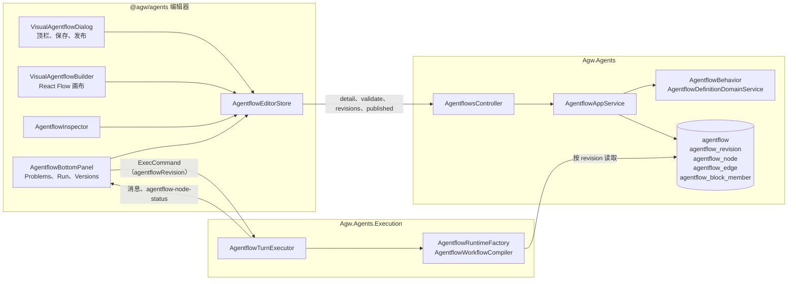
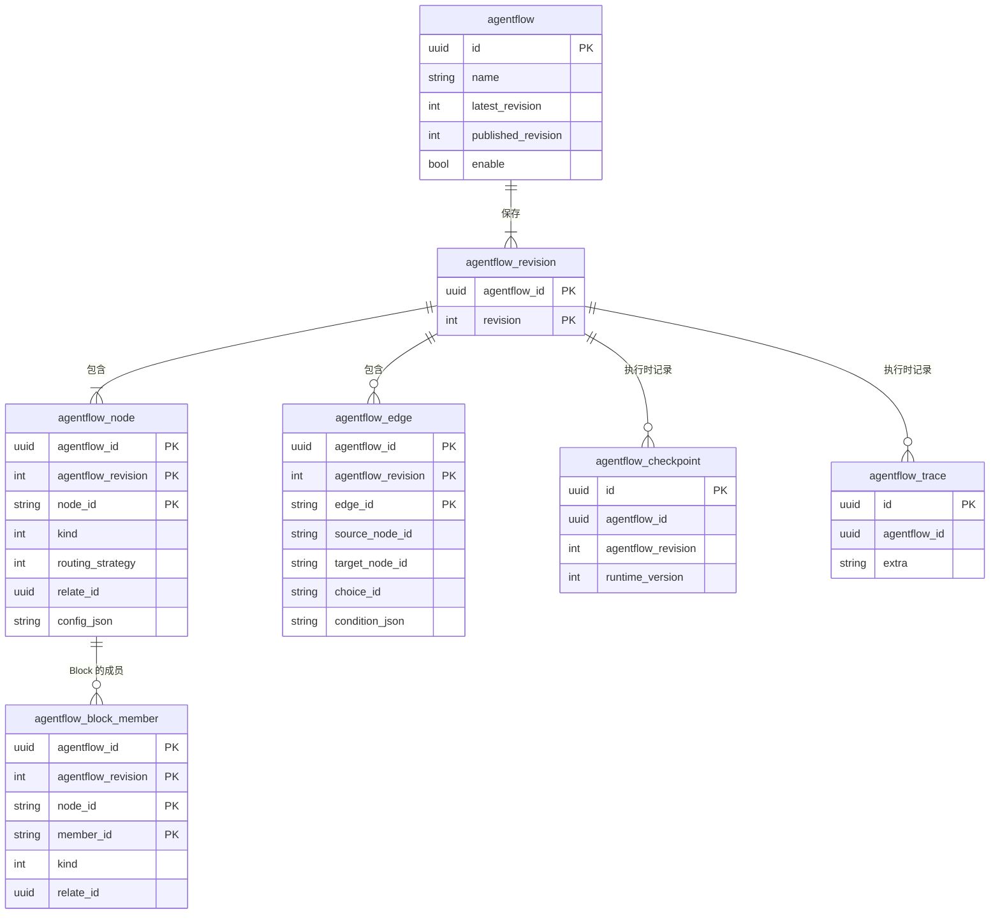
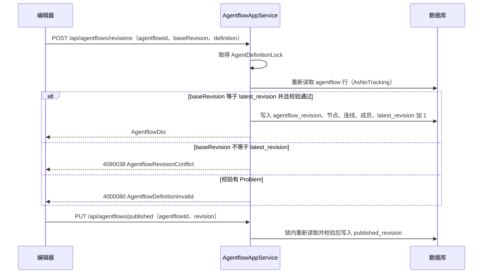

# Agentflow 编辑器

文中每一项设计都标有变更类型，含义相对于当前代码：

- 【新增】：当前代码中不存在。
- 【修改】：当前代码中存在，结构或行为有变化。
- 【删除】：从当前代码中移除。

## 名词解释

- **编辑器**：Agentflows 页面中创建与编辑 Agentflow 的全屏对话框（`VisualAgentflowDialog`）。
- **定义**：一个 Agentflow 的节点、连线与 Block 成员。
- **revision**【新增】：定义的一次保存结果，保存后不可修改，在一个 Agentflow 内从 1 开始编号。
- **已发布的 revision**【新增】：对话、Job、事件订阅、A2A 与嵌套引用的默认 revision，记录在 `agentflow.published_revision`；0 表示尚未发布。Turn 受理时解析根定义及所有嵌套引用的 revision，并将完整依赖快照用于该 Turn 的所有分段、重试与 checkpoint 恢复。
- **分支方式**【修改】：一个源节点把输出交给下游的方式，存放在节点的 `routingStrategy` 上。取值为 `direct`（界面名称 Pass on）、`fanOut`（Send to all）、`switch`（Branch）、`choice`（Human Gate 专用）。
- **等待边**【修改】：`isFanInBarrier` 为 true 的连线。目标节点在全部等待边的源节点完成后开始。
- **成员**【修改】：Block 节点的子记录，引用一个 Agent 或 Agentflow。
- **choice**【新增】：Human Gate 的一个选项。回答时选择其中一个，流程进入绑定该 choice 的连线。
- **Problem**【修改】：Server 校验定义后返回的一项问题，带有对应的节点或连线。
- **节点运行状态**【新增】：一次 Turn 中某个节点的状态，取值为 `running`、`waiting`、`completed`、`failed`。

## 背景

用户反馈编辑器功能单一、操作不易、界面不好看。现有代码中的情况如下。

功能：

- 保存成功后对话框关闭（`VisualAgentflowDialogSession.handleAgentflowCreated`），运行入口只在列表页（`ExecuteAgentflowDrawer`）。
- 保存直接替换正在使用的图（`AgentflowBehavior.TryReplaceGraph`），对话、Job 与事件订阅随即执行新的定义，没有试运行的环节，也没有历史版本。
- checkpoint 依靠 `AgentflowDefinitionFingerprint` 对当前定义求哈希，定义有变化后，之前的 checkpoint 无法恢复。
- 画布不显示运行情况。Clear Messages、Prompt Adapter、Output 等节点执行时不产生任何消息。
- 校验在遇到第一个问题时返回（`validateAgentflowGraph`），部分文案使用内部 id。Server 的校验只返回 bool，保存失败时只有一句通用的错误信息。同一套规则在 TypeScript（`agentflow-cycle-validation.ts`、`agentflow-edge-routing.ts`、`agentflow-input-node.ts`）与 C#（`AgentflowBehavior`、`AgentflowTopology`）各实现一遍。
- 每个 Agent 节点的正文是固定文字 "Runtime AI agent"，连线标签只有 IF、ELSE IF、ELSE、BARRIER。
- 画布一次只能选中一个节点，Delete 键不可用，没有复制、粘贴、右键菜单、MiniMap 与节点查找。新建时画布只有 Input 节点。

操作：

- 新节点出现在 `160 + nodes.length * 28` 的固定坐标。Agent 与 Workflow 通过两个下拉框添加。
- 分支方式分散在每条连线的 `kind` 上，"同一个源节点一致、只有一个 Else、顺序不重复"依靠校验保证，顺序存放在 `configJson.switchCaseOrder`。界面要求逐条连线选择 Edge Type，修改过程中图处于无效状态。
- 条件是手写的 Predicate JSON。求值时把消息文本用换行连接后做子串匹配（`AgentflowWorkflowCompiler.BuildCondition`）。
- Human Gate 的 Reject 结束整个工作流；Approve 之后的分支只能对回复文字做 `contains` 匹配，用户要输入约定的词才能进入某个分支。
- `configJson`、`conditionJson`、`positionJson` 是 JSON 里嵌套的字符串。界面上有 "Advanced Config JSON" 文本框，Server 读取的键都已有表单字段。
- Block 的成员是普通节点，由 `participantNodeIds` 引用，因此出现隐藏成员、同时在画布上、被多个 Block 共用三种状态；成员在单独的 Block canvas 中编辑。
- Summary 的配置分在两处：`agentflow.summary_model_provider_id` 与 Output 节点的 `enableSummary`。
- 连线表单显示两个内部 id，说明文字使用 "MAF AddEdge" 等实现名称。连接点固定在节点左右两侧，连线是默认的 bezier，回边斜向穿过画布。
- 读取一个 Agentflow 需要 nodes、edges 两个请求；接口路径带有 `{id}`，与"参数放在 query 或 body"的规则不一致。

外观：

- 节点头部使用 10 组色阶 utility 区分种类，连线使用 5 个颜色变量区分种类。画面中同时出现十几种颜色，多数用来表示种类。
- 这些色阶在 `tokens.css` 的 `.dark` 中没有对应的深色值，Default 主题的 Dark Mode 下节点头部保持浅色底。`--agw-agentflow-edge` 在深色画布上的对比度约为 2.5:1。
- React Flow 的控件条、连线标签底色与 "React Flow" 字样使用它的默认样式。

执行消息：

- 同一个节点标识有四个名字：`interactionNodeId`、`checkpointNodeId`、`nodeId`、`interaction.source.nodeId`。
- `permission-status`、`mode-status` 等状态消息与对话消息在同一个回调中到达，`Chat`、`ConversationController`、`chat-native` 三处各自识别并过滤。

没有兼容性要求。表结构、HTTP 接口、执行消息、编辑器界面与主题变量清单都按最终状态设计。现有的 Agentflow 数据不做转换，Server 与 Web、Desktop、Mobile 一起升级，仓库内的主题 extension 同步修改。

## 设计目标

### 功能目标

Server 与协议：

1. 定义模型：分支方式存放在节点上，连线、Block 成员与各种节点的选项都是有类型的字段。
2. revision：每次保存产生一个不可修改的 revision，发布后才对外使用。
3. 校验只在 Server 实现，接口返回 Problems。
4. Human Gate 的 choices。
5. 条件规则，包括读取结构化 Result 的字段。
6. 执行：revision 的选择、checkpoint、节点标识、节点状态消息、客户端的状态分发。

编辑器：

7. 布局：顶栏、节点库、画布、右侧表单、底部面板。
8. 节点库与四种增加节点的方式。
9. 节点卡片与 Block 成员。
10. 连线：直角圆角路径、文字标签、插入节点、重新连接。
11. 分支方式、等待与 choice 的编辑。
12. 条件表单。
13. 右侧表单。
14. Problems 的显示。
15. 保存、发布、版本与运行。
16. 画布显示节点运行状态。
17. 多选、剪贴板、键盘操作与右键菜单。
18. 整理布局与画布导航。
19. 模板、导入与导出。
20. 颜色只表示状态，并全部来自主题变量。

### 技术目标

- 存储结构只能表示有效的组合：分支方式每个节点一个值，成员只属于一个 Block，choice 与连线一一绑定。
- 保存与发布在现有的定义锁（`AgentDefinitionLock`）内重新读取 `agentflow` 行后判断并写入；保存携带 `baseRevision`，与最新 revision 不一致时拒绝。
- revision 不可修改。Turn 受理时确定根 Agentflow 的 revision，并解析整个嵌套依赖图中每条 WorkflowAsAgent 节点或 Block 成员引用的目标 revision。持久化的 Turn 快照覆盖根定义、父定义 revision、引用节点或成员标识、目标 Agentflow id 与目标 revision；后续分段、重试及 checkpoint 恢复沿用该快照，不重新读取当前 published revision。同一 Turn 内重复引用同一个 Agentflow 时固定到同一个 revision。
- 用户隔离沿用 `CreateBy`：revision、节点、连线、成员跟随所属的 Agentflow；他人的 id 与不存在的 id 返回相同的错误。
- 编辑器的每个编辑操作是一次 `updateDocument`，对应一步 Undo。连线路径、分支操作、运行状态由没有 React 依赖的纯函数计算。
- 颜色全部引用主题变量或 `PALETTE_STEPS` 允许的色阶，`check-theme-tokens` 通过。
- 节点状态消息位于 Turn 的消息流中，有 `turnSequence`，Distributed 模式下可以重放；它不写入对话历史，没有内容，A2A 不为它生成 artifact。
- 图标按钮都有 `aria-label`，键盘可以完成选择、删除、撤销与查找。

## 总体设计



### 变更清单

数据库（细节见"数据库设计"）：

| 对象 | 变更 |
| --- | --- |
| `agentflow_revision` 表 | 【新增】 |
| `agentflow_block_member` 表 | 【新增】 |
| `agentflow` 表 | 【修改】增加 `latest_revision`、`published_revision`，删除 `summary_model_provider_id` |
| `agentflow_node` 表 | 【修改】主键加入 `agentflow_revision`；增加 `position_x`、`position_y`、`routing_strategy`、`summary_model_provider_id`；删除 `position_json`；`config_json` 的内容改为 Server 序列化的类型化对象 |
| `agentflow_edge` 表 | 【修改】主键加入 `agentflow_revision`；增加 `is_fan_in_barrier`、`is_switch_default`、`switch_case_order`、`choice_id`；删除 `kind`、`config_json`；`condition_json` 的内容改为规则数组 |
| `agentflow_checkpoint` 表 | 【修改】增加 `agentflow_revision`、`runtime_version`，删除 `definition_fingerprint`；Durable checkpoint 经 `source_turn_id` 关联原 Turn 的完整依赖快照 |
| `agentflow_trace` 表 | 【修改】增加 `extra`，其中保存 `agentflowRevision` |
| `project_conversation_turn` 表 | 【修改】增加 `extra`，其中保存 `agentflowRevision` 与 `agentflowDependencies`；缺少该属性表示旧 Turn 没有 revision 快照，空数组表示已记录且没有嵌套引用 |

HTTP 接口（细节见"接口文档"）：

| 接口 | 变更 |
| --- | --- |
| `GET /api/agentflows/detail` | 【新增】 |
| `GET /api/agentflows/revisions` | 【新增】 |
| `POST /api/agentflows/revisions` | 【新增】 |
| `PUT /api/agentflows/published` | 【新增】 |
| `POST /api/agentflows/validate` | 【新增】 |
| `GET /api/agentflows`、`GET /api/agentflows/paged` | 【修改】返回 `AgentflowDto`；前者只返回可以执行的 Agentflow |
| `POST /api/agentflows` | 【修改】请求体为类型化的定义，创建 revision 1 |
| `DELETE /api/agentflows`、`GET /api/agentflows/mermaid` | 【修改】参数改为 query |
| `GET /api/traces` | 【修改】每条记录增加 `extra` |
| `GET /api/agentflows/{id}`、`GET /api/agentflows/{id}/nodes`、`GET /api/agentflows/{id}/edges`、`PUT /api/agentflows/{id}`、`DELETE /api/agentflows/{id}`、`GET /api/agentflows/mermaid/{id}` | 【删除】 |

执行协议（细节见第 4、6 节与"接口文档"）：

| 对象 | 变更 |
| --- | --- |
| 消息 `agentflow-node-status` | 【新增】 |
| `ExecCommand.agentflowRevision` | 【新增】 |
| `interaction-request` 的 `workflow-gate` | 【修改】增加 `choices`、`allowResponseText`，删除 `mode` |
| `HumanResponseCommand` 的 `workflow-gate` 回答 | 【修改】增加 `choiceId` |
| 消息属性 `nodeId`、`nodePath` | 【修改】取代 `interactionNodeId` 与 `checkpointNodeId` |
| `GetAgentflowCheckpoints` 的可恢复判断 | 【修改】按 revision 与 runtime version |
| 错误码 `4000080`、`4040018`、`4090038`、`4090039`、`4090040` | 【新增】 |

Server 代码：

| 位置 | 变更 |
| --- | --- |
| `Agw.Data/Entities/Agentflows/AgentflowRevision.cs`、`AgentflowBlockMember.cs`、`AgentflowRoutingStrategy.cs` 及其 Configuration | 【新增】 |
| `Agw.Data/Conversions/ExtraJson.cs`、`Agw.Data/Entities/Observable/AgentflowTraceExtra.cs`、`Agw.Data/Entities/Projects/ProjectConversationTurnExtra.cs` | 【新增】 |
| `Agw.Projects.Contracts/History/AgentflowDependencyRevisionDto.cs` | 【新增】 |
| `Agw.Agents/Definitions/Contracts/AgentflowDefinitionDto.cs`、`AgentflowProblem.cs` | 【新增】 |
| `Agw.Agents.Contracts/Messages/AgwAgentflowNodeStatus.cs` | 【新增】 |
| `Agw.Migrations.Sqlite`、`Agw.Migrations.Postgres` 各一个 migration | 【新增】 |
| `Agentflow`、`AgentflowNode`、`AgentflowEdge`、`AgentflowCheckpointRecord`、`AgentflowTrace`、`ProjectConversationTurn` 及其 Configuration | 【修改】 |
| `Agw.Projects.Contracts/History/IConversationTurnStore.cs` 中 Turn 的记录类型、`ConversationTurnStore`、`TurnAcceptanceService`、`AgentflowCheckpointPersistence`、`DurableTurnUpgrade` | 【修改】 |
| `IAgentsDbContext`、`AgwDbContext`、`IAgentflowDefinitionReader`、`AgentflowDefinitionReader`、`DurableExecutionManifest` | 【修改】 |
| `AgentflowRequests.cs`、`AgentflowsController`、`AgentflowAppService`、`AgentflowBehavior`、`AgentflowDefinitionDomainService`、`AgentDefinitionRepository`、`AgentCatalogFacade` | 【修改】 |
| `AgentflowTraceDto`、`AgentflowTraceAppService` | 【修改】 |
| `AgentDeletionCoordinator`、`DbSeeder.SeedDefaultAgentflowAsync`、`DbSeeder.MaintainSystemDataAsync`、`Agw.Host/Program.cs`、`ErrorCodes`、`BackendArchitectureTests.EntityOwners` | 【修改】 |
| `HumanInteraction.cs`（`WorkflowGateInteraction`、`WorkflowGateDecision`）、`InteractionRules`、`AgwMessageTypes` | 【修改】 |
| `ExecCommand`、`ExecutionTarget`、`ExecutionConnectionContext`、`AgentflowRuntimeFactory`、`AgentflowWorkflowCompiler`、四个 Block builder、`AgentflowBlockBuildContext`、`AgentflowBlockBuildSupport`、`AgentflowWorkflowMetadata`、`AgentflowMermaidProvider`、`AgentflowTurnExecutor`、`AgentflowMessageMapper`、`AgentflowMessageTransforms`、`AgentflowNodeScopedAgent`、`AgentTurnSummaryService`、`AgentflowCheckpointStore`、`AgentflowCheckpointContracts`、`AgentflowNodeExecutionActivity`、`ExtensionExecutionSelectionResolver` | 【修改】 |
| `AgentflowEdgeKind`、`AgentflowConfigurationParser`、`AgentflowConfigurationFacts`、`AgentflowDefinitionFingerprint` | 【删除】 |
| `docs/ws-flow.md`、`Agw.Agents.Execution/README.md`、`HumanInteraction/README.md` | 【修改】 |

客户端代码（编辑器的文件都在 `src/clients/packages/agents/src/ui-web/pages/agentflows/components/`）：

| 位置 | 变更 |
| --- | --- |
| `agentflow-node-meta.ts`、`agentflow-node-library.tsx`、`agentflow-node-menu.tsx`、`agentflow-node-card.tsx`、`agentflow-edge.tsx`、`agentflow-edge-path.ts`、`agentflow-condition.ts`、`agentflow-condition-editor.tsx`、`agentflow-inspector.tsx`、`agentflow-problems.ts`、`agentflow-bottom-panel.tsx`、`agentflow-run-state.ts`、`agentflow-clipboard.ts`、`agentflow-templates.ts`、`agentflow-transfer.ts` | 【新增】 |
| `@agw/execution-core` 的 `execution-status.ts` | 【新增】 |
| `@agw/chat` 的 `workflow-gate-card.tsx` | 【新增】 |
| `visual-agentflow-dialog.tsx`、`visual-agentflow-builder.tsx`、`agentflow-editor-store.tsx`、`agentflow-edge-routing.ts`、`agentflow-input-node.ts`、`autoLayout.ts`、`utils.ts`、`execute-agentflow-drawer.tsx`、`agentflows-table.tsx`、`agentflows/page.tsx`、`copy-requests.ts`、`types/agentflow.ts` | 【修改】 |
| `@agw/api` 的 `openapi.json`、`openapi.d.ts`（`pnpm gen:api`） | 【修改】 |
| `@agw/execution-types`、`@agw/execution-core` 的 `protocol.ts` | 【修改】 |
| `@agw/chat-runtime` 的 `execution-session.ts`、`execution-session-manager.ts`、`conversation-controller.ts` | 【修改】 |
| `@agw/chat-core` 的 `human-interaction.ts` | 【修改】 |
| `@agw/chat` 的 `chat.tsx`、`human-gate-approval.tsx`；`@agw/chat-native` 的 `conversation-history.tsx`、`native-workspace-provider.tsx` | 【修改】 |
| `src/clients/desktop/src/shared/theme-tokens.ts`、`packages/components/src/ui-tokens/tokens.css`、`packages/extension-sdk/src/api.ts`、`src/extensions/warm-minimalism-theme/themes/warm-minimalism.json`、Desktop 的测试主题 `contrast.json` | 【修改】 |
| `config-json.ts`、`block-membership.ts`、`agentflow-cycle-validation.ts` 及它们的测试 | 【删除】 |

## 数据库设计



数据库没有外键，图中的关系由 Application 与 Infrastructure 代码维护。列名使用 `snake_case`，各表保留 `BaseEntity` 的审计列。revision 自己的编号列名为 `revision`，其他表引用它的列名为 `agentflow_revision`；`agentflow_trace` 与 `project_conversation_turn` 把它保存在 `extra` 中，键是 `agentflowRevision`。

### `agentflow`【修改】

| 列 | 类型 | 变更 | 说明 |
| --- | --- | --- | --- |
| `latest_revision` | int，非空 | 【新增】 | 最新保存的 revision，创建时为 1 |
| `published_revision` | int，非空，默认 0 | 【新增】 | 已发布的 revision；0 表示尚未发布。发布接口拒绝 0 |
| `summary_model_provider_id` | | 【删除】 | Summary model 存放在 Output 节点上 |

### `agentflow_revision`【新增】

| 列 | 类型 | 说明 |
| --- | --- | --- |
| `agentflow_id` | uuid | 主键之一 |
| `revision` | int | 主键之一，从 1 开始 |

`create_by` 与 `create_time` 记录保存者与保存时间。

### `agentflow_node`【修改】

主键由 `(agentflow_id, node_id)` 改为 `(agentflow_id, agentflow_revision, node_id)`。索引 `(agentflow_id, kind, relate_id)` 改为 `(agentflow_id, agentflow_revision, kind, relate_id)`。

| 列 | 类型 | 变更 | 说明 |
| --- | --- | --- | --- |
| `agentflow_revision` | int | 【新增】 | 所属的 revision |
| `position_x`、`position_y` | double，非空 | 【新增】 | 画布坐标 |
| `position_json` | | 【删除】 | |
| `routing_strategy` | int，非空 | 【新增】 | `AgentflowRoutingStrategy`：0 `Direct`、1 `FanOut`、2 `Switch`、3 `Choice` |
| `summary_model_provider_id` | uuid，可空 | 【新增】 | Output 节点的 Summary model |
| `config_json` | varchar(16000)，非空 | 【修改】 | 该种类的选项，由 Server 按第 1 节的类型序列化；没有选项的种类为 `{}` |

`kind`、`relate_id`、`name`、`instructions` 的含义不变。

### `agentflow_block_member`【新增】

主键 `(agentflow_id, agentflow_revision, node_id, member_id)`，索引 `(agentflow_id, agentflow_revision, kind, relate_id)`。

| 列 | 类型 | 说明 |
| --- | --- | --- |
| `agentflow_id`、`agentflow_revision`、`node_id` | | 所属的 Block 节点 |
| `member_id` | varchar(64) | 成员 id，在一个 Block 内唯一 |
| `kind` | int | `AgentflowNodeKind.Agent` 或 `WorkflowAsAgent` |
| `relate_id` | uuid，非空 | 引用的 Agent 或 Agentflow |
| `name` | varchar(200)，非空 | 成员名称 |
| `instructions` | varchar(8000)，可空 | |
| `sort_order` | int，非空 | 成员的顺序，从 0 开始 |
| `is_manager` | bool，非空 | Magentic Team 的 Manager |

### `agentflow_edge`【修改】

主键由 `(agentflow_id, edge_id)` 改为 `(agentflow_id, agentflow_revision, edge_id)`。

| 列 | 类型 | 变更 | 说明 |
| --- | --- | --- | --- |
| `agentflow_revision` | int | 【新增】 | 所属的 revision |
| `kind` | | 【删除】 | 分支方式存放在源节点的 `routing_strategy` |
| `is_fan_in_barrier` | bool，非空 | 【新增】 | 等待边 |
| `is_switch_default` | bool，非空 | 【新增】 | 源节点为 `Switch` 时的 Else |
| `switch_case_order` | int，非空 | 【新增】 | 源节点为 `Switch` 时带条件分支的顺序，从 0 开始；其他连线为 0 |
| `choice_id` | varchar(64)，可空 | 【新增】 | 源节点为 Human Gate 时绑定的 choice |
| `condition_json` | varchar(8000)，非空 | 【修改】 | 条件规则数组，由 Server 序列化；没有条件时为 `[]` |
| `config_json` | | 【删除】 | |

### `agentflow_checkpoint`【修改】

| 列 | 类型 | 变更 | 说明 |
| --- | --- | --- | --- |
| `agentflow_revision` | int，非空 | 【新增】 | 产生 checkpoint 的 revision |
| `runtime_version` | int，非空 | 【新增】 | 产生 checkpoint 时的 `AgentflowCheckpointRuntime.Version` |
| `definition_fingerprint` | | 【删除】 | |

### `agentflow_trace`【修改】

| 列 | 类型 | 变更 | 说明 |
| --- | --- | --- | --- |
| `extra` | text，非空，默认 `{}` | 【新增】 | JSON 对象。`agentflowRevision`：这条记录的节点所属 Agentflow 的 revision，与同一行的 `agentflow_id` 对应 |

`GET /api/traces` 返回这一列，属性名是 `extra`：`AgentflowTraceDto` 增加 `Extra`（类型 `AgentflowTraceExtra`），`AgentflowTraceAppService` 从 `AgentflowTrace.Extra` 填入它。

### `project_conversation_turn`【修改】

| 列 | 类型 | 变更 | 说明 |
| --- | --- | --- | --- |
| `extra` | text，非空，默认 `{}` | 【新增】 | JSON 对象。`agentflowRevision`：Turn 执行的根 revision，目标是 Agent 时为 0；`agentflowDependencies`：该 Turn 固定的嵌套引用及其目标 revision。属性缺失表示没有快照；空数组表示已捕获完整依赖图且没有嵌套引用 |

该表属于 Projects 模块。`IConversationTurnStore` 的记录类型 `AcceptConversationTurnRequest` 与 `ConversationTurnSnapshot` 增加 `AgentflowRevision` 与可空的 `AgentflowDependencies`。`AgentflowDependencyRevisionDto` 定义在 `Agw.Projects.Contracts/History`，只含父 Agentflow id/revision、父节点 id、可空成员 id、目标 Agentflow id/revision。`ConversationTurnStore` 在 Projects contract DTO 与 `ProjectConversationTurnExtra` 的持久化本地记录之间转换；`Agw.Data` 不引用 `Agw.Projects.Contracts` 或 `Agw.Agents`。

### `extra`【新增】

`agentflow_trace` 与 `project_conversation_turn` 的 `extra` 使用相同的规则：

- 内容是一个 JSON 对象，键使用 camelCase，与 HTTP 接口中 JSON 的写法相同，例如 `{"agentflowRevision":3}`。
- 实体属性为 `Extra`，类型是各表自己的 record：`AgentflowTraceExtra` 与 `ProjectConversationTurnExtra`。Trace 有 `AgentflowRevision`（int）；Turn 有 `AgentflowRevision`（int）与可空的 `AgentflowDependencies`，其持久化本地记录每项含 `ParentAgentflowId`、`ParentRevision`、`ParentNodeId`、可空的 `BlockMemberId`、`TargetAgentflowId` 与 `TargetRevision`。新受理的 Agentflow Turn 总会写入该属性，无引用时写 `[]`；`null` 表示历史 Turn 或数据损坏，恢复时不得当作空依赖图。`ConversationTurnStore` 将该记录映射为 `Agw.Projects.Contracts/History/AgentflowDependencyRevisionDto`，没有跨模块反向引用。
- `Agw.Data/Conversions/ExtraJson.cs` 提供 `ExtraJson.Converter<T>()`，使用 `JsonNamingPolicy.CamelCase` 在 record 与 JSON 文本之间转换，两张表的 Configuration 都使用它。
- 内容为 `{}` 时，读取到的 `AgentflowRevision` 为 0，`AgentflowDependencies` 为 `null`，表示此历史记录没有 revision 快照。

### Migration

`Agw.Migrations.Sqlite` 与 `Agw.Migrations.Postgres` 各增加一个 migration，使用 `docs/1.Development.md` 中对应 provider 的命令生成。migration 先删除 `agentflow`、`agentflow_node`、`agentflow_edge`、`agentflow_checkpoint`、`agentflow_trace` 的全部行，再修改表结构；`project_conversation_turn` 的现有行保留，`extra` 为 `{}`。Job 与事件订阅保留原有的内置 Agentflow id。

升级后的内置 Agentflow 由 `DbSeeder.MaintainSystemDataAsync` 负责。`Agw.Host/Program.cs` 已在初始化完成的 Control Plane 启动时、持有 `host-startup-initialization` 应用锁期间调用该维护入口，并在应用开始接收请求前等待其完成。扩展此维护入口以调用 `EnsureBuiltInAgentflowAsync`；此路径覆盖已初始化的 SQLite 与 PostgreSQL 部署。`ConfiguredSetupInitializer.InitializeIfConfiguredAsync` 对已初始化数据库立即返回，因此升级不能依赖首次 Setup 的 `SeedAsync`。

迁移完成后，`EnsureBuiltInAgentflowAsync` 在同一事务中，按固定 `XiaohongshuAgentflowId` 与管理员所有权检查内置流程。流程缺失时，按固定 `GeneralAgentId`、`LocationExtractorAgentId`、`AmapPoiSearchAgentId` 与管理员所有权读取其内置 Agent，不依赖可编辑的 `Name` 或 `DisplayName`。任一 Agent 缺失时启动明确失败，不创建不完整的流程，也不尝试按名称创建替代 Agent。依赖齐全时，创建同一 id 的 Agentflow、revision 1、该 revision 的节点、连线与成员，并令 `latest_revision`、`published_revision` 都为 1。事务提交后，保留原 id 的 Job 与事件订阅可以继续定位此流程。重复启动时若该流程与 revision 1 已完整存在，则不新增或覆盖定义，不重置启用状态或 revision 指针；事务中途失败时整组新增数据回滚。id 已被其他所有者占用或现有数据不完整时，启动明确失败，避免创建重复身份或不完整定义。

新安装仍由首次 Setup 的 `SeedAsync` 创建相同 id、管理员所有权及已发布的 revision 1。升级部署先应用 provider 对应 migration，再启动 Control Plane 并等待系统数据维护成功；分离部署先确认 Control Plane 启动成功，再启动 Data Plane 接收执行。这样 Job 与事件订阅指向已恢复的内置流程，其他已删除 Agentflow 的引用仍按现有目标不存在错误处理。

`BackendArchitectureTests.EntityOwners` 增加 `AgentflowRevision`、`AgentflowBlockMember`，owner 为 `Agw.Agents`。

## 详细设计

### 1. 定义模型【修改】

接口中的定义是有类型的对象，节点按 `kind` 区分字段：

```jsonc
{
  "nodes": [
    {
      "nodeId": "input",
      "kind": "input",
      "name": "Input",
      "position": { "x": 80, "y": 80 },
      "routingStrategy": "fanOut"
    },
    {
      "nodeId": "agent-1763700000000-ab12cd",
      "kind": "agent",
      "name": "Coding",
      "position": { "x": 400, "y": 80 },
      "routingStrategy": "direct",
      "relateId": "0199c0de-…",
      "instructions": ""
    }
  ],
  "edges": [
    {
      "edgeId": "edge-1763700000100-ef34gh",
      "sourceNodeId": "input",
      "targetNodeId": "agent-1763700000000-ab12cd",
      "isFanInBarrier": false,
      "isSwitchDefault": false,
      "switchCaseOrder": 0,
      "choiceId": null,
      "label": null,
      "conditions": []
    }
  ]
}
```

每个节点都有 `nodeId`、`kind`、`name`、`position`、`routingStrategy`。各种类另有的字段：

| `kind` | 字段 | 相对当前代码 |
| --- | --- | --- |
| `input` | 无 | |
| `agent` | `relateId`、`instructions` | |
| `workflowAsAgent` | `relateId`、`instructions` | |
| `promptAdapter` | `instructions` | |
| `clearMessages` | 无 | |
| `humanGate` | `humanPrompt`、`choices`（`{ choiceId, label }` 的数组）、`allowResponseText` | 【修改】增加 `choices`、`allowResponseText`，删除 `humanMode` |
| `checkpointMarker` | `checkpointName` | |
| `output` | `enableSummary`、`summaryModelProviderId`、`instructions` | 【修改】`summaryModelProviderId` 从 Agentflow 移到节点 |
| `concurrentBlock` | `instructions`、`members` | 【修改】成员为子记录 |
| `handoffBlock` | `instructions`、`members`、`handoffInstructions`、`enableReturnToPrevious`、`autonomous`、`autonomousTurnLimit`、`continuationPrompt` | 【修改】成员为子记录 |
| `groupChatBlock` | `instructions`、`members`、`maxRounds` | 【修改】成员为子记录 |
| `magenticBlock` | `instructions`、`members`、`maxRounds`、`maxStalls`、`maxResets`、`requirePlanSignoff` | 【修改】成员为子记录，Manager 记在成员上 |

成员：`{ memberId, kind, relateId, name, instructions, isManager }`，`kind` 为 `agent` 或 `workflowAsAgent`，数组顺序即 `sort_order`。

`routingStrategy`【新增】：

| 节点 | 允许的取值 |
| --- | --- |
| `humanGate` | `choice` |
| 其他节点 | `direct`、`fanOut`、`switch` |

连线使用的字段由源节点的 `routingStrategy` 决定：

| 源节点 | 连线字段 |
| --- | --- |
| `direct`、`fanOut` | `conditions` 可以为空 |
| `switch` | 带条件的分支：`conditions` 非空，`switchCaseOrder` 为它的顺序；Else：`isSwitchDefault` 为 true，`conditions` 为空 |
| `choice` | `choiceId` 为源节点的一个 choice，`conditions` 为空 |
| 任意 | 等待边：`isFanInBarrier` 为 true，其余字段为默认值 |

`kind`、`routingStrategy` 在接口中是字符串（camelCase 的枚举名）。`AgentflowEdgeKind`【删除】。`AgentflowNodeDto` 是按 `kind` 区分的多态类型（`JsonPolymorphic`），`pnpm gen:api` 生成对应的 TypeScript 联合类型，`types/agentflow.ts` 改为导出生成的类型。

存储：`relateId`、`instructions`、`position`、`routingStrategy`、`summaryModelProviderId` 是 `agentflow_node` 的列，各种类的其余字段序列化到 `config_json`，成员写入 `agentflow_block_member`。`AgentflowConfigurationParser` 与 `AgentflowConfigurationFacts`【删除】，Server 直接读取类型化的字段。

编译（`AgentflowWorkflowCompiler`）【修改】：

| 源节点 | 编译结果 |
| --- | --- |
| `direct` | 每条连线一个 `AddEdge`，带有可选的谓词 |
| `fanOut` | `AddFanOutEdge`，带有谓词的连线只在谓词成立时执行 |
| `switch` | `AddSwitch`，按 `switchCaseOrder` 依次加入，`isSwitchDefault` 为默认分支 |
| `choice` | 每条连线带有判断 `choiceId` 的谓词（第 4 节） |
| 等待边 | 现有的 FanIn barrier |

Block builder 从成员记录创建参与者，成员的运行时节点 id 沿用 `{blockNodeId}.{memberId}`；Magentic Team 使用 `isManager` 为 true 的成员作为 Manager。

### 2. revision、保存与发布【新增】



- **创建**【修改】。`POST /api/agentflows` 创建 `agentflow` 行与 revision 1，`latest_revision` 为 1，`published_revision` 为 0。
- **保存**【新增】。`POST /api/agentflows/revisions` 在定义锁内重新读取 `agentflow` 行，`baseRevision` 等于 `latest_revision` 时写入 `latest_revision + 1` 的 revision，同时更新 `name` 与 `description`。已有的 revision 不被修改。
- **发布**【新增】。`PUT /api/agentflows/published` 在定义锁内重新读取并确认该 revision 存在，按当前的引用重新校验（第 3 节），通过后写入 `published_revision`。`revision` 小于 1 时返回 `InvalidParam`。
- **版本列表**【新增】。`GET /api/agentflows/revisions` 按 `revision` 从大到小返回 `{ revision, createTime }`。
- **读取**【新增】。`GET /api/agentflows/detail` 返回 Agentflow 与指定 revision 的定义；revision 不存在时返回 `4040018 AgentflowRevisionNotFound`。
- **删除**【修改】。删除 Agentflow 时同时删除它的全部 revision、节点、连线与成员；若活跃 Durable manifest 或可恢复 checkpoint 的根 Agentflow revision 或任一依赖目标 revision 引用该 Agentflow，则返回 `4090040 AgentflowInUse` 并保留定义。
- **可执行的列表**【修改】。`GET /api/agentflows` 只返回 `enable` 为 true 并且 `published_revision` 大于 0 的 Agentflow。对话的目标选择、Job、事件订阅、Projects 详情、Desktop 工作区与 extension 的列表都使用它，调用方不需要修改。`GET /api/agentflows/paged` 返回全部。
- **引用检查**【修改】。`AgentDeletionCoordinator` 检查 `latest_revision`、`published_revision` 及仍由活跃 Durable manifest 或可恢复 checkpoint 固定的 revision 中的节点与成员。Agent 被固定的 revision 引用时沿用 `4090018 AgentInUse`。`AgentCatalogFacade` 判断 model provider 是否被使用时，检查 `latest_revision` 与 `published_revision` 中 Output 节点的 `summary_model_provider_id`。

### 3. 校验【修改】

规则只在 Server 实现。`AgentflowBehavior.Validate` 返回问题列表，取代返回 bool 的 `IsValidGraph`；`AgentflowDefinitionDomainService` 补充需要查询其他聚合的规则。客户端的 `validateAgentflowGraph`、`validateInputGraph`、`validateAgentflowEdgeRouting`、`validateAgentflowCycles`【删除】。

```csharp
/// <summary>
/// 定义中的一项问题；NodeId 与 EdgeId 至多一个有值。
/// One problem in a definition; at most one of NodeId and EdgeId is set.
/// </summary>
public sealed record AgentflowProblem(string Code, string Message, string? NodeId, string? EdgeId);
```

| `code` | 规则 | 定位 | 实现位置 |
| --- | --- | --- | --- |
| `name-required` | 名称为空或超过 200 个字符 | 无 | Behavior |
| `input-invalid` | Input 节点不是恰好一个，或 `nodeId` 不是 `input`，或有连线指向它 | 节点 | Behavior |
| `duplicate-id` | 节点、连线或同一个 Block 的成员 id 重复 | 节点或连线 | Behavior |
| `runner-required` | 没有 Agent、Workflow as Agent 或带有成员的 Block | 无 | Behavior |
| `node-unreachable` | 节点从 Input 出发不可到达 | 节点 | Behavior |
| `edge-endpoint-missing` | 连线的源或目标不存在 | 连线 | Behavior |
| `routing-invalid` | `routingStrategy` 不是该种类允许的取值 | 节点 | Behavior |
| `switch-case-required` | `switch` 节点有出边但没有带条件的分支 | 节点 | Behavior |
| `switch-condition-required` | `switch` 的带条件分支没有规则 | 连线 | Behavior |
| `switch-default-duplicate` | `switch` 节点有多于一个 Else | 节点 | Behavior |
| `switch-order-duplicate` | 同一个源节点的 `switchCaseOrder` 重复 | 节点 | Behavior |
| `condition-invalid` | 规则的 `field` 不被支持，或值为空，或 `minMessages` 不是正整数，或 Else、等待边、Human Gate 的出边带有规则 | 连线 | Behavior |
| `choice-required` | Human Gate 没有 choice，或 choice 的 id、label 为空，或 id 重复 | 节点 | Behavior |
| `edge-choice-invalid` | Human Gate 的非等待出边的 `choiceId` 不是它的 choice | 连线 | Behavior |
| `block-member-count` | Concurrent Block 没有成员，其他 Block 的成员少于两个 | 节点 | Behavior |
| `block-manager-invalid` | Magentic Team 的 Manager 不是恰好一个 | 节点 | Behavior |
| `cycle-exit-required` | 环没有从 `switch` 或 `choice` 节点离开的出边 | 环中的第一个节点 | Behavior |
| `cycle-barrier-invalid` | 环内节点等待环外的非 Input 节点 | 连线 | Behavior |
| `summary-output-count` | 有 Output 打开 Summary 时 Output 不是恰好一个 | 节点 | Behavior |
| `reference-missing` | 节点或成员的 `relateId` 为空，或引用的 Agent、Agentflow 不属于当前用户 | 节点 | DomainService |
| `nested-unpublished` | 引用的 Agentflow 没有已发布的 revision | 节点 | DomainService |
| `nested-cycle` | 嵌套引用形成环；其他 Agentflow 按已发布的 revision 计算 | 节点 | DomainService |
| `summary-model-missing` | Output 打开 Summary 但 `summaryModelProviderId` 为空或对当前用户不可见 | 节点 | DomainService |
| `condition-result-unavailable` | 规则读取 Result，但源节点不是产生结构化 Result 的 Agent 节点 | 连线 | DomainService |

`message` 是英文句子，使用节点名称，例如 "Coding is not reachable from Input."。

三个入口使用同一个实现：

- `POST /api/agentflows/validate`【新增】返回 `{ problems }`，不写入数据。
- 创建与保存在有 Problem 时抛出 `AgwException(ErrorCodes.AgentflowDefinitionInvalid)`。
- 发布按当前的引用重新校验，有 Problem 时抛出同一个错误。

### 4. Human Gate 的 choices【修改】

**节点**。Human Gate 有 `humanPrompt`、至少一个 choice 与 `allowResponseText`。出边的 `choiceId` 决定回答某个 choice 后进入的连线；多条连线可以绑定同一个 choice，它们都会执行；没有连线的 choice 被选择后，流程在该节点结束这一条路径。

**交互请求**。`WorkflowGateInteraction`：

| 属性 | 变更 | 说明 |
| --- | --- | --- |
| `Choices` | 【新增】 | `IReadOnlyList<WorkflowGateChoice>`，`WorkflowGateChoice(string ChoiceId, string Label)` |
| `AllowResponseText` | 【新增】 | 是否显示文本输入 |
| `Mode` | 【删除】 | |
| `Prompt`、`InputPreview`、`Source` | 不变 | |

**回答**。`WorkflowGateDecision`：

| 属性 | 变更 | 说明 |
| --- | --- | --- |
| `ChoiceId` | 【新增】 | `Approved` 为 true 时必须是请求中的一个 choice |
| `Approved` | 含义【修改】 | true 表示选择了一个 choice；false 表示停止工作流，行为与现有的拒绝相同（`human-gate-rejected`，取消剩余等待） |
| `ResponseText` | 不变 | `AllowResponseText` 为 false 时忽略 |

`InteractionRules.ValidateAndNormalize` 检查 `ChoiceId`，不符合时抛出 `InvalidParam`。`InteractionRules.Decline` 继续返回 `Approved = false`。

**交回 Workflow**。`AgentflowMessageMapper.CreateHumanGateResponseMessages` 追加的人工回复消息：文本为 `ResponseText`，为空时为所选 choice 的 `Label`；`AuthorName` 为 `human`；`AdditionalProperties` 带有 `choiceId`。Human Gate 的每条非等待出边编译为带谓词的边，谓词读取最近一条 `AuthorName` 为 `human` 的消息的 `choiceId`，它等于连线的 `ChoiceId` 时成立。

**对话中的卡片**：

- `@agw/chat` 增加 `WorkflowGateCard`【新增】：显示节点名称、`prompt`、`inputPreview`；`allowResponseText` 为 true 时显示文本框；每个 choice 一个按钮，第一个为主要按钮；另有 "Stop workflow" 按钮，发送 `approved: false`。
- `HumanGateApproval`【修改】只处理 Tool approval。
- `@agw/chat-native` 的 `conversation-history.tsx`【修改】按同样的内容显示。

### 5. 条件【修改】

连线的 `conditions` 是规则数组，全部规则成立时条件成立，数组为空表示没有条件。

```ts
type AgentflowConditionRule = {
  field: "contains" | "notContains" | "equals" | "author" | "role" | "minMessages" | "result";
  /** 用于判断的值；minMessages 为正整数的文本。The value to compare; a positive integer in text for minMessages. */
  value: string;
  /** field 为 result 时是 Result 中的属性路径，其他情况为空字符串。The property path inside the Result when field is result; empty otherwise. */
  path: string;
};
```

| `field` | 变更 | 求值 |
| --- | --- | --- |
| `contains`、`notContains`、`equals` | 不变 | 对源节点交给下游的消息文本，忽略大小写 |
| `author`、`role` | 不变 | 至少一条消息的作者或角色等于 `value` |
| `minMessages` | 不变 | 消息数量不小于 `value` |
| `result` | 【新增】 | 取消息中最后一条 `resultFormat` 为 json 的 Result，按 `path`（用 `.` 分隔的属性名）读取它的 JSON；读取到的值的文本等于 `value`（忽略大小写）时成立；没有这样的 Result 或路径不存在时不成立 |
| `always` | 【删除】 | 没有规则即表示始终成立 |

`AgentflowWorkflowCompiler.BuildCondition` 改为读取规则数组；`useLatestHumanReply` 参数【删除】，Human Gate 的出边使用 choice。

Agent 节点在所引用的 Agent 打开 `EnableSummary` 并配置了 `ResponseSchema` 时产生结构化 Result（`AgentflowNodeResultOptions.UseStructuredResult`），Result 随节点输出交给下游。`result` 规则只能用于这样的源节点（`condition-result-unavailable`）。

### 6. 执行

#### 6.1 revision 的选择【新增】

- `ExecCommand` 增加 `AgentflowRevision`（int，默认 0）。0 表示根 Agentflow 使用当时的 published revision；大于 0 表示执行指定的根 revision，只有编辑器的 Run 使用。`ExecutionConnectionContext` 与 `AgentExecutionFacade` 将请求值交给 Turn 受理流程，不在受理事务外读取 published pointer。
- `ExecutionTarget` 增加受理后的 `AgentflowRevision`（Agent 目标为 0）。`Agw.Agents` 内的 Durable manifest 使用 `AgentflowDependencyRevision` 本地值类型，`Agw.Projects.Contracts/History` 使用 `AgentflowDependencyRevisionDto`；`TurnAcceptanceWriter` 在保存 Turn 时将同一份值映射到 Projects contract，不新增 Projects 对 Agents 的引用。writer 在现有的对话历史锁与 `AgwDbContext` 事务中，以 `Serializable` 隔离级别读取根 Agentflow、根 published pointer 及所有可达 Workflow as Agent 节点和 Block 成员所引用的 published pointer；定义读取器使用该事务中的同一 `AgwDbContext`。默认根 revision 为 0 时要求 `published_revision` 大于 0，否则返回 `4090039 AgentflowNotPublished`。显式根 revision 小于 0 时返回 `InvalidParam`；大于 0 但不存在时返回 `4040018`。任一嵌套目标未发布时返回 `4090039`。`TurnAcceptanceWrite` 只带请求 revision；writer 在同一个事务中生成完整依赖快照、写入 Turn 的 `extra`，并据此创建包含同一快照的 Durable manifest 与执行记录，然后提交事务后才发出 start 事件。若序列化冲突发生在提交前，整次接受回滚并返回失败，不创建 Turn 或发出 start 事件；之后重发同一 `turnId` 时按新请求解析。Turn 一旦提交，同 `turnId` 的重复受理只读取已保存快照。
- Turn 受理结果把已解析的根 revision 与依赖快照交给执行请求。若收到已存在的 `turnId`，先读取该 Turn 的持久化快照并返回原结果，不检查当前 root 或 nested published pointer；并发重复受理命中现有 Turn 时也读取原 Turn 与 Durable manifest。`DurableTurnUpgrade` 补齐 Turn 时同时复制 manifest 中的根 revision 与完整依赖快照。重新领取或故障重试只按已保存 manifest 的 revision 读取。
- `IAgentflowDefinitionReader` 的 `ListNodesAsync`、`ListEdgesAsync` 增加 `agentflowRevision` 参数，并增加 `ListBlockMembersAsync`。`AgentflowRuntimeFactory` 在递归编译时以父 Agentflow id、父 revision、节点 id 或成员 id 查找已持久化的依赖项，再按目标 id 与固定 revision 读取定义；编译期间不得再次读取当前 `published_revision`。`AgentflowMermaidProvider`、`ExtensionExecutionSelectionResolver` 按明确选择的 revision 读取。
- Workflow as Agent 节点与成员引用的 Agentflow，在 Turn 受理时使用当时的 published revision 写入依赖快照；图编译和所有后续执行均只使用快照中的 revision。
- `AgentCatalogFacade` 计算 Agentflow 的 permission capabilities 与 input capabilities 时使用已发布的 revision 的节点与成员。
- `AgentflowTrace` 在 `extra` 的 `agentflowRevision` 中记录节点所属 Agentflow 的 revision，与同一行的 `agentflow_id` 对应：
  - `AgentflowRuntimeFactory.CreateAiWorkflow` 把读取定义时使用的 revision 交给 `AgentflowWorkflowCompiler.Compile`。Agent 节点的 `AgentflowNodeScopedAgent` 与 `agentflowId` 一起保存它，Block 的成员经 `AgentflowBlockBuildContext` 得到它。
  - Workflow as Agent 节点与 Block 成员内部的节点记录其依赖快照中的目标 revision，不重新读取当前 published revision。
  - Human Gate 的记录由 `AgentflowTurnExecutor` 传入 Turn 的 revision。
  - `AgentflowNodeExecutionActivity.StartAgent`、`StartHumanGate` 增加 `agentflowRevision` 参数，`TryCreateTrace` 把它写入 `AgentflowTrace.Extra`。
- A2A、Job 与事件订阅经 `AgentExecutionFacade` 执行，使用默认值 0。

#### 6.2 checkpoint【修改】

- `AgentflowCheckpointRecord` 记录 `AgentflowRevision` 与 `RuntimeVersion`；`AgentflowCheckpointSnapshot` 同步修改。`AgentflowDefinitionFingerprint`【删除】，其中的版本号成为常量 `AgentflowCheckpointRuntime.Version`。
- `GetAgentflowCheckpoints` 的 `available`：`RuntimeVersion` 等于当前常量、保留现有快照条件（InProcess 的 runtime 仍然存活），且 Durable checkpoint 的 `SourceTurnId` 指向仍存在的 Turn 与 Durable execution；两者都包含相同根 revision 与快照属性。快照中每个 Agentflow id/revision 与其所需 Agent 都仍可读取。根流程没有嵌套引用时，空数组是有效快照；任一来源缺少快照属性或两份快照不一致时，checkpoint 不可恢复。
- `ResumeCheckpointCommand` 使用 checkpoint 的 `SourceTurnId` 读取原 Turn 与 Durable manifest 中的根 revision 及完整依赖快照，与当前 published pointer 无关。来源 Turn 或 Durable manifest 不存在、任一快照属性缺失、两份快照不一致或快照依赖无法读取时，在修改历史和注册恢复 execution 前拒绝恢复，不重新解析当前 published pointer。`AgentflowCheckpointPersistence.AcceptResumeTurnAsync` 将两者复制到恢复 Turn 与新 Durable manifest；重复提交同一恢复命令沿用已保存的快照。恢复分支继续使用原 Turn 的全部根及嵌套定义 revision。
- Save 只新增 revision，Publish 只更新 `published_revision`，两者都不删除或改写任何已有 revision。只要活跃 Durable manifest 或可恢复 checkpoint 的依赖快照仍引用某个 Agentflow revision，就保留该 Agentflow、revision 的节点/连线/成员及其引用的 Agent。删除 Agentflow 或 Agent 前检查这些快照；存在引用时拒绝删除。相关 Durable execution 结束且 checkpoint 不再可恢复后，才可释放这些保留引用。

#### 6.3 节点标识【修改】

Agentflow 节点产生的消息统一使用两个属性：

| 属性 | 含义 |
| --- | --- |
| `nodeId` | 当前 Turn 执行的 Agentflow 中的顶层节点 id |
| `nodePath` | 从顶层节点到产生消息的节点的路径，用 `/` 分隔；顶层节点自己的输出与 `nodeId` 相同 |

| 位置 | 变更 |
| --- | --- |
| `AgentflowNodeScopedAgent`、`AgentTurnSummaryService` 写入的 `interactionNodeId` | 【修改】改为 `nodePath`，并增加 `nodeId` |
| `agentflow-checkpoint` 的 `checkpointNodeId` | 【修改】改为 `nodeId` |
| `InteractionSource` | 【修改】`NodeId` 为顶层节点 id，增加 `NodePath` |
| `human-gate-rejected`、`human-gate-unavailable` 的 `nodeId` | 不变 |
| `AgentflowMessageTransforms.HasNodeSource`、`chat-core` 的 `matchesHumanInteractionCall` 与 `getAgentflowCheckpointMessage` | 【修改】读取新的属性名 |

`nodeName` 不变。

#### 6.4 节点状态消息【新增】

`AgwMessageTypes` 增加 `AgentflowNodeStatus = "agentflow-node-status"`。`Agw.Agents.Contracts/Messages` 增加：

```csharp
/// <summary>
/// agentflow-node-status 的 status 取值。
/// The status values of agentflow-node-status.
/// </summary>
public static class AgwAgentflowNodeStatus
{
    public const string Running = "running";
    public const string Waiting = "waiting";
    public const string Completed = "completed";
    public const string Failed = "failed";
}
```

消息由 `AgentflowMessageMapper.CreateNodeStatusMessage(nodeId, status, interactionId, messageId)` 创建：角色为 `AiRole.System`，没有内容，`additionalProperties` 包含 `type`、`nodeId`、`status`，以及有值时的 `interactionId`。它由 `AgentflowTurnExecutor` 写入 Turn 的消息流，与其他输出一样取得 `turnSequence`。该类型不属于 `AgwMessageClassifier.IsControl`，只输出 Result 的连接不会收到它。

executor 与节点的对应关系在编译时确定。`AgentflowWorkflowCompiler.Compile`【修改】返回 `AgentflowCompilation(Workflow Workflow, IReadOnlyDictionary<string, string> NodeIdsByExecutorId)`，对照表由 `bindings`（`NodeId → ExecutorBinding`）中每个 `ExecutorBinding.Id` 生成，`{nodeId}.output` 这类辅助 executor 不在其中。`AgentflowWorkflowMetadata` 增加 `NodeIdsByExecutorId`。

`AgentflowTurnExecutor.RunWorkflowAsync` 写入节点状态消息的位置：

| 时机 | `status` | `interactionId` |
| --- | --- | --- |
| `ExecutorInvokedEvent`，`ExecutorId` 在对照表中 | `running` | 无 |
| `ExecutorCompletedEvent`，`ExecutorId` 在对照表中 | `completed` | 无 |
| `ExecutorFailedEvent`，`ExecutorId` 在对照表中 | `failed` | 无 |
| 把交互请求交给 `IInteractionHandler` 之前 | `waiting` | 请求的 `InteractionId` |
| 交互得到回答并已交回 Workflow：`WorkflowGateInteraction` | `completed` | 请求的 `InteractionId` |
| 交互得到回答并已交回 Workflow：其他种类 | `running` | 请求的 `InteractionId` |

交互对应的节点是 `request.Source.NodeId`，它不是对照表中的节点时不写入。`WorkflowInteractionResult` 增加 `Answered`，携带已回答的请求；Durable 恢复时，已保存的回答经 `SendResponseAsync` 交回之后写入同样的消息。一个节点在一次激活中可能收到多组 `running` 与 `completed`（消息与 `TurnToken` 分别触发 executor）。

#### 6.5 客户端的状态分发【修改】

`@agw/execution-core` 增加 `execution-status.ts`【新增】：

```ts
export type AgentflowNodeStatus = "running" | "waiting" | "completed" | "failed";

export type ExecutionStatusEvent =
  | { type: "agentflow-node-status"; nodeId: string; status: AgentflowNodeStatus; interactionId?: string }
  | ({ type: "permission-status" } & PermissionStatus)
  | { type: "mode-status"; agentId: string; mode: AgentMode }
  | { type: "mode-change-failed"; agentId: string; mode: string; message: string | null };

/** 读取状态消息；对话消息返回 null。Reads a status message; conversation messages give null. */
export function getExecutionStatus(message: ExecutionMessage): ExecutionStatusEvent | null;
```

`ExecutionSession.receiveMessage`【修改】在确认 Turn 位置的同一个流程中分发：`getExecutionStatus` 有结果时调用 `handlers.onStatus`，否则调用 `handlers.onMessage`。状态消息不再经过 `onMessage`。

| 位置 | 变更 |
| --- | --- |
| `ExecutionSessionHandlers` | 【修改】增加 `onStatus(status: ExecutionStatusEvent)` |
| `ExecutionSessionManager` 的 `ActiveTurnSnapshot` | 【修改】增加 `statuses`（当前 Turn 中按顺序收到的状态事件），`messages` 只包含对话消息 |
| `Chat.applyExecutionMessage`、`ConversationController.receive`、`native-workspace-provider.tsx` | 【修改】各自对 `permission-status`、`mode-change-failed`、`mode-status` 的识别移到 `onStatus`；`Chat` 恢复快照时依次处理 `statuses` |
| `ChatProps` | 【修改】增加 `onExecutionStatus`、`onExecutionMessage`，`target` 增加可选的 `agentflowRevision` |
| `ExecutionCommandRequest`、`buildExecCommand` | 【修改】增加 `agentflowRevision` |

```ts
/** 收到的每一个状态事件。Every status event received. */
onExecutionStatus?: (status: ExecutionStatusEvent) => void;
/** 收到的每一条对话消息，包括 Turn 的开始与结束。Every conversation message received, including turn start and finish. */
onExecutionMessage?: (message: AiMessage) => void;
```

`tool-mode-status` 是写入历史的 Tool 消息，仍经过 `onMessage`。

### 7. 布局【修改】

- **顶栏**（`VisualAgentflowDialog`），从左到右：
  - 名称输入框，绑定 `document.name`，placeholder 为 "Untitled Agentflow"。
  - 版本标记【新增】：`v{latestRevision}`，后面是 "Published v{n}" 或 "Not published"；有未保存的修改时显示 "Unsaved changes"。
  - Problems 按钮【新增】：没有问题时显示 `Check` 与 "No problems"，有问题时显示 `CircleAlert` 与 "{n} problems"，校验请求进行中显示 "Checking…"。点击后展开底部面板的 Problems 标签页。
  - Undo、Redo。
  - 更多菜单【新增】（`DropdownMenu`）：Templates、Import、Export。
  - Run【新增】、Save【修改】、Publish【新增】（第 15 节）。
  - 关闭按钮。顶栏只有这一个关闭入口，有未保存的修改时显示现有的放弃确认。
- **左侧**【修改】：节点库，`ResizablePanel` 默认 280px。
- **中间**【修改】：纵向的 `ResizablePanelGroup`。上方是画布；下方是底部面板【新增】，默认只显示 36px 的标签行，展开后默认 260px，包含 Problems、Run、Versions 三个标签页。
- **右侧**【修改】：右侧表单，默认 340px。没有选中对象时显示 Agentflow 设置。
- 打开编辑器时没有选中对象。

`AgentflowEditorState` 的 UI 状态【修改】：

```ts
/** 已创建的 Agentflow 的 id；尚未创建时为 null。Id of the created Agentflow; null before it is created. */
agentflowId: string | null;
/** 编辑器内容所基于的 revision；尚未创建时为 0。The revision the editor content is based on; 0 before creation. */
baseRevision: number;
publishedRevision: number;
selectedNodeIds: string[];
selectedEdgeId: string | null;
/** 选中的 Block 成员。The selected Block member. */
selectedMember: { nodeId: string; memberId: string } | null;
/** 编辑器内的剪贴板，不使用系统剪贴板。The editor's own clipboard; the system clipboard is not used. */
clipboard: AgentflowClipboard | null;
problems: AgentflowProblemsState;
runState: AgentflowRunState;
```

`canvasScope`、`pendingFocusNodeId`、`selectedNodeId` 以及对应的 action【删除】。文档中的节点数据是第 1 节的类型化节点，连线数据是类型化连线。

### 8. 节点库与增加节点

`AgentflowNodeLibrary`【新增】顶部是搜索框，按名称、说明与种类名称过滤。下面分为四组：

- Agents：`enable` 为 true 的 Agent，显示 `name` 与 `description`。
- Workflows：`GET /api/agentflows` 返回的、不是当前 Agentflow 的 Agentflow。
- Steps：Prompt Adapter、Clear Messages、Human Gate、Checkpoint、Output。
- Blocks：Concurrent Block、Handoff Group、GroupChat Room、Magentic Team。

每个条目是一行：图标、名称、一行说明，来自 `agentflow-node-meta.ts`【新增】的 `AGENTFLOW_NODE_META`。

增加节点的四种方式【新增】：

1. **拖动**。条目设置 `draggable`，`dragstart` 写入 `application/x-agw-agentflow-node`，内容为 `{ kind, relateId }` 的 JSON。画布的 `onDrop` 使用 `screenToFlowPosition` 取得位置，坐标吸附到 20px 网格。
2. **点击**。节点放在视口中央；该位置已有节点时向右下方每次偏移 40px。
3. **连线松开**。`onConnectEnd` 的事件目标是画布空白（`.react-flow__pane`）时，在松开的位置打开节点菜单，选择后创建节点并连接。
4. **连线上的 "+"**（第 10 节）。

`AgentflowNodeMenu`【新增】是 `Popover` 中的搜索框与同一份分组列表，用于方式 3、方式 4、右键菜单的 "Add a node here" 与 Block 的 "Add member"；增加成员时只列出 Agents 与 Workflows。

新节点的默认值：`routingStrategy` 为 `direct`（Human Gate 为 `choice`）；Human Gate 有一个 choice（label 为 "Continue"）；Magentic Team 的第一个成员是 Manager。节点 id 沿用 `${kind}-${Date.now()}-${random}`，choice 与成员的 id 使用同样的方式生成。

### 9. 节点卡片与 Block 成员

`AgentflowNodeCard`【新增】是 React Flow 的 `dagNode` 类型，取代 `DagNode`。宽 240px；头部高 62px，包含图标块（30px，`bg-muted`）、标题、第二行（`text-xs text-muted-foreground`，单行）与状态标记。卡片背景为 `bg-card`，边框为 `border-border`。

| 种类 | 图标（lucide-react） | 第二行 |
| --- | --- | --- |
| Input | `LogIn` | "User message starts the flow" |
| Agent | `Bot` | Agent 的模型名称；External Agent 为 "External agent"；没有关联时为 "No agent selected" |
| Workflow as Agent | `Workflow` | 被引用 Agentflow 的 `description`，没有时为 "Nested Agentflow" |
| Prompt Adapter | `PenLine` | `instructions` 的开头，没有时为 "No instructions yet" |
| Clear Messages | `Eraser` | "Continues with empty input" |
| Human Gate | `UserCheck` | 各个 choice 的 label，用 " / " 连接 |
| Checkpoint | `Flag` | `checkpointName`，没有时为节点名称 |
| Output | `LogOut` | Summary 打开时为 "Summary by {模型名称}"，否则为 "Returns the incoming messages" |
| Concurrent Block | `Split` | "{n} members" |
| Handoff Group | `ArrowLeftRight` | "{n} members" |
| GroupChat Room | `MessagesSquare` | "{n} members"，设置了 `maxRounds` 时追加 "max {n} rounds" |
| Magentic Team | `Network` | "{n} members"，设置了 `maxRounds` 时追加 "max {n} rounds" |

状态标记与边框，按从上到下的优先顺序取第一项成立的状态：

| 状态 | 标记 | 边框 |
| --- | --- | --- |
| running | `LoaderCircle` 旋转，`--agw-status-running` | `--agw-status-running`，外加 3px 的同色 14% 外圈 |
| waiting | `Hand`，`amber-500` | `amber-500`，外加 3px 的同色 14% 外圈 |
| failed | `CircleX`，`--destructive` | `--destructive` |
| 有 Problem | `CircleAlert`，`--destructive` | 不变 |
| completed | `Check`，`--muted-foreground` | 不变 |

选中的节点边框为 `border-primary` 并带有 `ring-1 ring-primary`。

连接点：左侧 target、右侧 source 各一个，直径 10px，背景 `--card`，边框 1.5px `--agw-agentflow-edge`，hover 时放大到 1.5 倍。Input 没有 target。有等待边指向的节点，左侧连接点显示为 5×20px 的竖条（`bg-foreground`）。

只选中一个节点时，`NodeToolbar` 在它的右上方显示 Duplicate 与 Delete 两个图标按钮。Input 没有这两个按钮。

**Block 成员**【修改】。Block 节点在头部下方显示成员行，每行 30px：图标（`Bot` 或 `Workflow`）、成员名称，Manager 显示 `Crown`；最后一行是 "Add member"。

- 点击成员行调用 `selectMember({ nodeId, memberId })`，右侧显示成员表单。
- "Add member" 打开节点菜单，选择后在该节点的 `members` 末尾增加一项并选中它。
- 移除成员从 `members` 中删除该项；被移除的是 Manager 时，第一个成员成为 Manager。
- 成员只存在于所属的 Block 中。Block canvas、`ScopeBar`、`BlockScopePalette` 与 `block-membership.ts`【删除】。

### 10. 连线

连线使用自定义的 edge 类型 `agentflow`（`AgentflowEdge`【新增】）。

**路径**【新增】。`routeAgentflowEdges(nodes, edges)`（`agentflow-edge-path.ts`）一次计算全部连线，返回每条连线的折点与标签位置。`VisualAgentflowBuilder` 在节点位置或连线变化时使用 `useMemo` 计算，并写入各条连线的 `data.route`。节点的宽高使用 React Flow 测量的值，尚未测量时为 240×64。S 为源节点右侧的连接点，T 为目标节点左侧的连接点：

1. T 在 S 右侧至少 28px，两点高度相同，线段不经过其他节点：直线。
2. T 在 S 右侧至少 28px，高度不同：S → (mx, S.y) → (mx, T.y) → T，mx 为两点的中间；三段都不经过其他节点时采用。
3. 其余情况（回边、被节点挡住）经过通道：S → 向右 24px → 通道 → T 左侧 24px → T。目标节点整体在源节点的下方或上方并且间隔至少 40px 时，通道是两者之间的中线。否则，向前的连线从上方绕过（范围内节点的最小 top 减 34px），回边从下方绕过（范围内节点的最大 bottom 加 34px）。
4. 共用同一条通道（y 相差小于 24px）的连线按顺序每条偏移 12px。共用同一个 mx 的连线按源节点分组，每组偏移 14px。
5. 折点使用半径 10px 的圆角。

标签位置：直线取中点；两段式取竖线上的点，竖向距离超过 120px 时取距离 S 56px 处，否则取中点；通道式取通道上距离源端 96px 处，通道长度不足 192px 时取中点。

**标签**【修改】。`AgentflowEdge` 使用 `EdgeLabelRenderer` 把标签渲染为 HTML。内容为 `label`；为空时由 `describeAgentflowEdge(edge, nodes, edges)` 生成：

| 连线 | 文字 |
| --- | --- |
| 等待边 | `wait` |
| 源节点为 `switch`，第一个带条件的分支 | `if {条件}` |
| 源节点为 `switch`，其余带条件的分支 | `else if {条件}` |
| 源节点为 `switch`，Else | `else` |
| 源节点为 `choice` | choice 的 label |
| 源节点为 `direct`、`fanOut`，有条件 | `when {条件}` |
| 源节点为 `direct`、`fanOut`，没有条件 | 没有标签 |

标签样式为 `bg-card border border-border text-muted-foreground`、11px、圆角，最宽 200px，超出时截断并在 `title` 中显示全文。

**颜色与线宽**【修改】，取第一项成立的状态：

| 状态 | 颜色 | 线宽 |
| --- | --- | --- |
| 目标节点为 running 并且源节点为 completed | `--agw-status-running`，dash 流动动画，`prefers-reduced-motion` 时静止 | 2px |
| 有 Problem | `--destructive` | 1.5px |
| 选中 | `--primary` | 2.25px |
| 与选中的节点相连 | `--foreground` | 1.5px |
| 默认 | `--agw-agentflow-edge` | 1.5px |

箭头的 `markerEnd.color` 与线使用同一个变量。

**插入节点**【新增】。指针移到标签位置或连线被选中时，标签旁显示 20px 的圆形 "+" 按钮。点击后打开节点菜单；选择后新节点放在标签位置，原连线的目标改为新节点并保留它的其余字段，再增加一条从新节点到原目标的连线。原连线是等待边时，前一条成为普通连线，后一条成为等待边。新节点与其他节点重合时执行一次整理布局。插入后的图在内存中得到，需要整理时等待 ELK 的结果，再使用一次 `updateDocument` 写入。

**重新连接**【新增】。连线设置 `updatable: "target"`。拖动连线的目标端到另一个节点，`onEdgeUpdate` 在 `isValidConnection` 通过后修改 `targetNodeId`。

**连接时的即时判断**【修改】。`isValidConnection` 在拖动过程中判断三项：目标不是 Input，源与目标不同，两个节点之间没有相同方向的连线。不满足时目标节点显示为半透明。其他规则由 Server 校验。

新连线的字段：源节点为 `switch` 时 `switchCaseOrder` 为现有分支的最大值加 1，`conditions` 为空；源节点为 `choice` 时 `choiceId` 为第一个还没有连线的 choice，都有连线时为第一个 choice。

### 11. 分支方式、等待与 choice 的编辑

`agentflow-edge-routing.ts`【修改】保留并改写为对类型化文档的操作，原有的 `kind` 改写函数（`getDefaultEdgeKindForSource`、`normalizeSwitchCaseOrders`、`setSwitchCaseOrder`、`validateAgentflowEdgeRouting` 等）【删除】：

```ts
/** 修改源节点的分支方式，并整理它的出边字段。Changes a source's routing strategy and tidies its outgoing edge fields. */
export function setRoutingStrategy(document, nodeId, strategy): AgentflowEditorDocument;
/** 把一个分支设为 Else；原有的 Else 成为排在最后的带条件分支。Makes a branch the Else; a previous Else becomes the last conditional branch. */
export function setSwitchDefault(document, edgeId): AgentflowEditorDocument;
/** 把 Else 改为带条件的分支，排在最后。Turns the Else into a conditional branch placed last. */
export function clearSwitchDefault(document, edgeId): AgentflowEditorDocument;
/** 把分支移动到指定位置，并重新编号。Moves a branch to a position and renumbers the branches. */
export function reorderSwitchCase(document, edgeId, targetIndex): AgentflowEditorDocument;
/** 设置或取消等待。Turns waiting on or off for an edge. */
export function setFanInBarrier(document, edgeId, waiting): AgentflowEditorDocument;
/** 删除一个 choice 以及绑定它的连线。Removes a choice and the edges bound to it. */
export function removeGateChoice(document, nodeId, choiceId): AgentflowEditorDocument;
```

`setRoutingStrategy` 写入节点的 `routingStrategy`，并整理出边：切换到 `switch` 时按列表顺序写入 `switchCaseOrder`；离开 `switch` 时把 `isSwitchDefault` 置为 false、`switchCaseOrder` 置为 0。`conditions` 保留。`setFanInBarrier(…, true)` 清空该连线的 `conditions`、`choiceId`、`isSwitchDefault` 与 `switchCaseOrder`。

**源节点的 Outgoing 区域**【新增】：

- Human Gate 之外的节点：三个选项的 segmented control（Pass on、Send to all、Branch）与一行说明：
  - Pass on："Each connection passes the output on. A condition can hold one back."
  - Send to all："Every connected node runs. A condition can leave one out."
  - Branch："Only the first branch whose condition matches runs. Else runs when none match."
- 出边列表，每行：目标节点名称（点击后选中这条连线）、移除按钮、条件表单。
  - Branch 方式下，每行前面是拖动手柄与 "If" 或 "Else if"，可以拖动排序，也可以使用上移、下移按钮。没有 Else 时每行有 "Use as Else"。Else 行固定在最后，显示 "Runs when no branch above matches." 与 "Give it a condition"。
  - 等待边显示 "Wait" 与 "{目标名称} waits for this node."，不显示条件表单。
- Human Gate：按 choice 分组。每组标题是 choice 的 label，下面是绑定它的连线（目标节点名称、改为其他 choice 的下拉框、移除按钮）；没有连线的 choice 显示 "This path ends here."。
- 没有出边时显示 "No connections yet. Drag from the dot on the right edge of the node."。

**目标节点的 Incoming 区域**【新增】（Input 没有）：每条入边一行，显示源节点名称（点击后选中源节点）与 Wait 开关。下面是说明："With Wait on, this node starts only after every waited-for node has finished."

### 12. 条件表单【新增】

`agentflow-condition.ts` 提供 `describeConditions(rules)`（连线标签使用的文字）与规则的增加、修改、删除。`AgentflowConditionEditor`：

| `field` | 表单中的名称 | 值 | 标签文字 |
| --- | --- | --- | --- |
| `contains` | Contains | 文本 | `contains "{值}"` |
| `notContains` | Does not contain | 文本 | `does not contain "{值}"` |
| `equals` | Equals | 文本 | `equals "{值}"` |
| `author` | Author is | 文本 | `author is {值}` |
| `role` | Role is | 文本 | `role is {值}` |
| `minMessages` | At least N messages | 不小于 1 的整数 | `at least {值} messages` |
| `result` | Result field | 路径与文本 | `{路径} is "{值}"` |

- 每个规则一行：字段下拉框、值、移除按钮。`result` 之外的字段各出现一次；`result` 可以有多行。
- `result` 只在源节点是 Agent 并且该 Agent 的 `enableSummary` 为 true、`responseSchema` 不为空时提供。路径输入框的候选项来自 `responseSchema` 顶层 `properties` 的名称。
- "Add condition" 增加一行。多于一行时显示 "All conditions must match."，标签文字使用 " and " 连接。

### 13. 右侧表单【修改】

`AgentflowInspector`【新增】取代 `NodeInspector`、`EdgeInspector`、`BlockConfigInspector` 等组件，按选择显示四种内容之一。标题区显示图标、名称与种类。"Advanced Config JSON" 与 "Predicate JSON" 文本框【删除】。

**Agentflow 设置**（没有选中对象）：Description（`document.description`）；节点与连线的数量；"Select a node or a connection to edit it."。

**节点**：

| 种类 | 字段 |
| --- | --- |
| Input | 说明："Starts the flow with the user's message. It cannot be deleted or used as a target." |
| Agent | Name；Agent（`SearchableSelect`，修改时按现有规则同步名称）；Instructions |
| Workflow as Agent | Name；Workflow（`SearchableSelect`）；Instructions |
| Prompt Adapter | Name；Instructions |
| Clear Messages | Name；说明 "Drops everything received so far. The next node starts with empty input." |
| Human Gate | Name；Prompt（`humanPrompt`）；Choices【新增】：每个 choice 一行（label 输入框、拖动排序、移除按钮），"Add choice"；只有一个 choice 时不能移除；Allow a text reply 开关【新增】 |
| Checkpoint | Name；Checkpoint name |
| Output | Name；Write a summary 开关；打开时显示 Summary model【修改】（选项来自 `modelProviders`）与 Summary instructions（`instructions`） |
| Block | Name；Instructions；Members 列表（点击后选中成员，带有移除按钮）与 "Add member"；各 Block 的选项沿用现有字段 |

节点表单在上述字段之后依次是 Outgoing、Incoming（第 11 节）与 Last run（第 16 节）。

**成员**：Name；Agent 或 Workflow；Instructions；Magentic Team 中有 "Make manager"；"Remove from block"；"Back to {Block 名称}"。

**连线**：

- 标题为 "{源节点名称} → {目标节点名称}"，两个名称都可以点击并选中对应节点。
- 说明当前方式："{源节点名称} is set to {Pass on | Send to all | Branch}."、"{源节点名称} continues here when the answer is {choice 的 label}."，或等待边的 "{目标节点名称} waits for {源节点名称} to finish."。"Change how {源节点名称} hands off" 选中源节点。
- Wait 开关。
- 条件表单；Else 显示 "Else runs when no other branch matches."；等待边与 Human Gate 的出边不显示。
- Label on the canvas：`label`，placeholder 为自动生成的文字。
- Delete connection。

文本输入在输入过程中只更新画布，同一个字段的连续输入合并为一步 Undo（现有的 `{ group }` 历史模式）。

### 14. Problems 的显示【新增】

`agentflow-problems.ts`：

```ts
export type AgentflowProblemsState = {
  /** 最近一次成功返回的问题。Problems from the latest successful response. */
  problems: AgentflowProblem[];
  /** problems 对应的文档指纹；与当前文档不同时结果已过期。Fingerprint of the document the problems belong to; stale when it differs from the current document. */
  fingerprint: string | null;
  status: "idle" | "checking" | "failed";
  error: string | null;
};
```

- 文档变化后等待 400ms 请求 `POST /api/agentflows/validate`；新的请求发出时取消尚未返回的请求。打开编辑器时立即请求一次。
- 请求失败时 `status` 为 `failed`，Problems 标签页显示错误信息与 "Retry"。
- Save、Publish、Run 只在 `fingerprint` 等于当前文档的指纹并且 `problems` 为空时可用。

显示位置：

- 顶栏的 Problems 按钮与底部面板标签上的数量。
- 底部面板的 Problems 标签页：每项一行，带有 `CircleAlert`、`message` 与 "Show on canvas"。点击后选中对应的节点或连线，并在它位于视口之外时移动画布。没有问题时显示 "No problems. This Agentflow can be saved and run."。
- 节点的状态标记与连线的颜色（第 9 节、第 10 节）。

### 15. 保存、发布、版本与运行

**Save**【修改】。`agentflow-transfer.ts` 的 `createAgentflowDefinition(document)` 生成定义。`agentflowId` 为 null 时调用 `POST /api/agentflows`；否则调用 `POST /api/agentflows/revisions`，携带 `baseRevision`。成功后 store 记录返回的 `id` 与 `latestRevision`（成为新的 `baseRevision`），`markSaved`，编辑器保持打开，显示 toast "Saved v{n}"。`VisualAgentflowDialog` 的 `onAgentflowCreated` 改名为 `onAgentflowSaved`，Agentflows 页面在其中刷新列表查询。

- `4090038`：显示对话框 "This Agentflow was saved somewhere else."，两个操作："Load v{n}"（放弃当前内容并读取最新的 revision）与 "Save as v{n+1}"（以最新的 revision 作为 `baseRevision` 再次保存）。
- `4000080`：重新请求校验并展开 Problems 标签页。
- 其他错误显示 Server 的错误信息，文档保持为未保存。

Save 按钮在保存中、没有修改、校验未通过时禁用，`title` 分别为 "Saving…"、"No changes to save"、"Fix {n} problems before saving"。

**Publish**【新增】。调用 `PUT /api/agentflows/published`，发布 `baseRevision`，成功后显示 toast "Published v{n}"。有未保存的修改时禁用（"Save before publishing"）；`baseRevision` 等于 `publishedRevision` 时禁用（"v{n} is published"）。

**Versions 标签页**【新增】。列出 `GET /api/agentflows/revisions` 的结果，每行显示 `v{n}`、保存时间，已发布的 revision 带有 "Published" 标记。每行两个操作：

- Open：读取该 revision 的定义，替换编辑器的节点与连线，结果是一步 Undo；`baseRevision` 不变，保存后成为新的 revision。
- Publish：发布该 revision。

**Run 标签页**【新增】：

- `agentflowId` 为 null 时显示空状态 "Save the Agentflow to run it." 与 Save 按钮。
- 其余情况显示 `Chat`：`target={{ id: agentflowId, type: "agentflow", agentflowRevision: baseRevision }}`、内置 Project、`conversationId={null}`。`Chat` 首次显示后保持挂载，切换标签页或收起面板时对话保留。
- 文档有未保存的修改时，`Chat` 上方显示一行提示："Unsaved changes are not part of this run. It runs v{baseRevision}." 与 Save 按钮。
- 标签行右侧的 "New run" 更新 `sessionSeed.revision` 并清空 `runState`，开始一个新的对话。
- `Chat` 的 `messageActions` 增加 "Show node on canvas"：按消息 id 查找节点（第 16 节），选中它并移动画布；找不到时显示 toast "This message does not belong to a node."。

**顶栏的 Run**【新增】：校验未通过时展开 Problems 标签页；`agentflowId` 为 null 或有未保存的修改时先保存，成功后展开 Run 标签页；否则直接展开 Run 标签页。

**列表页**【修改】：

- `AgentflowsTable` 增加 Version 列：`v{publishedRevision}`；尚未发布时为 "Not published"；`latestRevision` 大于 `publishedRevision` 时追加 "v{latestRevision} not published"。
- Execute 在尚未发布或 `enable` 为 false 时禁用。`ExecuteAgentflowDrawer` 执行已发布的 revision，与 Run 标签页共用 `utils.ts` 中的 `AGENTFLOW_RUN_PROJECT_ID`。
- Edit 调用 `GET /api/agentflows/detail` 读取 `latestRevision`；`fetchAgentflowDetails` 改为这一个请求。
- Copy 读取最新 revision 的定义并调用 `POST /api/agentflows`；`createAgentflowCopyRequest` 改为生成类型化的请求。
- View Mermaid chart 请求已发布的 revision，尚未发布时请求最新的 revision。

### 16. 节点运行状态的显示【新增】

`agentflow-run-state.ts`：

```ts
export type AgentflowRunState = {
  turnActive: boolean;
  statusByNodeId: Record<string, "running" | "completed" | "failed">;
  pendingInteractionIdsByNodeId: Record<string, string[]>;
  activeMemberIdByNodeId: Record<string, string>;
  latestOutputByNodeId: Record<string, { messageId: string; text: string }>;
  nodeIdByMessageId: Record<string, string>;
};

export function applyAgentflowRunStatus(state: AgentflowRunState, status: ExecutionStatusEvent): AgentflowRunState;
export function applyAgentflowRunMessage(state: AgentflowRunState, message: AiMessage): AgentflowRunState;
/** 节点显示的状态：有未回答的交互时为 waiting。The status a node shows; waiting while an interaction is unanswered. */
export function getNodeRunStatus(state: AgentflowRunState, nodeId: string): AgentflowNodeStatus | null;
```

Run 标签页把 `Chat` 的 `onExecutionStatus` 与 `onExecutionMessage` 交给 store 的 `applyRunStatus`、`applyRunMessage`。

| 输入 | 处理 |
| --- | --- |
| 消息 `agw-turn-start` | 清空全部状态，`turnActive` 为 true |
| 状态 `agentflow-node-status`，`waiting` | 把 `interactionId` 加入该节点的未回答交互 |
| 状态 `agentflow-node-status`，其他 | 更新 `statusByNodeId`；带有 `interactionId` 时从未回答交互中移除它 |
| 带有 `nodeId` 的消息 | 记录 `nodeIdByMessageId`；同一个 `messageId` 的文本合并（`mergeStreamingMessage`）后写入 `latestOutputByNodeId`。`nodePath` 的最后一段以 `{nodeId}.` 开头时，其余部分去掉结尾的 `.manager` 后是成员 id；它是该 Block 的成员时写入 `activeMemberIdByNodeId` |
| 消息 `agw-turn-finished` | `turnActive` 为 false，移除 `running`，清空未回答交互与 `activeMemberIdByNodeId` |

画布上的显示：

- 节点卡片的状态标记与边框（第 9 节），Block 中正在输出的成员行使用 `--agw-status-running` 的文字颜色。
- 连线的运行颜色（第 10 节）。
- MiniMap 中 running 的节点使用 `--agw-status-running`。

右侧节点表单的 Last run 区域在该节点有运行状态或输出时显示：状态名称，以及 `latestOutputByNodeId` 中的文本（保留换行，最高 160px，可滚动）。

编辑不影响正在进行的运行。运行状态中已不存在的节点 id 不显示。

### 17. 选择、剪贴板、键盘与右键菜单【新增】

**选择**：

- 点击节点、连线或成员行：只选中它。点击画布空白：清空选择。节点、连线、成员三项选择互相排除。
- Cmd/Ctrl + 点击节点：加入或移出选择。Shift + 拖动：框选。Cmd/Ctrl+A：选中全部节点。
- 拖动任意一个选中的节点时，全部选中的节点一起移动，一次拖动是一步 Undo。
- 选中多个节点时右侧显示 "{n} nodes selected" 与 Duplicate、Delete。

**键盘**，焦点不在输入控件中时生效（现有的 `isEditableKeyboardTarget`）：

| 按键 | 操作 |
| --- | --- |
| Delete、Backspace | 删除选中的节点、连线或成员 |
| Cmd/Ctrl+Z；Shift+Cmd/Ctrl+Z、Ctrl+Y | Undo；Redo（现有） |
| Cmd/Ctrl+C、Cmd/Ctrl+V | 复制、粘贴 |
| Cmd/Ctrl+D | Duplicate |
| Cmd/Ctrl+A | 选中全部节点 |
| Cmd/Ctrl+F | 聚焦节点查找 |
| Escape | 关闭菜单；没有菜单时清空选择 |

**删除**（`agentflow-clipboard.ts` 的 `deleteNodes`、`deleteEdge`）：Input 不可删除；删除节点时同时删除它的连线；删除 `switch` 节点的分支后重新编号 `switchCaseOrder`。

**剪贴板**：`copyNodes` 把选中的节点（不包含 Input）与它们之间的连线写入 `clipboard`。`pasteNodes` 为节点、连线、成员与 choice 生成新的 id，同步修改连线两端与 `choiceId`；键盘粘贴时位置在原位置上每次偏移 40px，右键粘贴时左上角位于指针位置。粘贴的节点被选中。Duplicate 等同于复制后粘贴一次。

**右键菜单**（`onNodeContextMenu`、`onEdgeContextMenu`、`onPaneContextMenu`，在指针位置打开 `DropdownMenu`）：

| 位置 | 菜单项 |
| --- | --- |
| 节点 | Duplicate、Copy、Delete；Input 只有 Fit view |
| 连线 | Insert a node、Delete connection |
| 画布空白 | Add a node here、Paste（剪贴板有内容时）、Tidy up、Fit view |

### 18. 整理布局与画布导航

**整理布局**【修改】。`createGraphLayout` 使用 ELK：

```ts
{
  "elk.algorithm": "layered",
  "elk.direction": "RIGHT",
  "elk.spacing.nodeNode": "40",
  "elk.layered.spacing.nodeNodeBetweenLayers": "80",
  // 层数过多时换行，目标宽高比取画布的宽高比。Wraps long graphs; the target aspect ratio is the canvas aspect ratio.
  "elk.layered.wrapping.strategy": "MULTI_EDGE",
  "elk.aspectRatio": String(canvasWidth / canvasHeight),
  "elk.layered.wrapping.additionalEdgeSpacing": "120",
}
```

- 节点的宽高使用 React Flow 测量的值。
- 每条有标签的连线传入一个 label，宽度按文字长度估算（每个字符 6.2px 加 18px），高度 22px，ELK 据此留出层间距。
- 结果坐标吸附到 20px 网格。连线的路径由第 10 节的规则计算。
- 画布工具条的 "Tidy up" 按钮与右键菜单触发，结果是一步 Undo。

**画布**：

- `snapToGrid`，`snapGrid` 为 `[20, 20]`；背景点阵的间距为 20px。【新增】
- `fitView`，`fitViewOptions` 为 `{ padding: 0.2, maxZoom: 1 }`。【修改】
- `proOptions={{ hideAttribution: true }}`。【新增】
- 画布工具条【修改】位于左下角，使用 `@agw/components` 的 `Button`：缩小、缩放比例、放大、Fit view、Tidy up，取代 React Flow 的 `Controls`。
- `MiniMap`【新增】位于右下角，`pannable`、`zoomable`；节点颜色：选中为 `--primary`，running 为 `--agw-status-running`，有 Problem 为 `--destructive`，其余为 `--border`。
- 节点查找【新增】位于画布右上角：输入后列出标题、种类名称或成员名称匹配的节点（最多 8 个），点击或按 Enter 选中第一项并把它移到视口中央。

### 19. 模板、导入与导出【新增】

**模板**（`agentflow-templates.ts`）。每个模板返回节点与连线，Agent 节点没有 `relateId`，由 Problems 提示选择 Agent。

| 模板 | 结构 |
| --- | --- |
| Sequential pipeline | Input → Agent → Agent → Output |
| Parallel, then join | Input（Send to all）→ Agent A、Agent B；A、B 以等待边指向 Agent C；C → Output |
| Review loop | Input → Agent "Author" → Agent "Reviewer"（Branch）；`if contains "approved"` → Output；`else` → Author |
| Human approval | Input → Agent "Draft" → Human Gate（choices：Approve、Request changes，允许文本回复）；Approve → Output；Request changes → Agent "Revise" → Human Gate |
| Magentic team | Input → Magentic Team → Output |

入口有两个：更多菜单的 Templates；尚未创建的 Agentflow 中画布只有 Input 节点时，画布中央显示 "Start from a template" 与模板列表。选择模板后替换节点与连线并执行整理布局，结果是一步 Undo；名称与描述保持不变。

**导出**。更多菜单的 Export 打开对话框，显示 `{ name, description, definition }` 的 JSON（缩进 2 个空格），提供 Copy 与 Download（文件名为 `{名称}.agentflow.json`）。

**导入**。更多菜单的 Import 打开对话框，可以选择文件或粘贴文本。`parseAgentflowTransfer(text)` 使用 `JSON.parse` 读取文件内容，确认 `definition.nodes` 与 `definition.edges` 都是数组，再分别检查节点的 `nodeId` 和连线的 `edgeId`。同一组内的 ID 必须唯一，按原始字符串区分大小写，与 `AgentflowBehavior.IsValidGraph` 一致。发现重复时，对话框列出字段名及重复值，例如 `nodeId` 为 `reviewer` 或 `edgeId` 为 `to-output`。导入检查失败时，保留当前文档和 Undo 历史。

全部检查通过后才替换当前文档。有节点缺少 `position` 时执行整理布局，整个导入操作记为一步 Undo。其余问题由 Server 校验并显示在 Problems 中。

### 20. 颜色与主题变量【修改】

编辑器使用的颜色：

| 用途 | 颜色 |
| --- | --- |
| 面板、卡片、菜单 | `--background`、`--card`、`--popover`、`--muted`、`--border`、`--foreground`、`--muted-foreground` |
| 选中 | `--primary` |
| 运行中 | `--agw-status-running` |
| 有 Problem、失败 | `--destructive` |
| 等待人工 | `amber-500`（与状态指示器的 waiting-approval 相同） |
| 未保存标记 | `amber-700`，Dark Mode 为 `amber-400`（现有） |
| 连线与连接点的默认颜色 | `--agw-agentflow-edge` |

节点种类由图标表示。

主题变量清单：

| 变量 | 变更 |
| --- | --- |
| `--agw-agentflow-edge` | 【修改】默认值为浅色 `#475569`、深色 `#94a3b8`（写入 `tokens.css` 的 `.dark`） |
| `--agw-agentflow-edge-fan-out`、`--agw-agentflow-edge-fan-in`、`--agw-agentflow-edge-switch-case`、`--agw-agentflow-edge-switch-default` | 【删除】 |
| `PALETTE_STEPS` 中只有编辑器使用的 26 个色阶：`zinc-50`、`orange-50`、`emerald-50`、`emerald-200`、`emerald-800`、`teal-50`、`teal-200`、`teal-800`、`sky-50`、`sky-200`、`sky-600`、`sky-800`、`blue-50`、`indigo-50`、`indigo-200`、`indigo-900`、`violet-50`、`violet-100`、`violet-200`、`violet-300`、`violet-700`、`violet-900`、`violet-950`、`rose-50`、`rose-200`、`rose-800` | 【删除】`teal`、`sky`、`indigo`、`violet` 四个名称从清单中消失 |

主题文件中设置已删除的变量时，按现有规则报告 `UNKNOWN_THEME_VARIABLE`。同步修改：`theme-tokens.ts`、`tokens.css`、`extension-sdk/src/api.ts` 中主题变量的说明、`warm-minimalism.json`（删除两个 Mode 中的四个连线种类变量，以及 `--color-emerald-50`、`--color-emerald-200`、`--color-emerald-800`）、测试主题 `contrast.json`（删除四个连线种类变量）。

## 接口文档

### 基础信息

- 认证、请求头与 Bens.Results 响应外层沿用现有约定。下面的响应示例是 `data` 的内容。
- 参数放在 query 或 body 中，路径没有参数。
- 新增的错误码：

| 错误码 | 名称 | 含义 |
| --- | --- | --- |
| `4000080` | `AgentflowDefinitionInvalid` | 定义有 Problem，没有保存或发布 |
| `4040018` | `AgentflowRevisionNotFound` | revision 不存在 |
| `4090038` | `AgentflowRevisionConflict` | `baseRevision` 不是最新的 revision |
| `4090039` | `AgentflowNotPublished` | 执行目标没有已发布的 revision |
| `4090040` | `AgentflowInUse` | 活跃执行或可恢复 checkpoint 仍引用该 Agentflow revision |

`AgentflowDto`：

```json
{
  "id": "0199c0de-0000-7000-8000-000000000001",
  "name": "coding",
  "description": null,
  "enable": true,
  "latestRevision": 5,
  "publishedRevision": 3,
  "createTime": "2026-11-21T08:00:00Z",
  "updateTime": "2026-11-21T09:30:00Z"
}
```

### 接口列表

**`GET /api/agentflows`【修改】**

返回 `enable` 为 true 并且已发布的 `AgentflowDto` 数组。

**`GET /api/agentflows/paged?pageIndex=1&pageSize=20`【修改】**

返回 `{ items: AgentflowDto[], total }`，包含未启用与未发布的 Agentflow。

**`GET /api/agentflows/detail?id={id}&revision={n}`【新增】**

```jsonc
{
  "agentflow": { /* AgentflowDto */ },
  "revision": 5,
  "definition": { "nodes": [], "edges": [] }
}
```

`revision` 必须不小于 1。Agentflow 不存在时返回 `ResourceNotFound`，revision 不存在时返回 `4040018`。

**`GET /api/agentflows/revisions?id={id}`【新增】**

```json
[
  { "revision": 5, "createTime": "2026-11-21T09:30:00Z" },
  { "revision": 4, "createTime": "2026-11-21T09:10:00Z" }
]
```

**`POST /api/agentflows`【修改】**

```jsonc
{
  "name": "coding",
  "description": null,
  "definition": { "nodes": [], "edges": [] }
}
```

创建 Agentflow 与 revision 1，返回 `AgentflowDto`（`latestRevision` 为 1，`publishedRevision` 为 0）。有 Problem 时返回 `4000080`。

**`POST /api/agentflows/revisions`【新增】**

```jsonc
{
  "agentflowId": "0199c0de-0000-7000-8000-000000000001",
  "baseRevision": 5,
  "name": "coding",
  "description": null,
  "definition": { "nodes": [], "edges": [] }
}
```

返回 `AgentflowDto`（`latestRevision` 为 6）。失败：`4090038`、`4000080`、`ResourceNotFound`。

**`PUT /api/agentflows/published`【新增】**

```json
{ "agentflowId": "0199c0de-0000-7000-8000-000000000001", "revision": 6 }
```

返回 `AgentflowDto`。失败：`InvalidParam`（`revision` 小于 1）、`4040018`、`4000080`。

**`POST /api/agentflows/validate`【新增】**

```jsonc
{
  "agentflowId": "0199c0de-0000-7000-8000-000000000001",
  "name": "coding",
  "definition": { "nodes": [], "edges": [] }
}
```

`agentflowId` 在尚未创建时为 null。返回：

```json
{
  "problems": [
    {
      "code": "switch-condition-required",
      "message": "The branch from Reviewer to Output needs a condition.",
      "nodeId": null,
      "edgeId": "edge-1763700000100-ef34gh"
    }
  ]
}
```

**`DELETE /api/agentflows?id={id}`【修改】**

删除 Agentflow 与它的全部 revision、节点、连线、成员。活跃 Durable manifest 或可恢复 checkpoint 固定了该流程的根 revision 或任一子流程 revision 时返回 `4090040 AgentflowInUse`。

**`GET /api/agentflows/mermaid?id={id}&revision={n}`【修改】**

返回该 revision 的 Mermaid 文本。

**`PUT /api/agentflows/enabled`**：不变。

**【删除】** `GET /api/agentflows/{id}`、`GET /api/agentflows/{id}/nodes`、`GET /api/agentflows/{id}/edges`、`PUT /api/agentflows/{id}`、`DELETE /api/agentflows/{id}`、`GET /api/agentflows/mermaid/{id}`。

**`GET /api/traces`【修改】**

每条记录（`AgentflowTraceDto`）增加 `extra`，内容与 `agentflow_trace` 表的 `extra` 列相同：

```json
{ "agentflowRevision": 3 }
```

### 执行协议

Hub `/api/hubs/exec` 的方法与回调不变，下面是内容的变化。

**`ExecCommand`【修改】**：增加 `agentflowRevision`（int，默认 0）。

**`interaction-request` 的 `workflow-gate`【修改】**：

```json
{
  "kind": "workflow-gate",
  "interactionId": "<InteractionId>",
  "prompt": "Review the draft.",
  "source": { "nodeId": "humanGate-1763700000000-ab12cd", "nodePath": "humanGate-1763700000000-ab12cd", "nodeName": "Approve draft?" },
  "choices": [
    { "choiceId": "choice-1", "label": "Approve" },
    { "choiceId": "choice-2", "label": "Request changes" }
  ],
  "allowResponseText": true,
  "inputPreview": "…"
}
```

**`HumanResponseCommand.response` 的 `workflow-gate`【修改】**：

```json
{ "kind": "workflow-gate", "interactionId": "<InteractionId>", "approved": true, "choiceId": "choice-2", "responseText": "Shorten the intro." }
```

`approved` 为 false 时停止工作流，不需要 `choiceId`。

**消息 `agentflow-node-status`【新增】**：在 `agw-turn-start` 与 `agw-turn-finished` 之间发送，`contents` 为空数组，`additionalProperties`：

```json
{
  "type": "agentflow-node-status",
  "nodeId": "humanGate-1763700000000-ab12cd",
  "status": "waiting",
  "interactionId": "<InteractionId>"
}
```

| 字段 | 说明 |
| --- | --- |
| `nodeId` | Agentflow 顶层节点的 `nodeId` |
| `status` | `running`、`waiting`、`completed`、`failed` |
| `interactionId` | 只在状态由一次人机交互引起时出现：`waiting` 表示该交互开始等待，`running` 或 `completed` 表示该交互已得到回答 |

client 注意事项：同一个节点可能收到多条 `running` 与 `completed`，以最后一条为准；节点有尚未回答的交互时显示为 waiting；消息不写入对话历史，Distributed 模式下重新订阅时按原顺序重放。

**消息属性【修改】**：Agentflow 节点的输出带有 `nodeId` 与 `nodePath`；`agentflow-checkpoint` 使用 `nodeId`。`interactionNodeId` 与 `checkpointNodeId`【删除】。

## 测试计划

### 单元测试

Server，`dotnet test tests/Agw.Agents.Tests`：

| 测试 | 目的 |
| --- | --- |
| `Validate_EachRule_ReportsProblemWithCodeAndTarget` | 第 3 节的每条规则各自产生带有 `code` 与节点或连线 id 的 Problem |
| `Validate_TwoIndependentProblems_ReportsBoth` | 返回全部问题 |
| `Validate_ValidDefinition_ReportsNothing` | 有效的定义没有 Problem |
| `CreateAsync_ValidDefinition_CreatesRevisionOneUnpublished` | 创建后 `latest_revision` 为 1，`published_revision` 为 0 |
| `SaveRevisionAsync_BaseRevisionIsLatest_AddsNextRevisionAndKeepsEarlierRows` | 新的 revision 写入，已有 revision 的节点、连线、成员不变 |
| `SaveRevisionAsync_BaseRevisionIsStale_ThrowsRevisionConflict` | `4090038` |
| `SaveRevisionAsync_SecondSaveCommitsFirst_FirstSaveSeesNewLatestInsideLock` | 一个保存在另一个提交之后进入锁，重新读取到新的 `latest_revision` 并返回冲突 |
| `SaveRevisionAsync_DefinitionHasProblems_ThrowsDefinitionInvalid` | `4000080`，没有写入 |
| `PublishAsync_ExistingRevision_SetsPublishedRevision` | 发布 |
| `PublishAsync_RevisionZeroOrMissing_Throws` | `InvalidParam` 与 `4040018` |
| `PublishAsync_ReferencedAgentDeleted_ThrowsDefinitionInvalid` | 发布时重新校验引用 |
| `ListAsync_UnpublishedOrDisabled_IsExcluded` | `GET /api/agentflows` 的范围 |
| `GetDetailAsync_ForeignAgentflow_ReturnsNotFound` | 他人的 id 与不存在的 id 相同 |
| `DeleteAgent_ReferencedByLatestPublishedOrPinnedRevision_IsRejected` | 引用检查覆盖节点、成员及可恢复快照固定的 revision；被固定时返回 `4090018 AgentInUse` |
| `DeleteAgentflow_ReferencedByActiveManifestOrResumableCheckpoint_IsRejected` | 活跃 Durable manifest 或可恢复 checkpoint 固定根或子流程 revision 时返回 `4090040 AgentflowInUse` |
| `Compile_EachRoutingStrategy_BuildsExpectedEdges` | `direct`、`fanOut`、`switch`、`choice` 与等待边 |
| `Compile_EveryNodeKind_MapsPrimaryExecutorToNodeId` | 对照表覆盖每种节点，不包含辅助 executor |
| `Compile_BlockMembers_CreatesParticipantsAndManagerFromMemberRows` | 成员与 Manager |
| `RunAsync_HumanGateChoice_FollowsEdgesBoundToChoice` | 选择 choice 后只执行绑定它的连线 |
| `RunAsync_HumanGateChoiceWithoutEdge_EndsThatPath` | 没有连线的 choice |
| `RunAsync_HumanGateNotApproved_StopsWorkflow` | `approved: false` 的行为 |
| `ValidateAndNormalize_GateChoiceNotInRequest_ThrowsInvalidParam` | 回答的校验 |
| `BuildCondition_ResultRule_ComparesValueAtPath` | `result` 规则：匹配、不匹配、路径不存在、没有结构化 Result |
| `BuildCondition_TextRules_MatchExistingSemantics` | 其余规则 |
| `ExecCommand_RevisionZero_UsesPublishedRevision`、`ExecCommand_Unpublished_ThrowsNotPublished`、`ExecCommand_ExplicitRevision_UsesIt` | revision 的选择 |
| `CreateRevisionSnapshotAsync_RepeatedReferencesToSameTarget_UsesOneTargetRevisionAndRecordsEachReference` | 重复引用保留各自的父节点或成员身份，同一目标固定为一个 revision |
| `CreateRevisionSnapshotAsync_TransitiveWorkflowReferences_RecordsFullClosure` | 多层嵌套引用的每一条依赖边都记录父与目标 revision |
| `CreateRevisionSnapshotAsync_PublishDuringSnapshot_ProducesConsistentDependencyClosure` | 根定义与整组嵌套引用来自一致的数据库快照；事务冲突时整次受理失败，不留下混合快照 |
| `TurnAcceptanceWriter_AcceptAsync_UsesOneSnapshotForRootAndDependencies` | 根 published pointer 与所有嵌套 published pointer 在同一个 `Serializable` 事务读取，并将同一快照写入 Turn 与 Durable manifest |
| `TurnAcceptanceWriter_ExistingTurnId_ReusesStoredRevisionSnapshot` | 相同 `turnId` 重发时不读取当前 published pointer，也不改变 Turn 快照 |
| `RunAsync_PublishDuringDurableTurn_LaterSegmentUsesManifestRevision` | 根与全部嵌套依赖在 Turn 内保持不变 |
| `RunAsync_NestedAgentflow_SegmentRetryUsesAcceptedDependencySnapshot` | Durable 故障重试沿用已受理的子流程 revision |
| `ResumeCheckpoint_AfterNewRevisionPublished_RunsCheckpointRevision` | checkpoint 恢复使用原 Turn 记录的根与嵌套 revision |
| `RunAsync_NestedAgentflow_PublishDuringDistributedWait_ResumeUsesAcceptedDependencySnapshot` | Distributed 等待、进程重启、发布子流程新 revision 后恢复，仍执行受理时固定的子流程版本 |
| `GetCheckpoints_DurableSnapshotMissingOrMismatched_ReportsUnavailable` | 来源 Turn 或 Durable manifest 缺失、快照属性缺失或两份内容不同时不可恢复；空数组仍是有效快照 |
| `ResumeCheckpoint_MissingSourceTurnOrDependencySnapshot_FailsBeforeHistoryMutation` | 缺少持久快照时不改动对话历史，也不从当前 published pointer 重新解析 |
| `ResumeCheckpoint_TurnAndManifestSnapshotDisagree_FailsBeforeHistoryMutation` | Turn 与来源 manifest 快照不一致时不改动对话历史 |
| `GetCheckpoints_RuntimeVersionDiffers_ReportsUnavailable` | 可恢复判断 |
| `RunAsync_AgentflowNodes_TraceExtraRecordsAgentflowRevision` | Agent 节点、Block 的成员与 Human Gate 的 trace 在 `extra` 中记录 Turn 的 revision |
| `RunAsync_NestedAgentflow_TraceRecordsPinnedDependencyRevision` | Workflow as Agent 节点与 Block 成员内部的节点记录其快照中的目标 revision |
| `ListAsync_MapsEntityToDto`（`AgentflowTraceAppServiceTests` 的现有用例，增加断言） | `GET /api/traces` 返回的 `Extra` 与 trace 行的 `Extra` 相同 |
| `AcceptAsync_AgentflowTurn_StoresRevisionSnapshotInExtra`、`AcceptAsync_AgentTurn_StoresRevisionZero`（`Agw.Projects.Tests`） | Turn 行的 `extra` 保存根 revision 与完整 `agentflowDependencies`；Agent 目标保存 `agentflowRevision` 为 0 |
| `ConversationTurnStore_AgentflowDependencies_MapsPersistenceToHistoryDto`（`Agw.Projects.Tests`） | Projects history DTO 与 `Agw.Data` 本地 Extra 记录逐字段映射，不引入反向模块引用 |
| `AcceptResumeTurnAsync_Checkpoint_CopiesEntireDependencySnapshot` | 从 Durable checkpoint 的 `SourceTurnId` 复制根与所有嵌套依赖 revision 到恢复 Turn 与新 manifest |
| `Extra_EmptyObject_ReadsRevisionZero`（`Agw.Projects.Tests` 的 `EntityTypeConfigurationTests`） | `extra` 为 `{}` 的行读取到 revision 0 与 `AgentflowDependencies=null`；有效的无子流程快照使用空数组并可往返转换 |
| `RunAsync_LinearAgentflow_WritesRunningAndCompletedForEveryNode` | 每个节点都有状态，位于 turn-start 与 turn-finished 之间 |
| `RunAsync_HumanGateAnswered_WritesWaitingThenCompletedWithInteractionId` | Human Gate 的等待与回答 |
| `RunAsync_ToolApprovalAnswered_WritesWaitingThenRunningWithInteractionId` | Agent 节点内的 Tool approval |
| `RunAsync_NodeFails_WritesFailedBeforeWorkflowError` | 失败的节点 |
| `RunAsync_NodeOutput_CarriesNodeIdAndNodePath` | 节点标识；嵌套与成员的路径 |
| `PublishArtifactsAsync_NodeStatusMessage_AddsNoArtifact`（`Agw.A2A`） | A2A 不为节点状态生成 artifact |

另外运行 `dotnet test tests/Agw.Architecture.Tests`（实体 owner、持久化访问清单）与 `dotnet test tests/Agw.Shared.Tests`（错误码）。

系统数据升级测试，`dotnet test tests/Agw.Setup.Tests`：

| 测试 | 目的 |
| --- | --- |
| `MaintainSystemDataAsync_InitializedSqliteAfterMigration_SeedsBuiltinPublishedRevisionOne` | 已初始化的 SQLite 数据库应用 migration 后，启动维护创建固定内置 id、管理员所有权及已发布的 revision 1，原 Job 与事件订阅继续引用该 id |
| `MaintainSystemDataAsync_InitializedPostgresAfterMigration_SeedsBuiltinPublishedRevisionOne` | PostgreSQL 升级路径具有相同结果 |
| `MaintainSystemDataAsync_RepeatedStartup_DoesNotDuplicateOrResetBuiltinRevisions` | 多次启动不重复新增节点、成员、revision，也不重置启用状态或发布指针 |
| `MaintainSystemDataAsync_BuiltinIdentityConflict_FailsBeforeServing` | 固定 id 被其他所有者占用时启动明确失败 |
| `MaintainSystemDataAsync_BuiltinAgentMissing_FailsBeforePublishing` | 固定 id 的内置 Agent 不存在时，不按名称创建替代项，也不发布不完整流程 |
| `ControlPlaneStartup_CompletesSystemDataMaintenanceBeforeServing` | Control Plane 在接受请求前完成升级维护 |

客户端：

| 位置 | 用例 |
| --- | --- |
| `agentflow-edge-routing.test.ts` | switching to Branch numbers the branches in list order and keeps conditions；leaving Branch clears Else and order；making a branch the Else clears its conditions；turning Wait on clears conditions, choice and branch fields；removing a choice removes its edges |
| `agentflow-condition.test.ts` | descriptions for every field；rows join with and；result rules show the path |
| `agentflow-edge-path.test.ts` | same-row neighbours get a straight line；different rows get a two-segment route；a back edge on the same row passes below；a blocked forward edge passes above；edges sharing a corridor are offset；no segment crosses a node other than its endpoints；label anchors sit outside every node |
| `agentflow-run-state.test.ts` | turn start clears the state；the last status of a node wins；waiting holds until a status with the same interactionId arrives；a late completed does not hide waiting；turn finish removes running and waiting；output is attributed by nodeId；member output marks the active member |
| `agentflow-clipboard.test.ts` | pasted nodes, edges, members and choices get new ids and consistent references；Input is never copied or deleted；deleting a branch renumbers the rest |
| `agentflow-problems.test.ts` | a newer request cancels the older one；a stale result does not enable Save；a failed request reports the error |
| `agentflow-templates.test.ts` | every template round-trips through createAgentflowDefinition |
| `agentflow-transfer.test.ts` | An exported document can be imported. Missing node or edge arrays produce an error. Duplicate non-Input `nodeId` values and duplicate `edgeId` values are each reported with their field and value. The same ID can appear once in each group. |
| `agentflow-editor-store.test.ts` | selecting a node clears edge and member selection；undo restores a multi-node move in one step；saving records the new base revision |
| `@agw/execution-core` | getExecutionStatus reads the four status types and returns null for conversation messages；buildExecCommand carries agentflowRevision |
| `@agw/chat-runtime` | ExecutionSession sends status messages to onStatus and never to onMessage；a status message with a turn position advances the cursor |
| `@agw/chat-core` | workflow-gate requests expose choices and allowResponseText；checkpoint messages read nodeId |
| `@agw/chat` | WorkflowGateCard sends the chosen choiceId and the reply text；Stop workflow sends approved false |

Desktop：`extension-host-provider.test.ts` 与 `extension-theme-file.test.ts` 改为使用保留的变量，并增加一条用例：主题设置 `--agw-agentflow-edge-fan-out` 时报告 `UNKNOWN_THEME_VARIABLE`。

### 集成测试

- `pnpm test:boundaries`、各 package 的 `typecheck`；Desktop 构建后运行 `check-theme-tokens`。
- Web e2e（Playwright，隔离的 Standalone Host）：`client-behavior.spec.ts` 中现有的编辑器用例改为新的接口，新增 `agentflow-editor.spec.ts`：
  - 新建 Agentflow，选择 Sequential pipeline 模板，Problems 列出两个没有 Agent 的节点；选择 Agent 后数量变为 0。
  - 把一个 Agent 的分支方式改为 Branch，Problems 出现缺少条件的连线；填写条件后连线标签显示 `if contains "…"`。
  - 增加 Human Gate，新增一个 choice，把两个 choice 分别连接到两个节点，连线标签显示 choice 的 label。
  - Save 后对话框保持打开并显示 `v1`、"Not published"；再次修改并保存后显示 `v2`；Publish 后显示 "Published v2"，列表页的 Version 列一致。
  - 在 Versions 标签页 Open `v1`，保存后成为 `v3`，画布内容与 `v1` 相同。
  - 两个浏览器页面打开同一个 Agentflow，先后保存，后保存的页面显示冲突对话框。
  - 导出的 JSON 导入到另一个新建的 Agentflow 后，两者的定义相同。
  - 分别导入包含重复 `nodeId` 和重复 `edgeId` 的文件。对话框显示对应字段名和重复值，画布内容和 Undo 历史保持原状。
- Desktop extension 集成测试（`pnpm --filter @agw/desktop test:extensions`）的 Agentflow 主题场景改为：使用新的创建与删除接口，打开包含四种分支方式与等待边的图，切换设置了 `--agw-agentflow-edge` 的主题，全部连线与箭头使用该变量的值；拖动节点后选中状态与 "Unsaved changes" 保持。

### 回归测试

- 列表页的 Execute、Copy、View Mermaid chart、启用开关与删除。
- 对话、Job、事件订阅与 A2A 执行已发布的 Agentflow；未发布的 Agentflow 不出现在目标选择中。
- Web、Desktop、Mobile 中运行 Agentflow：对话不出现空白消息，Tool approval 与 Checkpoint 的交互不变，Human Gate 显示 choices。
- permission mode 与 Agent mode 的切换在 Web、Desktop、Mobile 中的显示不变。
- Default 与 warm-minimalism 主题下，编辑器在浅色与深色 Mode 中的节点、连线、标签、菜单的计算颜色符合第 20 节。
