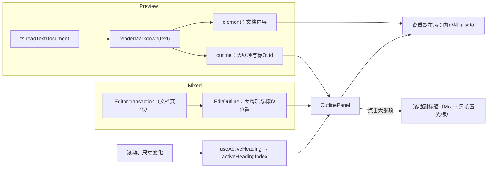

# Markdown 标题大纲

## 名词解释

- **Mixed**：Markdown extension 的可编辑查看器（`markdown.html`，Tiptap 编辑器），宿主中的 id 为 `<extension id>:markdown`。
- **Preview**：Markdown extension 的只读查看器（`preview.html`，Tiptap 静态渲染），宿主中的 id 为 `<extension id>:preview`。
- **大纲**：本方案在查看器右侧增加的标题列表。
- **大纲项**：大纲中的一行，对应文档中的一个 1～4 级标题。
- **当前项**：阅读位置所在章节的大纲项。
- **滚动区域**：内容滚动的区域。Mixed 为 `.edit-scroll` 元素；Preview 为整个页面（`window`）。
- **变更标签**：【新增】、【修改】、【删除】表示相对当前代码新增、修改或删除的文件、类型、函数、样式与界面元素。

## 背景

Markdown extension 的 Mixed 与 Preview 只显示文档内容。阅读 `README.zh-CN.md`、`docs/designs` 中的设计文档这类长文档时，用户看不到文档有哪些章节，只能滚动查找，也无法知道当前阅读位置所在的章节。

## 设计目标

### 功能目标

1. 标题收集：从文档中收集 1～4 级标题，作为大纲项。
2. 大纲显示：Mixed 与 Preview 在内容右侧显示大纲，层级用缩进表示。
3. 跳转：点击大纲项，把对应标题滚动到滚动区域顶部；Mixed 同时把光标放在该标题开头。
4. 当前项：滚动时标出当前项，并让当前项保持在大纲的可见范围内。
5. 更新：Mixed 中编辑标题后大纲随之更新；两个查看器重新读取文件后大纲随之更新。
6. 显示条件：Mixed 在页面宽度不小于 960px 时一直显示大纲，文档没有 1～4 级标题时大纲中显示 "No headings"，编辑中出现或删除标题时内容列不移动；Preview 只在文档有 1～4 级标题时显示大纲。两个查看器在页面宽度小于 960px、文档读取中或读取失败时都不显示大纲，此时内容列的位置与宽度和现在相同。

### 技术目标

- **范围**：只修改 Markdown extension 与 Desktop 的 extension 集成测试。`manifest.json`、Extension API、宿主代码不变；Markdown 原文的解析结果与 Mixed 的写回结果不变。
- **性能**：Mixed 每次文档变化收集一次标题，只遍历块节点，不遍历 paragraph 与代码块内的行内内容，耗时与块数量成正比；标题列表不变时大纲不重新渲染。滚动与尺寸变化在每个动画帧最多计算一次当前项。
- **无障碍**：大纲为带 `aria-label="Outline"` 的 `nav`，大纲项为按钮，当前项带 `aria-current="location"`，可以用 Tab 与 Enter 操作。

## 总体设计



大纲完全在 Markdown extension 的页面中实现：文件查看器的页面（Desktop 中由 `WebContentsView` 承载）占满 Files 的文件内容区域，大纲作为页面布局的一列显示在内容列右侧。标题列表来自文档模型（Preview 为解析后的 Tiptap JSON，Mixed 为编辑器的 ProseMirror 文档），滚动位置与当前项来自页面 DOM。Preview 渲染的脚注区有一个视觉隐藏的 `<h2 id="footnote-label">Footnotes</h2>`，它由 `footnotes` 节点输出，文档模型中没有对应的 `heading` 节点，因此大纲不包含它。

### 变更清单

客户端代码（路径相对 `src/extensions/markdown`，最后两行相对 `src/clients/desktop`）：

| 文件 | 变更 | 内容 |
| --- | --- | --- |
| `src/shared/outline.ts` | 【新增】 | `OutlineHeading` 类型、`isOutlineLevel`、`outlineLabel`、`sameOutline`、`activeHeadingIndex` |
| `src/shared/outline-panel.tsx` | 【新增】 | `OutlinePanel` 组件、`useActiveHeading` hook |
| `src/shared/outline.css` | 【新增】 | 大纲、共用网格与卡片样式 |
| `src/preview/markdown-pipeline.ts` | 【修改】 | `renderMarkdown` 同时返回大纲项；【新增】`collectOutline` |
| `src/preview/markdown-document.tsx` | 【修改】 | 内容与大纲的布局、跳转、当前项 |
| `src/preview/markdown.css` | 【修改】 | 【新增】`.preview-layout` 布局 |
| `src/preview/main.tsx` | 【修改】 | 引入 `outline.css` |
| `src/editor/edit-outline.ts` | 【新增】 | `EditOutline`：Mixed 的大纲项与标题位置 |
| `src/editor/edit-document.ts` | 【修改】 | 【新增】`outline` 属性，`dispose` 时释放 |
| `src/editor/edit-view.tsx` | 【修改】 | 内容与大纲的布局、跳转、当前项 |
| `src/editor/edit.css` | 【修改】 | 【新增】`.edit-layout` 布局与标题的 `scroll-margin-top` |
| `src/editor/main.tsx` | 【修改】 | 引入 `outline.css` |
| `src/test-layout.ts` | 【新增】 | 测试共用的 `LayoutFreeResizeObserver` 与 `outlineItems` |
| `src/editor/test-edit-host.ts` | 【修改】 | `LayoutFreeResizeObserver` 改为从 `src/test-layout.ts` 导入 |
| `src/shared/outline.test.ts` | 【新增】 | 见测试计划 |
| `src/editor/edit-outline.test.ts` | 【新增】 | 见测试计划 |
| `src/preview/markdown-pipeline.test.ts` | 【修改】 | 见测试计划 |
| `src/preview/markdown-document.test.ts` | 【修改】 | 见测试计划 |
| `src/editor/edit-view.test.ts` | 【修改】 | 见测试计划 |
| `src/main/extensions.integration.ts`（Desktop） | 【修改】 | 见测试计划 |
| `scripts/test-extensions.mjs`（Desktop） | 【修改】 | 写入集成测试使用的 `notes/outline.md` 与 `notes/plain.md` |

数据库、HTTP 接口、执行协议、Server 代码、Extension API 与宿主代码都没有变化。

## 数据库设计

不涉及。

## 详细设计

### 1. 标题收集【新增】

#### 1.1 规则

两个查看器使用同一套规则：

- 收集文档中 `heading` 节点里 `level` 为 1～4 的标题，按文档顺序排列；5、6 级标题不收集。
- 包括嵌套在引用块、列表项等容器中的标题。Preview 的 `footnotes` 节点（脚注定义区）内的标题不收集；Mixed 把脚注定义保存为 `rawBlock`，其中也没有 `heading` 节点。同一个文件在两个查看器中得到相同的大纲项。
- 大纲项文字：标题内全部文字节点的文字依次连接，bold、斜体、删除线、行内代码、链接等 mark 只保留文字。Mixed 的 `rawInline`（行内 HTML 标签）取 `attrs.raw` 作为文字，与 Preview 把标签显示为文字的结果相同，例如 `## Install <kbd>npm</kbd>` 在两个查看器中都得到 `Install <kbd>npm</kbd>`。图片、脚注引用（`footnoteReference`）等其他非文字的叶子节点各算作一个空格。连接后的结果经 `outlineLabel` 处理：连续的空白（含换行）合并为一个空格，去掉首尾空白。
- 处理后文字为空的标题（例如只有 `#` 的行，或 Mixed 中刚插入、还没有输入文字的标题）不收集。
- 大纲项的层级保留标题原来的 `level`。

```ts
// src/shared/outline.ts【新增】
/** 大纲中的标题。A heading in the outline. */
export type OutlineHeading = { level: 1 | 2 | 3 | 4; label: string };

export function isOutlineLevel(level: unknown): level is OutlineHeading["level"];

/** 合并连续空白并去掉首尾空白。Collapses runs of whitespace and trims. */
export function outlineLabel(text: string): string;

/** 两个大纲的每一项 level 与 label 都相同。Both outlines have equal level and label at every item. */
export function sameOutline(a: readonly OutlineHeading[], b: readonly OutlineHeading[]): boolean;
```

#### 1.2 Preview

`markdown-pipeline.ts`：

- 【新增】模块内部函数 `collectOutline(document: JSONContent): PreviewOutlineHeading[]`，`PreviewOutlineHeading = OutlineHeading & { id: string }`。在 `assignHeadingIds` 之后的文档上按 1.1 节的规则收集，`id` 取标题节点的 `attrs.id`，与渲染出的 `<hN id>` 相同（重复的标题由 `GithubSlugger` 加上 `-1`、`-2` 后缀）。仅含标点的标题也能进入大纲，`GithubSlugger` 生成的空字符串同样作为标题 ID。
- 【修改】`renderMarkdown(text, components)` 解析一次文档，返回 `{ element: ReactElement; outline: PreviewOutlineHeading[] }`。`MarkdownDocumentLayout` 的 `useMemo` 取用两者。

#### 1.3 Mixed

【新增】`src/editor/edit-outline.ts`：

```ts
export class EditOutline {
  public constructor(editor: Editor);
  /** React 快照；大纲项不变时为同一个数组。The React snapshot; the same array while the items are unchanged. */
  public get headings(): readonly OutlineHeading[];
  /** 第 index 个大纲项的标题节点在当前文档中的位置。The position of item index's heading node in the current doc. */
  public position(index: number): number;
  /** 供 useSyncExternalStore 使用。For useSyncExternalStore. */
  public subscribe(listener: () => void): () => void;
  public dispose(): void;
}
```

- 构造时收集一次；之后监听编辑器的 `transaction` 事件，`editor.state.doc` 与上次不是同一个对象时重新收集。触发方式与 `EditDocument` 统计编辑次数的方式相同：读取文件时 `setContent` 产生一次文档变化，随后的 `view.updateState` 沿用同一个文档对象，不需要另外处理。
- 遍历方式：`doc.descendants((node, pos) => …)`。遇到 `heading` 时记录后返回 `false`；遇到文本块（paragraph、代码块）或原子节点时返回 `false`，不进入行内内容；其他容器节点返回 `true` 继续向下。
- 每次收集都更新标题位置列表。大纲项与上次 `sameOutline` 时保留原来的数组，不通知订阅者，React 不重新渲染；不同时替换数组并通知订阅者。在标题之前输入文字只改变位置，大纲不重新渲染。
- 【修改】`EditDocument` 新增只读属性 `outline: EditOutline`，与 `ui`、`slashMenu` 一样由文档持有。`ui`、`slashMenu` 是字段初始化，`this.editor` 在构造函数中赋值，因此 `outline` 在构造函数中创建编辑器之后赋值：`this.outline = new EditOutline(this.editor)`。`dispose` 时先释放 `outline` 再销毁编辑器。

### 2. 大纲显示与布局【新增】

#### 2.1 OutlinePanel

【新增】`src/shared/outline-panel.tsx`：

```ts
export function OutlinePanel(props: {
  headings: readonly OutlineHeading[];
  /** 当前项；没有当前项时为 null。The current item, or null. */
  active: number | null;
  onSelect(index: number): void;
}): ReactElement;
```

DOM 结构：

```html
<nav class="outline" aria-label="Outline">
  <p class="outline-title">Outline</p>
  <ol class="outline-list">
    <li>
      <button type="button" class="outline-item" data-depth="0" aria-current="location" title="功能">功能</button>
    </li>
  </ol>
</nav>
```

- `headings` 为空时（只发生在 Mixed），`ol` 的位置显示 `<p class="outline-empty">No headings</p>`。
- `data-depth` 为该项 `level` 减去全部大纲项中最小的 `level`（0～3）。例如文档只有 2～4 级标题时，2 级标题的缩进为 0。
- 当前项带 `aria-current="location"`，其他项没有这个属性。
- `title` 为完整文字，项目文字只显示一行，超出宽度时以省略号结束。
- 当前项变化后，如果它不在 `nav` 的可见范围内，修改 `nav.scrollTop` 让它完整显示；滚动区域的滚动位置保持不变。

#### 2.2 样式

【新增】`src/shared/outline.css`，颜色全部来自宿主主题变量（`theme.apply`），深色模式随之变化：

- `:root` 定义 `--outline-width: 240px`、`--outline-gutter: 16px` 和 `--outline-heading-offset: 16px`。
- `.outline-layout` 使用三列网格。`.document-column` 放在第 2 列，`.outline` 放在第 3 列。查看器设置 `--document-column-width`，正文列为 `minmax(0, var(--document-column-width))`。两侧列默认为 `minmax(0, 1fr)`，带 `data-outline` 时第 3 列的最小宽度为大纲宽度加间距，共 256px。宽度小于 960px 时隐藏大纲，并恢复左右对称的列宽。
- `.outline`：宽度 `var(--outline-width)`，`box-sizing: border-box`，`position: sticky`、`top: 0`、`align-self: start`、`justify-self: start`，`max-height: 100vh`，`overflow-y: auto`，内边距 `32px 16px 72px`。上边距 32px 与内容列的上内边距相同，大纲标题与正文第一行处于同一高度。Desktop 原生 Chat 按钮为 52px，默认位置在窗口右下角、距底边 16px；底部的 72px 让列表滚动到底时最后一项位于按钮上方。
- `.outline-title`：字号 0.75em，字重 600，颜色 `--muted-foreground`，与列表之间留 8px。
- `.outline-item`：宽度 100%，无边框与背景，文字靠左，字号 0.875em（与查看器中其他界面文字相同），行高 1.5，上下内边距 4px，左内边距 `12px + depth × 12px`，颜色 `--muted-foreground`，圆角 `--radius-sm`；悬停时颜色为 `--foreground`、背景为 `--accent`；键盘焦点显示 `--ring` 轮廓。
- 当前项：颜色 `--foreground`，字重 500，左侧 2px 的竖线，颜色 `--primary`。
- `.outline-empty`：字号 0.875em，颜色 `--muted-foreground`，左内边距 12px，与大纲项的文字处于同一水平位置。
- 主题提供工作区背景时（`:root[data-workspace-backdrop]`），`.outline-layout` 的正文与大纲共用卡片的背景、圆角和阴影（`--card`、`--radius-xl`、卡片阴影）。大纲卡片内边距为 `16px 12px 24px`，`max-height` 为 `calc(100vh - 80px)`。卡片底边距窗口底边至少 48px，加上 24px 下内边距，最后一项位于 Chat 按钮上方。卡片的 `top` 与上边距由各查看器设置，见 2.3、2.4 节。

#### 2.3 Mixed 布局

【修改】`edit-view.tsx` 的结构：

```html
<div class="edit-viewer">
  <div class="edit-scroll">
    <div class="edit-layout outline-layout" data-outline="">
      <div class="edit-column document-column">…EditorContent…</div>
      <nav class="outline">…</nav>           <!-- 一直渲染；没有大纲项时显示 No headings -->
    </div>
  </div>
  …菜单与浮层不变…
</div>
```

【修改】`edit.css`：

- 【新增】`.edit-layout` 设置 `--document-column-width: calc(830px + 64px)`。工作区背景下再加 32px，用于卡片左右各 16px 的外边距。第三列余出的 16px 是大纲到滚动区域右边的间距。网格始终带 `data-outline`，空大纲与有标题的大纲使用相同的列宽。
- 【修改】`.edit-column`：放在第 2 列；`margin: 0 auto` 改为 `margin: 0`，网格项在列中拉伸，宽度由列宽决定（左右外边距为 `auto` 的网格项会按内容收缩宽度）。工作区背景下 `max-width: min(calc(830px + 64px), calc(100% - 32px))` 与 `margin: 32px auto 48px` 改为 `margin: 32px 16px 48px`，卡片宽度为 `min(894px, 可用宽度 - 32px)`，与现在相同。去掉不带工作区背景时的 `max-width`，列宽已经限制最大宽度。
- 【新增】`.edit-layout > .outline`：放在第 3 列。工作区背景下 `top` 与 `margin-top` 都为 32px，大纲卡片与内容卡片的上沿处于同一高度；内容卡片右侧的 16px 外边距成为两张卡片之间的间距。
- 【新增】`.edit-content :is(h1, h2, h3, h4)` 的 `scroll-margin-top` 使用 `--outline-heading-offset`，与 Preview 的标题相同。

`.outline` 在 `.edit-scroll` 内，文档读取中或读取失败时随 `.edit-scroll` 一起隐藏，当前项监听随之暂停。`EditDocumentLayout` 用 `useSyncExternalStore(outline.subscribe, () => outline.headings)` 读取大纲项。正文编辑改变标题位置时，订阅者继续使用同一个标题快照。

#### 2.4 Preview 布局

【修改】`markdown-document.tsx` 读取成功后的结构：

```html
<div class="preview-layout outline-layout" data-outline>    <!-- 有大纲项时带 data-outline -->
  <article class="markdown-body agw-prose document-column" data-density="document">…</article>
  <nav class="outline">…</nav>                <!-- 有大纲项时渲染 -->
</div>
```

【修改】`markdown.css`：

- 【新增】`.preview-layout` 设置 `--document-column-width: 980px`，作为正文列的最大宽度。有大纲项时加上 `data-outline`，第 3 列按共用网格规则预留空间。
- 【修改】`.markdown-body`：放在第 2 列；`margin: 0 auto` 改为 `margin: 0`，去掉 `max-width: 980px`，宽度由列宽决定；其余样式不变。工作区背景下 `body` 左右各 16px 的内边距不变，内容卡片的位置、宽度和现在相同。
- 【新增】`.preview-layout > .outline`：放在第 3 列，`margin-left: 16px`，作为大纲与内容之间的间距（列宽中的 16px 即为这一段）。页面本身滚动，`position: sticky` 相对窗口生效。工作区背景下 `top` 为 32px、`margin-top` 为 0：`.preview-layout` 已经从 `body` 的 32px 上内边距之后开始，大纲卡片与内容卡片的上沿处于同一高度；大纲右侧到窗口右边的间距由 `body` 的 16px 右内边距提供。

读取中显示的 `Loading …` 与读取失败的说明面板不变，这两种状态没有大纲。

### 3. 跳转【新增】

点击大纲项：

- **Preview** 在渲染后给 `article` 中的标题建立 ID 映射。映射支持空字符串 ID，遇到重复 ID 时使用先出现的标题。脚注区位于文末，因此正文中的同名标题优先于脚注区的固定标签。点击大纲项时，按该项的 ID 取得元素并调用 `scrollIntoView({ block: "start" })`，标题上方留出 16px。
- **Mixed**：取 `pos = outline.position(index)`，先调用 `editor.commands.focus(pos + 1, { scrollIntoView: false })`，把光标放在标题文字开头并让编辑器获得焦点；再对 `editor.view.nodeDOM(pos)` 调用 `scrollIntoView({ block: "start" })`。光标在标题开头，用户随后输入的文字出现在可见的位置。
- 两个查看器滚动后都调用 `useActiveHeading` 返回的 `pin(index)`，见第 4 节。

### 4. 当前项【新增】

#### 4.1 计算规则

```ts
// src/shared/outline.ts【新增】
/**
 * tops[i] 为第 i 个标题元素的上沿到滚动区域可见部分上沿的距离（px）；height 为可见部分的高度；
 * atBottom 表示滚动区域已经滚动到底部。
 * tops[i] is heading i's top relative to the top of the scroll area's visible part (px); height is that part's height;
 * atBottom tells that the scroll area is scrolled to the end.
 */
export function activeHeadingIndex(
  tops: readonly number[],
  viewport: { height: number; atBottom: boolean },
): number | null;
```

- 没有滚动到底部时：返回最后一个满足 `tops[i] <= 24` 的 `i`（24px 为 16px 的 `scroll-margin-top` 加 8px）；没有满足的标题（阅读位置在第一个标题之前）时返回 `null`。
- 滚动到底部时（`scrollTop + clientHeight >= scrollHeight - 1`）：返回最后一个满足 `tops[i] < height` 的 `i`，即最后一个上沿已经进入可见部分的标题。最后一节很短、它的标题无法滚动到顶部时，滚动到底部后它仍然成为当前项。

#### 4.2 useActiveHeading

【新增】`src/shared/outline-panel.tsx`：

```ts
export function useActiveHeading(options: {
  /** Mixed 为 .edit-scroll，Preview 为 window。Mixed 在未挂载、读取中或读取失败时传 null。 */
  scroller: HTMLElement | Window | null;
  /** 正文列尺寸变化时重新计算。Recomputes when the document column changes size. */
  documentColumn: HTMLElement | null;
  /** 与大纲项顺序相同的标题元素。The heading elements in the order of the items. */
  headingElements(): readonly (HTMLElement | null)[];
  /** 大纲项；变化时重新计算并清除 pin。The items; a change recomputes and clears the pin. */
  headings: readonly OutlineHeading[];
}): { active: number | null; pin(index: number): void };
```

- 滚动区域的 `scroll`、`ResizeObserver` 通知的正文列尺寸变化和窗口的 `resize` 都会安排重新计算，由 `requestAnimationFrame` 合并为每帧最多一次。窗口仅改变高度时，滚动区域的 `clientHeight` 和 `atBottom` 也可能变化，因此监听窗口尺寸。大纲项变化时在 layout effect 中立即计算。
- 计算时读取每个标题元素的 `getBoundingClientRect().top`，减去滚动区域可见部分的上沿（Mixed 为 `.edit-scroll` 的 `getBoundingClientRect().top`，Preview 为 0），交给 `activeHeadingIndex`。
- `pin(index)`：点击大纲项后调用。当前项立即设为 `index`，并记录此时滚动区域的 `scrollTop`。之后重新计算时，如果 `scrollTop` 仍等于记录值，当前项保持为 `index`；否则清除记录，按 4.1 节计算。这样点击最后几节中某一节的标题时，即使页面已经滚动到底部、标题无法到达顶部，当前项也是用户点击的那一项。
- Mixed 用 `editor.view.nodeDOM(outline.position(i))` 取得标题元素。Preview 的当前项计算与跳转共用 `article` 内的 ID 映射。
- 卸载时移除监听、断开 `ResizeObserver`、取消尚未执行的动画帧。

### 5. 更新【新增】

- **Preview**：每次 `show`（打开、再次显示、刷新）都重新读取文件；`renderMarkdown` 的结果随文字变化，大纲项与标题 id 一起更新。按 URI 重新挂载的现有行为不变，切换文件时大纲随组件重新创建。
- **Mixed**：编辑标题文字、改变标题级别、插入或删除标题、撤销与重做、文档会话重新读取文件，都会改变 `editor.state.doc`，`EditOutline` 随之更新。大纲项变化后 `useActiveHeading` 立即重新计算当前项。

## 接口文档

不涉及。Extension API、宿主与 Server 接口都没有变化。

## 测试计划

在 workspace 的 `src` 目录执行 `pnpm --filter @agw/extension-markdown typecheck`、`lint`、`test` 和 `format:check`，四项均须通过。格式检查使用 LF 文件。CRLF 检出时，将 HEAD 中的 LF 源文件和当前改动复制到忽略目录，执行同一格式检查脚本。

### 单元测试

测试使用真实的解析管线、Tiptap 编辑器与 jsdom。jsdom 没有排版，也没有实现 `scrollIntoView`，滚动、跳转与当前项的行为在集成测试中验证。

1. `src/shared/outline.test.ts`【新增】
   - `outlineLabel` 合并换行、制表符与连续空格，去掉首尾空白。
   - `activeHeadingIndex`：没有标题时返回 `null`；所有标题都在 24px 以下时返回 `null`；返回最后一个不超过 24px 的标题，等于 24px 的标题计入；滚动到底部时返回最后一个上沿小于可见高度的标题。
2. `src/preview/markdown-pipeline.test.ts`【修改】（现有用例改用返回值的 `element`）
   - 1～6 级标题的文档只得到 1～4 级大纲项，顺序与文档相同。
   - 引用块与列表项中的标题、setext 写法的标题都被收集。
   - 大纲项文字保留 bold、斜体、删除线、行内代码与链接的文字；图片与脚注引用不出现在文字中；多余空白被合并。
   - 只有 `#` 的空标题不被收集。
   - 大纲项的 `id` 与渲染结果中对应 `<hN>` 的 `id` 相同；两个同名标题的 `id` 为 `intro` 与 `intro-1`。
   - 带脚注的文档中，脚注区的 `Footnotes` 与脚注定义中的标题都不在大纲中。
   - `## Install <kbd>npm</kbd>` 的大纲项文字为 `Install <kbd>npm</kbd>`。
3. `src/editor/edit-outline.test.ts`【新增】（使用 `test-edit-host.ts` 的 `createEditHost` 与 `EditDocument`，编辑器带撤销历史）
   - 载入文档后得到 1～4 级大纲项；每一项的 `position` 处是对应的 `heading` 节点。
   - 在第一个标题之前的 paragraph 中输入文字：`headings` 仍是同一个数组，订阅者没有收到通知，`position` 随之后移。
   - 修改标题文字、把 paragraph 设为标题、把标题级别从 2 改为 5、删除标题、撤销上述操作：每次订阅者收到一次通知，`headings` 与文档一致。
   - 引用块与列表项中的标题被收集；空标题不被收集，输入文字后出现。
   - `## Install <kbd>npm</kbd>` 的大纲项文字为 `Install <kbd>npm</kbd>`；脚注定义中的标题不被收集。
   - `dispose` 后编辑文档，订阅者不再收到通知。
4. `src/preview/markdown-document.test.ts`【修改】（jsdom 改为 `pretendToBeVisual: true`，并使用 `src/test-layout.ts` 的 `LayoutFreeResizeObserver`）
   - 有标题的文档渲染出 `nav.outline`，各项文字与 `data-depth` 正确（只有 2～4 级标题时 2 级的 `data-depth` 为 0），`.preview-layout` 带 `data-outline`。
   - 仅含标点且 ID 为空字符串的标题能够显示在大纲中。
   - 没有 1～4 级标题的文档没有 `nav.outline`，`.preview-layout` 不带 `data-outline`。
   - 读取中与读取失败时没有 `nav.outline`。
   - 文件内容变化后再次 `show`，大纲项随之变化。
5. `src/editor/edit-view.test.ts`【修改】
   - 载入有标题的文档后，`nav.outline` 中的各项文字与 `data-depth` 正确。
   - 载入没有 1～4 级标题的文档后，`nav.outline` 显示 `No headings`；在空 paragraph 中输入 `## Title` 后出现 `Title` 一项；删除这个标题后恢复显示 `No headings`。
   - 读取失败时 `.edit-scroll` 隐藏，大纲随之隐藏。

### 集成测试

`src/clients/desktop/src/main/extensions.integration.ts`【修改】，在真实的 Electron 页面中验证排版相关的行为（每次运行前按 AGENTS.md 请求确认）。测试使用的文件由 `scripts/test-extensions.mjs`【修改】写入测试 Project，与其他 Markdown 测试文件相同：

1. Preview：打开一个包含 1～6 级标题、长度超过一屏的 Markdown 文件，大纲只包含 1～4 级标题。
2. Preview：点击中间的一项，该标题的上沿距窗口上沿 16px（误差 1px），该项带 `aria-current="location"`。
3. Preview：把页面滚动到两个标题之间，当前项为上方的标题；滚动到底部，当前项为最后一个上沿进入可见部分的标题。仅缩小窗口高度，保持滚动位置和正文尺寸，当前项随可见高度变化。恢复窗口高度后，在底部点击倒数第二项，当前项为倒数第二项。
4. Mixed：点击一项，该标题滚动到 `.edit-scroll` 顶部，编辑器获得焦点，光标位于标题文字开头；随后输入文字出现在该标题开头。
5. Mixed：打开没有标题的文档，大纲显示 `No headings`；新增一个 2 级标题，大纲出现对应的一项，内容列的位置与宽度在新增前后相同；滚动经过该标题时它成为当前项。
6. 把 Desktop 窗口宽度调整为使文件内容区域小于 960px，两个查看器的 `nav.outline` 都不显示，内容列的位置与宽度和修改前的版本相同；恢复宽度后大纲重新显示。
7. 使用提供工作区背景的主题时，大纲显示为卡片，上沿与内容卡片上沿处于同一高度。
