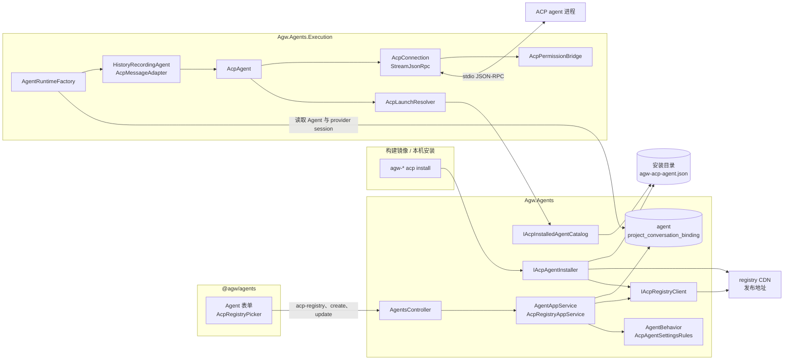
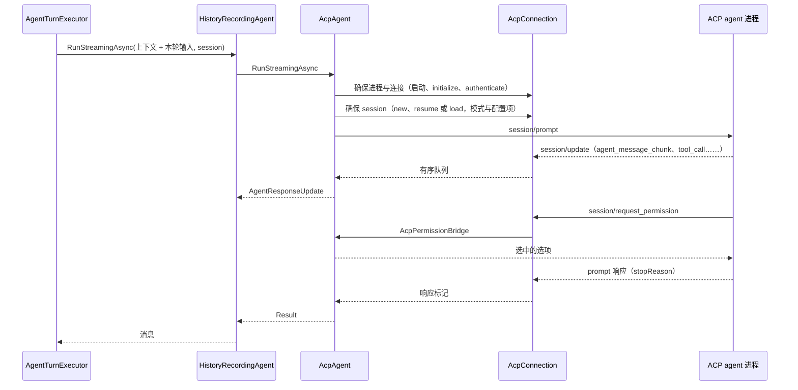
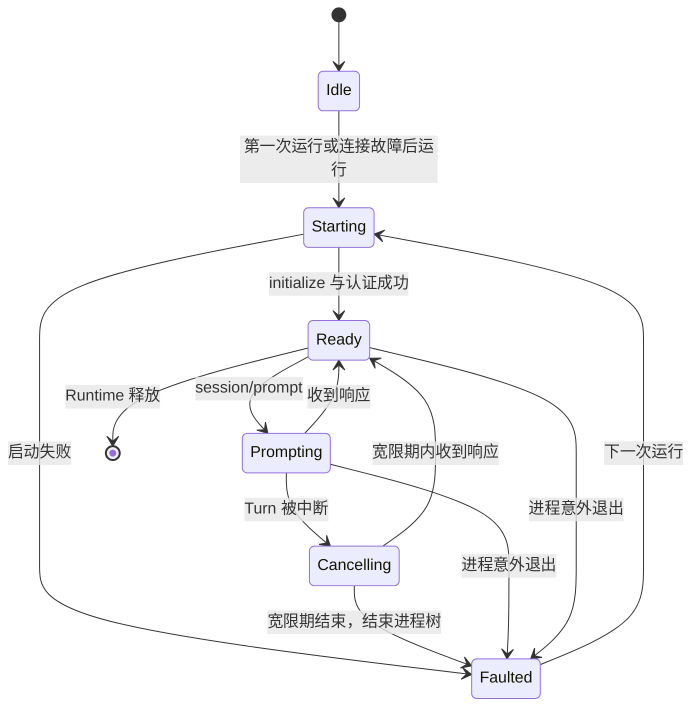

# ACP 外部 Agent 接入

文中每一项设计都标有变更类型，含义相对于当前代码：

- 【新增】：当前代码中不存在。
- 【修改】：当前代码中存在，结构或行为有变化。
- 【删除】：从当前代码中移除。

## 名词解释

- **ACP**：Agent Client Protocol。本文使用稳定协议版本 `1`，对应官方 schema `v1.34.1`（2026-11-21）。传输方式是 stdio 上的 JSON-RPC 2.0：client 以子进程方式启动 agent，每条消息占一行，以 `\n` 结尾。
- **ACP agent**：实现 ACP agent 一侧的外部程序，例如 `gemini --acp`、`opencode acp`、`codex-acp`。
- **ACP client**：实现 ACP client 一侧的程序。本文中由 agw 担任。
- **ACP Agent**【新增】：`Type = External` 并且 `ExternalAgentKind = ACP` 的 Agent 定义，它的每个 Turn 由一个 ACP agent 进程执行。
- **ACP session**：ACP agent 内部的一段会话，由 agent 生成的字符串 `sessionId` 标识。
- **registry**：ACP 官方的 agent 目录 `https://cdn.agentclientprotocol.com/registry/v1/latest/registry.json`，每个 agent 条目包含 `id`、`name`、`version`、`description` 与 `distribution`。
- **distribution**：registry 条目中的发布方式，取值 `binary`（按平台发布的压缩包或可执行文件）、`npx`（npm 包）、`uvx`（PyPI 包）。
- **安装目录**【新增】：执行 ACP Agent 的主机上预先安装 registry agent 的目录，由配置项 `AcpAgents:InstallRoot` 指定。容器部署在构建镜像时安装。
- **安装清单**【新增】：安装目录中每个已安装版本的 `agw-acp-agent.json`，记录启动这个版本所需的全部信息。
- **stop reason**：`session/prompt` 响应中的 `stopReason`，取值 `end_turn`、`max_tokens`、`max_turn_requests`、`refusal`、`cancelled`。

## 背景

- External Agent 现有四种 Engine：Claude Code、Codex、Pi 通过各自的 SDK 启动本地进程，只能在 InProcess 执行提供者下运行；A2A 调用远端服务，可以在 Distributed 下运行。
- Gemini CLI、OpenCode、Goose、GitHub Copilot、Cursor、Kimi Code、Qwen Code 等编程 agent 都支持 ACP，官方 registry 当前收录 46 个 agent。agw 实现 ACP client 后，可以用同一种 Engine 调用这些 agent。
- agw 会部署在 k8s 的多个 pod 中。ACP Agent 需要在 Distributed 执行提供者下运行，各 pod 使用的 agent 程序必须一致，并且运行时不依赖外网下载。
- ACP 的协议类型、连接与进程管理都在 agw 中实现，JSON-RPC 层使用 StreamJsonRpc。
- 本方案没有兼容性要求，按最终状态设计。

## 设计目标

### 功能目标

1. Agent 定义支持 ACP Agent 的创建、更新、删除与查询。启动配置写在 Agent 的 Extra JSON 中，取值是自定义命令，或者 registry 中的 agent id。
2. 支持官方 registry：提供 registry 查询接口，Agent 表单可以从 registry 选择 agent 并写入 Extra JSON；Server 可执行文件提供 `acp install` 命令，按 registry 条目把 agent 安装到安装目录；执行时只使用安装目录中已安装的版本。
3. ACP Agent 作为执行目标运行 Turn：发送文本、图片与文件引用，流式输出正文、推理、工具调用与结果、计划，并在 Turn 正常结束时输出 Result。
4. ACP session 在同一个对话的多个 Turn 之间延续，Runtime 重建、Server 重启与换到另一个 pod 执行之后，通过 `session/resume` 或 `session/load` 恢复。
5. ACP agent 的权限请求按 agw 的权限模式处理：`FullAccess` 自动允许；InProcess 下的 `AlwaysAsk` 与 `AllowSameArguments` 交给用户审批。
6. 中断 Turn 时发送 `session/cancel`；ACP agent 进程意外退出后，下一个 Turn 重新启动进程并恢复 session。
7. 在 session 建立后应用 Extra JSON 中配置的模式与配置项（例如模型），支持 agent 声明的认证方式。
8. 在 InProcess 与 Distributed 两种执行提供者下运行，可用于 Chat、Agentflow 节点、后台 Agent、Jobs、Events 与 agw 对外的 A2A 接口。
9. Web 与 Desktop 的 Agents 页面支持 ACP Agent 的创建与编辑，并提供 registry 选择器。

### 技术目标

- 安全
  - ACP Agent 随 Agent 的 `CreateBy` 隔离；其他用户读取与修改时得到与不存在相同的结果。
  - 自定义命令可以启动任意可执行文件，这与 Pi 的 `globalOptions.piPathOverride`、Codex 的 `codexPathOverride` 的权限范围相同。
  - ACP agent 进程以 Server 的操作系统用户运行，与 Claude Code、Codex 一样共用该用户的 HOME。agent 自己的配置与会话目录可以通过 Agent 的环境变量指定（例如 `CODEX_HOME`）。
  - 子进程只继承宿主环境中的白名单变量，再叠加安装清单中的环境变量与 Agent、Project、本次执行的环境变量。
  - Server 运行时不下载 agent 程序。`acp install` 只通过 HTTPS（回环地址允许 HTTP）下载；有 `sha256` 的压缩包必须校验通过；没有 `sha256` 的二进制 distribution 默认不安装；解压时拒绝指向目标目录之外的条目与链接。
  - Windows 上不经过 `cmd.exe` 启动命令脚本，避免参数被 shell 解释。
  - agw 不向 ACP agent 声明文件读写与终端能力，ACP agent 在 Project 工作目录中自行完成文件与命令操作，权限请求按 agw 的权限模式处理。
- 可观测：结构化日志、Activity、按结果统计的指标；进程 stderr 写入日志，并在启动失败与意外退出时附在错误消息中。
- 高可用：初始化与请求各有时限；中断后在宽限期内等待 agent 结束本轮，超时则结束进程；进程意外退出后下一个 Turn 自动重新启动；Distributed 下沿用 segment 至少执行一次的规则。
- 依赖
  - `StreamJsonRpc` 2.25.29：当前已经由 `CodexSdk.AppServer` 间接引用，`Agw.Agents.Execution` 改为直接引用同一版本。`NonConcurrentSynchronizationContext` 来自它依赖的 `Microsoft.VisualStudio.Threading`。
  - `SharpCompress`：`acp install` 解压 zip、tar.gz、tar.bz2 格式。实施时取 nuget.org 上的最新稳定版本，并通过构建时的漏洞审计。
  - `DiffPlex` 1.9.0：`Agw.Tools` 已经引用，`Agw.Agents.Execution` 增加引用，用 `UnidiffRenderer` 把 ACP 的 diff 内容转换为 unified diff 文本。
  - `Semver` 3.0.0：仓库已有，用于在多个已安装版本中选出最高版本。
  - 项目之间的引用关系没有变化。
  - 官方 Docker 镜像不内置 Node.js 与 uv。需要 `npx`、`uvx` 类 agent 的部署自行构建派生镜像。

## 总体设计



技术选型：

- ACP Agent 是 External Agent 的第五种 Engine，`EngineKind.ACP = 5`。它使用与其他 External Agent 相同的创建入口、`HistoryRecordingAgent`、`AgentTelemetryMiddleware` 与 `TurnPipeline`，Chat、Agentflow 节点、后台 Agent、Jobs、Events 与对外 A2A 接口都把它当作一个 Agent。
- `AcpAgent` 是 `Microsoft.Agents.AI.AIAgent` 的派生类，与 `A2ARemoteAgent` 处于同一层。它负责启动进程、初始化连接、建立与恢复 ACP session、把 `session/update` 转换为 `AgentResponseUpdate`、处理权限请求与中断。
- 协议类型是 agw 自己定义的 C# record，按 ACP v1 schema 编写，只包含 agw 使用的方法与字段。未知的 `session/update` 种类与枚举值按开放取值处理，不会导致解析失败。
- JSON-RPC 层使用 StreamJsonRpc：`NewLineDelimitedMessageHandler` 处理换行分帧，`SystemTextJsonFormatter` 处理序列化，`NonConcurrentSynchronizationContext` 保证入站消息按收到的顺序处理。
- registry agent 的安装与执行分开：`acp install` 在构建镜像或本机安装时下载并写入安装清单；执行时 `IAcpInstalledAgentCatalog` 只读取安装目录。所有 pod 使用同一个镜像，因此使用同一个版本，运行时不访问外网。
- ACP session 的 `sessionId` 保存在现有的 provider session 绑定 `project_conversation_binding` 中，与 Claude Code、Codex、Pi 的会话恢复使用同一套机制，Distributed 下各 pod 读取同一个数据库。
- Distributed 下一个 Turn 在一个 segment 内完成，ACP 进程随该 segment 的 Runtime 创建与释放。

### 变更清单

数据库（见"数据库设计"）：

| 对象 | 变更 |
| --- | --- |
| `agent.external_agent_kind` | 【修改】增加取值 5（ACP） |
| `agent.extra` | 【修改】ACP Agent 保存 `AcpAgentSettings` |
| `project_conversation_binding.provider_session_id` | 【修改】可以保存 ACP 的字符串 `sessionId`，列结构不变 |

HTTP 接口（见"接口文档"）：

| 接口 | 变更 |
| --- | --- |
| `GET /api/agents/acp-registry` | 【新增】 |
| `GET /api/agents/external-options` | 【修改】增加 ACP 一项 |
| `GET /api/agents/permission-capabilities` | 【修改】ACP Agent 在 InProcess 下返回三种模式，在 Distributed 下只返回 `FullAccess` |
| `POST /api/agents`、`PUT /api/agents/{id}` | 【修改】接受 ACP Agent 及其 Extra 规则 |

命令行（见 2.3 节）：

| 命令 | 变更 |
| --- | --- |
| `agw-server acp install`、`agw-control-plane acp install`、`agw-data-plane acp install` | 【新增】 |

执行协议（见第 6 至第 8 节与"接口文档"）：

| 对象 | 变更 |
| --- | --- |
| Turn 失败时 `turn-finished` 的 ACP 错误码取值 `5020014` 至 `5020018`、`5040002` | 【新增】 |
| 工具调用内容的附加属性 `toolTitle` | 【新增】 |

Server 代码：

| 位置 | 变更 |
| --- | --- |
| `Agw.Agents/ExternalAgents/Acp/AcpAgentSettings.cs`、`AcpAgentOptions.cs`、`AcpRegistryDocument.cs`、`AcpInstallManifest.cs`、`AcpPlatform.cs`、`AcpClientDiagnostics.cs` | 【新增】定义管理、安装与执行共用 |
| `Agw.Agents/Definitions/Domain/Rules/AcpAgentSettingsRules.cs`、`AcpRegistryRules.cs` | 【新增】不使用 JSON 序列化 |
| `Agw.Agents/ExternalAgents/Acp/AcpAgentSettingsJson.cs` | 【新增】Extra 与 `AcpAgentSettings` 之间的 JSON 转换 |
| `Agw.Agents/Application/Acp/IAcpRegistryClient.cs`、`IAcpAgentInstaller.cs`、`IAcpInstalledAgentCatalog.cs` | 【新增】 |
| `Agw.Agents/Infrastructure/Acp/AcpRegistryClient.cs`、`AcpDownloadClient.cs`、`AcpAgentInstaller.cs`、`AcpPackageInstaller.cs`、`AcpArchiveExtractor.cs`、`AcpInstalledAgentCatalog.cs` | 【新增】 |
| `Agw.Agents/Definitions/Agents/AcpRegistryAppService.cs`、`Agw.Agents/Definitions/Contracts/AcpRegistryContracts.cs` | 【新增】 |
| `Agw.Agents/ExternalAgents/Acp/AcpCommand.cs` | 【新增】`acp install` 命令 |
| `Agw.Agents/ExternalAgents/Acp/AcpServiceCollectionExtensions.cs` | 【新增】Server 与 `acp install` 共用的服务注册 |
| `Agw.Host/Program.cs` | 【修改】读取配置之后、初始化数据库之前处理 `acp` 命令 |
| `Agw.Agents.Execution/Agents/ExternalAgents/Acp/` 下的 `AcpAgent.cs`、`AcpAgentSession.cs`、`AcpConnection.cs`、`AcpClientMethods.cs`、`AcpCancellationStrategy.cs`、`AcpLaunchResolver.cs`、`AcpCommandResolver.cs`、`AcpProcessEnvironment.cs`、`AcpStderrBuffer.cs`、`AcpPromptBuilder.cs`、`AcpUpdateMapper.cs`、`AcpPermissionBridge.cs`、`Protocol/AcpSchema.cs`、`Protocol/AcpJson.cs` | 【新增】 |
| `Agw.Agents.Execution/Agents/ExternalAgents/ExternalToolApprovalCache.cs` | 【新增】由 `ClaudeCode/ClaudeToolApprovalCache.cs` 移动并改名，Claude Code 与 ACP 共用 |
| `Agw.Agents.Execution/Agents/ExternalAgents/ClaudeCode/ClaudeToolApprovalCache.cs` | 【删除】 |
| `EngineKind`、`ExternalAgentRules`、`ExternalAgentDefaults`、`EngineKinds` | 【修改】 |
| `AgentBehavior`、`AgentsController` | 【修改】 |
| `Agw.Agents/Execution/Configuration/ExecutionProviderOptions.cs` | 【新增】定义服务和运行时共享的 `Provider` 配置 |
| `ExecutionPermissionService`、`ExecutionInputService`、`ExecutionInputCapabilities`、`ExecutionRuntimeOptions`、`Agw.Agents.Execution/DependencyInjection.cs` | 【修改】使用同一份启动时的 `Provider` 配置 |
| `CreateAiAgentRequest.ProviderSessionId`、`ExternalProviderSessionBindings`、`AgentRuntimeFactory.CreateExternalAgents.cs`、`AgentRuntimeFactory.CreateRuntime.cs`、`AgentRuntimeFactory.cs`、`ClaudeCodeAskUserQuestionBridge` | 【修改】 |
| `CodexAgentRuntimeOptionsMapper.cs` | 【修改】接收字符串形式的 provider session id，转换为 Codex 的 `Guid` |
| `DurableExecutionCoordinator.RunAgentSegmentAsync` | 【修改】按 `EngineKinds.SupportsDistributedExecution` 拒绝 |
| `AgwChatHistoryProvider.Create`、`AgentMessageAdapters.cs`（增加 `AcpMessageAdapter`） | 【修改】 |
| `ToolStateSnapshots` | 【修改】增加 `CreateTodoSnapshotMessage`，供 ACP 计划使用；`CreateTodoAsync` 不变 |
| `ErrorCodes`、`Agw.Agents/DependencyInjection.cs`、`Agw.Host/appsettings.json` | 【修改】 |
| `Agw.Agents.csproj` | 【修改】增加 `SharpCompress` 和 `Semver` 引用 |
| `Agw.Agents.Execution.csproj` | 【修改】增加 `StreamJsonRpc` 和 `DiffPlex` 引用 |
| `src/server/Directory.Packages.props` | 【修改】增加 `SharpCompress` 和 `StreamJsonRpc` 版本 |
| `docs/1.Development.md`、`docs/2.Architecture.md`、`docs/4.Deployment.md`、`Agw.Agents.Execution/README.md` | 【修改】 |

客户端代码（Agent 表单的文件都在 `src/clients/packages/agents/src/ui-web/pages/agents/components/`）：

| 位置 | 变更 |
| --- | --- |
| `acp-registry-picker.tsx`、`acp-settings.ts` 及它们的测试 | 【新增】 |
| `types.ts`、`agent-form-fields.tsx`、`create-agent-dialog.tsx`、`edit-agent-dialog.tsx`、`agents-table.tsx`、`agents/page.tsx`、`agents/page.test.ts` | 【修改】 |
| `packages/agents/src/types/agentflow.ts` | 【修改】`externalAgentKind` 增加 5 |
| `packages/chat/src/ui-web/pages/chat/components/provider-sessions-section.tsx` | 【修改】说明文字包含 ACP |
| `packages/chat-core/src/conversation-render-model.ts` | 【修改】工具摘要优先使用 `toolTitle` |
| `packages/extension-sdk/src/api.ts`、`desktop/renderer/src/runtime/extensions/extension-bridge-broker.ts` | 【修改】`externalAgentKind` 增加 `"acp"` |
| `@agw/api` 的 `openapi.json`、`openapi.d.ts`（`pnpm gen:api`） | 【修改】 |

## 数据库设计

ACP Agent 没有新增表，也不需要 migration。

### 【修改】`agent`

| 列 | 类型 | 变更 | 说明 |
| --- | --- | --- | --- |
| `external_agent_kind` | int | 【修改】 | 增加取值 5，表示 ACP |
| `extra` | text | 【修改】 | ACP Agent 保存 `AcpAgentSettings` 的 JSON，见 1.2 节 |

### 【修改】`project_conversation_binding`

| 列 | 类型 | 变更 | 说明 |
| --- | --- | --- | --- |
| `provider_session_id` | varchar(200) | 【修改】 | ACP Agent 保存 ACP 的 `sessionId`（按现有规则去掉首尾空白）；长度超过 200 时 Turn 以 `AcpAgentRequestFailed` 失败 |

`external_agent_name` 按现有规则保存 `Agent.Name` 去掉首尾空白并转为小写后的值。删除 Agent 时 `AgentDeletionCoordinator` 按现有逻辑清理这些行。

## 详细设计

### 1. ACP Agent 的定义

#### 【修改】1.1 Engine 种类

- `EngineKind` 增加 `ACP = 5`。
- `ExternalAgentRules.SupportedKinds` 增加 `ACP`。
- `ExternalAgentDefaults`：`GetDisplayName` 返回 `ACP`；`GetDefaultExtra` 返回 `{}`。`GetSupportedProviderTypes` 的现有默认分支已经返回空数组，不需要修改。
- `EngineKinds.UsesProviderSessionBinding` 对 `ACP` 返回 true。`RequiresWorkspace` 与 `UsesSdkSession` 的现有判断对 `ACP` 已经分别返回 true 与 false。
- `EngineKinds` 增加 `SupportsDistributedExecution(EngineKind)`【新增】：`Maf`、`A2A`、`ACP` 返回 true。

#### 【新增】1.2 Extra 设置 `AcpAgentSettings`

ACP Agent 的 `extra` 是一个 JSON 对象，键使用 camelCase。`AcpAgentSettings` 位于 `Agw.Agents/ExternalAgents/Acp/`，是不带 JSON 特性的 record，属性如下：

| 键 | 类型 | 说明 |
| --- | --- | --- |
| `registry` | object，可选 | `{ "agentId": "<registry id>", "version": "<版本>" }`。`version` 可选，省略时使用安装目录中该 agent 的最高版本 |
| `command` | string，可选 | 自定义命令：可执行文件的名称或路径 |
| `args` | string[]，可选 | 自定义命令的参数，只能与 `command` 一起使用 |
| `authMethodId` | string，可选 | 初始化后调用 `authenticate` 使用的认证方式，见 4.4 节 |
| `modeId` | string，可选 | session 建立后切换到的模式，见 5.4 节 |
| `configOptions` | object，可选 | session 建立后设置的配置项，键是配置项的 `id`，值是字符串或布尔值，见 5.4 节 |

使用 registry 的示例：

```json
{
  "registry": { "agentId": "goose" },
  "configOptions": { "model": "claude-sonnet-4-5" }
}
```

使用自定义命令的示例：

```json
{
  "command": "opencode",
  "args": ["acp"],
  "modeId": "build"
}
```

#### 【新增】1.3 字段规则

Extra 不是 JSON 对象时，现有的 `AgentExtraSettings.Normalize` 抛出 `InvalidAgentExtraSettings`。之后 `AcpAgentSettingsJson.Parse(string extra)` 把它转换为 `AcpAgentSettings`：属性名使用 camelCase，`UnmappedMemberHandling` 为 `Disallow`，出现未定义的键时抛出 `AgwException(ErrorCodes.InvalidParam)`，消息指明该键。随后 `AcpAgentSettingsRules.Validate(AcpAgentSettings)` 校验，违反时抛出 `InvalidParam`，消息指明出错的键：

- `registry` 与 `command` 必须恰好有一个。两者都没有时消息为 `ACP agents require either registry or command in Extra Settings.`。
- `registry.agentId` 符合 `^[a-z][a-z0-9-]*$`，长度不超过 100。`registry.version` 存在时符合 `^[0-9]+\.[0-9]+\.[0-9]+$`。
- `command` 非空白，长度不超过 1024，不含 NUL、CR、LF。
- `args` 最多 64 项，每项长度不超过 4096，不含 NUL；`registry` 存在时不能有 `args`。
- `authMethodId`、`modeId` 长度为 1 到 200。
- `configOptions` 最多 32 项；键长度为 1 到 200；值是长度不超过 1000 的字符串或布尔值。

`AgentBehavior` 对 `ExternalAgentKind = ACP` 的 Agent 执行以下规则：

- `responseSchema` 为 null。ACP 无法强制结构化输出，规则与 Pi 相同，`EnsureResponseSchemaSupported` 增加 `ACP`。
- 带有 `a2aEndpoint` 时拒绝，沿用现有规则。
- `modelProviderId` 由现有的供应商类型检查拒绝：`GetSupportedProviderTypes(ACP)` 为空，`ValidateProviderType` 抛出 `ACP does not support <type> model providers.`。模型通过 `configOptions` 选择（5.4 节）。
- `environmentVariables` 按现有规则保存，在启动进程时传入（3.3 节）。

#### 【修改】1.4 创建、更新与删除

- `AgentAppService` 使用 `AgentExtraSettings.Normalize` 处理 Extra。`AgentBehavior` 在创建或指定 Extra 更新时调用 `AcpAgentSettingsJson.Parse` 与 `AcpAgentSettingsRules.Validate`。空 Extra 使用 `GetDefaultExtra` 提供的 `{}` 执行校验，因此创建时必须选择 registry agent 或填写 `command`。更新省略 Extra 时保留现有值。
- 创建与更新只做上述本地校验：不读取 registry，不检查安装目录。agent 是否已安装由执行时的主机决定（3.1 节），Control Plane 与 Data Plane 的安装目录可以不同。
- Extra 修改后 `AgentRuntimeConfiguration` 的快照改变，已有 Runtime 在下一个 Turn 按新配置重建。
- 删除沿用现有流程；provider session 绑定行由 `AgentDeletionCoordinator` 清理。安装目录中的 agent 不随 Agent 删除。

### 【新增】2. 官方 registry

#### 2.1 读取与缓存

`IAcpRegistryClient` 在 `Agw.Agents/DependencyInjection.cs` 中注册为单例，实现是 `AcpRegistryClient`，供查询接口与 `acp install` 使用：

- 地址取 `AcpAgents:RegistryUrl`，默认 `https://cdn.agentclientprotocol.com/registry/v1/latest/registry.json`。需要固定版本时，可以改为不可变快照地址，例如 `https://cdn.agentclientprotocol.com/registry/v1/v2026.11.23-e2bf02b/registry.json`；也可以指向本机或内网的镜像。
- registry 地址与 agent 发布地址的规则相同（`AcpRegistryRules.IsAllowedDownloadUri`）：使用 `https`；主机为回环地址（`localhost`、`127.0.0.0/8`、`::1`）时也可以使用 `http`，用于本机镜像。
- `GetAsync(bool refresh, CancellationToken)` 供查询接口使用，返回 `AcpRegistrySnapshot`（解析后的 `AcpRegistryDocument`、获取时间 `FetchedAt` 与来源地址）。内存中保存最近一次结果；距离上次成功获取超过 `RegistryRefreshInterval`，或者 `refresh` 为 true 时，带 `If-None-Match` 重新请求；收到 304 时只更新获取时间。请求失败时，内存中有同一地址的内容则继续使用它并记录 Warning 日志；没有时抛出 `AcpRegistryUnavailable`（`5020013`），公开消息带 HTTP 状态码或连接错误的类型。同一时刻只有一个请求在进行，其他调用等待它的结果。
- `FetchAsync(CancellationToken)` 供 `acp install` 使用，每次直接请求，不使用缓存。
- 响应体超过 `RegistryMaxBytes` 时中止读取，按请求失败处理。总时限为 `RegistryFetchTimeout`。

`AcpRegistryDocument` 按 registry 的 `agent.schema.json` 定义：顶层 `version`、`agents`；条目的 `id`、`name`、`version`、`description`、`repository`、`website`、`authors`、`license`、`distribution`。反序列化忽略未知字段（例如顶层的 `extensions`）。`distribution` 的三种形式：

- `npx`、`uvx`：`{ package, args?, env? }`。registry 要求 `package` 带固定版本，例如 `@google/gemini-cli@0.70.0`、`fast-agent-acp==0.10.65`。
- `binary`：平台键到 `{ archive, cmd, args?, env?, sha256? }` 的映射。平台键是 `darwin-aarch64`、`darwin-x86_64`、`linux-aarch64`、`linux-aarch64-musl`、`linux-x86_64`、`linux-x86_64-musl`、`windows-aarch64`、`windows-x86_64`。

命名 `HttpClient` `acp-registry` 用于 registry 与发布文件的下载：`Timeout` 为无限，时限由调用方的 `CancellationToken` 控制；跟随重定向（GitHub Release 的下载地址会重定向），每一跳的目标都必须满足 `IsAllowedDownloadUri`，否则请求失败。

#### 2.2 查询接口

`AcpRegistryAppService.GetAsync(refresh)` 读取 registry，返回 `AcpRegistryResponse`（见"接口文档"），每个条目列出它提供的 distribution 种类。`AgentsController` 增加 `GET /api/agents/acp-registry`。这个接口只提供目录信息，不表示 agent 已经安装。

#### 2.3 `acp install` 命令

Server 的三个可执行文件都提供：

```text
agw-data-plane acp install <agentId> [<agentId> ...] [--AcpAgents:InstallRoot=<目录>] [--AcpAgents:RegistryUrl=<地址>]
```

- `Agw.Host/Program.cs` 在读取配置与解析 `AgwDataDir` 之后、初始化日志与数据库之前调用 `AcpCommand.TryRunAsync(args, configuration, dataPaths)`。参数以 `acp install` 开头时执行命令并结束进程：全部成功返回 0，任一失败返回 1，错误消息写到 stderr。
- 命令使用独立的 `ServiceProvider` 注册安装配置、命名 `HttpClient`、registry client、下载器、安装目录查询、installer、时钟和日志。命令只读取 registry 和安装目录，并将安装结果写入该目录。
- 安装结果写入 stdout，诊断日志和错误消息写入 stderr。
- 每个 agent 安装 registry 中的当前版本。需要固定版本时，把 `RegistryUrl` 指向快照地址。
- 已经存在完整安装清单的版本直接跳过，并输出 `already installed`。
- 安装目录取 `AcpAgents:InstallRoot`，默认 `{AgwDataDir}/acp-agents`。容器中 `AgwDataDir` 是运行时挂载的数据卷，构建镜像时写入的内容会被挂载覆盖，所以派生镜像要把它设为镜像内的目录（"部署文档"一节的示例使用 `/opt/agw/acp-agents`），构建与运行使用同一个值。

`AcpPlatform.Current` 给出当前主机的平台键：

- 操作系统：macOS 为 `darwin`，Linux 为 `linux`，Windows 为 `windows`。
- 架构：`Arm64` 为 `aarch64`，`X64` 为 `x86_64`。其他架构没有平台键，只能安装 `npx` 与 `uvx`。
- Linux 上 `RuntimeInformation.RuntimeIdentifier` 包含 `musl` 时加上 `-musl` 后缀。

`AcpRegistryRules.SelectDistribution(entry, host, allowUnverifiedBinaries)` 按以下顺序取第一个可用的方式。`host` 提供平台键、Windows 标记及 `npm` 和 `uv` 的可用状态。

1. `binary`：存在当前平台键的目标；目标有 `sha256`，或者 `AllowUnverifiedBinaries` 为 true；`archive` 满足 `IsAllowedDownloadUri`；`cmd` 规范化后有效；Windows 上 `cmd` 的扩展名不是 `.cmd` 或 `.bat`。musl 平台只使用带 `-musl` 后缀的目标。
2. `npx`：主机上能找到 `npm`。
3. `uvx`：主机上能找到 `uv`。

二进制文件已经校验过、运行时也不需要 Node.js 或 Python，所以排在首位。没有可用方式时命令失败，消息逐项列出不可用的原因，例如 `binary: no target for linux-x86_64; npx: npm was not found; uvx: not provided`。

#### 2.4 安装过程

`IAcpAgentInstaller.InstallAsync(AcpRegistryAgent entry, CancellationToken)` 的实现是 `AcpAgentInstaller`。版本目录是 `{InstallRoot}/{agentId}/{version}/`，安装先在 `{版本目录}.partial-{guid}/` 中进行：

- `binary`
  - 下载到临时文件，边读取边计算 SHA-256。超过 `MaxDownloadBytes` 时中止；总时限为 `DownloadTimeout`。
  - 有 `sha256` 时对比结果（不区分大小写），不一致时失败，消息为 `SHA-256 mismatch for <archive url>.`。
  - 按地址路径的扩展名判断格式，扩展名不区分大小写。`AcpArchiveExtractor` 使用 SharpCompress 解压 `.zip`、`.tar.gz`、`.tgz`、`.tar.bz2`、`.tbz2`，并使用 `TarReader` 读取 tar 条目类型、链接目标与 Unix 权限。其他格式按单个可执行文件处理，名称取规范化后 `cmd` 的最后一段。
  - `AcpArchiveExtractor` 对每个条目检查：规范化后的完整路径必须位于临时目录之内；符号链接与 hard link 的目标解析后也必须位于临时目录之内，否则整个安装失败；绝对路径与包含 `..` 的条目直接拒绝。
  - `cmd` 的规范化：`\` 换成 `/`，去掉开头的 `./`，拒绝绝对路径与包含 `..` 的路径，结果按相对于版本目录的路径解析。解压后该文件必须存在，否则安装失败。Unix 上为它设置 `UnixFileMode` 0755。
  - 安装清单的 `runtime` 为 `native`，`executable` 为规范化后的 `cmd`。
- `npx`
  - 执行 `npm install --prefix <临时目录> --no-audit --no-fund -- <package>`。
  - 包名取 npm 写入的 `<临时目录>/package.json` 中 `dependencies` 的唯一一项，这样 `package` 是 tarball 路径时也能得到包名。
  - 读取 `node_modules/<包名>/package.json` 的 `bin`：是字符串时使用它；是对象并且只有一项时使用该项；有多项时使用键等于去掉 scope 的包名的那一项；都不满足时安装失败。
  - 安装清单的 `runtime` 为 `node`，`executable` 为 `node_modules/<包名>/<bin 路径>`。执行时用 `node` 启动它，避免依赖 npm 生成的平台脚本。
- `uvx`
  - 通过 `uv python install --no-bin` 把 Python 安装到临时目录的 `uv-python`，再用 `uv pip install --break-system-packages --python <解释器> -- <package>` 把包及其依赖安装到该解释器的目录。包声明可以包含 extras 和版本约束，`name@版本号` 转换为 `name==版本号`。
  - 从 Python 的 scripts 目录查找与包名相同的命令。Windows 同时检查 `.exe`、`.py` 和 `.pyw`。找不到命令时安装失败，消息列出目录中的命令。
  - 安装清单的 `runtime` 为 `native`。有同名 Python entry point 时，`executable` 指向目录内的解释器，通过包的 entry point 启动。wheel 提供的 Python 脚本也由同一个解释器启动。原生命令直接执行。安装目录改名或移动后，启动路径按当前位置解析。
- `DownloadTimeout` 只限制单个发布文件的下载。发布文件下载或 SHA-256 校验失败使用 `AcpDownloadFailed`（`5020019`）。安装过程中校验 registry 条目、解包或发布安装结果失败时使用 `AcpInstallFailed`（`5000034`）。
- registry 条目的 `env` 去掉以下保留名称后写入安装清单：`PATH`、`HOME`、`USER`、`LOGNAME`、`SHELL`、`TMPDIR`、`TMP`、`TEMP`、`PATHEXT`、`ComSpec`、`SystemRoot`，以及以 `LD_`、`DYLD_`、`NODE_`、`NPM_`、`npm_`、`UV_`、`PYTHON` 开头的名称。
- 全部成功后写入安装清单，再把临时目录改名为版本目录。改名时版本目录已经存在（另一个命令先完成）则删除临时目录并使用已有目录。任一步失败时删除临时目录。

#### 【新增】2.5 安装清单 `AcpInstallManifest`

每个版本目录中的 `agw-acp-agent.json`，键使用 camelCase：

```json
{
  "agentId": "goose",
  "name": "goose",
  "version": "1.60.2",
  "registryUrl": "https://cdn.agentclientprotocol.com/registry/v1/latest/registry.json",
  "distribution": "binary",
  "platform": "linux-x86_64",
  "runtime": "native",
  "executable": "goose",
  "args": ["acp"],
  "env": {},
  "installedAt": "2026-11-23T08:00:00Z"
}
```

- `executable` 是相对于版本目录的路径，整个安装目录可以移动。
- `platform` 记录安装时的平台键。`npx` 安装的依赖可能含有原生模块，`uvx` 安装的 Python 也与平台有关。主机没有 registry 平台键时，这两种方式记录 `RuntimeInformation.RuntimeIdentifier`。

#### 2.6 查找已安装的版本

`IAcpInstalledAgentCatalog.Find(agentId, version?)` 的实现是 `AcpInstalledAgentCatalog`，每次调用读取 `{InstallRoot}/{agentId}/*/agw-acp-agent.json`：

- 只考虑清单可以解析、`agentId` 与目录一致、`platform` 等于 `AcpPlatform.InstallationPlatform`、`executable` 指向的文件存在的版本。不满足的版本记录 Warning 日志并跳过。
- `version` 有值时取该版本；否则用 `Semver` 取最高版本。
- 没有结果时抛出 `AcpAgentNotInstalled`（`5020014`），消息为 `ACP agent '<agentId>' (<version 或 any version>) is not installed under '<InstallRoot>' for <platform>. Install it with '<当前可执行文件名> acp install <agentId>'.`。

### 【新增】3. 进程启动

#### 3.1 启动参数的来源

`AcpLaunchResolver.Resolve(AcpAgentSettings)` 返回 `AcpLaunchSpec { FileName, Arguments, Environment, Source }`：

- `command` 存在时：`FileName = command`，`Arguments = args ?? []`，`Environment` 为空，`Source = command`。
- `registry` 存在时：调用 `IAcpInstalledAgentCatalog.Find(agentId, version)`。`runtime` 为 `native` 时 `FileName` 是 `executable` 的绝对路径；为 `node` 时 `FileName = node`，`Arguments` 以 `executable` 的绝对路径开头。之后追加清单的 `args`；`Environment` 为清单的 `env`；`Source` 为清单的 `distribution`。

执行时不读取 registry，也不下载任何文件。

#### 3.2 命令查找

`AcpCommandResolver` 和安装流程复用 Pi SDK 的 `CommandUtil`：

- 绝对路径直接使用；包含目录分隔符的相对路径按 Server 进程的当前目录转换为绝对路径。
- 名称在子进程环境的 `PATH` 中查找；Windows 上按 `PATHEXT` 补全扩展名。
- Unix 上 `PATH` 中没有找到时，读取 `SHELL` 指定的 login shell 的 `PATH`（只接受 sh、bash、zsh、dash、ksh，时限 3 秒）。找到后，子进程使用该 shell 的 `PATH`，其中的相对目录转换为绝对路径。macOS 上由 LaunchAgent 启动的 Server 依靠这一步找到 `node`。
- Windows 上查找结果是 `.cmd` 或 `.bat` 时，抛出 `AcpAgentStartFailed`，消息为 `Windows command scripts are not supported: <path>.`。registry 的 `npx` agent 在安装时已经解析为 `node` 加入口文件，不受影响。

找不到命令时抛出 `AcpAgentStartFailed`（`5020015`），消息为 `Command '<command>' was not found.`。

#### 3.3 环境变量

`AcpProcessEnvironment.Build` 依次合并：

1. 宿主环境中的白名单变量，名单与 Pi SDK `PiProcessEnvironment` 相同：`PATH`、`HOME`、`USER`、`LOGNAME`、`SHELL`、`TMPDIR`、`TMP`、`TEMP`、`TZ`、`LANG`、`LC_*`、`SystemRoot`、`ComSpec`、`PATHEXT`、`USERPROFILE`、`APPDATA`、`LOCALAPPDATA`、代理变量与 CA 证书变量。
2. `AcpLaunchSpec.Environment`（安装清单的 `env`）。
3. `AgentRuntimeFactoryUtil.MergeEnvironmentVariables` 合并后的 Agent、Project 与本次执行的环境变量。

后面的值覆盖前面的同名值。`ProcessStartInfo.Environment` 先清空，再只写入这份结果。API 密钥等凭据由用户写在 Agent 或 Project 的环境变量中，例如 `GEMINI_API_KEY`、`OPENAI_API_KEY`、`ANTHROPIC_API_KEY`。

#### 3.4 工作目录与附加目录

- 子进程的工作目录与 `session/new` 的 `cwd` 都是 `ExpandTilde(project.Workspace)` 的绝对路径，沿用 `CreateExternalAgentAsync` 中现有的工作目录校验。
- agent 的 `sessionCapabilities.additionalDirectories` 存在时，`session/new`、`session/resume`、`session/load` 带上 Project 的附加目录。不论 agent 是否支持，附加目录仍按现有做法写入每个 Turn 第一条请求的上下文文字。

#### 3.5 stderr

`AcpStderrBuffer` 逐行读取 stderr：每行以 Debug 级别写入日志，并保留最近 `StderrTailLines` 行。进程启动失败、初始化失败或运行中意外退出时，错误消息附上这些行，总长度不超过 4000 个字符。

#### 3.6 生命周期

- `AcpAgent` 在创建 `AgentRuntime` 时构造，进程在第一次运行时启动。InProcess 下同一个 Runtime 的后续 Turn 复用同一个进程与连接，复用条件沿用 `InProcessExecutionCoordinator.CanReuseAsync` 与 `AgentRuntimeFactory.IsRuntimeCurrentAsync`。权限模式改变时 External Runtime 按现有规则重建，ACP 进程随之重启。
- Distributed 下每个 segment 创建并释放自己的 Runtime，ACP 进程随之启动与结束（第 9 节）。
- `AcpConnection` 持有 `Process`、`JsonRpc` 与 stderr 读取任务。`JsonRpc.Completion` 结束或进程退出后，连接进入故障状态；下一次运行重新解析启动参数并启动新进程，然后按 5.2 节恢复 session。
- Runtime 释放时，`AcpAgent.DisposeAsync` 对声明 `sessionCapabilities.close` 的 agent 发送 `session/close`（时限 2 秒），关闭 stdin，等待进程退出 2 秒，然后结束整个进程树。
- 同一个 `AcpAgent` 同一时刻只有一个运行，并发调用抛出 `AgwException(ErrorCodes.AgentExecutionFailed)`。

### 【新增】4. 连接与初始化

#### 4.1 JSON-RPC 连接

`AcpConnection` 创建 StreamJsonRpc 连接：

- `NewLineDelimitedMessageHandler`：写入进程 stdin，读取进程 stdout，换行符为 `\n`。
- `SystemTextJsonFormatter`：`JsonSerializerOptions` 使用 `AcpJson.Options`（4.2 节）。
- `SynchronizationContext` 设为 `NonConcurrentSynchronizationContext`，入站请求与通知按收到的顺序开始处理。`session/update` 的处理函数同步写入当前运行的有序队列后立即返回；`session/request_permission` 的处理函数先同步写入队列，再等待审批结果。
- `CancellationStrategy` 设为 `AcpCancellationStrategy`：agw 取消自己发出的请求时发送通知 `$/cancel_request { requestId }`；收到 agent 的 `$/cancel_request` 时取消对应入站请求的处理。
- 入站方法只注册 `session/update` 与 `session/request_permission`。agw 不声明文件、终端与 elicitation 能力，agent 调用其他方法时由 StreamJsonRpc 返回 `-32601`。
- 出站请求使用 `InvokeWithParameterObjectAsync`，通知使用 `NotifyWithParameterObjectAsync`。

StreamJsonRpc 在收到响应时直接完成对应的请求任务，这可能早于排在它前面的 `session/update` 被处理。所以 `session/prompt` 与 `session/load` 的响应在完成后，再向 `NonConcurrentSynchronizationContext` 投递一个"响应已到"的标记，标记排在之前收到的所有通知之后，`AcpAgent` 处理到标记时才结束本次请求。

#### 4.2 协议类型

`Protocol/AcpSchema.cs` 中的 record 覆盖 agw 使用的方法：`initialize`、`authenticate`、`session/new`、`session/load`、`session/resume`、`session/close`、`session/prompt`、`session/cancel`、`session/set_mode`、`session/set_config_option`、`session/update`、`session/request_permission`。

`AcpJson.Options`：

- 属性名使用 camelCase；忽略未知属性（包括 `_meta`）；`AllowOutOfOrderMetadataProperties = true`，类型标识字段不在第一位也能解析。
- `session/update` 的 `update` 按 `sessionUpdate` 区分种类，`ContentBlock` 与 `ToolCallContent` 按 `type` 区分种类。三者的基类不是 abstract，并设置 `IgnoreUnrecognizedTypeDiscriminators = true`，未知种类解析为基类实例，由调用方忽略。
- `stopReason`、工具调用的 `kind` 与 `status`、权限选项的 `kind`、计划条目的 `status` 是开放取值，类型为 string，取值写成常量。

#### 4.3 initialize

进程启动后发送 `initialize`，时限 `InitializeTimeout`：

```json
{
  "protocolVersion": 1,
  "clientCapabilities": {
    "fs": { "readTextFile": false, "writeTextFile": false },
    "terminal": false,
    "session": { "configOptions": { "boolean": {} } }
  },
  "clientInfo": { "name": "agw", "title": "Agw", "version": "<Server 版本>" }
}
```

- 响应的 `protocolVersion` 必须为 1，并且带有 `agentCapabilities`。有的 agent 会原样返回请求中的版本，所以同时检查字段形态。不满足时抛出 `AcpAgentStartFailed`，消息为 `The ACP agent does not support protocol version 1.`。
- `AcpConnection` 保存 `agentCapabilities`、`authMethods` 与 `agentInfo`，供后续步骤使用。
- 初始化超时抛出 `AcpAgentTimeout`（`5040002`）；进程在初始化前退出抛出 `AcpAgentStartFailed`，消息附 stderr。

#### 4.4 认证

- `authMethodId` 存在时，它必须是 `authMethods` 中某一项的 `id`，并且该项没有 `type` 或 `type` 为 `agent`。否则抛出 `InvalidParam`，消息列出可用的方式。之后发送 `authenticate { methodId }`，时限 `RequestTimeout`。
- `type` 为 `terminal` 的方式需要交互式终端，agw 不声明 `auth.terminal`，也不使用这类方式。
- 任何请求返回 JSON-RPC 错误码 `-32000` 时抛出 `AcpAgentAuthenticationRequired`（`5020016`），消息列出 `authMethods` 的 `id` 与 `name`，并说明可以设置 `authMethodId`，或者在 Agent 的环境变量中配置凭据。凭据也可以由主机（或镜像）中的同一个操作系统用户事先登录 agent 得到。

### 【新增】5. ACP session

`AcpAgentSession` 继承 `AgentSession`，保存当前的 `SessionId`、`Modes` 与 `ConfigOptions`。它只存在于内存中，`AgentSessionStateStore` 不保存它（`UsesSdkSession` 为 false）；跨 Runtime 的延续依靠 provider session 绑定。

#### 5.1 新建

```json
{ "cwd": "/Users/ben/projects/demo", "mcpServers": [], "additionalDirectories": ["/Users/ben/shared"] }
```

`additionalDirectories` 只在 agent 声明支持时发送。响应中的 `sessionId` 为空或长度超过 200 时抛出 `AcpAgentRequestFailed`。得到 `sessionId` 后，`CreateAiAgentRequest.OnExternalSessionStartedAsync` 不为 null 时调用它写入 provider session 绑定，沿用 `ExternalProviderSessionBindings.CreateExternalSessionStartedCallback` 的保存与失败规则；Agentflow 节点与后台子 Agent 的回调为 null，不写入绑定。

#### 5.2 延续

`AcpAgent` 在每次运行开始时确定要使用的 session：

1. `AcpAgentSession.SessionId` 有值并且连接没有重启过：直接使用。
2. 否则取已知的 `sessionId`：`AcpAgentSession.SessionId`（连接重启的情况），或者 Runtime 创建时得到的 `CreateAiAgentRequest.ProviderSessionId`（provider session 绑定中保存的值）。
3. 有已知 `sessionId` 时：
   - agent 声明 `sessionCapabilities.resume`：发送 `session/resume { sessionId, cwd, mcpServers: [], additionalDirectories? }`。
   - 否则 agent 声明 `loadSession`：发送 `session/load`。agent 在响应之前通过 `session/update` 回放历史，这些更新全部忽略，判断依据是 4.1 节的有序队列中位于响应标记之前的更新。
   - 都不支持：记录 Information 日志，按 5.1 节新建 session。
   - 恢复请求返回 `-32002`（资源不存在）：清除旧 id，按 5.1 节新建 session。其他错误抛出 `AcpAgentRequestFailed`，消息包含 JSON-RPC 错误码与错误消息；用户清空对话后 Generation 递增，下一个 Turn 新建 session。
4. 没有已知 `sessionId`：按 5.1 节新建。

session 建立后执行 5.4 节的设置。

Agentflow 节点每次调用都由 `AgentflowNodeScopedAgent.PrepareSessionAsync` 新建 `AgentSession`，节点也不传 `ProviderSessionId`，所以 ACP 节点每次调用都新建 ACP session，与 Pi 节点相同。

#### 【修改】5.3 provider session 绑定

ACP 的 `sessionId` 是任意字符串，现有代码只接受 Guid，改为：

- `CreateAiAgentRequest.ProviderSessionId` 的类型由 `Guid?` 改为 `string?`。
- `ExternalProviderSessionBindings.ParseProviderSessionId` 改名为 `ResolveProviderSessionId`，返回 `string?`：Claude Code、Codex、Pi 的值仍须是 Guid 格式，不是时记录 Warning 并返回 null（现有行为）；ACP 的值长度为 1 到 200 时原样返回。
- `ResolveExternalProviderSession` 的参数与返回值改为 `string?`，并增加 ACP 分支：返回 `(persisted, persisted != null)`。Claude Code 没有已保存的值时生成新的 Guid 字符串。
- `CreateClaudeCodeAgent`、`CreateCodexAgentAsync`、`CreatePiAgent` 在内部把字符串转换为各 SDK 需要的类型。
- `AgentRuntimeFactory.CreateRuntime.cs` 按新类型传递。

#### 5.4 模式与配置项

session 建立（新建或恢复）后，`AcpAgent` 依次执行：

- `modeId` 存在时：响应中没有 `modes` 抛出 `InvalidParam`，消息为 `This ACP agent does not report session modes.`；`modeId` 不在 `availableModes` 中抛出 `InvalidParam` 并列出可用模式；与 `currentModeId` 不同时发送 `session/set_mode`。
- `configOptions` 的每一项：在响应的 `configOptions` 中按 `id` 查找。找不到时抛出 `InvalidParam` 并列出可用的 `id`。`select` 类型的值必须是某个选项的 `value`（平铺或分组），`boolean` 类型的值必须是布尔值，否则抛出 `InvalidParam` 并列出可用值。当前值不同时发送 `session/set_config_option`，用响应中的完整列表更新 `AcpAgentSession.ConfigOptions`。
- 运行中收到 `current_mode_update` 与 `config_option_update` 时更新 `AcpAgentSession`。

模型的选择通过 `configOptions` 完成，常见的配置项 `id` 是 `model`，`category` 为 `model`。agent 自己的免审批模式（例如部分 agent 的 `bypassPermissions` 模式）也通过 `modeId` 或 `configOptions` 设置。

### 【新增】6. Turn 的执行



`AcpAgent` 实现 `RunCoreStreamingAsync`；`RunCoreAsync` 聚合流式结果后返回，普通 Agentflow 节点经由它调用。

#### 6.1 prompt 内容

`AcpPromptBuilder` 把本次运行收到的全部 `ChatMessage`（上下文、handoff 前缀与本轮输入）按顺序转换为一个 `ContentBlock` 数组：

| `AIContent` | `ContentBlock` | 条件 |
| --- | --- | --- |
| `TextContent` | `text` | 无 |
| `DataContent`，媒体类型为 `image/*` | `image { data, mimeType }` | `promptCapabilities.image` |
| `DataContent`，媒体类型为 `audio/*` | `audio { data, mimeType }` | `promptCapabilities.audio` |
| 其他 `DataContent` | `resource { resource: { uri, blob, mimeType } }`，`uri` 为 `agw:attachment/<名称>`。对 `DataContent.Name` 按一个 URI 路径段转义。名称缺失或为空时使用序号 | `promptCapabilities.embeddedContext` |
| `UriContent` | `resource_link { uri, name }`，`name` 取地址最后一段 | 无 |

- 不满足条件时抛出 `InvalidParam`，消息为 `This ACP agent does not accept <image|audio|embedded> content.`。
- 其他类型的内容跳过。转换结果为空时抛出 `InvalidParam`。
- System 消息的文字也转换为 `text`，放在原来的位置。

#### 6.2 `session/update` 的转换

`AcpUpdateMapper` 把有序队列中的更新转换为 `AgentResponseUpdate`。所有输出的 `AuthorName` 为 `acp`，`ResponseId` 是本次运行生成的 GUID，`RawRepresentation` 是对应的协议对象。

| 更新 | 输出 |
| --- | --- |
| `agent_message_chunk` | Assistant 消息的增量。`text` 为 `TextContent`，`image` 与 `audio` 为 `DataContent`，`resource_link` 为 `UriContent`，文本 `resource` 为 `TextContent`，二进制 `resource` 为 `DataContent` |
| `agent_thought_chunk` | Assistant 消息的增量，内容是 `TextReasoningContent` |
| `user_message_chunk` | 忽略 |
| `tool_call`、`tool_call_update` | 合并到按 `toolCallId` 记录的工具调用状态，按 6.3 节输出 |
| `plan` | todo 快照消息，按 6.4 节输出 |
| `current_mode_update`、`config_option_update` | 更新 `AcpAgentSession`（5.4 节），没有输出 |
| `available_commands_update`、`session_info_update`、`usage_update` | 忽略 |
| 未知种类 | 忽略，记录 Debug 日志 |

消息身份：

- 带 `messageId` 的分片使用 `acp:{messageId}` 作为 `MessageId`。
- 不带 `messageId` 的分片按连续区间分组：同一种类（正文或推理）的连续分片属于同一条消息，中间出现其他更新后开始新的一条。`MessageId` 为 `{responseId}-message-{n}` 或 `{responseId}-thought-{n}`。
- 增量通过现有的公共追加路径累积，`HistoryRecordingAgent` 按 `MessageId` 保存完整内容。

#### 6.3 工具调用

`tool_call` 与 `tool_call_update` 按 patch 规则合并：后者只覆盖出现的字段，`content` 整体替换。工具调用状态包含 `toolCallId`、`title`、`kind`、`status`、`rawInput`、`rawOutput`、`content`。

`FunctionCallContent` 在以下情况中最早发生的一次输出，每个 `toolCallId` 只输出一次：

- `status` 变为 `in_progress`、`completed` 或 `failed`；
- 该工具调用收到权限请求（第 7 节）；
- `session/prompt` 返回时它仍未输出。

`FunctionCallContent` 的值：

- `CallId` 为 `toolCallId`；`Name` 为 `kind`，没有时为 `other`。
- `Arguments`：`rawInput` 是 JSON 对象时为它的属性；是其他 JSON 值时为 `{ "input": <值> }`；没有时为空对象。
- `InformationalOnly = true`，与 Pi 相同，工具由 ACP agent 执行，agw 的函数调用层不处理它。
- `AdditionalProperties` 中的 `toolTitle` 为 `title`【新增】。客户端的工具摘要优先显示 `toolTitle`（第 12 节）。
- `MessageId` 为 `{responseId}-tool-{toolCallId}`。

`status` 变为 `completed` 或 `failed` 时输出 `FunctionResultContent`，`MessageId` 为 `{responseId}-tool-result-{toolCallId}`。结果文本按 `content` 的顺序生成：

- `content` 中的文本块：原文；图片与音频块：`[image <mimeType>]` 或 `[audio <mimeType>]`；资源链接：其 `uri`。
- `diff`：`DiffPlex` 的 `UnidiffRenderer` 生成的 unified diff，旧文件名为 `a/<path>`，新文件名为 `b/<path>`；`oldText` 为 null 时旧文件为 `/dev/null`。
- `terminal`、`session`：agw 没有声明对应能力，出现时写成 `[terminal <terminalId>]`、`[session <sessionId>]`。
- `content` 为空时使用 `rawOutput` 的 JSON 文本；也没有时使用 `status` 的值。

`failed` 的结果按 Pi 工具失败结果相同的方式标记为错误。`session/prompt` 返回时已经输出调用、但没有结果的工具调用，输出一条错误结果，文本为 `The ACP agent ended the turn before this tool call finished.`。

#### 6.4 计划

`plan` 更新携带完整的计划条目列表。`ToolStateSnapshots` 增加 `CreateTodoSnapshotMessage(string toolName, string callId, string messageId, IReadOnlyList<TodoSnapshotItem> items)`【新增】，`TodoSnapshotItem` 的 `Id` 为字符串。它与 `CreateTodoAsync` 使用同一个私有方法生成消息，区别是 `MessageId` 由调用方传入；`CreateTodoAsync` 保持不变，System Agent 的条目 `id` 仍是数字。`AcpAgent` 用它输出 todo 快照：

- `toolName` 为 `acp_plan`，`callId` 与 `messageId` 为 `{responseId}-plan`，本次运行中后来的计划替换前面的计划。
- 每个条目：`id` 为 `{responseId}:{index}`，`title` 为 `content`，`description` 为 null，`isComplete` 为 `status == "completed"`。
- 快照是 tool 消息，`ModelMessageAdapter` 不把它写入模型历史，由 `AgentTurnExecutor` 的现有 `ToolTurnPersistence` 保存，与 System Agent 的 todo 快照相同。

#### 6.5 Result 与 stop reason

| `stopReason` | 处理 |
| --- | --- |
| `end_turn` | 输出 Result（见下文）。Turn 以 `completed` 结束 |
| `cancelled` | agw 发起中断时按第 8 节处理；其他情况抛出 `AcpAgentTurnStopped` |
| `max_tokens`、`max_turn_requests`、`refusal`，以及未知值 | 抛出 `AcpAgentTurnStopped`（`5020018`），消息为 `The ACP agent stopped the turn: <stopReason>.`。Turn 以 `failed` 结束，已经输出的内容保留 |

Result 的形态与 Pi 相同：`type = result` 的 Assistant 消息，只有一个 `TextContent`，`MessageId` 为 `{responseId}-result`。文本取本次运行中最后一个工具调用之后的最后一条 Assistant 正文消息；该消息没有文本，或者本次运行在最后一个工具调用之后没有正文时，不输出 Result。`resultSourceMessageId` 指向这条正文消息。

#### 6.6 Runtime 的构造与历史

- `AgentRuntimeFactory.CreateExternalAgentAsync` 中 ACP 走与 Claude Code、Codex、Pi 相同的路径（不走 A2A 的提前返回），因此经过工作目录校验、附加目录与 User Memory 上下文的组装。
- `CreateExternalAgentWithDecoratorsAsync` 的第一个 switch 增加 `EngineKind.ACP => CreateAcpAgent(...)`，它使用调用方已经创建的 `historyProvider`，返回 `ResourceOwningAIAgent(DecorateExternalAgent(acpAgent, historyProvider, isBackground, createMemoryContextAsync), acpAgent)`，与 `WrapPiAgent` 的做法相同（MAF builder 的代理不保留 `IAsyncDisposable`）；第二个 switch 增加 `EngineKind.ACP => aiAgent`。两个 switch 都必须有 ACP 分支，否则 `CreateRuntimeAsync` 会返回 null。
- `CreateAcpAgent` 从 `_services` 取得 `AcpLaunchResolver`、`IAcpInstalledAgentCatalog` 与 `IOptions<AcpAgentOptions>`，与 A2A 分支取得依赖的方式相同。
- `AgwChatHistoryProvider.Create` 为 `EngineKind.ACP` 使用 `AcpMessageAdapter`【新增】，它继承 `ModelMessageAdapter`，`IsExternalEngine` 为 true，与 `PiMessageAdapter` 相同。
- ACP v1 的 `session/prompt` 响应没有 token 用量，`AgentTelemetryMiddleware` 记录的用量为 0。

### 【新增】7. 权限请求

`AcpPermissionBridge` 在构造时得到权限模式（`CreateAiAgentRequest.PermissionMode`）与是否后台执行；每次运行开始时绑定当前的交互通道、来源、授权缓存作用域与 `PermissionVersion`，绑定方式与 `ClaudeCodeAskUserQuestionBridge` 相同。收到 `session/request_permission { sessionId, toolCall, options }` 时：

1. 把 `toolCall` 合并到工具调用状态，并按 6.3 节输出 `FunctionCallContent`。
2. 按下表决定：

| 条件 | 结果 |
| --- | --- |
| 没有绑定的运行，或者 `sessionId` 不是当前 session | 拒绝 |
| 权限模式为 `FullAccess` | 允许 |
| 权限模式为 `AllowSameArguments`，`rawInput` 有值且缓存中有相同工具名与参数 | 允许 |
| 后台执行，或者没有活动的交互通道（Distributed 下的执行属于这种情况） | 拒绝，记录 Information 日志 |
| 其他（包括权限模式为 null） | 提交 `ToolApprovalInteraction`，等待用户决定 |

3. `ToolApprovalInteraction` 的 `Prompt` 为 `Allow the ACP agent to run "<title>"?`，`Arguments` 为合并后的 `rawInput`，`Source` 的 `ToolName` 为 6.3 节的 `Name`，`CallId` 为 `toolCallId`。当用户批准、权限模式为 `AllowSameArguments` 且 `rawInput` 有值时写入缓存。缺失或为 JSON `null` 的参数每次单独审批。
4. 回复 agent：允许时选 `kind` 为 `allow_once` 的选项，没有时选 `allow_always`；拒绝时选 `reject_once`，没有时选 `reject_always`；所需的选项都不存在时回复 `{ "outcome": { "outcome": "cancelled" } }`。agw 自己管理授权，所以批准时优先选 `allow_once`，ACP agent 不会记住超出 agw 权限模式的授权。
5. 等待期间 Turn 被中断，或者收到该请求的 `$/cancel_request`：取消这次交互，回复 `cancelled`。

后台子 Agent 与无人值守的执行需要 agent 自行处理工具调用时，使用 `FullAccess`（Jobs 的现有做法），或者通过 `modeId`、`configOptions` 把 agent 设为它自己的免审批模式。

`ExternalToolApprovalCache` 由 Claude Code 与 ACP 共用。缓存作用域由用户、项目、对话代次、Agent、节点和工作目录组成。两种运行时共用作用域与 `PermissionVersion` 的取值规则。

### 【新增】8. 中断与进程故障



非 Maf 引擎的中断会取消传给 Agent 与 `TurnPipeline` 的同一个 token，`TurnPipeline` 只有捕获到 `OperationCanceledException` 才把 Turn 记为 `interrupted`，`HistoryRecordingAgent` 也用这个 token 记录输出。所以 `AcpAgent` 的中断处理如下：

- 取消信号到达后不再输出任何更新。
- 发送 `session/cancel { sessionId }`（不受已取消 token 影响），对等待中的权限请求回复 `cancelled`。
- 继续从本次 prompt 的有序队列中读取并丢弃更新，直到处理到 `session/prompt` 响应的标记，或者 `CancelGracePeriod` 结束。队列属于本次 prompt，下一次运行不会读到这些更新。
- 宽限期内收到响应时连接保持可用；宽限期结束时结束整个进程树，连接进入故障状态。
- 最后抛出 `OperationCanceledException`。取消之前已经输出的内容按现有规则保存。

`session/prompt` 进行中进程退出时，抛出 `AcpAgentRequestFailed`（`5020017`），消息包含退出码与 stderr 的最后几行。故障状态的连接在下一次运行时按 3.6 节重新启动，并按 5.2 节用已知的 `sessionId` 恢复 session。

### 【修改】9. 执行提供者与能力

| 能力 | ACP Agent 的取值 | 位置 |
| --- | --- | --- |
| 权限模式 | InProcess 下为 `FullAccess`、`AlwaysAsk`、`AllowSameArguments`；Distributed 下只有 `FullAccess`，说明文字为 `ACP agents support Full access only with the Distributed execution provider.` | `ExecutionPermissionService.ForAgent` |
| `BackgroundToolPolicy.None` | 不支持，得到现有的 `BackgroundToolPolicyUnsupported` | `BackgroundToolPolicySupport.SupportsNoTools` 的现有判断 |
| Turn 运行中输入 | 不支持，说明文字为 `ACP agents do not accept input while a turn is running.`。该分支位于 Distributed 的判断之前 | `ExecutionInputCapabilities.ForEngine` |
| Distributed 执行 | 支持 | `DurableExecutionCoordinator.RunAgentSegmentAsync` |
| 输入建议 | 不支持，`AgentSuggestionAppService` 返回现有的 `Unsupported` | 无变化 |
| tools、skills | External Agent 现有规则：只提供 User Memory 上下文 | `AgentCapabilityComposer` 无变化 |

权限能力：

- `ExecutionPermissionService.ForAgent(Agent agent, ExecutionProvider provider)`【修改】增加执行提供者参数。ACP 分支按上表返回；其他 Agent 的结果不变。
- `ExecutionPermissionService`、`ExecutionInputService` 和 `AgentRuntimeFactory` 使用启动时绑定的 `Provider`。`ExecutionProviderOptions` 提供共享的属性，`ExecutionRuntimeOptions` 同时提供运行时配置。`GetAsync` 与 Agentflow 的能力合并都使用同一个值。
- 静态方法 `Validate(agent, mode)` 改为 `Validate(agent, provider, mode)`。

Distributed 执行：

- `DurableExecutionCoordinator.RunAgentSegmentAsync` 中的拒绝条件由 `EngineKinds.UsesProviderSessionBinding(runtime.EngineKind)` 改为 `!EngineKinds.SupportsDistributedExecution(runtime.EngineKind)`，消息改为 `Distributed execution supports System Agents, A2A Agents and ACP Agents.`。Claude Code、Codex、Pi 仍被拒绝。
- segment 创建 Runtime 时走同一个 `AgentRuntimeFactory.CreateRuntimeAsync`，provider session 绑定从共享数据库读取并在新建 session 时写回。
- ACP Agent 的一个 Turn 在一个 segment 内完成。segment 结束时 Runtime 释放，ACP 进程随之结束；下一个 Turn 可能由另一个 pod 执行，它启动新进程并按 5.2 节恢复 session。Worker 故障后 segment 重试时，同一条输入会再次发给 ACP agent，这与现有 Tool 副作用的至少一次规则相同。
- 跨 pod 恢复 session 需要 ACP agent 自己的会话目录对所有 Data Plane pod 可见：把该目录放在共享卷上（例如在 Agent 的环境变量中设置 `CODEX_HOME=/shared/agw-acp/codex`）。目录不可见时恢复请求得到 `-32002`，按 5.2 节新建 session，之前的上下文不再可用。部署文档写明这一点。
- 各 Data Plane pod 的安装目录内容一致（同一个镜像），所以同一个 Agent 在不同 pod 上使用同一个版本。

### 【新增】10. 可观测性

- 日志
  - registry：获取结果、HTTP 状态、是否使用缓存、耗时。
  - `acp install` 在 stderr 记录 agent id、版本、平台、distribution、安装目录和耗时。Binary 下载日志记录字节数与 SHA-256 校验状态。
  - 进程：启动命令的文件名（不含参数与环境变量）、来源（`command`、`binary`、`npx`、`uvx`）、版本、PID、退出码、stderr（Debug）。
  - Turn：`AgentId`、`AcpAgentName`（`agentInfo.name`）、`AcpAgentVersion`、`SessionId`、`SessionSource`（`new`、`resume`、`load`）、`StopReason`、`ToolCallCount`、`PermissionRequestCount`、`ElapsedMs`。
  - 日志中没有环境变量的值、消息内容与工具参数。
- `AcpClientDiagnostics` 持有 `ActivitySource("Agw.Agents.AcpClient")` 与 `Meter("Agw.Agents.AcpClient")`，名称在 `Agw.Host/Program.cs` 现有的 `Agw.*` 注册范围之内。
- Activity：`acp.client.start`（启动与初始化）、`acp.client.session`（session 建立）、`acp.client.turn`，标签与日志字段相同。
- 指标
  - `agw.acp.client.turns`：计数，标签 `outcome`（`completed`、`failed`、`interrupted`、`stopped`、`auth_required`）。
  - `agw.acp.client.turn.duration`：直方图，单位秒，标签同上。
  - `agw.acp.client.process_starts`：计数，标签 `outcome`、`source`（`command`、`binary`、`npx`、`uvx`）。
  - `agw.acp.client.permission_requests`：按全部权限响应计数，标签 `decision`（`allowed`、`rejected`、`cancelled`）、`mode`。有活动 Turn 时同时累加该 Turn 的权限请求总数。
  - `agw.acp.client.registry_fetches`：计数，标签 `outcome`（`fetched`、`not_modified`、`cached`、`failed`）。

### 【新增】11. 配置项

配置段为 `AcpAgents`，绑定到 `Agw.Agents/ExternalAgents/Acp/AcpAgentOptions.cs`，写在 `Agw.Host/appsettings.json` 中。

| key | 默认值 | 说明 |
| --- | --- | --- |
| `RegistryUrl` | `https://cdn.agentclientprotocol.com/registry/v1/latest/registry.json` | registry 地址，规则见 2.1 节。改为快照地址可以固定版本 |
| `RegistryRefreshInterval` | `01:00:00` | 查询接口距离上次成功获取超过该时长时重新请求 |
| `RegistryFetchTimeout` | `00:00:30` | 获取 registry 的总时限 |
| `RegistryMaxBytes` | `8388608` | registry 响应体的上限 |
| `InstallRoot` | 空，表示 `{AgwDataDir}/acp-agents` | 安装目录。容器中设为镜像内的目录 |
| `AllowUnverifiedBinaries` | `false` | 为 true 时 `acp install` 允许使用没有 `sha256` 的二进制 distribution |
| `DownloadTimeout` | `00:10:00` | `acp install` 下载一个发布文件的总时限 |
| `MaxDownloadBytes` | `1073741824` | `acp install` 下载一个发布文件的上限 |
| `InitializeTimeout` | `00:02:00` | 从启动进程到 `initialize` 响应的时限 |
| `RequestTimeout` | `00:01:00` | `authenticate`、`session/new`、`session/resume`、`session/load`、`session/set_mode`、`session/set_config_option` 各自的时限 |
| `CancelGracePeriod` | `00:00:05` | 发送 `session/cancel` 后等待 `session/prompt` 响应的时长 |
| `StderrTailLines` | `20` | 错误消息中附带的 stderr 行数 |

启动时校验：`RegistryUrl` 是满足 `IsAllowedDownloadUri` 的绝对地址；`InstallRoot` 有值时是绝对路径；各时限与上限为正数。不满足时启动失败。

### 12. 客户端界面

#### 【修改】12.1 Agent 表单

- External Agent 下拉的选项来自 `external-options`，增加 `ACP`。
- 切换到 ACP 时沿用 `page.tsx` 现有的处理：Extra 被替换为 `defaultExtra`（`{}`），Extra 已被修改时先确认；另外按 Pi 的现有逻辑清除 response schema，并按 A2A 的现有逻辑清除已选的模型。
- `agent-form-fields.tsx` 增加 `isAcp` 判断：隐藏 Model provider 与 Response schema。Environment variables 与 Extra Settings 显示，`showsLocalSettings` 的现有判断不变。
- Extra Settings 页在 JSON 输入框上方显示 `AcpRegistryPicker`【新增】：
  - 可搜索的下拉列表，数据来自 `GET /api/agents/acp-registry`。每项显示 `name`、`version`、`description` 与提供的 distribution 种类。
  - **Refresh** 按钮以 `refresh=true` 重新请求；请求失败时显示错误消息，JSON 输入框仍可编辑。
  - 选中一项时，`acp-settings.ts` 解析当前 Extra JSON，写入 `registry.agentId`，删除 `registry.version`、`command` 与 `args`，保留其他键，再写回输入框。
  - 下方显示说明：`The agent runs from the hosts' ACP install directory. Install it with "acp install <id>" when building the image.`
  - Extra JSON 无法解析时，选择器不可用，并提示先修正 JSON。Extra JSON 中已有 `registry.agentId` 时，选择器显示该项。
- `acp-settings.ts` 提供与 `AcpAgentSettingsRules` 相同的规则校验。`registry` 与 `command` 都没有时，输入框下方显示提示 `Select an agent from the ACP registry or set command.`，创建与保存按钮不可用，与 `externalAgentKind === 0` 时禁止创建的做法相同。

#### 【修改】12.2 其他位置

- `types.ts`：`ExternalAgentKind` 增加 `ACP: 5`。
- `agents-table.tsx`：`externalAgentName` 为 ACP Agent 给出 `ACP`。
- `create-agent-dialog.tsx`、`edit-agent-dialog.tsx`：ACP Agent 提交 `extra` 与 `environmentVariables`，`modelProviderId` 与 `responseSchema` 为 null。
- `agents/page.test.ts`：固定路由表增加 `GET /api/agents/acp-registry`。
- `packages/agents/src/types/agentflow.ts`：`externalAgentKind` 的类型增加 5。
- `provider-sessions-section.tsx`：说明文字改为 `Claude Code, Codex, Pi and ACP Agents record their sessions here…`。
- `conversation-render-model.ts`：工具调用的摘要优先使用工具调用内容 `additionalProperties.toolTitle`，没有时按现有的参数键取值。Mobile 使用同一个渲染模型。
- `packages/extension-sdk/src/api.ts`：`ContextTarget.externalAgentKind` 增加 `"acp"`；Desktop 的 `extension-bridge-broker.ts` 在 `ENGINE_KINDS` 中增加 `5: "acp"`。

### 【修改】13. 部署文档

`docs/4.Deployment.md` 增加 ACP Agent 一节：

- 官方镜像不内置 Node.js 与 uv。registry 中只有 `npx` 或 `uvx` 的 agent 需要派生镜像在安装前装好 Node.js（运行时也需要 `node`）或 uv。
- 派生镜像示例（Data Plane；Standalone 镜像把可执行文件换成 `agw-server`）：

```dockerfile
FROM ghcr.io/zxyao145/agw-data-plane:<version>
USER root
RUN apt-get update && apt-get install -y --no-install-recommends nodejs npm && rm -rf /var/lib/apt/lists/* \
    && mkdir -p /opt/agw/acp-agents && chown $APP_UID:$APP_UID /opt/agw/acp-agents
USER $APP_UID
RUN ./agw-data-plane acp install goose codex-acp --AcpAgents:InstallRoot=/opt/agw/acp-agents
CMD ["--AcpAgents:InstallRoot=/opt/agw/acp-agents"]
```

- 本机 Standalone 与 Desktop：用随应用发布的 `agw-server` 执行 `agw-server acp install <agentId>`，安装到 `{AgwDataDir}/acp-agents`。
- Distributed 部署中跨 pod 恢复 ACP session 的前提（第 9 节）。
- 凭据通过 Agent 或 Project 的环境变量提供，或者在镜像中以同一个操作系统用户事先登录 agent。

## 接口文档

### 基础信息

- 认证、请求头与 Bens.Results 响应外层沿用现有约定。下面的响应示例是 `data` 的内容。
- 新增接口的参数放在 query 中，路径没有参数。
- 新增的错误码：

| 错误码 | 名称 | HTTP 状态 | 含义 |
| --- | --- | --- | --- |
| `5000034` | `AcpInstallFailed` | 500 | ACP agent 安装失败 |
| `5020013` | `AcpRegistryUnavailable` | 502 | 无法读取 ACP registry，并且没有缓存 |
| `5020014` | `AcpAgentNotInstalled` | 502 | 执行主机的安装目录中没有所需的 registry agent |
| `5020015` | `AcpAgentStartFailed` | 502 | ACP agent 进程无法启动，或初始化失败 |
| `5020016` | `AcpAgentAuthenticationRequired` | 502 | ACP agent 要求认证 |
| `5020017` | `AcpAgentRequestFailed` | 502 | 对 ACP agent 的请求失败，或进程在运行中退出 |
| `5020018` | `AcpAgentTurnStopped` | 502 | ACP agent 以 `end_turn` 之外的原因结束本轮 |
| `5020019` | `AcpDownloadFailed` | 502 | ACP 发布文件下载或 SHA-256 校验失败 |
| `5040002` | `AcpAgentTimeout` | 504 | ACP agent 在时限内没有响应 |

### 接口列表

**【修改】`GET /api/agents/external-options`**

数组中增加一项：

```json
{ "kind": 5, "displayName": "ACP", "defaultExtra": "{}", "supportedProviderTypes": [] }
```

**【新增】`GET /api/agents/acp-registry?refresh=false`**

`refresh` 为可选的布尔值，默认 false。响应：

```json
{
  "sourceUrl": "https://cdn.agentclientprotocol.com/registry/v1/latest/registry.json",
  "fetchedAt": "2026-11-23T08:00:00Z",
  "agents": [
    {
      "id": "goose",
      "name": "goose",
      "version": "1.60.2",
      "description": "A local, extensible, open source AI agent that automates engineering tasks",
      "repository": "https://github.com/block/goose",
      "website": "https://block.github.io/goose/",
      "license": "Apache-2.0",
      "distributions": ["binary"]
    },
    {
      "id": "codex-acp",
      "name": "Codex",
      "version": "2.10.0",
      "description": "ACP adapter for OpenAI's coding assistant",
      "repository": "https://github.com/agentclientprotocol/codex-acp",
      "website": null,
      "license": "Apache-2.0",
      "distributions": ["npx"]
    }
  ]
}
```

registry 无法读取且没有缓存时返回 `5020013`。这个接口不写数据库，也不检查安装目录。

**【修改】`GET /api/agents/permission-capabilities`**

ACP Agent 在 InProcess 下返回：

```json
{ "supportedPermissionModes": ["fullAccess", "alwaysAsk", "allowSameArguments"], "supportsNoTools": false, "reason": null }
```

在 Distributed 下返回：

```json
{ "supportedPermissionModes": ["fullAccess"], "supportsNoTools": false, "reason": "ACP agents support Full access only with the Distributed execution provider." }
```

**【修改】`POST /api/agents`**

`externalAgentKind` 可以为 5：

```json
{
  "displayName": "Codex over ACP",
  "name": "codex-acp",
  "description": "Codex through the ACP adapter.",
  "systemPrompt": "",
  "modelProviderId": null,
  "type": 1,
  "externalAgentKind": 5,
  "extra": "{\"registry\":{\"agentId\":\"codex-acp\"}}",
  "environmentVariables": [{ "key": "OPENAI_API_KEY", "value": "example-key" }]
}
```

响应为 `AgentResponse`。Extra 不是 JSON 对象时返回 `InvalidAgentExtraSettings`，字段规则不满足时返回 `InvalidParam`。

**【修改】`PUT /api/agents/{id}`**

ACP Agent 的更新可以带 `displayName`、`description`、`extra` 与 `environmentVariables`；带有非 null 的 `modelProviderId` 或 `responseSchema` 时返回 `InvalidParam`。`extra` 按 1.3 节校验。

### 执行协议

Hub 命令与消息类型没有新增。ACP Agent 的 Turn 失败时，`turn-finished` 的 ACP 错误码为 `5020014` 至 `5020018` 或 `5040002`，字段配置错误为现有的 `InvalidParam`。工具调用内容的 `additionalProperties` 增加 `toolTitle`【新增】。

## 测试计划

集成测试中的 ACP agent 是 `tests/Agw.Agents.Tests/Acp/TestAgent/` 下的 Node.js 程序，使用 ACP 官方 TypeScript SDK `@agentclientprotocol/sdk`（固定版本，提交 `package.json` 与 `package-lock.json`，`node_modules` 加入 `.gitignore`）实现 agent 一侧。测试夹具在第一次使用时执行 `npm ci`。程序从命令行参数读取场景文件，按场景产生消息分片、工具调用、权限请求、计划与 stop reason，支持 `loadSession`、`resume`、`authMethods`、`modes` 与 `configOptions` 的声明，并把收到的请求、`cwd`、环境变量名与参数写入记录文件。

registry 与 `acp install` 测试使用测试进程内的 Kestrel server，在 `127.0.0.1` 的随机端口用 `http` 提供 `registry.json` 与测试中生成的 zip、tar.gz、tar.bz2 和单个可执行文件。回环地址允许 `http`（2.1 节），测试把 `RegistryUrl` 指向这个地址，`InstallRoot` 指向测试目录。

`uvx` 用例使用同一个 Kestrel server 提供 wheel 和 extras 依赖，Python 由 `uv` 从 `.scratch/acp-uvx-python` 的本地文件镜像安装。测试目录内的 `uv.toml` 关闭包索引，并指向本机 wheel 列表。用例需要 `uv` 和与当前平台匹配的 CPython 3.12 安装归档。

### 配置测试

| 用例 | 前置条件 | 步骤与预期 |
| --- | --- | --- |
| `Bind_DefaultSection_UsesDocumentedDefaults` | 没有 `AcpAgents` 配置段 | 绑定 `AcpAgentOptions`，各项等于第 11 节的默认值；`InstallRoot` 解析为 `{AgwDataDir}/acp-agents` |
| `Validate_HttpRegistryUrl_FailsStartup` | `RegistryUrl` 为非回环主机的 `http` 地址 | 选项校验失败；改为 `http://127.0.0.1:<port>/registry.json` 时校验通过 |
| `GetAsync_RegistryLargerThanLimit_ReturnsUnavailable` | `RegistryMaxBytes = 1024`，registry 更大，没有缓存 | 得到 `5020013` |
| `Install_InvalidRelease_RemovesPartialDirectory` 的 `size` 用例 | `MaxDownloadBytes = 1024` | `AcpDownloadFailed`，版本目录不存在 |

### 单元测试

`tests/Agw.Agents.Tests`：

| 用例 | 目的 |
| --- | --- |
| `Validate_RegistryAndCommand_ThrowsInvalidParam` | `registry` 与 `command` 互斥，且必须有一个；`{}` 被拒绝 |
| `Parse_UnknownKey_ThrowsInvalidParam` | 未定义的键被拒绝 |
| `Validate_ArgsWithRegistry_ThrowsInvalidParam` | `args` 只能与 `command` 一起使用 |
| `Validate_ConfigOptionValueObject_ThrowsInvalidParam` | `configOptions` 的值只能是字符串或布尔值 |
| `PrepareForCreate_AcpWithResponseSchema_ThrowsInvalidParam` | `responseSchema` 被拒绝 |
| `CreateAgent_AcpWithModelProvider_ThrowsInvalidParam` | 现有供应商类型检查拒绝 `modelProviderId` |
| `Resolve_ExternalAcp_ReturnsAcp` | `EngineKinds.Resolve`；`UsesProviderSessionBinding`、`SupportsDistributedExecution` 为 true |
| `ForAgent_AcpInProcess_AllowsAllPermissionModes` | InProcess 下的权限能力 |
| `ForAgent_AcpDistributed_AllowsFullAccessOnly` | Distributed 下的权限能力与说明文字；其他 Agent 的结果不变 |
| `ForEngine_AcpDistributed_ReportsAcpReason` | 输入能力的说明文字来自 ACP 分支 |
| `SelectDistribution_BinaryWithSha_PrefersBinary` | 顺序 binary、npx、uvx |
| `SelectDistribution_BinaryWithoutSha_FallsBackToNpx` | `AllowUnverifiedBinaries = false` 时跳过没有 sha256 的目标 |
| `SelectDistribution_NpmMissing_ReportsReasons` | 消息逐项列出不可用的原因 |
| `SelectDistribution_MuslWithoutMuslTarget_SkipsBinary` | musl 平台不使用 glibc 目标 |
| `SelectDistribution_WindowsCmdScript_SkipsBinary` | Windows 上 `.cmd` 目标不可用 |
| `NormalizeCmd_BackslashAndDotPrefix_ReturnsRelativePath` | `./goose-package\goose.exe` 规范化为 `goose-package/goose.exe`；绝对路径与 `..` 被拒绝 |
| `Current_Platform_MatchesRuntime` | `AcpPlatform.Current` 的操作系统、架构与 musl 后缀 |
| `Find_NoVersion_ReturnsHighestSemver` | `1.10.0` 高于 `1.9.0` |
| `Find_PlatformMismatch_SkipsVersion` | 平台不一致的版本被跳过；没有其他版本时得到 `5020014` |
| `Resolve_NodeRuntime_StartsNodeWithEntrypoint` | `runtime = node` 的启动参数 |
| `Build_Environment_LaterSourcesOverride` | 3.3 节的合并顺序；宿主的非白名单变量不出现 |
| `ResolveProviderSessionId_AcpNonGuid_ReturnsRawValue` | ACP 的字符串 id 原样返回；Pi 的非 Guid 值仍被忽略 |
| `ResolveExternalProviderSession_AcpPersisted_ResumesWithValue` | ACP 分支返回 `(persisted, true)`；没有保存值时返回 `(null, false)` |
| `Deserialize_UnknownSessionUpdate_ReturnsBaseType` | 未知 `sessionUpdate` 与位置不在第一位的类型字段 |
| `MapToolCall_RawInputArrivesLater_EmitsCallOnInProgress` | 6.3 节的输出时机、参数与 `InformationalOnly` |
| `MapToolResult_Diff_ProducesUnifiedDiff` | diff 内容的结果文本，包括新文件 |
| `MapPlan_Entries_ProducesTodoSnapshot` | 6.4 节的条目映射与 `messageId` |
| `MapMessages_WithoutMessageId_GroupsContiguousChunks` | 6.2 节的消息身份 |
| `BuildPrompt_ImageWithoutCapability_ThrowsInvalidParam` | 6.1 节的能力检查 |
| `SelectOption_ApprovedWithoutAllowOnce_UsesAllowAlways` | 第 7 节的选项选择 |

`tests/Agw.Shared.Tests` 的 `ErrorCodes` 规则测试覆盖新增的 9 个错误码。

客户端：`acp-settings.test.ts` 覆盖互斥规则与写入 `registry.agentId` 时保留其他键、删除 `command`、`args` 与 `registry.version`；`acp-registry-picker.test.ts` 覆盖请求失败与 JSON 无效时的状态；`agent-form-fields.test.ts` 增加选择 ACP 后字段显示与隐藏、缺少 `registry` 与 `command` 时禁止创建的用例；`agents-table.test.ts`、`context-service.test.ts`、`agent-form-summary.test.ts` 增加 ACP 的用例；`conversation-render-model.test.ts` 增加 `toolTitle` 摘要的用例。

### 集成测试

`tests/Agw.Agents.Tests`，使用上述测试 agent、测试 registry server 与 SQLite：

| 用例 | 步骤与预期 |
| --- | --- |
| `GetRegistry_NotModified_KeepsSnapshot` | 第二次请求带 `If-None-Match` 并收到 304 |
| `GetRegistry_ServerStopped_UsesMemorySnapshot` | 先成功获取一次，再关闭测试 server；以 `refresh=true` 请求仍返回原内容 |
| `Install_TarBz2WithSha_WritesManifestAndMarksExecutable` | 解压、校验、安装清单与 0755 |
| `Install_InvalidRelease_RemovesPartialDirectory` | 下载超限与 SHA-256 校验失败使用 `AcpDownloadFailed`，不安全路径、符号链接、不支持的条目类型和缺少启动文件使用 `AcpInstallFailed`。失败后清除临时目录 |
| `Install_InvalidRegistryIdentity_ReportsInstallFailure`、`Install_InvalidUvxPackage_ReportsInstallFailure` | Registry 条目或包名无效时使用 `AcpInstallFailed` |
| `Install_RawBinaryUrlWithQuery_NamesFileByCmd` | 单个可执行文件按 `cmd` 命名 |
| `Install_AlreadyInstalled_Skips` | 第二次执行输出 `already installed`，文件没有被改写 |
| `Install_Npx_ResolvesBinEntrypoint` | registry 条目为 `npx`，`package` 指向测试 agent 的本地 tarball；安装清单的 `runtime` 为 `node`，`executable` 指向 `bin` 入口 |
| `Install_UvxWithManagedPython_RunsAfterMovingVersionDirectory`、`Install_UvxWheelDataScript_RunsAfterMovingVersionDirectory` | 使用本机 wheel 与 Python 镜像安装。移动版本目录后执行 entry point、Python 脚本和 POSIX shell 脚本，并检查 extras 依赖 |
| `TryRunAsync_InstallWithoutDatabase_ReportsResultAndDiagnostics` | 数据库连接指向不存在的地址。stdout 输出安装结果，stderr 输出平台、下载字节数、校验状态、安装目录、耗时与失败诊断 |
| `RunTurn_CustomCommand_StreamsMessageAndResult` | 测试 agent 输出两段正文；历史中是一条消息；Result 的 `resultSourceMessageId` 指向它 |
| `RunTurn_InstalledRegistryAgent_Launches` | 先用 `acp install` 安装测试 agent 的 `npx` 条目，再运行 Turn；记录文件中的启动命令为 `node` 与入口文件 |
| `RunTurn_RegistryAgentNotInstalled_ReturnsNotInstalled` | 得到 `5020014`，消息包含安装命令 |
| `RunTurn_Thought_PersistsReasoning` | 推理内容为 `TextReasoningContent` |
| `RunTurn_ToolCallWithDiff_PersistsCallAndResult` | 工具调用与 unified diff 结果，`toolTitle` 存在 |
| `RunTurn_Plan_EmitsTodoSnapshot` | 两次 `plan` 更新替换为同一条快照 |
| `RunTurn_PermissionAlwaysAsk_ApprovedSelectsAllowOnce` | 交互请求发出，用户批准后测试 agent 收到 `allow_once` |
| `RunTurn_PermissionRejected_SelectsRejectOnce` | 用户拒绝后测试 agent 收到 `reject_once` |
| `RunTurn_PermissionAllowSameArguments_SecondCallSkipsPrompt` | 第二次相同参数的请求不再询问 |
| `RunTurn_PermissionFullAccess_AllowsWithoutInteraction` | 没有交互请求 |
| `RunTurn_BackgroundAgentPermission_Rejects` | 后台执行时直接拒绝 |
| `RunTurn_SecondTurn_ReusesSessionAndProcess` | 两个 Turn 使用同一个 PID 与 `sessionId` |
| `RunTurn_AfterRuntimeRebuild_ResumesSession` | Runtime 重建后测试 agent 收到 `session/resume`，`sessionId` 来自 provider session 绑定 |
| `RunTurn_LoadSessionReplay_IgnoresReplayedUpdates` | agent 只支持 `loadSession`；回放的更新没有进入历史 |
| `RunTurn_ResumeNotFound_CreatesNewSession` | 恢复返回 `-32002` 后新建 session，绑定更新为新 id |
| `RunTurn_AgentflowNode_CreatesSessionPerInvocation` | 同一节点调用两次，测试 agent 收到两次 `session/new`，没有写入 provider session 绑定 |
| `RunTurn_NonStreamingNode_AggregatesResult` | 经 `RunAsync` 调用，得到聚合后的消息 |
| `RunTurn_ModeAndConfigOptions_AppliedAfterSession` | 测试 agent 收到 `session/set_mode` 与 `session/set_config_option` |
| `RunTurn_UnknownConfigOption_ReturnsInvalidParam` | 消息列出可用的 `id` |
| `RunTurn_AuthRequired_ReturnsAuthCodeWithMethods` | 得到 `5020016`，消息包含方式列表 |
| `RunTurn_AuthMethodConfigured_CallsAuthenticate` | 初始化后收到 `authenticate` |
| `RunTurn_Interrupted_SendsCancelAndKeepsProcess` | 测试 agent 收到 `session/cancel`，以 `cancelled` 响应；Turn 为 `interrupted`；取消后到达的更新没有进入历史；下一个 Turn 使用同一个 PID |
| `RunTurn_InterruptIgnored_KillsProcessAfterGrace` | 测试 agent 不响应取消；宽限期后进程结束；下一个 Turn 启动新进程并恢复 session |
| `RunTurn_ProcessExitsMidTurn_ReturnsRequestFailedWithStderr` | 得到 `5020017`，消息包含退出码与 stderr |
| `RunTurn_RefusalStopReason_ReturnsTurnStopped` | 得到 `5020018` |
| `RunTurn_EnvironmentVariables_ReachProcess` | Agent 与 Project 的环境变量到达进程，宿主的非白名单变量没有到达 |
| `RunTurn_DistributedAcpAgent_CompletesInOneSegment` | 需要 `AGW_TEST_POSTGRES_CONNECTION_STRING`；Distributed 下 ACP Agent 的 Turn 完成，segment 结束后测试 agent 进程退出；第二个 Turn 启动新进程并以 `session/resume` 使用同一个 `sessionId`；Codex Agent 仍得到不支持错误 |
| `RunTurn_DistributedAlwaysAsk_ReturnsInvalidParam` | 需要 `AGW_TEST_POSTGRES_CONNECTION_STRING`；Distributed 下以 `AlwaysAsk` 运行 ACP Agent 得到 `InvalidParam` |

### 回归测试

- `dotnet test tests/Agw.Architecture.Tests`：`SemanticBoundaryTests` 通过（Domain 目录中的 ACP 规则不使用 JSON 序列化）。
- `dotnet test tests/Agw.Shared.Tests`。
- `dotnet test tests/Agw.Agents.Tests`：Claude Code、Codex、Pi 的 provider session 测试（`ProviderSessionExecutionTests`、`ProviderSessionRuntimeTests`、`AgentRuntimeFactoryCompositionTests`）、`ClaudeCodeAskUserQuestionBridgeTests`、`ExecutionPermissionServiceTests` 与 A2A 的 Distributed 测试在 `ProviderSessionId` 改为字符串、授权缓存改名、权限能力增加执行提供者参数后保持通过。
- 在 `src` 目录执行 `pnpm gen:api`、`pnpm typecheck`、`pnpm test`。

### 验收测试

在本机 Standalone Host 中，用 `agw-server acp install` 安装 `codex-acp`（npx）、`claude-acp`（binary）与 `goose`（binary，tar.bz2），通过 Agent 表单的 registry 选择器创建对应的 ACP Agent，再创建一个自定义命令 `opencode acp` 的 ACP Agent。在 Chat 中各运行一次包含读取文件、修改文件与执行命令的 Turn，并验证权限审批、中断、刷新页面后继续对话与 Server 重启后继续对话。

在本机 podman 中按第 13 节构建派生 Data Plane 镜像，以 Distributed 方式运行两个 Data Plane 容器与一个 Control Plane 容器，agent 的会话目录放在共享卷上；连续运行多个 Turn，验证不同容器执行的 Turn 继续同一个 ACP session。
