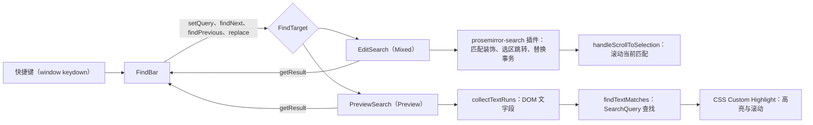

# Markdown 搜索与替换

## 名词解释

- **Mixed**：Markdown extension 的可编辑查看器（`markdown.html`，Tiptap 编辑器），宿主中的 id 为 `<extension id>:markdown`。
- **Preview**：Markdown extension 的只读查看器（`preview.html`，Tiptap 静态渲染），宿主中的 id 为 `<extension id>:preview`。
- **搜索栏**：本方案在查看器内容列右上角增加的浮动栏，包含搜索输入框、选项、计数、跳转按钮，Mixed 中另有替换行。
- **搜索条件**：搜索文字、替换文字与三个选项（区分大小写、全词匹配、正则表达式）。
- **匹配**：文档中符合搜索条件的一段文字。匹配不跨块：Mixed 中不跨 textblock，Preview 中不跨文字段。
- **当前匹配**：计数中的序号所指的匹配，颜色与其他匹配不同。Mixed 的当前匹配就是编辑器选区。
- **文字段**：Preview 中属于同一个块元素的连续文字节点。
- **Mod**：macOS 为 Cmd，其他平台为 Ctrl。
- **变更标签**：【新增】、【修改】、【删除】表示相对当前代码新增、修改或删除的文件、类型、函数、样式与界面元素。

## 背景

Mixed 与 Preview 没有搜索功能。Desktop 没有为 extension 页面提供页面搜索，在 Mixed 或 Preview 中按 Cmd+F 没有反应。用户查找一个词只能滚动阅读，修改同一个词的多处出现只能逐个编辑。同一个文件的 Source 视图由宿主的 Monaco 提供搜索与替换，Mixed 与 Preview 需要同样的能力，快捷键与 Monaco 的默认快捷键相同。

## 设计目标

### 功能目标

1. 打开与关闭：Mod+F 打开搜索栏；Mixed 中 macOS 的 Cmd+Option+F、其他平台的 Ctrl+H 打开带替换行的搜索栏，Preview 中同一个快捷键打开搜索栏；焦点在搜索栏中时 Esc 关闭，关闭按钮也可以关闭。
2. 搜索选项：区分大小写、全词匹配、正则表达式，可以用按钮或快捷键切换。
3. 高亮与计数：全部匹配高亮，当前匹配使用另一种颜色；搜索栏显示 `序号 of 总数`、`? of 总数`、`No results` 或 `Invalid regex`。
4. 跳转：上一个、下一个（按钮、Enter 与 Shift+Enter、F3 与 Shift+F3、Mod+G 与 Mod+Shift+G），到头后从另一端继续；当前匹配不在可见区域内或被搜索栏遮住时，把它滚动到可见区域中部。
5. 替换（只有 Mixed）：替换当前匹配并选中下一个匹配，或替换全部匹配；正则表达式模式的替换文字支持 `$&`、`$1`～`$9`、`$$`；替换可以撤销，保存时按现有写回规则输出 Markdown。
6. 搜索范围：Mixed 搜索编辑器中的文字，包括代码块、HTML 块与 front matter 的原文，不搜索链接地址、图片地址与图片说明等节点属性，"Diagram only" 视图中 Mermaid 代码块的源码不参与搜索与替换。Preview 搜索页面上显示的文字，不包括图表 SVG、视觉隐藏的元素和已经渲染为图表的 Mermaid 源码。
7. 状态保留：同一个查看器页面中，关闭后再打开保留上次的搜索条件与替换行的展开状态；切换文件或重新读取文件后，搜索栏保持打开时继续高亮新内容中的匹配。

### 技术目标

- **范围**：只修改 Markdown extension 与 Desktop 的 extension 集成测试。新增依赖 `prosemirror-search@1.1.1`。`manifest.json`、Extension API、宿主代码不变；Markdown 原文的解析结果与 Mixed 的写回规则不变。
- **一致性**：两个查看器使用同一个搜索栏组件，并用同一个 `SearchQuery`（prosemirror-search）判断匹配，同一个搜索条件在两个查看器中得到相同的匹配（Preview 不包括隐藏的文字）。
- **性能**：搜索栏关闭时搜索文字为空，编辑器的事务不做额外计算。搜索栏打开时，Mixed 在每次文档或选区变化后重新查找全部匹配（prosemirror-search 的行为），耗时与文档文字量成正比；Preview 在搜索条件变化时，或文档 DOM 变化后的下一个动画帧，重新查找。计数与当前序号不变时搜索栏不重新渲染。
- **无障碍**：搜索栏为带 `aria-label="Find and replace"` 的 `role="dialog"` 元素；输入框带 `aria-label`；选项按钮带 `aria-pressed`；替换行的展开按钮带 `aria-expanded`；计数带 `aria-live="polite"`；所有按钮都可以用 Tab 与 Enter 操作，图标按钮的 tooltip 显示名称与快捷键。

## 总体设计



搜索栏是共用的 React 组件，只负责界面、快捷键与搜索条件。两个查看器各自实现 `FindTarget`：

- Mixed 的 `EditSearch` 使用 prosemirror-search。它是 ProseMirror 作者维护的搜索插件，提供 `SearchQuery`（区分大小写、全词匹配、正则表达式、替换文字中的分组引用）、匹配装饰、跳转命令与替换命令，依赖的 prosemirror-state、prosemirror-model、prosemirror-view 与 `@tiptap/pm` 使用的是同一份模块（工作区为 hoisted 安装）。
- Preview 的 `PreviewSearch` 从 DOM 收集文字段，把它们放进一个只有文字的 ProseMirror 文档，用同一个 `SearchQuery` 查找匹配，再把匹配的偏移换算为 DOM `Range`，用 CSS Custom Highlight API 高亮。高亮不修改 DOM，React 渲染的内容保持不变。

### 变更清单

依赖（路径相对 `src`）：

| 文件 | 变更 | 内容 |
| --- | --- | --- |
| `pnpm-workspace.yaml` | 【修改】 | catalog 增加 `prosemirror-search: 1.1.1` |
| `extensions/markdown/package.json` | 【修改】 | devDependencies 增加 `"prosemirror-search": "catalog:"` |

客户端代码（路径相对 `src/extensions/markdown/src`）：

| 文件 | 变更 | 内容 |
| --- | --- | --- |
| `shared/find-query.ts` | 【新增】 | `FindQuery`、`FindResult`、`createSearchQuery`、`findShortcut`、`shortcutText` |
| `shared/find-bar.tsx` | 【新增】 | `FindTarget`、`FindBarMemory`、`createFindBarMemory`、`FindBar` |
| `shared/find-bar.css` | 【新增】 | 搜索栏样式与位置、匹配颜色变量 |
| `shared/find-reveal.ts` | 【新增】 | `needsReveal`：判断当前匹配是否需要滚动 |
| `shared/tooltip.css` | 【新增】 | 从 `editor/edit.css` 移来的 `.tooltip` 与 `.tooltip-arrow` |
| `shared/outline.css` | 【修改】 | 内容列与大纲指定 `grid-row: 1` |
| `editor/edit-search.ts` | 【新增】 | `EditSearchExtension`、`EditSearch` |
| `editor/edit-extensions.ts` | 【修改】 | 加入 `EditSearchExtension` |
| `editor/edit-document.ts` | 【修改】 | 新增 `search: EditSearch`；载入后恢复搜索条件；释放 |
| `editor/mermaid-editing.ts` | 【修改】 | 【新增】导出 `inDiagramOnlyBlock`、`switchesMermaidView` |
| `editor/edit-view.tsx` | 【修改】 | 在 `.edit-layout` 中渲染 `FindBar` |
| `editor/edit.css` | 【修改】 | 【新增】匹配样式；【删除】`.tooltip`、`.tooltip-arrow`（移到 `shared/tooltip.css`） |
| `editor/main.tsx` | 【修改】 | 导入 `find-bar.css`、`tooltip.css` |
| `preview/preview-search.ts` | 【新增】 | `collectTextRuns`、`findTextMatches`、`matchRange`、`PreviewSearch` |
| `preview/markdown-document.tsx` | 【修改】 | 创建 `PreviewSearch`，在 `.preview-layout` 中渲染 `FindBar` |
| `preview/markdown.css` | 【修改】 | 【新增】`::highlight()` 样式 |
| `preview/main.tsx` | 【修改】 | 创建 `FindBarMemory` 并传给 `MarkdownDocument`；导入 `find-bar.css`、`tooltip.css` |

测试（前四行路径相对 `src/extensions/markdown/src`，最后两行相对 `src/clients/desktop`）：

| 文件 | 变更 | 内容 |
| --- | --- | --- |
| `shared/find-query.test.ts` | 【新增】 | 快捷键与搜索条件 |
| `editor/edit-search.test.ts` | 【新增】 | Mixed 的匹配、跳转、替换、范围、写回 |
| `editor/edit-view.test.ts` | 【修改】 | Mixed 搜索栏的界面与快捷键 |
| `preview/preview-search.test.ts` | 【新增】 | 文字段、匹配与 `Range` |
| `scripts/test-extensions.mjs` | 【修改】 | 新增 `notes/search.md` |
| `src/main/extensions.integration.ts` | 【修改】 | 新增 `markdownSearch` 步骤 |

## 详细设计

### 1. 依赖【新增】

`prosemirror-search@1.1.1`（2026-05-25 发布）依赖 `prosemirror-model ^1.21.0`、`prosemirror-state ^1.4.3`、`prosemirror-view ^1.33.6`，当前安装的版本为 1.25.12、1.4.4、1.42.6，都在范围内。工作区的 `nodeLinker` 为 `hoisted`，prosemirror-search 与 `@tiptap/pm` 导入同一份模块，插件键、`EditorState` 与装饰类型不会有两份。

### 2. 搜索条件与快捷键【新增】

`shared/find-query.ts`：

```ts
export type FindQuery = {
  search: string;
  replace: string;
  caseSensitive: boolean;
  wholeWord: boolean;
  regexp: boolean;
};

export type FindResult =
  | { status: "idle" }                                   // 搜索文字为空
  | { status: "invalid" }                                // 正则表达式无效
  | { status: "matches"; count: number; current: number | null };

export function createSearchQuery(
  query: FindQuery,
  exclude?: (state: EditorState, result: SearchResult) => boolean,
): SearchQuery;

export type FindCommand =
  | "find" | "replace" | "next" | "previous"
  | "toggleCase" | "toggleWholeWord" | "toggleRegexp";

export function findShortcut(event: ShortcutEvent, platform: Platform): FindCommand | null;
export function shortcutText(command: FindCommand | "close" | "replaceOne" | "replaceAll", platform: Platform): string;
```

- `createSearchQuery` 创建 `new SearchQuery({ search, replace, caseSensitive, wholeWord, regexp, filter })`。`literal` 保持默认值 false：普通搜索中的 `\n`、`\t` 表示换行与制表符，与 prosemirror-search 的默认行为相同。`filter` 排除长度为 0 的匹配（例如正则表达式 `^`、`a*` 的空匹配），再排除 `exclude` 返回 true 的匹配。
- 全词匹配使用 prosemirror-search 的规则：匹配两端相邻的字符都是字母（Unicode `\p{L}`）时不算匹配；块的开头与结尾算作边界。
- `findShortcut`：Mod 为 macOS 的 `metaKey`、其他平台的 `ctrlKey`；另一个修饰键（macOS 的 Ctrl、其他平台的 Meta）按下时返回 null。字母键在 Alt 未按下时取 `event.key` 的小写形式，按照键盘布局识别；Alt 按下时取 `event.code`（macOS 的 Option 会改变 `event.key`）。

| 命令 | macOS | 其他平台 |
| --- | --- | --- |
| `find` | Cmd+F | Ctrl+F |
| `replace` | Cmd+Option+F | Ctrl+H |
| `next` | Cmd+G、F3 | Ctrl+G、F3 |
| `previous` | Cmd+Shift+G、Shift+F3 | Ctrl+Shift+G、Shift+F3 |
| `toggleCase` | Cmd+Option+C | Alt+C |
| `toggleWholeWord` | Cmd+Option+W | Alt+W |
| `toggleRegexp` | Cmd+Option+R | Alt+R |

- 只在输入框中有效的按键：搜索输入框中 Enter 为下一个、Shift+Enter 为上一个；替换输入框中 Enter 为替换当前匹配、Mod+Enter 为全部替换；两个输入框中 Esc 关闭搜索栏。输入法组合中（`isComposing`）的按键不处理。
- `shortcutText` 返回 tooltip 中的快捷键文字：macOS 使用符号（`⌥⌘C`、`⇧Enter`），其他平台使用 `Alt+C`、`Shift+Enter` 这样的写法。

### 3. 搜索栏【新增】

#### 3.1 FindTarget 与 FindBarMemory

`shared/find-bar.tsx`：

```ts
export interface FindTarget {
  subscribe(listener: () => void): () => void;
  /** 结果不变时返回同一个对象。Returns the same object while the result is unchanged. */
  getResult(): FindResult;
  /** null 表示搜索栏关闭。null means the bar is closed. */
  setQuery(query: FindQuery | null): void;
  findNext(): void;
  findPrevious(): void;
  /** 没有替换能力时为 null。null without replacing. */
  readonly replace: { next(): void; all(): void } | null;
  /** 内容中单行、非空的选中文字，没有时为 null。 */
  selectedText(): string | null;
  /** 关闭搜索栏后把焦点交还给内容。 */
  focusContent(): void;
}

export type FindBarMemory = { open: boolean; replaceOpen: boolean; query: FindQuery };
export function createFindBarMemory(): FindBarMemory;
```

`FindBarMemory` 由查看器页面创建一次，`FindBar` 挂载时从中读取初始状态，状态每次变化都写回。Preview 切换文件时 `MarkdownDocument` 按 URI 重新挂载，搜索栏借此恢复。初始值：`open: false`、`replaceOpen: false`、搜索与替换文字为空、三个选项都为 false。

#### 3.2 界面结构

```html
<div class="find-bar-anchor">
  <div class="find-bar" role="dialog" aria-label="Find and replace">
    <div class="find-row">
      <button class="find-button" aria-label="Toggle Replace" aria-expanded="false">›</button>  <!-- 只有可以替换时 -->
      <div class="find-field">                                     <!-- 正则表达式无效时带 data-invalid -->
        <input aria-label="Find" placeholder="Find" />
        <button class="find-button" aria-label="Match Case" aria-pressed="false">…</button>
        <button class="find-button" aria-label="Match Whole Word" aria-pressed="false">…</button>
        <button class="find-button" aria-label="Use Regular Expression" aria-pressed="false">…</button>
      </div>
      <span class="find-count" aria-live="polite">3 of 12</span>
      <button class="find-button" aria-label="Previous Match">…</button>
      <button class="find-button" aria-label="Next Match">…</button>
      <button class="find-button" aria-label="Close">…</button>
    </div>
    <div class="find-row find-replace-row">                        <!-- 替换行展开时 -->
      <div class="find-field"><input aria-label="Replace" placeholder="Replace" /></div>
      <button class="find-text-button">Replace</button>
      <button class="find-text-button">Replace All</button>
    </div>
  </div>
</div>
```

- 搜索栏关闭时 `.find-bar-anchor` 仍然渲染（空元素），位置不变。
- 图标来自 `@tabler/icons-react`：替换行展开按钮 `IconChevronRight`／`IconChevronDown`，区分大小写 `IconLetterCase`，全词匹配 `IconAbc`，正则表达式 `IconRegex`，上一个 `IconArrowUp`，下一个 `IconArrowDown`，关闭 `IconX`。
- 图标按钮使用 Radix `Tooltip`（与表格工具条相同），内容为名称加快捷键，例如 `Match Case (⌥⌘C)`、`Next Match (Enter)`、`Close (Escape)`。`Replace` 与 `Replace All` 为文字按钮，tooltip 为 `Replace (Enter)`、`Replace All (⌘Enter)`。
- 上一个、下一个、`Replace`、`Replace All` 在结果不是 `matches` 或匹配数为 0 时不可用。

#### 3.3 计数文字

| `FindResult` | 计数文字 |
| --- | --- |
| `idle` | 空 |
| `invalid` | `Invalid regex`（颜色 `--destructive`，搜索框带 `data-invalid`，输入框带 `aria-invalid="true"`） |
| `matches`，`count` 为 0 | `No results` |
| `matches`，`current` 为 null | `? of {count}` |
| `matches` | `{current + 1} of {count}` |

#### 3.4 行为

- `FindBar` 的属性：`target`、`memory`、`platform`（`api.context.get().app.platform`）、`enabled`。`enabled` 为 false 时不响应快捷键（Mixed 读取中或读取失败）。
- 搜索栏打开时调用 `target.setQuery(query)`，关闭时调用 `target.setQuery(null)`；搜索条件每次变化都调用一次。卸载时不调用：Mixed 卸载时编辑器先于 React 销毁。
- 结果用 `useSyncExternalStore(target.subscribe, target.getResult)` 读取。
- 打开（`find` 或 `replace` 快捷键）：
  - `target.selectedText()` 不为 null 时用它替换搜索文字。
  - `replace` 快捷键在可以替换时展开替换行。
  - 焦点：`find` 时放进搜索输入框并选中其中全部文字；`replace` 时搜索文字为空则放进搜索输入框，否则放进替换输入框并选中其中全部文字。搜索栏已经打开时同样处理焦点。
- `next`、`previous` 与三个切换命令只在搜索栏打开时处理。处理了的按键调用 `preventDefault`。
- 快捷键在 `window` 的 `keydown` 捕获阶段处理，编辑器、大纲按钮或页面其他位置有焦点时都有效。Esc 只在焦点位于搜索栏中时关闭搜索栏：Mixed 的 `/` 菜单与链接输入框也用 Esc 关闭自己。
- 关闭：`setQuery(null)`，再调用 `target.focusContent()`。

#### 3.5 位置与样式

`shared/find-bar.css`：

- `:root` 定义 `--find-match: rgb(250 204 21 / 0.4)` 与 `--find-match-current: rgb(249 115 22 / 0.55)`，浅色与深色主题都能看清。
- `.outline-layout > .find-bar-anchor`：`grid-column: 2`、`grid-row: 1`、`position: sticky`、`top: 0`、`z-index: 20`、`height: 0`。锚点与内容列在同一个网格单元中，高度为 0，不改变布局；sticky 的约束范围是整行，滚动时搜索栏一直在可见区域顶部。搜索栏因此位于内容列的右上角，不遮挡右侧的大纲；宽度小于 960px 时大纲隐藏，内容列占满宽度，搜索栏位于页面右上角。
- 【修改】`shared/outline.css` 中 `.outline-layout > .document-column` 与 `.outline-layout > .outline` 增加 `grid-row: 1`。只指定列的网格项会避开已被占用的单元格，锚点明确占用第 1 行第 2 列后，内容列没有 `grid-row: 1` 时会被放到第 2 行。
- `.find-bar`：`position: absolute`、`top: 12px`、`right: 16px`、宽度 `min(440px, calc(100% - 32px))`、`box-sizing: border-box`；纵向排列两行，行间距 4px，内边距 4px；边框、圆角、背景、阴影与 Mixed 的浮动菜单相同（`--border`、`--radius-md`、`--popover`、`--popover-foreground`、`0 4px 16px rgb(0 0 0 / 0.16)`）；字号 0.875em。
- `.find-field`：横向排列，占满剩余宽度，边框 `--border`，圆角 `--radius-sm`，背景 `--background`；获得焦点时边框为 `--ring`；`data-invalid` 时边框为 `--destructive`。输入框无边框，高 24px。
- `.find-button`：24px 正方形图标按钮，悬停与 `aria-pressed="true"` 时背景为 `--accent`；`.find-text-button` 为高 24px 的文字按钮。不可用时透明度 0.5。
- `.find-count`：最小宽度 72px，颜色 `--muted-foreground`，`font-variant-numeric: tabular-nums`。
- `.find-replace-row` 左侧留出展开按钮的宽度（26px），替换输入框与搜索输入框左边对齐。
- 【新增】`shared/tooltip.css`：`.tooltip` 与 `.tooltip-arrow` 的规则从 `editor/edit.css` 移来，内容不变，Mixed 与 Preview 都导入。

### 4. 当前匹配的滚动【新增】

`shared/find-reveal.ts`：

```ts
/** 匹配不完全在可见区域内，或与搜索栏相交时返回 true。 */
export function needsReveal(match: DOMRect, viewport: { top: number; bottom: number; left: number; right: number }): boolean;
```

搜索栏的位置取 `document.querySelector(".find-bar")?.getBoundingClientRect()`，搜索栏关闭时不参与判断。需要滚动时，两个查看器都把当前匹配滚动到可见区域的中部，横向滚动区域（代码块、表格）同时滚动到匹配可见。

### 5. Mixed

#### 5.1 EditSearchExtension【新增】

`editor/edit-search.ts` 导出 Tiptap 扩展 `EditSearchExtension`，加入两个 ProseMirror 插件：

1. prosemirror-search 的 `search()`：保存搜索条件，生成匹配的 inline 装饰。普通匹配带 `ProseMirror-search-match` 类，与选区完全相同的匹配带 `ProseMirror-active-search-match` 类。
2. `revealSearchMatch`：
   - `handleScrollToSelection`：视图更新后要把选区滚动到可见区域时，如果编辑区中有 `.ProseMirror-active-search-match` 元素，取第一个这样的元素；`needsReveal` 以 `.edit-scroll` 的矩形为可见区域，返回 true 时调用 `element.scrollIntoView({ block: "center", inline: "nearest" })`。不论是否滚动都返回 true。没有这样的元素时返回 false，交给 ProseMirror 的默认滚动。
   - `appendTransaction`：prosemirror-search 只在文档或选区变化时重新查找。事务中有 `switchesMermaidView` 为 true 的事务、并且当前条件有效时，追加一个用当前条件与范围调用 `setSearchState` 的事务，"Diagram only" 视图的源码随之离开或加入匹配。

`EditSearchExtension` 的 `priority` 为 50（低于默认的 100）。Tiptap 按 priority 从高到低排列插件，相同 priority 时把扩展列表中靠后的扩展排在前面；priority 50 使两个插件排在 MermaidEditing 之后，事务应用时 Mermaid 视图的插件状态先更新，搜索插件的 `filter` 读到的是新状态中的视图。

【修改】`edit-extensions.ts` 的 `createEditExtensions` 在 `editShortcuts(context)` 之前加入 `EditSearchExtension`。

#### 5.2 EditSearch【新增】

`EditSearch` 实现 `FindTarget`，由 `EditDocument` 持有：

- 构造：`new EditSearch(editor)`，监听编辑器的 `transaction` 事件重新计算结果；结果与上次相同时不通知订阅者。
- `getResult()`：读取 `getSearchState(state)`。搜索文字为空时为 `idle`；`query.valid` 为 false 时为 `invalid`；否则从 `getMatchHighlights(state).find()` 取出全部匹配，按 `from` 排序，`count` 为匹配数，`current` 为 `from`、`to` 与选区相同的匹配的序号，没有时为 null。
- `setQuery(query)`：用 `createSearchQuery(query, (state, result) => inDiagramOnlyBlock(state, result.from))` 创建条件（`query` 为 null 时使用搜索文字为空的条件），在一个事务中调用 `setSearchState`。搜索文字或三个选项与上次不同、并且新条件有效时，同一个事务把选区设为从当前选区开头（`selection.from`）向后的第一个匹配，没有时从文档开头找，并调用 `scrollIntoView()`；只有替换文字变化时选区不变。
- `findNext()`／`findPrevious()`：执行 prosemirror-search 的 `findNext`／`findPrev` 命令。
- `replace.next()`：执行 `replaceNext`：选区正好是一个匹配时替换它并选中下一个匹配，否则选中下一个匹配。`replace.all()`：执行 `replaceAll`，全部替换在一个事务中，一次撤销即可恢复。
- 替换文字中的普通文字使用被替换文字的公共 mark（prosemirror-search 的 `marksAcross`），正则表达式的分组引用复制原文的内容与 mark。
- `selectedText()`：选区为非空的 `TextSelection`、两端在同一个 textblock 中、文字不含换行时返回 `doc.textBetween(from, to)`，否则返回 null。
- `focusContent()`：`editor.view.focus()`，选区仍为当前匹配。
- `restore()`：用当前的条件再调用一次 `setSearchState`，选区不变。
- `dispose()`：取消 `transaction` 监听。

【修改】`EditDocument`：

- 新增只读属性 `search: EditSearch`，在构造函数中创建编辑器与 `outline` 之后赋值。
- `load()` 用新的 `EditorState` 替换编辑器状态时，所有插件重新初始化，搜索条件回到空值。`updateState` 之后调用 `this.search.restore()`，切换文件、重新读取与按其他编码重新打开之后继续高亮。这个事务不改变文档，`edits` 不增加，会话不会变为未保存。
- `dispose()` 在释放 `outline` 之后释放 `search`。

#### 5.3 Mermaid 代码块【修改】

`mermaid-editing.ts` 新增导出：

```ts
/** `pos` 是否在 "Diagram only" 视图的 Mermaid 代码块中。 */
export function inDiagramOnlyBlock(state: EditorState, pos: number): boolean;
/** 事务是否切换了 Mermaid 代码块的视图（带 mermaidView 插件的 meta）。 */
export function switchesMermaidView(tr: Transaction): boolean;
```

`pos` 所在 textblock 为 Mermaid 代码块，并且该代码块带视图的 node 装饰时返回 true。这类代码块的源码不显示，选区进入它时会改为整体选中，因此它的源码不参与搜索与替换。默认视图的 Mermaid 代码块参与搜索：当前匹配在其中时选区进入代码块，代码块带编辑状态并显示源码。

#### 5.4 搜索栏与样式【修改】

- `edit-view.tsx` 的 `EditDocumentLayout` 在 `.edit-layout` 的第一个子元素位置渲染 `<FindBar target={editDocument.search} memory={memory} platform={platform} enabled={ready} />`。`memory` 用 `useState(createFindBarMemory)` 创建一次；`EditView` 在文件切换时保持挂载，搜索栏状态随之保留。
- `edit.css` 新增：

```css
.edit-content .ProseMirror-search-match {
  background: var(--find-match);
}

.edit-content .ProseMirror-active-search-match {
  background: var(--find-match-current);
}
```

- 搜索输入框有焦点时编辑器没有焦点，格式菜单、链接菜单、图片菜单与表格工具条按现有规则（`hasFocus`）不显示，选区移动到匹配时不会弹出这些菜单。

### 6. Preview

#### 6.1 文字段【新增】

`preview/preview-search.ts`：

```ts
export type TextRun = { nodes: readonly Text[]; text: string };
export function collectTextRuns(root: HTMLElement): TextRun[];
```

- 用 `TreeWalker` 按文档顺序遍历 `root`（`.markdown-body`）中的文字节点。以下元素及其后代不参与：`script`、`style`、`svg`（Mermaid 图表与图标）、`.sr-only`（脚注区的视觉隐藏标题）、`.mermaid-block[data-diagram="rendered"] > pre`（已经渲染为图表的源码）。
- 文字节点的块元素为它的父元素向上最近的块元素：`article, blockquote, div, h1, h2, h3, h4, h5, h6, li, ol, p, pre, section, table, tbody, td, th, thead, tr, ul`。这些是 Preview 渲染的全部块元素：原始 HTML 显示为文字，不会产生其他元素。块元素相同并且在遍历中相邻的文字节点组成一个文字段；文字段的 `text` 为这些节点文字的拼接。`strong`、`a`、`code` 这类行内元素不分隔文字段，与 Mixed 中 mark 不分隔 textblock 相同。
- 空文字节点不加入文字段。

#### 6.2 查找与 Range【新增】

```ts
export type TextMatch = { run: number; from: number; to: number };
export function findTextMatches(runs: readonly TextRun[], query: SearchQuery): TextMatch[];
export function matchRange(run: TextRun, from: number, to: number): Range;
```

- `findTextMatches` 用模块中的文字 schema（`doc` 内容为 `block+`，`block` 内容为 `text*`）把每个文字段建成一个 `block`，用 `EditorState.create({ doc })` 与 `query.findNext` 从头到尾找出全部匹配，再把文档位置换算为文字段序号与段内偏移。没有文字段时返回空数组。prosemirror-search 按 textblock 查找，匹配因此不跨文字段。
- `matchRange` 按累计偏移找到起点与终点所在的文字节点，起点位于两个节点交界处时取后一个节点，终点位于交界处时取前一个节点。

#### 6.3 PreviewSearch【新增】

`PreviewSearch` 实现 `FindTarget`，`replace` 为 null：

- 构造：`new PreviewSearch(article)`，创建 `MutationObserver` 监听 `article` 的 `childList`、`characterData`、`subtree` 与 `data-diagram` 属性（图表渲染完成后源码隐藏）。变化后在下一个动画帧重新收集文字段与匹配；搜索栏关闭时不收集。重新查找后当前序号小于新的匹配数时保留，否则为 null；这种更新不滚动。
- `setQuery(query)`：null 时清空匹配并删除两个高亮。否则重新收集与查找，当前匹配为第一个底边位于窗口顶部之下的匹配，没有时为第一个匹配；然后更新高亮并滚动到当前匹配。
- `findNext()`／`findPrevious()`：当前序号加一或减一，到头后从另一端继续；当前序号为 null 时，下一个取第一个匹配，上一个取最后一个匹配。随后更新高亮并滚动。
- 高亮：`CSS.highlights.set("markdown-find-match", new Highlight(...除当前匹配外的 Range))`，`CSS.highlights.set("markdown-find-current", new Highlight(当前匹配的 Range))`。当前匹配不放进第一个高亮，两种颜色不会叠加。
- 滚动：`needsReveal` 以窗口为可见区域，返回 true 时，从 `Range` 起点的父元素向上到 `body`，对横向可以滚动（`overflow-x` 不为 `visible`，并且 `scrollWidth > clientWidth`）而匹配不在其可见范围内的元素，调整 `scrollLeft` 使匹配位于中部；之后匹配仍在窗口外或与搜索栏相交时，用 `window.scrollBy` 把匹配移到窗口的竖直中部。
- `selectedText()`：`getSelection()` 的文字非空、不含换行时返回它，否则返回 null。
- `focusContent()`：不做任何操作。Preview 没有可以编辑的区域，关闭搜索栏时输入框随之卸载，焦点回到页面。
- `dispose()`：断开 `MutationObserver`，取消未执行的动画帧，删除两个高亮。

【修改】`markdown.css` 新增：

```css
::highlight(markdown-find-match) {
  background-color: var(--find-match);
}

::highlight(markdown-find-current) {
  background-color: var(--find-match-current);
}
```

#### 6.4 接入【修改】

- `main.tsx` 在打开时创建一个 `FindBarMemory`，每次渲染都传给 `MarkdownDocument`（属性 `findMemory`）。
- `markdown-document.tsx` 的 `MarkdownDocumentLayout` 在 `article` 挂载后创建 `PreviewSearch`，`article` 变化或卸载时释放；`PreviewSearch` 创建后在 `.preview-layout` 的第一个子元素位置渲染 `<FindBar target={search} memory={findMemory} platform={platform} enabled />`。读取中与读取失败时没有内容，也没有搜索栏。

## 测试计划

### 单元测试

`shared/find-query.test.ts`：

1. `findShortcut_Darwin_MapsCommands`：macOS 上 Cmd+F、Cmd+Option+F（`key` 为 `ƒ`，`code` 为 `KeyF`）、Cmd+G、Cmd+Shift+G、F3、Shift+F3、Cmd+Option+C/W/R 分别得到对应命令；Ctrl+F、Cmd+H、Cmd+Shift+F 得到 null。
2. `findShortcut_Windows_MapsCommands`：Ctrl+F、Ctrl+H、Ctrl+G、Ctrl+Shift+G、F3、Shift+F3、Alt+C/W/R 得到对应命令；Meta+F、Ctrl+Alt+F 得到 null。
3. `createSearchQuery_ZeroLengthMatches_AreSkipped`：正则表达式 `^` 与 `x*` 在文档中没有匹配。

`editor/edit-search.test.ts`（真实的 `EditDocument` 与测试宿主）：

1. 计数与当前序号：搜索 `cat` 后结果为 `matches`，数量正确，当前匹配为选区之后的第一个；`findNext` 到最后一个后回到第一个，`findPrevious` 从第一个到最后一个。
2. 选项：区分大小写；全词匹配时 `cat` 不匹配 `category` 中的 `cat`，也不匹配 `**cat**s` 这种被 mark 分开的词中的 `cat`；正则表达式；无效正则表达式的结果为 `invalid`。
3. 范围：paragraph、标题、列表、表格单元格、代码块、HTML 块与 front matter 中的文字都能找到；匹配不跨 paragraph；链接地址与图片地址不参与；"Diagram only" 视图的 Mermaid 源码不参与，默认视图的参与。
4. 替换：`replace.next` 先选中再替换，替换后选中下一个；`replace.all` 一次撤销恢复全部；正则表达式 `(\w+)@(\w+)` 替换为 `$2 at $1`；替换后的文字保留原文的 bold mark。
5. 写回：全部替换后保存，宿主写入的 Markdown 只在被替换的位置与原文不同。
6. 恢复：搜索栏打开时 `session.reload()` 或切换到另一个文件后，结果仍按当前条件计算，会话不变为未保存。
7. 关闭：`setQuery(null)` 后结果为 `idle`，编辑器中没有匹配装饰。

`editor/edit-view.test.ts`：

1. 编辑器中选中一个词后按 Mod+F：搜索栏出现，搜索框为这个词并获得焦点，计数为 `1 of N`。
2. 在搜索框中按 Enter、Shift+Enter 改变计数中的序号；按 Esc 关闭搜索栏，编辑器获得焦点，选区为当前匹配。
3. 替换快捷键展开替换行；在替换框中按 Enter 替换当前匹配，按 Mod+Enter 全部替换；结果为 0 时按钮不可用并显示 `No results`。
4. 无效正则表达式显示 `Invalid regex`，搜索框带 `aria-invalid="true"`。
5. 关闭后再打开保留搜索文字与选项；编辑器中输入文字时搜索栏不重新渲染（`Profiler` 计数），计数变化时才渲染。

`preview/preview-search.test.ts`（jsdom 渲染 `renderMarkdown` 的结果）：

1. `collectTextRuns`：paragraph 中的行内元素不分隔文字段；列表项、表格单元格、代码块分别为文字段；脚注区的 `.sr-only` 标题、已渲染图表的源码、`svg` 中的文字不出现。
2. `findTextMatches`：跨 `strong` 与 `code` 的匹配可以找到；不跨 paragraph；区分大小写、全词匹配与正则表达式和 Mixed 中相同的文档得到相同的匹配文字。
3. `matchRange`：`Range.toString()` 等于匹配文字，包括起点与终点位于节点交界处的情况。

### 集成测试

`markdownSearch` 步骤（Desktop extension 集成测试，fixture `notes/search.md` 含多个 paragraph、带长行的代码块与 Mermaid 代码块）：

1. Preview：按 Mod+F 输入搜索文字，计数正确，`CSS.highlights` 中两个高亮的 Range 数量之和等于匹配数；按 Enter 后当前匹配在窗口内、不与搜索栏相交；代码块中的当前匹配所在的 `pre` 横向滚动到匹配可见；已经渲染为图表的 Mermaid 源码中的文字不计入；按 Esc 后两个高亮都被删除。
2. Mixed：按 Mod+F 输入搜索文字，计数与 `.ProseMirror-search-match`、`.ProseMirror-active-search-match` 元素对应；按 Enter 后当前匹配在 `.edit-scroll` 的可见区域内、不与搜索栏相交；按替换快捷键展开替换行，替换一个、全部替换后保存，磁盘上的文件只在被替换的位置变化；Mod+Z 撤销全部替换。
3. 宽度小于 960px 时搜索栏位于页面右上角并且完整显示；大纲显示时搜索栏不遮挡大纲。
