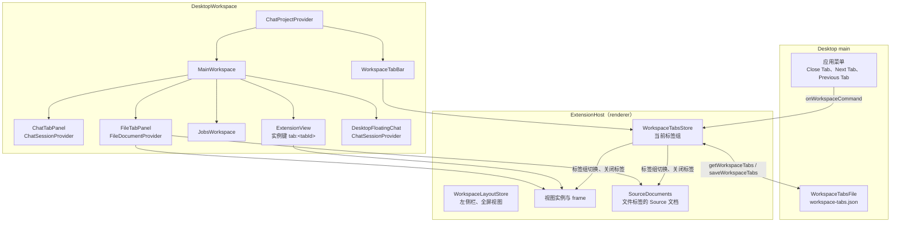
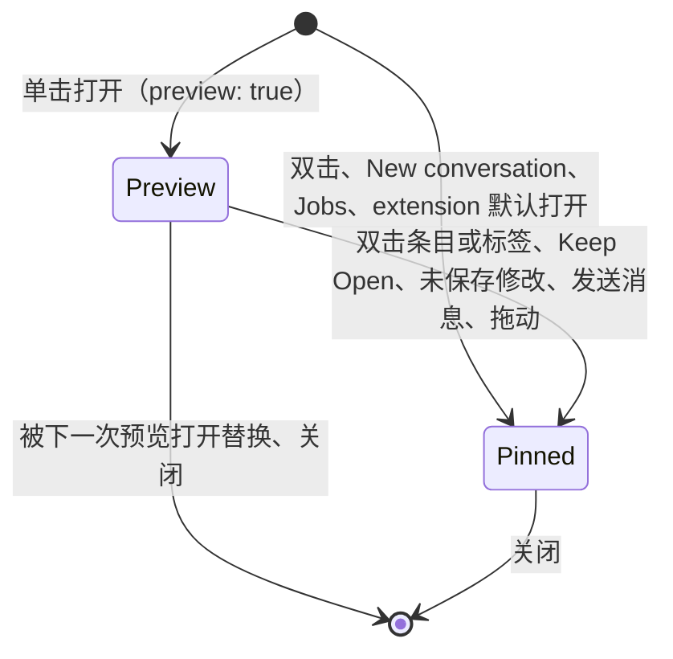
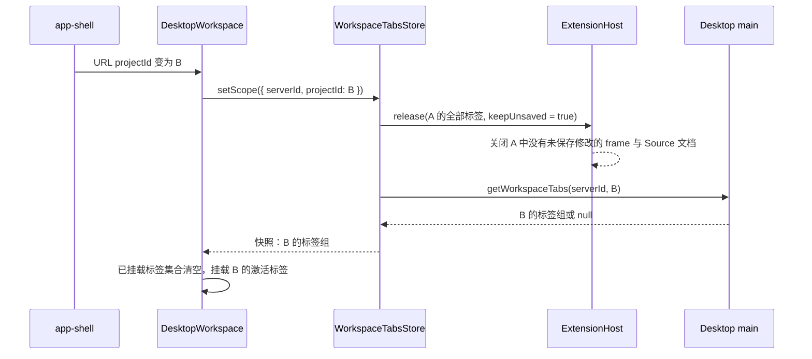

# Desktop 主区标签页

## 名词解释

- **主区**：`/desktop/chat` 页面右侧的 Main Workspace（`MainWorkspace` 组件，根元素 `.agw-main-workspace`）。
- **标签**：主区中可以切换的一个页面。类型有对话标签、文件标签、Jobs 标签和 extension 标签。
- **标签栏**：主区上方显示当前标签组全部标签的一行（`WorkspaceTabBar`）。
- **标签组**：一个 Server Profile 下一个 Project 的全部标签、标签顺序、激活的标签、最近激活的顺序与浮动对话状态。
- **标签标识**：同一标签组中判断“已经打开”的字符串，组内不重复，规则见 1.2 节。
- **固定标签**、**预览标签**：预览标签的标题用斜体显示，同一标签组中最多一个，下一次以预览方式打开其他内容时被替换；固定标签只由用户关闭。
- **草稿对话标签**：第一条消息还没有被服务端受理的对话标签。它的 `draftId` 是 UUIDv7，既是输入草稿的键，也是发送第一条消息时使用的对话 id。
- **全屏视图**：Events 与 Notifications。显示时收起左侧栏与标签栏，占满主区。
- **浮动对话**：文件、Jobs、extension 标签上方由浮动按钮打开的对话窗口（`FloatingChatPanel` 的 `floating` 模式）。
- **视图实例**：一个 extension 视图在某个位置上的一份页面，对应一个 frame（主进程中的一个 `WebContentsView`），由实例键区分，规则见 10.2 节。
- **页面挂载**：标签内容的 React 组件处于挂载状态。未激活的已挂载标签只隐藏。
- **Mod**：macOS 为 Cmd，其他平台为 Ctrl。
- **变更标签**：【新增】、【修改】、【删除】表示相对当前代码新增、修改或删除的文件、类型、函数、配置与界面元素。

## 背景

现在的主区一次只显示一个视图：

- `WorkspaceLayoutStore` 只记录 `activeMainViewId`。对话、文件、Jobs、Events、Notifications 与 extension 主区视图互相替换。
- `ChatWorkspaceProvider` 只有一个 `conversationId` 和一个文件选择。打开另一个对话或文件会替换当前内容，文件有未保存修改时先确认放弃。
- `ExtensionHost` 按视图 id 记录 frame（`viewFrames`），同一个视图同时只有一个页面。Bare Repository 的 Repository File 打开另一个文件时替换原来的内容，Markdown 等文件查看器只为当前文件保留页面（`retainFileViewers`）。
- 在标题栏切换 Project 时先确认放弃未保存修改，然后开始新对话；切回来时原来的对话与文件不再显示。
- 当前对话同步写在 URL 的 `conversationId` 中。

用户需要像 VS Code 一样的标签页：每个对话、每个文件、Jobs 和 extension 主区视图都以标签打开，已经打开的直接激活；单击打开预览标签；每个 Project 的标签互相隔离，切换 Project 再切回来、重启 Desktop 以后都恢复；浮动对话有自己的对话记录。

本方案按最终状态设计，没有兼容性要求：旧版本的主区状态、Desktop URL 中 `conversationId` 的同步、新对话输入草稿的存储键都不做转换或保留。Web 只调整共用组件的接口，界面与行为不变。Server、数据库与 OpenAPI 不变。

## 设计目标

### 功能目标

1. **标签栏**：主区上方显示当前标签组的标签，包括图标、标题与状态标记；预览标签标题为斜体；标签超出宽度时横向滚动，激活的标签滚动到可见区域。
2. **以标签打开**：对话、文件、Jobs、extension 主区视图都以标签打开；当前标签组中标签标识相同的标签已经存在时，激活原来的标签。
3. **预览标签**：在 Files 树、对话列表、Bare Repository 文件树中单击打开预览标签；双击条目、双击标签、右键菜单 Keep Open、文件出现未保存修改、在对话中发送消息、拖动预览标签时，预览标签变为固定标签。
4. **新对话**：New conversation 打开固定的草稿对话标签；第一条消息被受理后，这个标签成为该对话的标签。
5. **关闭**：× 按钮、鼠标中键、Mod+W、右键菜单的 Close、Close Others、Close to the Right、Close All；有未保存修改时先确认；运行中的对话关闭标签后在后台继续运行；关闭全部标签后显示空白页。
6. **排序与切换**：拖动标签排序；Ctrl+Tab 与 Ctrl+Shift+Tab 按标签栏顺序切换；关闭激活的标签后激活最近使用的标签。
7. **Project 隔离**：每个 Server Profile 的每个 Project 有一个标签组；切换 Project 显示该 Project 的标签组，切回来时标签、顺序、激活的标签和浮动对话都恢复；切换 Project 不再要求放弃未保存修改。
8. **重启恢复**：标签组保存在 Desktop 数据目录中；重启后恢复全部标签组，标签内容在第一次激活时加载。
9. **Jobs 与全屏视图**：Jobs 以标签打开，每个标签组最多一个；Events、Notifications 保持现在的全屏行为，离开后回到标签组。
10. **extension 主区视图**：同一个视图默认只有一个标签；`workspace.openMainView` 新增 `key`、`title`、`preview` 选项，同一视图可以按 `key` 打开多个标签；`workspace.openFile` 新增 `preview` 选项。Bare Repository 的 Repository File 每个文件一个标签。
11. **浮动对话**：每个标签组有自己的浮动对话，记录自己的当前对话，与对话标签无关；浮动对话中的对话以标签打开时，从浮动对话中移出。
12. **左侧栏跟随**：激活对话标签时对话列表高亮该对话；激活文件标签时 Files 树切换到文件所在目录，展开上级目录，选中该文件并滚动到可见区域。
13. **页面保留**：当前标签组中激活过的标签保持挂载，切回来时滚动位置、输入内容与页面状态都在；切换 Project 后原标签组的页面卸载，有未保存修改的文件保留修改内容。

### 技术目标

- **范围**：Desktop renderer、Desktop main 与 preload、`@agw/chat`、`@agw/projects`、`@agw/extension-sdk`、Bare Repository extension。Web 的界面与行为不变；Server、数据库与 OpenAPI 不变。
- **性能**：切换到当前标签组中激活过的标签不发出网络请求，也不重新创建 frame。标签组变化后立即请求保存，主进程合并连续的保存请求，同一时刻最多有一次写文件操作。
- **资源**：同时存在的视图 frame 包括：显示中的侧栏视图；当前标签组中激活过的文件标签显示过的文件查看器；`retainContextWhenHidden` 为 true 且激活过的 extension 标签；激活的 extension 标签；任意标签组中有未保存修改的文件查看器。
- **可靠性**：持久化文件由主进程用 zod 校验，格式错误时读取抛出错误，与 `settings.json` 的处理相同。渲染进程不猜测或丢弃无法识别的内容。
- **无障碍**：标签栏为 `role="tablist"`（`aria-label="Open tabs"`），标签为 `role="tab"`，带 `aria-selected` 与 `aria-controls`；标签内容为 `role="tabpanel"`，带 `aria-labelledby`。左右方向键在标签间移动焦点，Home、End 移到两端，Enter 与空格激活，Delete 关闭。关闭按钮带 `aria-label="Close <标题>"`；预览标签带 `aria-description="Preview"`，有未保存修改的标签带 `aria-description="Unsaved changes"`。

## 总体设计



- `ExtensionHost` 持有两份主区状态：`host.layout`（`WorkspaceLayoutStore`）只记录左侧栏与全屏视图；新增的 `host.tabs`（`WorkspaceTabsStore`）记录当前标签组，并通过 bridge 读取与保存标签组。
- `@agw/chat` 的 `ChatWorkspaceProvider` 分成三个 Provider：项目级的 `ChatProjectProvider`、一个对话一份的 `ChatSessionProvider`、一个文件一份的 `FileDocumentProvider`。Desktop 在 `ChatProjectProvider` 下为每个对话标签、每个文件标签和浮动对话各放一个对应的 Provider；Web 的 `ChatWorkspace` 用同样的三个 Provider 组成原来的单对话、单文件布局。
- `ExtensionHost` 的 frame 改为按视图实例记录。同一个文件查看器可以在多个文件标签中各有一个页面，同一个 extension 主区视图可以按 `key` 在多个标签中各有一个页面。
- 主进程新增 `workspace-tabs.json` 保存全部标签组，新增应用菜单把 Mod+W、Ctrl+Tab、Ctrl+Shift+Tab 交给渲染进程的标签组处理。焦点在 extension 页面中时这些快捷键也有效。

### 变更清单

Desktop main 与 preload（路径相对 `src/clients/desktop/src`）：

| 文件 | 变更 | 内容 |
| --- | --- | --- |
| `shared/contracts/workspace-tabs.ts` | 【新增】 | `JsonValue`、`PersistedTab`、`PersistedTabGroup`、`WorkspaceTabsFileContent`、`WorkspaceCommand` |
| `shared/workspace-tab-key.ts` | 【新增】 | `tabKey`：主进程校验与渲染进程共用 |
| `shared/contracts/index.ts` | 【修改】 | 导出 `workspace-tabs.ts` |
| `shared/contracts/bridge.ts` | 【修改】 | 新增 `getWorkspaceTabs`、`saveWorkspaceTabs`、`pruneWorkspaceTabs`、`onWorkspaceCommand` |
| `main/settings/workspace-tabs-file.ts` | 【新增】 | `WorkspaceTabsFile`：读取、校验、合并写入、清理 |
| `main/app-menu.ts` | 【新增】 | `buildApplicationMenu`：包含 Close Tab、Next Tab、Previous Tab 的应用菜单 |
| `main/index.ts` | 【修改】 | 创建 `WorkspaceTabsFile`；注册 IPC；设置应用菜单；保存 Server Profile 后清理已删除 Profile 的标签组 |
| `preload/index.ts` | 【修改】 | 暴露新增的 bridge 方法与 `agw:workspace-command` 事件 |

Desktop renderer（路径相对 `src/clients/desktop/renderer/src/runtime`）：

| 文件 | 变更 | 内容 |
| --- | --- | --- |
| `extensions/workspace-tab.ts` | 【新增】 | `WorkspaceTab`、`TabGroup`、`toPersistedTabGroup`、`fromPersistedTabGroup`、`createInitialTabGroup`、`activeViewIdOf` |
| `extensions/workspace-tabs-store.ts` | 【新增】 | `WorkspaceTabsStore` |
| `extensions/workspace-layout-store.ts` | 【修改】 | 【删除】`activeMainViewId` 与主区视图的 `openRequests`；【新增】`fullWorkspaceViewId`；`openMainView` 改为打开标签或全屏视图 |
| `extensions/workspace-ids.ts` | 【修改】 | 【新增】`tabInstanceKey`、`fileViewerInstanceKey`、`sidebarInstanceKey`、`settingsInstanceKey`、`FULL_WORKSPACE_VIEWS` |
| `extensions/extension-host.ts` | 【修改】 | 新增 `tabs`；frame 按视图实例记录；【删除】`retainFileViewers`、`setFileOpener`；未保存修改、保存状态、文件标题栏条目按实例记录；Source 未保存按标签记录；对话输入框按可见性选择；`workspaceState` 改为读取标签组 |
| `extensions/extension-bridge-broker.ts` | 【修改】 | `workspace.openMainView` 与 `workspace.openFile` 的选项校验；`chat.composer.insertText` 的目标 |
| `extensions/context-service.ts` | 【修改】 | `WorkspaceState.activeMainViewId` 可以为 null |
| `source/source-documents.ts` | 【新增】 | `SourceDocuments`：按文件标签保存 `SourceDocument` |
| `source/use-editable-source.ts` | 【修改】 | 从 `SourceDocuments` 取得文件标签的文档 |
| `components/workspace/desktop-workspace.tsx` | 【修改】 | 使用 `ChatProjectProvider`；设置标签组范围；处理 URL 中的 `conversationId`；对话列表与 Files 的回调改为打开标签；上下文选择来自可见的对话 |
| `components/workspace/main-workspace.tsx` | 【修改】 | 渲染标签栏、已挂载的标签内容、全屏视图、空白页与浮动对话 |
| `components/workspace/workspace-tab-bar.tsx` | 【新增】 | `WorkspaceTabBar` 与右键菜单 |
| `components/workspace/chat-tab-panel.tsx` | 【新增】 | `ChatTabPanel` |
| `components/workspace/file-tab-panel.tsx` | 【新增】 | `FileTabPanel` |
| `components/workspace/desktop-floating-chat.tsx` | 【新增】 | `DesktopFloatingChat` |
| `components/workspace/empty-workspace.tsx` | 【新增】 | `EmptyWorkspace` |
| `components/workspace/extension-view.tsx` | 【修改】 | 新增 `instanceKey`；`openRequest` 来自标签；新增视图不可用面板 |
| `components/workspace/left-sidebar.tsx` | 【修改】 | 对话列表与 Files 改为受控的当前项与打开回调 |
| `components/workspace/jobs-workspace.tsx` | 【修改】 | 【删除】`onOpenChat` |
| `components/workspace/ribbon.tsx` | 【修改】 | 高亮条件改为全屏视图或激活标签的视图 id |
| `components/app-shell.tsx` | 【修改】 | 切换 Project 不再确认；关闭 Project 标签只确认该标签组；返回链接不带 `conversationId` |

共用包（路径相对 `src/clients/packages`）：

| 文件 | 变更 | 内容 |
| --- | --- | --- |
| `chat/src/ui-web/pages/chat/chat-project-provider.tsx` | 【新增】 | `ChatProjectProvider`、`useChatProject` |
| `chat/src/ui-web/pages/chat/chat-session-provider.tsx` | 【新增】 | `ChatSessionProvider`、`useChatSession` |
| `chat/src/ui-web/pages/chat/file-document-provider.tsx` | 【新增】 | `FileDocumentProvider`、`useFileDocument` |
| `chat/src/ui-web/pages/chat/chat-workspace.tsx` | 【修改】 | 状态移到三个 Provider；Web 的单对话、单文件选择与 URL 同步留在 `ChatWorkspace` 内；【删除】`ChatWorkspaceProvider`、`useChatWorkspace`、`confirmFileChange`；侧栏组件改为受控 |
| `chat/src/ui-web/components/message/chat.tsx` | 【修改】 | 新增 `draftId`、`newConversationId`、`onSubmitted`；输入草稿按 `ComposerDraftKey` 保存；挂载时附着到 `newConversationId` 已有的执行会话 |
| `chat/src/lib/chat/conversation-composer-storage.ts` | 【修改】 | 键改为 `ComposerDraftKey`；新增 `move` |
| `chat/src/lib/chat/conversation-image-drafts.ts` | 【修改】 | 键改为 `ComposerDraftKey` |
| `chat/src/ui-web/components/message/use-conversation-image-draft.ts` | 【修改】 | 使用 `ComposerDraftKey` |
| `chat/src/index.ts` | 【修改】 | 导出三个 Provider 与 hook；【删除】`ChatWorkspaceProvider`、`useChatWorkspace` 的导出 |
| `projects/src/ui-web/components/task/conversation-list.tsx` | 【修改】 | `onConversationSelect` 增加 `{ pinned }`；双击固定；新增 `onConversationsLoaded` |
| `projects/src/ui-web/components/file-explorer/explorer.tsx` | 【修改】 | `onFileSelected` 增加 `{ pinned }`；新增 `selectedFilePath` |
| `projects/src/ui-web/components/file-explorer/explorer-file-tree.tsx` | 【修改】 | 双击固定；选中项高亮；展开上级目录并滚动到选中项 |
| `extension-sdk/src/api.ts` | 【修改】 | 【新增】`OpenMainViewOptions`、`OpenFileOptions`；`openMainView`、`openFile` 增加选项；`WorkspaceState.activeMainViewId` 可以为 null；`chat.composer.insertText` 的说明 |
| `extension-sdk/src/sdk/api.ts` | 【修改】 | 传递选项 |
| `components/src/ui-tokens/tokens.css` | 【修改】 | 【新增】`.agw-workspace-tabs` 等标签栏样式 |

extension（路径相对 `src/extensions`）：

| 文件 | 变更 | 内容 |
| --- | --- | --- |
| `bare-repository/src/sidebar.tsx` | 【修改】 | 单击以预览打开，双击固定；Repository File 按文件传入 `key` 与 `title` |

测试与文档见第 17、18 节。

## 数据存储设计

数据库不变。主进程在 `DesktopSettingsStore` 所在目录新增 `workspace-tabs.json`【新增】：

```json
{
  "schemaVersion": 1,
  "servers": {
    "local": {
      "11111111-1111-1111-1111-000000000001": {
        "tabs": [
          {
            "id": "7d4c…",
            "kind": "chat",
            "preview": false,
            "conversationId": "0196…",
            "draftId": "0196…",
            "draftSubmitted": false,
            "title": "Fix the login page"
          },
          {
            "id": "9e0f…",
            "kind": "file",
            "preview": true,
            "directoryId": null,
            "path": "docs/README.md",
            "diffScope": null,
            "diffFileView": false
          },
          { "id": "c3d4…", "kind": "jobs", "preview": false },
          {
            "id": "e5f6…",
            "kind": "extension",
            "preview": false,
            "viewId": "019a3c78-3400-70a0-8000-92e2e6c877bd:file",
            "key": "agw/main/src/index.ts",
            "title": "index.ts",
            "params": { "repository": "agw", "branch": "main", "path": "src/index.ts" }
          }
        ],
        "activeTabId": "9e0f…",
        "recentTabIds": ["9e0f…", "7d4c…", "e5f6…", "c3d4…"],
        "floatingChat": { "conversationId": null, "draftId": "0197…", "draftSubmitted": false }
      }
    }
  }
}
```

字段说明：

- `servers` 的键为 Server Profile id，第二层的键为 Project id。
- `id`：标签 id，`crypto.randomUUID()` 生成，组内唯一。
- `chat.conversationId`：草稿对话标签为 null。`draftId` 在标签创建时用 `createUuidV7()` 生成，草稿发送第一条消息时作为对话 id 使用，受理后 `conversationId` 等于它。`draftSubmitted` 表示草稿的第一条消息已经提交、还没有确认受理（7.3 节）。`title` 为最近一次读取到的对话标题，用于内容加载前显示，草稿为 null。
- `file.directoryId`：Project 主目录为 null。`path` 为目录内的相对路径，使用 `/`，不以 `./` 开头。`diffScope` 为 `"staged"`、`"unstaged"` 或 null。`diffFileView` 为 Diff 模式下显示文件本身的开关。
- `extension.viewId`：完整视图 id（`<extensionId>:<localId>`）。`key`、`title` 来自 `openMainView` 的选项，没有时为 null。`params` 为最近一次打开的参数，是 JSON 值。
- `activeTabId`：激活的标签，标签组为空时为 null。`recentTabIds`：按最近激活排序的全部标签 id，第一个是激活的标签。
- `floatingChat`：浮动对话的当前对话；`conversationId` 为 null 时是草稿，`draftId` 与 `draftSubmitted` 的含义与对话标签相同。

校验规则：`draftId` 为 UUIDv7；`conversationId` 不为 null 时 `draftSubmitted` 为 false；`tabs` 的 `id` 不重复，同一标签组中标签标识（1.2 节）不重复，预览标签最多一个；`activeTabId` 为 null 或 `tabs` 中的 id；`recentTabIds` 与 `tabs` 的 id 集合相同；`extension.params` 序列化后不超过 64 KiB。

## 详细设计

### 1. 标签模型【新增】

#### 1.1 类型

`extensions/workspace-tab.ts`：

```ts
export type ChatTab = {
  id: string;
  kind: "chat";
  preview: boolean;
  /** 草稿为 null。Null for a draft. */
  conversationId: string | null;
  /**
   * UUIDv7：草稿期间输入草稿的键，也是第一条消息使用的对话 id。
   * A UUIDv7: the composer draft key while a draft, and the conversation id the first message uses.
   */
  draftId: string;
  /** 第一条消息已经提交、还没有确认受理。The first message was submitted and acceptance is not confirmed yet. */
  draftSubmitted: boolean;
  /** 最近读取到的对话标题。The latest conversation title read. */
  title: string | null;
};

export type FileTab = {
  id: string;
  kind: "file";
  preview: boolean;
  /** Project 主目录为 null。Null for the Project's primary directory. */
  directoryId: string | null;
  path: string;
  diffScope: GitDiffScope | null;
  diffFileView: boolean;
};

export type JobsTab = { id: string; kind: "jobs"; preview: false };

export type ExtensionTab = {
  id: string;
  kind: "extension";
  preview: boolean;
  viewId: string;
  key: string | null;
  title: string | null;
  params: JsonValue;
  /** 每次打开加 1，已加载的页面据此收到 `view.onShow`。Increments on every open; a loaded page gets `view.onShow`. */
  sequence: number;
};

export type WorkspaceTab = ChatTab | FileTab | JobsTab | ExtensionTab;

export type TabGroup = {
  tabs: readonly WorkspaceTab[];
  activeTabId: string | null;
  recentTabIds: readonly string[];
  floatingChat: { conversationId: string | null; draftId: string; draftSubmitted: boolean };
};
```

`ExtensionTab.sequence` 只在内存中，不保存；读取标签组时为 0。

#### 1.2 标签标识

`tabKey(tab)`（`src/shared/workspace-tab-key.ts`，主进程校验与渲染进程共用）：

| 类型 | 标识 |
| --- | --- |
| 对话 | `chat:<conversationId>`；草稿为 `draft:<draftId>` |
| 文件 | `file:<directoryId 或空字符串>:<path>` |
| Jobs | `jobs` |
| extension | `view:<viewId>`；有 `key` 时为 `view:<viewId>:<key>` |

文件的 `diffScope` 与 `diffFileView` 不参与标识：同一个文件只有一个标签，从 Diff 模式再次打开时切换该标签的显示方式（8.4 节）。

#### 1.3 插入位置与最近使用顺序

- 新标签插入在激活标签的右侧；没有激活标签时插入在末尾。
- 替换预览标签时，新标签占用预览标签的位置与 id 以外的全部字段，使用新的 id，原预览标签的页面卸载并释放资源。
- 激活标签时把它的 id 移到 `recentTabIds` 的第一位。
- 关闭激活的标签后，激活 `recentTabIds` 中剩余的第一个标签；没有剩余标签时 `activeTabId` 为 null，主区显示空白页。

### 2. WorkspaceTabsStore【新增】

`extensions/workspace-tabs-store.ts`。`ExtensionHost` 在构造函数中创建，作为 `host.tabs` 暴露。快照只包含当前标签组：

```ts
export type TabGroupScope = { serverId: string; projectId: string };

export type WorkspaceTabsSnapshot = {
  scope: TabGroupScope | null;
  /** 读取完成之前为 null。Null until the group is read. */
  group: TabGroup | null;
  /** 读取失败的错误。The error of a failed read. */
  error: Error | null;
};

export type TabResources = {
  /** 只确认这些标签的未保存修改。Confirms discarding the unsaved changes of these tabs only. */
  confirmDiscard(tabIds: readonly string[]): Promise<boolean>;
  /** 关闭标签或离开标签组时释放 frame 与 Source 文档；keepUnsaved 为 true 时保留有未保存修改的资源。 */
  release(tabIds: readonly string[], keepUnsaved: boolean): void;
  /** 删除草稿的输入草稿与图片草稿。Deletes the input and image drafts of drafts. */
  discardDrafts(scope: TabGroupScope, draftIds: readonly string[]): void;
};

export class WorkspaceTabsStore {
  public constructor(options: {
    bridge: WorkspaceTabsBridge;
    resources: TabResources;
    reportError(message: string, error: unknown): void;
  });
  public getSnapshot(): WorkspaceTabsSnapshot;
  public subscribe(listener: () => void): () => void;
  /** 切换当前标签组。Switches the current group. */
  public setScope(scope: TabGroupScope | null): Promise<void>;
  /** 当前标签组读取完成时完成，读取失败时以该错误结束。Settles once the current group is read, or with the read error. */
  public whenLoaded(): Promise<void>;
  public openConversation(conversationId: string, options: { preview: boolean }): void;
  public openNewConversation(): void;
  public openFile(file: FileLocation, options: { preview: boolean }): void;
  public openJobs(): void;
  public openExtensionView(viewId: string, params: JsonValue, options: ExtensionTabOptions): void;
  public activate(tabId: string): void;
  public activateAdjacent(direction: 1 | -1): void;
  public pin(tabId: string): void;
  public move(tabId: string, index: number): void;
  public close(tabIds: readonly string[]): Promise<boolean>;
  public acceptConversation(tabId: string, conversationId: string): void;
  public setDraftSubmitted(tabId: string, submitted: boolean): void;
  public setChatTitle(tabId: string, title: string): void;
  public setFileView(tabId: string, view: { diffScope: GitDiffScope | null; diffFileView: boolean }): void;
  public removeConversations(conversationIds: readonly string[] | "all"): void;
  public removeFiles(directoryId: string | null, path: string): void;
  public newFloatingConversation(): void;
  public acceptFloatingConversation(conversationId: string): void;
  public setFloatingDraftSubmitted(submitted: boolean): void;
}
```

- `setScope`：先对旧标签组调用 `resources.release(全部标签 id, true)`，再把快照的 `group` 设为 null 并调用 `bridge.getWorkspaceTabs(serverId, projectId)`。结果返回时 scope 已经再次变化则丢弃结果。没有保存过的标签组用 `createInitialTabGroup()` 创建：一个固定的草稿对话标签，处于激活状态，浮动对话为新的草稿，创建后立即保存。`scope` 为 null（Workspace 卸载、切换 Server）时同样释放旧标签组。
- 读取失败时快照的 `error` 为该错误，`group` 保持 null；`MainWorkspace` 渲染时抛出它，由 `DesktopWorkspaceBoundary` 显示。
- 每个修改标签组的方法在更新快照后调用 `bridge.saveWorkspaceTabs(serverId, projectId, toPersistedTabGroup(group))`，不等待结果；保存失败时调用 `reportError("Unable to save open tabs", error)`，`ExtensionHost` 用 `console.error` 记录并用 toast 显示 `Unable to save open tabs: <message>`。
- `group` 为 null 时调用修改标签组的方法抛出 `Error("The tab group is not loaded.")`；需要等待的调用方先 `await whenLoaded()`。
- `close`：先 `await resources.confirmDiscard(tabIds)`，用户取消时返回 false 且不修改；确认后从标签组删除，调用 `resources.release(tabIds, false)`；删除的草稿对话标签通过 `resources.discardDrafts` 删除它的输入草稿与图片草稿（7.4 节）。
- `activate` 激活不在标签组中的 id 时抛出错误。
- 打开、关闭、移动、固定的规则见第 5、6 节；对话相关方法见第 7 节；文件相关方法见第 8 节；浮动对话方法见第 11 节。

### 3. 持久化【新增】

#### 3.1 主进程

`main/settings/workspace-tabs-file.ts`：

```ts
export class WorkspaceTabsFile {
  public constructor(directory: string);
  public read(serverId: string, projectId: string): Promise<PersistedTabGroup | null>;
  public save(serverId: string, projectId: string, group: PersistedTabGroup): Promise<void>;
  /** 只保留这些 Project 的标签组。Keeps only these Projects' groups. */
  public pruneProjects(serverId: string, projectIds: readonly string[]): Promise<void>;
  /** 只保留这些 Server Profile 的标签组。Keeps only these Server Profiles' groups. */
  public pruneServers(profileIds: readonly string[]): Promise<void>;
}
```

- 读取：文件不存在时视为 `{ schemaVersion: 1, servers: {} }`；JSON 或 zod 校验失败时抛出错误，IPC 把错误交给渲染进程。
- 写入：全部写入通过一个 Promise 链按顺序执行，使用现有的 `writeJsonFile`（写入临时文件后替换）。`save` 在一次写入进行中被多次调用时，同一个 Server 与 Project 只保留最后一次的内容，写入完成后一次写出。写入前对 `group` 做与读取相同的校验，校验失败时抛出错误。
- `main/index.ts` 在 `DesktopSettingsStore.save` 修改 `profiles` 后调用 `pruneServers`。

#### 3.2 Bridge

`shared/contracts/bridge.ts`：

```ts
getWorkspaceTabs(serverId: string, projectId: string): Promise<PersistedTabGroup | null>;
saveWorkspaceTabs(serverId: string, projectId: string, group: PersistedTabGroup): Promise<void>;
pruneWorkspaceTabs(serverId: string, projectIds: string[]): Promise<void>;
/** 应用菜单的标签命令。Tab commands from the application menu. */
onWorkspaceCommand(listener: (command: WorkspaceCommand) => void): () => void;
```

`WorkspaceCommand` 为 `"closeTab" | "nextTab" | "previousTab"`。IPC 通道为 `agw:get-workspace-tabs`、`agw:save-workspace-tabs`、`agw:prune-workspace-tabs` 与主进程发出的 `agw:workspace-command`。

渲染进程在 Project 列表加载成功后调用 `pruneWorkspaceTabs(serverId, 列表中的全部 Project id)`，删除服务端已删除的 Project 的标签组。

### 4. 布局状态【修改】

`WorkspaceLayoutState`：

```ts
export type WorkspaceLayoutState = {
  sidebarVisible: boolean;
  activeSidebarViewId: string;
  /** 显示中的全屏视图（Events、Notifications）；null 时显示标签组。The full-workspace view shown; null shows the tabs. */
  fullWorkspaceViewId: string | null;
  /** 侧栏视图与全屏视图最近一次打开的参数。The latest open params of sidebar and full-workspace views. */
  openRequests: Readonly<Record<string, ViewOpenRequest>>;
};
```

- 【删除】`activeMainViewId`。主区显示的内容由 `fullWorkspaceViewId` 与当前标签组的 `activeTabId` 决定。
- 【修改】`openMainView(id, params, options)`：
  - `agw.events`、`agw.notifications`：记录进入前的 `sidebarVisible`，设置 `fullWorkspaceViewId` 与 `openRequests[id]`，`sidebarVisible` 设为 false。
  - `agw.jobs`：离开全屏视图，调用 `tabs.openJobs()`。
  - extension 主区视图：离开全屏视图，调用 `tabs.openExtensionView(id, params, options)`。
  - `agw.chat`、`agw.file`：抛出 `ERR_UNSUPPORTED_OPERATION`（`Conversations and files open as tabs from the sidebar or workspace.openFile.`）。
  - 内置视图带 `key`、`title` 或 `preview` 选项时抛出 `ERR_INVALID_ARGUMENT`。
- 【新增】离开全屏视图：`fullWorkspaceViewId` 设为 null，`sidebarVisible` 恢复为进入前的值。以下操作会离开全屏视图：`showSidebarView`、`setSidebarVisible(true)`、打开任何标签、激活任何标签、URL 中的 `conversationId`（第 14 节）。
- 【修改】`showSidebarView` 不再修改主区内容。
- 【删除】`isFullWorkspaceView` 中的 `agw.jobs`；全屏视图集合放在 `workspace-ids.ts` 的 `FULL_WORKSPACE_VIEWS`。
- 【修改】`fallBackToDefaults` 只处理侧栏视图；全屏视图都是内置视图，不会被注销；标签中的视图被注销时由标签显示视图不可用面板（10.4 节）。
- Ribbon 中 `openMainView` 类型的条目在 `fullWorkspaceViewId` 等于它的视图，或没有全屏视图时激活标签的视图 id 等于它的视图时高亮。激活标签的视图 id：对话标签为 `agw.chat`，文件标签为 `agw.file`，Jobs 标签为 `agw.jobs`，extension 标签为它的 `viewId`。

### 5. 标签栏【新增】

#### 5.1 位置与结构

`MainWorkspace` 的外层改为一列：`WorkspaceTabBar` 在上，`.agw-main-workspace` 在下。标签栏在 `.agw-main-workspace` 之外，主题对 `.agw-main-workspace` 的样式与现有集成测试中 `.agw-main-workspace [role="tablist"]`（文件标题栏的查看器标签）都不受影响。全屏视图显示时标签栏不渲染。

`.agw-main-workspace` 保留 `data-view-id`（全屏视图 id 或激活标签的视图 id，空白页为 `agw.empty`），新增 `data-tab-id`（激活标签的 id，没有时不设置）。

#### 5.2 标签的内容

| 类型 | 图标 | 标题 | 状态标记 | 提示文字 |
| --- | --- | --- | --- | --- |
| 对话 | `MessageSquare` | `title`；草稿为 `New conversation`；`title` 为 null 时为 `Conversation` | 运行中、等待审批、后台执行时显示与标题栏 Project 标签相同的 `StatusDot` | 标题 |
| 文件 | Diff 显示时为 `GitCompare`，否则为 `FileText` | 文件名 | 有未保存修改时，关闭按钮位置显示圆点，悬停时显示关闭按钮 | 多目录 Project 时为 `<目录名>/<path>`，否则为 `<path>` |
| Jobs | `Clock3` | `Jobs` | 无 | `Jobs` |
| extension | 视图图标 | `title`，没有时为视图标题 | 无 | `<标题> · <extension 名称>` |

同一标签组中有多个文件名相同的文件标签时，这些标签在标题后用较浅的文字显示能区分它们的最短上级路径（例如 `index.ts  src/a` 与 `index.ts  src/b`）；上级路径也相同、目录不同时显示目录名。

预览标签的标题为斜体。激活标签有背景与下边框，使用现有 `.agw-project-tab.is-active` 的颜色变量。

#### 5.3 操作

- 单击：激活。双击：固定。鼠标中键：关闭。× 按钮：关闭。
- 右键菜单（使用 `@agw/components` 的 `ContextMenu`）：Close、Close Others、Close to the Right、Close All；预览标签另有 Keep Open。Close Others、Close to the Right、Close All 作为一次 `tabs.close` 调用，未保存修改合并成一次确认。
- 拖动排序：使用 HTML5 拖放；拖动开始时显示插入位置线，放下时调用 `tabs.move`。拖动预览标签时固定它。
- 横向滚动：鼠标滚轮的纵向滚动转为横向滚动，与标题栏 Project 标签相同；激活的标签变化后调用 `scrollIntoView({ block: "nearest", inline: "nearest" })`。
- 键盘：见“技术目标”中的无障碍要求。焦点在标签上时 Delete 关闭该标签。

#### 5.4 快捷键与应用菜单

Electron 的默认菜单把 Mod+W 用于关闭窗口，焦点在 extension 页面（独立的 `WebContentsView`）中时宿主页面收不到按键。`main/app-menu.ts` 设置应用菜单：

- macOS：`appMenu`；File 菜单为 Close Tab（`CmdOrCtrl+W`）、Close Window（`Shift+CmdOrCtrl+W`，`role: "close"`）；`editMenu`；`viewMenu`；Window 菜单为 `minimize`、`zoom`、分隔线、Next Tab（`Ctrl+Tab`）、Previous Tab（`Ctrl+Shift+Tab`）、分隔线、`front`。
- Windows、Linux：File 菜单为 Close Tab、Close Window、分隔线、`quit`；`editMenu`；`viewMenu`；Window 菜单为 `minimize`、分隔线、Next Tab、Previous Tab。

Close Tab、Next Tab、Previous Tab 向主窗口的宿主 `webContents` 发送 `agw:workspace-command`。`DesktopWorkspace` 挂载时订阅 `onWorkspaceCommand`：`closeTab` 关闭激活的标签，`nextTab`、`previousTab` 调用 `tabs.activateAdjacent(1 | -1)`。全屏视图显示或 `DesktopWorkspace` 没有挂载（Settings 等页面）时忽略命令。

### 6. 预览标签【新增】



打开规则（`preview` 为打开时的选项）：

1. 标签组中已有相同标识的标签：激活它；`preview` 为 false 时同时固定它。已经固定的标签不会变回预览。
2. 没有相同标识、`preview` 为 true：标签组中有预览标签时替换它（1.3 节），没有时插入新的预览标签。
3. 没有相同标识、`preview` 为 false：插入新的固定标签。

单击触发两次以上的双击时，第一次单击打开预览标签，双击固定同一个标签。

各入口的 `preview` 值：

| 入口 | 单击 | 双击 |
| --- | --- | --- |
| Files 树中的文件 | true | false |
| 对话列表中的对话 | true | false |
| Bare Repository 文件树中的文件 | true | false |
| New conversation（对话列表标题栏、空白页） | false | — |
| Ribbon 的 Jobs | false | — |
| `workspace.openMainView` | `options.preview ?? false` | — |
| `workspace.openFile` | `options.preview ?? false` | — |
| Markdown 中的链接（`workspace.openFile`） | false | — |
| URL 中的 `conversationId` | false | — |

固定触发：

- 文件标签：`ExtensionHost` 在文件查看器或 Source 报告未保存修改为 true 时调用 `tabs.pin(tabId)`。
- 对话标签：`Chat` 提交输入成功（`submit` 返回 `started`、`queued` 或 `steering`）后调用 `onSubmitted`，`ChatTabPanel` 调用 `tabs.pin(tabId)`；标签是草稿时同时调用 `tabs.setDraftSubmitted(tabId, true)`（7.3 节）。

### 7. 对话标签

#### 7.1 `@agw/chat` 的三个 Provider【修改】

`chat-workspace.tsx` 中的状态按范围移到三个文件：

**`ChatProjectProvider`**【新增】（项目级，Desktop 与 Web 各一个）：

- 现有逻辑原样移入：Project 列表与 `selectedProjectId` 的确定（URL 的 `projectId`、默认 Project、第一个 Project）、`selectProject`（只同步 `projectId` 到 URL）、Agent 与 Agentflow 列表、`targetOptions`、目录列表、`selectedDirectory` 与 `selectDirectory`、`searchDirectoryIds`、对话列表刷新信号、`conversationStatuses`、对话设置（环境变量、`resultOnly`）、`onlyDiff`、`recursiveMode`、`fileTreeRefreshSignal`、待发送的代码评论、`handleConversationDeleted`、`handleProjectConversationsCleared`、依赖加载错误。
- 【修改】`selectedDirectoryId` 与代码评论按 Project id 保存在内存中的 Map 里，切换 Project 再切回来时恢复。
- 【修改】`selectDirectory` 不再确认未保存修改。
- 【新增】`notifyFileWritten(directoryId, path)`：增加 `fileTreeRefreshSignal`，并通知订阅了该文件的 `FileDocumentProvider`。【新增】`notifyFileReset(path)`：通知订阅了该文件的 `FileDocumentProvider` 重新读取。
- 【新增】`reportReconnectState(sessionId, state, retry)`：可见的会话报告重连状态。Provider 显示最近一次报告中非 null 的状态对应的 `ExecutionReconnectingDialog`，并把 `isReconnecting` 设为 true。
- 【删除】`confirmFileChange`、`afterFileChangeConfirmed`、`guardFileChange`。

**`ChatSessionProvider`**【新增】（一个对话一份）：

```ts
export type ChatSessionProviderProps = {
  /** null 表示草稿。Null for a draft. */
  conversationId: string | null;
  /** 草稿期间输入草稿与图片草稿的键。The key of the input and image drafts while a draft. */
  draftId: string;
  /**
   * 草稿第一条消息使用的对话 id；null 时由 `Chat` 生成。
   * The conversation id a draft's first message uses; null lets `Chat` allocate one.
   */
  newConversationId: string | null;
  /** 草稿的第一条消息已经提交、还没有确认受理。The draft's first message was submitted and is not confirmed accepted. */
  draftSubmitted: boolean;
  /** 只有可见的会话报告重连状态。Only a visible session reports its reconnect state. */
  visible: boolean;
  onConversationAccepted(conversationId: string): void;
  /** 已提交的草稿确认没有被服务端保存。A submitted draft turned out not to be saved by the Server. */
  onDraftLost?(): void;
  onTitleChange?(title: string): void;
  onSubmitted?(): void;
  /** 当前对话与目标变化时调用。Called when the conversation or target changes. */
  onSelectionChange?(selection: { conversationId: string | null; target: ChatTargetOption | null }): void;
  children: React.ReactNode;
};
```

- 现有逻辑原样移入：`loadConversationHistory`（读取详情与第一页消息、恢复目标、迁移 durable attachment）、`chatSessionSeed`、`selectedTarget` 与 `selectAgent`（按对话保存到 `conversationComposerStorage`）、默认目标的确定、`composerRef`、`currentConversationTurnId`、`handleConversationAccepted`。
- 挂载时 `conversationId` 不为 null 则读取历史；读取完成后调用 `onTitleChange(details.title)`。读取失败时 `loadError` 为错误消息，并提供 `retry()`。
- 受理：`Chat` 调用 `onConversationAccepted(id)`，或者 7.3 节的找回规则确认受理时，Provider 先把输入草稿与图片草稿从 `{ draftId }` 移到 `{ conversationId: id }`（7.4 节），记录 `acceptedConversationId = id`，再调用 props 的 `onConversationAccepted(id)`。之后 props 的 `conversationId` 变为同一个 id 时不重新读取历史，`Chat` 保持执行连接与消息。同一个 id 只受理一次。
- `restoreExecution` 改为：`chatSessionSeed.revision > 0` 且 `chatSessionSeed.conversationId === conversationId`。
- 【删除】URL 同步：会话不读取、不写入 URL。

**`FileDocumentProvider`**【新增】（一个文件一份）：

```ts
export type FileDocumentProviderProps = {
  directoryId: string | null;
  path: string;
  diffScope: GitDiffScope | null;
  diffFileView: boolean;
  onDiffFileViewChange(diffFileView: boolean): void;
  /** Desktop 为 false：Source 由 SourceDocument 读取。False on Desktop: Source reads through SourceDocument. */
  readSourceContent: boolean;
  children: React.ReactNode;
};
```

- 现有逻辑原样移入：`loadFileContent`（diff 或文件内容）、`fileContent`、`isLoadingContent`、`contentError`、`diffContentData`。显示 diff 的条件为 `shouldShowFileDiff(onlyDiff, diffFileView)`，`onlyDiff` 来自 `ChatProjectProvider`。
- 目录 id 不在当前 Project 的目录列表中时，`contentError` 为 `The directory is no longer part of this Project.`。
- 订阅 `ChatProjectProvider` 的文件写入与重置通知，路径相同时重新读取。

**组件**【修改】：

- `ChatConversationPane` 读取 `useChatProject()` 与 `useChatSession()`，把 `draftId`、`newConversationId`、`onSubmitted` 传给 `Chat`。
- `ChatFilePane` 读取 `useChatProject()` 与 `useFileDocument()`。
- `ChatConversationSidebar` 改为受控：

```ts
export type ChatConversationSidebarProps = {
  currentConversationId: string | null;
  onConversationSelect(conversation: ConversationSummary, options: { pinned: boolean }): void;
  onNewConversation(): void;
  onAllConversationsDeleted(): void;
  onConversationDeleted?(conversationId: string): void;
  /** 对话列表每次读取到数据后调用。Called whenever the conversation list reads its items. */
  onConversationsLoaded?(items: readonly ConversationSummary[]): void;
  itemActions?: readonly ExtensionMenuItem<ConversationItemActionArgs>[];
};
```

  对话设置对话框显示 `currentConversationId` 对应的对话。`ConversationList`【修改】新增同名回调 `onConversationsLoaded`。

- `ChatFilesSidebar` 改为受控：

```ts
export type ChatFilesSidebarProps = {
  /** 高亮并显示的文件；null 时不选中。The file to highlight and reveal; null selects nothing. */
  selectedFile: { directoryId: string | null; path: string } | null;
  onFileSelected(path: string, scope: GitDiffScope | undefined, options: { pinned: boolean }): void;
  onFileDeleted?(path: string): void;
  contextMenuItems?: readonly ExtensionMenuItem<ExplorerContextMenuArgs>[];
};
```

- Web 的 `ChatWorkspace`【修改】：`ChatProjectProvider` 内保存单个对话选择与单个文件选择，保留现有的 URL 同步（`getChatRouteSessionAction`、`syncRoute`）、打开对话、新对话、删除全部对话的处理。Chat 面板为一个 `ChatSessionProvider`：`draftId` 固定为 `"web"`，`newConversationId` 为 null，`draftSubmitted` 为 false，新对话受理时不重新挂载。Files 面板在选中文件时为一个 `FileDocumentProvider`。侧栏组件的 `pinned` 选项在 Web 中不使用。Web 的界面与行为不变。

#### 7.2 ChatTabPanel【新增】

`components/workspace/chat-tab-panel.tsx`：

```tsx
<ChatSessionProvider
  conversationId={tab.conversationId}
  draftId={tab.draftId}
  newConversationId={tab.draftId}
  draftSubmitted={tab.draftSubmitted}
  visible={active && fullWorkspaceViewId === null}
  onConversationAccepted={(id) => host.tabs.acceptConversation(tab.id, id)}
  onDraftLost={() => host.tabs.setDraftSubmitted(tab.id, false)}
  onTitleChange={(title) => host.tabs.setChatTitle(tab.id, title)}
  onSubmitted={() => {
    host.tabs.pin(tab.id);
    if (tab.conversationId === null) host.tabs.setDraftSubmitted(tab.id, true);
  }}
  onSelectionChange={(selection) => reportChatSelection(tab.id, selection)}
>
  <ChatConversationPane showUserInputNavigation composerActions={…} messageActions={…} />
</ChatSessionProvider>
```

- 渲染在 `FloatingChatPanel` 之外，使用 `page` 模式的原有布局类（`.agw-chat-column` 等）。
- `loadError` 不为 null 时显示 `role="alert"` 的面板：`Failed to load the conversation: <消息>`，按钮 Retry 与 Close tab。
- 对话标签的 `ChatSessionProvider` 以 `tab.id` 为 React key。

#### 7.3 打开与受理【新增】

- 【修改】对话列表单击、双击调用 `tabs.openConversation(conversationId, { preview })`，规则见第 6 节。打开前，浮动对话的 `conversationId` 等于该对话时，先把浮动对话换成新的草稿（第 11 节）。
- 【修改】对话列表的 New conversation 与空白页按钮调用 `tabs.openNewConversation()`：插入新的固定草稿对话标签（新的 `id`，`draftId` 由 `createUuidV7()` 生成，`draftSubmitted` 为 false）并激活。
- 【新增】`tabs.acceptConversation(tabId, conversationId)`：把该草稿对话标签的 `conversationId` 设为受理的 id，`draftSubmitted` 设为 false。`conversationId` 不等于标签的 `draftId`，或标签组中已有另一个 `chat:<conversationId>` 标签时抛出错误。
- 【新增】草稿的对话 id：Desktop 的草稿对话标签与浮动对话把 `draftId` 作为 `newConversationId` 传给 `Chat`，第一条消息使用这个 id，标签在提交时就知道将来的对话 id。
- 【新增】找回受理：第一条消息提交后、受理消息到达前，标签的页面可能已经卸载（切换 Project、重启、重连期间离开）。`ExecutionSessionManager` 在后台继续发送，但没有附着的 `Chat` 收到受理消息。`ChatSessionProvider` 在 `conversationId` 为 null 且 `draftSubmitted` 为 true 时按以下顺序处理：
  1. `executionSessionManager.conversationStatuses` 中已有 `(serverId, projectId, draftId)` 的状态：确认受理。
  2. 执行会话存在（`executionSessionManager.has(key)`）：`Chat` 附着到它并显示进行中的发送（7.4 节）；同时订阅 `conversationStatuses`，该对话出现状态时确认受理。
  3. 执行会话不存在（重启后）：调用 `chatHttpClient.getConversation`。对话存在时确认受理并读取历史；返回 404 时调用 `onDraftLost()`，标签保持草稿，第一条消息需要重新发送；其他错误显示在 `loadError` 中，可以 Retry。
- 浮动对话使用同样的规则，回调为 `tabs.acceptFloatingConversation` 与 `tabs.setFloatingDraftSubmitted(false)`。
- 执行连接同一时间只交给一个 `Chat`：同一标签组中一个对话最多一个标签；浮动对话与对话标签不会显示同一个对话（第 11 节）。

#### 7.4 输入草稿的键【修改】

```ts
export type ComposerDraftKey = { conversationId: string } | { draftId: string };
```

- `conversationComposerStorage.get/set/remove` 与 `conversationImageDrafts` 的 `conversationId: string | null` 参数改为 `ComposerDraftKey`。存储键为 `…conversation:<id>` 或 `…draft:<draftId>`；【删除】`…new` 键，旧键中的数据不转换。
- 【新增】`conversationComposerStorage.move(scope, from, to)` 与 `conversationImageDrafts.accept(scope, from, to)`：把草稿移到对话键下。
- `Chat` 新增 `draftId` 属性；`conversationId` 为 null 时用 `{ draftId }` 读写输入草稿与图片草稿。
- `Chat` 新增 `newConversationId` 属性：不为 null 时，`ensureConversationId` 使用它，不再调用 `createUuidV7()`。挂载时 `conversationId` 为 null 且 `newConversationId` 的执行会话已经存在，`Chat` 把它作为当前执行对话（`draftConversationId`）并附着，显示进行中的 Turn 与队列。
- 关闭草稿对话标签、浮动对话换成新草稿时，删除旧 `draftId` 的输入草稿与图片草稿。

#### 7.5 删除对话【修改】

- 删除一个对话：`ChatProjectProvider.handleConversationDeleted` 保持现有清理（状态、输入草稿、图片草稿、执行连接），Desktop 另外调用 `tabs.removeConversations([id])`：关闭该对话的标签（不确认），浮动对话的当前对话等于它时换成新的草稿。
- 删除全部对话：`tabs.removeConversations("all")`：关闭全部对话标签（包括草稿），浮动对话换成新的草稿。

#### 7.6 标题【新增】

- 读取历史完成时由 `onTitleChange` 更新 `title`。
- 对话列表通过 `onConversationsLoaded` 报告读取到的数据，其中 `ConversationSummary.title` 与标签的 `title` 不同时，`DesktopWorkspace` 调用 `tabs.setChatTitle` 更新已打开的标签（对话标题由服务端在第一个 Turn 后生成，列表刷新时得到）。
- `setChatTitle` 的值与当前值相同时不修改、不保存。

### 8. 文件标签

#### 8.1 FileTabPanel【新增】

`components/workspace/file-tab-panel.tsx` 渲染一个文件标签：

```tsx
<FileDocumentProvider
  directoryId={tab.directoryId}
  path={tab.path}
  diffScope={tab.diffScope}
  diffFileView={tab.diffFileView}
  onDiffFileViewChange={(diffFileView) => host.tabs.setFileView(tab.id, { diffScope: tab.diffScope, diffFileView })}
  readSourceContent={false}
>
  <ChatFilePane fileViewers={…} renderFileViewer={…} editableSource={…} … />
</FileDocumentProvider>
```

`desktop-workspace.tsx` 中按当前文件计算的内容移到 `FileTabPanel`，每个文件标签各算一份：`FileViewerFile`（`formatCloudUri` 使用标签的 `directoryId` 与 `path`）、匹配的文件查看器（`host.registry.fileViewersFor`）、默认查看器、`useEditableSource`、Source 的浮动对话上下文。`fileViewerDefaults` 仍由 `DesktopWorkspace` 读取一次后传入。

只有激活的文件标签调用 `host.setSourceFloatingChatContext`，标签变为未激活时调用 `host.closeSourceFloatingChat()`。

#### 8.2 Source 文档【修改】

- 【新增】`source/source-documents.ts` 的 `SourceDocuments`，由 `ExtensionHost` 持有，按标签 id 保存 `SourceDocument`：`get(tabId)`、`open(tabId, file, services)`、`release(tabId, keepUnsaved)`、`dispose()`。
- 【修改】`useEditableSource(host, tabId, file)`：第一次显示 Source 时通过 `SourceDocuments.open` 创建文档；组件卸载时不释放文档。文档的生命周期由 `TabResources.release` 决定：关闭标签时释放；离开标签组时，没有未保存修改的文档释放，有未保存修改的保留，回到标签组后组件重新挂载并取回同一个文档。
- 【修改】`ExtensionHost.setSourceUnsaved(tabId, fileName | null)` 按标签记录，`hasUnsavedChanges` 与 `confirmDiscardUnsaved` 包括全部标签的 Source。

#### 8.3 文件查看器的视图实例【修改】

- 每个文件标签的每个查看器是一个视图实例，实例键为 `fileViewerInstanceKey(tabId, viewId)`（10.2 节）。
- `ExtensionView` 用实例键获取 frame；同一个查看器可以在多个文件标签中同时有页面。
- 文件标签变为未激活时，它的查看器 frame 只隐藏（`view.onHide`），与现在文件查看器的规则相同；再次激活时发送 `view.onShow`。
- 【删除】`retainFileViewers`：文件查看器 frame 在关闭标签、离开标签组（没有未保存修改时）、切换到该标签的其他查看器之外的情况下不会被关闭。
- 【修改】`setFileViewerFile(instanceKey, viewId, file)`：文件标签的文件不会变化（标签标识包含路径），每个实例只在创建时收到文件。

#### 8.4 Diff 模式【修改】

- 【修改】`onlyDiff` 仍是 Files 侧栏的模式，属于 `ChatProjectProvider`，对全部文件标签生效。
- Files 侧栏在 Diff 模式下单击文件时调用 `tabs.openFile({ directoryId, path, diffScope: scope ?? null }, { preview })`；标签已经存在时，除激活与固定规则外，再把它的 `diffScope` 改为本次的值、`diffFileView` 改为 false。
- `handleFileGitScopeChanged(path, targetScope)`【修改】：对当前标签组中路径等于 `path` 或在 `path` 目录下的文件标签调用 `tabs.setFileView`，把 `diffScope` 改为 `targetScope`。

#### 8.5 代码评论【修改】

代码评论属于 `ChatProjectProvider`，按 Project 保存在内存中。任何对话标签或浮动对话的输入框都显示待发送的评论，发送时由发送的会话移除，与现在的规则相同。

#### 8.6 文件写入、重置与删除【修改】

- extension 或 Source 写入文件：`host.setFileWriteListener` 的回调改为调用 `ChatProjectProvider.notifyFileWritten`。
- Files 侧栏的重置（git reset）调用 `notifyFileReset(path)`。
- Files 侧栏删除文件或目录：调用 `tabs.removeFiles(directoryId, path)`，关闭路径等于 `path` 或在 `path` 目录下的文件标签，不确认未保存修改。

#### 8.7 打开文件的入口【修改】

- Files 侧栏：见 8.4 节。
- 【修改】`workspace.openFile(uri, options)`：`ExtensionHost.openFile` 校验 URI 属于当前 Server 与当前 Project 后调用 `tabs.openFile(location, { preview: options.preview ?? false })`；标签组还在读取时等待读取完成。【删除】打开前的未保存修改确认与 `ERR_CANCELED`。
- 【删除】`host.setFileOpener` 与 `fileOpener`。

### 9. Jobs 标签与全屏视图【修改】

- Ribbon 的 Jobs 调用 `openMainView("agw.jobs")`，打开或激活 Jobs 标签。
- `JobsWorkspace` 在 Jobs 标签内渲染，挂载期间保留列表与日志页的状态（`jobId`）。【删除】`onOpenChat`：日志中的对话链接为 `/desktop/chat?projectId=…&conversationId=…`，由第 14 节的 URL 处理在对应 Project 的标签组中打开对话。
- Events、Notifications 为全屏视图（第 4 节），渲染在 `.agw-main-workspace` 中，标签栏不渲染，左侧栏收起；Notifications 仍从 `openRequests["agw.notifications"].params` 读取 `notificationId`。全屏视图显示时，当前标签组已挂载的标签内容保持挂载并隐藏。

### 10. extension 主区视图标签

#### 10.1 Extension API【修改】

`extension-sdk/src/api.ts`：

```ts
export interface OpenMainViewOptions {
  /**
   * 区分同一视图的多个标签，1 到 256 个字符；缺省时该视图只有一个标签。
   * Distinguishes several tabs of one view, 1 to 256 characters; without it the view has one tab.
   */
  key?: string;
  /** 标签标题，1 到 100 个字符；缺省为视图标题。The tab title, 1 to 100 characters; the view title by default. */
  title?: string;
  /** 以预览标签打开，缺省为 false。Opens a preview tab; false by default. */
  preview?: boolean;
}

export interface OpenFileOptions {
  /** 以预览标签打开，缺省为 false。Opens a preview tab; false by default. */
  preview?: boolean;
}

export interface WorkspaceState {
  sidebarVisible: boolean;
  activeSidebarViewId: string;
  /** 全屏视图或激活标签的视图 id；没有标签时为 null。The full-workspace view or the active tab's view id; null without tabs. */
  activeMainViewId: string | null;
}

export interface WorkspaceApi {
  // …
  /**
   * 以标签打开主区视图；当前标签组中已有相同视图与 key 的标签时激活它，并在页面已加载时发送 `view.onShow(params)`。
   * `params` 必须是 JSON 值，序列化后不超过 64 KiB。
   * Opens a main view as a tab; an existing tab with the same view and key is activated, and its loaded page gets
   * `view.onShow(params)`. `params` must be a JSON value of at most 64 KiB serialized.
   */
  openMainView(id: string, params?: unknown, options?: OpenMainViewOptions): Promise<void>;
  /** 在当前 Project 的标签组中以文件标签打开云端文件。Opens a cloud file as a file tab in the current Project's group. */
  openFile(uri: string, options?: OpenFileOptions): Promise<void>;
}
```

`sdk/api.ts` 把选项作为 `options` 字段传给 `workspace.openMainView` 与 `workspace.openFile`。

Bridge broker 校验【修改】：

- `options` 只能包含上述字段，类型与长度不符时为 `ERR_INVALID_ARGUMENT`。
- `params` 不是 JSON 值（含 `undefined`、函数、`Date`、`Map`、循环引用、非有限数字等）或序列化后超过 64 KiB 时为 `ERR_INVALID_ARGUMENT`。
- 内置视图带选项时为 `ERR_INVALID_ARGUMENT`；`agw.chat`、`agw.file` 为 `ERR_UNSUPPORTED_OPERATION`（第 4 节）。

#### 10.2 视图实例【修改】

`workspace-ids.ts`【新增】：

```ts
/** 侧栏视图的实例键。The instance key of a sidebar view. */
export function sidebarInstanceKey(viewId: string): string; // `sidebar:<viewId>`
/** extension 标签的实例键。The instance key of an extension tab. */
export function tabInstanceKey(tabId: string): string; // `tab:<tabId>`
/** 文件标签中一个查看器的实例键。The instance key of one viewer in a file tab. */
export function fileViewerInstanceKey(tabId: string, viewId: string): string; // `tab:<tabId>/<viewId>`
/** 设置页的实例键。The instance key of a settings page. */
export function settingsInstanceKey(extensionId: string): string; // `settings:<extensionId>`
```

`ExtensionHost`【修改】：

- `HostFrame` 新增 `instanceKey: string` 与 `tabId: string | null`；`viewId` 保持为完整视图 id。
- `viewFrames`、`viewHolds`、`viewReleaseTimers`、`viewErrors`、`fileViewerFiles` 改为以实例键为键（`instanceFrames`、`instanceHolds`、`instanceReleaseTimers`、`instanceErrors`、`fileViewerFiles`）。
- 方法签名改为以实例键定位：`acquireView(instanceKey, viewId)`、`reopenView(instanceKey, params)`、`reloadView(instanceKey)`、`frameIdOf(instanceKey)`、`reloadFileViewerDocument(instanceKey)`、`selectFileHeaderItem(instanceKey, itemId, entryId)`。
- 快照：`viewErrors` 改为 `instanceErrors`；`unsavedViewIds` 改为 `unsavedInstanceKeys`；`saveStatuses`、`fileHeaderItems` 以实例键为键；新增 `unsavedSourceTabIds`。
- `showView` 的参数：extension 标签取 `tabs` 快照中该标签的 `params`；文件查看器取 `fileViewerFiles`；侧栏视图取 `layout.openRequests`。
- `hideView` 的规则不变：`retainContextWhenHidden` 的主区视图与文件查看器只隐藏，其余关闭。
- 【新增】`TabResources` 的实现：`confirmDiscard(tabIds)` 只列出这些标签的查看器与 Source 的未保存修改；`release(tabIds, keepUnsaved)` 关闭 `tabId` 属于这些标签的 frame（`keepUnsaved` 为 true 时跳过有未保存修改的 frame），并调用 `SourceDocuments.release`。
- 【修改】`confirmDiscardUnsaved(scope?)`：`scope` 为 `{ tabIds }` 时只考虑这些标签，为 `{ instanceKeys }` 时只考虑这些视图实例（Reload view）；没有 `scope` 时考虑全部。
- 【新增】`ExtensionHost` 记录每个持有资源（frame 或 Source 文档）的标签属于哪个标签组（创建资源时的 `tabs` 范围）。`confirmDiscardScope(scope)` 确认该标签组全部资源中的未保存修改，`releaseScope(scope)` 释放该标签组的全部资源；`app-shell.tsx` 关闭 Project 标签时使用（第 12 节）。

`ExtensionView`【修改】新增 `instanceKey` 属性。extension 标签的 `openRequest` 为 `{ params: tab.params, sequence: tab.sequence }`；标签再次打开时 `sequence` 增加，已加载的页面收到 `view.onShow`。

主进程按 `frameId` 管理 frame，同一视图有多个 frame 不需要修改主进程。

#### 10.3 打开规则【新增】

`tabs.openExtensionView(viewId, params, { key, title, preview })`：

- 标签标识为 `view:<viewId>` 或 `view:<viewId>:<key>`，按第 6 节的规则打开或激活。
- 已有标签时把 `params` 替换为本次的值，`sequence` 加 1；`title` 有值时更新标题。
- `params` 与 `title` 随标签保存，重启后创建的页面在 `view.onLoad` 中收到最近一次的 `params`。

#### 10.4 视图不可用【新增】

标签中的 `viewId` 不在注册表中时（extension 未安装、停用、正在启动或已被卸载），标签保留保存的标题与默认图标 `Puzzle`，内容显示面板：extension 正在启动时为加载状态；其余为 `This view isn't available. Enable or install its extension, or close this tab.` 与 Close tab 按钮。视图注册后面板自动换成视图页面。extension 失败时沿用现有的 `ExtensionErrorView`。

#### 10.5 Bare Repository【修改】

`sidebar.tsx`：

- 文件树条目的 `onClick` 调用 `open(path, false)`，`onDoubleClick` 调用 `open(path, true)`。
- `open(path, pinned)`：有 checkout 时 `api.workspace.openFile(uri, { preview: !pinned })`；否则 `api.workspace.openMainView("file", params, { key: \`${repository}/${branch}/${path}\`, title: <path 的文件名>, preview: !pinned })`。
- `manage` 打开 `repositories` 视图时不传 `key`，该视图只有一个标签。

### 11. 浮动对话【修改】

- 标签组的 `floatingChat` 记录浮动对话的 `conversationId`、`draftId` 与 `draftSubmitted`，随标签组保存与恢复。浮动对话只从自己的草稿开始对话，受理后 `conversationId` 等于 `draftId`。浮动窗口是否打开不保存，重启与切换 Project 后为关闭。
- 【新增】`DesktopFloatingChat`：渲染 `FloatingChatPanel`（`floating` 或 `hidden` 模式），内部为 `ChatSessionProvider`（`conversationId`、`draftId`、`draftSubmitted` 来自 `floatingChat`，`newConversationId` 为 `draftId`，`visible` 为浮动窗口打开）与 `ChatConversationPane compact`。React key 为 `draftId`，受理不改变 key（7.1 节）。
- 【删除】对话页使用 `FloatingChatPanel` 的 `page` 模式：对话标签使用 `ChatTabPanel`，`FloatingChatPanel` 只用于浮动对话。
- 浮动窗口中的 New conversation 调用 `tabs.newFloatingConversation()`：用 `createUuidV7()` 生成新的 `draftId`，`conversationId` 设为 null，`draftSubmitted` 设为 false，删除旧草稿的输入草稿与图片草稿。
- 草稿提交时调用 `tabs.setFloatingDraftSubmitted(true)`；受理调用 `tabs.acceptFloatingConversation(id)`，`id` 不等于 `draftId` 时抛出错误；找回受理的规则见 7.3 节。
- `tabs.openConversation(id)` 打开的对话等于浮动对话的当前对话时，同一次更新中先把浮动对话换成新的草稿，再打开标签。旧的浮动对话会话卸载时 `detach` 只清除自己的处理函数，与新标签的 `attach` 的先后顺序不影响结果。
- 激活对话标签时关闭浮动窗口，与现在的规则相同。浮动按钮的显示条件、Source 与 extension 的浮动对话上下文都不变。
- 【修改】`clearFloatingChat` 在 Project 变化时只关闭浮动窗口并清除上下文；浮动对话的当前对话属于各自的标签组，不清除。

### 12. Project 切换与页面保留【修改】



- `DesktopWorkspace` 在 `ChatProjectProvider` 确定 `selectedProjectId` 后调用 `host.tabs.setScope({ serverId, projectId })`；卸载时调用 `setScope(null)`。
- `MainWorkspace` 用组件状态记录当前标签组中激活过的标签 id（已挂载集合）：激活标签时加入，关闭标签时移除，标签组变化时清空。已挂载集合中的标签内容都渲染，未激活的用 `hidden` 隐藏。
- 离开标签组时，原标签组的 React 组件全部卸载：对话的执行连接继续在后台运行（`ExecutionSessionManager`）；有未保存修改的 Source 文档与文件查看器 frame 保留（8.2、8.3 节）；其余 frame 与 Source 文档释放。
- 回到标签组时，激活的标签重新挂载并重新读取内容；有未保存修改的文件取回保留的 Source 文档与 frame，修改内容不变。
- 【修改】`app-shell.tsx`：
  - 选择 Project（Project 标签链接、Project 选择器、Background conversations 菜单）不再调用 `afterUnsavedConfirmed`；`confirmTitlebarLink` 对 Project 标签链接不确认。
  - 关闭 Project 标签：先 `host.confirmDiscardScope({ serverId, projectId })`，确认后 `host.releaseScope(…)`。关闭的是当前 Project 时，之后按现有逻辑导航到默认 Project。标签组仍然保存，再次打开该 Project 时恢复。
  - 切换 Server、离开对话页面（Settings 等）：保持现在的行为，确认全部未保存修改。
  - `chatReturnHref` 不再包含 `conversationId`。

### 13. 左侧栏跟随【新增】

- 对话列表：`currentConversationId` 为激活的对话标签的 `conversationId`；激活的不是对话标签或是草稿时为 null。
- Files 树：`selectedFile` 为激活的文件标签的位置；激活的不是文件标签时为 null。
- 激活的文件标签变化时（单击标签、键盘切换、关闭后激活、恢复），`DesktopWorkspace` 在它的 `directoryId` 与 `ChatProjectProvider.selectedDirectory` 不同时调用 `selectDirectory(directoryId)`。
- `Explorer` 新增 `selectedFilePath`【新增】：选中项使用 `bg-accent` 高亮；值变化时依次读取并展开上级目录（目录内容未读取时先读取），然后把选中项 `scrollIntoView({ block: "nearest" })`。由 Files 树单击触发的选中只高亮，不改变展开状态。

### 14. URL【修改】

- Desktop 的 URL 只携带 `projectId`；会话不再写入 `conversationId`。
- `DesktopWorkspace` 读取 URL：带 `conversationId` 时，等 `projectId` 对应的标签组读取完成后，离开全屏视图，调用 `tabs.openConversation(conversationId, { preview: false })`，再 `router.replace` 为只带 `projectId` 的地址。Jobs 日志、Background conversations 菜单与通知中的对话链接都通过这个入口打开对话标签。
- `notificationId` 与 `serverId` 参数打开 Notifications 全屏视图，保持现有行为。

### 15. extension 上下文与对话输入框【修改】

- 可见的会话：全屏视图没有显示时，激活的对话标签的会话；激活的不是对话标签且浮动窗口打开时，浮动对话的会话；其余情况没有。
- `context.conversation` 与 `context.target` 取可见会话的 `onSelectionChange` 报告；没有可见会话时都为 null。草稿的 `conversation` 为 null。
- `context.workspace` 由 `ExtensionHost.workspaceState()` 生成：`activeMainViewId` 为全屏视图 id，或激活标签的视图 id（第 4 节），标签组为空时为 null。
- `chat.composer.insertText`：写入可见会话的输入框；没有可见会话时为 `ERR_UNAVAILABLE`（`No chat composer is visible.`）。`host.setComposer` 改为每个 `ChatSessionProvider` 在 `visible` 为 true 时注册自己的输入框，变为不可见或卸载时注销。

### 16. 未保存修改的确认【修改】

| 操作 | 确认范围 |
| --- | --- |
| 关闭一个或多个标签 | 这些标签 |
| 切换 Project | 不确认，未保存修改保留 |
| 关闭当前或其他 Project 的 Project 标签 | 该 Project 的标签组 |
| 切换 Server、离开对话页面 | 全部 |
| 文件查看器的 Reload view | 该视图实例（现有行为） |
| 退出 Desktop（`beforeunload`） | 全部（现有行为） |

确认对话框沿用现有的 `discard-unsaved` 确认，列出文件名与查看器名称。

### 17. 测试

单元测试（Node test runner，路径相对 `src/clients`）：

| 文件 | 变更 | 内容 |
| --- | --- | --- |
| `desktop/renderer/src/runtime/extensions/workspace-tab.test.ts` | 【新增】 | 标签标识；持久化转换；初始标签组 |
| `desktop/renderer/src/runtime/extensions/workspace-tabs-store.test.ts` | 【新增】 | 打开与去重；预览替换与固定；插入位置；最近使用顺序与关闭后的激活；移动；关闭的确认与取消；草稿提交与受理、受理 id 与 `draftId` 不同时的错误；删除对话与文件；浮动对话的移出与新草稿；切换范围时释放资源与丢弃过期的读取结果；保存调用 |
| `desktop/renderer/src/runtime/extensions/workspace-layout-store.test.ts` | 【修改】 | 全屏视图的进入与离开、左侧栏可见性恢复；`openMainView` 的分派与错误 |
| `desktop/renderer/src/runtime/extensions/extension-host.test.ts` | 【修改】 | 同一查看器在两个文件标签中各有一个 frame；按实例记录未保存修改与保存状态；`release` 保留未保存的 frame；`confirmDiscardUnsaved` 按标签过滤；Source 按标签记录未保存；对话输入框的可见性选择 |
| `desktop/renderer/src/runtime/extensions/extension-bridge.test.ts` | 【修改】 | `openMainView` 与 `openFile` 的选项校验、JSON 参数校验、64 KiB 限制；`insertText` 没有可见输入框时的错误 |
| `desktop/renderer/src/runtime/components/workspace/workspace-tab-bar.test.ts` | 【新增】 | ARIA 属性；预览斜体；同名文件的上级路径；单击、双击、中键、× 按钮；右键菜单；方向键、Home、End、Delete；拖动排序 |
| `desktop/renderer/src/runtime/components/workspace/ribbon.test.ts` | 【修改】 | 高亮条件 |
| `desktop/src/main/settings/workspace-tabs-file.test.ts` | 【新增】 | 读取不存在的文件；校验失败抛出错误；合并连续写入；`pruneProjects`、`pruneServers` |
| `desktop/src/main/app-menu.test.ts` | 【新增】 | 两种平台的菜单结构与加速键；命令发送到宿主 `webContents` |
| `packages/chat/src/lib/chat/conversation-composer-storage.test.ts` | 【修改】 | `ComposerDraftKey` 的存储键；`move` |
| `packages/chat/src/ui-web/pages/chat/chat-workspace-hydration.test.ts` | 【修改】 | Web 的 URL 同步、打开对话、新对话、文件选择在三个 Provider 下行为不变 |
| `packages/chat/src/ui-web/pages/chat/chat-session-provider.test.ts` | 【新增】 | 挂载时读取历史；受理后 `conversationId` 变化不重新读取；草稿移动；读取失败与重试；已提交草稿的找回：状态已存在、执行会话存在后出现状态、重启后服务端存在、服务端 404 时 `onDraftLost` |
| `packages/projects/src/ui-web/components/file-explorer/explorer-file-tree.test.ts` | 【修改】 | 双击的 `pinned`；`selectedFilePath` 的高亮、展开与滚动 |
| `packages/projects/src/ui-web/components/task/conversation-list.test.ts` | 【修改】 | 单击与双击的 `pinned` |

Desktop extension 集成测试（`src/clients/desktop/src/main/extensions.integration.ts`）【修改】：

- 新增 `workspaceTabs` 步骤：Files 树单击两个 Markdown 文件，第二个替换预览标签；双击固定；打开第三个文件后三个标签都有各自的 Markdown 页面；在 Mixed 中修改内容，标签显示未保存圆点并变为固定；关闭时出现确认；切到另一个 Project 再切回，标签、激活标签与未保存内容都恢复；Mod+W 在焦点位于 Markdown 页面时关闭标签；Bare Repository 的两个仓库文件打开两个标签；在新对话标签中发送第一条消息后立即切到另一个 Project 再切回，该标签成为这个对话的标签，对话列表中只有一个对应的对话。
- 新增 `workspaceTabsRestore` 步骤：重新加载 renderer 后，标签组从 `workspace-tabs.json` 恢复，激活的标签加载内容，其余标签在激活时加载。
- 修改依赖单一主区视图的现有步骤：通过 `data-tab-id`、`data-view-id` 定位激活的内容；打开对话与文件后等待对应标签激活。

Web e2e（`src/clients/web/e2e`）不修改，必须全部通过。完成后运行 `pnpm test`（包含 `test:boundaries`、各包的 `typecheck` 与 `test`）。

### 18. 文档

| 文件 | 变更 | 内容 |
| --- | --- | --- |
| `src/clients/desktop/README.md` | 【修改】 | `/desktop/chat` 布局一段：主区标签页、预览标签、Project 隔离、重启恢复、全屏视图、快捷键；`@agw/chat` 的三个 Provider |
| `docs/2.Architecture.md` | 【修改】 | Desktop Chat 路由的描述改为 `ChatProjectProvider`、`ChatSessionProvider`、`FileDocumentProvider` 与标签组；frame 按视图实例创建；`workspace-tabs.json` |
| `src/clients/packages/extension-sdk/README.md` | 【修改】 | `workspace.openMainView` 与 `workspace.openFile` 的选项 |
