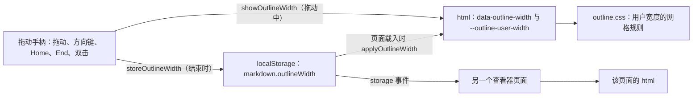

# Markdown 大纲宽度调整

## 名词解释

- **Mixed**、**Preview**：Markdown extension 的两个文件查看器，见 `2026-11-21-Markdown标题大纲.md`。
- **大纲**：查看器内容列右侧的 `nav.outline`。
- **自动宽度**：用户没有调整过宽度时，大纲按页面宽度在 240px 到 400px 之间变化的宽度（当前代码的行为）。
- **用户宽度**：用户拖动或用键盘调整后保存的大纲宽度。
- **拖动手柄**：大纲左边缘上用来调整宽度的竖条。
- **变更标签**：【新增】、【修改】、【删除】表示相对当前代码新增、修改或删除的文件、类型、函数、样式与界面元素。

## 背景

大纲宽度现在完全由页面宽度决定。标题长、层级深时，自动宽度仍然会截断标题；用户想多看正文时，也无法让大纲变窄。用户需要自己调整大纲宽度，并且调整结果在下次打开文件时仍然有效。

## 设计目标

### 功能目标

1. 拖动调整：拖动大纲左边缘的手柄改变大纲宽度，向左变宽，向右变窄。
2. 键盘调整：手柄可以获得焦点，方向键、Home、End 调整宽度。
3. 恢复自动宽度：双击手柄回到自动宽度。
4. 保存与同步：用户宽度在 Desktop 重启后仍然有效，Mixed 与 Preview 共用同一个用户宽度，一个查看器中的调整立即用到另一个已经打开的查看器。
5. 宽度范围：用户宽度不小于 240px；内容列至少保留 480px，页面变窄时大纲先让出宽度。宽度小于 960px 时大纲仍然隐藏。

### 技术目标

- **范围**：只修改 Markdown extension 与 Desktop 的 extension 集成测试。`manifest.json`、Extension API、宿主代码不变。
- **性能**：拖动过程中只修改 `html` 上的一个 CSS 变量，React 不重新渲染；拖动结束时写入一次存储。
- **无障碍**：手柄为 `role="separator"`、`aria-orientation="vertical"`，带 `aria-label`、`aria-valuemin`、`aria-valuemax`、`aria-valuenow`，键盘操作符合 WAI-ARIA 的 Window Splitter 模式。

## 总体设计



- 存储：extension 页面使用每个 extension 独享的持久 session（`persist:agw-extension-<id>`），Mixed 与 Preview 的页面同源，localStorage 在两个页面之间共用并随 Desktop 重启保留；一个页面写入时，另一个页面收到 `storage` 事件。bare-repository extension 已经用 localStorage 保存界面状态。
- 应用：用户宽度写在 `document.documentElement` 上（属性 `data-outline-width` 与内联变量 `--outline-user-width`），`outline.css` 根据它改变网格的第 3 列与大纲宽度。查看器的 React 组件不读取用户宽度。

### 变更清单

客户端代码（路径相对 `src/extensions/markdown/src`）：

| 文件 | 变更 | 内容 |
| --- | --- | --- |
| `shared/outline-width.ts` | 【新增】 | 宽度范围、读取、显示、保存、同步 |
| `shared/outline-panel.tsx` | 【修改】 | 【新增】`OutlineResizer`；大纲内容放进 `.outline-scroll`；`keepActiveHeadingVisible` 改为滚动 `.outline-scroll` |
| `shared/outline.css` | 【修改】 | 【新增】`--document-min-width`、`--outline-width-limit`、用户宽度的网格规则、`.outline-scroll`、`.outline-resizer`；【修改】`.outline` 的布局与内边距 |
| `editor/main.tsx` | 【修改】 | 载入时调用 `applyOutlineWidth()` |
| `preview/main.tsx` | 【修改】 | 载入时调用 `applyOutlineWidth()` |

测试（第一行路径相对 `src/extensions/markdown/src`，其余相对 `src/clients/desktop`）：

| 文件 | 变更 | 内容 |
| --- | --- | --- |
| `shared/outline-width.test.ts` | 【新增】 | 范围、读取、显示、保存、同步 |
| `src/main/extensions.integration.ts` | 【修改】 | 新增 `markdownOutlineResize` 步骤 |

## 详细设计

### 1. 大纲结构【修改】

`OutlinePanel` 的 DOM：

```html
<nav class="outline" aria-label="Outline">
  <div class="outline-resizer" role="separator" aria-orientation="vertical" aria-label="Resize Outline"
       tabindex="0" title="Drag to resize. Double-click to reset."></div>
  <div class="outline-scroll">
    <p class="outline-title">Outline</p>
    <ol class="outline-list">…</ol>                <!-- 或 <p class="outline-empty">No headings</p> -->
  </div>
</nav>
```

- 【修改】`nav.outline` 不再滚动：`display: flex`、`flex-direction: column`，`position: sticky`、`top: 0`、`max-height: 100vh` 不变；内边距移到 `.outline-scroll`。拖动手柄因此可以用绝对定位贴在 `nav` 的左边缘，不随列表滚动，也不被滚动区域裁掉。
- 【新增】`.outline-scroll`：`min-height: 0`、`overflow-y: auto`、内边距 `32px 16px 72px`（与原来 `nav` 的内边距相同）、`border-radius: inherit`（工作区背景下滚动条不超出卡片圆角）。工作区背景下内边距为 `16px 12px 24px`，`nav` 的 `max-height: calc(100vh - 80px)` 不变。
- 【修改】`keepActiveHeadingVisible` 读取与修改 `.outline-scroll` 的 `scrollTop` 与内边距。

### 2. 宽度规则【修改】

`outline.css`：

- `:root` 新增 `--document-min-width: 480px` 与 `--outline-width-limit: var(--outline-max-width)`。
- 自动宽度的规则不变。
- 【新增】`:root[data-outline-width]` 中 `--outline-width-limit: var(--outline-user-width)`。
- 【新增】`:root[data-outline-width] .outline-layout[data-outline]`：

```css
--outline-side-track: minmax(
  calc(
    clamp(
      var(--outline-min-width),
      var(--outline-user-width),
      100% - var(--outline-gutter) - var(--document-min-width)
    ) + var(--outline-gutter)
  ),
  1fr
);
```

- 【修改】`.outline` 的宽度为 `min(100% - var(--outline-gutter), var(--outline-width-limit))`。自动宽度时 `--outline-width-limit` 为 400px，结果与当前代码相同。
- 【修改】宽度小于 960px 的媒体查询中，把第 3 列恢复为 `minmax(0, 1fr)` 的规则同时列出上面的用户宽度选择器，否则用户宽度规则的选择器优先级更高，大纲隐藏后第 3 列仍然保留宽度。

结果：

- 第 3 列至少为用户宽度加 16px。页面宽度不够时内容列先变窄，内容列到 480px 后大纲变窄，大纲不小于 240px；宽度小于 960px 时大纲隐藏，规则与现在相同。
- 内容列为最大宽度并且两侧空白都不小于第 3 列时，两侧对称，大纲宽度等于用户宽度，左边与内容列相邻，与自动宽度在宽页面中的位置相同。
- 拖动时大纲右边贴着页面右边（Preview）或距页面右边 16px（Mixed）的情况下，左边缘跟随鼠标移动；两侧空白都比大纲宽时，大纲左边与内容列相邻、位置不变，宽度变化体现在右边。

### 3. outline-width.ts【新增】

```ts
export const OUTLINE_WIDTH_KEY = "markdown.outlineWidth";

export type OutlineSizes = { min: number; gutter: number; documentMin: number };

/** 从元素的计算样式读取 --outline-min-width、--outline-gutter、--document-min-width（px）。 */
export function readOutlineSizes(element: Element): OutlineSizes;

/** 用户宽度的范围：最小值为 min，最大值为 max(min, layoutWidth - gutter - documentMin)。 */
export function outlineWidthRange(layoutWidth: number, sizes: OutlineSizes): { min: number; max: number };

/** localStorage 中的用户宽度；没有时为 null。 */
export function readStoredOutlineWidth(): number | null;

/** 在 html 上显示用户宽度；null 时回到自动宽度。不写存储。 */
export function showOutlineWidth(width: number | null): void;

/** 保存并显示用户宽度；null 时删除存储并回到自动宽度。 */
export function storeOutlineWidth(width: number | null): void;

/** 页面存续期间：显示存储中的宽度，并在其他页面修改存储时更新。 */
export function applyOutlineWidth(): void;
```

- 存储值为整数像素的十进制字符串。`readStoredOutlineWidth` 读到的值不是正整数时抛出错误：这个值只由本模块写入，并且写入前已经限制在范围内；最小宽度由第 2 节的 `clamp` 保证。
- `showOutlineWidth(width)`：`width` 为数字时设置 `html` 的 `data-outline-width` 属性与内联变量 `--outline-user-width: <width>px`；为 null 时删除两者。
- `applyOutlineWidth`：先调用 `showOutlineWidth(readStoredOutlineWidth())`；然后监听 `window` 的 `storage` 事件，`event.key` 为 `OUTLINE_WIDTH_KEY` 或 null（存储被清空）时再读取一次并显示。
- `readOutlineSizes` 读取的变量值不是 px 长度时抛出错误。

### 4. 拖动手柄【新增】

`outline-panel.tsx` 中的 `OutlineResizer` 渲染第 1 节的元素，手柄所在的 `nav` 为大纲，`nav` 的父元素为 `.outline-layout`。

- 拖动：主按钮的 `pointerdown` 调用 `preventDefault` 与 `setPointerCapture`，记录起点横坐标、大纲当前宽度（`nav.getBoundingClientRect().width`，自动宽度时为自动宽度）与 `outlineWidthRange(layout.clientWidth, readOutlineSizes(layout))`。`pointermove` 中宽度为 `round(起始宽度 + 起点横坐标 - 当前横坐标)` 限制在范围内，调用 `showOutlineWidth`。`pointerup`、`pointercancel` 时调用 `storeOutlineWidth` 保存最后的宽度并结束拖动。拖动期间 `html` 带 `data-outline-resizing`，整个页面的鼠标指针为 `col-resize`。
- 键盘（焦点在手柄上）：ArrowLeft 加 16px，ArrowRight 减 16px，Home 为最小值，End 为最大值；起始宽度与范围的取法同上，结果限制在范围内后调用 `storeOutlineWidth`，按键调用 `preventDefault`。
- 双击：`storeOutlineWidth(null)`，回到自动宽度。
- ARIA：`aria-valuemin`、`aria-valuemax`、`aria-valuenow` 在手柄获得焦点、每次拖动更新、键盘调整与双击之后写入（取整的像素值）。这些属性不由 React 渲染，每次变化不触发 React 提交。

样式（`outline.css`）：

- `.outline-resizer`：`position: absolute`、`top: 0`、`bottom: 0`、`left: -4px`、`width: 8px`、`z-index: 1`、`cursor: col-resize`、`touch-action: none`，以大纲左边缘为中线。
- `.outline-resizer::after`：宽 2px、位于中线的竖线，平时透明；悬停、键盘焦点（`:focus-visible`）与拖动中颜色为 `--ring`。手柄的 `:focus-visible` 不显示默认的焦点框。
- `:root[data-outline-resizing] *`：`cursor: col-resize !important`，拖动经过按钮、编辑区等元素时指针不变。

### 5. 接入【修改】

`editor/main.tsx` 与 `preview/main.tsx` 的 `onLoad` 在 `applyWorkspaceBackdrop(api)` 之后调用 `applyOutlineWidth()`。

## 测试计划

### 单元测试

`shared/outline-width.test.ts`（jsdom）：

1. `outlineWidthRange`：页面宽 1200 时范围为 240～704；页面宽 700 时最大值不小于最小值（240～240）。
2. `storeOutlineWidth` 与 `readStoredOutlineWidth`：保存 320 后读到 320，`html` 带 `data-outline-width`，`--outline-user-width` 为 `320px`；保存 null 后读到 null，属性与变量都被删除。
3. `readStoredOutlineWidth`：存储中为 `"abc"`、`"0"`、`"320.5"`、`"-5"`、`" 320"` 时抛出错误。
4. `readOutlineSizes`：读取三个 px 变量；变量值为 `30rem` 时抛出错误。
5. `applyOutlineWidth`：存储中已有值时立即显示；派发 `key` 为 `markdown.outlineWidth` 的 `storage` 事件后显示新值；`key` 为其他值时不变；`key` 为 null（存储被清空）时回到自动宽度。

### 集成测试

`markdownOutlineResize` 步骤（打开 `notes/outline.md`，默认窗口）：

1. Mixed：用鼠标把手柄向左拖动 100px，大纲宽度增加 100px（误差 1px），大纲左边缘跟随鼠标，localStorage 中为新的宽度。
2. Preview：切换到 Preview，大纲宽度等于 Mixed 中保存的宽度。
3. 键盘：手柄获得焦点后按 End，内容列宽度为 480px；把窗口宽度减小 100px，内容列仍为 480px，大纲变窄 100px；恢复窗口宽度。按 ArrowRight 后宽度减少 16px，`aria-valuenow` 随之变化。
4. 双击手柄回到自动宽度，Mixed 与 Preview 的布局符合 `visibleOutlineLayout`，localStorage 中没有这个键。
