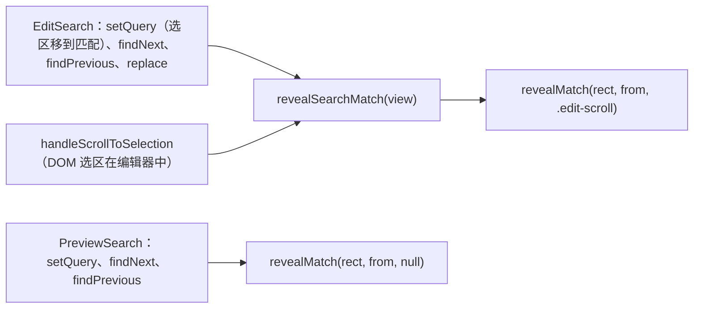

# Markdown 搜索匹配滚动

## 名词解释

- **Mixed**、**Preview**、**搜索栏**、**当前匹配**：见 `2026-11-23-Markdown搜索替换.md`。
- **横向滚动区域**：可以横向滚动的祖先元素，例如代码块的 `pre` 与表格。
- **变更标签**：【新增】、【修改】、【删除】表示相对当前代码新增、修改或删除的函数与测试。

## 背景

`2026-11-23-Markdown搜索替换.md` 实现后，在 Desktop 中验证时有两个问题：

1. ProseMirror 的 `scrollToSelection` 只在 DOM 选区位于编辑器中时调用 `handleScrollToSelection`。焦点在搜索栏的输入框中时，DOM 选区在输入框里，Mixed 跳到下一个匹配后不滚动，可见区域之外的匹配看不到。
2. Mixed 用 `scrollIntoView({ inline: "nearest" })` 横向滚动，匹配贴着代码块的右边缘显示；Preview 把匹配移到横向滚动区域的中部，两个查看器不一致。设备像素比为 2 时，滚动位置按半像素取整，贴边的匹配会超出代码块零点几像素。

## 设计目标

### 功能目标

1. Mixed 中焦点在搜索栏时，跳转、输入搜索文字与替换后，当前匹配都滚动到可见位置。
2. 两个查看器使用同一个滚动规则：横向滚动区域把当前匹配移到中部，竖直方向不可见或被搜索栏遮住时移到中部。

### 技术目标

- **范围**：只修改 Markdown extension 与 Desktop 的 extension 集成测试。
- **幂等**：当前匹配完整显示时不滚动，同一次跳转中多次调用滚动函数只滚动一次。

## 总体设计



### 变更清单

客户端代码（路径相对 `src/extensions/markdown/src`）：

| 文件 | 变更 | 内容 |
| --- | --- | --- |
| `shared/find-reveal.ts` | 【修改】 | 【新增】`revealMatch`；【删除】`needsReveal`；【修改】`clippingScrollers`、`coveredByFindBar` 不再导出 |
| `editor/edit-search.ts` | 【修改】 | 【新增】`revealSearchMatch`；`handleScrollToSelection` 使用它；`EditSearch` 在跳转与替换后调用它 |
| `preview/preview-search.ts` | 【修改】 | `PreviewSearch` 的滚动改为调用 `revealMatch` |

测试（路径相对 `src/clients/desktop`）：

| 文件 | 变更 | 内容 |
| --- | --- | --- |
| `src/main/extensions.integration.ts` | 【修改】 | 【新增】`findDiagnostics`，搜索步骤的等待超时时输出计数与各元素位置；`markdownOutlineResize` 的右方向键使用 `sendInputEvent` 的键名 `Right`，按键前等待窗口恢复后的宽度 |
| `scripts/test-extensions.mjs` | 【修改】 | 【新增】`notes/search.md`（`markdownSearch` 步骤使用的文件） |

## 详细设计

### 1. revealMatch【新增】

```ts
/** 把当前匹配滚动到可见位置；`rect` 每次读取匹配的当前位置，`scroller` 为 null 时滚动窗口。 */
export function revealMatch(rect: () => DOMRect, from: Element, scroller: Element | null): void;
```

1. 从 `from` 向上到 `scroller`（null 时到 `body`，不含）之间，横向可以滚动（`overflow-x` 不为 `visible`，并且 `scrollWidth > clientWidth`）而匹配不在其可见范围内的元素，调整 `scrollLeft` 把匹配移到中部；到达滚动的尽头时停在尽头。
2. 之后匹配在 `scroller` 的可见区域（null 时为窗口）之外，或与搜索栏相交时，调整 `scroller.scrollTop`（窗口为 `window.scrollBy`）把匹配移到竖直中部。搜索栏的位置取 `document.querySelector(".find-bar")?.getBoundingClientRect()`，搜索栏关闭时不参与判断。
3. 匹配完整显示时不滚动。

`rect` 是函数：横向滚动后匹配的位置发生变化，每一步都重新读取。

### 2. Mixed【修改】

- 【新增】`revealSearchMatch(view)`：编辑区中有 `.ProseMirror-active-search-match` 元素时取第一个，调用 `revealMatch(() => element.getBoundingClientRect(), element, view.dom.closest(".edit-scroll"))` 并返回 true；没有时返回 false。
- 【修改】`handleScrollToSelection` 为 `revealSearchMatch`：DOM 选区在编辑器中、选区正好是一个匹配时由它滚动，其他选区交给 ProseMirror 的默认滚动。
- 【修改】`EditSearch.setQuery`：选区移到匹配时，派发事务之后调用 `revealSearchMatch`；只有替换文字变化时不滚动。
- 【修改】`EditSearch` 的 `findNext`、`findPrevious`、`replace.next`、`replace.all`：执行命令之后调用 `revealSearchMatch`。焦点在编辑器中时 `handleScrollToSelection` 已经滚动过，这次调用发现匹配完整显示，不再滚动。

### 3. Preview【修改】

`PreviewSearch` 的滚动改为 `revealMatch(() => range.getBoundingClientRect(), range.startContainer.parentElement, null)`，规则与原来相同。

## 测试计划

### 单元测试

jsdom 没有排版，滚动由集成测试验证；markdown extension 的现有单元测试全部通过。

### 集成测试

缩短版运行（boot → bundledDefaults → markdownSearch → markdownOutlineResize）：

1. Mixed：焦点在搜索框中按 Enter 跳到代码块中的匹配，匹配在 `.edit-scroll` 与代码块中完整显示、不与搜索栏相交，代码块横向滚动；Mermaid 源码中的匹配与最后一个匹配同样完整显示。
2. Preview 的三项搜索检查、Mixed 的替换与撤销、大纲宽度调整的各项检查全部通过。
