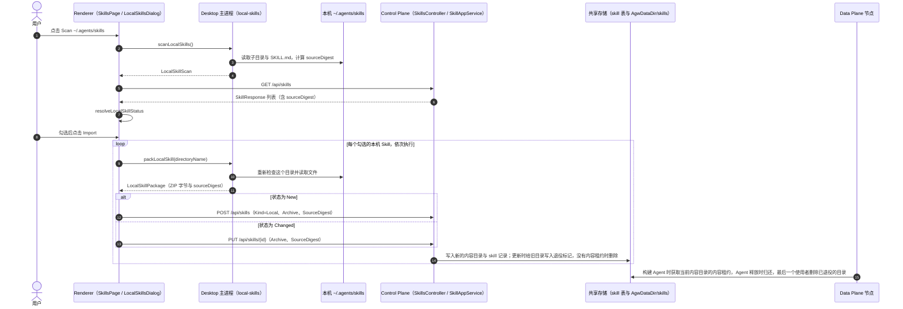
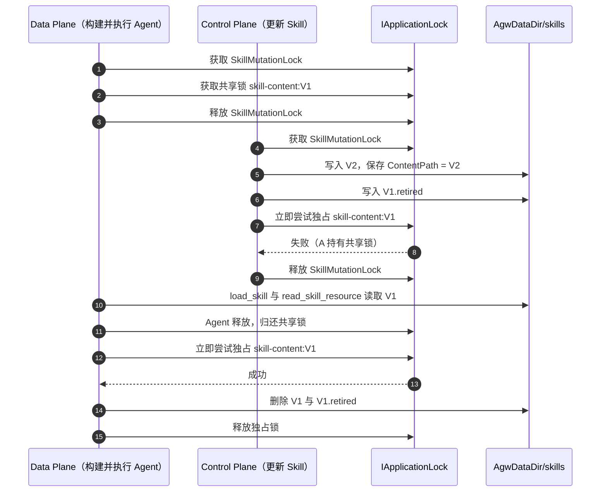

# Desktop 导入本机 Skills 目录

## 名词解释

- **本机 Skills 目录**：Desktop 所在电脑上的 `~/.agents/skills`，路径为 `path.join(os.homedir(), ".agents", "skills")`，Windows 上为 `%USERPROFILE%\.agents\skills`。
- **本机 Skill**：本机 Skills 目录下一层的子目录（或指向目录的符号链接）。`directoryName` 是这个子目录的名称。
- **服务器 Skill**：服务器 `skill` 表中的记录。Local 类型的文件保存在 `<AgwDataDir>/skills/<skillId>-<version>/<name>/`，记录的 `ContentPath` 指向这个目录。
- **内容目录**：`ContentPath` 对应的绝对路径。每次上传新的 ZIP 都写入新的内容目录，内容目录写入之后不再修改。
- **内容租约**：执行中的 Agent 对它使用的内容目录持有的共享锁，锁资源名为 `skill-content:<ContentPath>`。
- **退役标记**：内容目录旁边的空文件 `<内容目录>.retired`（例如 `skills/<skillId>-<version>/pdf-tools.retired`），表示这个内容目录已经不是任何 Skill 的当前目录，没有内容租约时可以删除。
- **sourceDigest**：本机 Skill 目录内容的摘要，格式为 `sha256:` 加 64 位小写十六进制字符，只由 Desktop 主进程计算。服务器 Skill 保存最近一次从本机 Skill 导入或更新时上传的 sourceDigest。
- **导入**：Desktop 把本机 Skill 打包成 ZIP，创建同名的服务器 Local Skill。
- **更新**：Desktop 把本机 Skill 打包成 ZIP，替换同名服务器 Local Skill 的文件。
- **扫描状态**：本机 Skill 与服务器 Skill 对比得到的状态，取值为 `New`、`Synced`、`Changed`、`Conflict`、`Invalid`，规则见「详细设计 / 5」。
- **变更标签**：【新增】、【修改】、【删除】表示相对当前代码新增、修改或删除的文件、类型、函数、列与界面元素。

## 背景

用户在本机 `~/.agents/skills` 中维护 Skill，每个子目录是一个 Skill，根目录中有 `SKILL.md`。现在 Skills 页面只能把 Skill 逐个压缩成 ZIP 再上传；本机修改 Skill 之后，也无法知道服务器中的文件是否已经过期。

Desktop 的 Skills 页面需要扫描这个目录，把选中的 Skill 导入服务器，并显示每个 Skill 与服务器文件是否一致。

服务器可能部署为多个节点：Control Plane 处理管理 API，多个 Data Plane 副本执行 Agent。执行 Agent 时，Data Plane 通过 `ILocalSkillContentResolver`（`SkillAppService.PrepareLocalDirectoryAsync`）在本节点的 `<AgwDataDir>/skills/` 中读取 Local Skill 的目录，目录不存在时这个 Skill 不会加载（`AgentRuntimeFactory.ResolveLocalSkillPathsAsync`）。Desktop 电脑上的路径对服务器节点不可见，各节点自己的 home 目录内容也各不相同。因此 Skill 文件需要进入服务器的 Skill 存储，所有节点从同一份存储读取。

更新 Skill 时，服务器保存新的 `ContentPath` 后立即删除旧的内容目录。执行中的 Agent 在构建时已经拿到旧路径，MAF `UseFileSkills` 之后在 `load_skill`、`read_skill_resource`、`run_skill_script` 时才读取文件，这时文件已经不存在。删除 Skill 与旧目录名称的整理（`NormalizeLocalDirectoryAsync`）也会立即删除目录。从本机目录导入之后，更新会更加频繁，本设计一起处理这个问题。

Skill 的创建与更新接口设置了 100 MiB 的表单解析上限，但没有设置请求体上限，实际按 Kestrel 默认的 30,000,000 字节限制；split 部署示例 `deploy/nginx.split.conf.example` 也没有设置 `client_max_body_size`，经过入口的请求按 nginx 默认的 1 MB 限制。本设计把这两处都调整为 100 MiB。

没有兼容性要求，按最终状态设计。

## 设计目标

### 功能目标

1. 扫描：Desktop Skills 页面的工具栏增加 `Scan ~/.agents/skills` 按钮，打开对话框，列出本机 Skill 以及每一项的扫描状态。
2. 导入：勾选状态为 `New` 的本机 Skill，创建服务器 Local Skill，并记录 sourceDigest。
3. 更新：勾选状态为 `Changed` 的本机 Skill，用本机文件替换同名服务器 Local Skill 的文件，并记录 sourceDigest。
4. 扫描状态：按名称与 sourceDigest 判断 `New`、`Synced`、`Changed`、`Conflict`、`Invalid`；`Conflict` 与 `Invalid` 显示原因。
5. 来源摘要：服务器 Skill 保存 sourceDigest，Skill API 的响应返回它；通过 Web 或手动上传新的 ZIP 时清除。
6. 多节点：导入与更新后的文件对所有 Data Plane 节点可用。
7. 旧版本保留：更新或删除 Skill 时，执行中的 Agent 继续使用它构建时的内容目录，直到它释放；最后一个使用者释放之后删除旧目录。
8. 上传上限：`POST /api/skills` 与 `PUT /api/skills/{id}` 接受 100 MiB（104857600 字节）以内的请求，split 部署示例的入口同样允许。
9. 范围：扫描入口只在 Desktop 显示；Web 的 Skills 页面与现有的手动上传流程保持现状。

### 技术目标

- **安全**
  - 扫描、计算摘要与打包只在 Electron 主进程中执行，两个 IPC 通道都先调用 `assertTrustedSender`。
  - renderer 只传入 `directoryName`。主进程要求它是本机 Skills 目录下一层的名称：非空，不以 `.` 开头，不含 `/`、`\` 与 NUL。
  - Skill 内的符号链接必须指向这个 Skill 根目录之内的普通文件，否则这个 Skill 的状态为 `Invalid`，防止把 Skill 目录以外的文件上传到服务器。
  - 服务器校验 sourceDigest 的格式，并要求它与归档包一起提交。
- **一致性**：摘要算法只在 Desktop 主进程中实现一份，扫描与打包共用。打包时每个文件只读取一次，上传的 sourceDigest 与 ZIP 内容来自同一份数据。
- **性能**：扫描以流的方式计算每个文件的 SHA-256，不把文件整体读入内存。打包把文件读入内存后生成 ZIP，大小以服务器的 100 MiB 上限为准，Desktop 不另外检查。
- **一致性**：执行中的 Agent 从构建到释放都使用同一个内容目录，这个目录在它释放之前一直存在。内容租约使用 `IApplicationLock`：`DistributedLock:Provider` 为 `inmemory` 时是进程内锁，为 `postgres` 时是 PostgreSQL advisory lock，节点意外退出时数据库会话结束，锁随之释放。
- **失败处理**：意外的 IO 错误（例如没有读取权限）直接终止扫描或打包，错误显示在对话框中。批量导入遇到第一个失败的 Skill 就停止，之后的项目保持未处理。

## 总体设计



- 扫描与打包在 Desktop 电脑上进行；服务器节点只接收上传的 ZIP。
- 导入与更新使用现有的 `POST /api/skills` 与 `PUT /api/skills/{id}`，服务器保存文件的方式与手动上传相同。
- 多节点下文件对各节点可见的依据见「详细设计 / 7」。

### 变更清单

服务器（路径相对 `src/server`）：

| 文件 | 变更 | 内容 |
| --- | --- | --- |
| `Agw.Data/Entities/AgentCapabilities/Skills/SkillExtra.cs` | 【新增】 | `SkillExtra` record，属性 `SourceDigest` |
| `Agw.Data/Entities/AgentCapabilities/Skills/Skill.cs` | 【修改】 | 【新增】属性 `Extra` |
| `Agw.Data/Entities/AgentCapabilities/Skills/SkillConfiguration.cs` | 【修改】 | `Extra` 使用 `ExtraJson.Converter<SkillExtra>()`，默认值 `'{}'` |
| `Agw.Migrations.Sqlite`、`Agw.Migrations.Postgres` | 【新增】 | `skill.extra` 列的 migration，实现时用 `docs/1.Development.md` 中各 Provider 的命令生成 |
| `Agw.Skills/Contracts/Manager/SkillRequests.cs` | 【修改】 | `SkillCreateRequest`、`SkillUpdateRequest`、`SkillResponse` 【新增】`SourceDigest` |
| `Agw.Skills/Domain/Behaviors/SkillBehavior.cs` | 【修改】 | `EnsureCreatable`、`EnsureUpdatable` 增加 sourceDigest 校验；【新增】`DefineLocalContent` |
| `Agw.Skills/Application/SkillAppService.cs` | 【修改】 | `CreateAsync`、`UpdateAsync` 增加参数 `sourceDigest`；发布归档包时记录 sourceDigest；`LocalSkillState` 包含 `Extra`；`PrepareLocalDirectoryAsync` 改为 `AcquireLocalDirectoryAsync`；更新、删除、目录名称整理改为退役旧内容目录 |
| `Agw.Skills/Application/Content/ISkillContentRetirement.cs` | 【新增】 | 内容租约、退役与删除的接口 |
| `Agw.Skills/Infrastructure/Content/SkillContentRetirement.cs` | 【新增】 | `ISkillContentRetirement` 的文件系统与锁实现 |
| `Agw.Skills/Infrastructure/Content/SkillContentSweepService.cs` | 【新增】 | Host 启动时删除没有内容租约的退役目录 |
| `Agw.Skills/Application/Facades/LocalSkillContentFacade.cs` | 【修改】 | 实现新的 `AcquireDirectoryAsync` |
| `Agw.Skills/DependencyInjection.cs` | 【修改】 | 注册 `ISkillContentRetirement`、`SkillContentSweepService` |
| `Agw.Skills.Contracts/ILocalSkillContentResolver.cs` | 【修改】 | `ResolveDirectoryAsync` 改为 `AcquireDirectoryAsync`，返回 【新增】`ILocalSkillDirectoryLease` |
| `Agw.Skills/Controllers/SkillsController.cs` | 【修改】 | 传递 `request.SourceDigest`；`Map` 输出 `SourceDigest`；`CreateAsync`、`UpdateAsync` 【新增】`[RequestSizeLimit(104857600)]` 与 `[SkillUploadLimit]` |
| `Agw.Skills/Controllers/SkillUploadLimitAttribute.cs` | 【新增】 | 将表单绑定期间收到的 Kestrel 413 转换为 `FileTooLarge` |
| `Agw.Shared/Exceptions/ErrorCodes.cs` | 【修改】 | 【新增】`SkillSourceDigestInvalid`、`SkillSourceDigestRequiresArchive` |
| `Agw.Shared/Contracts/Coordination/IApplicationLock.cs` | 【修改】 | 【新增】`AcquireSharedAsync`、`TryAcquireExclusiveAsync` |
| `Agw.Shared/Coordination/InMemoryApplicationLock.cs` | 【修改】 | 用 Nito `AsyncReaderWriterLock` 实现共享与独占 |
| `Agw.Shared/Agw.Shared.csproj` | 【修改】 | 【新增】`Nito.AsyncEx.Coordination`（版本已在 `Directory.Packages.props`） |
| `Agw.Infrastructure/Coordination/ApplicationLockRouter.cs` | 【修改】 | 用 `IDistributedReaderWriterLockProvider` 实现共享与独占 |
| `Agw.Agents.Execution/Agents/Runtime/AgentRuntimeFactory.Skills.cs` | 【修改】 | `ResolveLocalSkillPathsAsync` 获取内容租约并交给 `AgentCapabilityComposition` 持有 |
| `Agw.Agents.Execution/Agents/Composition/AgentCapabilityComposition.cs` | 【修改】 | 【新增】internal 方法 `Own(IAsyncDisposable)` |

客户端（路径相对 `src/clients`）：

| 文件 | 变更 | 内容 |
| --- | --- | --- |
| `desktop/src/shared/contracts/local-skills.ts` | 【新增】 | `LocalSkill`、`LocalSkillScan`、`LocalSkillPackage` |
| `desktop/src/shared/contracts/bridge.ts` | 【修改】 | 【新增】`scanLocalSkills`、`packLocalSkill` |
| `desktop/src/shared/contracts/index.ts` | 【修改】 | 导出 `local-skills` |
| `desktop/src/preload/index.ts` | 【修改】 | 【新增】通道 `agw:scan-local-skills`、`agw:pack-local-skill` |
| `desktop/src/main/local-skills/local-skills.ts` | 【新增】 | `scanLocalSkills`、`packLocalSkill`、摘要算法 |
| `desktop/src/main/index.ts` | 【修改】 | 注册两个 IPC 处理函数 |
| `desktop/package.json` | 【修改】 | 【新增】依赖 `vfile`、`vfile-matter`（版本来自 catalog） |
| `desktop/renderer/src/runtime/local-skills-source.ts` | 【新增】 | `desktopLocalSkills`：用 bridge 实现 `LocalSkillsSource` |
| `desktop/renderer/src/runtime/index.ts` | 【修改】 | 导出 `desktopLocalSkills` |
| `desktop/renderer/src/app/(app)/skills/page.tsx` | 【修改】 | 由 re-export 改为组件，向 `SkillsPage` 传入 `localSkills={desktopLocalSkills}` |
| `packages/skills/src/local-skills.ts` | 【新增】 | `LocalSkillsSource` 等类型、`resolveLocalSkillStatus`、`buildLocalSkillFormData` |
| `packages/skills/src/ui-web/pages/skills/local-skills-dialog.tsx` | 【新增】 | `LocalSkillsDialog` |
| `packages/skills/src/ui-web/pages/skills/page.tsx` | 【修改】 | `SkillsPage` 【新增】属性 `localSkills` 与工具栏按钮；`SkillDto` 【新增】`sourceDigest` |
| `packages/skills/src/index.ts` | 【修改】 | 导出 `LocalSkillsSource` 及相关类型 |
| `packages/api/src/openapi.d.ts` | 【修改】 | `pnpm gen:api` 重新生成 |

文档与部署示例（路径相对仓库根目录）：

| 文件 | 变更 | 内容 |
| --- | --- | --- |
| `docs/4.Deployment.md` | 【修改】 | 「Distributed execution」写明所有副本共享 `<AgwDataDir>`（包括 `keys/` 与 `skills/`）；入口需要允许 100 MiB 的 Skill 上传 |
| `deploy/nginx.split.conf.example` | 【修改】 | 【新增】`location /api/skills`，`client_max_body_size 100m` |
| `src/server/Agw.Agents.Execution/README.md` | 【修改】 | Skill provider 一节说明内容租约随 Agent 释放 |
| `site/content/docs/guides/tools-skills.zh.md`、`tools-skills.en.md` | 【修改】 | 【新增】「从 ~/.agents/skills 导入」一节 |

## 数据库设计

`skill` 表【新增】列：

| 列 | 类型 | 可空 | 默认值 | 说明 |
| --- | --- | --- | --- | --- |
| `extra` | `text` | 否 | `'{}'` | JSON 对象，键为 camelCase。只作记录，执行逻辑不读取 |

`extra` 的键：

| 键 | 类型 | 说明 |
| --- | --- | --- |
| `sourceDigest` | string，可以省略 | 最近一次从本机 Skill 导入或更新时 Desktop 上传的摘要；通过 Web 或手动上传新的 ZIP 后清除 |

- 两个 Provider 的 migration 都执行 `AddColumn<string>(name: "extra", table: "skill", type: "text", nullable: false, defaultValueSql: "'{}'")`，与 `agentflow_trace.extra` 相同。
- 现有记录的 `extra` 为 `{}`，与本机同名时状态为 `Changed`。
- 不增加索引。

## 详细设计

### 1. 本机 Skills 目录扫描【新增】

`desktop/src/main/local-skills/local-skills.ts` 中的 `scanLocalSkills(homeDirectory: string): Promise<LocalSkillScan>`。IPC 处理函数传入 `os.homedir()`，测试传入 scratch 目录。

1. `directory = path.join(homeDirectory, ".agents", "skills")`。
   - 不存在（`ENOENT`）：返回 `{ directory, exists: false, skills: [] }`。
   - 存在但不是目录：抛出错误 `"<directory> isn't a directory."`。
2. 读取 `directory` 的直接子项，按名称排序。
   - 名称以 `.` 开头的子项跳过。
   - `stat`（跟随符号链接）结果为目录的子项成为本机 Skill。
   - 目标不存在的符号链接成为 `problem` 为 `Broken symbolic link.` 的本机 Skill。
   - 其他子项（普通文件等）跳过。
3. 对每个本机 Skill，取 `root = realpath(子目录)`，用 `lstat` 递归遍历：
   - 名称属于 `IGNORED_ENTRY_NAMES = [".git", ".DS_Store", "Thumbs.db", "desktop.ini"]` 的文件或目录在任意层级都跳过，不参与摘要，也不进入 ZIP。它们是版本控制与操作系统生成的元数据，内容随本机操作变化。
   - 普通文件：加入文件列表，`relativePath` 使用 `/` 分隔。
   - 目录：继续遍历。
   - 符号链接：取 `realpath`。目标不存在时，该 Skill 的 `problem` 为 `Broken symbolic link.`；目标在 `root` 之外时 `problem` 为 `Symbolic link "<relativePath>" points outside the skill directory.`；目标是目录时 `problem` 为 `Symbolic link "<relativePath>" points to a directory.`；目标是 `root` 之内的普通文件时，以链接的 `relativePath` 加入文件列表，内容读取目标文件。
   - 其他类型：`problem` 为 `"<relativePath>" isn't a regular file or directory.`。
4. `SKILL.md` 必须在文件列表中，并且位于根目录，否则 `problem` 为 `SKILL.md is missing.`。
5. 用 `vfile` 与 `vfile-matter` 解析 `SKILL.md` 的 front matter（Markdown extension 的 `front-matter.ts` 使用同样的库）：
   - 没有 front matter：`SKILL.md has no front matter.`
   - YAML 无效：`Front matter isn't valid YAML: <message>`
   - `name` 不是非空字符串：`Front matter needs a name.`
   - `description` 不是非空字符串：`Front matter needs a description.`
   - `name` 与 `description` 去掉两端空白后返回。名称格式与长度由服务器的 `SkillBehavior` 校验，导入时失败的原因显示在这一行。
6. 没有 `problem` 时计算 sourceDigest（见第 2 节），同时统计 `fileCount` 与 `totalBytes`。
7. 全部本机 Skill 处理完之后，`name` 相同的本机 Skill 都设置 `problem` 为 `Another directory uses the name "<name>".`，`sourceDigest` 设为 null。

单个本机 Skill 出现第 2 至 7 步列出的问题时，只影响这个 Skill 的 `problem`。其他 IO 错误终止整个扫描，错误交给 renderer 显示。

扫描与打包读取文件前，会通过打开的文件句柄确认目标仍为普通文件，并比较设备编号与 inode 是否和遍历时一致。检查失败时抛出 `File "<relativePath>" changed while reading the skill directory.`。

### 2. 摘要算法【新增】

```ts
// files：参与导入的文件，relativePath 使用 "/" 分隔。
// files: the files that are imported; relativePath uses "/" as the separator.
const entries = files
  .map((file) => [file.relativePath, sha256Hex(file.bytes)] as const)
  .sort(([left], [right]) => (left < right ? -1 : left > right ? 1 : 0));
const sourceDigest = `sha256:${sha256Hex(Buffer.from(JSON.stringify(entries), "utf8"))}`;
```

- 按 `relativePath` 的 UTF-16 code unit 顺序排序；JSON 编码保证任何文件名都不会产生相同的输入。
- 只包含路径与内容。修改时间、权限与文件创建顺序不影响摘要。
- 扫描时 `sha256Hex` 以流的方式读取文件；打包时对已经读入内存的字节计算，两条路径共用 `entries` 与最后一步的计算函数。
- 服务器保存的是 Desktop 上传时计算的值，服务器改写 `SKILL.md`（`RewriteSkillMarkdown`）不影响对比。

### 3. 本机 Skill 打包【新增】

`packLocalSkill(homeDirectory: string, directoryName: string): Promise<LocalSkillPackage>`：

1. 校验 `directoryName`：非空，不以 `.` 开头，不含 `/`、`\` 与 NUL，否则抛出 `Invalid local skill directory name.`。
2. 对 `<本机 Skills 目录>/<directoryName>` 执行第 1 节的第 3 至 6 步，文件内容读入 `Buffer`。有 `problem` 时以 `problem` 为消息抛出错误。
3. 用 `yazl`（Desktop 已经依赖）生成 ZIP：每个文件调用 `zipFile.addBuffer(bytes, relativePath)`，条目位于 ZIP 根目录，服务器 `FindSkillRoot` 直接找到根目录的 `SKILL.md`。`zipFile.end()` 之后把 `outputStream` 读成一个 `Buffer`。
4. 用同一批 `Buffer` 计算 sourceDigest。
5. 返回 `{ directoryName, name, description, sourceDigest, fileName: "<name>.zip", bytes }`。

### 4. IPC 与 preload【新增】

`desktop/src/shared/contracts/local-skills.ts`：

```ts
export type LocalSkill = {
  /** 本机 Skills 目录下的子目录名。The subdirectory name under the local skills directory. */
  directoryName: string;
  name: string | null;
  description: string | null;
  /** 有 problem 时为 null。Null when there is a problem. */
  sourceDigest: string | null;
  fileCount: number;
  totalBytes: number;
  /** 不能导入的原因。Why the skill can't be imported. */
  problem: string | null;
};

export type LocalSkillScan = {
  /** 本机 Skills 目录的绝对路径。The absolute path of the local skills directory. */
  directory: string;
  exists: boolean;
  skills: LocalSkill[];
};

export type LocalSkillPackage = {
  directoryName: string;
  name: string;
  description: string;
  sourceDigest: string;
  fileName: string;
  bytes: Uint8Array;
};
```

`AgwDesktopBridge` 【新增】：

```ts
/** 扫描本机 ~/.agents/skills。Scans the local ~/.agents/skills directory. */
scanLocalSkills(): Promise<LocalSkillScan>;
/** 打包一个本机 Skill 用于上传。Packs one local skill for upload. */
packLocalSkill(directoryName: string): Promise<LocalSkillPackage>;
```

- preload：`scanLocalSkills: () => ipcRenderer.invoke("agw:scan-local-skills")`，`packLocalSkill: (directoryName) => ipcRenderer.invoke("agw:pack-local-skill", directoryName)`。
- 主进程：两个处理函数先调用 `assertTrustedSender(senderUrl(event))`，再以 `os.homedir()` 调用第 1、3 节的函数。`Uint8Array` 通过 IPC 的结构化克隆传给 renderer。

### 5. 扫描状态【新增】

`packages/skills/src/local-skills.ts`：

```ts
export type LocalSkillStatus =
  | { kind: "Invalid"; reason: string }
  | { kind: "New" }
  | { kind: "Synced"; skillId: string }
  | { kind: "Changed"; skillId: string }
  | { kind: "Conflict"; reason: string };

export type LocalSkillsSource = {
  scan(): Promise<LocalSkillScan>;
  pack(directoryName: string): Promise<LocalSkillPackage>;
};
```

`LocalSkill`、`LocalSkillScan`、`LocalSkillPackage` 在 `@agw/skills` 中按第 4 节的字段名重新声明（packages 不能引用 Desktop 的代码）。

`resolveLocalSkillStatus(skill: LocalSkill, serverSkills: SkillDto[]): LocalSkillStatus` 按顺序判断，`serverSkills` 来自 `GET /api/skills`（内置 Skill 与当前用户的 Skill）：

1. `problem` 不为 null：`Invalid`，原因为 `problem`。
2. 没有名称相同的服务器 Skill：`New`。
3. 名称相同的服务器 Skill 中有 `isBuiltIn` 为 true 或 `kind` 不是 `Local` 的：`Conflict`，原因为 `A built-in skill already uses this name.` 或 `A remote skill already uses this name.`。
4. 名称相同的 Local Skill 的 `sourceDigest` 等于本机 sourceDigest：`Synced`。
5. 其他情况：`Changed`。服务器 sourceDigest 为 null（手动上传的 Skill，或导入之后又通过 Web 上传过 ZIP）也属于这种情况。

名称按字符串完全相等比较；服务器与扫描结果都去掉了两端空白。

`buildLocalSkillFormData(skill: LocalSkill, status, pkg: LocalSkillPackage): FormData`：

- `pkg.name` 与 `skill.name` 不同时抛出 `SKILL.md of <directoryName> changed after the scan. Rescan and try again.`。
- 字段：`Name`、`Description`、`Archive`（`new File([pkg.bytes], pkg.fileName, { type: "application/zip" })`）、`SourceDigest`；`New` 另外加上 `Kind=Local`。
- `New` 提交到 `POST /api/skills`；`Changed` 提交到 `PUT /api/skills/{id}`，`id` 为 `status.skillId`。

### 6. Skills 页面与对话框【新增】【修改】

- 【修改】`SkillsPage` 【新增】属性 `localSkills?: LocalSkillsSource`。传入时工具栏在 `Add Skill` 左侧显示 `Scan ~/.agents/skills` 按钮；Web 不传入，页面保持现状。
- 【修改】`SkillDto` 【新增】`sourceDigest?: string | null`。
- 【修改】Desktop 路由由一行 re-export 改为组件：

```tsx
"use client";

import { SkillsPage } from "@agw/skills";

import { desktopLocalSkills } from "@/runtime";

export default function DesktopSkillsPage() {
  return <SkillsPage localSkills={desktopLocalSkills} />;
}
```

- 【新增】`desktopLocalSkills`：调用 `window.agwDesktop.scanLocalSkills()` 与 `packLocalSkill()`；bridge 不存在时抛出 `Agw Desktop bridge is unavailable.`，与 `DesktopIntegrationsPage` 相同。
- 【新增】`LocalSkillsDialog`：
  - 打开时执行两个查询：`["local-skills", "scan"]`（`source.scan()`，`staleTime: 0`）与 `["skills", "all"]`（`GET /api/skills`）。
  - 标题 `Local skills`，说明文字显示 `scan.directory` 的绝对路径。
  - `exists` 为 false 时显示 Empty：`<directory> doesn't exist.`；`skills` 为空时显示 Empty：`No skills in <directory>.`。
  - 扫描失败时显示错误消息与 `Rescan` 按钮。
  - 表格列：勾选框、Name（`directoryName` 与名称不同时在下面显示目录名）、Description（最多两行）、Files（`fileCount` 与 `totalBytes`）、Status（Badge；`Conflict` 与 `Invalid` 在下面显示原因）、Result。
  - 默认勾选：`New` 勾选，`Changed` 不勾选；`Synced`、`Conflict`、`Invalid` 的勾选框禁用。`Changed` 会替换服务器文件，由用户逐项确认。
  - 底部按钮：`Rescan`（重新执行两个查询并清空 Result）、`Import (n)`（n 为勾选数量，为 0 时禁用）。
  - 导入：依次处理勾选的项目，Result 显示 `Importing…`，成功后显示 `Imported` 或 `Updated`，失败时显示 `getApiErrorMessage` 的结果并停止。结束后（成功或停止）使 `["skills"]` 查询失效并重新扫描，Result 保留到下一次 `Rescan`、`Import` 或关闭对话框，勾选按新的状态恢复默认值。
  - 导入过程中 `Rescan`、`Import` 与关闭对话框都不可用。

### 7. 多节点

- 导入与更新是管理 API。split 部署时入口把 `/api/skills` 转发到 Control Plane；Standalone 时是同一个进程。
- 创建 Local Skill 不获取锁，同名的并发创建由 `skill` 表 `(create_by, name)` 的唯一索引阻止。更新在 `SkillMutationLock` 内执行（`IApplicationLock` 的实现 `ApplicationLockRouter` 在 `DistributedLock:Provider` 为 `postgres` 时使用跨节点的分布式锁）：把 ZIP 解压到新的 `<AgwDataDir>/skills/<skillId>-<version>/<name>`，保存 `ContentPath` 与 `extra`，再退役旧的内容目录（第 9 节）。
- Data Plane 构建 Agent 时，`AcquireLocalDirectoryAsync` 在同一个锁内确定当前内容目录并获取它的内容租约。之后 MAF 在锁外读取 `SKILL.md`、资源与脚本，这个目录在 Agent 释放之前一直存在。
- 所有节点挂载同一个数据目录：`deploy/compose.cluster.yaml` 中 Control Plane 与 Data Plane 都挂载 `agw-data:/data`，Data Protection key ring 也位于 `<AgwDataDir>/keys`。导入后的文件因此对所有节点可用。
- 共享数据目录的同角色副本使用不同的 `Extensions:HostInstanceName`。同一个副本重启时保留名称，以沿用它的扩展 Host 身份。
- 【修改】`docs/4.Deployment.md`「Distributed execution」一节把共享要求写完整：所有副本共享数据库、`<AgwDataDir>`（包括 `keys/` 与 `skills/`）以及 Project Workspace 路径；入口需要允许 100 MiB 的 `/api/skills` 请求。
- 【修改】`deploy/nginx.split.conf.example` 在 `location /` 之前增加：

```nginx
location /api/skills {
    client_max_body_size 100m;
    proxy_pass http://agw_control_plane;
    proxy_set_header Host $host;
    proxy_set_header X-Forwarded-For $proxy_add_x_forwarded_for;
    proxy_set_header X-Forwarded-Proto $scheme;
}
```
- 多台电脑：每台 Desktop 用自己的本机目录与服务器的 sourceDigest 对比。最后一次导入或更新的电脑决定服务器文件，其他电脑上的同名 Skill 随后显示为 `Changed`。

### 8. 服务器记录 sourceDigest【新增】【修改】

- 【新增】`SkillExtra`：

```csharp
public sealed record SkillExtra
{
    public string? SourceDigest { get; init; }
}
```

- 【修改】`Skill`：`public SkillExtra Extra { get; set; } = new();`
- 【修改】`SkillConfiguration`：`builder.Property(e => e.Extra).HasConversion(ExtraJson.Converter<SkillExtra>()).HasDefaultValueSql("'{}'");`
- 【修改】`SkillBehavior`：
  - `EnsureCreatable(bool archiveSupplied, string? sourceDigest)` 与 `EnsureUpdatable(string name, bool archiveSupplied, string? remoteUrl, string? sourceDigest)`：sourceDigest 非空时，没有归档包时抛出 `SkillSourceDigestRequiresArchive`，格式不匹配 `^sha256:[0-9a-f]{64}$` 时抛出 `SkillSourceDigestInvalid`。Remote Skill 不接受归档包，因此也不接受 sourceDigest。
  - 【新增】`DefineLocalContent(string? sourceDigest)`：发布新的归档包内容时调用，`Extra = Extra with { SourceDigest = sourceDigest }`，空白值保存为 null。
- 【修改】`SkillAppService`：
  - `CreateAsync(Skill skill, IFormFile? archive, string user, string? remoteUrl = null, string? sourceDigest = null, CancellationToken cancellationToken = default)`，`UpdateAsync` 同样在 `remoteUrl` 之后增加 `sourceDigest`。
  - `CreateLocalAsync` 发布目录时调用 `DefineLocalContent(sourceDigest)`。
  - `UpdateLocalAsync` 有归档包时，在 `PublishArchiveAsync` 中调用 `DefineLocalContent(sourceDigest)`；没有归档包时 `Extra` 不变，只修改描述时文件没有变化，sourceDigest 仍然有效。
  - `LocalSkillState` 【新增】`Extra`，`RestoreLocalSkillAsync` 一起恢复。
- 【修改】`SkillCreateRequest`、`SkillUpdateRequest` 【新增】`string? SourceDigest`；`SkillResponse` 在 `RemoteUrl` 之后【新增】`string? SourceDigest`。
- 【修改】`SkillsController`：把 `request.SourceDigest` 传给 `CreateAsync` 与 `UpdateAsync`，`Map` 输出 `skill.Extra.SourceDigest`。`CreateAsync` 与 `UpdateAsync` 在现有的 `RequestFormLimits(MultipartBodyLengthLimit = 104857600)` 旁边【新增】`[RequestSizeLimit(104857600)]`，Kestrel 对这两个端点按 100 MiB 限制请求体。
- 【新增】`SkillUploadLimitAttribute`：在两个上传端点包装 `FormValueProviderFactory`，将表单绑定期间封装为 `ValueProviderException` 的 Kestrel 413 转换为 `AgwException(ErrorCodes.FileTooLarge)`。
- 【修改】`ErrorCodes`【新增】：
  - `SkillSourceDigestInvalid`：`400_0081`，`Skill source digest must be "sha256:" followed by 64 lowercase hexadecimal characters.`
  - `SkillSourceDigestRequiresArchive`：`400_0082`，`A skill source digest requires an uploaded archive.`
  - 编号取实现时 400 段最大序号之后的两个序号（当前最大为 `400_0080`）。

### 9. 旧内容目录的保留与删除【新增】【修改】



#### 9.1 共享锁与独占锁【修改】

`IApplicationLock` 【新增】两个方法：

```csharp
/// <summary>
/// <para>获取资源的共享租约；资源被独占时等待。</para>
/// <para>Acquires a shared lease on the resource; waits while the resource is held exclusively.</para>
/// </summary>
Task<IApplicationLockLease> AcquireSharedAsync(string resourceName, CancellationToken cancellationToken);

/// <summary>
/// <para>立即尝试获取资源的独占租约；资源有共享或独占租约时返回 null，不等待。</para>
/// <para>Tries to take an exclusive lease on the resource at once; returns null without waiting while any lease is held.</para>
/// </summary>
Task<IApplicationLockLease?> TryAcquireExclusiveAsync(string resourceName, CancellationToken cancellationToken);
```

- 一个资源名只通过 `AcquireAsync` 使用，或者只通过这两个方法使用。内容租约的资源名都以 `skill-content:` 开头。
- 【修改】`InMemoryApplicationLock`：每个资源一个 Nito `AsyncReaderWriterLock`（`ExtensionDatabaseLockCoordinator` 已经这样使用），条目按现有 `Entry` 的引用计数方式回收，与 `AcquireAsync` 的条目分开保存。`AcquireSharedAsync` 调用 `ReaderLockAsync(cancellationToken)`。`TryAcquireExclusiveAsync` 用已经取消的 token 调用 `WriterLockAsync`：按 Nito 的文档，锁可用时立即取得，不可用时抛出 `OperationCanceledException`，方法返回 null。租约的 `HandleLostToken` 为 `CancellationToken.None`。
- 【修改】`ApplicationLockRouter`：`inmemory` 使用上面的实现。`postgres` 把 provider 转换为 `IDistributedReaderWriterLockProvider`（`PostgresDistributedSynchronizationProvider` 实现了它；转换失败时抛出 `UnsupportedDistributedLockProvider`），用 `CreateReaderWriterLock($"agw:application:{resourceName}")` 创建锁，共享用 `AcquireReadLockAsync`，独占用 `TryAcquireWriteLockAsync(TimeSpan.Zero)`，句柄包装为现有的 `DistributedSynchronizationLease`。Medallion 的 PostgreSQL 锁默认多路复用连接，Turn 长时间持有共享锁不会为每个租约占用一个连接。
- 【修改】`Agw.Shared.csproj` 增加 `Nito.AsyncEx.Coordination` 引用。

#### 9.2 内容租约【修改】

`Agw.Skills.Contracts`：

```csharp
public interface ILocalSkillContentResolver
{
    /// <summary>
    /// <para>获取 Local Skill 当前内容目录的内容租约；租约归还之前这个目录不会被删除。Skill 不存在或目录不存在时返回 null。</para>
    /// <para>Acquires a content lease on the Local Skill's current content directory; the directory is not deleted
    /// before the lease is returned. Returns null when the skill or its directory does not exist.</para>
    /// </summary>
    Task<ILocalSkillDirectoryLease?> AcquireDirectoryAsync(Guid skillId, CancellationToken cancellationToken = default);
}

public interface ILocalSkillDirectoryLease : IAsyncDisposable
{
    string Path { get; }
}
```

- 【修改】`SkillAppService.PrepareLocalDirectoryAsync` 改名为 `AcquireLocalDirectoryAsync`：在 `SkillMutationLock` 内确定当前内容目录（包括现有的 `NormalizeLocalDirectoryAsync`），调用 `ISkillContentRetirement.AcquireAsync` 获取内容租约，然后释放 `SkillMutationLock` 并返回租约。`LocalSkillContentFacade` 转发这个方法。
- 【修改】`AgentRuntimeFactory.ResolveLocalSkillPathsAsync` 对每个 Local Skill 调用 `AcquireDirectoryAsync`；返回 null 时跳过（与现在相同）；取得租约后立即调用 `capabilities.Own(lease)`，再把 `lease.Path` 加入路径列表。
- 【新增】`AgentCapabilityComposition.Own(IAsyncDisposable resource)`（internal）：把资源加入它的 `AgentResourceLease`，随 Agent 释放。
- 租约的持有时间：Agent 或 Project 绑定了 Skill 时，`AgentRuntimeConfiguration.ReadAsync` 返回 null，InProcess 的 Runtime 每个 Turn 重建；Durable 每个 Segment 重建 Runtime；Agentflow 每个 Turn 编译 Workflow。因此一个内容租约最长持有一个 Turn 或一个 Segment，包括其中等待人工回答的时间。

#### 9.3 退役与删除【新增】

`Agw.Skills/Application/Content/ISkillContentRetirement.cs`，实现为 `Agw.Skills/Infrastructure/Content/SkillContentRetirement.cs`（singleton，依赖 `AgwDataPaths`、`IApplicationLock`、`ILogger`）：

```csharp
public sealed record SkillContentLocation(string ContentPath, string Directory);

public interface ISkillContentRetirement
{
    /// <summary>
    /// <para>获取内容目录的内容租约；租约归还时尝试删除已经退役的目录。</para>
    /// <para>Acquires a content lease on the directory; returning the lease tries to delete the directory once retired.</para>
    /// </summary>
    Task<ILocalSkillDirectoryLease> AcquireAsync(SkillContentLocation location, CancellationToken cancellationToken);

    /// <summary>
    /// <para>写入退役标记，然后尝试删除目录。</para>
    /// <para>Writes the retirement marker, then tries to delete the directory.</para>
    /// </summary>
    Task RetireAsync(SkillContentLocation location, CancellationToken cancellationToken);

    /// <summary>
    /// <para>删除 skills 目录中所有没有内容租约的退役目录。</para>
    /// <para>Deletes every retired directory under skills that has no content lease.</para>
    /// </summary>
    Task SweepAsync(CancellationToken cancellationToken);
}
```

- `ContentPath` 使用 `/` 分隔，是锁资源名 `skill-content:<ContentPath>` 的一部分；记录的 `ContentPath` 为空时使用 `GetSkillAbsolutePath` 实际使用的 `skills/<name>`。`Directory` 由 `SkillAppService` 现有的 `GetSkillAbsolutePath` 计算并校验。
- 尝试删除（内部方法）：
  1. 退役标记不存在时返回。
  2. `TryAcquireExclusiveAsync` 返回 null 时返回：还有 Agent 持有内容租约，由最后一个归还租约的 Agent 删除。
  3. 取得独占租约后删除内容目录（已经不存在时跳过），删除退役标记，父目录是 `skills/` 下的空版本目录时删除父目录（与现有 `DeleteSkillContentDirectory` 的规则相同），最后释放独占租约。
  4. 记录日志 `Deleted retired skill content {ContentPath}`。
- 内容租约归还：先释放共享锁，再对这个目录尝试删除。
- 退役：创建空的退役标记文件，记录日志 `Retired skill content {ContentPath}`，再尝试删除。
- 【修改】`SkillAppService` 中现在立即删除旧内容目录的位置都改为退役，这些位置都在 `SkillMutationLock` 内：
  - `UpdateLocalAsync`：保存成功并且 `ContentPath` 改变时，退役原内容目录（替换 `DeleteDirectoryIfDifferent`）。
  - `RestoreLocalSkillAsync`：保存抛出异常但数据库已经提交新 `ContentPath` 的分支，同样退役原内容目录。
  - `NormalizeLocalDirectoryAsync`：保存后退役原目录。
  - `DeleteCoreAsync`：删除记录后退役 Local Skill 的当前内容目录。
  - 发布失败时删除从未成为当前目录的新目录：保持立即删除，没有 Agent 能取得它的内容租约。
- 正确性：内容租约只在 `SkillMutationLock` 内、只对当前内容目录获取；退役也在这个锁内，并且在 `ContentPath` 切换或记录删除之后进行。所以退役标记写入之后，这个目录不会再有新的内容租约；取得独占锁就说明已经没有 Agent 在使用它。
- 失败处理：删除过程中的 IO 错误直接抛出。在内容租约归还时抛出的错误由 `AgentResourceLease` 在释放完其他资源之后抛出。
- 【新增】`SkillContentSweepService`（`BackgroundService`）：Host 启动后执行一次 `SweepAsync`，在 `skills/` 顶层和直接子目录中查找 `*.retired`。子目录名称必须符合 `<skillId:N>-<version:N>` 格式。旧格式 `skills/<name>/` 内的 `*.retired` 资源文件保留原样。对每个标记对应的目录尝试删除。持有内容租约的节点意外退出时，数据库会话结束使共享锁释放，下一次任何 Host 启动时清理对应的退役目录。

## 接口文档

### 基础信息

- 认证：与现有 Skill API 相同，使用当前用户的 Token 或会话。
- 响应：Bens.Results 信封，客户端通过 `@agw/api` 解包。

### 接口列表

#### `POST /api/skills`【修改】

`multipart/form-data`，【新增】字段 `SourceDigest`（可选，只能与 `Archive` 一起提交）。【修改】请求体上限为 100 MiB（104857600 字节）。表单绑定期间收到 Kestrel 413 时，`SkillUploadLimitAttribute` 将其转换为 HTTP 413 和 Bens.Results 错误 `FileTooLarge`（`413_0001`）。

```text
Kind=Local
Name=pdf-tools
Description=Extract text and tables from PDF files.
Archive=<pdf-tools.zip>
SourceDigest=sha256:9f2b6c0e4d8a1f3b5c7e9d0a2b4c6e8f0a1b3c5d7e9f1a2b4c6d8e0f2a4b6c8d
```

响应：

```json
{
  "code": 0,
  "title": "ok",
  "statusCode": 200,
  "data": {
    "id": "019ac0c2-5e1b-7c3e-9a41-0d2f6b8e1a37",
    "name": "pdf-tools",
    "description": "Extract text and tables from PDF files.",
    "kind": "Local",
    "contentPath": "skills/019ac0c25e1b7c3e9a410d2f6b8e1a37-019ac0c25e2a7d11b6f04c9e3a5d7b21/pdf-tools",
    "remoteUrl": null,
    "sourceDigest": "sha256:9f2b6c0e4d8a1f3b5c7e9d0a2b4c6e8f0a1b3c5d7e9f1a2b4c6d8e0f2a4b6c8d",
    "isBuiltIn": false,
    "agentIds": [],
    "createTime": "2026-11-26T08:30:00Z",
    "createBy": "admin",
    "updateTime": null,
    "updateBy": null
  }
}
```

#### `PUT /api/skills/{id}`【修改】

`multipart/form-data`，【新增】字段 `SourceDigest`（可选，只能与 `Archive` 一起提交）。【修改】请求体上限与 `POST /api/skills` 相同。提交 `Archive` 而没有 `SourceDigest` 时，服务器清除之前保存的 sourceDigest；没有 `Archive` 时保持不变。

```text
Name=pdf-tools
Description=Extract text and tables from PDF files.
Archive=<pdf-tools.zip>
SourceDigest=sha256:0c4e8a2f6b1d3e5f7a9c0b2d4f6e8a1c3e5b7d9f0a2c4e6b8d1f3a5c7e9b0d2f
```

响应与 `POST /api/skills` 相同。

上传接口的错误：

| 条件 | 错误码 |
| --- | --- |
| `SourceDigest` 格式无效 | `SkillSourceDigestInvalid`（`400_0081`） |
| 提交 `SourceDigest` 而没有 `Archive`（包括 Remote Skill） | `SkillSourceDigestRequiresArchive`（`400_0082`） |
| 表单绑定期间 Kestrel 拒绝超过 100 MiB 的请求体 | `FileTooLarge`（`413_0001`，`File exceeds the 100 MiB transfer limit.`） |

#### `GET /api/skills`、`GET /api/skills/paged`、`GET /api/skills/{id}`【修改】

`SkillResponse` 【新增】`sourceDigest`（string 或 null）。

#### Desktop bridge【新增】

- `scanLocalSkills()` 的返回示例：

```json
{
  "directory": "/Users/ben/.agents/skills",
  "exists": true,
  "skills": [
    {
      "directoryName": "pdf-tools",
      "name": "pdf-tools",
      "description": "Extract text and tables from PDF files.",
      "sourceDigest": "sha256:9f2b6c0e4d8a1f3b5c7e9d0a2b4c6e8f0a1b3c5d7e9f1a2b4c6d8e0f2a4b6c8d",
      "fileCount": 4,
      "totalBytes": 18342,
      "problem": null
    },
    {
      "directoryName": "notes",
      "name": null,
      "description": null,
      "sourceDigest": null,
      "fileCount": 0,
      "totalBytes": 0,
      "problem": "SKILL.md is missing."
    }
  ]
}
```

- `packLocalSkill("pdf-tools")` 返回 `LocalSkillPackage`，`bytes` 为 ZIP 内容，`fileName` 为 `pdf-tools.zip`。

## 测试计划

### 单元测试

Desktop 主进程（【新增】`desktop/src/main/local-skills/local-skills.test.ts`，使用 `createScratchDirectory` 创建的真实目录作为 home 目录）：

| 用例名 | 目的 | 前置条件 | 步骤与断言 |
| --- | --- | --- | --- |
| `scanLocalSkills_DirectoryMissing_ReturnsNotExists` | 目录不存在 | home 下没有 `.agents/skills` | `exists` 为 false，`skills` 为空 |
| `scanLocalSkills_PathIsFile_Throws` | 路径不是目录 | `.agents/skills` 是文件 | 抛出错误 |
| `scanLocalSkills_ValidSkill_ReturnsMetadata` | 有效 Skill | 一个目录含 `SKILL.md` 与 `scripts/run.py` | `name`、`description`、`fileCount`、`totalBytes`、`sourceDigest` 正确，`problem` 为 null |
| `scanLocalSkills_HiddenEntriesAndFiles_Skipped` | 跳过规则 | 根目录有 `.system/`、`README.md` | 两者都不出现在结果中 |
| `scanLocalSkills_TopLevelSymlink_ScansTarget` | 顶层符号链接 | 子项是指向 scratch 中另一个 Skill 目录的符号链接 | 作为本机 Skill 返回，`directoryName` 为链接名 |
| `scanLocalSkills_BrokenTopLevelSymlink_ReportsProblem` | 失效链接 | 子项指向不存在的路径 | `problem` 为 `Broken symbolic link.` |
| `scanLocalSkills_MissingOrInvalidFrontMatter_ReportsProblem` | front matter 校验 | 分别缺少 `SKILL.md`、缺少 front matter、YAML 无效、缺少 `name`、缺少 `description` | 每种情况的 `problem` 与第 1 节一致 |
| `scanLocalSkills_SymlinkOutsideSkill_ReportsProblem` | 防止上传目录外文件 | Skill 内的链接指向 scratch 中 Skill 以外的文件 | `problem` 指出该链接，`sourceDigest` 为 null |
| `scanLocalSkills_SymlinkToDirectory_ReportsProblem` | 目录链接 | Skill 内的链接指向 Skill 内的子目录 | `problem` 指出该链接 |
| `scanLocalSkills_SymlinkInsideSkill_UsesTargetContent` | 目录内链接 | Skill 内的链接指向 Skill 内的普通文件 | 文件计入结果，摘要等于把链接换成同内容普通文件时的摘要 |
| `scanLocalSkills_DuplicateNames_ReportsProblemOnBoth` | 名称重复 | 两个目录的 front matter `name` 相同 | 两项的 `problem` 都为 `Another directory uses the name ...` |
| `sourceDigest_SameContentDifferentTimes_IsEqual` | 摘要稳定 | 两个目录内容相同，创建顺序与修改时间不同 | 摘要相同 |
| `sourceDigest_ContentOrPathChanged_Differs` | 摘要变化 | 修改一个文件的内容，或重命名一个文件 | 摘要不同 |
| `sourceDigest_IgnoredEntries_DoNotAffectDigest` | 忽略元数据 | 增加 `.DS_Store` 与 `.git/HEAD` | 摘要不变 |
| `packLocalSkill_ValidSkill_ZipMatchesFilesAndDigest` | 打包内容 | 有效 Skill | 用 `yauzl` 读回 ZIP，条目路径与内容等于目录文件（不含忽略项），返回的 `sourceDigest` 等于扫描结果 |
| `packLocalSkill_InvalidDirectoryName_Throws` | 路径校验 | 名称为 `..`、`a/b`、`a\b`、`.x`、空字符串 | 每种都抛出 `Invalid local skill directory name.` |
| `packLocalSkill_SkillBecameInvalid_Throws` | 扫描之后被修改 | 扫描后删除 `SKILL.md` 的 front matter | 抛出 `SKILL.md has no front matter.` |

`@agw/skills`（【新增】`packages/skills/src/local-skills.test.ts`）：

| 用例名 | 目的 | 步骤与断言 |
| --- | --- | --- |
| `resolveLocalSkillStatus_Problem_ReturnsInvalid` | Invalid | `problem` 不为 null 时返回 `Invalid` 与原因 |
| `resolveLocalSkillStatus_NoServerSkill_ReturnsNew` | New | 服务器没有同名 Skill |
| `resolveLocalSkillStatus_SameDigest_ReturnsSynced` | Synced | 同名 Local Skill 的 `sourceDigest` 相同，返回这个 Skill 的 `skillId` |
| `resolveLocalSkillStatus_DifferentOrMissingDigest_ReturnsChanged` | Changed | `sourceDigest` 不同或为 null |
| `resolveLocalSkillStatus_BuiltInOrRemote_ReturnsConflict` | Conflict | 同名 Skill 为内置或 Remote，原因文字分别正确 |
| `buildLocalSkillFormData_New_IncludesKindAndDigest` | 创建表单 | 字段含 `Kind=Local`、`Name`、`Description`、`Archive`（文件名与类型）、`SourceDigest` |
| `buildLocalSkillFormData_Changed_OmitsKind` | 更新表单 | 不含 `Kind`，其他字段相同 |
| `buildLocalSkillFormData_NameChangedAfterScan_Throws` | 扫描之后改名 | `pkg.name` 与扫描结果不同时抛出错误 |

服务器（`tests/Agw.Skills.Tests`）：

| 用例名 | 目的 | 步骤与断言 |
| --- | --- | --- |
| `EnsureCreatable_DigestWithoutArchive_Throws` | Behavior 校验 | 抛出 `SkillSourceDigestRequiresArchive` |
| `EnsureCreatable_InvalidDigest_Throws` | 格式校验 | 大写十六进制、长度不对、缺少前缀都抛出 `SkillSourceDigestInvalid` |
| `EnsureUpdatable_RemoteWithDigest_Throws` | Remote 拒绝 | 抛出 `SkillSourceDigestRequiresArchive` |
| `CreateAsync_LocalWithDigest_PersistsDigest` | 保存 | 重新读取记录，`Extra.SourceDigest` 等于提交值，响应含 `SourceDigest` |
| `CreateAsync_LocalWithoutDigest_LeavesDigestNull` | Web 上传 | `Extra.SourceDigest` 为 null |
| `UpdateAsync_ArchiveWithDigest_ReplacesDigest` | 更新 | 新值替换旧值 |
| `UpdateAsync_ArchiveWithoutDigest_ClearsDigest` | Web 重新上传 | 旧值被清除 |
| `UpdateAsync_DescriptionOnly_KeepsDigest` | 只改描述 | 旧值保留 |
| `UpdateAsync_SaveFails_RestoresExtra` | 失败恢复 | 使用现有的保存失败用例结构，失败后内存中的 `Extra` 恢复为原值 |
| `UpdateAsync_NoLease_DeletesOldDirectory` | 没有使用者 | 更新后旧内容目录与退役标记都不存在 |
| `UpdateAsync_LeaseHeld_KeepsOldDirectoryUntilReturned` | 保留旧目录 | `AcquireLocalDirectoryAsync` 取得租约后更新：旧目录与退役标记仍然存在，文件可以读取；归还租约后两者都被删除 |
| `UpdateAsync_TwoLeases_LastReturnDeletes` | 多个使用者 | 两个租约，归还第一个后旧目录仍然存在，归还第二个后被删除 |
| `DeleteAsync_LeaseHeld_KeepsDirectoryUntilReturned` | 删除 Skill | 与上一项相同的断言 |
| `AcquireLocalDirectoryAsync_AfterUpdate_ReturnsNewDirectory` | 新租约 | 更新后取得的租约指向新内容目录 |
| `SweepAsync_RetiredWithoutLease_DeletesDirectoryAndMarker` | 启动清理 | 手动写入退役标记后执行 `SweepAsync`，目录、标记与空的版本父目录都被删除 |
| `SweepAsync_RetiredWithLease_KeepsDirectory` | 启动清理 | 目录有内容租约时保留 |
| `RetireAsync_LegacyContentPath_KeepsSkillsRoot` | 旧路径格式 | `ContentPath` 为 `skills/<name>` 的目录被删除，`skills/` 本身保留 |

锁（【修改】`tests/Agw.Shared.Tests/InMemoryApplicationLockTests.cs`）：

| 用例名 | 目的 | 步骤与断言 |
| --- | --- | --- |
| `TryAcquireExclusiveAsync_SharedLeaseHeld_ReturnsNull` | 共享阻止独占 | 持有共享租约时返回 null，不等待 |
| `TryAcquireExclusiveAsync_ExclusiveLeaseHeld_ReturnsNull` | 独占阻止独占 | 持有独占租约时返回 null |
| `TryAcquireExclusiveAsync_AllLeasesReturned_ReturnsLease` | 归还之后 | 共享租约全部归还后返回租约 |
| `AcquireSharedAsync_ExclusiveLeaseHeld_WaitsForRelease` | 独占阻止共享 | 独占释放之前任务没有完成，释放后完成 |
| `AcquireSharedAsync_MultipleShared_AllGranted` | 多个共享 | 同一资源的多个共享租约同时取得 |

PostgreSQL 锁（【新增】`ApplicationLockRouterPostgresTests`，放在 `DistributedLockSettingsResolverTests` 所在的 `tests/Agw.Jobs.Tests`；没有配置 `.scratch/postgres-tests.json` 或 `AGW_TEST_POSTGRES_CONNECTION_STRING` 时按现有 PostgreSQL 测试的方式跳过）：两个 `ApplicationLockRouter` 实例模拟两个节点，验证一个实例的共享租约使另一个实例的 `TryAcquireExclusiveAsync` 返回 null，归还后返回租约；独占租约存在时另一个实例的 `AcquireSharedAsync` 等待到独占释放。

Agent 运行时（【修改】`tests/Agw.Agents.Tests/AgentRuntimeFactorySystemCompositionTests.cs`）：【新增】`CreateRuntimeAsync_LocalSkillUpdated_OldDirectoryKeptUntilRuntimeDisposed`，创建绑定 Local Skill 的 Runtime，更新这个 Skill 后旧内容目录仍然存在，释放 Runtime 后旧目录被删除。

另外运行 `dotnet test tests/Agw.Architecture.Tests`（实体与持久化访问）与 `dotnet test tests/Agw.Shared.Tests`（`ErrorCodes`）。

### 集成测试

1. 单节点：【新增】`desktop/src/main/local-skills/local-skills.integration.ts`，结构参照 `renderer/src/runtime/server-connection.integration.ts`，启动 Standalone Host（SQLite，独立 `AgwDataDir`）。在 scratch home 中建立 Skill，调用 `packLocalSkill`，通过 `POST /api/skills` 导入；`GET /api/skills` 的 `sourceDigest` 等于扫描结果；修改文件后重新扫描得到 `Changed`，通过 `PUT /api/skills/{id}` 更新后得到 `Synced`；`<AgwDataDir>/skills/` 中新版本目录的文件与本机一致（`SKILL.md` 按服务器规则改写），旧版本目录已经删除；包含 40 MB 资源文件的 Skill（超过 30,000,000 字节）导入成功，超过 100 MiB 的 Skill 返回 413。
2. 多节点：PostgreSQL、`Execution:Provider=Distributed`、一个 Control Plane 与两个 Data Plane，三个进程使用同一个 `AgwDataDir`。模型 Provider 使用把 system 消息原样作为回复的 OpenAI 兼容回显服务。通过 Control Plane 导入 Skill 并绑定到 Agent，用 SignalR 分别连接两个 Data Plane 执行 Turn，两次回复的 `# Skills` 段落都包含导入的 Skill 名称与描述。这个列表由 `AgentSkillsProvider` 根据 Data Plane 读取的 `SKILL.md` 写入 system 消息。修改本机 `SKILL.md` 的 `description` 并通过 Control Plane 更新后再次执行，两个 Data Plane 的回复都包含新的描述，旧内容目录已经删除。上传经过按 `deploy/nginx.split.conf.example` 配置的 nginx（podman 容器），40 MiB 的 Skill 导入成功。在共享数据目录中手动写入一个退役标记，重启一个 Data Plane 后对应目录被删除。
3. Desktop 界面：`pnpm dev:desktop` 连接第 1 项的 Standalone Host，在 Skills 页面完成扫描、导入、更新，确认 `Conflict`、`Invalid` 行的原因文字与批量导入在失败处停止的行为。

### 回归测试

- Web Skills 页面：手动创建、编辑、删除 Local 与 Remote Skill 的流程不变；通过 Web 上传新 ZIP 后 `sourceDigest` 为 null。
- 现有 `tests/Agw.Skills.Tests`、`pnpm --filter @agw/skills test`、`pnpm --filter @agw/desktop test` 全部通过。
