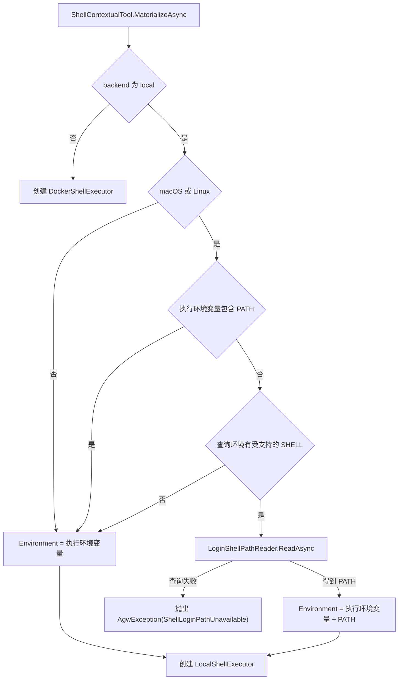

# run_shell 使用 login shell 的 PATH

本文用【新增】、【修改】标明每一项相对当前代码的变化。

## 名词解释

- **login shell**：运行 Server 的账号在环境变量 `SHELL` 中指定的 shell。以 `-il` 参数启动时，它读取系统和用户的启动配置（zsh 的 `/etc/zprofile`、`.zprofile`、`.zshrc`，bash 的 `/etc/profile`、`.bash_profile` 等）。
- **执行环境变量**：`ToolMaterializationContext.EnvironmentVariables`，由 Agent、Project 和执行请求的环境变量合并得到（`src/server/Agw.Agents.Execution/Agents/Runtime/AgentRuntimeFactory.CreateAiAgent.cs:85`）。
- **查询环境**：启动 login shell 查询 `PATH` 时传给它的完整环境，定义见详细设计 1.2。

## 背景

System Agent 通过 `run_shell` 运行命令时，Homebrew、npm 等位置安装的 CLI 会以 `command not found` 结束，系统目录中的命令可以运行。这个现象出现在 Desktop 启动的 Server 上；在终端里启动的 Server 可以找到同样的命令。

当前代码的行为如下：

- `ShellContextualTool.CreateLocalExecutor`（`src/server/Agw.Tools/Impl/ContextualTools/Shell/ShellContextualTool.cs:97`）使用 `Microsoft.Agents.AI.Tools.Shell 1.21.0-preview.260911.1` 的 `LocalShellExecutor`，设置 `CleanEnvironment = true`，`Environment` 为执行环境变量。
- `LocalShellExecutor` 启动的进程是 `/bin/bash --noprofile --norc`，不读取任何启动配置。
- Server 进程的环境变量中，只有 `PATH`、`HOME`、`USER` 传给这个 shell，随后叠加执行环境变量。
- Desktop 把 Server 注册为 LaunchAgent（`src/clients/desktop/src/main/daemon/registration.ts:10`），plist 中没有 `EnvironmentVariables`，launchd 提供的 `PATH` 为 `/usr/bin:/bin:/usr/sbin:/sbin`。Linux 的 systemd user unit（`registration.ts:34`）同样没有环境设置。

因此 `run_shell` 中的 `PATH` 等于 Server 进程的 `PATH`，用户在 shell 启动配置里加入的目录不在其中。

外部 Agent（Codex、Pi、ACP）在 `PATH` 未命中时查询 login shell 的 `PATH`（`src/server/Agw.Agents.Execution/Agents/ExternalAgents/Acp/AcpConnection.cs:142`、`src/sdks/pi-agent-sdk-csharp/src/PiAgentSdk/Internal/CommandUtil.cs:196`）。`run_shell` 没有对应的步骤。

本次使用 `.scratch/shell-env-diagnosis/probe/` 中的探测程序在 macOS 上完成了验证。程序以与 `CreateLocalExecutor` 相同的选项创建 `LocalShellExecutor`，在三种条件下运行同一组命令：

| 宿主 `PATH` | 传给执行器的 `PATH` | shell 中的宿主变量 | `node`、`npm`、`brew`、`gh`、`codex`、`dotnet`、`pnpm` |
| --- | --- | --- | --- |
| `/usr/bin:/bin:/usr/sbin:/sbin` | 无 | `HOME`、`PATH`、`USER` | 全部 `NOT FOUND` |
| `/usr/bin:/bin:/usr/sbin:/sbin` | `/bin/zsh -ilc` 查询得到的值 | `HOME`、`PATH`、`USER` | 全部找到，`node --version` 输出 `v26.13.1` |
| 终端的 `PATH` | 无 | `HOME`、`PATH`、`USER` | 全部找到 |

第二种条件下，login shell 查询耗时 159 毫秒，`Environment["PATH"]` 替换了宿主 `PATH`，其余宿主变量保持隔离。

没有兼容性要求。

## 设计目标

### 功能目标

1. 本机 `run_shell` 的 `PATH` 来自 login shell。
2. 执行环境变量中的 `PATH` 直接生效；没有受支持的 login shell 时使用 Server 进程的 `PATH`。
3. login shell 查询失败时，以明确的错误结束本次 Agent 创建。
4. 站点文档说明本机 `run_shell` 的 `PATH` 来源。

### 技术目标

- **安全**：`CleanEnvironment = true` 保持。进入 shell 的宿主变量仍为 `PATH`、`HOME`、`USER`，其中 `PATH` 的值来自 login shell。查询脚本是固定文本，不包含模型输出和请求内容。login shell 只得到查询环境，Server 的其他环境变量不传给用户的启动配置。
- **延迟**：每次创建本机执行器增加一次 login shell 启动，超时为 3 秒。
- **错误**：新增错误码 `ShellLoginPathUnavailable`，消息包含失败原因。

## 总体设计



### 变更清单

**Server 代码**

| 变更 | 位置 | 内容 |
| --- | --- | --- |
| 【新增】 | `src/server/Agw.Tools/Impl/ContextualTools/Shell/LoginShellPathReader.cs` | 查询 login shell 的 `PATH` |
| 【修改】 | `src/server/Agw.Tools/Impl/ContextualTools/Shell/ShellContextualTool.cs` | `MaterializeAsync` 生成本机执行器的环境；`CreateLocalExecutor` 接收该环境 |
| 【新增】 | `src/server/Agw.Shared/Exceptions/ErrorCodes.cs` | `ShellLoginPathUnavailable`（`500_0035`） |

**测试**

| 变更 | 位置 | 内容 |
| --- | --- | --- |
| 【新增】 | `tests/Agw.Tools.Tests/LoginShellPathReaderTests.cs` | `LoginShellPathReader` 的测试 |
| 【新增】 | `tests/Agw.Tools.Tests/ZshTestEnvironment.cs` | 供测试共用的 `/bin/zsh` 可用性检查和跳过原因 |
| 【修改】 | `tests/Agw.Tools.Tests/ShellContextualToolTests.cs` | 新增 login shell 相关用例；`MaterializeAsync` 辅助方法接收执行环境变量 |
| 【修改】 | `tests/Agw.Tools.Tests/ToolRegistryServiceTests.cs`、`tests/Agw.Agents.Tests/ExecutionWorkspaceAuthorizationTests.cs` | 创建本机 `run_shell` 的用例在执行环境变量中传入 `PATH` |

**文档**

| 变更 | 位置 | 内容 |
| --- | --- | --- |
| 【修改】 | `site/content/docs/operations/configuration.zh.md`、`site/content/docs/operations/configuration.en.md` | “Shell 工具与 Project 工作目录”一节说明 `PATH` 来源 |

## 详细设计

### 1. 本机 run_shell 的 PATH 来自 login shell

#### 【新增】1.1 LoginShellPathReader

```csharp
namespace Agw.Tools.Impl.ContextualTools.Shell;

internal static class LoginShellPathReader
{
    internal static readonly TimeSpan DefaultTimeout = TimeSpan.FromSeconds(3);

    public static bool HasLoginShell(IReadOnlyDictionary<string, string> environment);

    public static Task<string> ReadAsync(
        IReadOnlyDictionary<string, string> environment,
        TimeSpan timeout,
        CancellationToken cancellationToken
    );
}
```

`HasLoginShell` 在 `environment` 包含非空白的 `SHELL`，并且它的文件名是 `sh`、`bash`、`zsh`、`dash`、`ksh` 之一时返回 `true`。查询脚本使用 POSIX shell 语法，这五种 shell 可以运行它。

`ReadAsync` 的调用方先确认 `HasLoginShell` 为 `true`。它按以下顺序工作：

1. 读取 `environment` 中的 `SHELL`，要求它是绝对路径。
2. 用 `ProcessStartInfo` 启动该 shell，依次传入 `-il`、`+m`、`-c` 和下列固定脚本。

   ```sh
   command -p printf '\0%s\0' "$PATH"
   ```

   `UseShellExecute = false`，重定向标准输出和标准错误，`CreateNoWindow = true`。清空默认环境后完整复制 `environment`。`-il` 让 shell 同时读取 login 和 interactive 两类启动配置。`+m` 关闭 job control，让调用方保留终端的前台进程组。`command -p` 按系统默认目录查找 `printf`，启动配置把 `PATH` 设置为任何值时脚本都可以运行。
3. 同时读取标准输出和等待 shell 进程退出。忽略第一个 NUL 之前的启动输出，再读取 `PATH`，以第二个 NUL 结束一帧。`PATH` 的长度上限为 64 KiB，读到完整的一帧即可处理。如果 shell 先退出，在查询时限内继续等待完整的一帧，最多等待 1 秒。标准错误持续读取并丢弃。
4. 按 `:` 分开 `PATH`，去掉空项。查询环境中的 `HOME` 非空时，用它展开单独的 `~` 和以 `~/` 开头的项。其余项保留原值。保持目录顺序，再用 `:` 连接。执行器按命令运行时的工作目录解析相对目录。
5. 返回前终止仍在运行的辅助进程（`Kill(entireProcessTree: true)`），并用最多 1 秒等待读取任务和进程退出。

调用方取消时抛出 `OperationCanceledException`。下列情况抛出 `AgwException(ErrorCodes.ShellLoginPathUnavailable, message)`：

| 情况 | message |
| --- | --- |
| `SHELL` 为相对路径 | `Login shell path is not absolute: {shell}` |
| 进程无法启动（`Win32Exception`、`IOException`、`UnauthorizedAccessException`） | `Cannot start login shell: {error.Message}` |
| 超过 `timeout` | `Login shell lookup timed out.` |
| 进程退出后仍未收到完整的一帧 | `Login shell exited with code {exitCode} without returning a valid search path.` |
| `PATH` 超过 64 KiB | `Login shell search path exceeds 64 KiB.` |
| 去掉空项后的 `PATH` 为空 | `Login shell returned an empty search path.` |
| 读取标准输出时发生 `IOException` | `Cannot read login shell search path: {error.Message}` |

#### 【修改】1.2 ShellContextualTool

【新增】`internal static` 方法 `CreateLocalEnvironmentAsync(ToolMaterializationContext context, CancellationToken cancellationToken)`，返回传给 `LocalShellExecutorOptions.Environment` 的 `Dictionary<string, string?>`，`context.EnvironmentVariables` 保持原值：

1. 以 `StringComparer.Ordinal` 复制 `context.EnvironmentVariables`，得到 `environment`。
2. `OperatingSystem.IsWindows()` 为 `true`，或 `environment` 包含键 `PATH` 时，返回 `environment`。
3. 生成查询环境：从 Server 进程环境中读取 `PATH`、`HOME`、`USER`、`SHELL` 四个变量中存在的项，再叠加 `context.EnvironmentVariables`。前三个变量与执行器 shell 得到的宿主变量相同，`SHELL` 用于选择 login shell。执行环境变量中的 `SHELL`、`HOME`、`ZDOTDIR` 等值对查询同样生效。
4. `LoginShellPathReader.HasLoginShell(查询环境)` 为 `false` 时，返回 `environment`。
5. `environment["PATH"] = await LoginShellPathReader.ReadAsync(查询环境, LoginShellPathReader.DefaultTimeout, cancellationToken)`，返回 `environment`。

【修改】`MaterializeAsync`：目录校验和 backend 读取之后，使用 switch 表达式选择执行器工厂。`local` 分支等待 `CreateLocalExecutorFactoryAsync`，由该方法调用一次 `CreateLocalEnvironmentAsync`，并返回使用这个结果的委托。`ProjectDirectoryShellExecutor` 在目录的物理身份改变后再次调用委托时，新执行器使用同一份结果。

【修改】`CreateLocalExecutor` 的参数改为 `(string workspace, IReadOnlyDictionary<string, string?> environment)`，每次调用把 `environment` 复制为新的字典传给 `LocalShellExecutorOptions.Environment`。其余选项（`Mode`、`WorkingDirectory`、`ConfineWorkingDirectory`、`CleanEnvironment`、`Policy`、`Timeout`、`AcknowledgeUnsafe`）保持现值。

### 2. 执行环境变量中的 PATH 与没有 login shell 的环境

- Agent、Project 或执行请求的环境变量中有 `PATH` 时，shell 使用这个值，不启动 login shell。
- 查询环境中没有 `SHELL`（容器中的 Server），或 `SHELL` 指向五种受支持 shell 之外的程序（例如 fish）时，shell 使用 Server 进程的 `PATH`。这类环境通过执行环境变量中的 `PATH` 指定搜索路径。
- Windows 的 `LocalShellExecutor` 使用 `pwsh`、`powershell` 或 `cmd`，`PATH` 来自 Server 进程。
- Docker backend 的 `PATH` 来自镜像。

### 3. 查询失败

【新增】错误码，加入 `src/server/Agw.Shared/Exceptions/ErrorCodes.cs`，编号接在 `500_0034` 之后：

```csharp
public static readonly ErrorCode ShellLoginPathUnavailable = new(
    500_0035,
    "The login shell search path could not be read.",
    HttpStatusCode.InternalServerError
);
```

`LoginShellPathReader.ReadAsync` 抛出的 `AgwException` 从 `ShellContextualTool.MaterializeAsync` 向外传播。`AgentCapabilityComposer.ComposeAsync` 释放已创建的资源并重新抛出（`src/server/Agw.Agents.Execution/Agents/Composition/AgentCapabilityComposer.cs:331`），本次 Agent 创建以该错误结束，消息中包含 1.1 表格里的原因。

### 4. 站点文档

【修改】`site/content/docs/operations/configuration.zh.md` 的“Shell 工具与 Project 工作目录”一节，在 `Agents:Shell:Backend` 的说明之后加入：

> 在 macOS 和 Linux 上，`local` 后端使用运行 Server 的账号的 login shell 提供的程序搜索路径（`PATH`）。Server 读取环境变量 `SHELL` 指定的 `sh`、`bash`、`zsh`、`dash` 或 `ksh` 的启动配置。Agent、Project 或执行请求的环境变量中配置了 `PATH` 时，使用配置的值。`SHELL` 未设置或指向其他 shell 时，使用 Server 进程的 `PATH`。读取 login shell 的 `PATH` 失败时，本次执行以错误 `5000035` 结束。

【修改】`site/content/docs/operations/configuration.en.md` 的对应位置加入相同内容的英文说明。

## 测试计划

测试使用本机的 `/bin/zsh` 和 `LocalShellExecutor`。需要 zsh 的用例通过 `SkipUnless` 引用 `ZshTestEnvironment.HasZsh`，共用跳过原因 `ZshTestEnvironment.RequiresZsh`。shell 启动配置和测试命令放在 `AppContext.BaseDirectory/.scratch/` 下的测试目录，通过 `ZDOTDIR` 指向该目录。

### 单元测试

`tests/Agw.Tools.Tests/LoginShellPathReaderTests.cs`：

| 用例 | 前置条件 | 断言 |
| --- | --- | --- |
| `HasLoginShell_ShellMissing_ReturnsFalse` | 环境中没有 `SHELL` | 返回 `false` |
| `HasLoginShell_UnsupportedShell_ReturnsFalse` | `SHELL=/usr/local/bin/fish` | 返回 `false` |
| `HasLoginShell_SupportedShell_ReturnsTrue` | `SHELL=/bin/zsh` | 返回 `true` |
| `ReadAsync_StartupConfigurationSetsPath_ReturnsNormalizedEntriesInOrder` | 查询环境的 `HOME={dir}`，`.zshrc` 输出一行文本，执行 `cd "$ZDOTDIR"`、`export HOME="$ZDOTDIR/other-home"` 和 `export PATH="cli tools::./node tools:~/.dotnet/tools:~:~someone/tools:.:/opt/tool/link/../bin:/usr/bin"` | 返回 `cli tools:./node tools:{dir}/.dotnet/tools:{dir}:~someone/tools:.:/opt/tool/link/../bin:/usr/bin` |
| `ReadAsync_BackgroundProcessHoldsStdout_ReturnsPath` | `.zshrc` 为 `export PATH=/usr/bin` 和 `/bin/sleep 30 &` | 在 `DefaultTimeout` 内返回 `/usr/bin` |
| `ReadAsync_EmptyPath_ThrowsShellLoginPathUnavailable` | `.zshrc` 为 `export PATH=` | `AgwException` 的消息为 `Login shell returned an empty search path.` |
| `ReadAsync_PathExceedsLimit_ThrowsShellLoginPathUnavailable` | `.zshrc` 把 `PATH` 设为 70000 个字符 | `AgwException` 的消息为 `Login shell search path exceeds 64 KiB.` |
| `ReadAsync_StartupConfigurationTimesOut_ThrowsShellLoginPathUnavailable` | `.zshrc` 为 `/bin/sleep 30`，`timeout` 为 200 毫秒 | `AgwException` 的 `Code` 为 `ShellLoginPathUnavailable`，消息为 `Login shell lookup timed out.` |
| `ReadAsync_ShellExitsWithoutFrame_ThrowsShellLoginPathUnavailable` | `.zshrc` 为 `exit 7` | `AgwException` 的消息包含 `code 7` |
| `ReadAsync_ShellExitsWhileBackgroundProcessHoldsStdout_ThrowsShellLoginPathUnavailable` | `.zshrc` 为 `/bin/sleep 30 &` 和 `exit 7` | `AgwException` 的消息包含 `code 7` |
| `ReadAsync_ShellExecutableMissing_ThrowsShellLoginPathUnavailable` | `SHELL` 指向不存在的 `zsh` 路径 | `AgwException` 的消息以 `Cannot start login shell:` 开头 |
| `ReadAsync_RelativeShellPath_ThrowsShellLoginPathUnavailable` | `SHELL=zsh` | `AgwException` 的消息以 `Login shell path is not absolute:` 开头 |
| `ReadAsync_CallerCancels_ThrowsOperationCanceledException` | `.zshrc` 为 `/bin/sleep 30`，调用后取消 | 抛出 `OperationCanceledException` |

### 组件测试

`tests/Agw.Tools.Tests/ShellContextualToolTests.cs`。测试目录的 `tools/` 中有输出固定文本 `agw-shell-probe-ok` 的可执行脚本 `agw-shell-probe`，用例通过 `ShellContextualTool.MaterializeAsync` 得到的 `run_shell` 函数运行它：

| 用例 | 前置条件 | 断言 |
| --- | --- | --- |
| `RunShell_LoginShellAddsDirectory_RunsCommandFromThatDirectory` | `.zshrc` 分别把 `$ZDOTDIR/tools`、`~/tools` 或 `../zdotdir/tools` 加入 `PATH`，执行环境变量为 `SHELL=/bin/zsh`、`HOME={dir}` 和 `ZDOTDIR={dir}` | 直接运行 `agw-shell-probe` 或通过 `/usr/bin/env agw-shell-probe` 运行，结果均包含 `agw-shell-probe-ok`，传入的执行环境变量字典中仍然没有 `PATH` |
| `RunShell_DirectoriesMovedAfterLoginShellQuery_KeepsLoginShellPath` | `.zshrc` 每次启动向 `$ZDOTDIR/queries` 追加一行，并把 `$ZDOTDIR/tools` 加入 `PATH`；第一次运行命令后移走工作目录 | 两次运行 `agw-shell-probe` 的结果都包含 `agw-shell-probe-ok`；`queries` 只有一行 |
| `RunShell_EnvironmentVariablesContainPath_UsesThatPath` | 执行环境变量为 `PATH={dir}/tools:/usr/bin:/bin`、`SHELL=/bin/zsh` 和 `ZDOTDIR`；`.zshrc` 为 `exit 7` | 创建成功；运行 `agw-shell-probe` 的结果包含 `agw-shell-probe-ok` |
| `Materialize_LoginShellQueryFails_ThrowsShellLoginPathUnavailable` | 执行环境变量为 `SHELL=/bin/zsh` 和 `ZDOTDIR`；`.zshrc` 为 `exit 7` | `MaterializeAsync` 抛出 `Code` 为 `ShellLoginPathUnavailable` 的 `AgwException`，消息包含 `code 7` |
| `CreateLocalEnvironmentAsync_UnsupportedLoginShell_LeavesPathUnset` | 执行环境变量为 `SHELL=/usr/local/bin/fish` | 返回的字典没有 `PATH`，`SHELL` 为 `/usr/local/bin/fish` |

【修改】现有用例：`ShellContextualToolTests.MaterializeAsync`、`ToolRegistryServiceTests.CreateMaterializationContext`、`ExecutionWorkspaceAuthorizationTests.CreateShellContext` 创建本机 `run_shell` 时，在执行环境变量中传入测试进程的 `PATH`，这些用例不启动开发机上的 login shell。通过完整执行流程创建 `run_shell` 的用例，用 `SHELL=/nonexistent/zsh` 运行相关测试项目找出：以 `ShellLoginPathUnavailable` 结束的用例，在它的 Project 或 Agent 环境变量中传入 `PATH`。

### 回归测试

- `dotnet test tests/Agw.Tools.Tests`
- `dotnet test tests/Agw.Agents.Tests`
- `dotnet test tests/Agw.Shared.Tests`（`ErrorCodes` 有变化）
- `dotnet csharpier format` 处理修改过的 `.cs` 文件

### 验收

1. 用 `dotnet publish src/server/Agw.Standalone.Host -c Release -r osx-arm64 --self-contained true` 发布 Server。
2. 按 `buildLaunchAgentPlist` 的结构写一份 plist（Label 使用 `com.agw.server.runshell`，参数加入独立的 `--urls`、`--AgwDataDir`、`--AgwLogDir`），用 `launchctl bootstrap gui/<uid> <plist>` 启动。launchd 提供的 `PATH` 为 `/usr/bin:/bin:/usr/sbin:/sbin`。
3. 在这个 Server 上用带有 `run_shell` 的 System Agent 运行 `which node` 和 `node --version`。
4. 验收条件：两条命令的退出码为 `0`，输出 login shell 的 `PATH` 中的 `node` 路径和版本号。
5. 在 Agent 的环境变量中配置只含系统目录的 `PATH`，重复第 3 步；验收条件：`which node` 的退出码为 `1`。
6. 用 `launchctl bootout gui/<uid>/com.agw.server.runshell` 注销。
