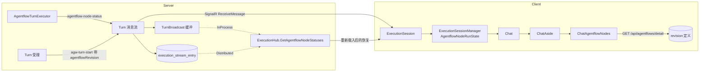
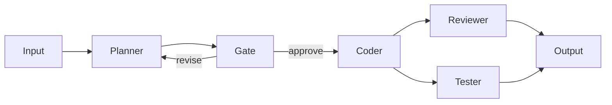
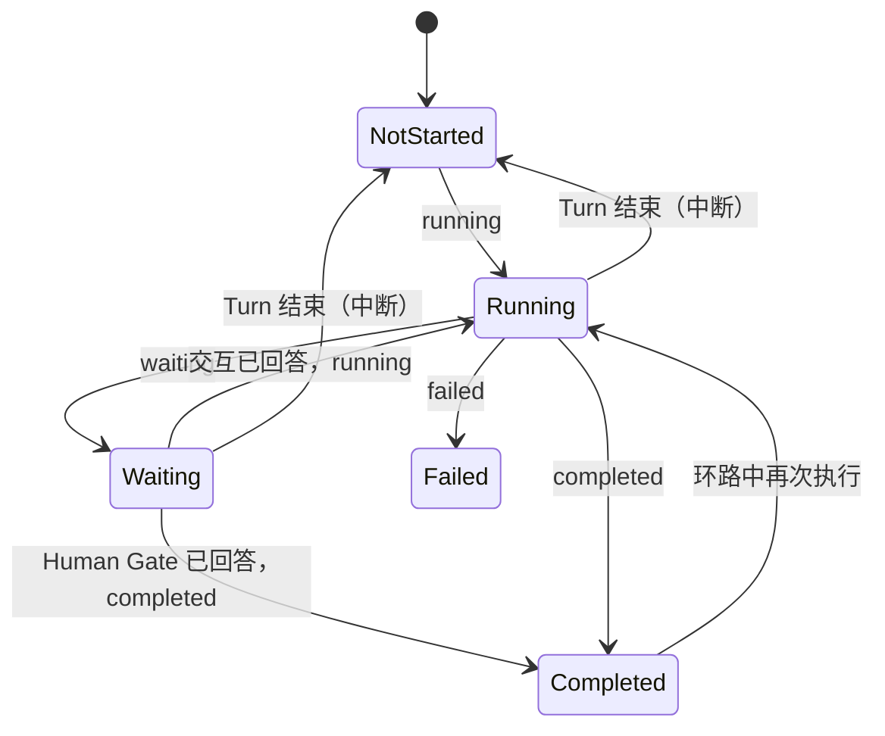
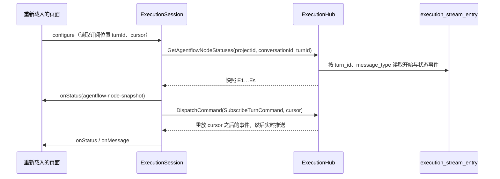
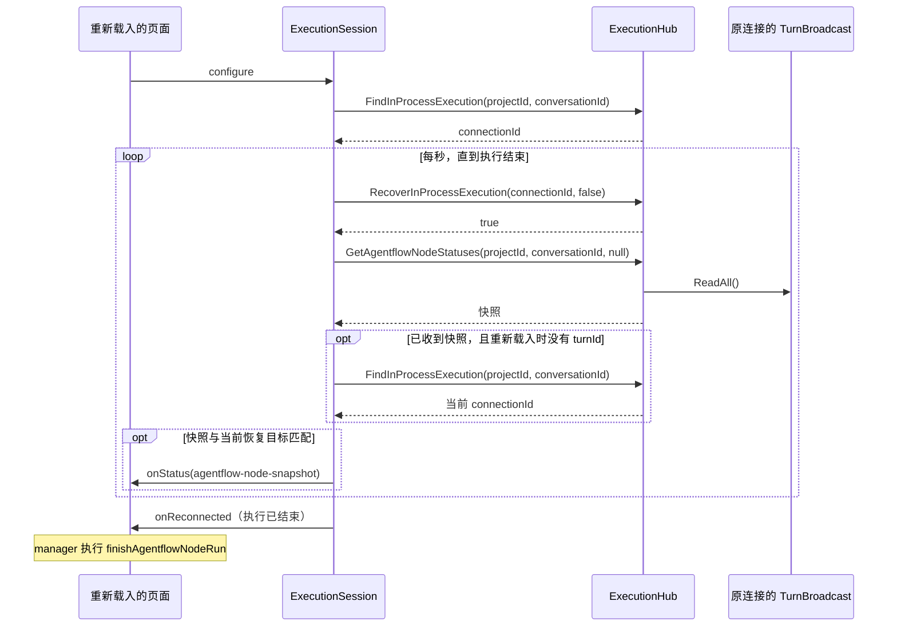

# 对话侧栏的 Agentflow 节点状态

本文中的标签表示相对当前代码的变化：【新增】是当前代码没有的内容，【修改】是改变已有的内容，【删除】是移除已有的内容。

## 名词解释

| 名词 | 含义 |
| --- | --- |
| 侧栏 | `ChatAside`（`packages/chat/src/ui-web/components/message/chat-aside.tsx`），对话区域右侧的 “Current conversation details”。对话区域宽度不小于 64rem 时显示，目前包含 Token usage 与 Todo 两张卡片 |
| 节点状态消息 | 类型为 `agentflow-node-status` 的消息。`AgentflowTurnExecutor` 把它写入 Turn 的消息流，携带顶层节点的 `nodeId`、`status`（`running`、`waiting`、`completed`、`failed`）以及可选的 `interactionId`。它不写入对话历史 |
| 节点运行状态 | 客户端按 Turn 汇总的各节点状态，类型为 `AgentflowNodeRunState` |
| 节点状态快照 | 服务端从运行中 Turn 的消息里读出的 Turn 身份、Agentflow revision 与全部节点状态消息，页面重新载入后用它恢复节点运行状态 |
| 订阅位置 | Distributed 模式下客户端保存在 localStorage 中的 `{ turnId, cursor }`，cursor 是已经处理的最大 `turnSequence` |

## 背景

需求：对话中选择的 target 是 Agentflow 时，在侧栏 Token usage 卡片的下面动态显示各节点的执行状态。

1. 所有节点竖向排列。
2. 执行到哪个节点，哪个节点高亮。

当前代码的情况：

- 服务端已经为每个顶层节点发送节点状态消息（`AgentflowTurnExecutor.RunWorkflowAsync`）。编译时生成的 `NodeIdsByExecutorId` 包含全部节点种类；Workflow as Agent 与 Block 内部的节点不单独发送。
- 编辑器的 Run 标签页用 `packages/agents/.../agentflow-run-state.ts` 汇总这些消息，在画布上显示节点状态。对话页面没有使用这些消息。
- Turn 开始消息 `agw-turn-start` 只带 `agentId`、`agentType`，没有 Turn 使用的 Agentflow revision。普通 Turn 使用受理时的 published revision，从 checkpoint 恢复的 Turn 使用原 Turn 的 revision，两者都可能与客户端读到的 `publishedRevision` 不同。
- 节点状态消息不写入对话历史。页面重新载入后，InProcess 模式只每秒查询原执行是否结束，不再收到消息流；Distributed 模式从订阅位置之后继续接收。重新载入之前收到的节点状态因此丢失。

已确认的范围：Turn 运行期间实时更新；页面重新载入后恢复运行中 Turn 的节点状态；Turn 结束后的状态只在当前页面保留，不保存到服务端。

本方案没有兼容性要求。

## 设计目标

### 功能目标

1. 显示条件与位置：侧栏 Token usage 卡片的下面增加 Agentflow 节点卡片，Todo 卡片排在它的下面。
2. 节点顺序：所有顶层节点按执行方向竖向排列。
3. 状态与高亮：每个节点显示状态图标，`running` 与 `waiting` 的节点高亮。
4. Block 成员：Block 节点下面列出成员，节点运行时突出显示正在输出的成员。
5. revision：节点列表使用 Turn 实际执行的 revision。
6. 状态恢复：在同一页面切换到其他对话再返回、页面重新载入之后，恢复运行中 Turn 的节点状态。
7. Turn 结束：高亮消失，`completed` 与 `failed` 保留到下一个 Turn 开始。

### 技术目标

- 流式输出不增加 Chat 的渲染次数：节点运行状态只在节点状态、正在输出的成员、Turn 开始或结束发生变化时产生新对象。
- revision 的定义不可变，按 `(agentflowId, revision)` 缓存，同一个 revision 只请求一次。
- Distributed 模式读取快照时只读取 Turn 开始与节点状态两类事件，走索引查询，不解密其他事件。
- 安全：Hub 方法只按当前用户、项目与对话查找运行中的 Turn；其他用户的对话与不存在的对话得到相同结果（`null`）。
- 快照格式不符合约定时抛出错误，不使用默认值代替。

### 范围

- 平台：Web 与 Desktop，二者共用 `@agw/chat`。Mobile 不显示该卡片。
- 节点：顶层节点与 Block 成员。Workflow as Agent 节点作为一个整体显示。

## 总体设计



- 实时：节点状态消息与 Turn 开始、结束消息经 `ExecutionSession` 交给 `ExecutionSessionManager`，manager 为每个对话汇总 `AgentflowNodeRunState`。Chat 卸载期间 manager 继续汇总，切换对话返回后直接读取。
- revision：Turn 开始消息增加 `agentflowRevision`，卡片按这个 revision 读取节点定义。
- 恢复：页面重新载入后，`ExecutionSession` 调用新的 Hub 方法 `GetAgentflowNodeStatuses` 取得节点状态快照，作为状态事件交给 manager。

### 变更清单

数据库：

| 位置 | 变更 |
| --- | --- |
| `execution_stream_entry.message_type` | 【新增】列 |
| `execution_stream_entry` 索引 `(turn_id, message_type, turn_sequence)` | 【新增】 |

执行协议：

| 位置 | 变更 |
| --- | --- |
| `agw-turn-start`、`agw-turn-finished` 的 `agentflowRevision` | 【新增】Agentflow Turn 带有该属性 |
| Hub 方法 `GetAgentflowNodeStatuses(projectId, conversationId, turnId)` | 【新增】 |

HTTP 接口：无变更，使用已有的 `GET /api/agentflows` 与 `GET /api/agentflows/detail`。

Server 代码：

| 位置 | 变更 |
| --- | --- |
| `Agw.Data/Entities/Executions/DurableExecutionEventRecord.cs`、`DurableExecutionEventRecordConfiguration.cs` | 【修改】增加 `MessageType` 与索引 |
| `Agw.Migrations.Sqlite`、`Agw.Migrations.Postgres` | 【新增】migration 与快照 |
| `Agw.Agents.Execution/Turns/TurnMessageFactory.cs` | 【修改】`TurnEnvelope` 增加 `AgentflowRevision`，生命周期消息写入 `agentflowRevision` |
| `Agw.Agents.Execution/Turns/TurnAcceptanceService.cs` | 【修改】两处创建 `TurnEnvelope` 时传入 revision |
| `Agw.Agents.Execution/Agentflows/Checkpoints/AgentflowCheckpointStore.cs` | 【修改】恢复分支的开始事件带 revision 与 `MessageType` |
| `Agw.Agents.Execution/Runtimes/Durable/DurableExecutionCoordinator.cs` | 【修改】`CreateEnvelope` 带 revision；【新增】`ReadAgentflowNodeStatusesAsync` |
| `Agw.Agents.Execution/Persistence/Durable/DurableExecutionEvents.cs` | 【修改】`AppendAsync` 写入 `MessageType`；【新增】`ReadByTypesAsync` |
| `Agw.Agents.Execution/Persistence/Durable/DurableExecutionStore.cs` | 【新增】`IsTurnActiveAsync` |
| `Agw.Infrastructure/Agents/TurnAcceptanceWriter.cs` | 【修改】Durable 受理时的开始事件写入 `MessageType` |
| `Agw.Infrastructure/Agents/DurableTurnUpgrade.cs` | 【修改】开始消息带 revision，事件写入 `MessageType` |
| `Agw.Agents.Execution/Turns/TurnBroadcast.cs` | 【新增】`ReadAll` |
| `Agw.Agents.Execution/Agentflows/Messaging/AgentflowNodeStatusSnapshot.cs` | 【新增】快照类型与读取器 |
| `Agw.Agents.Execution/Inbound/Connections/ExecutionConnection.cs`、`ExecutionConnectionContext.cs` | 【新增】读取当前 Turn 的节点状态快照 |
| `Agw.Agents.Execution/Inbound/SignalR/ExecutionConnectionRegistry.cs` | 【新增】`GetInProcessAgentflowNodeStatusesAsync` |
| `Agw.Agents.Execution/Inbound/SignalR/ExecutionHub.cs` | 【新增】`GetAgentflowNodeStatuses` |

客户端代码：

| 位置 | 变更 |
| --- | --- |
| `execution-types/src/chat-events.ts` | 【修改】`ExecutionHubMethod` 增加 `GetAgentflowNodeStatuses` |
| `execution-core/src/execution-status.ts` | 【修改】增加 `agentflow-node-snapshot` 事件与快照解析 |
| `execution-core/src/protocol.ts` | 【新增】`getTurnTarget` |
| `chat-core/src/agentflow-node-run-state.ts` | 【新增】节点运行状态 |
| `chat-core/src/agentflow-node-order.ts` | 【新增】节点顺序 |
| `chat-core/src/agentflow-node-labels.ts` | 【新增】节点种类名称，由 `agents` 移入 |
| `chat-runtime/src/execution-session.ts` | 【修改】恢复时读取节点状态快照 |
| `chat-runtime/src/execution-session-manager.ts` | 【修改】按对话保存节点运行状态 |
| `chat/src/ui-web/components/message/chat-agentflow-nodes.tsx` | 【新增】节点卡片 |
| `chat/src/ui-web/components/message/chat-aside.tsx` | 【修改】增加节点卡片 |
| `chat/src/ui-web/components/message/chat.tsx` | 【修改】选择显示的 Agentflow 与 revision |
| `agents/.../agentflow-run-state.ts` | 【修改】节点部分改用 chat-core 的函数 |
| `agents/.../agentflow-node-labels.ts` | 【删除】 |
| `agents/.../agentflow-document.ts`、`agentflow-node-meta.ts` | 【修改】从 `@agw/chat-core` 引入节点种类名称 |
| `agents/package.json` | 【修改】增加 `@agw/chat-core` 依赖 |

文档：

| 位置 | 变更 |
| --- | --- |
| `docs/ws-flow.md` | 【修改】Turn 开始消息的 `agentflowRevision`、Hub 方法 `GetAgentflowNodeStatuses` |
| `src/server/Agw.Agents.Execution/README.md` | 【修改】节点状态消息的恢复方式 |
| `src/server/Agw.Agents.Execution/Persistence/README.md` | 【修改】`execution_stream_entry.message_type` |

## 数据库设计

### `execution_stream_entry`【修改】

| 列 | 类型 | 变更 | 说明 |
| --- | --- | --- | --- |
| `message_type` | text，可空 | 【新增】 | 事件消息 `additionalProperties.type` 的值，没有 type 的消息为 null。明文保存，供按类型查询 |

| 索引 | 变更 | 说明 |
| --- | --- | --- |
| `(turn_id, message_type, turn_sequence)` | 【新增】 | 恢复时按 Turn 读取指定类型的事件，结果按序号排列 |

写入位置：

- `TurnAcceptanceWriter.CreateStartEvent`：Durable 受理事务写入开始事件，类型为 `AgwMessageTypes.TurnStart`。
- `DurableExecutionEvents.AppendAsync`：用 `AgwMessageClassifier.GetMessageType` 读取 `PendingExecutionEvent.Message` 的类型。可合并的流式文本增量在合并前后类型相同。
- `AgentflowCheckpointStore.AddResumeStartEvent`：`agw-turn-start`。
- `DurableTurnUpgrade`：`Append` 追加的事件，以及 `UpgradeEventsAsync` 逐条读取的已有事件（它已经反序列化每条事件，同时写入 `MessageType`）。

Migration：`Agw.Migrations.Sqlite` 与 `Agw.Migrations.Postgres` 各增加一个 migration（增加列与索引），按 `docs/1.Development.md` 中各 Provider 的命令生成。已有的行保持 null；事件载荷是加密保存的，不在 SQL 中补写。

## 详细设计

### 1. 显示条件与位置【新增】

`Chat` 从 manager 读取当前对话的节点运行状态 `nodeRun`，按下表决定卡片显示的 Agentflow 与 revision：

| 条件（自上而下取第一条） | Agentflow | revision | 状态 |
| --- | --- | --- | --- |
| `nodeRun.turnActive` 为 true 且 `nodeRun.agentflowId` 有值 | `nodeRun.agentflowId` | `nodeRun.agentflowRevision` | `nodeRun` |
| 选择的 target 是 Agentflow X，且 `nodeRun.agentflowId` 等于 X | X | `nodeRun.agentflowRevision` | `nodeRun`，即本页面中上一个 Turn 的结果 |
| 选择的 target 是 Agentflow X | X | `target.agentflowRevision`，没有时为 X 的 `publishedRevision` | 全部未执行 |
| 其他 | 不显示 | | |

- 第一条让运行中的 Turn 始终显示，即使用户在运行期间改变了选择器。
- `publishedRevision` 来自 `GET /api/agentflows`，查询键 `["agentflows"]` 与选择器、`chat-project-provider` 相同，共用缓存。编辑器 Run 标签页的 target 带有 `agentflowRevision`，使用它。
- revision 为 0（尚未发布）时不显示卡片。
- 卡片放在 Token usage 卡片与 Todo 卡片之间，随侧栏一起在对话区域宽度不小于 64rem 时显示。

`ChatAsideProps`【修改】：

```ts
export interface ChatAsideProps {
  usage: TokenUsage;
  todos: readonly TodoPresentationItem[];
  /** 要显示的 Agentflow；为 null 时不显示节点卡片。The Agentflow to show; null hides the node card. */
  agentflow: { agentflowId: string; revision: number; run: AgentflowNodeRunState } | null;
}
```

### 2. 节点顺序【新增】

`chat-core/src/agentflow-node-order.ts`：

```ts
/** 按执行方向排列顶层节点。Orders top-level nodes along the direction of execution. */
export function orderAgentflowNodes(definition: AgentflowDefinitionDto): AgentflowNodeDto[];
```

类型来自 `@agw/api` 的 `components["schemas"]`。

算法：

1. 找出回边：按定义顺序从每个 `input` 节点开始深度优先遍历，出边按定义顺序访问；之后再从尚未访问的节点开始遍历。指向当前遍历路径上的节点的边是回边。
2. 分层：去掉回边后的图没有环。按拓扑顺序计算 `layer(n) = max(layer(p) + 1)`，p 为 n 的前驱；没有入边的节点 `layer` 为 0（最长路径分层）。
3. 排序：按 `layer` 升序；同一层按 `position.y`、`position.x`、定义顺序升序。

原因：

- 画布从左向右布局，同一层对应画布上的一列，同一列从上到下排列，读者看到的顺序与画布一致。
- 最长路径分层让汇合节点（fan-in）排在它的全部前驱之后，与执行顺序相同。
- Agentflow 允许带出口的环路（`AgentflowBehavior.ValidateCycles`）。去掉回边后，环路中的节点按第一次到达的顺序排列，例如 Human Gate 退回上游节点的边不影响顺序。

时间复杂度：遍历与分层 O(N + E)，排序 O(N log N)，N 为节点数，E 为连线数。

示例：



`Gate → Planner` 是回边。分层结果：Input 0、Planner 1、Gate 2、Coder 3、Reviewer 4、Tester 4、Output 5。Reviewer 与 Tester 在同一层，按画布上的 `position.y` 排列。

### 3. 节点卡片【新增】

组件 `ChatAgentflowNodes`（`chat/src/ui-web/components/message/chat-agentflow-nodes.tsx`），props 为 `{ agentflowId, revision, run }`。

数据：

- 定义：`useQuery`（从 `@agw/components/query` 引入），查询键 `["agentflow-detail", agentflowId, revision]`，`apiGet("/api/agentflows/detail")` 带 `id` 与 `revision`，`staleTime: Infinity`。
- 名称：`["agents"]`（`GET /api/agents`）与 `["agentflows"]` 两个已有查询。

结构：

- 外层 `<section aria-label="Agentflow nodes">`，样式与 Todo 卡片相同：`mt-4 rounded-2xl border border-border bg-background/50 px-3 py-3 shadow-xs`。
- 标题行：`Workflow` 图标（`text-primary`），`h2` 显示 Agentflow 的名称（`truncate text-base font-medium text-muted-foreground`，列表中找不到时显示 “Agentflow”），右侧 `Badge variant="secondary"` 显示 `v{revision}`。
- 节点列表：`<ol>`，外层容器 `max-h-[min(50vh,28rem)] overflow-y-auto`，节点按第 2 节的顺序排列。节点之间不画连接线，因为分支流程的节点并不都依次执行。
- 节点行：`flex items-start gap-2 rounded-lg px-2 py-1.5`，左侧状态图标（`mt-0.5 size-4 shrink-0`），右侧标题（`truncate text-sm`，带 `title` 属性显示完整名称）与副标题（`truncate text-xs text-muted-foreground`，内容是节点种类名称，与标题相同时不显示）。

标题：`node.name`；为空时，Agent 节点使用所引用 Agent 的 `displayName` 或 `name`，Workflow as Agent 节点使用所引用 Agentflow 的 `name`，Checkpoint 节点使用 `checkpointName`；仍然为空时使用节点种类名称。节点种类名称来自 `chat-core` 的 `AGENTFLOW_NODE_LABELS`。

状态的显示（状态由 `getAgentflowNodeStatus(run, nodeId)` 得到）：

| 状态 | 图标 | 节点行 |
| --- | --- | --- |
| 未执行（null） | `Circle`，`text-muted-foreground`，`aria-label="Not started"` | 默认样式 |
| `running` | `LoaderCircle animate-spin`，`text-(--agw-status-running)`，`aria-label="Running"` | 高亮：背景为 `--agw-status-running` 的 10%，使用 `ring-1 ring-inset` 绘制 40% 颜色的内描边，标题 `font-medium`，`aria-current="step"` |
| `waiting` | `Hand`，`text-amber-500`，`aria-label="Waiting"` | 高亮：同样的规则，颜色为 `--color-amber-500`，`aria-current="step"` |
| `completed` | `CheckCircle2`，`text-emerald-600`，`aria-label="Completed"` | 默认样式 |
| `failed` | `CircleX`，`text-destructive`，`aria-label="Failed"` | 标题 `text-destructive` |

图标与颜色和编辑器节点卡片（`NodeStatusIcon`）、侧栏 Todo 卡片一致。并行执行时可能有多个节点同时高亮。

Block 成员：Block 节点行的下面是成员列表 `<ul className="ml-8 mt-1 space-y-0.5">`，每个成员一行（`truncate text-xs text-muted-foreground`，内容为 `member.name`，按 `members` 的顺序）。Block 节点为 `running` 且 `run.activeMemberIdByNodeId[nodeId]` 等于该成员时，这一行使用 `text-(--agw-status-running) font-medium`，并带 `aria-current="true"`。

滚动：高亮节点的集合变化时，把列表中第一个高亮的节点行滚动到可见区域（`scrollIntoView({ block: "nearest" })`）。

读取中显示 3 行 `Skeleton`（`h-5`）。读取失败时显示 `getApiErrorMessage(error)`（`text-sm text-destructive`）。运行状态中有、当前定义中没有的节点 id 不显示。

### 4. Turn 开始消息中的 revision【修改】

`TurnEnvelope` 使用显式构造函数初始化全部属性，包括 `int AgentflowRevision`，Agent 目标为 0。`TurnMessageFactory.CreateTurnProperties` 在 `AgentType` 为 Agentflow 时写入 `agentflowRevision`，开始与结束消息都带有它。

| 创建位置 | revision 来源 |
| --- | --- |
| `TurnAcceptanceService.CreateExecutionRequest` | `AgentflowRevisionSnapshot.RootRevision`（Agent 目标为 0） |
| `TurnAcceptanceService.CreateReplayRequest` | `ConversationTurnSnapshot.AgentflowRevision` |
| `AgentflowCheckpointStore.AddResumeStartEvent` | `AgentflowCheckpointRecord.AgentflowRevision` |
| `DurableExecutionCoordinator.CreateEnvelope` | `DurableExecutionManifest.AgentflowRevision` |
| `DurableTurnUpgrade.UpgradeEventsAsync` 追加或改写的开始消息 | `DurableExecutionManifest.AgentflowRevision` |

`DurableTurnUpgrade.UpgradeEventsAsync` 根据 manifest 为已有的 `turn-start` 和 `agw-turn-start` 写入完整的开始属性，并统一使用 `agw-turn-start` 类型。

`execution-core/src/protocol.ts`【新增】：

```ts
export type TurnTarget = {
  turnId: string;
  agentId: string;
  agentType: "agent" | "agentflow";
  /** Agentflow Turn 执行的根 revision；Agent Turn 为 null。The root revision an Agentflow turn runs; null for an Agent turn. */
  agentflowRevision: number | null;
};

/** 读取 Turn 开始消息中的目标；其他消息返回 null。Reads the target of a turn start message; other messages give null. */
export function getTurnTarget(message: ExecutionMessage): TurnTarget | null;
```

Turn 开始消息缺少 `turnId`、`agentId`、`agentType`，或 Agentflow Turn 缺少大于 0 的 `agentflowRevision` 时抛出 `TypeError`。

### 5. 节点运行状态【新增】

`chat-core/src/agentflow-node-run-state.ts`：

```ts
export type AgentflowNodeRunState = {
  /** 状态所属的 Turn；没有时为 null。The turn the state belongs to; null when none. */
  turnId: string | null;
  agentflowId: string | null;
  agentflowRevision: number | null;
  turnActive: boolean;
  statusByNodeId: Readonly<Record<string, "running" | "completed" | "failed">>;
  pendingInteractionIdsByNodeId: Readonly<Record<string, readonly string[]>>;
  activeMemberIdByNodeId: Readonly<Record<string, string>>;
};

export const EMPTY_AGENTFLOW_NODE_RUN_STATE: AgentflowNodeRunState;

/** 返回值与 state 相同表示没有变化。Returning state itself means nothing changed. */
export function applyAgentflowNodeStatus(
  state: AgentflowNodeRunState,
  status: ExecutionStatusEvent,
): AgentflowNodeRunState;
export function applyAgentflowNodeMessage(
  state: AgentflowNodeRunState,
  message: AiMessage,
): AgentflowNodeRunState;
/** Turn 已结束但没有收到结束消息时调用。Called when a turn ended without a finish message. */
export function finishAgentflowNodeRun(state: AgentflowNodeRunState): AgentflowNodeRunState;
/** 有未回答的交互时为 waiting。Waiting while an interaction is unanswered. */
export function getAgentflowNodeStatus(
  state: AgentflowNodeRunState,
  nodeId: string,
): AgentflowNodeStatus | null;
```

| 输入 | 处理 |
| --- | --- |
| 带 `superseded` 标记的生命周期消息 | 不变 |
| `agw-turn-start`，Agentflow Turn | `EMPTY` 加上 `turnId`、`agentflowId`（`agentId`）、`agentflowRevision`，`turnActive` 为 true |
| `agw-turn-start`，Agent Turn | `EMPTY` 加上 `turnId` |
| 状态 `agentflow-node-status`，`waiting` | 把 `interactionId` 加入该节点的未回答交互；没有 `interactionId` 时不变 |
| 状态 `agentflow-node-status`，其他取值 | `statusByNodeId[nodeId]` 设为该值；带有 `interactionId` 时从该节点的未回答交互中移除它 |
| 状态 `agentflow-node-snapshot` | 快照的 `turnId` 与 `state.turnId` 不同时，从 `EMPTY` 开始并设置快照的 `turnId`、`agentflowId`、`agentflowRevision`；相同时保留当前状态。之后 `turnActive` 为 true，按顺序对快照中的每条状态执行上面两行的处理 |
| `agw-turn-finished` | 消息带 `turnId` 且与 `state.turnId` 不同时不变；否则执行 `finishAgentflowNodeRun` |
| 带 `nodeId` 与 `nodePath` 的消息 | `nodePath` 最后一段以 `{nodeId}.` 开头时，其余部分去掉结尾的 `.manager` 后是成员 id，写入 `activeMemberIdByNodeId[nodeId]`；值没有变化时不变 |
| 其他 | 不变 |

`finishAgentflowNodeRun`：`turnActive` 为 false，移除 `running`，清空未回答交互与 `activeMemberIdByNodeId`；`turnActive` 已经为 false 时不变。

“不变”表示返回传入的同一个对象。manager 依据这一点判断是否通知界面，流式文本增量不会产生新对象。

节点状态的变化：



`chat-core/src/agentflow-node-labels.ts`【新增】：`AGENTFLOW_NODE_LABELS` 从 `agents` 移入，键类型为 `components["schemas"]["AgentflowNodeDto"]["kind"]`，内容不变。

### 6. ExecutionSessionManager 保存节点运行状态【修改】

`ExecutionSessionManager` 的每个会话条目增加 `agentflowNodeRun: AgentflowNodeRunState`，初始为 `EMPTY_AGENTFLOW_NODE_RUN_STATE`：

| 位置 | 处理 |
| --- | --- |
| `handleStatus` | `applyAgentflowNodeStatus` |
| `handleMessage` | `applyAgentflowNodeMessage`，在现有处理之前执行，与 Chat 是否挂载无关 |
| `handleReconnected` 中没有运行中 Turn 的分支、`handleClose`、调用 `activity.turnFinished(..., "failed")` 的两处 | `finishAgentflowNodeRun` |
| 释放会话（删除对话） | 移除该条目的状态 |

结果与原对象不同时保存并增加版本号，通知订阅者。新增的公开成员与队列的 `subscribeQueue`、`getQueueVersion`、`getQueue` 形式相同：

```ts
public subscribeAgentflowNodeRuns(listener: () => void): () => void;
public getAgentflowNodeRunVersion(): number;
/** 没有连接的会话返回 EMPTY_AGENTFLOW_NODE_RUN_STATE。A conversation without a connection gives EMPTY_AGENTFLOW_NODE_RUN_STATE. */
public getAgentflowNodeRun(key: ExecutionSessionKey): AgentflowNodeRunState;
```

`Chat`【修改】用 `useSyncExternalStore(subscribeAgentflowNodeRuns, getAgentflowNodeRunVersion)` 订阅，以 `queueKey` 读取状态，按第 1 节选择显示内容后交给 `ChatAside`。还没有对话 id 的新对话使用 `EMPTY_AGENTFLOW_NODE_RUN_STATE`。

Chat 卸载期间 manager 继续收到该对话的消息与状态，所以在同一页面切换到其他对话再返回时状态完整。

### 7. 页面重新载入后的恢复【新增】

#### 7.1 Hub 方法

`ExecutionHub.GetAgentflowNodeStatuses(Guid projectId, Guid conversationId, Guid? turnId)` 返回当前用户在指定对话中的活动 Agentflow Turn 快照。InProcess 传入 `null`，Distributed 传入待恢复的 `turnId`。当前用户在指定范围内找不到对应的活动 Agentflow Turn 时返回 `null`。

```csharp
/// <summary>
/// 运行中 Agentflow Turn 的节点状态快照；Statuses 按 turnSequence 排列。
/// The node status snapshot of a running Agentflow turn; Statuses are in turnSequence order.
/// </summary>
public sealed record AgentflowNodeStatusSnapshot
{
    public AgentflowNodeStatusSnapshot(
        Guid turnId,
        Guid agentflowId,
        int agentflowRevision,
        IReadOnlyList<AgentflowNodeStatusEntry> statuses
    )
    {
        TurnId = turnId;
        AgentflowId = agentflowId;
        AgentflowRevision = agentflowRevision;
        Statuses = statuses;
    }

    public Guid TurnId { get; }
    public Guid AgentflowId { get; }
    public int AgentflowRevision { get; }
    public IReadOnlyList<AgentflowNodeStatusEntry> Statuses { get; }
}

public sealed record AgentflowNodeStatusEntry(string NodeId, string Status, string? InteractionId);
```

`AgentflowNodeStatusSnapshotReader.Read(IEnumerable<AgwMessage> messages)`【新增】从一个 Turn 按序号排列的消息中生成快照：第一条消息必须是 Turn 开始消息，从中读取 `turnId`、`agentId`、`agentType`、`agentflowRevision`；`agentType` 为 agent 时返回 null；之后每条 `agentflow-node-status` 消息生成一个 `AgentflowNodeStatusEntry`。属性值按文本读取，因为从事件记录读回的属性是 `JsonElement`。缺少 Turn 开始消息或其中缺少 revision 时抛出 `AgwException(ErrorCodes.AgentExecutionFailed)`。

`ExecutionHub.GetAgentflowNodeStatuses` 按 `ExecutionRuntimeOptions.Provider` 分别读取：

- InProcess 通过 `ExecutionConnectionRegistry.GetInProcessAgentflowNodeStatusesAsync` 按 `FindInProcessExecutionAsync` 的同一规则（当前用户、项目、对话，执行尚未结束）找到连接。`ExecutionConnection` 经 `_commandGate` 交给 `ExecutionConnectionContext`，读取 `_turnBroadcast.ReadAll()` 中的消息生成快照。`TurnBroadcast.ReadAll()`【新增】在锁内复制全部已编号的消息。节点状态消息写入前会先发布待合并的文本，所以缓冲中的状态消息完整。
- Distributed 在 Hub 建立的当前用户上下文内调用 `DurableExecutionCoordinator.ReadAgentflowNodeStatusesAsync(projectId, conversationId, turnId, cancellationToken)`。`turnId` 为 `null` 或空 GUID 时，Hub 返回 `InvalidParam`。
  1. 同一对话可以有多个活动 Turn。`DurableExecutionStore.IsTurnActiveAsync` 使用 `UserInfoUtil.RequiredUserId`，按 `turnId`、项目、对话、当前用户和活动状态检查目标 Turn。
  2. 找不到目标 Turn 时返回 `null`。找到时，`DurableExecutionEvents.ReadByTypesAsync` 读取该 Turn 的 `agw-turn-start` 和 `agentflow-node-status` 事件，按 `turn_sequence` 升序，经 `ToEntry` 解密后交给读取器。

Hub 方法与已有方法相同，`AgwException` 转为 `HubException`。

#### 7.2 客户端的调用

`ExecutionSession`【修改】在两处调用 Hub 方法，参数取自当前设置的 `projectId` 与 `conversationId`；结果不为 null 时经 `execution-core` 的 `parseAgentflowNodeSnapshot` 校验后，以 `handlers.onStatus({ type: "agentflow-node-snapshot", ... })` 交出：

| 位置 | 条件 |
| --- | --- |
| `restoreDurableSubscription(turnId, cursor)` 发送 `SubscribeTurnCommand` 之前 | `cursor` 不为 null 时传入该 `turnId`，结果中的 `turnId` 匹配时交出快照 |
| `recoverInProcessExecution` 得到 `active` 为 true 之后 | 不是停止请求（`interrupt` 为 false）；每次轮询（1 秒）都读取 |

InProcess 恢复时，已知 `turnId` 就与快照中的 `turnId` 比较。页面重新载入时只有原连接 ID，收到快照后再次调用 `FindInProcessExecution` 确认对话仍由原连接执行，连接相同时才交出快照。这样可以过滤原连接结束后由其他连接发起的 Turn。

`cursor` 为 null 的订阅会从第一条事件重放，不需要快照。SignalR 自动重连后的重新订阅也经过第一处，结果与已有状态合并后不变。读取失败时错误沿现有的恢复流程抛出。

`execution-core/src/execution-status.ts`【修改】：

```ts
export type AgentflowNodeStatusEvent = {
  type: "agentflow-node-status";
  nodeId: string;
  status: AgentflowNodeStatus;
  interactionId?: string;
};

export type AgentflowNodeSnapshotEvent = {
  type: "agentflow-node-snapshot";
  turnId: string;
  agentflowId: string;
  agentflowRevision: number;
  statuses: AgentflowNodeStatusEvent[];
};

export type ExecutionStatusEvent =
  | AgentflowNodeStatusEvent
  | AgentflowNodeSnapshotEvent
  | ({ type: "permission-status" } & PermissionStatus)
  | { type: "mode-status"; agentId: string; mode: AgentMode }
  | { type: "mode-change-failed"; agentId: string; mode: string; message: string | null };

/** 校验 Hub 返回的快照；格式不符时抛出 TypeError。Validates a snapshot from the Hub; throws TypeError when malformed. */
export function parseAgentflowNodeSnapshot(value: unknown): AgentflowNodeSnapshotEvent;
```

快照事件经 `ExecutionSessionManager.handleStatus` 写入节点运行状态，同时进入 `ActiveTurnSnapshot.statuses`。写入前移除同一 Turn 已保存的快照，使每个 Turn 只保留最新快照。`Chat.applyExecutionStatus`、`ConversationController.receiveStatus`、`native-workspace-provider.tsx` 按 `type` 分支，忽略这一新类型。

#### 7.3 顺序与正确性

节点运行状态对状态事件的处理满足：每个节点取最后一条状态，每个交互取最后一次加入或移除。设 Turn 的状态事件为 E1…En，快照包含 E1…Es，订阅位置为 c（c ≤ s）。

- Distributed：快照在 `SubscribeTurnCommand` 之前交出，之后订阅按顺序重放 Ec+1…En。fold(fold(E1…Es), Ec+1…En) 中每个节点与交互的最后一条记录都来自 E1…En，结果等于 fold(E1…En)。
- InProcess：恢复期间没有消息流，每次快照覆盖从 E1 开始的完整前缀，依次处理后的结果等于最新一次快照。





### 8. 编辑器 Run 标签页【修改】

`agentflow-run-state.ts` 的节点部分改用 chat-core：

- `AgentflowRunState` 为 `AgentflowNodeRunState & { latestOutputByNodeId; nodeIdByMessageId }`，编辑器读取字段的位置不变。
- `applyAgentflowRunStatus` 的节点处理调用 `applyAgentflowNodeStatus`；`applyAgentflowRunMessage` 的节点处理调用 `applyAgentflowNodeMessage`，`latestOutputByNodeId`、`nodeIdByMessageId` 的处理保持现状，Turn 开始时清空。
- `getNodeRunStatus` 调用 `getAgentflowNodeStatus`。
- `getMemberId` 与 `EMPTY_RUN_STATE` 中节点部分的定义移到 chat-core。

编辑器继续通过 `Chat` 的 `onExecutionStatus`、`onExecutionMessage` 更新自己的 store，画布显示不变。Run 标签页的 `Chat` 宽度小于 64rem 时侧栏不显示；宽度足够时侧栏中的节点卡片显示 Run 的 revision。

## 接口文档

### 基础信息

执行协议经 SignalR Hub `/api/hubs/exec`，需要登录。HTTP 接口没有变更。

### 接口列表

**【修改】`agw-turn-start` / `agw-turn-finished` 消息**

Agentflow Turn 的生命周期消息增加 `agentflowRevision`（int，大于 0），Agent Turn 没有该属性：

```json
{
  "messageId": "0195f3a2-6c1e-7b40-9a52-2d6f0c1e8a01",
  "role": "system",
  "additionalProperties": {
    "type": "agw-turn-start",
    "turnId": "0195f3a2-6b90-7c11-8d3e-5a4b3c2d1e0f",
    "conversationId": "0195f39e-1a2b-7c3d-8e4f-5a6b7c8d9e0f",
    "agentId": "0194d0aa-2b3c-7d4e-9f50-61728394a5b6",
    "agentType": "agentflow",
    "agentflowRevision": 3,
    "streamingScopeId": "0195f3a2-6b90-7c11-8d3e-5a4b3c2d1e0f",
    "turnSequence": 1
  }
}
```

客户端注意：`getTurnTarget` 读取该属性；Agentflow Turn 缺少它时抛出错误。

**【新增】Hub 方法 `GetAgentflowNodeStatuses(projectId, conversationId, turnId)`**

请求参数为 `projectId`（Guid）、`conversationId`（Guid）和 `turnId`（Guid?）。Distributed 传入待恢复的 Turn ID，InProcess 传入 `null`。

响应示例：

```json
{
  "turnId": "0195f3a2-6b90-7c11-8d3e-5a4b3c2d1e0f",
  "agentflowId": "0194d0aa-2b3c-7d4e-9f50-61728394a5b6",
  "agentflowRevision": 3,
  "statuses": [
    { "nodeId": "input", "status": "running", "interactionId": null },
    { "nodeId": "input", "status": "completed", "interactionId": null },
    { "nodeId": "planner", "status": "running", "interactionId": null },
    { "nodeId": "planner", "status": "completed", "interactionId": null },
    { "nodeId": "gate", "status": "waiting", "interactionId": "0195f3a4-0d1e-7f20-8a31-4b5c6d7e8f90" }
  ]
}
```

没有运行中的 Agentflow Turn 时响应为 `null`。客户端注意：只在恢复流程中调用（第 7.2 节）；`ExecutionHubMethod` 增加该名称，chat 通信观察者能看到这次调用。

## 测试计划

### 单元测试

Server（xUnit，命名 `Method_Condition_ExpectedResult`）：

| 测试 | 目的 |
| --- | --- |
| `TurnMessageFactoryTests.CreateStarted_AgentflowEnvelope_IncludesAgentflowRevision`（新文件） | Agentflow Turn 的开始消息带 revision |
| `TurnMessageFactoryTests.CreateStarted_AgentEnvelope_OmitsAgentflowRevision` | Agent Turn 不带该属性 |
| `TurnAcceptanceWriterSnapshotTests` 增加用例：受理 Agentflow Turn 后开始消息的 `agentflowRevision` 等于依赖快照的根 revision | 普通 Turn 使用受理时的 revision |
| `AgentflowCheckpointStoreTests` 增加用例：Durable 恢复分支的开始事件带原 Turn 的 revision，`MessageType` 为 `agw-turn-start` | 从 checkpoint 恢复的 Turn 使用原 revision |
| `AgentflowNodeStatusSnapshotReaderTests.Read_AgentflowTurn_ReturnsStatusesInSequence` | 状态按顺序输出，跳过其他消息 |
| `AgentflowNodeStatusSnapshotReaderTests.Read_AgentTurn_ReturnsNull` | Agent Turn 没有快照 |
| `AgentflowNodeStatusSnapshotReaderTests.Read_PropertiesFromEventLog_ReadsJsonElementValues` | 从事件记录反序列化的消息可以读取 |
| `AgentflowNodeStatusSnapshotReaderTests.Read_MissingTurnStart_Throws` | 数据不完整时抛出异常 |
| `DurableDistributedStoreTests` 增加用例（需要 PostgreSQL）：追加带类型的事件后 `message_type` 等于消息类型，没有 type 的消息为 null | 写入事件时保存类型 |
| `DurableDistributedStoreTests` 增加用例（需要 PostgreSQL）：`ReadByTypesAsync` 在混合事件中只返回指定类型，按序号排列 | 按类型读取 |
| `TurnBroadcastTests.ReadAll_PendingTextDelta_ContainsStatusAfterPublishedDelta` | 状态消息之前的待合并文本已发布，缓冲完整 |

客户端（Node test runner）：

| 文件 | 用例 |
| --- | --- |
| `chat-core/src/agentflow-node-order.test.ts` | 线性流程；分支按 `position.y`；fan-in 排在全部前驱之后；环路的回边不影响顺序；多个 input；没有连线的节点按位置排列 |
| `chat-core/src/agentflow-node-run-state.test.ts` | Agentflow 与 Agent 的 Turn 开始；waiting 与回答；Human Gate 回答后 completed；快照属于新 Turn 时重置、属于同一 Turn 时合并；快照后重放部分事件结果不变；其他 Turn 的结束消息不变；superseded 消息不变；成员 id 与 `.manager`；没有变化时返回同一对象；`finishAgentflowNodeRun` |
| `execution-core/src/protocol.test.ts` | `getTurnTarget` 读取 Agentflow 与 Agent Turn；缺少 revision 时抛出 |
| `execution-core/src/execution-status.test.ts` | `parseAgentflowNodeSnapshot` 接受合法快照，字段缺失或状态取值不合法时抛出 |
| `chat-runtime/src/execution-hub.test.ts` | Distributed 带 cursor 恢复时先调用 `GetAgentflowNodeStatuses` 再发送 `SubscribeTurnCommand`，并交出快照；cursor 为 null 时不调用；快照属于其他 Turn 时不交出；InProcess 恢复每次轮询交出快照；停止请求不读取 |
| `chat-runtime/src/execution-session-manager.test.ts` | Chat 未挂载时继续汇总状态；流式文本增量不增加版本号；重连后没有运行中 Turn 时结束运行状态；删除对话时移除状态 |
| `chat/src/ui-web/components/message/chat-agentflow-nodes.test.ts` | 按顺序显示全部节点；running 与 waiting 高亮并带 `aria-current="step"`；completed、failed 的图标；Block 成员与正在输出的成员；标题的取值顺序；读取中与读取失败 |
| `chat/src/ui-web/components/message/chat-token-usage.test.ts`（或新文件） | target 为 Agentflow 时显示卡片，为 Agent 时不显示；状态事件改变高亮；Turn 结束后高亮消失、completed 保留；运行中改变选择器仍显示运行中的 Agentflow；未发布时不显示 |
| `agents/.../agentflow-run-state.test.ts` | 现有用例全部通过 |

### 集成测试

- `tests/Agw.Agents.Tests`：InProcess 模式运行两个节点的 Agentflow，在节点运行期间以同一用户调用 `GetAgentflowNodeStatuses`，得到包含 `running` 的快照；以其他用户调用得到 null；Turn 结束后得到 null；Agent Turn 得到 null。
- Distributed（需要 `AGW_TEST_POSTGRES_CONNECTION_STRING`）：运行中的 execution 返回事件记录中的状态，Turn 开始事件带 revision；执行结束后返回 null。
- `dotnet test tests/Agw.Architecture.Tests`：实体与原始持久化访问清单与改动一致（`DurableExecutionEvents.cs`、`DurableExecutionStore.cs` 的查询有变化时按测试结果更新清单）。

### 回归测试

- `pnpm test`（含 `test:boundaries`，确认 `agents` 新增 `@agw/chat-core` 依赖符合规则）。
- `dotnet test Agw.slnx`。
- 编辑器 Run 标签页：画布节点状态、Block 成员颜色、“Show node on canvas” 与 Last run 不变。

### 验收

使用本机 Ollama 的 `qwen3:0.6b` 模型与已发布的 Agentflow。两份脚本分别以 SQLite InProcess 和 PostgreSQL Distributed 模式运行 Standalone Host，验证 Hub 快照、用户隔离、Turn 结束和 Distributed 事件重放。侧栏显示另外按以下场景检查：

1. 选择 Agentflow 后，未发送消息时卡片按顺序显示全部节点，均为未执行。
2. 发送消息后，高亮依次移动；Human Gate 等待时为 waiting；Turn 结束后高亮消失，completed 保留。
3. 运行中切换到其他对话再返回，状态与当前执行一致。
4. 运行中重新载入页面（InProcess），卡片显示运行中的节点，之后每秒更新，执行结束后高亮消失。
5. Distributed（本机 Postgres 与 Data Plane）运行中重新载入页面，卡片立即恢复，之后实时更新。
6. 从 checkpoint 恢复的 Turn 显示原 revision 的节点。
