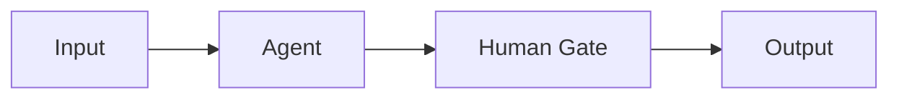
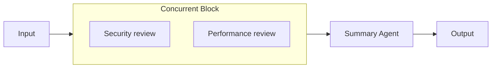

Agentflow means **Agent Workflow**: a workflow that connects several processing steps. One agent might prepare material, another review it, and a person choose the next path. The canvas shows the steps, their inputs and outputs, and their order.

Verify each agent independently before connecting it. Start with one path from input to output, then add branches and approvals once it works.

## Build and publish a flow

1. Open the Agentflows editor and start with its single Input node, or pick a starter layout from **More options → Templates** (`Sequential pipeline`, `Parallel, then join`, `Review loop`, `Human approval`, or `Magentic team`).
2. Add nodes from the left **Node library** (by clicking or dragging onto the canvas) or from a connection's insert menu, then connect Input to Agent and Output.
3. Check the **Problems** tab in the bottom panel; validation runs continuously and **Show on canvas** jumps directly to any invalid node or connection.
4. Click **Save** to create an immutable revision (`v1`, `v2`, …), test it in the editor's **Run** panel, and click **Publish** when it is ready for Chat, Jobs, and A2A.

The editor canvas has **Undo** and **Redo** buttons at the top (`Cmd/Ctrl+Z`, `Cmd/Ctrl+Shift+Z`, or `Ctrl+Y`), node copy/paste, and **More options → Import / Export** for sharing JSON definitions. Drag the dividers to resize the Node library, Inspector, and bottom panel. With unsaved edits, closing asks **Discard unsaved changes?**; unsaved drafts are not kept after the dialog closes.

The bottom panel has three tabs:

- **Problems**: live Server-side validation messages with **Show on canvas** links.
- **Run**: test the currently open saved revision inside the editor. While running, nodes show live status highlights, and any message's **Show node on canvas** action highlights its source node; the Inspector also displays the node's **Last run** status and output.
- **Versions**: lists saved revisions with **Open** and **Publish** actions. If another tab or user saves a newer revision first, a conflict prompt lets you inspect or resolve the newer revision.

Each flow in the Agentflows list has an **Enabled** switch and Run, Edit, Copy, View Mermaid chart, and Delete actions. Run opens Chat in a side drawer using the built-in default Project against the published revision; to run it in another Project, select the Agentflow in Chat. Disabled agents and unpublished or disabled agentflows cannot run in Chat or Jobs.

{caption="AGW Desktop: an existing Agentflow in the editor, showing nodes, edges, the node palette, and inspector. The flow was not run."}

## Primitive Nodes

Primitive nodes handle one step: receiving input, calling an Agent, adjusting messages, waiting for a person, saving a checkpoint, or returning results. Select a node on the canvas, configure it in the right-hand Inspector, and connect it to its upstream and downstream steps.

### Input: enter the flow

Input passes the current user request into the graph. For example, “Review these changes” enters here when sent from Chat.

Every flow has exactly one Input with the fixed ID `input` and no incoming edges. Connect it to one step or use **Send to all** to distribute input to multiple branches.

### Agent: perform a task

Select a configured **Agent** and optionally set the node **Name** and **Instructions** describing how to handle upstream results. For example, a code-review node can inspect incoming code and return problems and suggested fixes.

The node receives upstream content, runs the selected Agent, and passes its results downstream. The same Agent definition can appear in several nodes, each with its own model conversation history. Edges transfer task content rather than merging another node’s complete model session.

Verify the Agent’s model, tools, and workspace before adding it to a flow. Node instructions should also match the configuration supported by that Agent type.

### Workflow as Agent: reuse a subflow

Select an existing **Workflow** as a step. Upstream messages become its input, and its published revision runs and returns output to the parent flow. This suits reusable processes such as collecting material and producing a summary.

Verify and publish the subflow independently before adding it to a parent flow or block. References between flows cannot be recursive: A cannot call B if B calls A. Separate branches may reuse the same subflow.

### Prompt Adapter: add instructions

Use **Instructions** to describe how downstream content should be handled, such as “Respond with background, findings, and recommendations.” The node prepends these instructions to the current messages and forwards them.

Prompt Adapter does not call a model or perform translation, summarization, or data conversion itself. Connect an Agent after it to generate new content.

### Clear Messages: discard upstream messages

Clear Messages discards arriving messages and continues downstream with an empty message payload. No model configuration is needed. For example, once an earlier step has written results to project files, the next step can read those files without carrying a large amount of upstream text.

It does not delete Chat records or clear a downstream Agent’s existing session history. The next step needs clear instructions or accessible source material and cannot rely on the discarded content.

### Human Gate: choices and optional reply

Insert **Human Gate** where a person needs to confirm a result, choose a path, or provide feedback:

| Field | Usage |
| --- | --- |
| Prompt | Explain what to decide or provide, such as “Review the draft and choose how to proceed.” |
| Choices | Ordered list of decision buttons (`Add choice`, reorder, rename, remove). Each choice routes to its own outgoing path. |
| Allow a text reply | When enabled, lets the person include response text alongside the chosen button. |

Execution pauses until the request is handled through an interactive interface. Selecting a choice continues along the edges bound to that choice; if **Allow a text reply** is enabled, the reply text travels downstream with the decision. Rejecting or interrupting stops the workflow. Human nodes require an interactive execution channel and cannot complete inside unattended Jobs.

### Checkpoint: save a recovery boundary

Set a recognizable **Checkpoint name**, such as “Research complete,” and place it where execution progress should be saved.

After this node, the system saves a complete workflow checkpoint at the end of the corresponding execution stage. Chat shows each saved checkpoint as a card marked **Checkpoint**; click **Resume** on the card to restore that save. The button is disabled with “This checkpoint is unavailable” when it cannot be resumed. Resuming selects one specific saved occurrence, creates a new execution branch from that state using the source turn's pinned revisions, and removes conversation records after the saved boundary.

Resume requires the same user, Project, conversation, and Agentflow, readable snapshots, and no conflicting execution. InProcess checkpoints remain resumable only while the original runtime still holds the occurrence. Distributed mode persists checkpoints in PostgreSQL and supports recovery across disconnects or Server restarts.

### Output: return results and optionally summarize

Output emits arriving messages as flow results. A simple flow can connect `Agent → Output` directly.

In the Inspector, toggle **Write a summary** to control whether Output appends a conclusion:

- Off: pass arriving messages through unchanged.
- On: select a **Summary model** and optional **Summary instructions**. An additional model call turns the incoming results into a Markdown conclusion appended after them. When **Write a summary** is on, the workflow must have a valid **Summary model** and exactly one Output node.

## Orchestration Blocks

Blocks organize multiple participants into one step. Participants can be Agents or published nested Agentflows. The Node library lists the four blocks as **Concurrent Block**, **Handoff Group**, **GroupChat Room**, and **Magentic Team**. Add a block, click **Add member** in the Inspector, and select each member to configure its name and instructions. Parent-flow edges connect to the block, which schedules its members internally.

| Block | Collaboration | Suitable tasks |
| --- | --- | --- |
| Concurrent Block | Process the same input in parallel and wait for all results | Independent analysis or reviews from different perspectives |
| Handoff Group | Start with the first participant and transfer work as needed | Triage and specialist routing |
| GroupChat Room | Participants speak in order | Bounded discussion and iterative improvement |
| Magentic Team | A Manager plans and coordinates the team | Tasks requiring dynamic planning and delegation |

### Concurrent Block: work in parallel

Add participants that can work independently, such as security and performance reviewers. The block sends the same input to every member concurrently, waits for all of them to finish, and combines their response messages for the next step.

Combining messages does not deduplicate opinions or generate a unified conclusion. Add a summarizing Agent afterward or enable Output summarization if needed. Use sequential edges for dependent steps, and avoid conflicting writes when members work on the same files.

### Handoff Group: transfer work as needed

The first participant receives the task and can transfer it to another member according to their responsibilities. For example, a triage Agent routes a question to a billing or technical specialist. When the block finishes, its results continue downstream in the parent flow.

| Field | Purpose |
| --- | --- |
| Handoff instructions | Explain when to transfer work and which participant should receive it |
| Enable return to previous | Allow a transfer back to the previous participant |
| Autonomous | Enable automatic continuation |
| Autonomous turn limit | Bound continuation turns when autonomous is enabled |
| Continuation prompt | Prompt used for automatic continuation |

Define clear responsibilities and transfer conditions, and set a reasonable autonomous limit. Handoff does not guarantee that every participant runs. If every step must execute, sequential parent-flow edges are more direct.

### GroupChat Room: take turns

Add at least two participants and check their order. The current implementation schedules them in Round Robin order to contribute to the incoming task, stopping at **Max rounds** (default 10 when unset).

`Max rounds` bounds scheduling iterations rather than granting each member that many turns. Group Chat suits bounded collaboration with clear discussion rules and does not wait for consensus automatically. Add a summary Agent afterward when a single conclusion is needed.

### Magentic Team: coordinate through a Manager

Add at least two participants and select the **Manager** member (if none is designated, the first participant acts as Manager and the rest form the team). The Manager plans and assigns work based on the task.

| Field | Purpose |
| --- | --- |
| Max rounds | Overall scheduling-round limit |
| Max stalls | Limit tolerance for lack of progress |
| Max resets | Bound replanning or resets |
| Require plan signoff | Require human confirmation of the plan before proceeding |

Give the Manager clear goals, completion criteria, and member responsibilities. `Require plan signoff` requires an interactive execution entry point.

## Routing, conditions, and constraints

Exactly one Input must have ID `input` and no incoming edges. Runtime-visible nodes must be reachable from it, and node and edge IDs must be unique with valid references.

Select a non-HumanGate source node to set its **Outgoing** routing strategy:

| Strategy | Meaning | Design consideration |
| --- | --- | --- |
| Pass on | Each connection passes the output on; conditions can hold individual connections back | Use for a fixed sequence |
| Send to all | Every connected node whose conditions match runs | Branches should process the input independently |
| Branch | Evaluates **If** / **Else if** branches in order and runs only the first match; use **Use as Else** for a fallback | Add an **Else** branch to handle unmatched cases |

On any connection (or in the target node's **Incoming** section), toggle **Wait** (`Fan-in Barrier`) when the target node must wait for all waited-for sources to finish before running. Do not mix incompatible strategies across barriers—for example, placing a **Wait** barrier after a **Branch** source that only activates one path can leave the barrier waiting indefinitely.

For conditional connections, add rules in the Inspector's condition editor. When multiple rules are added on one connection, all rules must match:

- `Contains` / `Does not contain` / `Equals`: inspect the outgoing message text (or the Human Gate reply when present).
- `Author is` / `Role is`: match message metadata.
- `At least N messages`: require a minimum number of incoming messages.
- `Result field`: available when the source Agent has both **Generate Turn Summary** and a **Response Schema** enabled; inspects fields in the structured JSON Result by path.

Controlled cycles are supported when every cycle has an explicit exit path (such as a `Branch` `If`/`Else` exit or a Human Gate choice exiting the cycle).

## Verify and inspect history

Test success, unmatched conditions, human rejection, and waiting paths separately. While the flow runs, Chat shows the input each node receives as its own input bubble in the current turn, keeping the upstream node attribution, so you can check execution order. Checkpoint marks a full MAF checkpoint boundary; recovery restores from that exact saved occurrence rather than restarting an arbitrary node.

## Implementation and references

- [Graph contract](https://github.com/zxyao145/agw/blob/main/docs/designs/2.Agentflow.md)
- [Node and block configuration](https://github.com/zxyao145/agw/blob/main/src/clients/packages/agents/src/ui-web/pages/agentflows/components/visual-agentflow-builder.tsx)
- [Orchestration block execution](https://github.com/zxyao145/agw/tree/main/src/server/Agw.Agents.Execution/Agentflows/Workflows/Builders)
