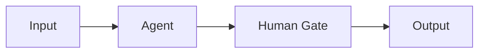
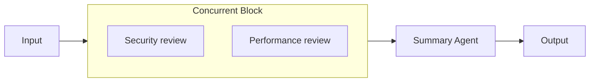

Agentflow 指 **Agent Workflow（Agent 工作流）**，把多个处理步骤连接起来。例如，先由一个 Agent 整理材料，再由另一个 Agent 审查，最后由人决定下一步走向。各步骤的输入、输出和先后关系都可以在画布中查看。

先单独验证每个 Agent 能完成自己的任务，再把它们接成流程。第一版建议只保留一条从输入到输出的路径，验证后再添加分支和审批。

## 构建与发布流程

1. 打开 Agentflows 编辑器，从唯一的 Input 节点开始，也可以通过 **More options → Templates** 选择内置模板（`Sequential pipeline`、`Parallel, then join`、`Review loop`、`Human approval`、`Magentic team`）。
2. 从左侧 **Node library** 点击或拖放节点到画布，或通过连线的插入菜单添加节点，连接 Input、Agent 与 Output。
3. 在底部 **Problems** 面板查看实时校验结果；点击校验提示旁的 **Show on canvas** 可以直接定位到对应节点或连线。
4. 点击 **Save** 保存为一个不可变的修订版本（`v1`、`v2`、…），在底部 **Run** 面板试运行验证；确认无误后点击 **Publish** 发布，供 Chat、Jobs 和 A2A 使用。

编辑器画布顶部提供 **Undo** 和 **Redo** 按钮（`Cmd/Ctrl+Z`、`Cmd/Ctrl+Shift+Z` 或 `Ctrl+Y`）、节点复制粘贴，以及 **More options → Import / Export** 导入导出 JSON 定义；节点库、Inspector 和底部面板都可以拖动分隔条调整大小。存在未保存的修改时，关闭前会询问 **Discard unsaved changes?**；关闭对话框后，未保存的草稿不会保留。

底部面板包含三个标签页：

- **Problems**：实时显示服务端校验发现的问题，并支持 **Show on canvas** 跳转定位。
- **Run**：直接在编辑器内试运行当前打开的已保存版本。运行期间画布节点会显示实时状态；消息上的 **Show node on canvas** 可以定位产生该消息的节点，Inspector 也会显示节点最近一次运行的 **Last run** 状态与输出。
- **Versions**：列出所有已保存的修订版本，支持 **Open** 打开查看和 **Publish** 发布指定版本。如果有其他会话先保存了新版本，保存时会弹出版本冲突提示。

Agentflows 列表中每个流程都有 **Enabled** 开关，以及 Run、Edit、Copy、View Mermaid chart 和 Delete 操作。Run 会在右侧抽屉中以内置默认 Project 运行已发布版本，适合快速试运行；需要在其他 Project 中运行时，在 Chat 中选择该 Agentflow。停用的 Agent、未发布或停用的 Agentflow 不会出现在运行列表中。

{caption="AGW Desktop：一个已有 Agentflow 的编辑视图，展示节点、连线、节点面板和属性检查器；此图未运行流程。"}

## Primitive Nodes（基础节点）

基础节点负责一个明确步骤：接收输入、调用 Agent、调整消息、等待人工处理、保存检查点或输出结果。在画布中选中节点后，在右侧 Inspector 配置其属性，再用连线确定前后关系。

### Input：流程入口

Input 将本次用户输入传入流程。例如，在 Chat 中发送“审查这次修改”，这条请求会从 Input 进入下游节点。

每个流程只有一个 Input，ID 固定为 `input`，不能接收入边。可以从它连向一个节点，也可以通过 **Send to all** 将输入分发给多个分支。

### Agent：执行一项任务

选择一个已配置的 **Agent**，并按需填写节点 **Name** 和 **Instructions**，说明它如何处理上游结果。例如，让“代码审查”节点检查上游提交的代码，并列出问题与修改建议。

节点接收上游内容，调用所选 Agent，再把执行结果传给下游。同一个 Agent 定义可以出现在多个节点中，各节点的模型会话历史分别保存；连线会传递任务内容，不会把另一个节点的完整模型会话合并过来。

先单独验证所选 Agent 的模型、工具和工作目录，再接入流程。节点指令也应符合该 Agent 类型支持的配置方式。

### Workflow as Agent：复用子流程

选择已有 **Workflow**，将它作为一个步骤使用。上游消息成为子流程输入，并运行该子流程的已发布版本，再把输出返回主流程，适合复用“收集资料 → 整理摘要”这样的固定过程。

先确认子流程已经发布并可独立运行，再将它放入主流程或编排块。流程之间不能形成递归引用，例如 A 调用 B、B 又调用 A；同一个子流程可以在不同分支中复用。

### Prompt Adapter：补充处理指令

在 **Instructions** 中填写下游需要遵循的说明，例如“根据以下材料，按背景、问题、建议三个部分回答”。节点会把这段指令加到当前消息前面，再传给下游。

Prompt Adapter 本身不调用模型，也不会直接完成翻译、摘要或数据转换。要实际生成新内容，需要在后面连接 Agent。

### Clear Messages：清除上游消息

Clear Messages 丢弃到达该节点的消息，以空消息继续下游流程，无需配置模型。例如，前一步已经把结果写入项目文件，下一步只需从文件重新读取，就可以用它避免继续携带前一步的大段文本。

它不会删除 Chat 记录，也不会清空下游 Agent 已有的会话历史。下游需要明确的任务指令或可读取的资料，不能再依赖已被丢弃的上游内容。

### Human Gate：选项路由与可选回复

在需要人确认结果、选择后续路径或补充意见的位置插入 **Human Gate**，并在 Inspector 中配置：

| 字段 | 如何使用 |
| --- | --- |
| Prompt | 写清需要人决定或确认的内容，例如“请审查草稿并选择下一步操作。” |
| Choices | 有序选项列表（支持 **Add choice**、调整顺序、重命名与删除）。每个选项各自连接一条下游路径。 |
| Allow a text reply | 开启后，允许人在点击选项按钮时一并填写文字说明，随该路径传给下游。 |

流程到达这里会暂停，在交互界面等待处理。选择某个选项后，流程沿绑定到该选项的连线继续；如果开启了 **Allow a text reply**，附带的文字回复也会一并传给下游。选择 Reject 或中断时流程直接停止。人工节点需要能够接收和回应请求的交互通道，无人值守 Job 遇到此类节点会失败。

### Checkpoint：保存恢复边界

在 **Checkpoint name** 中填写易于辨认的名称，例如“资料收集完成”，并将节点放在希望保留执行进度的位置。

经过该节点后，系统在对应执行阶段结束时保存完整工作流检查点。Chat 中每个已保存的检查点显示为一张带 **Checkpoint** 标记的卡片，点击卡片上的 **Resume** 从这次保存恢复；检查点不可用时按钮禁用，并提示 “This checkpoint is unavailable”。恢复时选择的是一次具体保存记录，会使用来源回合记录的流程修订版本快照创建新分支，并移除当前会话中保存边界之后的记录。

恢复要求仍是同一用户、Project、会话和 Agentflow，快照可读，且没有冲突的执行。单机 InProcess 检查点只在原运行时仍持有该记录时可恢复；Distributed 模式将检查点持久化到 PostgreSQL，可以跨断线或 Server 重启恢复。

### Output：输出结果与可选总结

Output 将到达它的消息作为流程结果输出。简单流程可直接连接 `Agent → Output`。

在 Inspector 中通过 **Write a summary** 开关控制是否追加总结：

- 关闭：直接输出流入的消息。
- 开启：选择 **Summary model**，并按需填写 **Summary instructions**。流程结束后会额外调用该模型，把流入 Output 的内容整理成 Markdown 结论追加在末尾。开启总结时，整个流程必须选择有效的 **Summary model** 且只能有一个 Output 节点。

## Orchestration Blocks（编排块）

编排块把多个参与者组织成一个步骤，参与者可以是 Agent 或已发布的子 Agentflow。四种编排块在节点库中分别显示为 **Concurrent Block**、**Handoff Group**、**GroupChat Room** 和 **Magentic Team**。添加编排块后，在 Inspector 中通过 **Add member** 加入成员，并点击成员分别配置名称和指令。主流程的连线连接到编排块，由块内部安排成员执行。

| 编排块 | 协作方式 | 适合场景 |
| --- | --- | --- |
| Concurrent Block | 多个参与者同时处理相同输入，等待全部结果 | 多角度审查、独立分析 |
| Handoff Group | 从首个参与者开始，根据任务需要交接 | 分诊、专家转交 |
| GroupChat Room | 参与者按顺序轮流发言 | 多轮讨论、交替改进 |
| Magentic Team | Manager 制订计划并协调团队 | 需要动态理解分工与调度的任务 |

### Concurrent Block：并行处理

加入多个能够独立完成工作的参与者，例如安全审查 Agent 和性能审查 Agent。块会把相同输入交给所有成员并发执行，等待全部完成后，将各自的响应消息合在一起传给下游。

这种合并不会自动消除重复意见或生成统一结论。如需汇总，可以再连接一个 Agent，或启用 Output 的总结。成员之间有先后依赖时，应使用顺序连线；多个成员操作同一批文件时，还需避免互相覆盖。

### Handoff Group：按需交接

第一个参与者先接收任务，再根据职责交给其他成员。例如，分诊 Agent 判断用户问题属于账单还是技术问题，然后转交对应专家。块完成后，结果继续传给主流程下游。

| 字段 | 作用 |
| --- | --- |
| Handoff instructions | 说明何时交接，以及应交给哪类参与者 |
| Enable return to previous | 允许交接后返回上一个参与者 |
| Autonomous | 启用自动继续执行的模式 |
| Autonomous turn limit | 限制自治模式继续执行的轮次 |
| Continuation prompt | 自动继续时使用的提示词 |

应为成员写清职责和交接条件，并为自治模式设置合理上限。Handoff 不保证每个成员都会被调用；如果每一步都必须执行，使用主流程的顺序连线更直接。

### GroupChat Room：轮流讨论

加入至少两名参与者并确认成员顺序。当前实现按 Round Robin（轮询）顺序安排发言，成员围绕传入的任务轮流贡献结果，达到 **Max rounds**（未填写时默认 10）后结束。

`Max rounds` 限制调度迭代次数，不能理解成每个成员都发言这么多次。Group Chat 适合有明确讨论规则的有限轮协作，不会自动等到所有成员达成共识；需要统一结论时，可以在块后增加总结 Agent。

### Magentic Team：Manager 协调团队

加入至少两名参与者，并指定 **Manager** 成员（未指定时由第一个参与者担任 Manager，其余成员组成执行团队）。Manager 根据输入任务安排计划和成员工作。

| 字段 | 作用 |
| --- | --- |
| Max rounds | 整体调度轮次上限 |
| Max stalls | 控制无进展状态的容忍次数 |
| Max resets | 限制重新规划或重置的次数 |
| Require plan signoff | 要求在执行前对计划进行人工确认 |

为 Manager 写清目标、完成标准及成员职责，并根据任务设置轮次、停滞和重置上限。启用 **Require plan signoff** 时，需要可交互的执行入口。

## 路由、条件与约束

必须恰好有一个 ID 为 `input` 的 Input，且无入边；可运行节点必须从它可达。节点和连线 ID 必须唯一，引用必须有效。

选中非 Human Gate 的来源节点后，可以在 Inspector 的 **Outgoing** 中选择出边路由策略：

| 策略 | 含义 | 设计时注意 |
| --- | --- | --- |
| Pass on | 每条连线各自向下游传递结果；可通过条件拦住某条连线 | 适合固定顺序 |
| Send to all | 同时分发给多个分支，条件匹配的分支都会执行 | 各分支应能独立处理输入 |
| Branch | 按顺序检查 **If** / **Else if** 条件，只把消息交给第一个匹配的分支；可用 **Use as Else** 设置兜底路径 | 建议添加 **Else** 分支处理未匹配情况 |

在任意连线上（或目标节点的 **Incoming** 区域中），打开 **Wait**（Fan-in Barrier）开关后，目标节点会等待所有被勾选等待的前驱完成后再启动。不要把互斥的路由策略和全等待汇合混用；例如 **Branch** 只会激活一条分支，若后续节点设置等待所有分支，就会一直等待未激活的分支。

需要按条件转发时，在 Inspector 的条件编辑器中添加规则；同一条连线有多条规则时，需要全部满足才通过：

- `Contains` / `Does not contain` / `Equals`：检查传出消息文本（存在 Human Gate 回复时检查该回复）。
- `Author is` / `Role is`：按消息元数据的作者或角色匹配。
- `At least N messages`：要求到达的消息数量不少于指定值。
- `Result field`：当来源 Agent 同时启用了 **Generate Turn Summary** 与 **Response Schema** 时可用，按路径读取结构化 JSON Result 中的字段值。

工作流支持符合安全规则的受控循环，每个循环必须有明确的退出路径（例如 `Branch` 的退出分支或 Human Gate 的退出选项）。

## 验证与历史

分别测试正常路径、条件不匹配、人工拒绝及需要等待的路径。运行时，Chat 会在当前回合中把每个节点收到的输入显示为单独的输入气泡，并保留上游节点归属，可以据此检查执行顺序。Checkpoint 标记完整 MAF 检查点的边界；恢复会从选定的具体保存记录继续，而不会随意从任意节点重新运行。

## 实现与参考

- [Graph contract](https://github.com/zxyao145/agw/blob/main/docs/designs/2.Agentflow.md)
- [Node and block configuration](https://github.com/zxyao145/agw/blob/main/src/clients/packages/agents/src/ui-web/pages/agentflows/components/visual-agentflow-builder.tsx)
- [Orchestration block execution](https://github.com/zxyao145/agw/tree/main/src/server/Agw.Agents.Execution/Agentflows/Workflows/Builders)
